# 8. 使用 CNN 和 MLP 进行医学研究预测

在上一章中，我向您介绍了如何使用 ANN 和 CNN 进行预测。所讨论的预测严格与数值数据集相关，并未直接涉及任何输入图像。在本章中，我将讨论如何使用图像与 CNN 进行医学诊断预测。目前，这一研究领域极其重要，许多 AI 研究人员正在探索可行的研究方向以推动该主题的发展。实际上，我在本章末尾增加了一个面向数据的 MLP 演示，希望能向您展示纯数据项目在该领域仍然具有相关性。

本章内容很大程度上受到了 Adrian Rosebrock 于 2019 年 2 月发表的博客文章“使用 Keras 和深度学习进行乳腺癌分类”的启发。正如 Adrian 在其博客中指出的，他的大多数读者“都认识某个曾患癌症的人”。我相信这句话对于本书的大多数读者来说也是成立的。希望本章的内容能为潜在的癌症患者带来一些希望，让他们看到在利用 AI、ML 和 DL 早期检测某些类型癌症方面正在取得实质性进展。

## 零件清单

本章演示需要标准的 RasPi 桌面配置。

| 项目 | 型号 | 数量 | 来源 |
| --- | --- | --- | --- |
| Raspberry Pi 4 | Model B（2 或 4 GB RAM 的 RasPi 4） | 1 | mcmelectronics.comadafruit.comdigikey.commouser.comfarnell.com |
| Micro SD 卡 | 32 GB，class 10 或更大 | 1 | amazon.com |
| USB 键盘 | Amazon Basic | 1 | amazon.com |
| USB 鼠标 | Amazon Basic | 1 | amazon.com |
| HDMI 显示器 | 通用型 | 1 | amazon.com |

### 注意
至少需要 2 GB RAM 才能使 RasPi 4 编译和训练本章演示中使用的 CNN 模型。只有 1 GB RAM 的 RasPi 无法成功完成演示。

需要使用 32 GB 的 micro SD 卡，因为在虚拟 Python 环境中，OpenCV、Keras、TensorFlow、演示中使用的数据集以及最新的 Raspbian 操作系统的总内存需求超过 16 GB。

## 下载乳腺癌组织学图像数据集

组织学，又称显微解剖学或微观解剖学，是[生物学](https://en.wikipedia.org/wiki/Biology)的一个分支，研究生物[组织](https://en.wikipedia.org/wiki/Tissue_%2528biology%2529)的微观[解剖学](https://en.wikipedia.org/wiki/Anatomy)。具体来说，本问题领域所涉及的组织学，是指取自患有和未患有恶性乳腺癌细胞的患者的显微图像。

本演示中使用的数据集是针对浸润性导管癌（IDC）的。该数据集可通过以下链接下载：
* `www.kaggle.com/paultimothymooney/breast-histopathology-images`

这是一个非常大的下载文件（1.6 GB），需要解压两次才能访问原始图像。最终提取的数据集大小超过 2.4 GB。

以下是数据集下载网站提供的背景和内容描述：

`背景：`
浸润性导管癌（IDC）是所有乳腺癌中最常见的亚型。为了对整张切片样本进行侵袭性分级，病理学家通常关注包含 IDC 的区域。因此，自动侵袭性分级的常见预处理步骤之一是在整张切片中描绘出 IDC 的确切区域。

`内容：`
原始数据集包含 162 张以 40 倍放大倍数扫描的乳腺癌（BCa）标本整张切片图像。从中提取了 277,524 个大小为 50 x 50 的图块（其中 198,738 个 IDC 阴性，78,786 个 IDC 阳性）。每个图块的文件名格式为 `u_xX_yY_classC.png`。例如，`10253_idx5_x1351_y1101_class0.png`，其中 `u` 是患者 ID（`10253_idx5`），`X` 是裁剪该图块的 x 坐标，`Y` 是裁剪该图块的 y 坐标，`C` 表示类别，0 为非 IDC，1 为 IDC。

综上所述，根据上述描述，数据集包含：
* 277,524 个 50×50 像素的图像图块
* 78,786 个正例（即表明图块中检测到乳腺癌）
* 198,738 个负例（即未检测到乳腺癌）

通过检查部分图块坐标样本，我推断原始整张切片图像的像素尺寸必须为 1600 x 1600。这意味着，假设没有重叠图块，任何一张切片最多可以提取 1024 个图块。这意味着，假设每位患者都有癌症和非癌症图块，整个数据集的最大潜在图块数为患者数量乘以 1024。稍后我将向您展示，本研究中共有 837 位患者，这意味着潜在的最大图块数为 857,088 个。实际上，数据集中有 277,524 张图像，这意味着仅采样了潜在图块的 32%。虽然这个统计数据对于统计学家来说可能关乎任何预测的整体“质量”，但为了本演示的目的，我将选择忽略它。

然而，数据集中图像类型存在明显的不平衡。负类图像的数量是正类图像的两倍。这将在数据预处理时进行处理。

图 8-1 展示了数据集中正类和负类图像的一小部分。

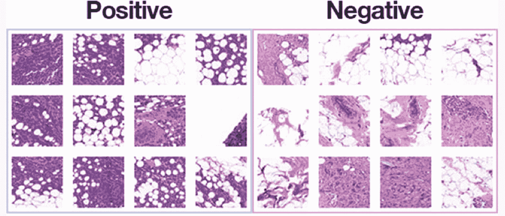

在主目录 `IDC_regular_ps50_idc5` 下有 837 个子目录。接下来，您需要将此目录重命名为 `dataset`，以使其与我稍后将讨论的配置脚本兼容。您可以使用 `cp` 命令或使用文件管理器工具进行此更改。我几乎总是使用文件管理器，因为它很方便。

图 8-2 是运行 `tree` 命令的结果，您可以看到 837 个子目录中的一小部分。


每个子目录都包含特定患者的正类和负类图像，其数字 ID 即为子目录的名称。在每个子目录中，还有两个名为 `0` 和 `1` 的子目录。`0` 目录包含未检测到任何癌细胞的图像。`1` 目录包含检测到癌细胞的图像。

本演示的最终目标是训练一个 CNN 模型来区分正类和负类图像，从而预测给定患者是否患有 IDC。

### 准备项目环境
在尝试任何项目脚本之前，第一步是设置一个 Python 虚拟环境。我在之前的演示中使用过这种环境类型，并将继续在本章的演示中使用。如果您需要复习，请参考第 1 章关于如何创建虚拟环境的内容。

必须安装五个依赖项以支持本章使用的脚本。如果您一直在复现前一章的演示，您可能已经安装了大部分（如果不是全部）依赖项。无论如何，您只需输入以下命令即可确保安装所需的依赖项：
```
pip install numpy opencv-contrib-python
pip install pillow
pip install tensorflow keras
pip install imutils
pip install scikit-learn matplotlib
```

如果您尚未安装 OpenCV，则在使用 `imutils` 包时会遇到问题。虽然本章的任何脚本都没有直接调用 OpenCV 函数，但 `imutils` 确实与此包存在一些嵌入式依赖关系。如果您需要安装 OpenCV 的指导，请参考第 2 章。

设置好虚拟环境后，您就可以开始处理第一个脚本了。

#### 配置脚本
以下脚本设置了适当的目录路径，并定义了用于训练和验证的数据量。此脚本名为 `config_IDC.py`，可从本书的配套网站获取：
```python
# 导入所需库
import os
# 初始化输入图像目录的路径。
ORIG_INPUT_DATASET = "dataset"
# 初始化包含训练和测试分割后剩余图像的目录的基本路径。
BASE_PATH = "datasets/idc"
# 定义训练、验证和测试目录路径。
TRAIN_PATH = os.path.sep.join([BASE_PATH, "training"])
VAL_PATH = os.path.sep.join([BASE_PATH, "validation"])
TEST_PATH = os.path.sep.join([BASE_PATH, "testing"])
# 定义将用于训练的数据分割比例。
TRAIN_SPLIT = 0.8
# 定义将用于验证的数据分割比例。
VAL_SPLIT = 0.1
# 向用户显示配置完成。
print('[INFO]: Configuration complete')
```

此配置脚本将在运行接下来要讨论的脚本时执行。

演示的下一步是构建数据集。

#### 构建数据集
构建数据集的部分工作是将原始数据集拆分为三个较小的数据集，如图 8-3 所示。

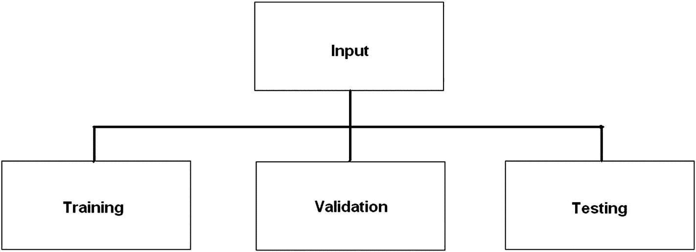

图 8-3

## 数据集拆分

你首先应该意识到的一点是，原始数据集的大小略超过 5.8 GB。对于我用来运行此演示的 4 GB RasPi 4 来说，这显然太大了。为了避免这个问题，将使用 Keras 的 `ImageDataGenerator` 类从拆分后的数据集中创建更小的批次，这样就无需将整个原始数据集加载到 RAM 中。但是，必须先对原始数据集进行拆分和重新组织。

此脚本名为 `build_IDC_dataset.py`，将用于组织原始数据集。该脚本使用配置常量，这些常量在脚本开头运行 `config_IDC` 脚本时设置。此脚本可从本书的配套网站获取。代码清单后附有一些解释性注释。

```
# 导入所需的库
from config_IDC import config_IDC
from imutils import paths
import random
import shutil
import os
# 获取原始输入目录中所有输入图像的路径并打乱它们。
imagePaths = list(paths.list_images(config_IDC.ORIG_INPUT_DATASET))
random.seed(42)
random.shuffle(imagePaths)
# 计算训练集和测试集的拆分比例。
i = int(len(imagePaths) * config_IDC.TRAIN_SPLIT)
trainPaths = imagePaths[:i]
testPaths = imagePaths[i:]
# 使用部分训练数据作为验证集。
i = int(len(trainPaths) * config.VAL_SPLIT)
valPaths = trainPaths[:i]
trainPaths = trainPaths[i:]
# 定义要构建的数据集。
datasets = [
("training", trainPaths, config.TRAIN_PATH),
("validation", valPaths, config.VAL_PATH),
("testing", testPaths, config.TEST_PATH)
]
# 遍历数据集。
for (dType, imagePaths, baseOutput) in datasets:
# 显示创建了哪个数据拆分
print("[INFO] building '{}' split".format(dType))
# 如果基础输出目录不存在，则创建它。
if not os.path.exists(baseOutput):
print("[INFO] 'creating {}' directory".format(baseOutput))
os.makedirs(baseOutput)
# 遍历输入图像路径。
for inputPath in imagePaths:
# 提取输入图像的文件名，并提取类别标签（"0" 表示 "阴性"，"1" 表示 "阳性"）。
filename = inputPath.split(os.path.sep)[-1]
label = filename[-5:-4]
# 构建标签目录的路径。
labelPath = os.path.sep.join([baseOutput, label])
# 如果标签输出目录不存在，则创建它。
if not os.path.exists(labelPath):
print("[INFO] 'creating {}' directory".format(labelPath))
os.makedirs(labelPath)
# 构建目标图像的路径，然后复制图像本身。
p = os.path.sep.join([labelPath, filename])
shutil.copy2(inputPath, p)
```

解释性注释：

配置设置和路径在脚本开头运行 `config_IDC` 脚本后收集。Python 的 `random` 库用于随机打乱路径。`shutil` 库用于复制图像，`os` 库用于连接路径和创建目录。

接下来，打乱所有数据集的 `imagePaths`，以提高随机性，从而获得更好的最终结果。然后计算训练/测试拆分的索引，并通过切片 `imagePaths` 来构建 `trainPaths` 和 `testPaths`。`trainPaths` 被进一步拆分，以保留一部分用于验证。

然后定义一个名为 `datasets` 的列表。该列表包含三个元组，每个元组都包含将所有 `imagePaths` 组织成训练、验证和测试数据所需的信息。

然后开始对所有数据集进行迭代。循环中执行以下步骤：

*   创建一个基础输出目录（仅一次）。

*   在当前拆分中，对所有输入图像进行嵌套循环，其中：

    *   从输入路径中提取文件名，并从文件名中提取类别标签。

*   构建 `labelPath`，并创建一个标签输出目录（仅一次）。

*   将每个文件复制到其目标目录。

### 运行构建数据集脚本

通过输入以下命令来运行 `build_IDC_dataset.py` 脚本：

```
python build_IDC_dataset.py
```

图 8-4 显示了运行脚本的结果。

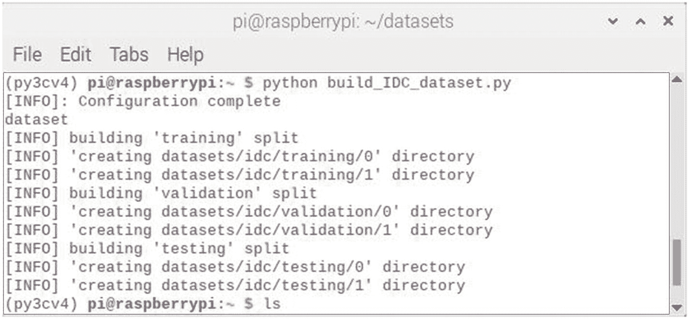

图 8-4

运行 `build_IDC_dataset` 脚本后的结果

接下来，我在新构建的 `datasets` 目录上运行了 `tree` 命令，以确认所需的数据集已按预期构建完成。图 8-5 显示了运行 `tree` 命令的结果。

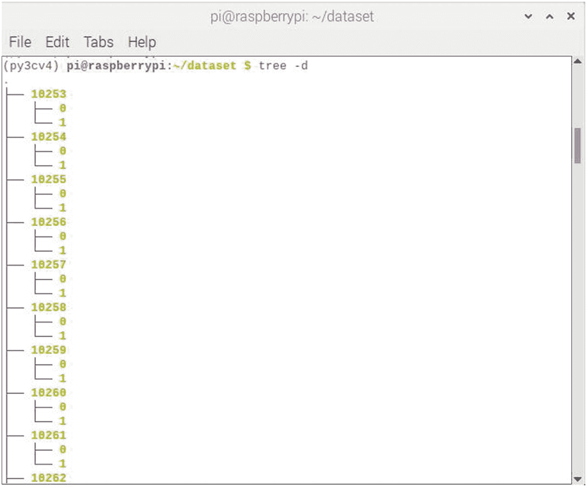

图 8-5

对 `datasets` 目录应用 `tree` 命令

现在，数据集已经设置好，是时候讨论 CNN 模型了。

### CNN 模型

本演示中使用的模型主要基于上一章讨论过的 VGGNet 风格模型。该模型包含多个堆叠的卷积层，这些卷积层使用了 VGG 模型典型的 3 x 3 滤波器。然而，此 VGG 模型使用的是深度可分离卷积层，而非标准卷积层。在此不深入细节，只需说明深度可分离卷积相比传统卷积，计算效率更高。

这个 CNN 模型被命名为 `CancerNet`，鉴于其根据患者的组织学研究来预测患者是否患有该疾病，这个名字似乎很贴切。图 8-6 展示了 `CancerNet` 的结构。

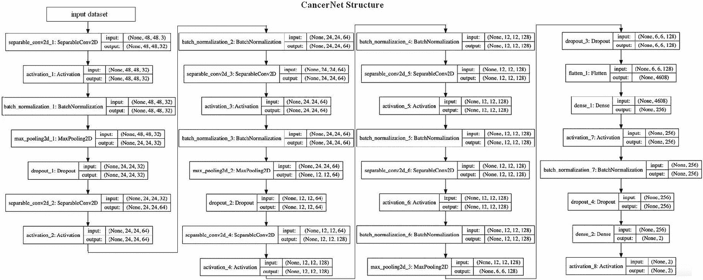

图 8-6

`CancerNet` 结构

从该图可以明显看出，这个 CNN 网络非常复杂，包含许多层。这个 CNN 确实是深度网络的经典代表。图中显示了 31 层，您可以通过统计以下类定义中添加到模型的层数来确认。

以下类定义文件名为 `cancernet.py`，可从本书的配套网站获取：

```
# 导入所需库
from keras.models import Sequential
from keras.layers.normalization import BatchNormalization
from keras.layers.convolutional import SeparableConv2D
from keras.layers.convolutional import MaxPooling2D
from keras.layers.core import Activation
from keras.layers.core import Flatten
from keras.layers.core import Dropout
from keras.layers.core import Dense
from keras import backend as K
class CancerNet:
@staticmethod
def build(width, height, depth, classes):
# 初始化模型以及输入形状为
# "channels last" 和通道维度本身
model = Sequential()
inputShape = (height, width, depth)
chanDim = -1
# 如果使用 "channels first"，则更新输入形状
# 和通道维度。
if K.image_data_format() == "channels_first":
inputShape = (depth, height, width)
chanDim = 1
# CONV => RELU => POOL
model.add(SeparableConv2D(32, (3, 3), padding="same",
input_shape=inputShape))
model.add(Activation("relu"))
model.add(BatchNormalization(axis=chanDim))
model.add(MaxPooling2D(pool_size=(2, 2)))
model.add(Dropout(0.25))
# (CONV => RELU => POOL) * 2
model.add(SeparableConv2D(64, (3, 3), padding="same"))
model.add(Activation("relu"))
model.add(BatchNormalization(axis=chanDim))
model.add(SeparableConv2D(64, (3, 3), padding="same"))
model.add(Activation("relu"))
model.add(BatchNormalization(axis=chanDim))
model.add(MaxPooling2D(pool_size=(2, 2)))
model.add(Dropout(0.25))
# (CONV => RELU => POOL) * 3
model.add(SeparableConv2D(128, (3, 3), padding="same"))
model.add(Activation("relu"))
model.add(BatchNormalization(axis=chanDim))
model.add(SeparableConv2D(128, (3, 3), padding="same"))
model.add(Activation("relu"))
model.add(BatchNormalization(axis=chanDim))
model.add(SeparableConv2D(128, (3, 3), padding="same"))
model.add(Activation("relu"))
model.add(BatchNormalization(axis=chanDim))
model.add(MaxPooling2D(pool_size=(2, 2)))
model.add(Dropout(0.25))
# 第一组（也是唯一一组）FC => RELU 层
model.add(Flatten())
model.add(Dense(256))
model.add(Activation("relu"))
model.add(BatchNormalization())
model.add(Dropout(0.5))
# Softmax 分类器
model.add(Dense(classes))
model.add(Activation("softmax"))
# 返回构建好的网络架构
return model
```

该模型结构是顺序的，这意味着各层以串行方式添加。此模型中使用的层类型，除了实现前述深度可分离卷积的 `SeparableConv2D` 层之外，大部分都在第 7 章的 CNN 模型中使用过。

模型中定义了三个 `DEPTHWISE_CONV => RELU => POOL` 块，并增加了堆叠层数和滤波器数量。同时还添加了 `BatchNormalization` 和 `Dropout` 层。

网络最后由 `FC => RELU` 层和 softmax 分类器完成。softmax 分类器的输出将为每个预测类别生成预测百分比。

该模型被构建为一个可调用的方法，这意味着实例化后的模型将被返回给训练脚本。

#### 训练与测试脚本

训练脚本是关键部分，它最终将整个项目整合在一起。该脚本名为 `train_IDC_model.py`，不仅用于训练模型，还用于测试其预测准确性。此脚本可从本书的配套网站获取。以下是代码清单后的解释性注释。

# 设置 matplotlib 后端，以便将图形保存到后台

```python
import matplotlib
matplotlib.use("Agg")
from keras.preprocessing.image import ImageDataGenerator
from keras.callbacks import LearningRateScheduler
from keras.optimizers import Adagrad
from keras.utils import np_utils
from sklearn.metrics import classification_report
from sklearn.metrics import confusion_matrix
from cancernet import CancerNet
import config_IDC as config
from imutils import paths
import matplotlib.pyplot as plt
import numpy as np
import argparse
import os

# 构建参数解析器并解析参数。
ap = argparse.ArgumentParser()
ap.add_argument("-p", "--plot", type=str, default="plot.png",
                help="输出损失/准确率图的路径")
args = vars(ap.parse_args())

# 初始化训练轮数、初始学习率和批次大小。
NUM_EPOCHS = 40
INIT_LR = 1e-2
BS = 32

# 确定训练、验证和测试目录中的图像路径总数。
trainPaths = list(paths.list_images(config.TRAIN_PATH))
totalTrain = len(trainPaths)
totalVal = len(list(paths.list_images(config.VAL_PATH)))
totalTest = len(list(paths.list_images(config.TEST_PATH)))

# 处理标签数据中的偏斜
trainLabels = [int(p.split(os.path.sep)[-2]) for p in trainPaths]
trainLabels = np_utils.to_categorical(trainLabels)
classTotals = trainLabels.sum(axis=0)
classWeight = classTotals.max() / classTotals

# 初始化训练数据增强对象
trainAug = ImageDataGenerator(
    rescale=1 / 255.0,
    rotation_range=20,
    zoom_range=0.05,
    width_shift_range=0.1,
    height_shift_range=0.1,
    shear_range=0.05,
    horizontal_flip=True,
    vertical_flip=True,
    fill_mode="nearest")

# 初始化验证（和测试）数据增强对象。
valAug = ImageDataGenerator(rescale=1 / 255.0)

# 初始化训练生成器。
trainGen = trainAug.flow_from_directory(
    config.TRAIN_PATH,
    class_mode="categorical",
    target_size=(48, 48),
    color_mode="rgb",
    shuffle=True,
    batch_size=BS)

# 初始化验证生成器。
valGen = valAug.flow_from_directory(
    config.VAL_PATH,
    class_mode="categorical",
    target_size=(48, 48),
    color_mode="rgb",
    shuffle=False,
    batch_size=BS)

# 初始化测试生成器。
testGen = valAug.flow_from_directory(
    config.TEST_PATH,
    class_mode="categorical",
    target_size=(48, 48),
    color_mode="rgb",
    shuffle=False,
    batch_size=BS)

# 初始化 CancerNet 模型并编译它。
model = CancerNet.build(width=48, height=48, depth=3, classes=2)
opt = Adagrad(lr=INIT_LR, decay=INIT_LR / NUM_EPOCHS)
model.compile(loss="binary_crossentropy", optimizer=opt, metrics=["accuracy"])

# 拟合模型。
H = model.fit_generator(
    trainGen,
    steps_per_epoch=totalTrain // BS,
    validation_data=valGen,
    validation_steps=totalVal // BS,
    class_weight=classWeight,
    epochs=NUM_EPOCHS)

# 重置测试生成器，然后使用训练好的模型对数据进行预测。
print("[INFO] 正在评估网络...")
testGen.reset()
predIdxs = model.predict_generator(testGen,
                                   steps=(totalTest // BS) + 1)

# 对于测试集中的每张图像，找到对应最大预测概率的标签索引。
predIdxs = np.argmax(predIdxs, axis=1)

# 显示格式良好的分类报告。
print(classification_report(testGen.classes, predIdxs,
                            target_names=testGen.class_indices.keys()))

# 计算混淆矩阵，并据此推导出原始准确率、敏感度和特异度。
cm = confusion_matrix(testGen.classes, predIdxs)
total = sum(sum(cm))
acc = (cm[0, 0] + cm[1, 1]) / total
sensitivity = cm[0, 0] / (cm[0, 0] + cm[0, 1])
specificity = cm[1, 1] / (cm[1, 0] + cm[1, 1])

# 显示混淆矩阵、准确率、敏感度和特异度。
print(cm)
print("acc: {:.4f}".format(acc))
print("sensitivity: {:.4f}".format(sensitivity))
print("specificity: {:.4f}".format(specificity))

# 绘制训练损失和准确率图。
N = NUM_EPOCHS
plt.style.use("ggplot")
plt.figure()
plt.plot(np.arange(0, N), H.history["loss"], label="train_loss")
plt.plot(np.arange(0, N), H.history["val_loss"], label="val_loss")
plt.plot(np.arange(0, N), H.history["acc"], label="train_acc")
plt.plot(np.arange(0, N), H.history["val_acc"], label="val_acc")
plt.title("数据集上的训练损失和准确率")
plt.xlabel("轮次 #")
plt.ylabel("损失/准确率")
plt.legend(loc="lower left")
plt.savefig(args["plot"])
```

该脚本使用了以下库，并附有简要说明：

1.  **Matplotlib** – 这是科学绘图包，是 Python 的事实标准。该库设置为使用“Agg”后端，以便将训练图保存到磁盘。

2.  **Keras** – 使用 Keras 的 `ImageDataGenerator`、`LearningRateScheduler`、`Adagrad` 优化器和 `np_utils`。

3.  **sklearn** – 使用 scikit-learn 实现的 `classification_report` 和 `confusion_matrix`。

4.  **config_IDC** – 使用此脚本配置来获取三个数据分区的路径。

5.  **cancernet** – 训练和评估所需的 `CancerNet` 类定义。

6.  **imutils** – 使用 `paths` 模块获取每张图像的路径。

7. `numpy` – 用于 Python 中的数值处理。

8. `argparse` – 用于解析命令行参数。

9. `os` – 用于访问操作系统级别的命令。

该脚本有一个可选的命令行参数 `--plot`。如果在运行时在终端中提供了此参数，脚本将使用该名称将图保存到磁盘。如果未指定带有绘图文件名的命令行参数，则将使用默认名称 `plot.png`。

训练轮数、初始学习率和批次大小在解析器代码之后定义。

在这些定义之后，确定训练、验证和测试目录中的图像路径总数。

然后为训练数据计算 `classWeight` 参数，以处理类别不平衡/偏斜。当训练数据集中数据元素的比例失衡时，就会发生类别不平衡。正如我在本章开头提到的，本项目就是这种情况。良性样本图像的数量是恶性样本图像的两倍多。类别不平衡会给模型带来两个问题：

*   对于不平衡的类别，永远无法获得优化的结果，因为模型从未得到充分训练。

*   由于类别之间的错误表示，验证变得困难，其中一个或多个类别严重代表性不足。

Keras 的 `fit` 函数使用 `classWeight` 参数来帮助纠正数据集的不平衡。我不确定该函数内部是如何实现的。

接下来的代码部分涉及数据增强，这是一种正则化形式。正则化对于几乎所有深度学习实验都至关重要，有助于模型的泛化。该函数在将训练数据集传入网络进行训练之前，会对其进行扰动，略微修改其内容。这种方法在一定程度上减少了对收集额外训练数据的需求。

首先初始化数据增强对象 `trainAug`。然后在应用于训练数据集时，对其应用随机旋转、平移、剪切和翻转。`trainAug` 对象还将图像像素强度重新缩放到 0 到 1 的范围。

接下来，初始化训练、验证和测试生成器。每个生成器按需提供图像批次，如 `batch_size` 参数所指定。

然后使用 `Adagrad` 优化器初始化模型。回想一下，我在前一章中提到过 Keras 中可用的各种优化器。`Adagrad` 优化器是一种基于梯度的优化算法，它使学习率（`lr`）适应参数，对与频繁出现的特征相关的参数执行较小的更新（即低学习率），对与不频繁特征相关的参数执行较大的更新（即高学习率）。因此，它非常适合处理稀疏数据，而本训练数据集（至少对于一个类别而言）正是这种情况。`Adagrad` 优化器在其操作中同时使用初始学习率和衰减学习率。

然后使用 `binary_crossentropy` 损失函数编译模型，因为只有两个数据类别。

Keras 的 `fit_generator` 方法启动训练过程。通过使用此方法，训练图像数据可以驻留在磁盘上，并以批次方式应用，而不是在整个训练过程中将整个数据集保存在 RAM 中。这是树莓派系统处理如此庞大训练数据集的唯一可行方法。

训练完成后，对所有测试数据进行预测。在预测过程中再次使用生成器对象。

收集每个样本的最高预测索引，然后显示 `classification_report`。

然后生成混淆矩阵。该矩阵显示模型准确率、敏感度和特异度。

最后，生成包含训练/验证损失和训练/验证准确率的训练历史图。这些是时间序列图，用于检测过拟合/欠拟合。

## 运行训练与测试脚本

### 注意事项

此脚本计算量极大。经我测试，在 RasPi 4 系统上完成 1 个 epoch 就需要 2.7 小时。如果你选择像原博客那样运行 40 个 epoch，那么预计需要等待约 108 小时才能完成。那可是 4.5 天！另一种选择是将 epoch 数量减少到更易管理的数值，例如 8 个，但这仍然意味着你需要等待大约 21 小时才能完成。我估计，精度的损失最多仅在 0.5% 到 1.0% 的范围内，我认为这是为了节省近 4 天等待时间而可以接受的权衡。运行这个演示让我确信了 GPU 加速处理的价值。

我在 RasPi 4 系统（4 GB 内存）上运行了 `train_IDC_model` 脚本，使用了默认配置值，仅将 epoch 数量设置为 8。我不确定这个脚本及其训练集是否能在标准的 RasPi 3 系统上运行。

通过输入以下命令来运行脚本：

```
python train_IDC_model.py
```

图 8-7 显示了脚本开始运行时的结果。

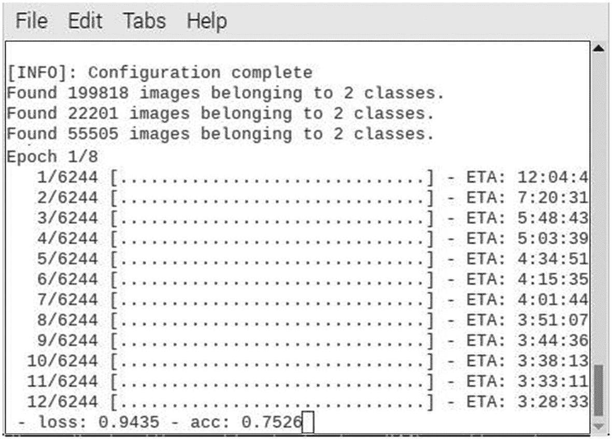

图 8-7

脚本开始运行

21.5 小时后，脚本运行结束，最终结果如图 8-8 所示。

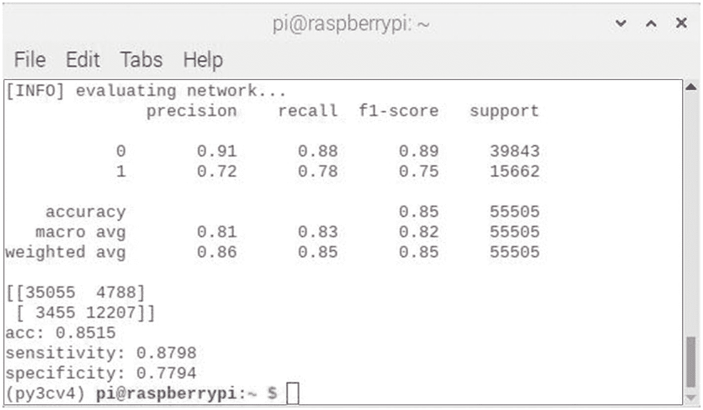

图 8-8

运行 `train_IDC_model` 脚本后的结果

图中显示的混淆矩阵（误差矩阵）在表 8-1 中复现。如果你需要复习混淆矩阵的相关知识，请参考第 1 章的讨论。

表 8-1

CNN 混淆矩阵

|   | 预测值 |

| --- | --- |

| **实际值** | 0 | 1 |

| 0 | 35055 (TN) | 4788 (FP) |

| 1 | 3455 (FN) | 12207 (TP) |

其中

0 = 未检测到癌细胞（阴性）

1 = 检测到癌细胞（阳性）

有关 TN、FN、TP 和 FP 的定义，请参见以下数据。

图 8-9 包含了训练损失和准确率的时间变化图。这些图只是每个 epoch 完成后的中间结果。

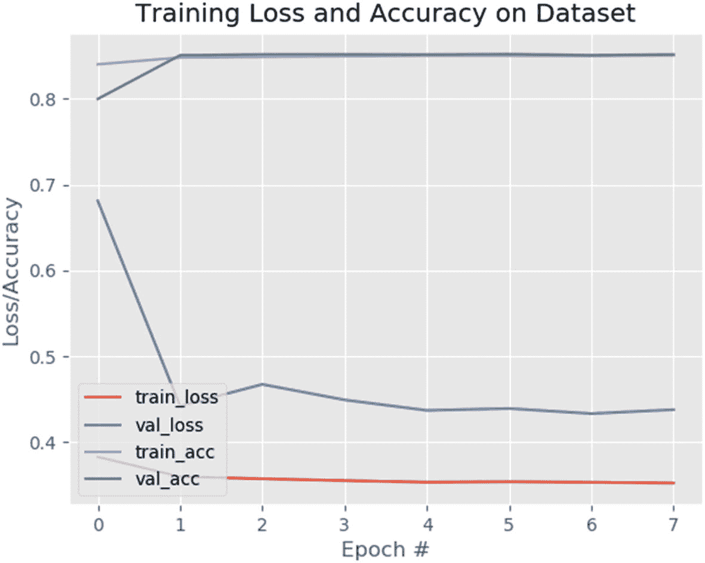

图 8-9

训练损失和准确率的时间变化图

在这些图中需要注意几点。首先，训练和验证的准确率图在第一个 epoch 完成后趋于一致，并在所有后续 epoch 中保持同步。这表明 CNN 模型几乎没有出现过拟合或欠拟合。该模型似乎与这个数据集拟合得非常好。其次要注意的是，在第二个 epoch 完成后，准确率图看起来是水平的，这证实了我的假设：8 个 epoch 足以产生可靠的结果。同时观察损失图，可以看到它们已经稳定在某个值附近，随着 epoch 增加仅有微小变化，这证实了最终结果的稳定性。

## 通过讨论敏感性、特异性和 AUROC 曲线来评估结果

观察该图，你可以看到模型达到了 85.15% 的准确率；然而，这个准确率值在很大程度上受到“无癌症”类别以 91% 的比率被正确分类这一事实的影响。

计算结果的敏感性和特异性也有助于更好地理解模型的性能。在开始讨论这些指标之前，我需要定义一些术语并提供一些公式作为背景。假设在接下来的讨论中，提到的模型用于预测患者是否患有某种疾病。阳性结果表示存在疾病，阴性结果表示没有疾病。

真正例 (TP) – 真正例是指模型正确预测出阳性类别的结果。

真负例 (TN) – 真负例是指模型正确预测出阴性类别的结果。

假正例 (FP) – 假正例是指模型错误地预测出阳性类别的结果。

假负例 (FN) – 假负例是指模型错误地预测出阴性类别的结果。

真正例率 (TPR)/敏感性/召回率公式：

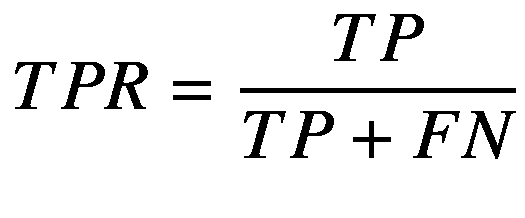

特异性公式：

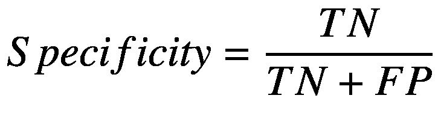

假正例率 (FPR) 公式：


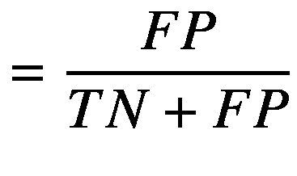

假负例率 (FNR) 公式：

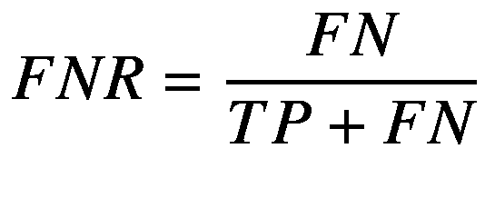

在演示模型中，敏感性衡量了实际为 TP 且被预测为阳性的比例，达到了 87.98%。相反，特异性衡量的 TN 率为 77.94%。务必小心处理假负例。你绝对不想在某人实际上是“癌症阳性”时，将其归类为“无癌症”。

假正例率也很重要，因为你不想错误地将患者归类为“癌症阳性”，然后让他们接受可能不必要且可能痛苦的广泛治疗。

任何 AI 从业者都必须注意敏感性和特异性之间的平衡，尤其是在涉及深度学习和医疗/健康治疗时。

### 什么是敏感性？

敏感性是衡量实际阳性案例中被预测为阳性（TP）的比例。敏感性的另一个名称是召回率，这意味着会有另一部分实际阳性案例被错误地预测为阴性，可称为 FN。这也以 FNR 的形式表示。敏感性与假负例率 (FNR) 之和始终为 1。当模型用于预测某人是否患有疾病时，这个概念可能更容易理解。敏感性衡量的是患有疾病的人中被正确预测为患有疾病的比例。换句话说，就是不健康的人实际上被预测为不健康。

理想情况下，模型应力求降低 FN，因为这可能危及生命。

较高的敏感性值意味着较高的`TP`值和较低的`FN`值。较低的敏感性值意味着较低的`TP`值和较高的`FN`值。出于医疗和财务原因，人们希望使用高敏感性的模型。

## 什么是特异性？

特异性定义为实际阴性案例中被预测为阴性（`TN`）的比例。这意味着会有另一部分实际阴性案例被预测为阳性，可称为`FP`。这个比例也称为`FPR`。特异性和`FPR`之和始终为 1。当模型用于预测某人是否患有疾病时，这个概念可能更容易理解。特异性衡量的是没有患病的人中被正确预测为没有患病的比例。换句话说，特异性就是健康的人实际上被预测为健康。

较高的特异性值意味着较高的`TN`值和较低的`FPR`。较低的特异性值意味着较低的`TN`值和较高的`FP`值。

## 敏感度与特异度有何区别？它们如何应用？

敏感度指标用于衡量实际阳性案例中被正确预测的比例。特异度指标则用于衡量实际阴性案例中被正确预测的比例。

敏感度和特异度指标可用于绘制受试者工作特征曲线下面积（`AUC-ROC`）。`AUC-ROC`（也称为`AUROC`）曲线是一种图形化展示，用于说明二分类系统在不同判别阈值下的诊断能力。`ROC`是一条概率曲线，而`AUC`代表类别可分性的程度或度量。它反映了模型区分不同类别的能力。`AUC`值越高，模型将 0 预测为 0、将 1 预测为 1 的能力就越强。类比而言，`AUC`值越高，模型区分患病患者与未患病患者的能力就越强。

`AUROC`曲线是通过在不同阈值设置下，以 y 轴为真正率（`TPR`）、x 轴为假正率（`FPR`）绘制而成的。`FPR`也称为误报率或虚警概率，可通过`1 − TPR`计算得出。因此，`AUROC`曲线本质上是敏感度随误报率变化的函数。图 8-10 展示了一条典型的`AUROC`曲线。

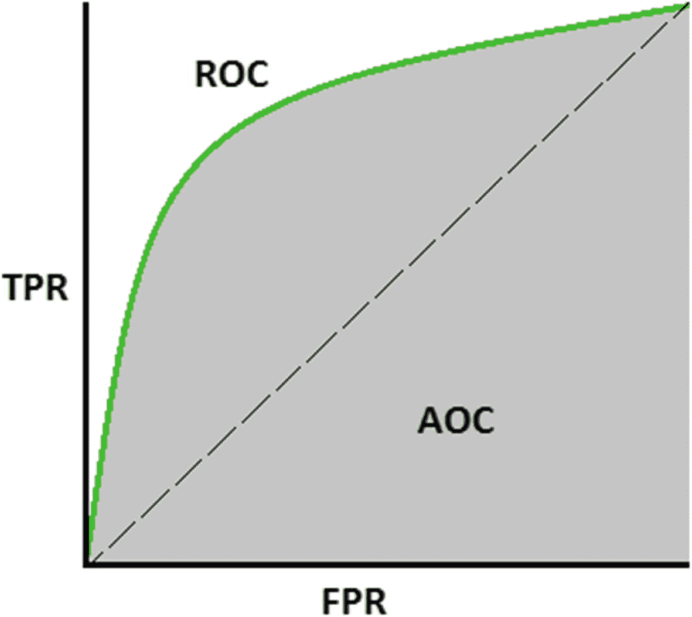

**图 8-10**

典型`AUROC`曲线

一个优秀的模型其`AUC`接近 1.0，这意味着它具有良好的类别预测分离能力。一个较差的模型其`AUC`接近 0，表示其类别可分性最差。实际上，这种情况是将 0 预测为 1、将 1 预测为 0。这种状况被称为类别反转。当`AUC`为 0.5 时，意味着模型完全无法区分不同类别。

接下来的系列图示将有助于阐明`AUROC`曲线如何用于解释模型性能。

如前所述，`ROC`是一条概率曲线，因此本讨论将使用概率分布图。假设图中右侧曲线代表正类（即患病患者），相应地，左侧曲线代表健康患者。图 8-11 展示了两个类别完全分离且`AUC`为 1.0 的情况。此时模型能够完全区分正类和负类样本。

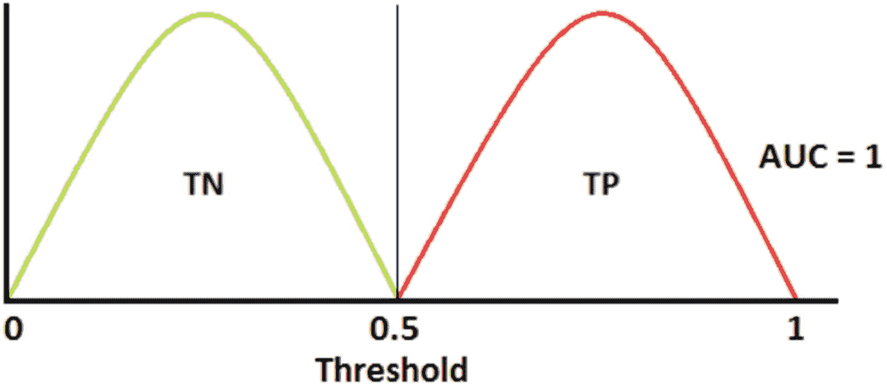

**图 8-11**

完美的类别分离

这种情况下的`AUROC`曲线如图 8-12 所示。

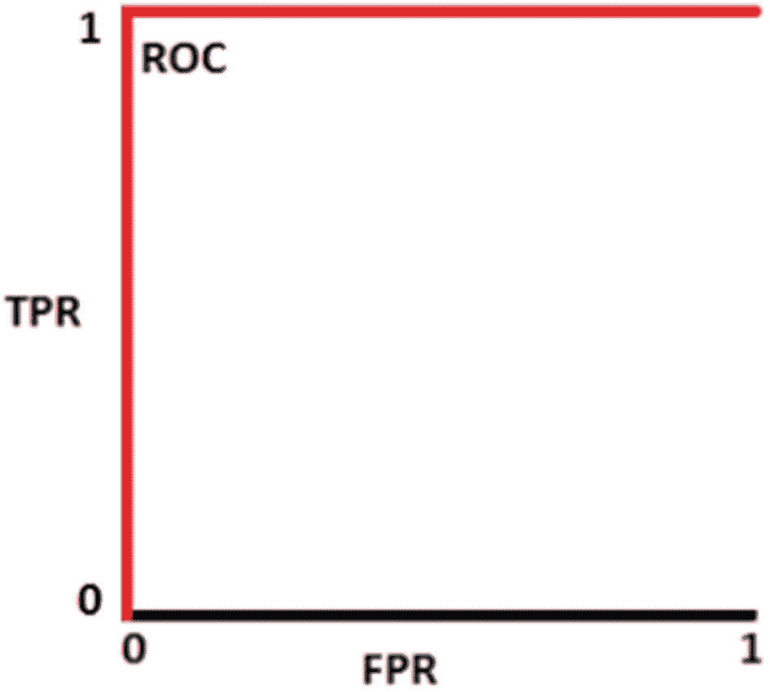

**图 8-12**

`AUC` = 1.0 时的`AUROC`曲线

现在，让我们稍微改变情况，假设概率分布有少量重叠。这引入了统计学家所称的第一类错误和第二类错误发生的可能性。第一类错误是假阳性（`FP`），即在此情境下，预测患者患病但实际上并未患病。类似地，第二类错误是假阴性（`FN`），即预测患者未患病但实际上已患病。图 8-13 展示了`AUC`等于 0.7 时的分布情况。

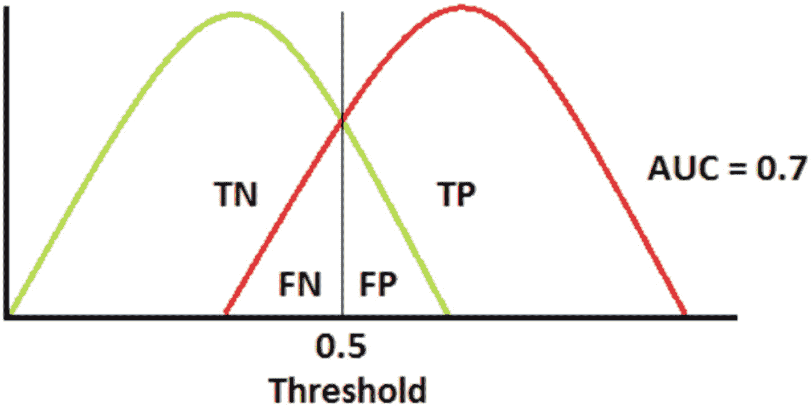

**图 8-13**

70%的类别分离度

`AUC`为 0.7 意味着模型有 70%的概率能够成功区分正类和负类。

这种情况下的`AUROC`曲线如图 8-14 所示。

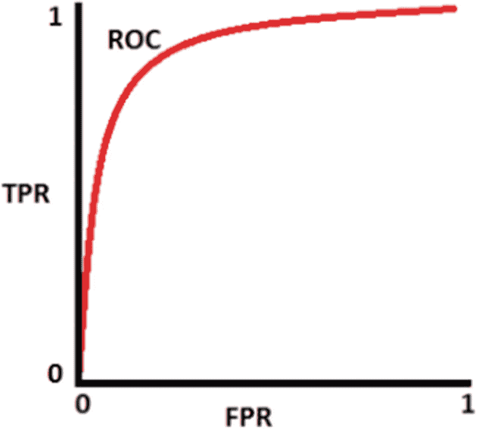

**图 8-14**

`AUC` = 0.7 时的`AUROC`曲线

现在，让情况变得更糟，将`AUC`设为 0.5。在此`AUC`值下，模型无法区分不同类别。图 8-15 展示了重叠的概率分布曲线，这证明了模型为何无效。

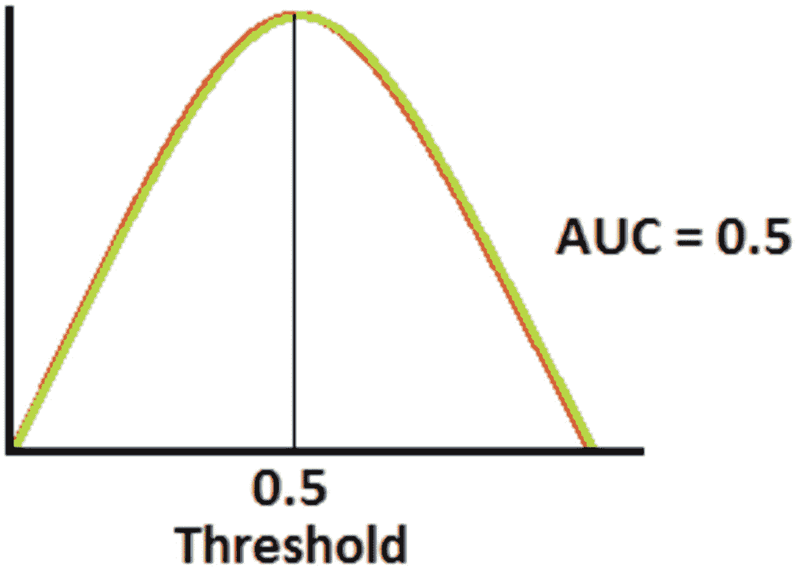

**图 8-15**

50%的类别分离度

这种情况下的`AUROC`曲线如图 8-16 所示。

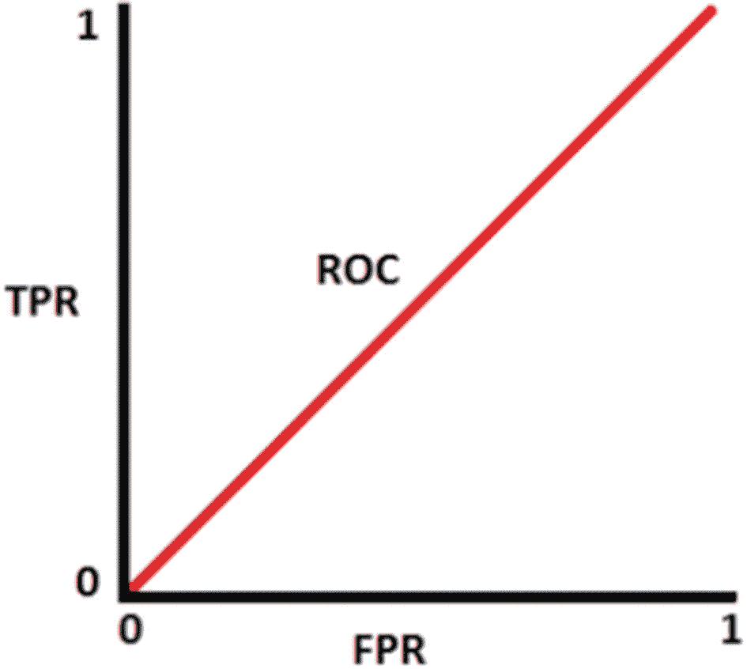

**图 8-16**

`AUC` = 0.5 时的`AUROC`曲线

最后一种情况发生在分布发生翻转时，如图 8-11 所示，但此时正类位于左侧，负类位于右侧。这就是我之前提到的反转情况，这种情况下的`AUROC`曲线如图 8-17 所示。

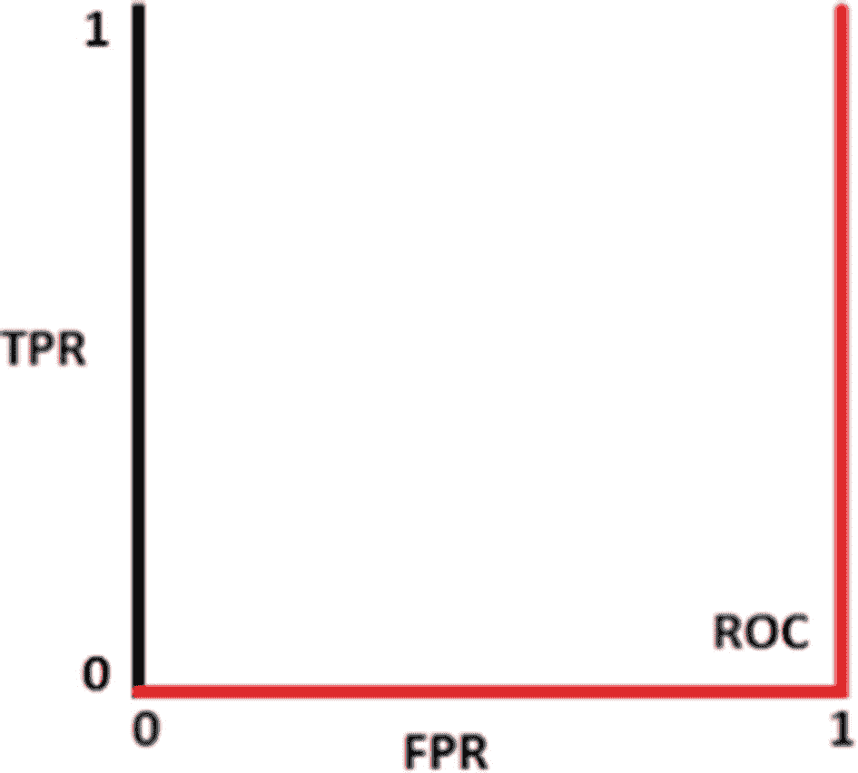

**图 8-17**

`AUC` = 0.0 时的`AUROC`曲线

反转是一种极端情况，在任何实际模型中都不应发生。此处展示仅是为了完善背景讨论。

我将在下一个演示中向您展示一条实际的`AUROC`曲线。

### 使用 MLP 模型进行乳腺癌预测

本演示使用了来自 699 名患者乳腺癌样本的组织学研究结果，根据记录的特征预测癌症的存在与否。此演示与本章中第一个使用 CNN 模型的演示有显著不同。在本例中，使用的是病理学家活检检查的结果，而不是像第一个演示那样直接处理原始图像。该模型是一个 MLP 应用，而非 CNN 应用。

数据集是`威斯康星州乳腺癌（诊断）数据集`特征，这些特征是根据乳腺肿块细针穿刺（`FNA`）的数字化图像计算得出的。数据描述了图像中存在的细胞核特征。该数据集由 K. P. Bennett 和 O. L. Mangasarian 在《鲁棒线性规划对两个线性不可分集的判别》（《优化方法与软件》1992 年第 1 期）中详细描述。

您可以从`UCI 机器学习库`下载输入数据集。

```
https://archive.ics.uci.edu/ml/datasets/Breast+Cancer+Wisconsin+%28Diagnostic%29
```

将下载的文件重命名为`data.csv`，并放置在一个名为`input`的新子目录中。

现在，您需要将第七列中的 16 个'`?`'条目替换为 1。我知道这可能会对数据集产生一些偏差，但如果不将这些字符替换为数字，脚本将无法运行。我选择的数字是该列中出现频率最高的数字。我使用 MS Excel 程序进行了更改，但您也可以使用`RasPi`系统上应已安装的`LibreOffice Calc`应用程序。

以下脚本名为`bcMLP.py`，可从本书配套网站获取。无需进一步的解释性注释，因为我在之前的脚本中已经向您展示过相同或几乎相同的代码。

# 导入所需的库

```python
import pandas as pd
import numpy as np
import matplotlib.pyplot as plt
import seaborn as sns
from sklearn.preprocessing import LabelEncoder
from sklearn.model_selection import train_test_split
from sklearn.preprocessing import StandardScaler
from sklearn.metrics import confusion_matrix
from sklearn.metrics import roc_curve, auc
from sklearn.ensemble import RandomForestClassifier
import keras
from keras.models import Sequential
from keras.layers import Dense, Dropout
# 加载数据
data = pd.read_csv('input/data.csv')
#del data['Unnamed: 32']
X = data.iloc[:, 1:9].values
y = data.iloc[:, 10].values
# 编码分类数据
labelencoder_X_1 = LabelEncoder()
y = labelencoder_X_1.fit_transform(y)
# 将数据集拆分为训练集和测试集
X_train, X_test, y_train, y_test = train_test_split(X, y, test_size = 0.1, random_state = 0)
#特征缩放
sc = StandardScaler()
X_train = sc.fit_transform(X_train)
X_test = sc.transform(X_test)
# 初始化人工神经网络
classifier = Sequential()
# 添加输入层和第一个隐藏层
classifier.add(Dense(output_dim=16, init="uniform", activation="relu", input_dim=8))
# 添加 Dropout 以防止过拟合
classifier.add(Dropout(p=0.1))
# 添加第二个隐藏层
classifier.add(Dense(output_dim=16, init="uniform", activation="relu"))
# 添加 Dropout 以防止过拟合
classifier.add(Dropout(p=0.1))
# 添加输出层
classifier.add(Dense(output_dim=1, init="uniform", activation="sigmoid"))
# 编译人工神经网络
classifier.compile(optimizer='adam', loss="binary_crossentropy", metrics=['accuracy'])
# 将人工神经网络拟合到训练集
# 批次大小和迭代次数通过试错法设定。
classifier.fit(X_train, y_train, batch_size=100, nb_epoch=150)
# 预测测试集结果
y_pred = classifier.predict(X_test)
y_pred = (y_pred > 0.5) # 将连续值转换为二值
# 创建混淆矩阵对象
cm = confusion_matrix(y_test, y_pred)
# 显示准确率
print('准确率为 {}%'.format(((cm[0][0] + cm[1][1])/70)*100))
# 显示混淆矩阵
print('\n 混淆矩阵\n',cm)
# 生成并显示 Seaborn 热力图
sns.heatmap(cm, annot=True)
plt.savefig('bcHeatmap.png')
plt.show()
# 实例化随机森林分类器
rf_clf = RandomForestClassifier(n_estimators=100)
rf_clf.fit(X_train, y_train)
# 计算概率分布
probas = rf_clf.predict_proba(X_test)# 绘图
plt.figure(dpi=150)
plt.hist(probas, bins=20)
plt.title('分类概率')
plt.xlabel('概率')
plt.ylabel('实例数量')
plt.xlim([0.5, 1.0])
plt.legend('01')
plt.show()
# 计算假正率和真正率
fpr, tpr, thresholds = roc_curve(y_test, probas[:,0], pos_label=0)
# 计算曲线下面积
roc_auc = auc(fpr, tpr)
# 绘制 AUROC 曲线
plt.figure(dpi=150)
plt.plot(fpr, tpr, lw=1, color="green", label=f'AUC = {roc_auc:.3f}')
plt.title('随机森林分类器的 ROC 曲线')
plt.xlabel('假正率')
plt.ylabel('真正率（召回率）')
plt.xlim([-0.05, 1.05])
plt.ylim([-0.05, 1.05])
plt.legend()
plt.show()
```

## 运行 MLP 脚本

通过输入以下命令来运行脚本：

```bash
python bcMLP.py
```

图 8-18 显示了运行脚本后的结果。

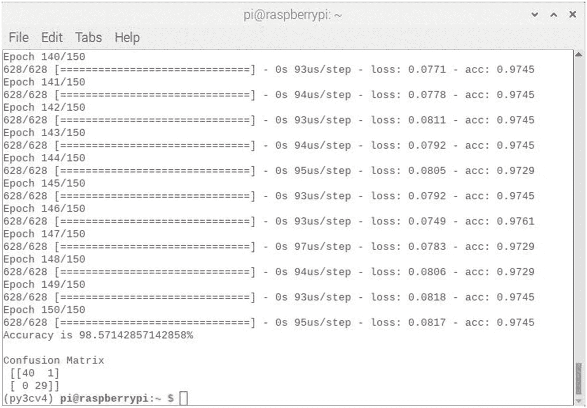

**图 8-18**

运行 `bcMLP` 脚本后的结果

图中显示的混淆矩阵在表 8-2 中复现。

**表 8-2**

MLP 混淆矩阵

|   | 预测值 |

| --- | --- |

| **实际值** | 0 | 1 |

| 0 | 40 | 1 |

| 1 | 0 | 29 |

其中

`0` = 未检测到癌症（阴性）

`1` = 检测到癌症（阳性）

从表中可以清楚地看到，该模型在预测未患癌症时准确率为 100%（0 个假正例），在预测患癌症时准确率为 98.57%（1 个假负例）。最后这个指标与脚本运行后显示的准确率值完全相同。当然，在癌症仍然存在的情况下报告患者无癌，其现实后果可能对患者造成毁灭性打击。因此，即使 1.43% 的错误率极低，但由于涉及患者安全的巨大后果，也必须谨慎看待。

顺便提一下，虽然大多数读者已经明白，但我还是要明确指出，混淆矩阵中显示的总数 70 是由于测试集大小采用了 10% 的分割比例。由于原始数据集中有 699 名患者，测试集大小四舍五入为 70。

图 8-19 是一个热力图，提供了另一种可视化混淆矩阵结果的方式。

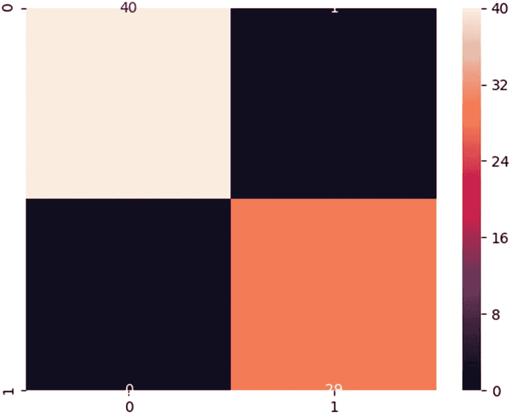

**图 8-19**

热力图

对于纸质书读者，我强烈建议查看包含本书所有彩色图片的 PDF 中图 8-19 的彩色图像版本。

### 生成 AUROC 图

为了生成 AUROC 图，必须首先创建概率分布。由于 MLP 模型无法直接提供概率分布，这就是我实例化一个名为 `rf_clf` 的随机森林分类器对象的原因。虽然底层模型不同，但由于数据集的特性，最终的 AUROC 图应该几乎相同。图 8-20 是正类（`1`）和负类（`0`）概率分布的条形图。

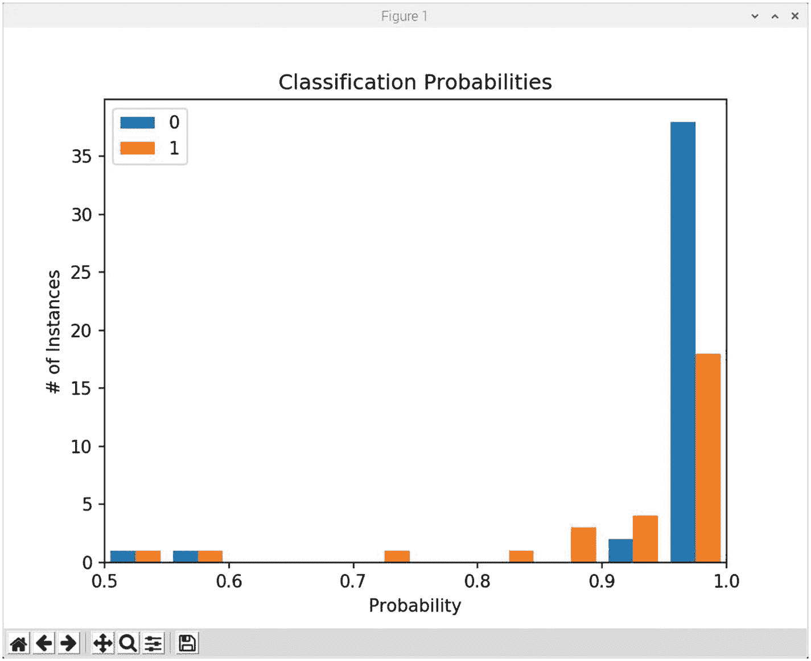

**图 8-20**

数据集类别概率分布

你可以清楚地看到，两个类别的分布都高度右偏，这将迫使 AUROC 图类似于图 8-12。正如你在图 8-21 中所见，这正是生成该图时发生的情况。

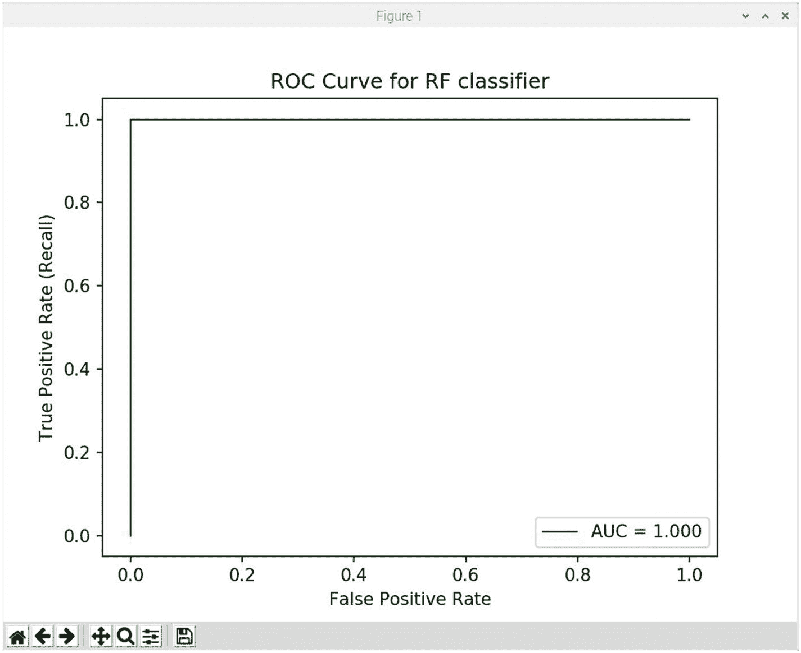

**图 8-21**

乳腺癌数据集的随机森林模型 AUROC 图

当你看到这样的图时，你的直接收获是，该分类器模型对于该特定数据集来说是一个性能出色的模型。这一结论得到了用于量化模型的其他性能指标的支持。