# 9. 强化学习

大多数读者可能都听说过人工智能自学玩电脑游戏的例子，其中最著名的当属 DeepMind。2016 年，DeepMind 团队因其 AlphaGo 程序击败韩国围棋世界冠军而登上国际新闻。同样，过去也有许多成功的尝试，旨在开发能够玩《*打砖块*》、《*乓*》和《*太空侵略者*》等雅达利游戏的软件智能体。

这些程序都遵循一种称为强化学习（RL）的机器学习范式。以下是一个关于 RL 工作原理的直观类比。

以 1978 年经典的雅达利游戏《*打砖块*》为例。游戏的目标是通过从屏幕底部反弹一个球，清除屏幕顶部的所有砖块。你控制屏幕底部的一个挡板来反弹球。每次击中砖块，砖块就会消失，分数增加，即获得奖励。图 9-1 展示了一系列《*打砖块*》的截图，说明了游戏的功能。

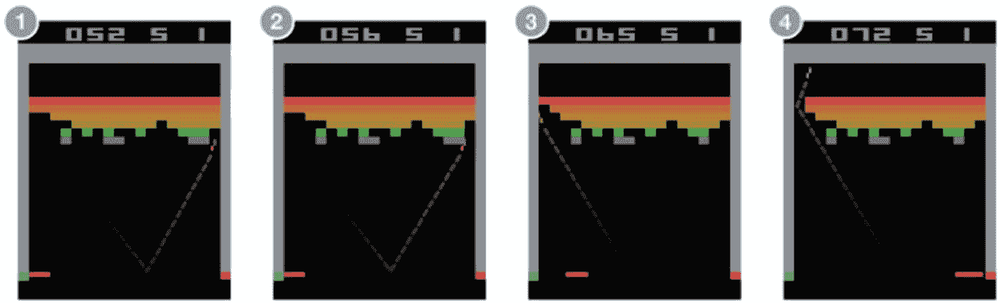

图 9-1 雅达利《打砖块》游戏截图

现在，让我们考虑如何教会一个人工神经网络（ANN）玩这个游戏。一种方法是输入一系列截图，并输出诸如“向右移动挡板”、“向左移动挡板”或“发射”（即发射球）等指令。从这个意义上说，学习过程变成了一个分类问题，即给定的屏幕图像预测应采取三种动作中的哪一种。这看起来很简单，但请考虑一下这将需要海量的训练样本。这种方法相当幼稚，因为不需要游戏专家重复成千上万次地指示“做这个”或“做那个”。我们需要的是某种反馈，表明所采取的动作是正确的或接近正确，并允许进行一些自我修正。

RL 试图解决这类问题。RL 既可以是监督学习，也可以是无监督学习。监督学习为每个训练样本提供一个目标标签，而无监督学习则没有标签。RL 拥有稀疏的“标签”，这些标签是时间延迟的，被称为奖励。软件智能体必须仅基于奖励来学习行为。

实际上，为《*打砖块*》游戏实现 RL 算法面临着诸多挑战。事实证明，所给予的奖励可能与奖励给出之前立即采取的动作关系不大。当球击中砖块时才会获得奖励，但挡板必须事先正确定位，并且发射按钮必须在适当的时间按下。即时奖励与所有必要的前置动作之间的脱节被称为信用分配问题，即哪个前置动作对奖励负责，以及负责到什么程度？

玩《*打砖块*》以及大多数其他游戏通常需要策略。玩家通常一开始会以随机方式玩游戏，但随着观察游戏的进展，他们会逐渐演变出自己的游戏策略。例如，在《*打砖块*》中，球往往更频繁地飞向左侧而非右侧。一个简单的策略——将挡板更多地移到左侧——通常能获得更多分数。但这可能不是提高分数的唯一方法。确定最优策略的一种方法被称为探索-利用困境，这是在试图获得最多奖励时需要考虑的一个有用框架。

RL 模型是封装我们人类学习经验的有效方式，无论是在学校、商业领域，甚至政府或军事环境中。信用分配和探索-利用困境每天都在我们的所有活动中出现。RL 是一个值得探索和实验的重要课题，而游戏则是一个完美的、无威胁的沙盒。

在完成以下所有演示后，我将进一步讨论 Q 学习与深度学习如何交叉。届时，你应该已经具备了良好的 Q 学习背景，能够欣赏并理解最后的讨论。

## 马尔可夫决策过程

马尔可夫决策过程（MDP）是 RL 的形式化表述。假设你是一个智能体，处于像《*打砖块*》游戏这样的环境中。环境处于某种状态（例如，挡板位置、球的位置和方向、砖块数量等）。智能体在此环境中执行某些动作，例如向左或向右移动挡板。动作有时会带来奖励。任何动作都会在一定程度上改变环境，并导致一个新状态。然后智能体可以执行另一个动作，导致另一个状态，依此类推。这些动作如何被选择的规则集称为策略。环境通常是随机的，这意味着下一个状态会有一定的随机性。对于《*打砖块*》游戏，这意味着每个新球都会以一个随机方向发射。

图 9-2 是描绘 MDP 数据流的示意图。

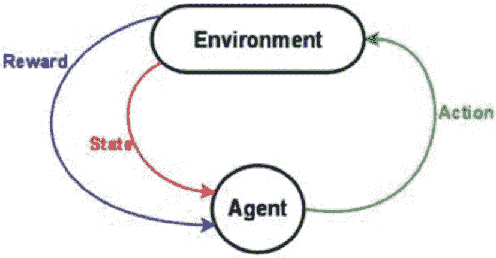

图 9-2 MDP 数据流

MDP 由状态、动作以及从一个状态转换到另一个状态的规则组成。此过程的一个回合（游戏）可以表示为状态、动作和奖励的有限序列：

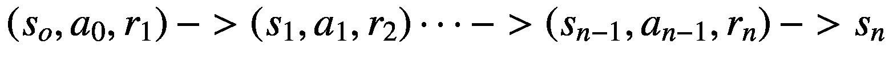

其中`s[i]` = 状态，`a[i]` = 动作，`r[i + 1]` = 执行动作`a[i]`后的奖励。该回合以终止状态`s[n]`结束。MDP 依赖于马尔可夫假设，即下一个状态`s[i + 1]`的概率仅取决于当前状态`s[i]`和动作`a[i]`，而不取决于之前的状态或动作。

### 折扣未来奖励

为了使 MDP 表现良好，必须同时考虑长期奖励和即时奖励。一个回合的总奖励可以表示为：

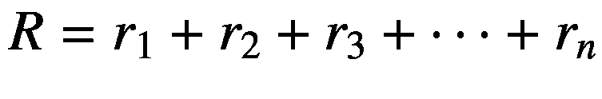

从时间点`t`开始的未来总奖励可以表示为：

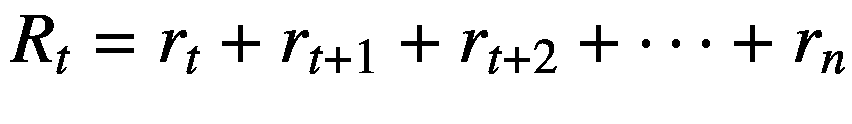

由于环境是随机的，下次执行相同动作时，无法确定性地获得相同的奖励。考虑的未来奖励越远，它们可能偏离得越多。为了考虑这种不确定性，通常使用折扣未来奖励，其表示为：

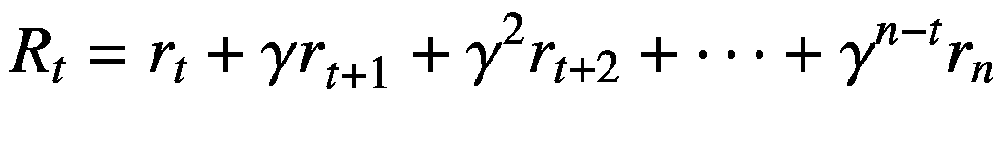

其中`γ` = 折扣因子（取值范围为 0 到 1.0）。由于折扣因子小于 1.0 且被乘方，所有未来奖励都会被大幅减少或折扣。时间步`t`的折扣未来奖励可以用时间步`t+1`的相同量来表示：

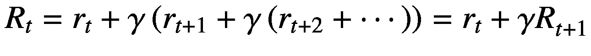

如果折扣因子`γ`设置为 0，那么策略将没有长期参与，仅依赖于即时奖励。即时奖励与未来奖励之间的平衡应设置一个折扣因子，例如`γ` = 0.9。如果环境几乎是确定性的，且相同动作总是产生相同奖励，那么折扣因子可以设置为 1.0。智能体的一个好策略是始终选择能最大化（折扣）未来奖励的动作。

### Q-learning

在 Q-learning 中，函数`Q(s[t], a[t])`被定义为：当在状态`s[t]`下执行动作`a[t]`并从此处开始持续最优操作时，所能获得的最大折现未来奖励。

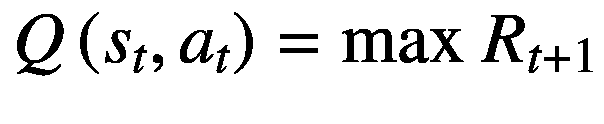

理解`Q(s[t], a[t])`的一种方式是将其视为“在状态`s[t]`下执行动作`a[t]`后，游戏结束时可能获得的最佳分数”。它被称为 Q 函数，因为它代表了在给定状态下某个动作的“质量”。

乍一看，Q 函数的定义似乎令人费解。游戏结束时的最终分数如何能估算出来？未来的状态和动作根本无从知晓。但假设存在这样一个函数，对于支持最大化未来可能奖励的假设至关重要。

接下来考虑拥有这样一个函数意味着什么。假设存在一个状态，有两种可能的动作。应该选择那个能带来游戏最高分数的动作。但是，应该选择哪个动作呢？一旦你有了 Q 函数，答案就变得简单了。只需选择具有最高 Q 值的动作。以下方程代表了这一策略：

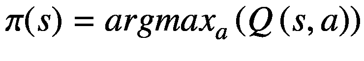

其中`π` = 策略（关于如何在给定状态下选择动作的规则）。现在的问题是，基于之前的讨论，Q 函数是如何定义的？我将首先只关注一个转移过程 `(s, a, r, s')`，其中`s'`代表`s`之后的下一个状态。状态`s`和动作`a`的 Q 值可以用下一个状态`s'`的 Q 值来表示，如下所示：


这个方程被称为`贝尔曼方程`。这是一个相当直观的概念：当前状态和动作的最大未来奖励等于即时奖励加上下一个状态的最大未来奖励。

`Q-learning`的核心概念是，可以使用`贝尔曼方程`迭代地逼近`Q`函数。在最简单的情况下，`Q`函数可以作为一个表格来实现，其中状态作为行，动作作为列。

`Q-learning`算法的流程图如图 9-3 所示。
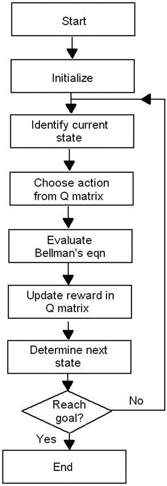
**图 9-3** `Q-learning`流程图

`Q-learning`算法首先从输入中识别当前状态 *s*。识别状态后，将从动作列表中选择一个动作，要么通过搜索最大奖励，要么（如果是随机策略）通过接受一个贪婪概率 *ε*。利用前几步初始化的所有值，使用`贝尔曼方程`计算在状态 *s* 下所采取动作的`Q`值。然后，该`Q`值将被存储在`Q`表中。换句话说，智能体的经验被捕获在`Q`表中。所提出的`Q-learning`的奖励和惩罚通过一组为奖励函数（策略）设定的简单规则进行评估。在执行选定的动作 *a* 后，将确定`Q-learning`算法的下一个状态 *s*′。当确定下一个状态 s′ 后，将检查`Q-learning`算法的停止条件。如果下一个状态 *s*′ 是`Q-learning`的最终目标，则过程结束；否则，下一个状态 *s*′ 将成为下一次迭代的当前状态 *s*。此过程持续进行，直到达到目标或满足停止条件。

以下是一个详细的示例，有助于阐明`Q-learning`过程。

#### `Q-learning` 示例

我首先要感谢几位博主，他们精彩的帖子启发了这个示例。他们也受到了其他致力于解释`Q-learning`复杂问题的人们的启发，以便AI社区能更好地理解这个主题。这些博客是：

“Reinforcement Learning: A Simple Python Example and a Step Closer to AI with Assisted QLearning”，作者 Manuel Amunategui

[`https://l-ing.ru/watch/Reinforcement-Learning--A-Simple-Python-Example-and-A-Step-Closer-to-AI-with-Assisted-QLearning/`](https://l-ing.ru/watch/Reinforcement-Learning--A-Simple-Python-Example-and-A-Step-Closer-to-AI-with-Assisted-QLearning/)

“Getting AI smarter with Qlearning: a simple first step in Python”，来自 *The Beginner Programmer*

[`http://firsttimeprogrammer.blogspot.com/2016/09/getting-ai-smarter-with-q-learning.html`](http://firsttimeprogrammer.blogspot.com/2016/09/getting-ai-smarter-with-q-learning.html)
[`http://mnemstudio.org/path-finding-q-learningtutorial.htm`](http://mnemstudio.org/path-finding-q-learningtutorial.htm)

本示例首先展示了一个包含五个房间的建筑平面图，如图 9-4 所示。
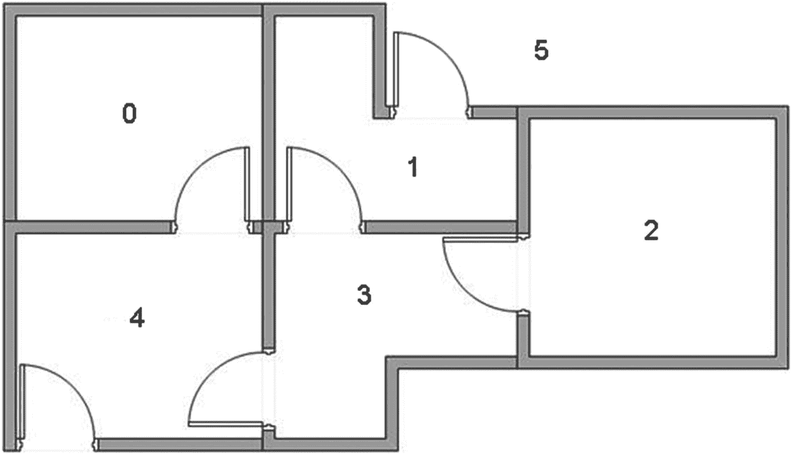
**图 9-4** 示例建筑平面图

建筑中的每个房间都有一扇门，机器人或智能体可以通过它双向移动。请注意图中，房间 1 和 4 的门通向室外，在本示例中，室外被描绘为“房间”5。然而，要实现的目标是让智能体进入房间 5，即室外。智能体可以从任意房间开始。每个门都会被分配一个奖励值，并且最终目标的奖励值将远大于那些不直接通向目标的门的奖励值。

图 9-5 是一个节点图，描绘了房间之间所有可能的路径，以及哪些是可能成功的路径。
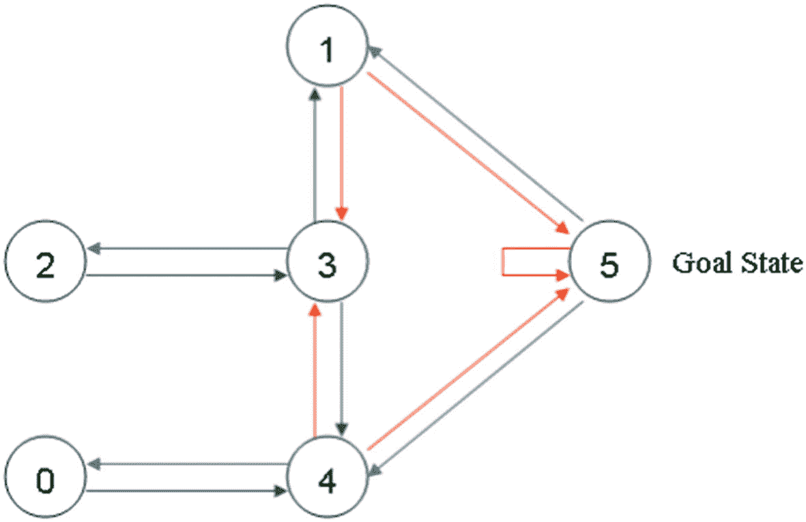
**图 9-5** 节点图

如前所述，智能体可以从任意房间开始，并从该房间走出建筑（即目标房间 5）。为了将此房间设为目标，每个门都关联了一个奖励值。直接通向目标的门有 100 的即时奖励。其他不直接连接目标房间的门奖励为 0。每个房间分配了两个箭头，因为门是双向的（0 通向 4，4 也通向 0）。每个箭头包含一个即时奖励值，如图 9-6 所示。
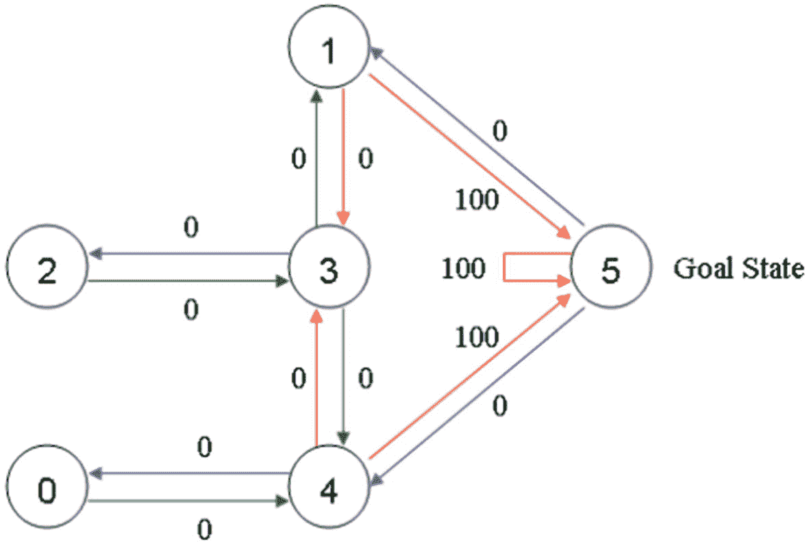
**图 9-6** 标注了奖励的节点图

请注意图中，房间 5 内有一条路径循环回到自身，奖励为 100，而所有其他通向目标房间的链接奖励也为 100。在`Q-learning`中，目标是达到具有最高奖励的状态，因此如果智能体到达目标，它应该永远停留在那里。这种目标类型被称为“吸收目标”。

将我们的智能体想象成一个可以通过经验学习的虚拟机器人。智能体可以从一个房间移动到另一个房间，但对环境一无所知，也不知道哪扇门的序列通向室外。

目标是确定智能体从建筑内任意房间到室外的路径。在接下来的讨论中，假设智能体从房间 2 开始，并试图到达建筑外部，即房间 5。图 9-7 很好地概括了这个初始环境。
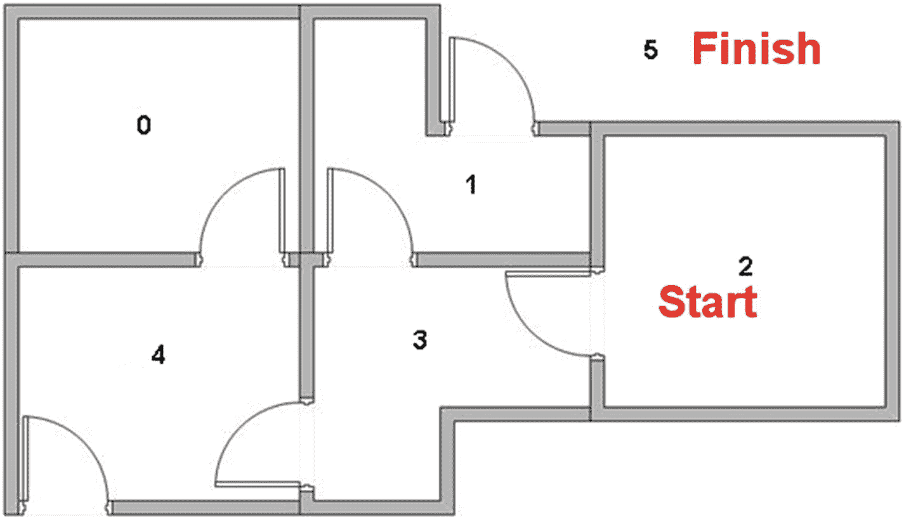
**图 9-7** 初始环境

在`Q`学习术语中，每个房间（包括外部）都是一个“状态”，而智能体从一个房间移动到另一个房间则是一个“动作”。因此，在上述节点图中，“状态”被描绘为一个节点，而“动作”则由箭头表示。

请参考图 9-8 进行以下讨论。

图 9-8 初始动作

如前所述，智能体从状态 2 开始。从状态 2 出发，它只能前往状态 3，因为状态 2 仅与状态 3 相连。从状态 3 出发，它可以前往状态 1 或 4，或者返回状态 2。如果智能体处于状态 4，则有三种可能的动作：前往状态 0、5 或 3。如果智能体处于状态 1，它可以前往状态 5 或 3。从状态 0 出发，它只能返回状态 4。

可以构建一个矩阵“R”（代表奖励）来捕捉状态图及即时奖励值。图 9-9 展示了这个矩阵。
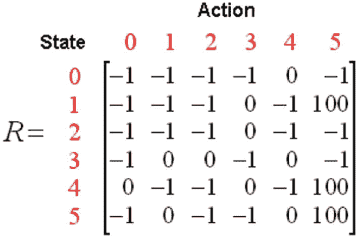
图 9-9 `R` 矩阵

表中的 -1 表示空值（即节点之间不存在连接）。例如，状态 0 无法前往状态 1。

现在，一个类似的矩阵“Q”被添加到智能体的大脑中。这个矩阵代表了智能体通过经验所学到的记忆。`Q`矩阵的行代表智能体的当前状态，列代表通往下一状态的可行动作，即节点之间的连接。

由于智能体初始时一无所知，`Q`矩阵被初始化为零。在本例中，状态数量为六，代表每个节点。如果状态数量未知，`Q`矩阵可以仅从一个元素开始。随着新状态的发现，向`Q`矩阵中添加更多列和行是一项简单的任务。

`Q`学习的转换规则是`贝尔曼方程`：

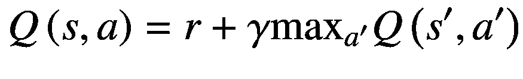

智能体将在没有教师的情况下，通过经验进行学习，这是其无监督学习体验的一部分。智能体从一个状态探索到另一个状态，直到达到目标。每次探索称为一个回合。每个回合包括智能体从初始状态移动到目标状态。每次智能体到达目标状态时，脚本进入下一个回合。

`Q`学习算法可总结如下：

1.  设置 *γ* 参数以及`R`矩阵中的环境奖励。
2.  将`Q`矩阵初始化为零。
3.  对于每个回合（循环）：
4.  选择一个随机的初始状态。
5.  如果尚未达到目标状态，则进行迭代（循环）：
    *   为当前状态选择所有可能的动作之一。
    *   利用这个可能的动作，考虑前往下一个状态。

# Q学习算法与手动计算实验

## 算法描述

基于所有可能的动作，获取这个下一状态的最大 Q 值。

计算：
$$Q\left(s,a\right)=r+\gamma {\mathit{\max}}_{a^{\prime }}Q\left({s}^{\prime },{a}^{\prime}\right)$$

将下一状态设置为当前状态。

## 一般性解释

上述算法被智能体用于从经验中学习。每个回合相当于一次训练会话。在每次训练会话中，智能体探索由 `R` 矩阵表示的环境，并接收奖励（如果有的话），直到达到目标状态。训练的目的是增强我们智能体的“大脑”，即由 `Q` 矩阵表示的部分。与人工神经网络（`ANN`）的情况类似，训练越多，得到的 `Q` 矩阵就越优化。

你应该意识到，用于更新 `Q(s, a)` 的函数 ${\mathit{\max}}_{a^{\prime }}Q\left({s}^{\prime },{a}^{\prime}\right)$ 只是一个近似值，并且在训练的早期阶段，它可能完全错误。然而，这个近似值会随着每个回合而改善，如果更新次数足够多，那么 `Q` 函数将会收敛并代表真实的 Q 值。

一旦 `Q` 矩阵得到增强，智能体将找到通往目标状态的最快路径。要使用增强后的 `Q` 矩阵，智能体只需追踪从初始状态到目标状态的状态序列。

以下是几个逐步手动计算的 Q 学习实验，希望能充分解释这一过程。

## 手动 Q 学习实验

为了理解 Q 学习算法的工作原理，我将逐步演示几个回合。

### 第一回合

第一个回合开始时，将学习参数 `γ` 的值设为 0.8，初始状态设为房间 1。`Q` 矩阵也初始化为全 0，如图 9-10 所示。

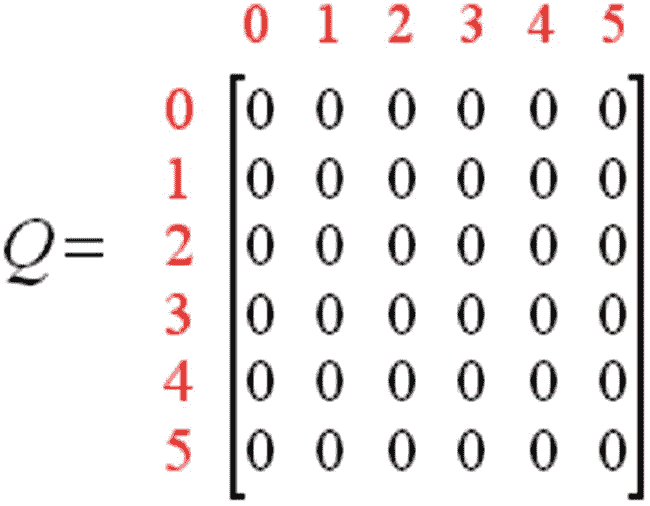

接下来检查图 9-9 中 `R` 矩阵的第二行（状态 1）。当前状态 1 有两个可能的动作：

*   前往状态 3。

*   前往状态 5。

现在，假设通过随机选择，选中了动作 5。

接下来，想象一下如果智能体处于状态 5 会发生什么。查看 `R` 矩阵的第六行。它有三个可能的动作：

*   前往状态 1。

*   前往状态 4。

*   前往状态 5。

应用贝尔曼方程得到：

$$Q\left(s,a\right)=r+\gamma {\mathit{\max}}_{a^{\prime }}Q\left({s}^{\prime },{a}^{\prime}\right)$$

$$Q\left(1,5\right)=R\left(1,5\right)+0.8\ast {\mathit{\max}}_{a^{\prime }}Q\left(Q\left(5,1\right),Q\left(5,4\right),Q\left(5,5\right)\right)$$

$$Q\left(1,5\right)=100+0.8\ast 0=100$$

由于 `Q` 矩阵仍初始化为零，`Q(5, 1)`、`Q(5, 4)`、`Q(5, 5)` 均为 0。`Q(1, 5)` 的计算结果为 100，这是因为来自 `R(1, 5)` 的即时奖励。

根据算法，下一个状态 5 现在成为当前状态。由于 5 是目标状态，该回合结束。智能体的大脑现在包含一个增强后的 `Q` 矩阵，如图 9-11 所示。

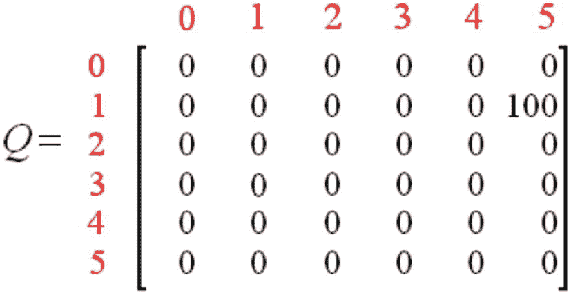

### 第二回合

下一个回合从一个随机选择的初始状态开始。假设状态 3 是初始状态。

查看 `R` 矩阵的第四行，可以看到有三个可能的动作：

*   前往状态 1。

*   前往状态 2。

*   前往状态 4。

假设通过随机过程选择了前往状态 1。接下来想象智能体处于状态 1。检查 `R` 矩阵中状态 1 的第二行。可以看到它有两个可能的动作：

*   前往状态 3。

*   前往状态 5。

现在必须使用贝尔曼方程计算 Q 值：

$$Q\left(s,a\right)=r+\gamma {\mathit{\max}}_{a^{\prime }}Q\left({s}^{\prime },{a}^{\prime}\right)$$

$$Q\left(1,5\right)=R\left(1,5\right)+0.8\ast {\mathit{\max}}_{a^{\prime }}Q\left(Q\left(1,2\right),Q\left(1,5\right)\right)$$

$$Q\left(1,5\right)=0+0.8\ast \mathit{\max}\left(0,100\right)=80$$

上一回合增强后的 `Q` 矩阵包含了 `Q(1, 3) = 0` 和 `Q(1, 5) = 100` 的结果。计算得到 `Q(3, 1) = 80`，因为奖励为零。`Q` 矩阵现在变为图 9-12 所示。

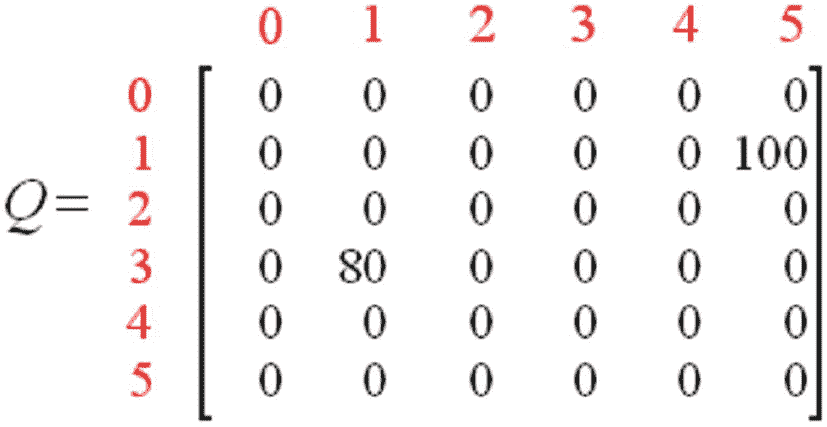

下一个状态 1 现在成为当前状态。由于状态 1 不是目标状态，Q 学习算法的内循环将重复执行。

因此，在从当前状态 1 开始新循环后，有两个可能的动作：

*   前往状态 3。

*   前往状态 5。

通过随机选择，假设选中的动作是 5。如图 9-13 所示。

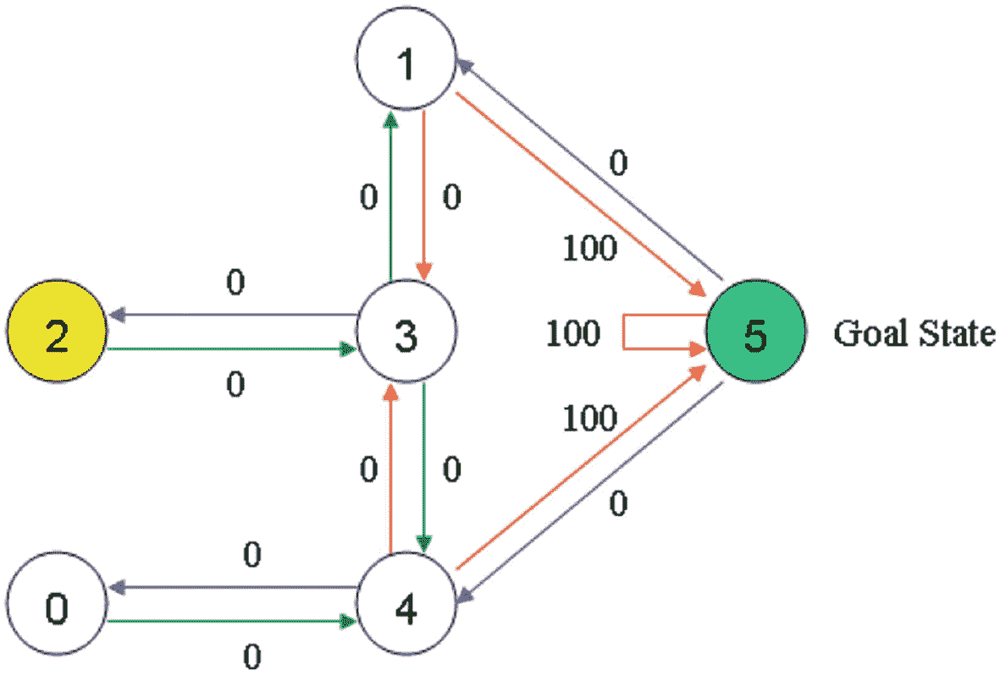

现在，想象智能体处于状态 5。有三个可能的动作：

*   前往状态 1。

*   前往状态 4。

*   前往状态 5。

使用这些可能动作中的最大值来计算 Q 值：

$$Q\left(s,a\right)=r+\gamma {\mathit{\max}}_{a^{\prime }}Q\left({s}^{\prime },{a}^{\prime}\right)$$

$$Q\left(1,5\right)=R\left(1,5\right)+0.8\ast {\mathit{\max}}_{a^{\prime }}Q\left(Q\left(5,1\right),Q\left(5,4\right),Q\left(5,5\right)\right)$$

$$Q\left(1,5\right)=100+0.8\ast 0=100$$

`Q` 矩阵中 `Q(5,1)`、`Q(5,4)`、`Q(5,5)` 的更新条目均为 0。`Q(1, 5)` 的计算结果为 100，这是因为来自 `R(5, 1)` 的即时奖励。此结果不会改变增强后的 `Q` 矩阵。

由于 5 是目标状态，该回合结束。我们智能体的大脑现在包含一个增强后的 `Q` 矩阵，如图 9-14 所示。

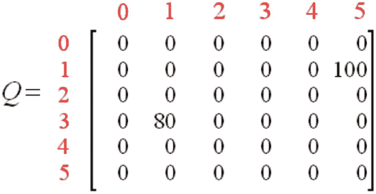

## 结果与归一化

智能体通过完成更多回合最终学到更多知识。它最终会达到 `Q` 矩阵中的收敛值，如图 9-15 所示。

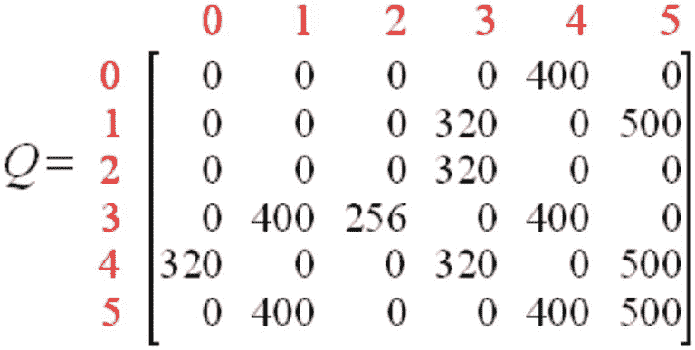

然后，可以通过将所有条目除以一个数来归一化 `Q` 矩阵，该数将使矩阵的最大值等于 100。在本例中，这个数是 5。归一化后的矩阵如图 9-16 所示。

## Q 学习示例

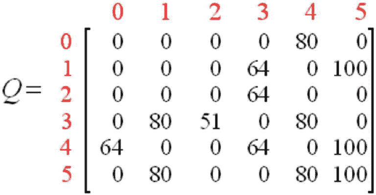

图 9-16 归一化后的 Q 矩阵

一旦 `Q` 矩阵收敛，智能体就学会了通往目标状态的最优路径。追踪最佳状态序列就像在每个状态跟随具有最高值的链接一样简单。如图 9-17 所示。

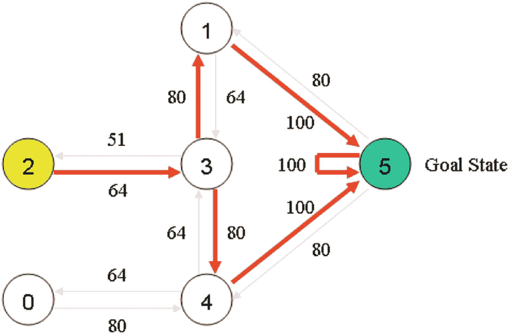

图 9-17 具有最终归一化链接值的节点图

例如，从初始状态 2 开始，智能体可以使用 `Q` 矩阵作为指南：

*   从状态 2 开始，最大 `Q` 值表明动作是前往状态 3。
*   从状态 3 开始，最大 `Q` 值表明有两个选择：
    *   前往状态 1。
    *   前往状态 4。
*   假设随机选择了前往状态 4 的动作，即前往状态 1。
*   从状态 1 开始，最大 `Q` 值表明动作是前往状态 5。
*   因此，基于 `Q` 学习的最优路径是 2 → 3 → 1 → 5。

## 使用 Python 脚本演示 Q 学习

### 注意

我强烈建议你在阅读本节之前先阅读（或重读）上一节。我不会在本节中重复逐步解释。理解这些解释将使本节内容更易于理解且更具趣味性。

在本演示中，我将使用 Python 脚本中的 Q-learning 来寻找两点之间的最短路径。该脚本对环境没有任何先验知识，仅通过强化学习进行学习。

图 9-18 是由脚本生成的随机点图。

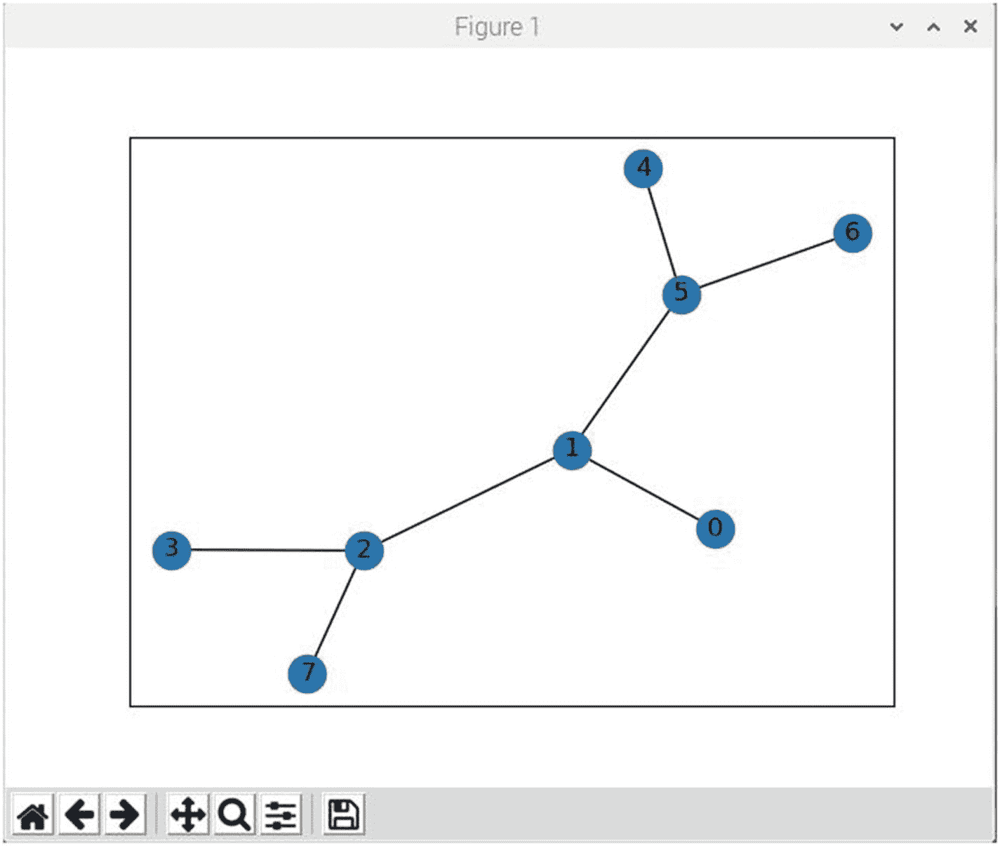

**图 9-18** 随机点图

点 0 为起始位置，点 7 为目标和终点位置。脚本的目标是使用强化学习算法确定起点与目标位置之间的最优路径。地图中存在明显的错误路径和虚假目标，这些都需要被评估并舍弃。

你需要加载一个额外的库来准备运行此脚本。输入以下命令以加载所需库：

```
pip install networkx
```

该脚本名为 `simpleRL.py`，可从本书的配套网站获取。此脚本没有额外的解释性注释，因为之前我已经通过多个逐步示例详细讲解了强化学习过程，相信你已具备足够的知识来理解这个相对简单的脚本是如何工作的。

```python
# 导入所需库
import numpy as np
import pylab as plt
import networkx as nx
# 映射单元格到单元格，为目标点添加循环单元格
points_list = [(0,1), (1,5), (5,6), (5,4), (1,2), (2,3), (2,7)]
# 设置目标节点
goal = 7
# 创建并显示图
G=nx.Graph()
G.add_edges_from(points_list)
pos = nx.spring_layout(G)
nx.draw_networkx_nodes(G,pos)
nx.draw_networkx_edges(G,pos)
nx.draw_networkx_labels(G,pos)
plt.show()
# 定义图中的点
MATRIX_SIZE = 8
# 创建矩阵 (MATRIX_SIZE * MATRIX_SIZE)
R = np.matrix(np.ones(shape=(MATRIX_SIZE, MATRIX_SIZE)))
R *= -1
# 为路径分配 0，为到达目标的点分配 100
for point in points_list:
    print(point)
    if point[1] == goal:
        R[point] = 100
    else:
        R[point] = 0
    if point[0] == goal:
        R[point[::-1]] = 100
    else:
        # 点的反向
        R[point[::-1]]= 0
# 添加目标点的自循环
R[goal,goal]= 100
# 创建 Q 矩阵
Q = np.matrix(np.zeros([MATRIX_SIZE,MATRIX_SIZE]))
# 设置学习参数 gamma
gamma = 0.8
# 设置初始起点
initial_state = 1
# 定义 available_actions 方法
def available_actions(state):
    current_state_row = R[state,]
    av_act = np.where(current_state_row >= 0)[1]
    return av_act
# 创建变量以保存可能的动作
available_act = available_actions(initial_state)
# 定义随机选择下一个动作的方法
def sample_next_action(available_actions_range):
    next_action = int(np.random.choice(available_act,1))
    return next_action
# 创建变量以保存随机选择的动作
action = sample_next_action(available_act)
# 定义在需要时更新状态的方法
def update(current_state, action, gamma):
    max_index = np.where(Q[action,] == np.max(Q[action,]))[1]
    if max_index.shape[0] > 1:
        max_index = int(np.random.choice(max_index, size = 1))
    else:
        max_index = int(max_index)
    max_value = Q[action, max_index]
    # 贝尔曼方程
    Q[current_state, action] = R[current_state, action] + gamma * max_value
    print('max_value', R[current_state, action] + gamma * max_value)
    if (np.max(Q) > 0):
        return(np.sum(Q/np.max(Q)*100))
    else:
        return (0)
# 基于所选动作更新状态
update(initial_state, action, gamma)
# 训练开始
scores = []
for i in range(700):
    current_state = np.random.randint(0, int(Q.shape[0]))
    available_act = available_actions(current_state)
    action = sample_next_action(available_act)
    score = update(current_state,action,gamma)
    scores.append(score)
    print ('Score:', str(score))
# 显示奖励矩阵
print('\nRewards matrix R\n')
print(R)
# 显示增强后的 Q 矩阵
print('\nEnhanced Q matrix\n')
print(Q/np.max(Q)*100)
# 测试开始
current_state = 0
steps = [current_state]
# 循环以确定最优路径
while current_state != 7:
    next_step_index = np.where(Q[current_state,] == np.max(Q[current_state,]))[1]
    if next_step_index.shape[0] > 1:
        next_step_index = int(np.random.choice(next_step_index, size = 1))
    else:
        next_step_index = int(next_step_index)
    steps.append(next_step_index)
    current_state = next_step_index
print("Most efficient path:")
print(steps)
plt.plot(scores)
plt.show()
```

### 运行脚本

通过输入以下命令来运行脚本：

```
python simpleRL.py
```

图 9-19 展示了收敛分数与已完成回合数的关系图。

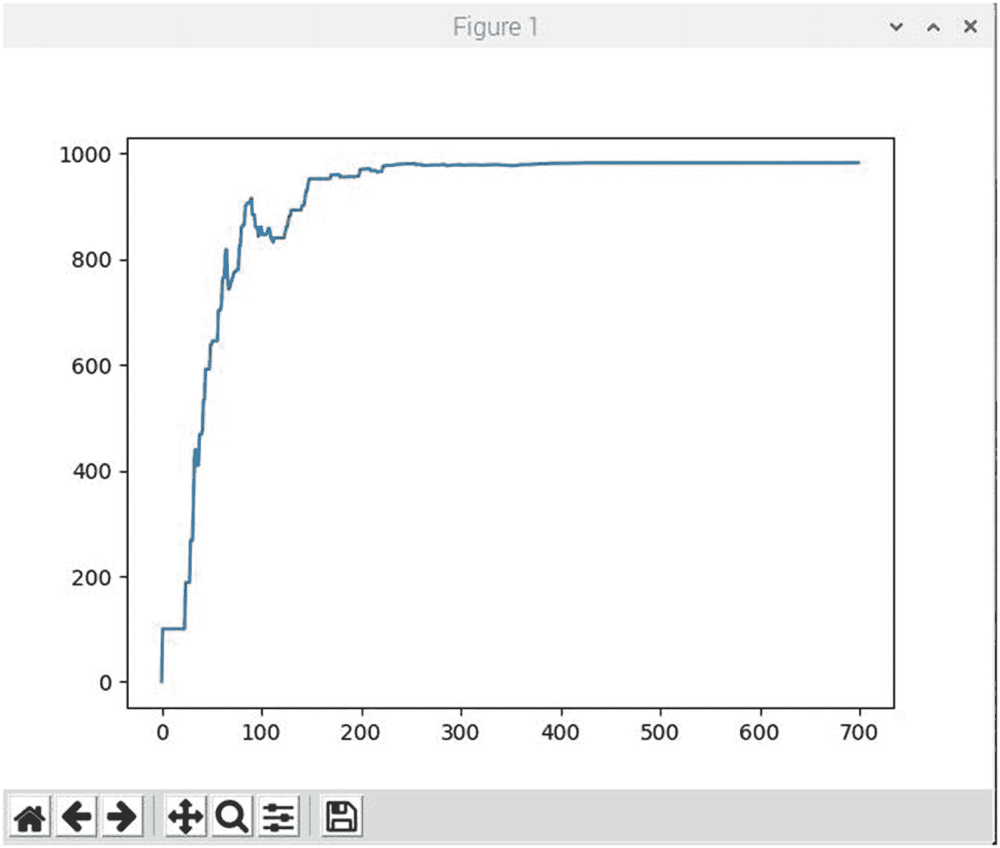

**图 9-19** 分数收敛图

你可以清晰地看到，在完成大约 400 个回合后，分数达到最大值。脚本被硬编码为运行 700 个回合。在达到 400 回合后，额外运行 300 回合所需的时间微乎其微。

图 9-20 显示了脚本运行完成后的终端窗口。

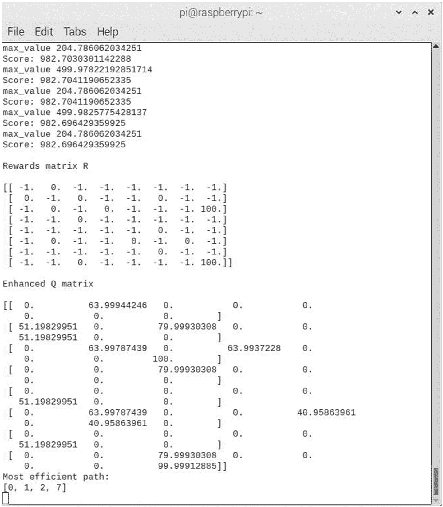

**图 9-20** 最终脚本结果

这张图中有许多值得讨论的有趣内容。首先是图中顶部显示的剩余中间回合结果部分。在这里你可以看到 `Q` 函数的最大值以及分数。显示的分数是未归一化的最优路径值。

奖励矩阵 `R` 显示在中间回合结果下方。关于这个矩阵，有两点需要注意。在 `R(2, 6)` 和 `R(6,6)` 位置有两个 100 的奖励值。第一个奖励 (`R(2,6)`) 对应节点 2 和节点 7 之间的直接路径。第二个奖励 (`R(6,6)`) 是自吸收链接或目标节点的自循环。接下来需要注意的是，现有链接的值为 0，不存在的链接值为 -1。

增强并归一化后的 `Q` 矩阵显示在 `R` 矩阵下方。不幸的是，Python 3 的 `print` 语句导致行有些换行，阅读起来有些困难。我曾尝试让它逐行打印，但未能成功。矩阵值也以浮点数形式显示，这又是一个不必要的干扰。

图中的最后一项是显示的最优路径，结果为 0 到 1 到 2 到 7。

在下一个演示中，我将向你展示如何在路径确定中处理敌对环境因素。

## 在敌对环境中演示 Q-learning

有时，强化学习项目中的环境并不总是对试图导航路径的智能体友好。为了在本次演示中明确这一点，我将假设智能体是一群蜜蜂，它们试图到达位于节点 7 的蜂巢。现在，蜜蜂不喜欢烟雾，会不惜一切代价避开它。事实上，养蜂人（正式名称为蜂农）在从蜂巢中采集蜂蜜时，会使用烟雾枪来安抚蜜蜂。如图 9-21 所示，我在随机生成的环境中的几个节点添加了烟雾。智能体将始终尝试避开那些通向烟雾的链接。

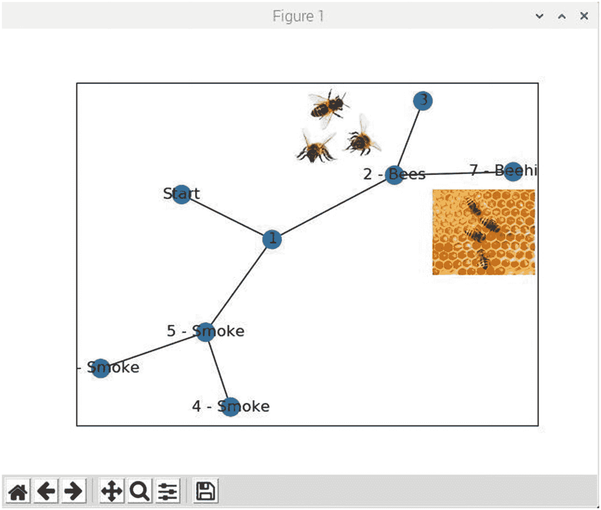

图 9-21 随机生成的蜜蜂环境

以下脚本名为 `beeRL.py`，可从本书的配套网站获取：

```python
# 导入所需库
import numpy as np
import pylab as plt
import networkx as nx
# 映射单元格到单元格，添加循环单元格到目标点
points_list = [(0,1), (1,5), (5,6), (5,4), (1,2), (2,3), (2,7)]
# 设置目标节点
goal = 7
bees = [2]
smoke = [4,5,6]
gamma = 0.8
G=nx.Graph()
G.add_edges_from(points_list)
mapping={0:'Start', 1:'1', 2:'2 - Bees', 3:'3', 4:'4 - Smoke', 5:'5 - Smoke', 6:'6 - Smoke', 7:'7 - Beehive'}
H=nx.relabel_nodes(G,mapping)
pos = nx.spring_layout(H)
nx.draw_networkx_nodes(H,pos, node_size=[200,200,200,200,200,200,200,200])
nx.draw_networkx_edges(H,pos)
nx.draw_networkx_labels(H,pos)
plt.show()
# 定义图中的点
MATRIX_SIZE = 8
# 创建矩阵 (MATRIX_SIZE * MATRIX_SIZE)
R = np.matrix(np.ones(shape=(MATRIX_SIZE, MATRIX_SIZE)))
R *= -1
# 为路径分配 0，为到达目标点分配 100
for point in points_list:
print(point)
if point[1] == goal:
R[point] = 100
else:
R[point] = 0
if point[0] == goal:
R[point[::-1]] = 100
else:
# 点的反向
R[point[::-1]]= 0
# 添加目标点往返
R[goal,goal]= 100
def available_actions(state):
current_state_row = R[state,]
av_act = np.where(current_state_row >= 0)[1]
return av_act
def sample_next_action(available_actions_range):
next_action = int(np.random.choice(available_act, 1))
return next_action
def collect_environmental_data(action):
found = []
if action in bees:
found.append('b')
if action in smoke:
found.append('s')
return found
# 创建 Q 矩阵
Q = np.matrix(np.zeros([MATRIX_SIZE,MATRIX_SIZE]))
enviro_bees = np.matrix(np.zeros([MATRIX_SIZE, MATRIX_SIZE]))
enviro_smoke = np.matrix(np.zeros([MATRIX_SIZE, MATRIX_SIZE]))
initial_state = 1
# 获取当前状态下的可用动作
available_act = available_actions(initial_state)
# 采样要执行的下一个动作
action = sample_next_action(available_act)
# 此函数根据所选路径和 Q 学习算法更新 Q 矩阵
def update(current_state, action, gamma):
max_index = np.where(Q[action,] == np.max(Q[action,]))[1]
if max_index.shape[0] > 1:
max_index = int(np.random.choice(max_index, size = 1))
else:
max_index = int(max_index)
max_value = Q[action, max_index]
Q[current_state, action] = R[current_state, action] + gamma * max_value
print('max_value', R[current_state, action] + gamma * max_value)
environment = collect_environmental_data(action)
if 'b' in environment:
enviro_bees[current_state, action] += 1
if 's' in environment:
enviro_smoke[current_state, action] += 1
if (np.max(Q) > 0):
return(np.sum(Q/np.max(Q)*100))
else:
return(0)
update(initial_state,action,gamma)
# 训练开始
scores = []
for i in range(700):
current_state = np.random.randint(0, int(Q.shape[0]))
available_act = available_actions(current_state)
action = sample_next_action(available_act)
score = update(current_state,action,gamma)
scores.append(score)
print ('Score:', str(score))
plt.plot(scores)
plt.show()
print('Bees found')
print(enviro_bees)
print('Smoke found')
print(enviro_smoke)
```

### 运行脚本并评估结果

通过输入以下命令来运行脚本：

```
python beeRL.py
```

图 9-22 是收敛分数与已完成回合数的关系图。

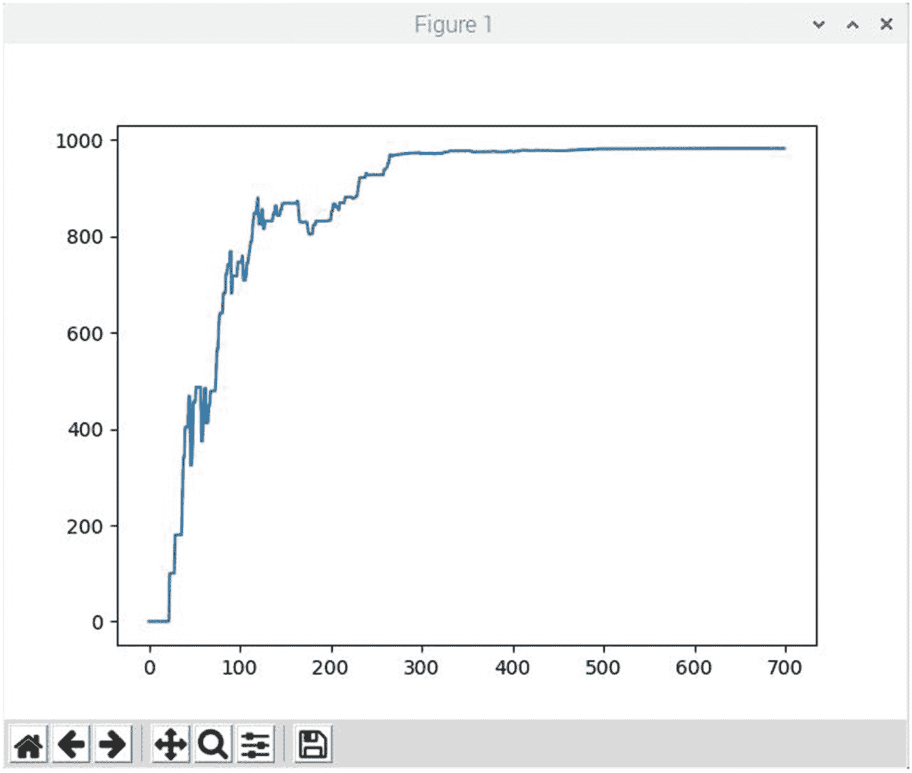

图 9-22 分数收敛图

你可以清楚地看到，在完成大约 400 个回合后达到了最高分数。该脚本被硬编码为运行 700 个回合。在达到 400 个回合后，额外运行 300 个回合所需的时间非常少。

图 9-23 显示了脚本运行完成后的终端窗口。

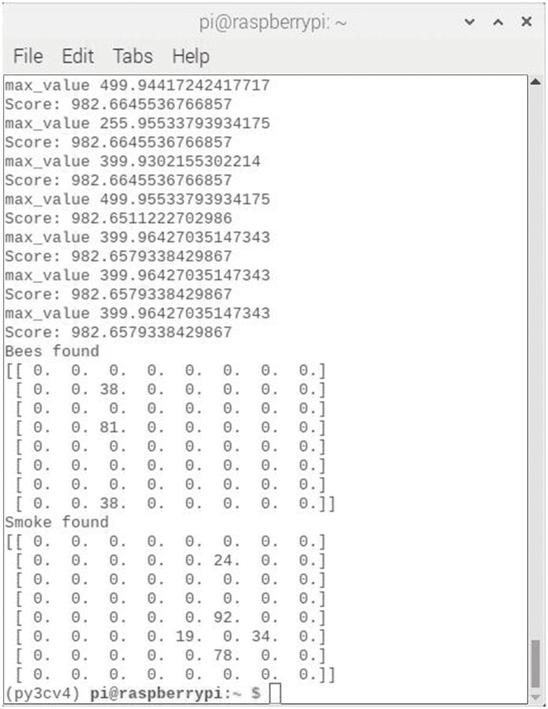

图 9-23 最终脚本结果

图中的环境矩阵显示了智能体在寻找通往蜂巢最有效路径的过程中，发现了多少蜜蜂和烟雾。为了简化此演示，我们做了两个假设。它们是：

*   蜜蜂在找到蜂巢时具有正系数。
*   蜜蜂在遇到烟雾时具有负系数。

这些假设并非不合理，但确实需要关于智能体行为的先验知识。现在自然产生了一个问题：能否利用这些先验知识来提高 Q-learning 的性能？这个问题的答案可以在下面的演示中找到。

## 在具有先验知识的敌对环境中演示 Q-learning

本演示将向你展示如何使用可用的先验知识来改进智能体在路径查找任务中的表现。一群蜜蜂仍将是智能体，目标仍然是到达蜂巢。然而，现在采用了一种更现实的方法，即智能体动态地观察新环境，并在遇到环境偏差时为其分配权重。通向充满烟雾节点的链接将被折扣，而蜜蜂友好的链接将受到鼓励。

这个新脚本与之前脚本之间的显著变化在于，更新方法已被修改，为所有尝试过的路径包含了一个评分矩阵。如果尝试的路径通向一个被标记为烟雾的节点，则矩阵值将递减。相反，如果尝试的路径通向一个被标记为蜜蜂的节点，则矩阵值将递增。包含所有这些偏差值的矩阵会在训练循环中持续使用，以指导智能体进行路径选择。

以下脚本名为 `beeRLenv.py`，可从本书的配套网站获取：

```
# 导入所需库
import numpy as np
import pylab as plt
import networkx as nx
# 映射单元格到单元格，添加环形单元格到目标点
points_list = [(0,1), (1,5), (5,6), (5,4), (1,2), (2,3), (2,7)]
# 设置目标节点
goal = 7
bees = [2]
smoke = [4,5,6]
gamma = 0.8
G=nx.Graph()
G.add_edges_from(points_list)
mapping={0:'起点', 1:'1', 2:'2 - 蜜蜂', 3:'3', 4:'4 - 烟雾', 5:'5 - 烟雾', 6:'6 - 烟雾', 7:'7 - 蜂巢'}
H=nx.relabel_nodes(G,mapping)
pos = nx.spring_layout(H)
nx.draw_networkx_nodes(H,pos, node_size=[200,200,200,200,200,200,200,200])
nx.draw_networkx_edges(H,pos)
nx.draw_networkx_labels(H,pos)
plt.show()
# 定义图中的点
MATRIX_SIZE = 8
# 创建矩阵 (MATRIX_SIZE * MATRIX_SIZE)
R = np.matrix(np.ones(shape=(MATRIX_SIZE, MATRIX_SIZE)))
R *= -1
# 为路径分配 0，为到达目标的点分配 100
for point in points_list:
print(point)
if point[1] == goal:
R[point] = 100
else:
R[point] = 0
if point[0] == goal:
R[point[::-1]] = 100
else:
# 点的反向
R[point[::-1]]= 0
# 添加目标点的往返路径
R[goal,goal]= 100
def available_actions(state):
current_state_row = R[state,]
av_act = np.where(current_state_row >= 0)[1]
return av_act
def sample_next_action(available_actions_range):
next_action = int(np.random.choice(available_act, 1))
return next_action
def collect_environmental_data(action):
found = []
if action in bees:
found.append('b')
if action in smoke:
found.append('s')
return found
# 创建 Q 矩阵
Q = np.matrix(np.zeros([MATRIX_SIZE,MATRIX_SIZE]))
# 创建矩阵来保存蜜蜂和烟雾的总数
enviro_bees = np.matrix(np.zeros([MATRIX_SIZE, MATRIX_SIZE]))
enviro_smoke = np.matrix(np.zeros([MATRIX_SIZE, MATRIX_SIZE]))
# 从烟雾中减去蜜蜂。这给烟雾一个负偏置
enviro_matrix = enviro_bees - enviro_smoke
initial_state = 1
# 获取当前状态下的可用动作
available_act = available_actions(initial_state)
# 采样下一个要执行的动作
action = sample_next_action(available_act)
# 此函数根据所选路径和 Q 学习算法更新 Q 矩阵
def update(current_state, action, gamma):
max_index = np.where(Q[action,] == np.max(Q[action,]))[1]
if max_index.shape[0] > 1:
max_index = int(np.random.choice(max_index, size = 1))
else:
max_index = int(max_index)
max_value = Q[action, max_index]
Q[current_state, action] = R[current_state, action] + gamma * max_value
print('max_value', R[current_state, action] + gamma * max_value)
environment = collect_environmental_data(action)
if 'b' in environment:
enviro_matrix[current_state, action] += 1
if 's' in environment:
enviro_matrix[current_state, action] -= 1
if (np.max(Q) > 0):
return(np.sum(Q/np.max(Q)*100))
else:
return(0)
# 执行一次更新
update(initial_state,action,gamma)
# 创建事务性矩阵副本，用于 enviro_help 方法
enviro_matrix_snap = enviro_matrix.copy()
def available_actions_with_enviro_help(state):
current_state_row = R[state,]
av_act = np.where(current_state_row >= 0)[1]
# 如果存在多条路径，则对负值路径进行降权
env_pos_row = enviro_matrix_snap[state,av_act]
if (np.sum(env_pos_row =0]
if len(temp_av_act) > 0:
print('从:',av_act)
print('到:',temp_av_act)
av_act = temp_av_act
return av_act
# 训练开始
scores = []
for i in range(700):
current_state = np.random.randint(0, int(Q.shape[0]))
available_act = available_actions_with_enviro_help(current_state)
action = sample_next_action(available_act)
score = update(current_state,action,gamma)
scores.append(score)
print ('得分:', str(score))
plt.plot(scores)
plt.show()
```

### 运行脚本并评估结果

通过输入以下命令运行脚本：

```
python beeRLenv.py
```

图 9-24 是本演示中随机生成的环境示意图。

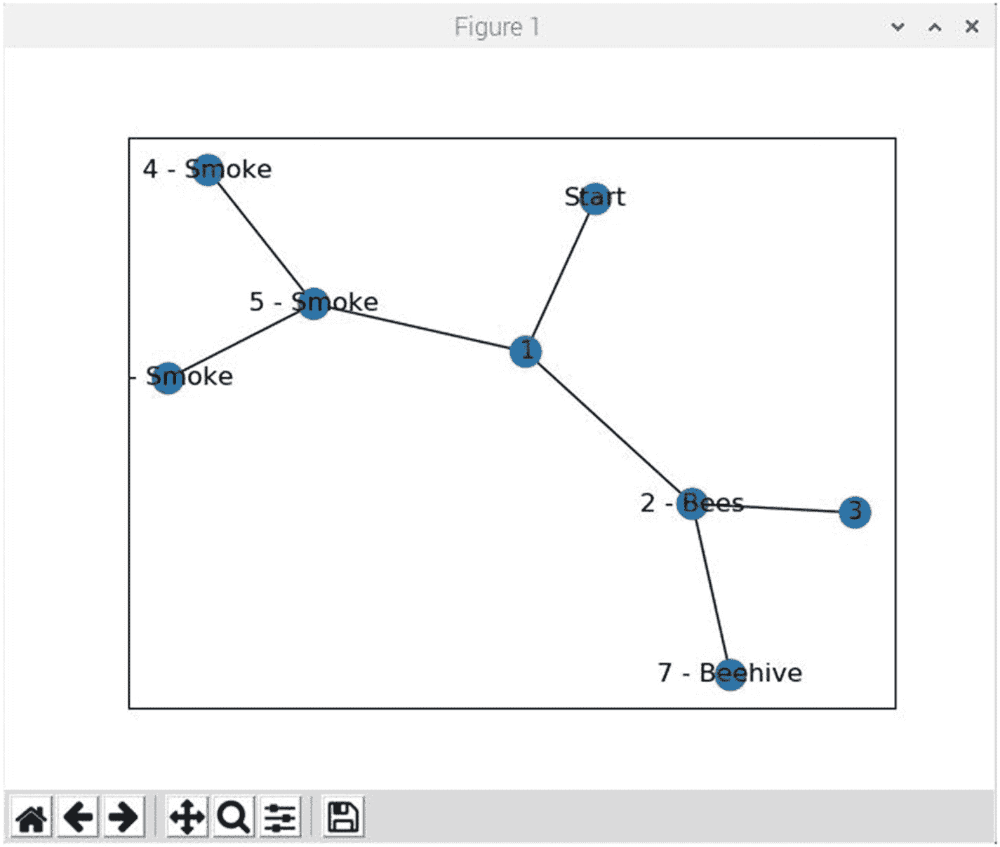

图 9-24 随机生成的环境

## Q 学习与神经网络

图 9-25 是一个终端窗口，显示了被评估的路径。最后列出的路径是最优选择路径。如果你查看图 9-24，这应该不会令人意外。但是，你必须记住，智能体并没有这种鸟瞰环境的视角，它必须系统地测试从起始节点出发的每一条可用连接。

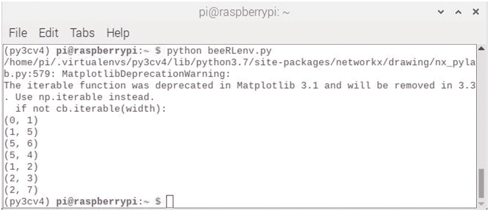

图 9-25 显示已评估路径的终端窗口

本结果部分的最后一张图是图 9-26，它展示了评分收敛情况。这是本演示唯一的性能衡量指标，也是证明这种动态方法是否有效的关键证据。

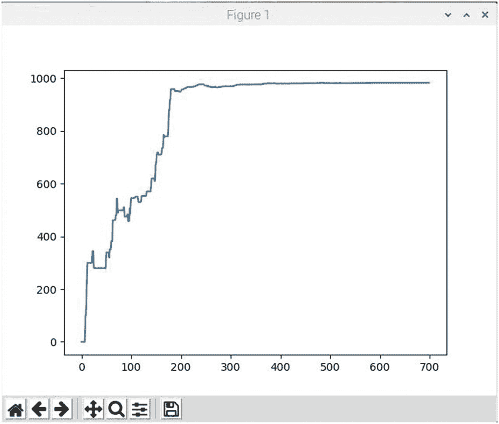

图 9-26 评分收敛图

从图中可以看出，最终评分值在大约第 180 个回合时有效达到。将此图与图 9-22 中显示的图进行比较，后者的最终评分值在大约第 400 个回合时收敛。动态方法收敛得更早，证明其性能远优于不考虑环境条件的方法。这个结果在某种程度上类似于使用偏置值调整人工神经网络（`ANN`）或卷积神经网络（`CNN`）以提升性能。

### 打砖块游戏中的状态表示

在《打砖块》游戏中，环境状态仅由挡板位置、球的位置和方向以及每个砖块是否存在来定义。然而，这种直观的表示方式仅适用于特定游戏。是否存在一种更通用的方法，适用于所有游戏？显而易见的选择是使用屏幕像素，因为它们隐含地包含了游戏情境的所有相关信息，但在《打砖块》游戏中，球的速度和方向除外。不过，通过连续两帧或更多帧画面，可以充分描述球的状态。

如果对游戏画面应用 `DeepMind` 的预处理方法，即取最近四帧屏幕图像，将其调整为 84×84 像素，并转换为 256 级灰度的灰度图。这将产生 `256^(84x84x4) ≈ 10⁶⁷⁹⁷⁰` 种可能的游戏状态。这意味着 `Q` 表中将有 `10⁶⁷⁹⁷⁰` 行，这比已知宇宙中的原子数量还要多——显然这是不可能实现的。这种庞大的状态数量可以通过仅包含已访问过的状态来大幅减少。即便如此，大多数状态很少被访问，`Q` 表需要宇宙的寿命才能收敛——这同样不是一个理想的方案。解决方案在于为从未见过的状态估算 `Q` 值。

此时，深度学习（`DL`）将大有裨益。神经网络在从高度结构化的数据中提取有用特征方面表现异常出色。神经网络可以表示一个 `Q` 函数，该函数以状态（四帧游戏画面）和动作作为输入，并输出相应的 `Q` 值。另一种方案是，将游戏画面作为输入，并为每个可能的动作输出一个 `Q` 值。后者正是 `DeepMind` 团队采用的方法。无论采用哪种方法，其优势在于只需通过网络进行一次前向传播，即可执行 `Q` 值更新或选择具有最高 `Q` 值的动作。

图 9-27 展示了将四个状态输入神经网络并获取单个 `Q` 值输出的“朴素”方法。

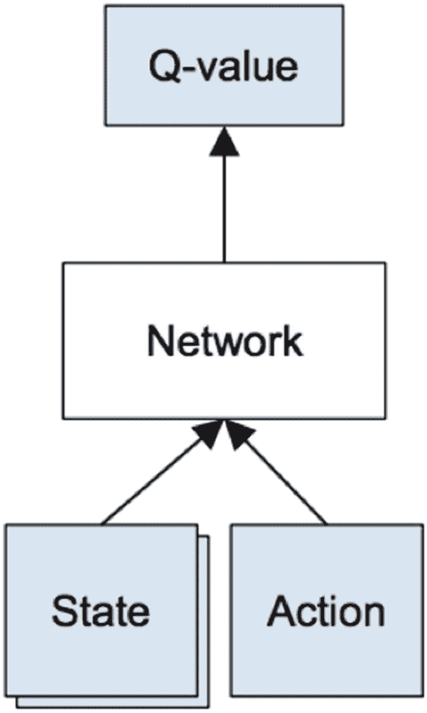

图 9-27 使用深度学习与 `Q` 学习的朴素方法

相比之下，图 9-28 展示了 `DeepMind` 团队采用的方法，即输入单个状态并输出多个 `Q` 值。

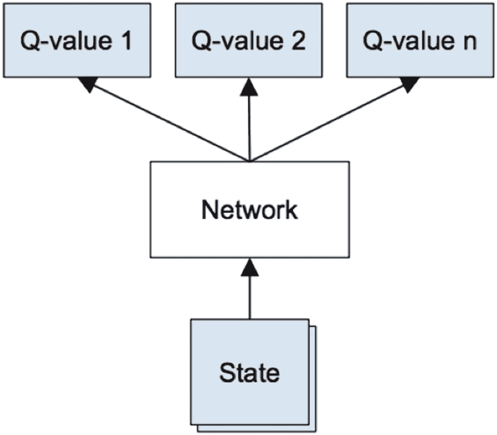

图 9-28 `DeepMind` 的深度学习与 `Q` 学习方法

### DeepMind 模型架构

作为纯信息参考，表 9-1 展示了 `DeepMind` 模型中使用的架构。

**表 9-1 DeepMind 模型架构**

| 层    | 输入       | 滤波器大小 | 步长 | 滤波器数量 | 激活函数 | 输出      |
| :--- | :--------- | :--------- | :--- | :--------- | :------- | :-------- |
| conv1 | 84x84x4    | 8x8        | 4    | 32         | ReLU     | 20x20x32  |
| conv2 | 20x20x32   | 4x4        | 2    | 64         | ReLU     | 9x9x64    |
| conv3 | 9x9x64     | 3x3        | 1    | 64         | ReLU     | 7x7x64    |
| fc4   | 7x7x64     |            |      | 512        | ReLU     | 512       |
| fc5   | 512        |            |      | 18         | 线性     | 18        |

这是一个卷积神经网络，包含三个卷积层，后接两个全连接层。注意，其中没有池化层。这是因为池化层会导致特征变得平移不变。这意味着模型对图像中物体的位置变得不敏感。这将破坏模型在《打砖块》游戏中追踪球位置的能力。

网络的输入是四帧 84×84 的灰度游戏画面。网络的输出是每个可能动作的 `Q` 值，在《打砖块》游戏中有 18 个动作。`Q` 值是实数值，因此这构成了一个回归任务，可以使用简单的平方误差损失（`L`）进行优化。

$$
L=\frac{1}{2}{\left(r+{\mathit{\max}}_{a^{\prime }}Q\left({s}^{\prime },{a}^{\prime}\right)-Q\left(s,a\right)\right)}²
$$

其中

$$
r+{\mathit{\max}}_{a^{\prime }}Q\left({s}^{\prime },{a}^{\prime}\right)
$$

= 目标值

`Q(s, a)` = 预测值

### 算法更新过程

给定一个转移 (`s, a, r, s'`)，经典的贝尔曼方程 `Q` 表更新规则必须替换为以下过程：

1.  对当前状态 `s` 执行一次前馈传播，获取所有动作的预测 `Q` 值。
2.  对下一个状态 `s'` 执行一次前馈传播，并计算网络输出的最大值 `max_{a'} Q(s', a')`。
3.  将动作的 `Q` 值目标设置为 `r + γ * max_{a'} Q(s', a')`（使用步骤 2 中计算的最大值）。对于所有其他动作，将 `Q` 值目标设置为与步骤 1 中原始返回的值相同，从而使这些输出的误差为 0。
4.  使用反向传播更新权重。

上述过程展示了如何通过 `Q` 学习估算每个状态下的未来奖励，并使用 `CNN` 近似 `Q` 函数。然而，事实证明，使用非线性函数近似 `Q` 值是不稳定的。必须使用许多调优技术才能使其收敛。而且这需要很长时间，使用配备单个 `GPU` 板的计算机几乎需要一周时间。

### 经验回放

最重要的调优技术是使用经验回放。在游戏过程中，所有经验 (`s, a, r, s'`) 都存储在回放记忆中。训练网络时，使用来自回放记忆的随机小批量数据，而不是最近的转移。这打破了训练样本中可能存在的任何相似性，这种相似性可能会无意中将网络推向局部最小值。此外，使用经验回放使训练任务类似于常规的监督学习。这简化了调试和进一步的算法测试。

### 解决信用分配与探索困境

将深度学习与 `Q` 学习结合使用，试图解决我在本章开头提到的信用分配问题。这个解决方案之所以有效，是因为奖励会随时间反向传播，直到到达关键的决策点。该点才是获得奖励的实际原因。

另一个主要问题是探索与利用的困境，也在本章开头提到过。你应该意识到，当 `Q` 表或 `Q` 网络被随机初始化时，其预测最初也是随机的。如果选择具有最高 `Q` 值的动作，那么该动作将是随机的，智能体将进行简单的探索。随着 `Q` 函数收敛，它会返回更一致的 `Q` 值，探索量也会减少。可以说，`Q` 学习将探索作为算法的一部分。但这种探索是“贪婪的”，因为它会选择它找到的第一个有效策略。

针对上述问题，一个简单有效的解决方法是 ε-贪婪探索，即以概率 ε 选择随机动作；否则，选择具有最高 `Q` 值的“贪婪”动作。`DeepMind` 系统随时间将 ε 从 1 降低到 0.1。当 `DeepMind` 系统启动时，它完全随机移动以彻底探索状态空间，然后稳定在一个固定的探索率上。

### 总结伪代码

以上所有讨论都可以通过基于 `DeepMind` 模型的一些伪代码来概括，该伪代码提供了一个相对易于理解的算法。

```
# 伪代码示例（概念性描述）
initialize replay memory D with capacity N
initialize action-value network Q with random weights
initialize target action-value network Q' with weights Q' <- Q

for episode = 1 to M:
    initialize starting state s
    for t = 1 to T:
        with probability ε: select a random action a
        else: select a = argmax_a' Q(s, a'; θ)

        execute action a, observe reward r and new state s'

        store transition (s, a, r, s') in D

        sample random minibatch of transitions (s_j, a_j, r_j, s'_j) from D

        set y_j = r_j + γ * max_{a'} Q'(s'_j, a'; θ') if episode not terminal at step j
              y_j = r_j otherwise

        update weights θ by minimizing loss L = (y_j - Q(s_j, a_j; θ))^2

        every C steps: reset Q' <- Q

        s <- s'
    end for
end for
```

### 算法描述
```
初始化回放记忆 D
使用随机权重初始化动作-价值函数 Q
观察初始状态 s
重复：
  选择一个动作 a
  以概率 ε 选择一个随机动作
  否则选择 a = argmaxa'Q(s,a')
  执行动作 a
  观察奖励 r 和新状态 s'
  将经验 (s, a, r, s') 存储在回放记忆 D 中
  从回放记忆 D 中采样随机转移 ( ss, aa, rr, ss' )
  为每个小批量转移计算目标：
    如果 ss' 是终止状态，则 tt = rr
    否则 tt = rr + γmaxa'Q(ss',aa')
  使用 (tt – Q(ss,aa))2 作为损失训练 Q 网络
  s = s'
直到终止
```

### 技术细节

DeepMind 团队为了使其真正工作，还使用了更多调优技术，例如使用目标网络、误差裁剪、奖励裁剪等。我将把这些话题留给感兴趣的读者去深入研究。

令人惊奇的是，这个算法竟然真的能学到东西。试想一下，`Q函数`是随机初始化的；当它首次启动时，自然会输出垃圾数据。然后，算法使用这些初始垃圾数据（下一个状态的最大 `Q值`）作为网络的目标，只是偶尔记录一个微小的奖励。从宏观角度来看，这种方法似乎毫无意义。算法怎么可能学到任何有意义的东西？奇怪的事实是，它最终确实学到了。

一些非常聪明的人曾说过，`人工智能`是我们尚未弄清楚的东西。一旦`人工智能`被弄清楚，它可能看起来就不再那么智能了。然而，结合深度学习的 Q 学习仍然是一个令人惊叹的话题。观察它学会玩一个新游戏，确实是一件令人敬畏的事情。

### 索引

#### A
`AdaGrad` 和 `RMSProp` 算法
`Adam` 算法
`自适应梯度算法 (AdaGrad)`
`AlexNet` 网络
`受试者工作特征曲线下面积 (AUC-ROC)` 曲线
`人工神经网络 (ANN)` 激活函数
`annDemo1` 脚本
人工神经元示意图
类别
复杂误差
计算过程
误差贡献
前馈计算
前馈/反馈
梯度下降方程
隐藏层节点
房价回归预测器，演示
初始输入/权重值
输入*与*输出
手动过程
矩阵
多重误差分配设置
神经元模型
神经元组成部分
输出节点误差
皮马印第安人糖尿病项目
Python 演示
`init` 模块
矩阵表示法
脚本
`testANN3` 脚本
`testANN4` 脚本
测试代码
测试误差
`testNet` 模块
`trainNet` 模块
Python 会话
`scikit-learn` 库
`Sigmoid` 函数
单误差分配设置
六节点
三十六节点
三层
两层
权重修改过程
`Atari Breakout` 游戏截图
`属性选择度量 (ASM)`
`AUROC` 曲线
二元分类器系统
漏报/概率反转情况
重叠概率
完美类别分离
正类*与*负类概率曲线

#### B
`Bagging` 和随机森林集成算法
`Bagging` 演示
结果
脚本
`Bootstrap` 重采样演示
`Bootstrap` 过程
`CART` 性能估计
随机森林演示
基尼指数
结果
脚本
基线模型
批量归一化 `Inception V2`
贝尔曼方程
最佳匹配单元 (`BMU`)
`Breakout` 游戏
乳腺癌预测
`Adagrad` 优化器
`batch_size` 参数
构建数据集
细胞检测
`classWeight` 参数
`CNN` 模型
命令行参数
配置脚本
内容
`cp` 命令
数据增强
数据集划分
桌面配置
解释性注释
`fit_generator` 方法
基于梯度的优化
`IDC`
不平衡/偏斜类别
库
`CancerNet`
`imutils`
`Keras`
`Matplotlib`
`OS`
`scikit-learn`
`MLP` 模型
`OpenCV` 安装
过拟合/欠拟合
阳性/阴性图像
潜在补丁
`Python` 虚拟环境
结果评估
运行数据集
脚本
`train_IDC_model` 脚本
训练/测试脚本
`tree` 命令

#### C
摄像头串行接口 (`CSI`) 插座
`CancerNet` 结构
分类准确率图
`分类与回归树 (CART)`
`命令行解释器 (CLI)`
卷积核
`卷积神经网络 (CNN)` 模型
激活图
架构
卷积层与特征
卷积运算
设计策略
眼睛特征与非眼睛特征
历史与演进
`AlexNet` 网络
批量归一化
瓶颈
`GoogLeNet`
`Inception` 模块
`Inception V4` 架构
`Inception V4` 模块
`LeNet-5` 架构
`NiN` 架构
`Overfeat` 框架
`ResNet` 核心
`Xception`
图像体积，卷积滤波器
神经元
原始图像像素
单变量时间序列
创建 `CNN` 模型
预处理数据集
使用预测，细胞显微镜应用
宽度、高度和深度
`create_model()` 函数
交叉熵损失
`CSI` 插座位置

#### D
数据增强对象
数据压缩函数
`决策树算法`
`ASM`
决策逻辑图
流程图
增益率定义
固有信息
基尼指数
任意数据集
二元分割
连续值属性
离散值属性
方程
最终树
初始分割
信息增益定义
熵
初始分割
度量信息
最优分割
游戏决策
分割标准
过程
`决策树分类器算法`
参见`决策树算法`
`scikit-learn`
参见 `Scikit-learn，决策树`
`深度学习 (DL)` 基础
线性分类器
机器学习，数据模式
线性分类器
添加偏置向量
评分函数
脚本
终端结果
损失函数
优化器算法
二维图
误差图
梯度下降算法
梯度搜索
迭代次数
`LR` 预测器
`Python` 代码
变量
加权变量
`Deepmind` 模型
`Deepmind` 预处理
深度神经网络
折扣未来奖励
显示串行接口 (`DSI`) 插座

#### E
误差函数
`ε-贪婪探索`
`export_*graphviz*` 函数

#### F
`假阴性率 (FNR)`
`假阳性率 (FPR)`
`Fashion MNIST` 演示
`Adam` 算法
`Adam` 优化器
`CNN`
复杂 `CNN` 模型
数据集分类
`Keras`
`fit` 函数
手写数字识别
输入数据集
整数到服装描述关系
`kerasComplexFashionTest.py`
`kerasFashionTest.py`
逻辑回归算法
`python`
`kerasFashionTest.py` 结果
`kerasComplexFashionTest` 脚本结果
`kerasFashionTest` 脚本结果
`reviewData` 脚本结果
随机梯度下降
字符串变量与网络计算
训练记录
图像
反馈模型
`细针抽吸 (FNA)`
`Keras`
`fit` 函数
`FractalNet`

#### G
增益率
高斯朴素贝叶斯
基尼指数
任意数据集
二元分割
连续值属性
离散值属性
方程
最终树
初始分割
全局最小值
`GoogLeNet`
`GPU` 神经网络
基于梯度的优化
`图形处理单元 (GPU)`
`GridSearchCV` 模块

#### H
手写数字识别
`ANN`，创建
`ANN` 测试脚本
演示
完整训练数据集
误识别的手写数字
结果
脚本
`testANN_metrics`
`testANN_metrics.py`
`testANN` 脚本结果
`testANN_short.py`
`testANN_short` 脚本
`viewResults` 脚本
开发与测试
公司指南
指南
初始 `ANN` 训练脚本
演示
输入数据集，调整
解释 `ANN` 输出数据值
`Keras`
参见 `Keras`
人员、硬件和软件
`Pi` 摄像头
参见 `Pi` 摄像头
全球邮政服务
生产或现场发布
项目历史与准备细节
`dataList`
交互式 `Python` 会话
`matplotlib Python` 库
`MNIST` 数据库
`MNIST` 训练数据集
邮政编码
`python3 viewRecord.py`
`viewRecord.py`
项目需求
现实的时间表
测试
房价回归预测器，演示
基线模型
数据集
特征变量
预处理数据

#### I
恒等快捷连接
`Inception` 架构
批量归一化层
模型
模块
`V2` 网络
`V3` 模块
`V4` 架构
`V4` 模块
`Inception-ResNet V1`
`init` 模块
整数编码
`浸润性导管癌 (IDC)`
鸢尾花演示，第 1 部分
类别属性
属性直方图
属性散点图
脚本
步骤
演示，第 2 部分
实现交叉验证过程
模型
`Python` 脚本
步骤
演示，第 3 部分
箱线图
类别*与*预测类别
`KNN` 模型
六个模型的准确率显示
`sklearn`
`learn`
`metrics` 分析
`isnull()` 方法

#### J
`Jason` 的 `Fashion MNIST` 演示

#### K
`Keras`
`ANN` 模型
后端引擎
编译，模型
深度学习库
安装
整数编码
`MNIST` 数据集
网络模型
随机数生成器
`ReLU`
`scikit-learn` 库
`create_model()`
网格搜索

# KerasClassifier 和 KerasRegressor 类

- 脚本
- 工具
- `kerasTest.py`
- `softmax` 函数
- 训练和测试数据集
- `kerasFashionTest` 脚本
- `Keras fit_generator` 方法
- `Keras`
- 导入数据集库
- `kerasTest` 脚本
- `k-近邻 (k-NN)` 模型
- 距离度量
- `kNN.py`
- `knnTest.py`
- 噪声特征
- 性能问题
- `k-NN` 算法

## L

- `learningRate` 参数
- 学习向量量化 (`LVQ`)
- `BMU`
- 码本向量
- 演示
- 码本向量
- `n` 折交叉验证
- 过程
- 结果
- 脚本
- `Weka`
- 欧几里得距离
- `k-NN` 算法
- `LeNet-5` 模型
- 似然函数
- 线性判别分析 (`LDA`) 与 `PCA`
- 过程
- 脚本
- 演示
- 解释性注释
- 线性回归 (`LR`)
- 系数
- 线性代数解
- `lrTest` 脚本
- 数学术语
- 伪随机数据集
- 简化案例
- 整例插补
- 局部最小值
- 逻辑回归 (`LogR`)
- 吴恩达的数据集
- 假设
- 演示
- 分类器线
- 系数
- 假阴性
- 假阳性
- `logRDemo.py`
- 随机分数
- 开发
- 系数确定
- 代价函数
- `logRTest.py`
- 与 `LR`
- `Sigmoid` 函数
- 对数损失函数
- 损失函数

## M

机器学习 (`ML`) 数据定义设计矩阵线性预测与分类鸢尾花的花萼与花瓣鸢尾花 `LDA` 结构化方法步骤参数人工智能、深度学习 (`DL`) 任务之间的关系马尔可夫决策过程 (`MDP`) 数据流折扣未来奖励 `Q` 学习参见 `Q` 学习状态、动作与规则最大后验概率 (`MAP`) 均方误差 (`MSE`) 均方误差 (`MSE`) 损失函数误识别的手写数字混合国家标准与技术研究所 (`MNIST`) 数据库 `mkvirtualenv` 命令 `MNIST` 手写数字数据集多层感知器 (`MLP`) 模型 `AUROC` 图混淆矩阵热图概率分布结果多重误差分配设置多元时间序列 `CNN` 模型多输入序列预处理数据集

## N

朴素贝叶斯假设类别概率条件概率定义频率表 `gnbTest.py` 似然表后验概率优缺点定理类型天气/打球数据集网络中的网络 (`NiN`) 神经网络 `Deepmind` 方法朴素方法 `Q` 值节点图非 `Keras` 网络非线性函数归一化 `Q` 矩阵

## O

`OpenCV` `apt-get` 构建 `CMake` 命令编译目录设置非自由算法 `numpy` 库 `py3cv4_1` 版本验证 `Python 3` 与 `numpy` 交换配置文件交换大小符号链接 `CMake` 实用工具下载可视化参见 `Seaborn` 数据库 `OpenCV` 函数 `Overfeat` 框架

## P

参数化 `Pi Camera` 手写数字识别演示安装 `CSI` 插座正确插入摄像头电缆软件接口短柔性排线版本 2 皮马印第安人糖尿病数据集皮马印第安人糖尿病项目八个因素准备数据相关性热图 `csv` 数据集 `diabetesTest` 脚本结果下载解释性注释直方图直方图绘制库胰岛素直方图 `Keras ANN` 模型列表式插补 `revisedDiabetesTest` 脚本结果误差与迭代次数关系图 `predict()` 方法预测建模主成分分析 (`PCA`) 数据压缩函数目标过程脚本协方差矩阵 `csv` 文件演示降维解释性注释鸢尾花数据集标准化 `SVD` 算法 `W` 矩阵的创建概率密度函数 (`PDF`)

## Q

`Q` 学习贝尔曼方程贝尔曼方程 `Q` 表更新规则 `Breakout` 游戏构建（示例）初始动作初始环境节点图平面图奖励值 `R` 矩阵 `CNN Deepmind` 方法 `Deepmind` 模型架构 `DL` 流程图函数敌对环境演示 `beeRL.py` 环境矩阵先验知识 `python beeRL.py` 随机生成环境蜜蜂得分收敛图手动 `Q` 学习实验贝尔曼方程增强 `Q` 矩阵学习参数节点图归一化矩阵 `Q` 矩阵随机选择修正后的增强 `Q` 矩阵修正后的 `Q` 矩阵朴素方法与神经网络 `Python` 脚本演示 `python simpleRL.py` 运行 `Q` 值奖励函数调优技术 `Q` 矩阵 `Q` 网络 `Q` 表 `Q` 值

## R

随机点图树莓派 (`RasPi`) `LibreELEC` 强制配置启动更改密码检查更新 `ifconfig` 命令显示选择 `WiFi` 网络时区菜单 `micro SD` 卡配置过程可选配置过程 `Model B+` `NOOBS Lite` 镜像 `Raspbian Linux` 发行版安装依赖项 `Python` 虚拟环境安装初始源命令结果 `mkvirtualenv` 命令过程 `virtualenv` 实用工具 `workon` 命令结果更新操作 `RasPi` 桌面配置 `RasPi` 处理器速度常规神经网络强化学习 (`RL`) `Breakout` 游戏人类学习经验 `ML` 范式监督学习无监督学习 `ReLU` 图 `ResNet` 架构瓶颈消除瓶颈缩减方案流程图恒等快捷连接 `Inception V4` 架构池化层加 `softmaxXception` 代码 `R` 矩阵均方根传播 (`RMSProp`)

## S

`Scikit-learn` 决策树准确率 `clf` 模型缺点 `CSV` 文件 `diabetesDT.py` 加载数据集加载库优化准确率 `diabetesDT.py` 超参数 `pimaDiabetes.py` 树图 1 皮马印第安人糖尿病数据集优点 `Python` 脚本分割数据集训练集与测试集可视化 `diabetesDT.py` 放大部分 `export_graphviz` 函数基尼系数树图 `Scikit-learn` 包装函数评分收敛图评分函数 `Seaborn` 数据库箱线图数据集数据可视化依赖关系分面网格图安装鸢尾花数据集核密度估计图配对图散点图带状图小提琴图灵敏度 `Sigmoid` 函数单误差分配设置奇异值分解 (`SVD`) `softargmaxSoftmax` 函数特异性 `split_sequences` 函数 `SqueezeNet` `scikit-learn` `StratifiedKFold` 函数监督学习支持向量机 (`SVM`) 数据模型数据点演示高维数据集高斯函数应用 `GridSearchCV` 模块参数问题数据集二次函数结果脚本转换后的数据集目测图形直觉支持向量总宽度确定

## T

目标手写数字 `testANN3` 脚本 `testANN_image` 脚本 `testANN_metrics_lr` 脚本 `testANN_metrics` 脚本测试生成器 `testNet` 模块传统 `CNN` 架构 `trainANN` 脚本 `trainNet` 模块 `train_test_split()` 函数真阳性率 (`TPR`) 调优技术

## U

单变量时间序列无监督学习

## V

验证生成器 `VGG` `Fashion MNIST` 演示 `VGG` 网络

## W

怀卡托知识分析环境 (`Weka`) 权重/偏置白盒机器学习算法 `workon` 命令

## X, Y

`Xception` 模块架构

## Z

零规则算法