MATLAB 机器学习

实战指南

问题解决方案方法

—

*第二版*

—

迈克尔·帕卢泽克

斯蒂芬妮·托马斯


**MATLAB 机器学习**

**实战指南**

**问题解决方案方法**

**第二版**

**迈克尔·帕卢泽克**

**斯蒂芬妮·托马斯**

***MATLAB 机器学习：问题解决方案方法***

迈克尔·帕卢泽克

斯蒂芬妮·托马斯

美国新泽西州普莱恩斯伯勒

美国新泽西州普莱恩斯伯勒

ISBN-13（平装）：978-1-4842-3915-5

ISBN-13（电子版）：978-1-4842-3916-2

[`doi.org/10.1007/978-1-4842-3916-2`](https://doi.org/10.1007/978-1-4842-3916-2)

美国国会图书馆控制号：2018967208

版权 © 2019 归迈克尔·帕卢泽克和斯蒂芬妮·托马斯所有

本作品受版权保护。出版商保留所有权利，无论是全部还是部分材料，特别是翻译、重印、重用插图、朗诵、广播、以缩微胶卷或任何其他物理方式复制，以及以电子方式改编、通过计算机软件或现在已知或以后开发的类似或不同方法进行传输或信息存储与检索的权利。

本书中可能出现商标名称、徽标和图像。对于每个出现的商标名称、徽标或图像，我们仅以编辑方式使用这些名称、徽标和图像，并为了商标所有者的利益，无意侵犯商标权。

本出版物中使用的商品名称、商标、服务标志和类似术语，即使未被标识为此类，也不应被视为对其是否受专有权利保护的看法。

尽管本书中的建议和信息在出版时被认为是真实准确的，但作者、编辑和出版商均不对可能存在的任何错误或遗漏承担法律责任。

出版商对本书所含材料不作任何明示或暗示的保证。

Apress Media LLC 董事总经理：Welmoed Spahr

采购编辑：Steve Anglin

开发编辑：Matthew Moodie

协调编辑：Mark Powers

封面设计：eStudioCalamar

封面图片设计：Freepik [(http://www.freepik.com)](http://www.freepik.com)

全球图书贸易发行：Springer Science+Business Media New York，地址：233 Spring Street, 6th Floor, New York, NY 10013。电话：1-800-SPRINGER，传真：(201) 348-4505，电子邮件：orders-ny@springer-sbm.com，或访问 [www.springeronline.com](http://www.springeronline.com)。Apress Media, LLC 是一家加利福尼亚有限责任公司，其唯一成员（所有者）是 Springer Science + Business Media Finance Inc (SSBM Finance Inc)。SSBM Finance Inc 是一家特拉华州公司。

有关翻译信息，请发送电子邮件至 rights@apress.com，或访问 [www.apress.com](http://www.apress.com)。

Apress 及 ED 系列书籍可批量购买用于学术、企业或促销用途。大多数图书也提供电子版和许可证。更多信息，请参考我们的特殊批量销售-电子书许可网页：[www.apress.com/bulk-sales](http://www.apress.com/bulk-sales)。

作者在本文中引用的任何源代码或其他补充材料，读者可在以下网址获取：

[www.apress.com](http://www.apress.com)。有关如何找到本书源代码的详细信息，请访问

[www.apress.com/source-code/](http://www.apress.com/source-code/)。读者还可以在 SpringerLink 上每个章节的补充材料部分访问源代码。

印刷于无酸纸上


**目录**

**关于作者**

**XV**

**引言**

**XVII**

**第 1 章**


**机器学习概述**

**1**

1.1

引言 . . . . . . . . . . . . . . . . . . . . . . . . . . . . . . . . . . . . . . . . . . . . . . . . . . . . . . . . . . . . . . . . . . . . .

1

1.2

机器学习的要素 . . . . . . . . . . . . . . . . . . . . . . . . . . . . . . . . . . . . . . . . . . . . . . . . . . . . . . . . . . . . . . . . . . . . .

2

1.2.1

[数据 . . . . . . . . . . . . . . . . . . . . . . . . . . . . . . . . . . . . . . . . . . . . . . . . . . . . . . . . . . . . . . . . . . . . . . . . . . . . . . . . . . . . . . . . . . . . . . . . . . . . . . . . . . . . . . . . . . . . . . . . . . . . . . . . . . . . . . . . . . . . . . . . . . . . . . . . . . . . . . . . . . . . . . . . . . . . . . . . . . . . . . . . . . . . . . . . . . . . . . . . . . . . . . . . . . . . . . . . . . . . . . . . . . . . . . . . . . . . . . . . . . . . . . . . . . . . . . . . . . . . . . . . . . . . . . . . . . . . . . . . . . . . . . . . . . . . . . . . . . . . . . . . . . . . . . . . . . . . . . . . . . . . . . . . . . . . . . . . . . . . . . . . . . . . . . . . . . . . . . . . . . . . . . . . . . . . . . . . . . . . . . . . . . . . . . . . . . . . . . . . . . . . . . . . . . . . . . . . . . . . . . . . . . . . . . . . . . . . . . . . . . . . . . . . . . . . . . . . . . . . . . . . . . . . . . . . . . . . . . . . . . . . . . . . . . . . . . . . . . . . . . . . . . . . . . . . . . . . . . . . . . . . . . . . . . . . . . . . . . . . . . . . . . . . . . . . . . . . . . . . . . . . . . . . . . . . . . . . . . . . . . . . . . . . . . . . . . . . . . . . . . . . . . . . . . . . . . . . . . . . . . . . . . . . . . . . . . . . . . . . . . . . . . . . . . . . . . . . . . . . . . . . . . . . . . . . . . . . . . . . . . . . . . . . . . . . . . . . . . . . . . . . . . . . . . . . . . . . . . . . . . . . . . . . . . . . . . . . . . . . . . . . . . . . . . . . . . . . . . . . . . . . . . . . . . . . . . . . . . . . . . . . . . . . . . . . . . . . . . . . . . . . . . . . . . . . . . . . . . . . . . . . . . . . . . . . . . . . . . . . . . . . . . . . . . . . . . . . . . . . . . . . . . . . . . . . . . . . . . . . . . . . . . . . . . . . . . . . . . . . . . . . . . . . . . . . . . . . . . . . . . . . . . . . . . . . . . . . . . . . . . . . . . . . . . . . . . . . . . . . . . . . . . . . . . . . . . . . . . . . . . . . . . . . . . . . . . . . . . . . . . . . . . . . . . . . . . . . . . . . . . . . . . . . . . . . . . . . . . . . . . . . . . . . . . . . . . . . . . . . . . . . . . . . . . . . . . . . . . . . . . . . . . . . . . . . . . . . . . . . . . . . . . . . . . . . . . . . . . . . . . . . . . . . . . . . . . . . . . . . . . . . . . . . . . . . . . . . . . . . . . . . . . . . . . . . . . . . . . . . . . . . . . . . . . . . . . . . . . . . . . . . . . . . . . . . . . . . . . . . . . . . . . . . . . . . . . . . . . . . . . . . . . . . . . . . . . . . . . . . . . . . . . . . . . . . . . . . . . . . . . . . . . . . . . . . . . . . . . . . . . . . . . . . . . . . . . . . . . . . . . . . . . . . . . . . . . . . . . . . . . . . . . . . . . . . . . . . . . . . . . . . . . . . . . . . . . . . . . . . . . . . . . . . . . . . . . . . . . . . . . . . . . . . . . . . . . . . . . . . . . . . . . . . . . . . . . . . . . . . . . . . . . . . . . . . . . . . . . . . . . . . . . . . . . . . . . . . . . . . . . . . . . . . . . . . . . . . . . . . . . . . . . . . . . . . . . . . . . . . . . . . . . . . . . . . . . . . . . . . . . . . . . . . . . . . . . . . . . . . . . . . . . . . . . . . . . . . . . . . . . . . . . . . . . . . . . . . . . . . . . . . . . . . . . . . . . . . . . . . . . . . . . . . . . . . . . . . . . . . . . . . . . . . . . . . . . . . . . . . . . . . . . . . . . . . . . . . . . . . . . . . . . . . . . . . . . . . . . . . . . . . . . . . . . . . . . . . . . . . . . . . . . . . . . . . . . . . . . . . . . . . . . . . . . . . . . . . . . . . . . . . . . . . . . . . . . . . . . . . . . . . . . . . . . . . . . . . . . . . . . . . . . . . . . . . . . . . . . . . . . . . . . . . . . . . . . . . . . . . . . . . . . . . . . . . . . . . . . . . . . . . . . . . . . . . . . . . . . . . . . . . . . . . . . . . . . . . . . . . . . . . . . . . . . . . . . . . . . . . . . . . . . . . . . . . . . . . . . . . . . . . . . . . . . . . . . . . . . . . . . . . . . . . . . . . . . . . . . . . . . . . . . . . . . . . . . . . . . . . . . . . . . . . . . . . . . . . . . . . . . . . . . . . . . . . . . . . . . . . . . . . . . . . . . . . . . . . . . . . . . . . . . . . . . . . . . . . . . . . . . . . . . . . . . . . . . . . . . . . . . . . . . . . . . . . . . . . . . . . . . . . . . . . . . . . . . . . . . . . . . . . . . . . . . . . . . . . . . . . . . . . . . . . . . . . . . . . . . . . . . . . . . . . . . . . . . . . . . . . . . . . . . . . . . . . . . . . . . . . . . . . . . . . . . . . . . . . . . . . . . . . . . . . . . . . . . . . . . . . . . . . . . . . . . . . . . . . . . . . . . . . . . . . . . . . . . . . . . . . . . . . . . . . . . . . . . . . . . . . . . . . . . . . . . . . . . . . . . . . . . . . . . . . . . . . . . . . . . . . . . . . . . . . . . . . . . . . . . . . . . . . . . . . . . . . . . . . . . . . . . . . . . . . . . . . . . . . . . . . . . . . . . . . . . . . . . . . . . . . . . . . . . . . . . . . . . . . . . . . . . . . . . . . . . . . . . . . . . . . . . . . . . . . . . . . . . . . . . . . . . . . . . . . . . . . . . . . . . . . . . . . . . . . . . . . . . . . . . . . . . . . . . . . . . . . . . . . . . . . . . . . . . . . . . . . . . . . . . . . . . . . . . . . . . . . . . . . . . . . . . . . . . . . . . . . . . . . . . . . . . . . . . . . . . . . . . . . . . . . . . . . . . . . . . . . . . . . . . . . . . . . . . . . . . . . . . . . . . . . . . . . . . . . . . . . . . . . . . . . . . . . . . . . . . . . . . . . . . . . . . . . . . . . . . . . . . . . . . . . . . . . . . . . . . . . . . . . . . . . . . . . . . . . . . . . . . . . . . . . . . . . . . . . . . . . . . . . . . . . . . . . . . . . . . . . . . . . . . . . . . . . . . . . . . . . . . . . . . . . . . . . . . . . . . . . . . . . . . . . . . . . . . . . . . . . . . . . . . . . . . . . . . . . . . . . . . . . . . . . . . . . . . . . . . . . . . . . . . . . . . . . . . . . . . . . . . . . . . . . . . . . . . . . . . . . . . . . . . . . . . . . . . . . . . . . . . . . . . . . . . . . . . . . . . . . . . . . . . . . . . . . . . . . . . . . . . . . . . . . . . . . . . . . . . . . . . . . . . . . . . . . . . . . . . . . . . . . . . . . . . . . . . . . . . . . . . . . . . . . . . . . . . . . . . . . . . . . . . . . . . . . . . . . . . . . . . . . . . . . . . . . . . . . . . . . . . . . . . . . . . . . . . . . . . . . . . . . . . . . . . . . . . . . . . . . . . . . . . . . . . . . . . . . . . . . . . . . . . . . . . . . . . . . . . . . . . . . . . . . . . . . . . . . . . . . . . . . . . . . . . . . . . . . . . . . . . . . . . . . . . . . . . . . . . . . . . . . . . . . . . . . . . . . . . . . . . . . . . . . . . . . . . . . . . . . . . . . . . . . . . . . . . . . . . . . . . . . . . . . . . . . . . . . . . . . . . . . . . . . . . . . . . . . . . . . . . . . . . . . . . . . . . . . . . . . . . . . . . . . . . . . . . . . . . . . . . . . . . . . . . . . . . . . . . . . . . . . . . . . . . . . . . . . . . . . . . . . . . . . . . . . . . . . . . . . . . . . . . . . . . . . . . . . . . . . . . . . . . . . . . . . . . . . . . . . . . . . . . . . . . . . . . . . . . . . . . . . . . . . . . . . . . . . . . . . . . . . . . . . . . . . . . . . . . . . . . . . . . . . . . . . . . . . . . . . . . . . . . . . . . . . . . . . . . . . . . . . . . . . . . . . . . . . . . . . . . . . . . . . . . . . . . . . . . . . . . . . . . . . . . . . . . . . . . . . . . . . . . . . . . . . . . . . . . . . . . . . . . . . . . . . . . . . . . . . . . . . . . . . . . . . . . . . . . . . . . . . . . . . . . . . . . . . . . . . . . . . . . . . . . . . . . . . . . . . . . . . . . . . . . . . . . . . . . . . . . . . . . . . . . . . . . . . . . . . . . . . . . . . . . . . . . . . . . . . . . . . . . . . . . . . . . . . . . . . . . . . . . . . . . . . . . . . . . . . . . . . . . . . . . . . . . . . . . . . . . . . . . . . . . . . . . . . . . . . . . . . . . . . . . . . . . . . . . . . . . . . . . . . . . . . . . . . . . . . . . . . . . . . . . . . . . . . . . . . . . . . . . . . . . . . . . . . . . . . . . . . . . . . . . . . . . . . . . . . . . . . . . . . . . . . . . . . . . . . . . . . . . . . . . . . . . . . . . . . . . . . . . . . . . . . . . . . . . . . . . . . . . . . . . . . . . . . . . . . . . . . . . . . . . . . . . . . . . . . . . . . . . . . . . . . . . . . . . . . . . . . . . . . . . . . . . . . . . . . . . . . . . . . . . . . . . . . . . . . . . . . . . . . . . . . . . . . . . . . . . . . . . . . . . . . . . . . . . . . . . . . . . . . . . . . . . . . . . . . . . . . . . . . . . . . . . . . . . . . . . . . . . . . . . . . . . . . . . . . . . . . . . . . . . . . . . . . . . . . . . . . . . . . . . . . . . . . . . . . . . . . . . . . . . . . . . . . . . . . . . . . . . . . . . . . . . . . . . . . . . . . . . . . . . . . . . . . . . . . . . . . . . . . . . . . . . . . . . . . . . . . . . . . . . . . . . . . . . . . . . . . . . . . . . . . . . . . . . . . . . . . . . . . . . . . . . . . . . . . . . . . . . . . . . . . . . . . . . . . . . . . . . . . . . . . . . . . . . . . . . . . . . . . . . . . . . . . . . . . . . . . . . . . . . . . . . . . . . . . . . . . . . . . . . . . . . . . . . . . . . . . . . . . . . . . . . . . . . . . . . . . . . . . . . . . . . . . . . . . . . . . . . . . . . . . . . . . . . . . . . . . . . . . . . . . . . . . . . . . . . . . . . . . . . . . . . . . . . . . . . . . . . . . . . . . . . . . . . . . . . . . . . . . . . . . . . . . . . . . . . . . . . . . . . . . . . . . . . . . . . . . . . . . . . . . . . . . . . . . . . . . . . . . . . . . . . . . . . . . . . . . . . . . . . . . . . . . . . . . . . . . . . . . . . . . . . . . . . . . . . . . . . . . . . . . . . . . . . . . . . . . . . . . . . . . . . . . . . . . . . . . . . . . . . . . . . . . . . . . . . . . . . . . . . . . . . . . . . . . . . . . . . . . . . . . . . . . . . . . . . . . . . . . . . . . . . . . . . . . . . . . . . . . . . . . . . . . . . . . . . . . . . . . . . . . . . . . . . . . . . . . . . . . . . . . . . . . . . . . . . . . . . . . . . . . . . . . . . . . . . . . . . . . . . . . . . . . . . . . . . . . . . . . . . . . . . . . . . . . . . . . . . . . . . . . . . . . . . . . . . . . . . . . . . . . . . . . . . . . . . . . . . . . . . . . . . . . . . . . . . . . . . . . . . . . . . . . . . . . . . . . . . . . . . . . . . . . . . . . . . . . . . . . . . . . . . . . . . . . . . . . . . . . . . . . . . . . . . . . . . . . . . . . . . . . . . . . . . . . . . . . . . . . . . . . . . . . . . . . . . . . . . . . . . . . . . . . . . . . . . . . . . . . . . . . . . . . . . . . . . . . . . . . . . . . . . . . . . . . . . . . . . . . . . . . . . . . . . . . . . . . . . . . . . . . . . . . . . . . . . . . . . . . . . . . . . . . . . . . . . . . . . . . . . . . . . . . . . . . . . . . . . . . . . . . . . . . . . . . . . . . . . . . . . . . . . . . . . . . . . . . . . . . . . . . . . . . . . . . . . . . . . . . . . . . . . . . . . . . . . . . . . . . . . . . . . . . . . . . . . . . . . . . . . . . . . . . . . . . . . . . . . . . . . . . . . . . . . . . . . . . . . . . . . . . . . . . . . . . . . . . . . . . . . . . . . . . . . . . . . . . . . . . . . . . . . . . . . . . . . . . . . . . . . . . . . . . . . . . . . . . . . . . . . . . . . . . . . . . . . . . . . . . . . . . . . . . . . . . . . . . . . . . . . . . . . . . . . . . . . . . . . . . . . . . . . . . . . . . . . . . . . . . . . . . . . . . . . . . . . . . . . . . . . . . . . . . . . . . . . . . . . . . . . . . . . . . . . . . . . . . . . . . . . . . . . . . . . . . . . . . . . . . . . . . . . . . . . . . . . . . . . . . . . . . . . . . . . . . . . . . . . . . . . . . . . . . . . . . . . . . . . . . . . . . . . . . . . . . . . . . . . . . . . . . . . . . . . . . . . . . . . . . . . . . . . . . . . . . . . . . . . . . . . . . . . . . . . . . . . . . . . . . . . . . . . . . . . . . . . . . . . . . . . . . . . . . . . . . . . . . . . . . . . . . . . . . . . . . . . . . . . . . . . . . . . . . . . . . . . . . . . . . . . . . . . . . . . . . . . . . . . . . . . . . . . . . . . . . . . . . . . . . . . . . . . . . . . . . . . . . . . . . . . . . . . . . . . . . . . . . . . . . . . . . . . . . . . . . . . . . . . . . . . . . . . . . . . . . . . . . . . . . . . . . . . . . . . . . . . . . . . . . . . . . . . . . . . . . . . . . . . . . . . . . . . . . . . . . . . . . . . . . . . . . . . . . . . . . . . . . . . . . . . . . . . . . . . . . . . . . . . . . . . . . . . . . . . . . . . . . . . . . . . . . . . . . . . . . . . . . . . . . . . . . . . . . . . . . . . . . . . . . . . . . . . . . . . . . . . . . . . . . . . . . . . . . . . . . . . . . . . . . . . . . . . . . . . . . . . . . . . . . . . . . . . . . . . . . . . . . . . . . . . . . . . . . . . . . . . . . . . . . . . . . . . . . . . . . . . . . . . . . . . . . . . . . . . . . . . . . . . . . . . . . . . . . . . . . . . . . . . . . . . . . . . . . . . . . . . . . . . . . . . . . . . . . . . . . . . . . . . . . . . . . . . . . . . . . . . . . . . . . . . . . . . . . . . . . . . . . . . . . . . . . . . . . . . . . . . . . . . . . . . . . . . . . . . . . . . . . . . . . . . . . . . . . . . . . . . . . . . . . . . . . . . . . . . . . . . . . . . . . . . . . . . . . . . . . . . . . . . . . . . . . . . . . . . . . . . . . . . . . . . . . . . . . . . . . . . . . . . . . . . . . . . . . . . . . . . . . . . . . . . . . . . . . . . . . . . . . . . . . . . . . . . . . . . . . . . . . . . . . . . . . . . . . . . . . . . . . . . . . . . . . . . . . . . . . . . . . . . . . . . . . . . . . . . . . . . . . . . . . . . . . . . . . . . . . . . . . . . . . . . . . . . . . . . . . . . . . . . . . . . . . . . . . . . . . . . . . . . . . . . . . . . . . . . . . . . . . . . . . . . . . . . . . . . . . . . . . . . . . . . . . . . . . . . . . . . . . . . . . . . . . . . . . . . . . . . . . . . . . . . . . . . . . . . . . . . . . . . . . . . . . . . . . . . . . . . . . . . . . . . . . . . . . . . . . . . . . . . . . . . . . . . . . . . . . . . . . . . . . . . . . . . . . . . . . . . . . . . . . . . . . . . . . . . . . . . . . . . . . . . . . . . . . . . . . . . . . . . . . . . . . . . . . . . . . . . . . . . . . . . . . . . . . . . . . . . . . . . . . . . . . . . . . . . . . . . . . . . . . . . . . . . . . . . . . . . . . . . . . . . . . . . . . . . . . . . . . . . . . . . . . . . . . . . . . . . . . . . . . . . . . . . . . . . . . . . . . . . . . . . . . . . . . . . . . . . . . . . . . . . . . . . . . . . . . . . . . . . . . . . . . . . . . . . . . . . . . . . . . . . . . . . . . . . . . . . . . . . . . . . . . . . . . . . . . . . . . . . . . . . . . . . . . . . . . . . . . . . . . . . . . . . . . . . . . . . . . . . . . . . . . . . . . . . . . . . . . . . . . . . . . . . . . . . . . . . . . . . . . . . . . . . . . . . . . . . . . . . . . . . . . . . . . . . . . . . . . . . . . . . . . . . . . . . . . . . . . . . . . . . . . . . . . . . . . . . . . . . . . . . . . . . . . . . . . . . . . . . . . . . . . . . . . . . . . . . . . . . . . . . . . . . . . . . . . . . . . . . . . . . . . . . . . . . . . . . . . . . . . . . . . . . . . . . . . . . . . . . . . . . . . . . . . . . . . . . . . . . . . . . . . . . . . . . . . . . . . . . . . . . . . . . . . . . . . . . . . . . . . . . . . . . . . . . . . . . . . . . . . . . . . . . . . . . . . . . . . . . . . . . . . . . . . . . . . . . . . . . . . . . . . . . . . . . . . . . . . . . . . . . . . . . . . . . . . . . . . . . . . . . . . . . . . . . . . . . . . . . . . . . . . . . . . . . . . . . . . . . . . . . . . . . . . . . . . . . . . . . . . . . . . . . . . . . . . . . . . . . . . . . . . . . . . . . . . . . . . . . . . . . . . . . . . . . . . . . . . . . . . . . . . . . . . . . . . . . . . . . . . . . . . . . . . . . . . . . . . . . . . . . . . . . . . . . . . . . . . . . . . . . . . . . . . . . . . . . . . . . . . . . . . . . . . . . . . . . . . . . . . . . . . . . . . . . . . . . . . . . . . . . . . . . . . . . . . . . . . . . . . . . . . . . . . . . . . . . . . . . . . . . . . . . . . . . . . . . . . . . . . . . . . . . . . . . . . . . . . . . . . . . . . . . . . . . . . . . . . . . . . . . . . . . . . . . . . . . . . . . . . . . . . . . . . . . . . . . . . . . . . . . . . . . . . . . . . . . . . . . . . . . . . . . . . . . . . . . . . . . . . . . . . . . . . . . . . . . . . . . . . . . . . . . . . . . . . . . . . . . . . . . . . . . . . . . . . . . . . . . . . . . . . . . . . . . . . . . . . . . . . . . . . . . . . . . . . . . . . . . . . . . . . . . . . . . . . . . . . . . . . . . . . . . . . . . . . . . . . . . . . . . . . . . . . . . . . . . . . . . . . . . . . . . . . . . . . . . . . . . . . . . . . . . . . . . . . . . . . . . . . . . . . . . . . . . . . . . . . . . . . . . . . . . . . . . . . . . . . . . . . . . . . . . . . . . . . . . . . . . . . . . . . . . . . . . . . . . . . . . . . . . . . . . . . . . . . . . . . . . . . . . . . . . . . . . . . . . . . . . . . . . . . . . . . . . . . . . . . . . . . . . . . . . . . . . . . . . . . . . . . . . . . . . . . . . . . . . . . . . . . . . . . . . . . . . . . . . . . . . . . . . . . . . . . . . . . . . . . . . . . . . . . . . . . . . . . . . . . . . . . . . . . . . . . . . . . . . . . . . . . . . . . . . . . . . . . . . . . . . . . . . . . . . . . . . . . . . . . . . . . . . . . . . . . . . . . . . . . . . . . . . . . . . . . . . . . . . . . . . . . . . . . . . . . . . . . . . . . . . . . . . . . . . . . . . . . . . . . . . . . . . . . . . . . . . . . . . . . . . . . . . . . . . . . . . . . . . . . . . . . . . . . . . . . . . . . . . . . . . . . . . . . . . . . . . . . . . . . . . . . . . . . . . . . . . . . . . . . . . . . . . . . . . . . . . . . . . . . . . . . . . . . . . . . . . . . . . . . . . . . . . . . . . . . . . . . . . . . . . . . . . . . . . . . . . . . . . . . . . . . . . . . . . . . . . . . . . . . . . . . . . . . . . . . . . . . . . . . . . . . . . . . . . . . . . . . . . . . . . . . . . . . . . . . . . . . . . . . . . . . . . . . . . . . . . . . . . . . . . . . . . . . . . . . . . . . . . . . . . . . . . . . . . . . . . . . . . . . . . . . . . . . . . . . . . . . . . . . . . . . . . . . . . . . . . . . . . . . . . . . . . . . . . . . . . . . . . . . . . . . . . . . . . . . . . . . . . . . . . . . . . . . . . . . . . . . . . . . . . . . . . . . . . . . . . . . . . . . . . . . . . . . . . . . . . . . . . . . . . . . . . . . . . . . . . . . . . . . . . . . . . . . . . . . . . . . . . . . . . . . . . . . . . . . . . . . . . . . . . . . . . . . . . . . . . . . . . . . . . . . . . . . . . . . . . . . . . . . . . . . . . . . . . . . . . . . . . . . . . . . . . . . . . . . . . . . . . . . . . . . . . . . . . . . . . . . . . . . . . . . . . . . . . . . . . . . . . . . . . . . . . . . . . . . . . . . . . . . . . . . . . . . . . . . . . . . . . . . . . . . . . . . . . . . . . . . . . . . . . . . . . . . . . . . . . . . . . . . . . . . . . . . . . . . . . . . . . . . . . . . . . . . . . . . . . . . . . . . . . . . . . . . . . . . . . . . . . . . . . . . . . . . . . . . . . . . . . . . . . . . . . . . . . . . . . . . . . . . . . . . . . . . . . . . . . . . . . . . . . . . . . . . . . . . . . . . . . . . . . . . . . . . . . . . . . . . . . . . . . . . . . . . . . . . . . . . . . . . . . . . . . . . . . . . . . . . . . . . . . . . . . . . . . . . . . . . . . . . . . . . . . . . . . . . . . . . . . . . . . . . . . . . . . . . . . . . . . . . . . . . . . . . . . . . . . . . . . . . . . . . . . . . . . . . . . . . . . . . . . . . . . . . . . . . . . . . . . . . . . . . . . . . . . . . . . . . . . . . . . . . . . . . . . . . . . . . . . . . . . . . . . . . . . . . . . . . . . . . . . . . . . . . . . . . . . . . . . . . . . . . . . . . . . . . . . . . . . . . . . . . . . . . . . . . . . . . . . . . . . . . . . . . . . . . . . . . . . . . . . . . . . . . . . . . . . . . . . . . . . . . . . . . . . . . . . . . . . . . . . . . . . . . . . . . . . . . . . . . . . . . . . . . . . . . . . . . . . . . . . . . . . . . . . . . . . . . . . . . . . . . . . . . . . . . . . . . . . . . . . . . . . . . . . . . . . . . . . . . . . . . . . . . . . . . . . . . . . . . . . . . . . . . . . . . . . . . . . . . . . . . . . . . . . . . . . . . . . . . . . . . . . . . . . . . . . . . . . . . . . . . . . . . . . . . . . . . . . . . . . . . . . . . . . . . . . . . . . . . . . . . . . . . . . . . . . . . . . . . . . . . . . . . . . . . . . . . . . . . . . . . . . . . . . . . . . . . . . . . . . . . . . . . . . . . . . . . . . . . . . . . . . . . . . . . . . . . . . . . . . . . . . . . . . . . . . . . . . . . . . . . . . . . . . . . . . . . . . . . . . . . . . . . . . . . . . . . . . . . . . . . . . . . . . . . . . . . . . . . . . . . . . . . . . . . . . . . . . . . . . . . . . . . . . . . . . . . . . . . . . . . . . . . . . . . . . . . . . . . . . . . . . . . . . . . . . . . . . . . . . . . . . . . . . . . . . . . . . . . . . . . . . . . . . . . . . . . . . . . . . . . . . . . . . . . . . . . . . . . . . . . . . . . . . . . . . . . . . . . . . . . . . . . . . . . . . . . . . . . . . . . . . . . . . . . . . . . . . . . . . . . . . . . . . . . . . . . . . . . . . . . . . . . . . . . . . . . . . . . . . . . . . . . . . . . . . . . . . . . . . . . . . . . . . . . . . . . . . . . . . . . . . . . . . . . . . . . . . . . . . . . . . . . . . . . . . . . . . . . . . . . . . . . . . . . . . . . . . . . . . . . . . . . . . . . . . . . . . . . . . . . . . . . . . . . . . . . . . . . . . . . . . . . . . . . . . . . . . . . . . . . . . . . . . . . . . . . . . . . . . . . . . . . . . . . . . . . . . . . . . . . . . . . . . . . . . . . . . . . . . . . . . . . . . . . . . . . . . . . . . . . . . . . . . . . . . . . . . . . . . . . . . . . . . . . . . . . . . . . . . . . . . . . . . . . . . . . . . . . . . . . . . . . . . . . . . . . . . . . . . . . . . . . . . . . . . . . . . . . . . . . . . . . . . . . . . . . . . . . . . . . . . . . . . . . . . . . . . . . . . . . . . . . . . . . . . . . . . . . . . . . . . . . . . . . . . . . . . . . . . . . . . . . . . . . . . . . . . . . . . . . . . . . . . . . . . . . . . . . . . . . . . . . . . . . . . . . . . . . . . . . . . . . . . . . . . . . . . . . . . . . . . . . . . . . . . . . . . . . . . . . . . . . . . . . . . . . . . . . . . . . . . . . . . . . . . . . . . . . . . . . . . . . . . . . . . . . . . . . . . . . . . . . . . . . . . . . . . . . . . . . . . . . . . . . . . . . . . . . . . . . . . . . . . . . . . . . . . . . . . . . . . . . . . . . . . . . . . . . . . . . . . . . . . . . . . . . . . . . . . . . . . . . . . . . . . . . . . . . . . . . . . . . . . . . . . . . . . . . . . . . . . . . . . . . . . . . . . . . . . . . . . . . . . . . . . . . . . . . . . . . . . . . . . . . . . . . . . . . . . . . . . . . . . . . . . . . . . . . . . . . . . . . . . . . . . . . . . . . . . . . . . . . . . . . . . . . . . . . . . . . . . . . . . . . . . . . . . . . . . . . . . . . . . . . . . . . . . . . . . . . . . . . . . . . . . . . . . . . . . . . . . . . . . . . . . . . . . . . . . . . . . . . . . . . . . . . . . . . . . . . . . . . . . . . . . . . . . . . . . . . . . . . . . . . . . . . . . . . . . . . . . . . . . . . . . . . . . . . . . . . . . . . . . . . . . . . . . . . . . . . . . . . . . . . . . . . . . . . . . . . . . . . . . . . . . . . . . . . . . . . . . . . . . . . . . . . . . . . . . . . . . . . . . . . . . . . . . . . . . . . . . . . . . . . . . . . . . . . . . . . . . . . . . . . . . . . . . . . . . . . . . . . . . . . . . . . . . . . . . . . . . . . . . . . . . . . . . . . . . . . . . . . . . . . . . . . . . . . . . . . . . . . . . . . . . . . . . . . . . . . . . . . . . . . . . . . . . . . . . . . . . . . . . . . . . . . . . . . . . . . . . . . . . . . . . . . . . . . . . . . . . . . . . . . . . . . . . . . . . . . . . . . . . . . . . . . . . . . . . . . . . . . . . . . . . . . . . . . . . . . . . . . . . . . . . . . . . . . . . . . . . . . . . . . . . . . . . . . . . . . . . . . . . . . . . . . . . . . . . . . . . . . . . . . . . . . . . . . . . . . . . . . . . . . . . . . . . . . . . . . . . . . . . . . . . . . . . . . . . . . . . . . . . . . . . . . . . . . . . . . . . . . . . . . . . . . . . . . . . . . . . . . . . . . . . . . . . . . . . . . . . . . . . . . . . . . . . . . . . . . . . . . . . . . . . . . . . . . . . . . . . . . . . . . . . . . . . . . . . . . . . . . . . . . . . . . . . . . . . . . . . . . . . . . . . . . . . . . . . . . . . . . . . . . . . . . . . . . . . . . . . . . . . . . . . . . . . . . . . . . . . . . . . . . . . . . . . . . . . . . . . . . . . . . . . . . . . . . . . . . . . . . . . . . . . . . . . . . . . . . . . . . . . . . . . . . . . . . . . . . . . . . . . . . . . . . . . . . . . . . . . . . . . . . . . . . . . . . . . . . . . . . . . . . . . . . . . . . . . . . . . . . . . . . . . . . . . . . . . . . . . . . . . . . . . . . . . . . . . . . . . . . . . . . . . . . . . . . . . . . . . . . . . . . . . . . . . . . . . . . . . . . . . . . . . . . . . . . . . . . . . . . . . . . . . . . . . . . . . . . . . . . . . . . . . . . . . . . . . . . . . . . . . . . . . . . . . . . . . . . . . . . . . . . . . . . . . . . . . . . . . . . . . . . . . . . . . . . . . . . . . . . . . . . . . . . . . . . . . . . . . . . . . . . . . . . . . . . . . . . . . . . . . . . . . . . . . . . . . . . . . . . . . . . . . . . . . . . . . . . . . . . . . . . . . . . . . . . . . . . . . . . . . . . . . . . . . . . . . . . . . . . . . . . . . . . . . . . . . . . . . . . . . . . . . . . . . . . . . . . . . . . . . . . . . . . . . . . . . . . . . . . . . . . . . . . . . . . . . . . . . . . . . . . . . . . . . . . . . . . . . . . . . . . . . . . . . . . . . . . . . . . . . . . . . . . . . . . . . . . . . . . . . . . . . . . . . . . . . . . . . . . . . . . . . . . . . . . . . . . . . . . . . . . . . . . . . . . . . . . . . . . . . . . . . . . . . . . . . . . . . . . . . . . . . . . . . . . . . . . . . . . . . . . . . . . . . . . . . . . . . . . . . . . . . . . . . . . . . . . . . . . . . . . . . . . . . . . . . . . . . . . . . . . . . . . . . . . . . . . . . . . . . . . . . . . . . . . . . . . . . . . . . . . . . . . . . . . . . . . . . . . . . . . . . . . . . . . . . . . . . . . . . . . . . . . . . . . . . . . . . . . . . . . . . . . . . . . . . . . . . . . . . . . . . . . . . . . . . . . . . . . . . . . . . . . . . . . . . . . . . . . . . . . . . . . . . . . . . . . . . . . . . . . . . . . . . . . . . . . . . . . . . . . . . . . . . . . . . . . . . . . . . . . . . . . . . . . . . . . . . . . . . . . . . . . . . . . . . . . . . . . . . . . . . . . . . . . . . . . . . . . . . . . . . . . . . . . . . . . . . . . . . . . . . . . . . . . . . . . . . . . . . . . . . . . . . . . . . . . . . . . . . . . . . . . . . . . . . . . . . . . . . . . . . . . . . . . . . . . . . . . . . . . . . . . . . . . . . . . . . . . . . . . . . . . . . . . . . . . . . . . . . . . . . . . . . . . . . . . . . . . . . . . . . . . . . . . . . . . . . . . . . . . . . . . . . . . . . . . . . . . . . . . . . . . . . . . . . . . . . . . . . . . . . . . . . . . . . . . . . . . . . . . . . . . . . . . . . . . . . . . . . . . . . . . . . . . . . . . . . . . . . . . . . . . . . . . . . . . . . . . . . . . . . . . . . . . . . . . . . . . . . . . . . . . . . . . . . . . . . . . . . . . . . . . . . . . . . . . . . . . . . . . . . . . . . . . . . . . . . . . . . . . . . . . . . . . . . . . . . . . . . . . . . . . . . . . . . . . . . . . . . . . . . . . . . . . . . . . . . . . . . . . . . . . . . . . . . . . . . . . . . . . . . . . . . . . . . . . . . . . . . . . . . . . . . . . . . . . . . . . . . . . . . . . . . . . . . . . . . . . . . . . . . . . . . . . . . . . . . . . . . . . . . . . . . . . . . . . . . . . . . . . . . . . . . . . . . . . . . . . . . . . . . . . . . . . . . . . . . . . . . . . . . . . . . . . . . . . . . . . . . . . . . . . . . . . . . . . . . . . . . . . . . . . . . . . . . . . . . . . . . . . . . . . . . . . . . . . . . . . . . . . . . . . . . . . . . . . . . . . . . . . . . . . . . . . . . . . . . . . . . . . . . . . . . . . . . . . . . . . . . . . . . . . . . . . . . . . . . . . . . . . . . . . . . . . . . . . . . . . . . . . . . . . . . . . . . . . . . . . . . . . . . . . . . . . . . . . . . . . . . . . . . . . . . . . . . . . . . . . . . . . . . . . . . . . . . . . . . . . . . . . . . . . . . . . . . . . . . . . . . . . . . . . . . . . . . . . . . . . . . . . . . . . . . . . . . . . . . . . . . . . . . . . . . . . . . . . . . . . . . . . . . . . . . . . . . . . . . . . . . . . . . . . . . . . . . . . . . . . . . . . . . . . . . . . . . . . . . . . . . . . . . . . . . . . . . . . . . . . . . . . . . . . . . . . . . . . . . . . . . . . . . . . . . . . . . . . . . . . . . . . . . . . . . . . . . . . . . . . . . . . . . . . . . . . . . . . . . . . . . . . . . . . . . . . . . . . . . . . . . . . . . . . . . . . . . . . . . . . . . . . . . . . . . . . . . . . . . . . . . . . . . . . . . . . . . . . . . . . . . . . . . . . . . . . . . . . . . . . . . . . . . . . . . . . . . . . . . . . . . . . . . . . . . . . . . . . . . . . . . . . . . . . . . . . . . . . . . . . . . . . . . . . . . . . . . . . . . . . . . . . . . . . . . . . . . . . . . . . . . . . . . . . . . . . . . . . . . . . . . . . . . . . . . . . . . . . . . . . . . . . . . . . . . . . . . . . . . . . . . . . . . . . . . . . . . . . . . . . . . . . . . . . . . . . . . . . . . . . . . . . . . . . . . . . . . . . . . . . . . . . . . . . . . . . . . . . . . . . . . . . . . . . . . . . . . . . . . . . . . . . . . . . . . . . . . . . . . . . . . . . . . . . . . . . . . . . . . . . . . . . . . . . . . . . . . . . . . . . . . . . . . . . . . . . . . . . . . . . . . . . . . . . . . . . . . . . . . . . . . . . . . . . . . . . . . . . . . . . . . . . . . . . . . . . . . . . . . . . . . . . . . . . . . . . . . . . . . . . . . . . . . . . . . . . . . . . . . . . . . . . . . . . . . . . . . . . . . . . . . . . . . . . . . . . . . . . . . . . . . . . . . . . . . . . . . . . . . . . . . . . . . . . . . . . . . . . . . . . . . . . . . . . . . . . . . . . . . . . . . . . . . . . . . . . . . . . . . . . . . . . . . . . . . . . . . . . . . . . . . . . . . . . . . . . . . . . . . . . . . . . . . . . . . . . . . . . . . . . . . . . . . . . . . . . . . . . . . . . . . . . . . . . . . . . . . . . . . . . . . . . . . . . . . . . . . . . . . . . . . . . . . . . . . . . . . . . . . . . . . . . . . . . . . . . . . . . . . . . . . . . . . . . . . . . . . . . . . . . . . . . . . . . . . . . . . . . . . . . . . . . . . . . . . . . . . . . . . . . . . . . . . . . . . . . . . . . . . . . . . . . . . . . . . . . . . . . . . . . . . . . . . . . . . . . . . . . . . . . . . . . . . . . . . . . . . . . . . . . . . . . . . . . . . . . . . . . . . . . . . . . . . . . . . . . . . . . . . . . . . . . . . . . . . . . . . . . . . . . . . . . . . . . . . . . . . . . . . . . . . . . . . . . . . . . . . . . . . . . . . . . . . . . . . . . . . . . . . . . . . . . . . . . . . . . . . . . . . . . . . . . . . . . . . . . . . . . . . . . . . . . . . . . . . . . . . . . . . . . . . . . . . . . . . . . . . . . . . . . . . . . . . . . . . . . . . . . . . . . . . . . . . . . . . . . . . . . . . . . . . . . . . . . . . . . . . . . . . . . . . . . . . . . . . . . . . . . . . . . . . . . . . . . . . . . . . . . . . . . . . . . . . . . . . . . . . . . . . . . . . . . . . . . . . . . . . . . . . . . . . . . . . . . . . . . . . . . . . . . . . . . . . . . . . . . . . . . . . . . . . . . . . . . . . . . . . . . . . . . . . . . . . . . . . . . . . . . . . . . . . . . . . . . . . . . . . . . . . . . . . . . . . . . . . . . . . . . . . . . . . . . . . . . . . . . . . . . . . . . . . . . . . . . . . . . . . . . . . . . . . . . . . . . . . . . . . . . . . . . . . . . . . . . . . . . . . . . . . . . . . . . . . . . . . . . . . . . . . . . . . . . . . . . . . . . . . . . . . . . . . . . . . . . . . . . . . . . . . . . . . . . . . . . . . . . . . . . . . . . . . . . . . . . . . . . . . . . . . . . . . . . . . . . . . . . . . . . . . . . . . . . . . . . . . . . . . . . . . . . . . . . . . . . . . . . . . . . . . . . . . . . . . . . . . . . . . . . . . . . . . . . . . . . . . . . . . . . . . . . . . . . . . . . . . . . . . . . . . . . . . . . . . . . . . . . . . . . . . . . . . . . . . . . . . . . . . . . . . . . . . . . . . . . . . . . . . . . . . . . . . . . . . . . . . . . . . . . . . . . . . . . . . . . . . . . . . . . . . . . . . . . . . . . . . . . . . . . . . . . . . . . . . . . . . . . . . . . . . . . . . . . . . . . . . . . . . . . . . . . . . . . . . . . . . . . . . . . . . . . . . . . . . . . . . . . . . . . . . . . . . . . . . . . . . . . . . . . . . . . . . . . . . . . . . . . . . . . . . . . . . . . . . . . . . . . . . . . . . . . . . . . . . . . . . . . . . . . . . . . . . . . . . . . . . . . . . . . . . . . . . . . . . . . . . . . . . . . . . . . . . . . . . . . . . . . . . . . . . . . . . . . . . . . . . . . . . . . . . . . . . . . . . . . . . . . . . . . . . . . . . . . . . . . . . . . . . . . . . . . . . . . . . . . . . . . . . . . . . . . . . . . . . . . . . . . . . . . . . . . . . . . . . . . . . . . . . . . . . . . . . . . . . . . . . . . . . . . . . . . . . . . . . . . . . . . . . . . . . . . . . . . . . . . . . . . . . . . . . . . . . . . . . . . . . . . . . . . . . . . . . . . . . . . . . . . . . . . . . . . . . . . . . . . . . . . . . . . . . . . . . . . . . . . . . . . . . . . . . . . . . . . . . . . . . . . . . . . . . . . . . . . . . . . . . . . . . . . . . . . . . . . . . . . . . . . . . . . . . . . . . . . . . . . . . . . . . . . . . . . . . . . . . . . . . . . . . . . . . . . . . . . . . . . . . . . . . . . . . . . . . . . . . . . . . . . . . . . . . . . . . . . . . . . . . . . . . . . . . . . . . . . . . . . . . . . . . . . . . . . . . . . . . . . . . . . . . . . . . . . . . . . . . . . . . . . . . . . . . . . . . . . . . . . . . . . . . . . . . . . . . . . . . . . . . . . . . . . . . . . . . . . . . . . . . . . . . . . . . . . . . . . . . . . . . . . . . . . . . . . . . . . . . . . . . . . . . . . . . . . . . . . . . . . . . . . . . . . . . . . . . . . . . . . . . . . . . . . . . . . . . . . . . . . . . . . . . . . . . . . . . . . . . . . . . . . . . . . . . . . . . . . . . . . . . . . . . . . . . . . . . . . . . . . . . . . . . . . . . . . . . . . . . . . . . . . . . . . . . . . . . . . . . . . . . . . . . . . . . . . . . . . . . . . . . . . . . . . . . . . . . . . . . . . . . . . . . . . . . . . . . . . . . . . . . . . . . . . . . . . . . . . . . . . . . . . . . . . . . . . . . . . . . . . . . . . . . . . . . . . . . . . . . . . . . . . . . . . . . . . . . . . . . . . . . . . . . . . . . . . . . . . . . . . . . . . . . . . . . . . . . . . . . . . . . . . . . . . . . . . . . . . . . . . . . . . . . . . . . . . . . . . . . . . . . . . . . . . . . . . . . . . . . . . . . . . . . . . . . . . . . . . . . . . . . . . . . . . . . . . . . . . . . . . . . . . . . . . . . . . . . . . . . . . . . . . . . . . . . . . . . . . . . . . . . . . . . . . . . . . . . . . . . . . . . . . . . . . . . . . . . . . . . . . . . . . . . . . . . . . . . . . . . . . . . . . . . . . . . . . . . . . . . . . . . . . . . . . . . . . . . . . . . . . . . . . . . . . . . . . . . . . . . . . . . . . . . . . . . . . . . . . . . . . . . . . . . . . . . . . . . . . . . . . . . . . . . . . . . . . . . . . . . . . . . . . . . . . . . . . . . . . . . . . . . . . . . . . . . . . . . . . . . . . . . . . . . . . . . . . . . . . . . . . . . . . . . . . . . . . . . . . . . . . . . . . . . . . . . . . . . . . . . . . . . . . . . . . . . . . . . . . . . . . . . . . . . . . . . . . . . . . . . . . . . . . . . . . . . . . . . . . . . . . . . . . . . . . . . . . . . . . . . . . . . . . . . . . . . . . . . . . . . . . . . . . . . . . . . . . . . . . . . . . . . . . . . . . . . . . . . . . . . . . . . . . . . . . . . . . . . . . . . . . . . . . . . . . . . . . . . . . . . . . . . . . . . . . . . . . . . . . . . . . . . . . . . . . . . . . . . . . . . . . . . . . . . . . . . . . . . . . . . . . . . . . . . . . . . . . . . . . . . . . . . . . . . . . . . . . . . . . . . . . . . . . . . . . . . . . . . . . . . . . . . . . . . . . . . . . . . . . . . . . . . . . . . . . . . . . . . . . . . . . . . . . . . . . . . . . . . . . . . . . . . . . . . . . . . . . . . . . . . . . . . . . . . . . . . . . . . . . . . . . . . . . . . . . . . . . . . . . . . . . . . . . . . . . . . . . . . . . . . . . . . . . . . . . . . . . . . . . . . . . . . . . . . . . . . . . . . . . . . . . . . . . . . . . . . . . . . . . . . . . . . . . . . . . . . . . . . . . . . . . . . . . . . . . . . . . . . . . . . . . . . . . . . . . . . . . . . . . . . . . . . . . . . . . . . . . . . . . . . . . . . . . . . . . . . . . . . . . . . . . . . . . . . . . . . . . . . . . . . . . . . . . . . . . . . . . . . . . . . . . . . . . . . . . . . . . . . . . . . . . . . . . . . . . . . . . . . . . . . . . . . . . . . . . . . . . . . . . . . . . . . . . . . . . . . . . . . . . . . . . . . . . . . . . . . . . . . . . . . . . . . . . . . . . . . . . . . . . . . . . . . . . . . . . . . . . . . . . . . . . . . . . . . . . . . . . . . . . . . . . . . . . . . . . . . . . . . . . . . . . . . . . . . . . . . . . . . . . . . . . . . . . . . . . . . . . . . . . . . . . . . . . . . . . . . . . . . . . . . . . . . . . . . . . . . . . . . . . . . . . . . . . . . . . . . . . . . . . . . . . . . . . . . . . . . . . . . . . . . . . . . . . . . . . . . . . . . . . . . . . . . . . . . . . . . . . . . . . . . . . . . . . . . . . . . . . . . . . . . . . . . . . . . . . . . . . . . . . . . . . . . . . . . . . . . . . . . . . . . . . . . . . . . . . . . . . . . . . . . . . . . . . . . . . . . . . . . . . . . . . . . . . . . . . . . . . . . . . . . . . . . . . . . . . . . . . . . . . . . . . . . . . . . . . . . . . . . . . . . . . . . . . . . . . . . . . . . . . . . . . . . . . . . . . . . . . . . . . . . . . . . . . . . . . . . . . . . . . . . . . . . . . . . . . . . . . . . . . . . . . . . . . . . . . . . . . . . . . . . . . . . . . . . . . . . . . . . . . . . . . . . . . . . . . . . . . . . . . . . . . . . . . . . . . . . . . . . . . . . . . . . . . . . . . . . . . . . . . . . . . . . . . . . . . . . . . . . . . . . . . . . . . . . . . . . . . . . . . . . . . . . . . . . . . . . . . . . . . . . . . . . . . . . . . . . . . . . . . . . . . . . . . . . . . . . . . . . . . . . . . . . . . . . . . . . . . . . . . . . . . . . . . . . . . . . . . . . . . . . . . . . . . . . . . . . . . . . . . . . . . . . . . . . . . . . . . . . . . . . . . . . . . . . . . . . . . . . . . . . . . . . . . . . . . . . . . . . . . . . . . . . . . . . . . . . . . . . . . . . . . . . . . . . . . . . . . . . . . . . . . . . . . . . . . . . . . . . . . . . . . . . . . . . . . . . . . . . . . . . . . . . . . . . . . . . . . . . . . . . . . . . . . . . . . . . . . . . . . . . . . . . . . . . . . . . . . . . . . . . . . . . . . . . . . . . . . . . . . . . . . . . . . . . . . . . . . . . . . . . . . . . . . . . . . . . . . . . . . . . . . . . . . . . . . . . . . . . . . . . . . . . . . . . . . . . . . . . . . . . . . . . . . . . . . . . . . . . . . . . . . . . . . . . . . . . . . . . . . . . . . . . . . . . . . . . . . . . . . . . . . . . . . . . . . . . . . . . . . . . . . . . . . . . . . . . . . . . . . . . . . . . . . . . . . . . . . . . . . . . . . . . . . . . . . . . . . . . . . . . . . . . . . . . . . . . . . . . . . . . . . . . . . . . . . . . . . . . . . . . . . . . . . . . . . . . . . . . . . . . . . . . . . . . . . . . . . . . . . . . . . . . . . . . . . . . . . . . . . . . . . . . . . . . . . . . . . . . . . . . . . . . . . . . . . . . . . . . . . . . . . . . . . . . . . . . . . . . . . . . . . . . . . . . . . . . . . . . . . . . . . . . . . . . . . . . . . . . . . . . . . . . . . . . . . . . . . . . . . . . . . . . . . . . . . . . . . . . . . . . . . . . . . . . . . . . . . . . . . . . . . . . . . . . . . . . . . . . . . . . . . . . . . . . . . . . . . . . . . . . . . . . . . . . . . . . . . . . . . . . . . . . . . . . . . . . . . . . . . . . . . . . . . . . . . . . . . . . . . . . . . . . . . . . . . . . . . . . . . . . . . . . . . . . . . . . . . . . . . . . . . . . . . . . . . . . . . . . . . . . . . . . . . . . . . . . . . . . . . . . . . . . . . . . . . . . . . . . . . . . . . . . . . . . . . . . . . . . . . . . . . . . . . . . . . . . . . . . . . . . . . . . . . . . . . . . . . . . . . . . . . . . . . . . . . . . . . . . . . . . . . . . . . . . . . . . . . . . . . . . . . . . . . . . . . . . . . . . . . . . . . . . . . . . . . . . . . . . . . . . . . . . . . . . . . . . . . . . . . . . . . . . . . . . . . . . . . . . . . . . . . . . . . . . . . . . . . . . . . . . . . . . . . . . . . . . . . . . . . . . . . . . . . . . . . . . . . . . . . . . . . . . . . . . . . . . . . . . . . . . . . . . . . . . . . . . . . . . . . . . . . . . . . . . . . . . . . . . . . . . . . . . . . . . . . . . . . . . . . . . . . . . . . . . . . . . . . . . . . . . . . . . . . . . . . . . . . . . . . . . . . . . . . . . . . . . . . . . . . . . . . . . . . . . . . . . . . . . . . . . . . . . . . . . . . . . . . . . . . . . . . . . . . . . . . . . . . . . . . . . . . . . . . . . . . . . . . . . . . . . . . . . . . . . . . . . . . . . . . . . . . . . . . . . . . . . . . . . . . . . . . . . . . . . . . . . . . . . . . . . . . . . . . . . . . . . . . . . . . . . . . . . . . . . . . . . . . . . . . . . . . . . . . . . . . . . . . . . . . . . . . . . . . . . . . . . . . . . . . . . . . . . . . . . . . . . . . . . . . . . . . . . . . . . . . . . . . . . . . . . . . . . . . . . . . . . . . . . . . . . . . . . . . . . . . . . . . . . . . . . . . . . . . . . . . . . . . . . . . . . . . . . . . . . . . . . . . . . . . . . . . . . . . . . . . . . . . . . . . . . . . . . . . . . . . . . . . . . . . . . . . . . . . . . . . . . . . . . . . . . . . . . . . . . . . . . . . . . . . . . . . . . . . . . . . . . . . . . . . . . . . . . . . . . . . . . . . . . . . . . . . . . . . . . . . . . . . . . . . . . . . . . . . . . . . . . . . . . . . . . . . . . . . . . . . . . . . . . . . . . . . . . . . . . . . . . . . . . . . . . . . . . . . . . . . . . . . . . . . . . . . . . . . . . . . . . . . . . . . . . . . . . . . . . . . . . . . . . . . . . . . . . . . . . . . . . . . . . . . . . . . . . . . . . . . . . . . . . . . . . . . . . . . . . . . . . . . . . . . . . . . . . . . . . . . . . . . . . . . . . . . . . . . . . . . . . . . . . . . . . . . . . . . . . . . . . . . . . . . . . . . . . . . . . . . . . . . . . . . . . . . . . . . . . . . . . . . . . . . . . . . . . . . . . . . . . . . . . . . . . . . . . . . . . . . . . . . . . . . . . . . . . . . . . . . . . . . . . . . . . . . . . . . . . . . . . . . . . . . . . . . . . . . . . . . . . . . . . . . . . . . . . . . . . . . . . . . . . . . . . . . . . . . . . . . . . . . . . . . . . . . . . . . . . . . . . . . . . . . . . . . . . . . . . . . . . . . . . . . . . . . . . . . . . . . . . . . . . . . . . . . . . . . . . . . . . . . . . . . . . . . . . . . . . . . . . . . . . . . . . . . . . . . . . . . . . . . . . . . . . . . . . . . . . . . . . . . . . . . . . . . . . . . . . . . . . . . . . . . . . . . . . . . . . . . . . . . . . . . . . . . . . . . . . . . . . . . . . . . . . . . . . . . . . . . . . . . . . . . . . . . . . . . . . . . . . . . . . . . . . . . . . . . . . . . . . . . . . . . . . . . . . . . . . . . . . . . . . . . . . . . . . . . . . . . . . . . . . . . . . . . . . . . . . . . . . . . . . . . . . . . . . . . . . . . . . . . . . . . . . . . . . . . . . . . . . . . . . . . . . . . . . . . . . . . . . . . . . . . . . . . . . . . . . . . . . . . . . . . . . . . . . . . . . . . . . . . . . . . . . . . . . . . . . . . . . . . . . . . . . . . . . . . . . . . . . . . . . . . . . . . . . . . . . . . . . . . . . . . . . . . . . . . . . . . . . . . . . . . . . . . . . . . . . . . . . . . . . . . . . . . . . . . . . . . . . . . . . . . . . . . . . . . . . . . . . . . . . . . . . . . . . . . . . . . . . . . . . . . . . . . . . . . . . . . . . . . . . . . . . . . . . . . . . . . . . . . . . . . . . . . . . . . . . . . . . . . . . . . . . . . . . . . . . . . . . . . . . . . . . . . . . . . . . . . . . . . . . . . . . . . . . . . . . . . . . . . . . . . . . . . . . . . . . . . . . . . . . . . . . . . . . . . . . . . . . . . . . . . . . . . . . . . . . . . . . . . . . . . . . . . . . . . . . . . . . . . . . . . . . . . . . . . . . . . . . . . . . . . . . . . . . . . . . . . . . . . . . . . . . . . . . . . . . . . . . . . . . . . . . . . . . . . . . . . . . . . . . . . . . . . . . . . . . . . . . . . . . . . . . . . . . . . . . . . . . . . . . . . . . . . . . . . . . . . . . . . . . . . . . . . . . . . . . . . . . . . . . . . . . . . . . . . . . . . . . . . . . . . . . . . . . . . . . . . . . . . . . . . . . . . . . . . . . . . . . . . . . . . . . . . . . . . . . . . . . . . . . . . . . . . . . . . . . . . . . . . . . . . . . . . . . . . . . . . . . . . . . . . . . . . . . . . . . . . . . . . . . . . . . . . . . . . . . . . . . . . . . . . . . . . . . . . . . . . . . . . . . . . . . . . . . . . . . . . . . . . . . . . . . . . . . . . . . . . . . . . . . . . . . . . . . . . . . . . . . . . . . . . . . . . . . . . . . . . . . . . . . . . . . . . . . . . . . . . . . . . . . . . . . . . . . . . . . . . . . . . . . . . . . . . . . . . . . . . . . . . . . . . . . . . . . . . . . . . . . . . . . . . . . . . . . . . . . . . . . . . . . . . . . . . . . . . . . . . . . . . . . . . . . . . . . . . . . . . . . . . . . . . . . . . . . . . . . . . . . . . . . . . . . . . . . . . . . . . . . . . . . . . . . . . . . . . . . . . . . . . . . . . . . . . . . . . . . . . . . . . . . . . . . . . . . . . . . . . . . . . . . . . . . . . . . . . . . . . . . . . . . . . . . . . . . . . . . . . . . . . . . . . . . . . . . . . . . . . . . . . . . . . . . . . . . . . . . . . . . . . . . . . . . . . . . . . . . . . . . . . . . . . . . . . . . . . . . . . . . . . . . . . . . . . . . . . . . . . . . . . . . . . . . . . . . . . . . . . . . . . . . . . . . . . . . . . . . . . . . . . . . . . . . . . . . . . . . . . . . . . . . . . . . . . . . . . . . . . . . . . . . . . . . . . . . . . . . . . . . . . . . . . . . . . . . . . . . . . . . . . . . . . . . . . . . . . . . . . . . . . . . . . . . . . . . . . . . . . . . . . . . . . . . . . . . . . . . . . . . . . . . . . . . . . . . . . . . . . . . . . . . . . . . . . . . . . . . . . . . . . . . . . . . . . . . . . . . . . . . . . . . . . . . . . . . . . . . . . . . . . . . . . . . . . . . . . . . . . . . . . . . . . . . . . . . . . . . . . . . . . . . . . . . . . . . . . . . . . . . . . . . . . . . . . . . . . . . . . . . . . . . . . . . . . . . . . . . . . . . . . . . . . . . . . . . . . . . . . . . . . . . . . . . . . . . . . . . . . . . . . . . . . . . . . . . . . . . . . . . . . . . . . . . . . . . . . . . . . . . . . . . . . . . . . . . . . . . . . . . . . . . . . . . . . . . . . . . . . . . . . . . . . . . . . . . . . . . . . . . . . . . . . . . . . . . . . . . . . . . . . . . . . . . . . . . . . . . . . . . . . . . . . . . . . . . . . . . . . . . . . . . . . . . . . . . . . . . . . . . . . . . . . . . . . . . . . . . . . . . . . . . . . . . . . . . . . . . . . . . . . . . . . . . . . . . . . . . . . . . . . . . . . . . . . . . . . . . . . . . . . . . . . . . . . . . . . . . . . . . . . . . . . . . . . . . . . . . . . . . . . . . . . . . . . . . . . . . . . . . . . . . . . . . . . . . . . . . . . . . . . . . . . . . . . . . . . . . . . . . . . . . . . . . . . . . . . . . . . . . . . . . . . . . . . . . . . . . . . . . . . . . . . . . . . . . . . . . . . . . . . . . . . . . . . . . . . . . . . . . . . . . . . . . . . . . . . . . . . . . . . . . . . . . . . . . . . . . . . . . . . . . . . . . . . . . . . . . . . . . . . . . . . . . . . . . . . . . . . . . . . . . . . . . . . . . . . . . . . . . . . . . . . . . . . . . . . . . . . . . . . . . . . . . . . . . . . . . . . . . . . . . . . . . . . . . . . . . . . . . . . . . . . . . . . . . . . . . . . . . . . . . . . . . . . . . . . . . . . . . . . . . . . . . . . . . . . . . . . . . . . . . . . . . . . . . . . . . . . . . . . . . . . . . . . . . . . . . . . . . . . . . . . . . . . . . . . . . . . . . . . . . . . . . . . . . . . . . . . . . . . . . . . . . . . . . . . . . . . . . . . . . . . . . . . . . . . . . . . . . . . . . . . . . . . . . . . . . . . . . . . . . . . . . . . . . . . . . . . . . . . . . . . . . . . . . . . . . . . . . . . . . . . . . . . . . . . . . . . . . . . . . . . . . . . . . . . . . . . . . . . . . . . . . . . . . . . . . . . . . . . . . . . . . . . . . . . . . . . . . . . . . . . . . . . . . . . . . . . . . . . . . . . . . . . . . . . . . . . . . . . . . . . . . . . . . . . . . . . . . . . . . . . . . . . . . . . . . . . . . . . . . . . . . . . . . . . . . . . . . . . . . . . . . . . . . . . . . . . . . . . . . . . . . . . . . . . . . . . . . . . . . . . . . . . . . . . . . . . . . . . . . . . . . . . . . . . . . . . . . . . . . . . . . . . . . . . . . . . . . . . . . . . . . . . . . . . . . . . . . . . . . . . . . . . . . . . . . . . . . . . . . . . . . . . . . . . . . . . . . . . . . . . . . . . . . . . . . . . . . . . . . . . . . . . . . . . . . . . . . . . . . . . . . . . . . . . . . . . . . . . . . . . . . . . . . . . . . . . . . . . . . . . . . . . . . . . . . . . . . . . . . . . . . . . . . . . . . . . . . . . . . . . . . . . . . . . . . . . . . . . . . . . . . . . . . . . . . . . . . . . . . . . . . . . . . . . . . . . . . . . . . . . . . . . . . . . . . . . . . . . . . . . . . . . . . . . . . . . . . . . . . . . . . . . . . . . . . . . . . . . . . . . . . . . . . . . . . . . . . . . . . . . . . . . . . . . . . . . . . . . . . . . . . . . . . . . . . . . . . . . . . . . . . . . . . . . . . . . . . . . . . . . . . . . . . . . . . . . . . . . . . . . . . . . . . . . . . . . . . . . . . . . . . . . . . . . . . . . . . . . . . . . . . . . . . . . . . . . . . . . . . . . . . . . . . . . . . . . . . . . . . . . . . . . . . . . . . . . . . . . . . . . . . . . . . . . . . . . . . . . . . . . . . . . . . . . . . . . . . . . . . . . . . . . . . . . . . . . . . . . . . . . . . . . . . . . . . . . . . . . . . . . . . . . . . . . . . . . . . . . . . . . . . . . . . . . . . . . . . . . . . . . . . . . . . . . . . . . . . . . . . . . . . . . . . . . . . . . . . . . . . . . . . . . . . . . . . . . . . . . . . . . . . . . . . . . . . . . . . . . . . . . . . . . . . . . . . . . . . . . . . . . . . . . . . . . . . . . . . . . . . . . . . . . . . . . . . . . . . . . . . . . . . . . . . . . . . . . . . . . . . . . . . . . . . . . . . . . . . . . . . . . . . . . . . . . . . . . . . . . . . . . . . . . . . . . . . . . . . . . . . . . . . . . . . . . . . . . . . . . . . . . . . . . . . . . . . . . . . . . . . . . . . . . . . . . . . . . . . . . . . . . . . . . . . . . . . . . . . . . . . . . . . . . . . . . . . . . . . . . . . . . . . . . . . . . . . . . . . . . . . . . . . . . . . . . . . . . . . . . . . . . . . . . . . . . . . . . . . . . . . . . . . . . . . . . . . . . . . . . . . . . . . . . . . . . . . . . . . . . . . . . . . . . . . . . . . . . . . . . . . . . . . . . . . . . . . . . . . . . . . . . . . . . . . . . . . . . . . . . . . . . . . . . . . . . . . . . . . . . . . . . . . . . . . . . . . . . . . . . . . . . . . . . . . . . . . . . . . . . . . . . . . . . . . . . . . . . . . . . . . . . . . . . . . . . . . . . . . . . . . . . . . . . . . . . . . . . . . . . . . . . . . . . . . . . . . . . . . . . . . . . . . . . . . . . . . . . . . . . . . . . . . . . . . . . . . . . . . . . . . . . . . . . . . . . . . . . . . . . . . . . . . . . . . . . . . . . . . . . . . . . . . . . . . . . . . . . . . . . . . . . . . . . . . . . . . . . . . . . . . . . . . . . . . . . . . . . . . . . . . . . . . . . . . . . . . . . . . . . . . . . . . . . . . . . . . . . . . . . . . . . . . . . . . . . . . . . . . . . . . . . . . . . . . . . . . . . . . . . . . . . . . . . . . . . . . . . . . . . . . . . . . . . . . . . . . . . . . . . . . . . . . . . . . . . . . . . . . . . . . . . . . . . . . . . . . . . . . . . . . . . . . . . . . . . . . . . . . . . . . . . . . . . . . . . . . . . . . . . . . . . . . . . . . . . . . . . . . . . . . . . . . . . . . . . . . . . . . . . . . . . . . . . . . . . . . . . . . . . . . . . . . . . . . . . . . . . . . . . . . . . . . . . . . . . . . . . . . . . . . . . . . . . . . . . . . . . . . . . . . . . . . . . . . . . . . . . . . . . . . . . . . . . . . . . . . . . . . . . . . . . . . . . . . . . . . . . . . . . . . . . . . . . . . . . . . . . . . . . . . . . . . . . . . . . . . . . . . . . . . . . . . . . . . . . . . . . . . . . . . . . . . . . . . . . . . . . . . . . . . . . . . . . . . . . . . . . . . . . . . . . . . . . . . . . . . . . . . . . . . . . . . . . . . . . . . . . . . . . . . . . . . . . . . . . . . . . . . . . . . . . . . . . . . . . . . . . . . . . . . . . . . . . . . . . . . . . . . . . . . . . . . . . . . . . . . . . . . . . . . . . . . . . . . . . . . . . . . . . . . . . . . . . . . . . . . . . . . . . . . . . . . . . . . . . . . . . . . . . . . . . . . . . . . . . . . . . . . . . . . . . . . . . . . . . . . . . . . . . . . . . . . . . . . . . . . . . . . . . . . . . . . . . . . . . . . . . . . . . . . . . . . . . . . . . . . . . . . . . . . . . . . . . . . . . . . . . . . . . . . . . . . . . . . . . . . . . . . . . . . . . . . . . . . . . . . . . . . . . . . . . . . . . . . . . . . . . . . . . . . . . . . . . . . . . . . . . . . . . . . . . . . . . . . . . . . . . . . . . . . . . . . . . . . . . . . . . . . . . . . . . . . . . . . . . . . . . . . . . . . . . . . . . . . . . . . . . . . . . . . . . . . . . . . . . . . . . . . . . . . . . . . . . . . . . . . . . . . . . . . . . . . . . . . . . . . . . . . . . . . . . . . . . . . . . . . . . . . . . . . . . . . . . . . . . . . . . . . . . . . . . . . . . . . . . . . . . . . . . . . . . . . . . . . . . . . . . . . . . . . . . . . . . . . . . . . . . . . . . . . . . . . . . . . . . . . . . . . . . . . . . . . . . . . . . . . . . . . . . . . . . . . . . . . . . . . . . . . . . . . . . . . . . . . . . . . . . . . . . . . . . . . . . . . . . . . . . . . . . . . . . . . . . . . . . . . . . . . . . . . . . . . . . . . . . . . . . . . . . . . . . . . . . . . . . . . . . . . . . . . . . . . . . . . . . . . . . . . . . . . . . . . . . . . . . . . . . . . . . . . . . . . . . . . . . . . . . . . . . . . . . . . . . . . . . . . . . . . . . . . . . . . . . . . . . . . . . . . . . . . . . . . . . . . . . . . . . . . . . . . . . . . . . . . . . . . . . . . . . . . . . . . . . . . . . . . . . . . . . . . . . . . . . . . . . . . . . . . . . . . . . . . . . . . . . . . . . . . . . . . . . . . . . . . . . . . . . . . . . . . . . . . . . . . . . . . . . . . . . . . . . . . . . . . . . . . . . . . . . . . . . . . . . . . . . . . . . . . . . . . . . . . . . . . . . . . . . . . . . . . . . . . . . . . . . . . . . . . . . . . . . . . . . . . . . . . . . . . . . . . . . . . . . . . . . . . . . . . . . . . . . . . . . . . . . . . . . . . . . . . . . . . . . . . . . . . . . . . . . . . . . . . . . . . . . . . . . . . . . . . . . . . . . . . . . . . . . . . . . . . . . . . . . . . . . . . . . . . . . . . . . . . . . . . . . . . . . . . . . . . . . . . . . . . . . . . . . . . . . . . . . . . . . . . . . . . . . . . . . . . . . . . . . . . . . . . . . . . . . . . . . . . . . . . . . . . . . . . . . . . . . . . . . . . . . . . . . . . . . . . . . . . . . . . . . . . . . . . . . . . . . . . . . . . . . . . . . . . . . . . . . . . . . . . . . . . . . . . . . . . . . . . . . . . . . . . . . . . . . . . . . . . . . . . . . . . . . . . . . . . . . . . . . . . . . . . . . . . . . . . . . . . . . . . . . . . . . . . . . . . . . . . . . . . . . . . . . . . . . . . . . . . . . . . . . . . . . . . . . . . . . . . . . . . . . . . . . . . . . . . . . . . . . . . . . . . . . . . . . . . . . . . . . . . . . . . . . . . . . . . . . . . . . . . . . . . . . . . . . . . . . . . . . . . . . . . . . . . . . . . . . . . . . . . . . . . . . . . . . . . . . . . . . . . . . . . . . . . . . . . . . . . . . . . . . . . . . . . . . . . . . . . . . . . . . . . . . . . . . . . . . . . . . . . . . . . . . . . . . . . . . . . . . . . . . . . . . . . . . . . . . . . . . . . . . . . . . . . . . . . . . . . . . . . . . . . . . . . . . . . . . . . . . . . . . . . . . . . . . . . . . . . . . . . . . . . . . . . . . . . . . . . . . . . . . . . . . . . . . . . . . . . . . . . . . . . . . . . . . . . . . . . . . . . . . . . . . . . . . . . . . . . . . . . . . . . . . . . . . . . . . . . . . . . . . . . . . . . . . . . . . . . . . . . . . . . . . . . . . . . . . . . . . . . . . . . . . . . . . . . . . . . . . . . . . . . . . . . . . . . . . . . . . . . . . . . . . . . . . . . . . . . . . . . . . . . . . . . . . . . . . . . . . . . . . . . . . . . . . . . . . . . . . . . . . . . . . . . . . . . . . . . . . . . . . . . . . . . . . . . . . . . . . . . . . . . . . . . . . . . . . . . . . . . . . . . . . . . . . . . . . . . . . . . . . . . . . . . . . . . . . . . . . . . . . . . . . . . . . . . . . . . . . . . . . . . . . . . . . . . . . . . . . . . . . . . . . . . . . . . . . . . . . . . . . . . . . . . . . . . . . . . . . . . . . . . . . . . . . . . . . . . . . . . . . . . . . . . . . . . . . . . . . . . . . . . . . . . . . . . . . . . . . . . . . . . . . . . . . . . . . . . . . . . . . . . . . . . . . . . . . . . . . . . . . . . . . . . . . . . . . . . . . . . . . . . . . . . . . . . . . . . . . . . . . . . . . . . . . . . . . . . . . . . . . . . . . . . . . . . . . . . . . . . . . . . . . . . . . . . . . . . . . . . . . . . . . . . . . . . . . . . . . . . . . . . . . . . . . . . . . . . . . . . . . . . . . . . . . . . . . . . . . . . . . . . . . . . . . . . . . . . . . . . . . . . . . . . . . . . . . . . . . . . . . . . . . . . . . . . . . . . . . . . . . . . . . . . . . . . . . . . . . . . . . . . . . . . . . . . . . . . . . . . . . . . . . . . . . . . . . . . . . . . . . . . . . . . . . . . . . . . . . . . . . . . . . . . . . . . . . . . . . . . . . . . . . . . . . . . . . . . . . . . . . . . . . . . . . . . . . . . . . . . . . . . . . . . . . . . . . . . . . . . . . . . . . . . . . . . . . . . . . . . . . . . . . . . . . . . . . . . . . . . . . . . . . . . . . . . . . . . . . . . . . . . . . . . . . . . . . . . . . . . . . . . . . . . . . . . . . . . . . . . . . . . . . . . . . . . . . . . . . . . . . . . . . . . . . . . . . . . . . . . . . . . . . . . . . . . . . . . . . . . . . . . . . . . . . . . . . . . . . . . . . . . . . . . . . . . . . . . . . . . . . . . . . . . . . . . . . . . . . . . . . . . . . . . . . . . . . . . . . . . . . . . . . . . . . . . . . . . . . . . . . . . . . . . . . . . . . . . . . . . . . . . . . . . . . . . . . . . . . . . . . . . . . . . . . . . . . . . . . . . . . . . . . . . . . . . . . . . . . . . . . . . . . . . . . . . . . . . . . . . . . . . . . . . . . . . . . . . . . . . . . . . . . . . . . . . . . . . . . . . . . . . . . . . . . . . . . . . . . . . . . . . . . . . . . . . . . . . . . . . . . . . . . . . . . . . . . . . . . . . . . . . . . . . . . . . . . . . . . . . . . . . . . . . . . . . . . . . . . . . . . . . . . . . . . . . . . . . . . . . . . . . . . . . . . . . . . . . . . . . . . . . . . . . . . . . . . . . . . . . . . . . . . . . . . . . . . . . . . . . . . . . . . . . . . . . . . . . . . . . . . . . . . . . . . . . . . . . . . . . . . . . . . . . . . . . . . . . . . . . . . . . . . . . . . . . . . . . . . . . . . . . . . . . . . . . . . . . . . . . . . . . . . . . . . . . . . . . . . . . . . . . . . . . . . . . . . . . . . . . . . . . . . . . . . . . . . . . . . . . . . . . . . . . . . . . . . . . . . . . . . . . . . . . . . . . . . . . . . . . . . . . . . . . . . . . . . . . . . . . . . . . . . . . . . . . . . . . . . . . . . . . . . . . . . . . . . . . . . . . . . . . . . . . . . . . . . . . . . . . . . . . . . . . . . . . . . . . . . . . . . . . . . . . . . . . . . . . . . . . . . . . . . . . . . . . . . . . . . . . . . . . . . . . . . . . . . . . . . . . . . . . . . . . . . . . . . . . . . . . . . . . . . . . . . . . . . . . . . . . . . . . . . . . . . . . . . . . . . . . . . . . . . . . . . . . . . . . . . . . . . . . . . . . . . . . . . . . . . . . . . . . . . . . . . . . . . . . . . . . . . . . . . . . . . . . . . . . . . . . . . . . . . . . . . . . . . . . . . . . . . . . . . . . . . . . . . . . . . . . . . . . . . . . . . . . . . . . . . . . . . . . . . . . . . . . . . . . . . . . . . . . . . . . . . . . . . . . . . . . . . . . . . . . . . . . . . . . . . . . . . . . . . . . . . . . . . . . . . . . . . . . . . . . . . . . . . . . . . . . . . . . . . . . . . . . . . . . . . . . . . . . . . . . . . . . . . . . . . . . . . . . . . . . . . . . . . . . . . . . . . . . . . . . . . . . . . . . . . . . . . . . . . . . . . . . . . . . . . . . . . . . . . . . . . . . . . . . . . . . . . . . . . . . . . . . . . . . . . . . . . . . . . . . . . . . . . . . . . . . . . . . . . . . . . . . . . . . . . . . . . . . . . . . . . . . . . . . . . . . . . . . . . . . . . . . . . . . . . . . . . . . . . . . . . . . . . . . . . . . . . . . . . . . . . . . . . . . . . . . . . . . . . . . . . . . . . . . . . . . . . . . . . . . . . . . . . . . . . . . . . . . . . . . . . . . . . . . . . . . . . . . . . . . . . . . . . . . . . . . . . . . . . . . . . . . . . . . . . . . . . . . . . . . . . . . . . . . . . . . . . . . . . . . . . . . . . . . . . . . . . . . . . . . . . . . . . . . . . . . . . . . . . . . . . . . . . . . . . . . . . . . . . . . . . . . . . . . . . . . . . . . . . . . . . . . . . . . . . . . . . . . . . . . . . . . . . . . . . . . . . . . . . . . . . . . . . . . . . . . . . . . . . . . . . . . . . . . . . . . . . . . . . . . . . . . . . . . . . . . . . . . . . . . . . . . . . . . . . . . . . . . . . . . . . . . . . . . . . . . . . . . . . . . . . . . . . . . . . . . . . . . . . . . . . . . . . . . . . . . . . . . . . . . . . . . . . . . . . . . . . . . . . . . . . . . . . . . . . . . . . . . . . . . . . . . . . . . . . . . . . . . . . . . . . . . . . . . . . . . . . . . . . . . . . . . . . . . . . . . . . . . . . . . . . . . . . . . . . . . . . . . . . . . . . . . . . . . . . . . . . . . . . . . . . . . . . . . . . . . . . . . . . . . . . . . . . . . . . . . . . . . . . . . . . . . . . . . . . . . . . . . . . . . . . . . . . . . . . . . . . . . . . . . . . . . . . . . . . . . . . . . . . . . . . . . . . . . . . . . . . . . . . . . . . . . . . . . . . . . . . . . . . . . . . . . . . . . . . . . . . . . . . . . . . . . . . . . . . . . . . . . . . . . . . . . . . . . . . . . . . . . . . . . . . . . . . . . . . . . . . . . . . . . . . . . . . . . . . . . . . . . . . . . . . . . . . . . . . . . . . . . . . . . . . . . . . . . . . . . . . . . . . . . . . . . . . . . . . . . . . . . . . . . . . . . . . . . . . . . . . . . . . . . . . . . . . . . . . . . . . . . . . . . . . . . . . . . . . . . . . . . . . . . . . . . . . . . . . . . . . . . . . . . . . . . . . . . . . . . . . . . . . . . . . . . . . . . . . . . . . . . . . . . . . . . . . . . . . . . . . . . . . . . . . . . . . . . . . . . . . . . . . . . . . . . . . . . . . . . . . . . . . . . . . . . . . . . . . . . . . . . . . . . . . . . . . . . . . . . . . . . . . . . . . . . . . . . . . . . . . . . . . . . . . . . . . . . . . . . . . . . . . . . . . . . . . . . . . . . . . . . . . . . . . . . . . . . . . . . . . . . . . . . . . . . . . . . . . . . . . . . . . . . . . . . . . . . . . . . . . . . . . . . . . . . . . . . . . . . . . . . . . . . . . . . . . . . . . . . . . . . . . . . . . . . . . . . . . . . . . . . . . . . . . . . . . . . . . . . . . . . . . . . . . . . . . . . . . . . . . . . . . . . . . . . . . . . . . . . . . . . . . . . . . . . . . . . . . . . . . . . . . . . . . . . . . . . . . . . . . . . . . . . . . . . . . . . . . . . . . . . . . . . . . . . . . . . . . . . . . . . . . . . . . . . . . . . . . . . . . . . . . . . . . . . . . . . . . . . . . . . . . . . . . . . . . . . . . . . . . . . . . . . . . . . . . . . . . . . . . . . . . . . . . . . . . . . . . . . . . . . . . . . . . . . . . . . . . . . . . . . . . . . . . . . . . . . . . . . . . . . . . . . . . . . . . . . . . . . . . . . . . . . . . . . . . . . . . . . . . . . . . . . . . . . . . . . . . . . . . . . . . . . . . . . . . . . . . . . . . . . . . . . . . . . . . . . . . . . . . . . . . . . . . . . . . . . . . . . . . . . . . . . . . . . . . . . . . . . . . . . . . . . . . . . . . . . . . . . . . . . . . . . . . . . . . . . . . . . . . . . . . . . . . . . . . . . . . . . . . . . . . . . . . . . . . . . . . . . . . . . . . . . . . . . . . . . . . . . . . . . . . . . . . . . . . . . . . . . . . . . . . . . . . . . . . . . . . . . . . . . . . . . . . . . . . . . . . . . . . . . . . . . . . . . . . . . . . . . . . . . . . . . . . . . . . . . . . . . . . . . . . . . . . . . . . . . . . . . . . . . . . . . . . . . . . . . . . . . . . . . . . . . . . . . . . . . . . . . . . . . . . . . . . . . . . . . . . . . . . . . . . . . . . . . . . . . . . . . . . . . . . . . . . . . . . . . . . . . . . . . . . . . . . . . . . . . . . . . . . . . . . . . . . . . . . . . . . . . . . . . . . . . . . . . . . . . . . . . . . . . . . . . . . . . . . . . . . . . . . . . . . . . . . . . . . . . . . . . . . . . . . . . . . . . . . . . . . . . . . . . . . . . . . . . . . . . . . . . . . . . . . . . . . . . . . . . . . . . . . . . . . . . . . . . . . . . . . . . . . . . . . . . . . . . . . . . . . . . . . . . . . . . . . . . . . . . . . . . . . . . . . . . . . . . . . . . . . . . . . . . . . . . . . . . . . . . . . . . . . . . . . . . . . . . . . . . . . . . . . . . . . . . . . . . . . . . . . . . . . . . . . . . . . . . . . . . . . . . . . . . . . . . . . . . . . . . . . . . . . . . . . . . . . . . . . . . . . . . . . . . . . . . . . . . . . . . . . . . . . . . . . . . . . . . . . . . . . . . . . . . . . . . . . . . . . . . . . . . . . . . . . . . . . . . . . . . . . . . . . . . . . . . . . . . . . . . . . . . . . . . . . . . . . . . . . . . . . . . . . . . . . . . . . . . . . . . . . . . . . . . . . . . . . . . . . . . . . . . . . . . . . . . . . . . . . . . . . . . . . . . . . . . . . . . . . . . . . . . . . . . . . . . . . . . . . . . . . . . . . . . . . . . . . . . . . . . . . . . . . . . . . . . . . . . . . . . . . . . . . . . . . . . . . . . . . . . . . . . . . . . . . . . . . . . . . . . . . . . . . . . . . . . . . . . . . . . . . . . . . . . . . . . . . . . . . . . . . . . . . . . . . . . . . . . . . . . . . . . . . . . . . . . . . . . . . . . . . . . . . . . . . . . . . . . . . . . . . . . . . . . . . . . . . . . . . . . . . . . . . . . . . . . . . . . . . . . . . . . . . . . . . . . . . . . . . . . . . . . . . . . . . . . . . . . . . . . . . . . . . . . . . . . . . . . . . . . . . . . . . . . . . . . . . . . . . . . . . . . . . . . . . . . . . . . . . . . . . . . . . . . . . . . . . . . . . . . . . . . . . . . . . . . . . . . . . . . . . . . . . . . . . . . . . . . . . . . . . . . . . . . . . . . . . . . . . . . . . . . . . . . . . . . . . . . . . . . . . . . . . . . . . . . . . . . . . . . . . . . . . . . . . . . . . . . . . . . . . . . . . . . . . . . . . . . . . . . . . . . . . . . . . . . . . . . . . . . . . . . . . . . . . . . . . . . . . . . . . . . . . . . . . . . . . . . . . . . . . . . . . . . . . . . . . . . . . . . . . . . . . . . . . . . . . . . . . . . . . . . . . . . . . . . . . . . . . . . . . . . . . . . . . . . . . . . . . . . . . . . . . . . . . . . . . . . . . . . . . . . . . . . . . . . . . . . . . . . . . . . . . . . . . . . . . . . . . . . . . . . . . . . . . . . . . . . . . . . . . . . . . . . . . . . . . . . . . . . . . . . . . . . . . . . . . . . . . . . . . . . . . . . . . . . . . . . . . . . . . . . . . . . . . . . . . . . . . . . . . . . . . . . . . . . . . . . . . . . . . . . . . . . . . . . . . . . . . . . . . . . . . . . . . . . . . . . . . . . . . . . . . . . . . . . . . . . . . . . . . . . . . . . . . . . . . . . . . . . . . . . . . . . . . . . . . . . . . . . . . . . . . . . . . . . . . . . . . . . . . . . . . . . . . . . . . . . . . . . . . . . . . . . . . . . . . . . . . . . . . . . . . . . . . . . . . . . . . . . . . . . . . . . . . . . . . . . . . . . . . . . . . . . . . . . . . . . . . . . . . . . . . . . . . . . . . . . . . . . . . . . . . . . . . . . . . . . . . . . . . . . . . . . . . . . . . . . . . . . . . . . . . . . . . . . . . . . . . . . . . . . . . . . . . . . . . . . . . . . . . . . . . . . . . . . . . . . . . . . . . . . . . . . . . . . . . . . . . . . . . . . . . . . . . . . . . . . . . . . . . . . . . . . . . . . . . . . . . . . . . . . . . . . . . . . . . . . . . . . . . . . . . . . . . . . . . . . . . . . . . . . . . . . . . . . . . . . . . . . . . . . . . . . . . . . . . . . . . . . . . . . . . . . . . . . . . . . . . . . . . . . . . . . . . . . . . . . . . . . . . . . . . . . . . . . . . . . . . . . . . . . . . . . . . . . . . . . . . . . . . . . . . . . . . . . . . . . . . . . . . . . . . . . . . . . . . . . . . . . . . . . . . . . . . . . . . . . . . . . . . . . . . . . . . . . . . . . . . . . . . . . . . . . . . . . . . . . . . . . . . . . . . . . . . . . . . . . . . . . . . . . . . . . . . . . . . . . . . . . . . . . . . . . . . . . . . . . . . . . . . . . . . . . . . . . . . . . . . . . . . . . . . . . . . . . . . . . . . . . . . . . . . . . . . . . . . . . . . . . . . . . . . . . . . . . . . . . . . . . . . . . . . . . . . . . . . . . . . . . . . . . . . . . . . . . . . . . . . . . . . . . . . . . . . . . . . . . . . . . . . . . . . . . . . . . . . . . . . . . . . . . . . . . . . . . . . . . . . . . . . . . . . . . . . . . . . . . . . . . . . . . . . . . . . . . . . . . . . . . . . . . . . . . . . . . . . . . . . . . . . . . . . . . . . . . . . . . . . . . . . . . . . . . . . . . . . . . . . . . . . . . . . . . . . . . . . . . . . . . . . . . . . . . . . . . . . . . . . . . . . . . . . . . . . . . . . . . . . . . . . . . . . . . . . . . . . . . . . . . . . . . . . . . . . . . . . . . . . . . . . . . . . . . . . . . . . . . . . . . . . . . . . . . . . . . . . . . . . . . . . . . . . . . . . . . . . . . . . . . . . . . . . . . . . . . . . . . . . . . . . . . . . . . . . . . . . . . . . . . . . . . . . . . . . . . . . . . . . . . . . . . . . . . . . . . . . . . . . . . . . . . . . . . . . . . . . . . . . . . . . . . . . . . . . . . . . . . . . . . . . . . . . . . . . . . . . . . . . . . . . . . . . . . . . . . . . . . . . . . . . . . . . . . . . . . . . . . . . . . . . . . . . . . . . . . . . . . . . . . . . . . . . . . . . . . . . . . . . . . . . . . . . . . . . . . . . . . . . . . . . . . . . . . . . . . . . . . . . . . . . . . . . . . . . . . . . . . . . . . . . . . . . . . . . . . . . . . . . . . . . . . . . . . . . . . . . . . . . . . . . . . . . . . . . . . . . . . . . . . . . . . . . . . . . . . . . . . . . . . . . . . . . . . . . . . . . . . . . . . . . . . . . . . . . . . . . . . . . . . . . . . . . . . . . . . . . . . . . . . . . . . . . . . . . . . . . . . . . . . . . . . . . . . . . . . . . . . . . . . . . . . . . . . . . . . . . . . . . . . . . . . . . . . . . . . . . . . . . . . . . . . . . . . . . . . . . . . . . . . . . . . . . . . . . . . . . . . . . . . . . . . . . . . . . . . . . . . . . . . . . . . . . . . . . . . . . . . . . . . . . . . . . . . . . . . . . . . . . . . . . . . . . . . . . . . . . . . . . . . . . . . . . . . . . . . . . . . . . . . . . . . . . . . . . . . . . . . . . . . . . . . . . . . . . . . . . . . . . . . . . . . . . . . . . . . . . . . . . . . . . . . . . . . . . . . . . . . . . . . . . . . . . . . . . . . . . . . . . . . . . . . . . . . . . . . . . . . . . . . . . . . . . . . . . . . . . . . . . . . . . . . . . . . . . . . . . . . . . . . . . . . . . . . . . . . . . . . . . . . . . . . . . . . . . . . . . . . . . . . . . . . . . . . . . . . . . . . . . . . . . . . . . . . . . . . . . . . . . . . . . . . . . . . . . . . . . . . . . . . . . . . . . . . . . . . . . . . . . . . . . . . . . . . . . . . . . . . . . . . . . . . . . . . . . . . . . . . . . . . . . . . . . . . . . . . . . . . . . . . . . . . . . . . . . . . . . . . . . . . . . . . . . . . . . . . . . . . . . . . . . . . . . . . . . . . . . . . . . . . . . . . . . . . . . . . . . . . . . . . . . . . . . . . . . . . . . . . . . . . . . . . . . . . . . . . . . . . . . . . . . . . . . . . . . . . . . . . . . . . . . . . . . . . . . . . . . . . . . . . . . . . . . . . . . . . . . . . . . . . . . . . . . . . . . . . . . . . . . . . . . . . . . . . . . . . . . . . . . . . . . . . . . . . . . . . . . . . . . . . . . . . . . . . . . . . . . . . . . . . . . . . . . . . . . . . . . . . . . . . . . . . . . . . . . . . . . . . . . . . . . . . . . . . . . . . . . . . . . . . . . . . . . . . . . . . . . . . . . . . . . . . . . . . . . . . . . . . . . . . . . . . . . . . . . . . . . . . . . . . . . . . . . . . . . . . . . . . . . . . . . . . . . . . . . . . . . . . . . . . . . . . . . . . . . . . . . . . . . . . . . . . . . . . . . . . . . . . . . . . . . . . . . . . . . . . . . . . . . . . . . . . . . . . . . . . . . . . . . . . . . . . . . . . . . . . . . . . . . . . . . . . . . . . . . . . . . . . . . . . . . . . . . . . . . . . . . . . . . . . . . . . . . . . . . . . . . . . . . . . . . . . . . . . . . . . . . . . . . . . . . . . . . . . . . . . . . . . . . . . . . . . . . . . . . . . . . . . . . . . . . . . . . . . . . . . . . . . . . . . . . . . . . . . . . . . . . . . . . . . . . . . . . . . . . . . . . . . . . . . . . . . . . . . . . . . . . . . . . . . . . . . . . . . . . . . . . . . . . . . . . . . . . . . . . . . . . . . . . . . . . . . . . . . . . . . . . . . . . . . . . . . . . . . . . . . . . . . . . . . . . . . . . . . . . . . . . . . . . . . . . . . . . . . . . . . . . . . . . . . . . . . . . . . . . . . . . . . . . . . . . . . . . . . . . . . . . . . . . . . . . . . . . . . . . . . . . . . . . . . . . . . . . . . . . . . . . . . . . . . . . . . . . . . . . . . . . . . . . . . . . . . . . . . . . . . . . . . . . . . . . . . . . . . . . . . . . . . . . . . . . . . . . . . . . . . . . . . . . . . . . . . . . . . . . . . . . . . . . . . . . . . . . . . . . . . . . . . . . . . . . . . . . . . . . . . . . . . . . . . . . . . . . . . . . . . . . . . . . . . . . . . . . . . . . . . . . . . . . . . . . . . . . . . . . . . . . . . . . . . . . . . . . . . . . . . . . . . . . . . . . . . . . . . . . . . . . . . . . . . . . . . . . . . . . . . . . . . . . . . . . . . . . . . . . . . . . . . . . . . . . . . . . . . . . . . . . . . . . . . . . . . . . . . . . . . . . . . . . . . . . . . . . . . . . . . . . . . . . . . . . . . . . . . . . . . . . . . . . . . . . . . . . . . . . . . . . . . . . . . . . . . . . . . . . . . . . . . . . . . . . . . . . . . . . . . . . . . . . . . . . . . . . . . . . . . . . . . . . . . . . . . . . . . . . . . . . . . . . . . . . . . . . . . . . . . . . . . . . . . . . . . . . . . . . . . . . . . . . . . . . . . . . . . . . . . . . . . . . . . . . . . . . . . . . . . . . . . . . . . . . . . . . . . . . . . . . . . . . . . . . . . . . . . . . . . . . . . . . . . . . . . . . . . . . . . . . . . . . . . . . . . . . . . . . . . . . . . . . . . . . . . . . . . . . . . . . . . . . . . . . . . . . . . . . . . . . . . . . . . . . . . . . . . . . . . . . . . . . . . . . . . . . . . . . . . . . . . . . . . . . . . . . . . . . . . . . . . . . . . . . . . . . . . . . . . . . . . . . . . . . . . . . . . . . . . . . . . . . . . . . . . . . . . . . . . . . . . . . . . . . . . . . . . . . . . . . . . . . . . . . . . . . . . . . . . . . . . . . . . . . . . . . . . . . . . . . . . . . . . . . . . . . . . . . . . . . . . . . . . . . . . . . . . . . . . . . . . . . . . . . . . . . . . . . . . . . . . . . . . . . . . . . . . . . . . . . . . . . . . . . . . . . . . . . . . . . . . . . . . . . . . . . . . . . . . . . . . . . . . . . . . . . . . . . . . . . . . . . . . . . . . . . . . . . . . . . . . . . . . . . . . . . . . . . . . . . . . . . . . . . . . . . . . . . . . . . . . . . . . . . . . . . . . . . . . . . . . . . . . . . . . . . . . . . . . . . . . . . . . . . . . . . . . . . . . . . . . . . . . . . . . . . . . . . . . . . . . . . . . . . . . . . . . . . . . . . . . . . . . . . . . . . . . . . . . . . . . . . . . . . . . . . . . . . . . . . . . . . . . . . . . . . . . . . . . . . . . . . . . . . . . . . . . . . . . . . . . . . . . . . . . . . . . . . . . . . . . . . . . . . . . . . . . . . . . . . . . . . . . . . . . . . . . . . . . . . . . . . . . . . . . . . . . . . . . . . . . . . . . . . . . . . . . . . . . . . . . . . . . . . . . . . . . . . . . . . . . . . . . . . . . . . . . . . . . . . . . . . . . . . . . . . . . . . . . . . . . . . . . . . . . . . . . . . . . . . . . . . . . . . . . . . . . . . . . . . . . . . . . . . . . . . . . . . . . . . . . . . . . . . . . . . . . . . . . . . . . . . . . . . . . . . . . . . . . . . . . . . . . . . . . . . . . . . . . . . . . . . . . . . . . . . . . . . . . . . . . . . . . . . . . . . . . . . . . . . . . . . . . . . . . . . . . . . . . . . . . . . . . . . . . . . . . . . . . . . . . . . . . . . . . . . . . . . . . . . . . . . . . . . . . . . . . . . . . . . . . . . . . . . . . . . . . . . . . . . . . . . . . . . . . . . . . . . . . . . . . . . . . . . . . . . . . . . . . . . . . . . . . . . . . . . . . . . . . . . . . . . . . . . . . . . . . . . . . . . . . . . . . . . . . . . . . . . . . . . . . . . . . . . . . . . . . . . . . . . . . . . . . . . . . . . . . . . . . . . . . . . . . . . . . . . . . . . . . . . . . . . . . . . . . . . . . . . . . . . . . . . . . . . . . . . . . . . . . . . . . . . . . . . . . . . . . . . . . . . . . . . . . . . . . . . . . . . . . . . . . . . . . . . . . . . . . . . . . . . . . . . . . . . . . . . . . . . . . . . . . . . . . . . . . . . . . . . . . . . . . . . . . . . . . . . . . . . . . . . . . . . . . . . . . . . . . . . . . . . . . . . . . . . . . . . . . . . . . . . . . . . . . . . . . . . . . . . . . . . . . . . . . . . . . . . . . . . . . . . . . . . . . . . . . . . . . . . . . . . . . . . . . . . . . . . . . . . . . . . . . . . . . . . . . . . . . . . . . . . . . . . . . . . . . . . . . . . . . . . . . . . . . . . . . . . . . . . . . . . . . . . . . . . . . . . . . . . . . . . . . . . . . . . . . . . . . . . . . . . . . . . . . . . . . . . . . . . . . . . . . . . . . . . . . . . . . . . . . . . . . . . . . . . . . . . . . . . . . . . . . . . . . . . . . . . . . . . . . . . . . . . . . . . . . . . . . . . . . . . . . . . . . . . . . . . . . . . . . . . . . . . . . . . . . . . . . . . . . . . . . . . . . . . . . . . . . . . . . . . . . . . . . . . . . . . . . . . . . . . . . . . . . . . . . . . . . . . . . . . . . . . . . . . . . . . . . . . . . . . . . . . . . . . . . . . . . . . . . . . . . . . . . . . . . . . . . . . . . . . . . . . . . . . . . . . . . . . . . . . . . . . . . . . . . . . . . . . . . . . . . . . . . . . . . . . . . . . . . . . . . . . . . . . . . . . . . . . . . . . . . . . . . . . . . . . . . . . . . . . . . . . . . . . . . . . . . . . . . . . . . . . . . . . . . . . . . . . . . . . . . . . . . . . . . . . . . . . . . . . . . . . . . . . . . . . . . . . . . . . . . . . . . . . . . . . . . . . . . . . . . . . . . . . . . . . . . . . . . . . . . . . . . . . . . . . . . . . . . . . . . . . . . . . . . . . . . . . . . . . . . . . . . . . . . . . . . . . . . . . . . . . . . . . . . . . . . . . . . . . . . . . . . . . . . . . . . . . . . . . . . . . . . . . . . . . . . . . . . . . . . . . . . . . . . . . . . . . . . . . . . . . . . . . . . . . . . . . . . . . . . . . . . . . . . . . . . . . . . . . . . . . . . . . . . . . . . . . . . . . . . . . . . . . . . . . . . . . . . . . . . . . . . . . . . . . . . . . . . . . . . . . . . . . . . . . . . . . . . . . . . . . . . . . . . . . . . . . . . . . . . . . . . . . . . . . . . . . . . . . . . . . . . . . . . . . . . . . . . . . . . . . . . . . . . . . . . . . . . . . . . . . . . . . . . . . . . . . . . . . . . . . . . . . . . . . . . . . . . . . . . . . . . . . . . . . . . . . . . . . . . . . . . . . . . . . . . . . . . . . . . . . . . . . . . . . . . . . . . . . . . . . . . . . . . . . . . . . . . . . . . . . . . . . . . . . . . . . . . . . . . . . . . . . . . . . . . . . . . . . . . . . . . . . . . . . . . . . . . . . . . . . . . . . . . . . . . . . . . . . . . . . . . . . . . . . . . . . . . . . . . . . . . . . . . . . . . . . . . . . . . . . . . . . . . . . . . . . . . . . . . . . . . . . . . . . . . . . . . . . . . . . . . . . . . . . . . . . . . . . . . . . . . . . . . . . . . . . . . . . . . . . . . . . . . . . . . . . . . . . . . . . . . . . . . . . . . . . . . . . . . . . . . . . . . . . . . . . . . . . . . . . . . . . . . . . . . . . . . . . . . . . . . . . . . . . . . . . . . . . . . . . . . . . . . . . . . . . . . . . . . . . . . . . . . . . . . . . . . . . . . . . . . . . . . . . . . . . . . . . . . . . . . . . . . . . . . . . . . . . . . . . . . . . . . . . . . . . . . . . . . . . . . . . . . . . . . . . . . . . . . . . . . . . . . . . . . . . . . . . . . . . . . . . . . . . . . . . . . . . . . . . . . . . . . . . . . . . . . . . . . . . . . . . . . . . . . . . . . . . . . . . . . . . . . . . . . . . . . . . . . . . . . . . . . . . . . . . . . . . . . . . . . . . . . . . . . . . . . . . . . . . . . . . . . . . . . . . . . . . . . . . . . . . . . . . . . . . . . . . . . . . . . . . . . . . . . . . . . . . . . . . . . . . . . . . . . . . . . . . . . . . . . . . . . . . . . . . . . . . . . . . . . . . . . . . . . . . . . . . . . . . . . . . . . . . . . . . . . . . . . . . . . . . . . . . . . . . . . . . . . . . . . . . . . . . . . . . . . . . . . . . . . . . . . . . . . . . . . . . . . . . . . . . . . . . . . . . . . . . . . . . . . . . . . . . . . . . . . . . . . . . . . . . . . . . . . . . . . . . . . . . . . . . . . . . . . . . . . . . . . . . . . . . . . . . . . . . . . . . . . . . . . . . . . . . . . . . . . . . . . . . . . . . . . . . . . . . . . . . . . . . . . . . . . . . . . . . . . . . . . . . . . . . . . . . . . . . . . . . . . . . . . . . . . . . . . . . . . . . . . . . . . . . . . . . . . . . . . . . . . . . . . . . . . . . . . . . . . . . . . . . . . . . . . . . . . . . . . . . . . . . . . . . . . . . . . . . . . . . . . . . . . . . . . . . . . . . . . . . . . . . . . . . . . . . . . . . . . . . . . . . . . . . . . . . . . . . . . . . . . . . . . . . . . . . . . . . . . . . . . . . . . . . . . . . . . . . . . . . . . . . . . . . . . . . . . . . . . . . . . . . . . . . . . . . . . . . . . . . . . . . . . . . . . . . . . . . . . . . . . . . . . . . . . . . . . . . . . . . . . . . . . . . . . . . . . . . . . . . . . . . . . . . . . . . . . . . . . . . . . . . . . . . . . . . . . . . . . . . . . . . . . . . . . . . . . . . . . . . . . . . . . . . . . . . . . . . . . . . . . . . . . . . . . . . . . . . . . . . . . . . . . . . . . . . . . . . . . . . . . . . . . . . . . . . . . . . . . . . . . . . . . . . . . . . . . . . . . . . . . . . . . . . . . . . . . . . . . . . . . . . . . . . . . . . . . . . . . . . . . . . . . . . . . . . . . . . . . . . . . . . . . . . . . . . . . . . . . . . . . . . . . . . . . . . . . . . . . . . . . . . . . . . . . . . . . . . . . . . . . . . . . . . . . . . . . . . . . . . . . . . . . . . . . . . . . . . . . . . . . . . . . . . . . . . . . . . . . . . . . . . . . . . . . . . . . . . . . . . . . . . . . . . . . . . . . . . . . . . . . . . . . . . . . . . . . . . . . . . . . . . . . . . . . . . . . . . . . . . . . . . . . . . . . . . . . . . . . . . . . . . . . . . . . . . . . . . . . . . . . . . . . . . . . . . . . . . . . . . . . . . . . . . . . . . . . . . . . . . . . . . . . . . . . . . . . . . . . . . . . . . . . . . . . . . . . . . . . . . . . . . . . . . . . . . . . . . . . . . . . . . . . . . . . . . . . . . . . . . . . . . . . . . . . . . . . . . . . . . . . . . . . . . . . . . . . . . . . . . . . . . . . . . . . . . . . . . . . . . . . . . . . . . . . . . . . . . . . . . . . . . . . . . . . . . . . . . . . . . . . . . . . . . . . . . . . . . . . . . . . . . . . . . . . . . . . . . . . . . . . . . . . . . . . . . . . . . . . . . . . . . . . . . . . . . . . . . . . . . . . . . . . . . . . . . . . . . . . . . . . . . . . . . . . . . . . . . . . . . . . . . . . . . . . . . . . . . . . . . . . . . . . . . . . . . . . . . . . . . . . . . . . . . . . . . . . . . . . . . . . . . . . . . . . . . . . . . . . . . . . . . . . . . . . . . . . . . . . . . . . . . . . . . . . . . . . . . . . . . . . . . . . . . . . . . . . . . . . . . . . . . . . . . . . . . . . . . . . . . . . . . . . . . . . . . . . . . . . . . . . . . . . . . . . . . . . . . . . . . . . . . . . . . . . . . . . . . . . . . . . . . . . . . . . . . . . . . . . . . . . . . . . . . . . . . . . . . . . . . . . . . . . . . . . . . . . . . . . . . . . . . . . . . . . . . . . . . . . . . . . . . . . . . . . . . . . . . . . . . . . . . . . . . . . . . . . . . . . . . . . . . . . . . . . . . . . . . . . . . . . . . . . . . . . . . . . . . . . . . . . . . . . . . . . . . . . . . . . . . . . . . . . . . . . . . . . . . . . . . . . . . . . . . . . . . . . . . . . . . . . . . . . . . . . . . . . . . . . . . . . . . . . . . . . . . . . . . . . . . . . . . . . . . . . . . . . . . . . . . . . . . . . . . . . . . . . . . . . . . . . . . . . . . . . . . . . . . . . . . . . . . . . . . . . . . . . . . . . . . . . . . . . . . . . . . . . . . . . . . . . . . . . . . . . . . . . . . . . . . . . . . . . . . . . . . . . . . . . . . . . . . . . . . . . . . . . . . . . . . . . . . . . . . . . . . . . . . . . . . . . . . . . . . . . . . . . . . . . . . . . . . . . . . . . . . . . . . . . . . . . . . . . . . . . . . . . . . . . . . . . . . . . . . . . . . . . . . . . . . . . . . . . . . . . . . . . . . . . . . . . . . . . . . . . . . . . . . . . . . . . . . . . . . . . . . . . . . . . . . . . . . . . . . . . . . . . . . . . . . . . . . . . . . . . . . . . . . . . . . . . . . . . . . . . . . . . . . . . . . . . . . . . . . . . . . . . . . . . . . . . . . . . . . . . . . . . . . . . . . . . . . . . . . . . . . . . . . . . . . . . . . . . . . . . . . . . . . . . . . . . . . . . . . . . . . . . . . . . . . . . . . . . . . . . . . . . . . . . . . . . . . . . . . . . . . . . . . . . . . . . . . . . . . . . . . . . . . . . . . . . . . . . . . . . . . . . . . . . . . . . . . . . . . . . . . . . . . . . . . . . . . . . . . . . . . . . . . . . . . . . . . . . . . . . . . . . . . . . . . . . . . . . . . . . . . . . . . . . . . . . . . . . . . . . . . . . . . . . . . . . . . . . . . . . . . . . . . . . . . . . . . . . . . . . . . . . . . . . . . . . . . . . . . . . . . . . . . . . . . . . . . . . . . . . . . . . . . . . . . . . . . . . . . . . . . . . . . . . . . . . . . . . . . . . . . . . . . . . . . . . . . . . . . . . . . . . . . . . . . . . . . . . . . . . . . . . . . . . . . . . . . . . . . . . . . . . . . . . . . . . . . . . . . . . . . . . . . . . . . . . . . . . . . . . . . . . . . . . . . . . . . . . . . . . . . . . . . . . . . . . . . . . . . . . . . . . . . . . . . . . . . . . . . . . . . . . . . . . . . . . . . . . . . . . . . . . . . . . . . . . . . . . . . . . . . . . . . . . . . . . . . . . . . . . . . . . . . . . . . . . . . . . . . . . . . . . . . . . . . . . . . . . . . . . . . . . . . . . . . . . . . . . . . . . . . . . . . . . . . . . . . . . . . . . . . . . . . . . . . . . . . . . . . . . . . . . . . . . . . . . . . . . . . . . . . . . . . . . . . . . . . . . . . . . . . . . . . . . . . . . . . . . . . . . . . . . . . . . . . . . . . . . . . . . . . . . . . . . . . . . . . . . . . . . . . . . . . . . . . . . . . . . . . . . . . . . . . . . . . . . . . . . . . . . . . . . . . . . . . . . . . . . . . . . . . . . . . . . . . . . . . . . . . . . . . . . . . . . . . . . . . . . . . . . . . . . . . . . . . . . . . . . . . . . . . . . . . . . . . . . . . . . . . . . . . . . . . . . . . . . . . . . . . . . . . . . . . . . . . . . . . . . . . . . . . . . . . . . . . . . . . . . . . . . . . . . . . . . . . . . . . . . . . . . . . . . . . . . . . . . . . . . . . . . . . . . . . . . . . . . . . . . . . . . . . . . . . . . . . . . . . . . . . . . . . . . . . . . . . . . . . . . . . . . . . . . . . . . . . . . . . . . . . . . . . . . . . . . . . . . . . . . . . . . . . . . . . . . . . . . . . . . . . . . . . . . . . . . . . . . . . . . . . . . . . . . . . . . . . . . . . . . . . . . . . . . . . . . . . . . . . . . . . . . . . . . . . . . . . . . . . . . . . . . . . . . . . . . . . . . . . . . . . . . . . . . . . . . . . . . . . . . . . . . . . . . . . . . . . . . . . . . . . . . . . . . . . . . . . . . . . . . . . . . . . . . . . . . . . . . . . . . . . . . . . . . . . . . . . . . . . . . . . . . . . . . . . . . . . . . . . . . . . . . . . . . . . . . . . . . . . . . . . . . . . . . . . . . . . . . . . . . . . . . . . . . . . . . . . . . . . . . . . . . . . . . . . . . . . . . . . . . . . . . . . . . . . . . . . . . . . . . . . . . . . . . . . . . . . . . . . . . . . . . . . . . . . . . . . . . . . . . . . . . . . . . . . . . . . . . . . . . . . . . . . . . . . . . . . . . . . . . . . . . . . . . . . . . . . . . . . . . . . . . . . . . . . . . . . . . . . . . . . . . . . . . . . . . . . . . . . . . . . . . . . . . . . . . . . . . . . . . . . . . . . . . . . . . . . . . . . . . . . . . . . . . . . . . . . . . . . . . . . . . . . . . . . . . . . . . . . . . . . . . . . . . . . . . . . . . . . . . . . . . . . . . . . . . . . . . . . . . . . . . . . . . . . . . . . . . . . . . . . . . . . . . . . . . . . . . . . . . . . . . . . . . . . . . . . . . . . . . . . . . . . . . . . . . . . . . . . . . . . . . . . . . . . . . . . . . . . . . . . . . . . . . . . . . . . . . . . . . . . . . . . . . . . . . . . . . . . . . . . . . . . . . . . . . . . . . . . . . . . . . . . . . . . . . . . . . . . . . . . . . . . . . . . . . . . . . . . . . . . . . . . . . . . . . . . . . . . . . . . . . . . . . . . . . . . . . . . . . . . . . . . . . . . . . . . . . . . . . . . . . . . . . . . . . . . . . . . . . . . . . . . . . . . . . . . . . . . . . . . . . . . . . . . . . . . . . . . . . . . . . . . . . . . . . . . . . . . . . . . . . . . . . . . . . . . . . . . . . . . . . . . . . . . . . . . . . . . . . . . . . . . . . . . . . . . . . . . . . . . . . . . . . . . . . . . . . . . . . . . . . . . . . . . . . . . . . . . . . . . . . . . . . . . . . . . . . . . . . . . . . . . . . . . . . . . . . . . . . . . . . . . . . . . . . . . . . . . . . . . . . . . . . . . . . . . . . . . . . . . . . . . . . . . . . . . . . . . . . . . . . . . . . . . . . . . . . . . . . . . . . . . . . . . . . . . . . . . . . . . . . . . . . . . . . . . . . . . . . . . . . . . . . . . . . . . . . . . . . . . . . . . . . . . . . . . . . . . . . . . . . . . . . . . . . . . . . . . . . . . . . . . . . . . . . . . . . . . . . . . . . . . . . . . . . . . . . . . . . . . . . . . . . . . . . . . . . . . . . . . . . . . . . . . . . . . . . . . . . . . . . . . . . . . . . . . . . . . . . . . . . . . . . . . . . . . . . . . . . . . . . . . . . . . . . . . . . . . . . . . . . . . . . . . . . . . . . . . . . . . . . . . . . . . . . . . . . . . . . . . . . . . . . . . . . . . . . . . . . . . . . . . . . . . . . . . . . . . . . . . . . . . . . . . . . . . . . . . . . . . . . . . . . . . . . . . . . . . . . . . . . . . . . . . . . . . . . . . . . . . . . . . . . . . . . . . . . . . . . . . . . . . . . . . . . . . . . . . . . . . . . . . . . . . . . . . . . . . . . . . . . . . . . . . . . . . . . . . . . . . . . . . . . . . . . . . . . . . . . . . . . . . . . . . . . . . . . . . . . . . . . . . . . . . . . . . . . . . . . . . . . . . . . . . . . . . . . . . . . . . . . . . . . . . . . . . . . . . . . . . . . . . . . . . . . . . . . . . . . . . . . . . . . . . . . . . . . . . . . . . . . . . . . . . . . . . . . . . . . . . . . . . . . . . . . . . . . . . . . . . . . . . . . . . . . . . . . . . . . . . . . . . . . . . . . . . . . . . . . . . . . . . . . . . . . . . . . . . . . . . . . . . . . . . . . . . . . . . . . . . . . . . . . . . . . . . . . . . . . . . . . . . . . . . . . . . . . . . . . . . . . . . . . . . . . . . . . . . . . . . . . . . . . . . . . . . . . . . . . . . . . . . . . . . . . . . . . . . . . . . . . . . . . . . . . . . . . . . . . . . . . . . . . . . . . . . . . . . . . . . . . . . . . . . . . . . . . . . . . . . . . . . . . . . . . . . . . . . . . . . . . . . . . . . . . . . . . . . . . . . . . . . . . . . . . . . . . . . . . . . . . . . . . . . . . . . . . . . . . . . . . . . . . . . . . . . . . . . . . . . . . . . . . . . . . . . . . . . . . . . . . . . . . . . . . . . . . . . . . . . . . . . . . . . . . . . . . . . . . . . . . . . . . . . . . . . . . . . . . . . . . . . . . . . . . . . . . . . . . . . . . . . . . . . . . . . . . . . . . . . . . . . . . . . . . . . . . . . . . . . . . . . . . . . . . . . . . . . . . . . . . . . . . . . . . . . . . . . . . . . . . . . . . . . . . . . . . . . . . . . . . . . . . . . . . . . . . . . . . . . . . . . . . . . . . . . . . . . . . . . . . . . . . . . . . . . . . . . . . . . . . . . . . . . . . . . . . . . . . . . . . . . . . . . . . . . . . . . . . . . . . . . . . . . . . . . . . . . . . . . . . . . . . . . . . . . . . . . . . . . . . . . . . . . . . . . . . . . . . . . . . . . . . . . . . . . . . . . . . . . . . . . . . . . . . . . . . . . . . . . . . . . . . . . . . . . . . . . . . . . . . . . . . . . . . . . . . . . . . . . . . . . . . . . . . . . . . . . . . . . . . . . . . . . . . . . . . . . . . . . . . . . . . . . . . . . . . . . . . . . . . . . . . . . . . . . . . . . . . . . . . . . . . . . . . . . . . . . . . . . . . . . . . . . . . . . . . . . . . . . . . . . . . . . . . . . . . . . . . . . . . . . . . . . . . . . . . . . . . . . . . . . . . . . . . . . . . . . . . . . . . . . . . . . . . . . . . . . . . . . . . . . . . . . . . . . . . . . . . . . . . . . . . . . . . . . . . . . . . . . . . . . . . . . . . . . . . . . . . . . . . . . . . . . . . . . . . . . . . . . . . . . . . . . . . . . . . . . . . . . . . . . . . . . . . . . . . . . . . . . . . . . . . . . . . . . . . . . . . . . . . . . . . . . . . . . . . . . . . . . . . . . . . . . . . . . . . . . . . . . . . . . . . . . . . . . . . . . . . . . . . . . . . . . . . . . . . . . . . . . . . . . . . . . . . . . . . . . . . . . . . . . . . . . . . . . . . . . . . . . . . . . . . . . . . . . . . . . . . . . . . . . . . . . . . . . . . . . . . . . . . . . . . . . . . . . . . . . . . . . . . . . . . . . . . . . . . . . . . . . . . . . . . . . . . . . . . . . . . . . . . . . . . . . . . . . . . . . . . . . . . . . . . . . . . . . . . . . . . . . . . . . . . . . . . . . . . . . . . . . . . . . . . . . . . . . . . . . . . . . . . . . . . . . . . . . . . . . . . . . . . . . . . . . . . . . . . . . . . . . . . . . . . . . . . . . . . . . . . . . . . . . . . . . . . . . . . . . . . . . . . . . . . . . . . . . . . . . . . . . . . . . . . . . . . . . . . . . . . . . . . . . . . . . . . . . . . . . . . . . . . . . . . . . . . . . . . . . . . . . . . . . . . . . . . . . . . . . . . . . . . . . . . . . . . . . . . . . . . . . . . . . . . . . . . . . . . . . . . . . . . . . . . . . . . . . . . . . . . . . . . . . . . . . . . . . . . . . . . . . . . . . . . . . . . . . . . . . . . . . . . . . . . . . . . . . . . . . . . . . . . . . . . . . . . . . . . . . . . . . . . . . . . . . . . . . . . . . . . . . . . . . . . . . . . . . . . . . . . . . . . . . . . . . . . . . . . . . . . . . . . . . . . . . . . . . . . . . . . . . . . . . . . . . . . . . . . . . . . . . . . . . . . . . . . . . . . . . . . . . . . . . . . . . . . . . . . . . . . . . . . . . . . . . . . . . . . . . . . . . . . . . . . . . . . . . . . . . . . . . . . . . . . . . . . . . . . . . . . . . . . . . . . . . . . . . . . . . . . . . . . . . . . . . . . . . . . . . . . . . . . . . . . . . . . . . . . . . . . . . . . . . . . . . . . . . . . . . . . . . . . . . . . . . . . . . . . . . . . . . . . . . . . . . . . . . . . . . . . . . . . . . . . . . . . . . . . . . . . . . . . . . . . . . . . . . . . . . . . . . . . . . . . . . . . . . . . . . . . . . . . . . . . . . . . . . . . . . . . . . . . . . . . . . . . . . . . . . . . . . . . . . . . . . . . . . . . . . . . . . . . . . . . . . . . . . . . . . . . . . . . . . . . . . . . . . . . . . . . . . . . . . . . . . . . . . . . . . . . . . . . . . . . . . . . . . . . . . . . . . . . . . . . . . . . . . . . . . . . . . . . . . . . . . . . . . . . . . . . . . . . . . . . . . . . . . . . . . . . . . . . . . . . . . . . . . . . . . . . . . . . . . . . . . . . . . . . . . . . . . . . . . . . . . . . . . . . . . . . . . . . . . . . . . . . . . . . . . . . . . . . . . . . . . . . . . . . . . . . . . . . . . . . . . . . . . . . . . . . . . . . . . . . . . . . . . . . . . . . . . . . . . . . . . . . . . . . . . . . . . . . . . . . . . . . . . . . . . . . . . . . . . . . . . . . . . . . . . . . . . . . . . . . . . . . . . . . . . . . . . . . . . . . . . . . . . . . . . . . . . . . . . . . . . . . . . . . . . . . . . . . . . . . . . . . . . . . . . . . . . . . . . . . . . . . . . . . . . . . . . . . . . . . . . . . . . . . . . . . . . . . . . . . . . . . . . . . . . . . . . . . . . . . . . . . . . . . . . . . . . . . . . . . . . . . . . . . . . . . . . . . . . . . . . . . . . . . . . . . . . . . . . . . . . . . . . . . . . . . . . . . . . . . . . . . . . . . . . . . . . . . . . . . . . . . . . . . . . . . . . . . . . . . . . . . . . . . . . . . . . . . . . . . . . . . . . . . . . . . . . . . . . . . . . . . . . . . . . . . . . . . . . . . . . . . . . . . . . . . . . . . . . . . . . . . . . . . . . . . . . . . . . . . . . . . . . . . . . . . . . . . . . . . . . . . . . . . . . . . . . . . . . . . . . . . . . . . . . . . . . . . . . . . . . . . . . . . . . . . . . . . . . . . . . . . . . . . . . . . . . . . . . . . . . . . . . . . . . . . . . . . . . . . . . . . . . . . . . . . . . . . . . . . . . . . . . . . . . . . . . . . . . . . . . . . . . . . . . . . . . . . . . . . . . . . . . . . . . . . . . . . . . . . . . . . . . . . . . . . . . . . . . . . . . . . . . . . . . . . . . . . . . . . . . . . . . . . . . . . . . . . . . . . . . . . . . . . . . . . . . . . . . . . . . . . . . . . . . . . . . . . . . . . . . . . . . . . . . . . . . . . . . . . . . . . . . . . . . . . . . . . . . . . . . . . . . . . . . . . . . . . . . . . . . . . . . . . . . . . . . . . . . . . . . . . . . . . . . . . . . . . . . . . . . . . . . . . . . . . . . . . . . . . . . . . . . . . . . . . . . . . . . . . . . . . . . . . . . . . . . . . . . . . . . . . . . . . . . . . . . . . . . . . . . . . . . . . . . . . . . . . . . . . . . . . . . . . . . . . . . . . . . . . . . . . . . . . . . . . . . . . . . . . . . . . . . . . . . . . . . . . . . . . . . . . . . . . . . . . . . . . . . . . . . . . . . . . . . . . . . . . . . . . . . . . . . . . . . . . . . . . . . . . . . . . . . . . . . . . . . . . . . . . . . . . . . . . . . . . . . . . . . . . . . . . . . . . . . . . . . . . . . . . . . . . . . . . . . . . . . . . . . . . . . . . . . . . . . . . . . . . . . . . . . . . . . . . . . . . . . . . . . . . . . . . . . . . . . . . . . . . . . . . . . . . . . . . . . . . . . . . . . . . . . . . . . . . . . . . . . . . . . . . . . . . . . . . . . . . . . . . . . . . . . . . . . . . . . . . . . . . . . . . . . . . . . . . . . . . . . . . . . . . . . . . . . . . . . . . . . . . . . . . . . . . . . . . . . . . . . . . . . . . . . . . . . . . . . . . . . . .


摘要 . . . . . . . . . . . . . . . . . . . . . . . . . . . . . . . . . . . . . . . . . . . . . . . . . . . . . . . . . . . . . . . . . . . . . . .

18

III


目录

**2**

**在 MATLAB 中为机器学习表示数据**

**19**

2.1

[MATLAB 数据类型简介 . . . . . . . . . . . . . . . . . . . . . . . . . . . . . . . . . . . . . . . . . . . . . . . . . . . . . . . . . . . . . . . . . . . . . . . . . . . . . . . . . . . . . . . . . . . . . . . . . . . . . . . . . . . . . . . . . . . . . . . . . . . . . . . . . . . . . . . . . . . . . . . . . . . . . . . . . . . . . . . . . . . . . . . . . . . . . . . . . . . . . . . . . . . . . . . . . . . . . . . . . . . . . . . . . . . . . . . . . . . . . . . . . . . . . . . . . . . . . . . . . . . . . . . . . . . . . . . . . . . . . . . . . . . . . . . . . . . . . . . . . . . . . . . . . . . . . . . . . . . . . . . . . . . . . . . . . . . . . . . . . . . . . . . . . . . . . . . . . . . . . . . . . . . . . . . . . . . . . . . . . . . . . . . . . . . . . . . . . . . . . . . . . . . . . . . . . . . . . . . . . . . . . . . . . . . . . . . . . . . . . . . . . . . . . . . . . . . . . . . . . . . . . . . . . . . . . . . . . . . . . . . . . . . . . . . . . . . . . . . . . . . . . . . . . . . . . . . . . . . . . . . . . . . . . . . . . . . . . . . . . . . . . . . . . . . . . . . . . . . . . . . . . . . . . . . . . . . . . . . . . . . . . . . . . . . . . . . . . . . . . . . . . . . . . . . . . . . . . . . . . . . . . . . . . . . . . . . . . . . . . . . . . . . . . . . . . . . . . . . . . . . . . . . . . . . . . . . . . . . . . . . . . . . . . . . . . . . . . . . . . . . . . . . . . . . . . . . . . . . . . . . . . . . . . . . . . . . . . . . . . . . . . . . . . . . . . . . . . . . . . . . . . . . . . . . . . . . . . . . . . . . . . . . . . . . . . . . . . . . . . . . . . . . . . . . . . . . . . . . . . . . . . . . . . . . . . . . . . . . . . . . . . . . . . . . . . . . . . . . . . . . . . . . . . . . . . . . . . . . . . . . . . . . . . . . . . . . . . . . . . . . . . . . . . . . . . . . . . . . . . . . . . . . . . . . . . . . . . . . . . . . . . . . . . . . . . . . . . . . . . . . . . . . . . . . . . . . . . . . . . . . . . . . . . . . . . . . . . . . . . . . . . . . . . . . . . . . . . . . . . . . . . . . . . . . . . . . . . . . . . . . . . . . . . . . . . . . . . . . . . . . . . . . . . . . . . . . . . . . . . . . . . . . . . . . . . . . . . . . . . . . . . . . . . . . . . . . . . . . . . . . . . . . . . . . . . . . . . . . . . . . . . . . . . . . . . . . . . . . . . . . . . . . . . . . . . . . . . . . . . . . . . . . . . . . . . . . . . . . . . . . . . . . . . . . . . . . . . . . . . . . . . . . . . . . . . . . . . . . . . . . . . . . . . . . . . . . . . . . . . . . . . . . . . . . . . . . . . . . . . . . . . . . . . . . . . . . . . . . . . . . . . . . . . . . . . . . . . . . . . . . . . . . . . . . . . . . . . . . . . . . . . . . . . . . . . . . . . . . . . . . . . . . . . . . . . . . . . . . . . . . . . . . . . . . . . . . . . . . . . . . . . . . . . . . . . . . . . . . . . . . . . . . . . . . . . . . . . . . . . . . . . . . . . . . . . . . . . . . . . . . . . . . . . . . . . . . . . . . . . . . . . . . . . . . . . . . . . . . . . . . . . . . . . . . . . . . . . . . . . . . . . . . . . . . . . . . . . . . . . . . . . . . . . . . . . . . . . . . . . . . . . . . . . . . . . . . . . . . . . . . . . . . . . . . . . . . . . . . . . . . . . . . . . . . . . . . . . . . . . . . . . . . . . . . . . . . . . . . . . . . . . . . . . . . . . . . . . . . . . . . . . . . . . . . . . . . . . . . . . . . . . . . . . . . . . . . . . . . . . . . . . . . . . . . . . . . . . . . . . . . . . . . . . . . . . . . . . . . . . . . . . . . . . . . . . . . . . . . . . . . . . . . . . . . . . . . . . . . . . . . . . . . . . . . . . . . . . . . . . . . . . . . . . . . . . . . . . . . . . . . . . . . . . . . . . . . . . . . . . . . . . . . . . . . . . . . . . . . . . . . . . . . . . . . . . . . . . . . . . . . . . . . . . . . . . . . . . . . . . . . . . . . . . . . . . . . . . . . . . . . . . . . . . . . . . . . . . . . . . . . . . . . . . . . . . . . . . . . . . . . . . . . . . . . . . . . . . . . . . . . . . . . . . . . . . . . . . . . . . . . . . . . . . . . . . . . . . . . . . . . . . . . . . . . . . . . . . . . . . . . . . . . . . . . . . . . . . . . . . . . . . . . . . . . . . . . . . . . . . . . . . . . . . . . . . . . . . . . . . . . . . . . . . . . . . . . . . . . . . . . . . . . . . . . . . . . . . . . . . . . . . . . . . . . . . . . . . . . . . . . . . . . . . . . . . . . . . . . . . . . . . . . . . . . . . . . . . . . . . . . . . . . . . . . . . . . . . . . . . . . . . . . . . . . . . . . . . . . . . . . . . . . . . . . . . . . . . . . . . . . . . . . . . . . . . . . . . . . . . . . . . . . . . . . . . . . . . . . . . . . . . . . . . . . . . . . . . . . . . . . . . . . . . . . . . . . . . . . . . . . . . . . . . . . . . . . . . . . . . . . . . . . . . . . . . . . . . . . . . . . . . . . . . . . . . . . . . . . . . . . . . . . . . . . . . . . . . . . . . . . . . . . . . . . . . . . . . . . . . . . . . . . . . . . . . . . . . . . . . . . . . . . . . . . . . . . . . . . . . . . . . . . . . . . . . . . . . . . . . . . . . . . . . . . . . . . . . . . . . . . . . . . . . . . . . . . . . . . . . . . . . . . . . . . . . . . . . . . . . . . . . . . . . . . . . . . . . . . . . . . . . . . . . . . . . . . . . . . . . . . . . . . . . . . . . . . . . . . . . . . . . . . . . . . . . . . . . . . . . . . . . . . . . . . . . . . . . . . . . . . . . . . . . . . . . . . . . . . . . . . . . . . . . . . . . . . . . . . . . . . . . . . . . . . . . . . . . . . . . . . . . . . . . . . . . . . . . . . . . . . . . . . . . . . . . . . . . . . . . . . . . . . . . . . . . . . . . . . . . . . . . . . . . . . . . . . . . . . . . . . . . . . . . . . . . . . . . . . . . . . . . . . . . . . . . . . . . . . . . . . . . . . . . . . . . . . . . . . . . . . . . . . . . . . . . . . . . . . . . . . . . . . . . . . . . . . . . . . . . . . . . . . . . . . . . . . . . . . . . . . . . . . . . . . . . . . . . . . . . . . . . . . . . . . . . . . . . . . . . . . . . . . . . . . . . . . . . . . . . . . . . . . . . . . . . . . . . . . . . . . . . . . . . . . . . . . . . . . . . . . . . . . . . . . . . . . . . . . . . . . . . . . . . . . . . . . . . . . . . . . . . . . . . . . . . . . . . . . . . . . . . . . . . . . . . . . . . . . . . . . . . . . . . . . . . . . . . . . . . . . . . . . . . . . . . . . . . . . . . . . . . . . . . . . . . . . . . . . . . . . . . . . . . . . . . . . . . . . . . . . . . . . . . . . . . . . . . . . . . . . . . . . . . . . . . . . . . . . . . . . . . . . . . . . . . . . . . . . . . . . . . . . . . . . . . . . . . . . . . . . . . . . . . . . . . . . . . . . . . . . . . . . . . . . . . . . . . . . . . . . . . . . . . . . . . . . . . . . . . . . . . . . . . . . . . . . . . . . . . . . . . . . . . . . . . . . . . . . . . . . . . . . . . . . . . . . . . . . . . . . . . . . . . . . . . . . . . . . . . . . . . . . . . . . . . . . . . . . . . . . . . . . . . . . . . . . . . . . . . . . . . . . . . . . . . . . . . . . . . . . . . . . . . . . . . . . . . . . . . . . . . . . . . . . . . . . . . . . . . . . . . . . . . . . . . . . . . . . . . . . . . . . . . . . . . . . . . . . . . . . . . . . . . . . . . . . . . . . . . . . . . . . . . . . . . . . . . . . . . . . . . . . . . . . . . . . . . . . . . . . . . . . . . . . . . . . . . . . . . . . . . . . . . . . . . . . . . . . . . . . . . . . . . . . . . . . . . . . . . . . . . . . . . . . . . . . . . . . . . . . . . . . . . . . . . . . . . . . . . . . . . . . . . . . . . . . . . . . . . . . . . . . . . . . . . . . . . . . . . . . . . . . . . . . . . . . . . . . . . . . . . . . . . . . . . . . . . . . . . . . . . . . . . . . . . . . . . . . . . . . . . . . . . . . . . . . . . . . . . . . . . . . . . . . . . . . . . . . . . . . . . . . . . . . . . . . . . . . . . . . . . . . . . . . . . . . . . . . . . . . . . . . . . . . . . . . . . . . . . . . . . . . . . . . . . . . . . . . . . . . . . . . . . . . . . . . . . . . . . . . . . . . . . . . . . . . . . . . . . . . . . . . . . . . . . . . . . . . . . . . . . . . . . . . . . . . . . . . . . . . . . . . . . . . . . . . . . . . . . . . . . . . . . . . . . . . . . . . . . . . . . . . . . . . . . . . . . . . . . . . . . . . . . . . . . . . . . . . . . . . . . . . . . . . . . . . . . . . . . . . . . . . . . . . . . . . . . . . . . . . . . . . . . . . . . . . . . . . . . . . . . . . . . . . . . . . . . . . . . . . . . . . . . . . . . . . . . . . . . . . . . . . . . . . . . . . . . . . . . . . . . . . . . . . . . . . . . . . . . . . . . . . . . . . . . . . . . . . . . . . . . . . . . . . . . . . . . . . . . . . . . . . . . . . . . . . . . . . . . . . . . . . . . . . . . . . . . . . . . . . . . . . . . . . . . . . . . . . . . . . . . . . . . . . . . . . . . . . . . . . . . . . . . . . . . . . . . . . . . . . . . . . . . . . . . . . . . . . . . . . . . . . . . . . . . . . . . . . . . . . . . . . . . . . . . . . . . . . . . . . . . . . . . . . . . . . . . . . . . . . . . . . . . . . . . . . . . . . . . . . . . . . . . . . . . . . . . . . . . . . . . . . . . . . . . . . . . . . . . . . . . . . . . . . . . . . . . . . . . . . . . . . . . . . . . . . . . . . . . . . . . . . . . . . . . . . . . . . . . . . . . . . . . . . . . . . . . . . . . . . . . . . . . . . . . . . . . . . . . . . . . . . . . . . . . . . . . . . . . . . . . . . . . . . . . . . . . . . . . . . . . . . . . . . . . . . . . . . . . . . . . . . . . . . . . . . . . . . . . . . . . . . . . . . . . . . . . . . . . . . . . . . . . . . . . . . . . . . . . . . . . . . . . . . . . . . . . . . . . . . . . . . . . . . . . . . . . . . . . . . . . . . . . . . . . . . . . . . . . . . . . . . . . . . . . . . . . . . . . . . . . . . . . . . . . . . . . . . . . . . . . . . . . . . . . . . . . . . . . . . . . . . . . . . . . . . . . . . . . . . . . . . . . . . . . . . . . . . . . . . . . . . . . . . . . . . . . . . . . . . . . . . . . . . . . . . . . . . . . . . . . . . . . . . . . . . . . . . . . . . . . . . . . . . . . . . . . . . . . . . . . . . . . . . . . . . . . . . . . . . . . . . . . . . . . . . . . . . . . . . . . . . . . . . . . . . . . . . . . . . . . . . . . . . . . . . . . . . . . . . . . . . . . . . . . . . . . . . . . . . . . . . . . . . . . . . . . . . . . . . . . . . . . . . . . . . . . . . . . . . . . . . . . . . . . . . . . . . . . . . . . . . . . . . . . . . . . . . . . . . . . . . . . . . . . . . . . . . . . . . . . . . . . . . . . . . . . . . . . . . . . . . . . . . . . . . . . . . . . . . . . . . . . . . . . . . . . . . . . . . . . . . . . . . . . . . . . . . . . . . . . . . . . . . . . . . . . . . . . . . . . . . . . . . . . . . . . . . . . . . . . . . . . . . . . . . . . . . . . . . . . . . . . . . . . . . . . . . . . . . . . . . . . . . . . . . . . . . . . . . . . . . . . . . . . . . . . . . . . . . . . . . . . . . . . . . . . . . . . . . . . . . . . . . . . . . . . . . . . . . . . . . . . . . . . . . . . . . . . . . . . . . . . . . . . . . . . . . . . . . . . . . . . . . . . . . . . . . . . . . . . . . . . . . . . . . . . . . . . . . . . . . . . . . . . . . . . . . . . . . . . . . . . . . . . . . . . . . . . . . . . . . . . . . . . . . . . . . . . . . . . . . . . . . . . . . . . . . . . . . . . . . . . . . . . . . . . . . . . . . . . . . . . . . . . . . . . . . . . . . . . . . . . . . . . . . . . . . . . . . . . . . . . . . . . . . . . . . . . . . . . . . . . . . . . . . . . . . . . . . . . . . . . . . . . . . . . . . . . . . . . . . . . . . . . . . . . . . . . . . . . . . . . . . . . . . . . . . . . . . . . . . . . . . . . . . . . . . . . . . . . . . . . . . . . . . . . . . . . . . . . . . . . . . . . . . . . . . . . . . . . . . . . . . . . . . . . . . . . . . . . . . . . . . . . . . . . . . . . . . . . . . . . . . . . . . . . . . . . . . . . . . . . . . . . . . . . . . . . . . . . . . . . . . . . . . . . . . . . . . . . . . . . . . . . . . . . . . . . . . . . . . . . . . . . . . . . . . . . . . . . . . . . . . . . . . . . . . . . . . . . . . . . . . . . . . . . . . . . . . . . . . . . . . . . . . . . . . . . . . . . . . . . . . . . . . . . . . . . . . . . . . . . . . . . . . . . . . . . . . . . . . . . . . . . . . . . . . . . . . . . . . . . . . . . . . . . . . . . . . . . . . . . . . . . . . . . . . . . . . . . . . . . . . . . . . . . . . . . . . . . . . . . . . . . . . . . . . . . . . . . . . . . . . . . . . . . . . . . . . . . . . . . . . . . . . . . . . . . . . . . . . . . . . . . . . . . . . . . . . . . . . . . . . . . . . . . . . . . . . . . . . . . . . . . . . . . . . . . . . . . . . . . . . . . . . . . . . . . . . . . . . . . . . . . . . . . . . . . . . . . . . . . . . . . . . . . . . . . . . . . . . . . . . . . . . . . . . . . . . . . . . . . . . . . . . . . . . . . . . . . . . . . . . . . . . . . . . . . . . . . . . . . . . . . . . . . . . . . . . . . . . . . . . . . . . . . . . . . . . . . . . . . . . . . . . . . . . . . . . . . . . . . . . . . . . . . . . . . . . . . . . . . . . . . . . . . . . . . . . . . . . . . . . . . . . . . . . . . . . . . . . . . . . . . . . . . . . . . . . . . . . . . . . . . . . . . . . . . . . . . . . . . . . . . . . . . . . . . . . . . . . . . . . . . . . . . . . . . . . . . . . . . . . . . . . . . . . . . . . . . . . . . . . . . . . . . . . . . . . . . . . . . . . . . . . . . . . . . . . . . . . . . . . . . . . . . . . . . . . . . . . . . . . . . . . . . . . . . . . . . . . . . . . . . . . . . . . . . . . . . . . . . . . . . . . . . . . . . . . . . . . . . . . . . . . . . . . . . . . . . . . . . . . . . . . . . . . . . . . . . . . . . . . . . . . . . . . . . . . . . . . . . . . . . . . . . . . . . . . . . . . . . . . . . . . . . . . . . . . . . . . . . . . . . . . . . . . . . . . . . . . . . . . . . . . . . . . . . . . . . . . . . . . . . . . . . . . . . . . . . . . . . . . . . . . . . . . . . . . . . . . . . . . . . . . . . . . . . . . . . . . . . . . . . . . . . . . . . . . . . . . . . . . . . . . . . . . . . . . . . . . . . . . . . . . . . . . . . . . . . . . . . . . . . . . . . . . . . . . . . . . . . . . . . . . . . . . . . . . . . . . . . . . . . . . . . . . . . . . . . . . . . . . . . . . . . . . . . . . . . . . . . . . . . . . . . . . . . . . . . . . . . . . . . . . . . . . . . . . . . . . . . . . . . . . . . . . . . . . . . . . . . . . . . . . . . . . . . . . . . . . . . . . . . . . . . . . . . . . . . . . . . . . . . . . . . . . . . . . . . . . . . . . . . . . . . . . . . . . . . . . . . . . . . . . . . . . . . . . . . . . . . . . . . . . . . . . . . . . . . . . . . . . . . . . . . . . . . . . . . . . . . . . . . . . . . . . . . . . . . . . . . . . . . . . . . . . . . . . . . . . . . . . . . . . . . . . . . . . . . . . . . . . . . . . . . . . . . . . . . . . . . . . . . . . . . . . . . . . . . . . . . . . . . . . . . . . . . . . . . . . . . . . . . . . . . . . . . . . . . . . . . . . . . . . . . . . . . . . . . . . . . . . . . . . . . . . . . . . . . . . . . . . . . . . . . . . . . . . . . . . . . . . . . . . . . . . . . . . . . . . . . . . . . . . . . . . . . . . . . . . . . . . . . . . . . . . . . . . . . . . . . . . . . . . . . . . . . . . . . . . . . . . . . . . . . . . . . . . . . . . . . . . . . . . . . . . . . . . . . . . . . . . . . . . . . . . . . . . . . . . . . . . . . . . . . . . . . . . . . . . . . . . . . . . . . . . . . . . . . . . . . . . . . . . . . . . . . . . . . . . . . . . . . . . . . . . . . . . . . . . . . . . . . . . . . . . . . . . . . . . . . . . . . . . . . . . . . . . . . . . . . . . . . . . . . . . . . . . . . . . . . . . . . . . . . . . . . . . . . . . . . . . . . . . . . . . . . . . . . . . . . . . . . . . . . . . . . . . . . . . . . . . . . . . . . . . . . . . . . . . . . . . . . . . . . . . . . . . . . . . . . . . . . . . . . . . . . . . . . . . . . . . . . . . . . . . . . . . . . . . . . . . . . . . . . . . . . . . . . . . . . . . . . . . . . . . . . . . . . . . . . . . . . . . . . . . . . . . . . . . . . . . . . . . . . . . . . . . . . . . . . . . . . . . . . . . . . . . . . . . . . . . . . . . . . . . . . . . . . . . . . . . . . . . . . . . . . . . . . . . . . . . . . . . . . . . . . . . . . . . . . . . . . . . . . . . . . . . . . . . . . . . . . . . . . . . . . . . . . . . . . . . . . . . . . . . . . . . . . . . . . . . . . . . . . . . . . . . . . . . . . . . . . . . . . . . . . . . . . . . . . . . . . . . . . . . . . . . . . . . . . . . . . . . . . . . . . . . . . . . . . . . . . . . . . . . . . . . . . . . . . . . . . . . . . . . . . . . . . . . . . . . . . . . . . . . . . . . . . . . . . . . . . . . . . . . . . . . . . . . . . . . . . . . . . . . . . . . . . . . . . . . . . . . . . . . . . . . . . . . . . . . . . . . . . . . . . . . . . . . . . . . . . . . . . . . . . . . . . . . . . . . . . . . . . . . . . . . . . . . . . . . . . . . . . . . . . . . . . . . . . . . . . . . . . . . . . . . . . . . . . . . . . . . . . . . . . . . . . . . . . . . . . . . . . . . . . . . . . . . . . . . . . . . . . . . . . . . . . . . . . . . . . . . . . . . . . . . . . . . . . . . . . . . . . . . . . . . . . . . . . . . . . . . . . . . . . . . . . . . . . . . . . . . . . . . . . . . . . . . . . . . . . . . . . . . . . . . . . . . . . . . . . . . . . . . . . . . . . . . . . . . . . . . . . . . . . . . . . . . . . . . . . . . . . . . . . . . . . . . . . . . . . . . . . . . . . . . . . . . . . . . . . . . . . . . . . . . . . . . . . . . . . . . . . . . . . . . . . . . . . . . . . . . . . . . . . . . . . . . . . . . . . . . . . . . . . . . . . . . . . . . . . . . . . . . . . . . . . . . . . . . . . . . . . . . . . . . . . . . . . . . . . . . . . . . . . . . . . . . . . . . . . . . . . . . . . . . . . . . . . . . . . . . . . . . . . . . . . . . . . . . . . . . . . . . . . . . . . . . . . . . . . . . . . . . . . . . . . . . . . . . . . . . . . . . . . . . . . . . . . . . . . . . . . . . . . . . . . . . . . . . . . . . . . . . . . . . . . . . . . . . . . . . . . . . . . . . . . . . . . . . . . . . . . . . . . . . . . . . . . . . . . . . . . . . . . . . . . . . . . . . . . . . . . . . . . . . . . . . . . . . . . . . . . . . . . . . . . . . . . . . . . . . . . . . . . . . . . . . . . . . . . . . . . . . . . . . . . . . . . . . . . . . . . . . . . . . . . . . . . . . . . . . . . . . . . . . . . . . . . . . . . . . . . . . . . . . . . . . . . . . . . . . . . . . . . . . . . . . . . . . . . . . . . . . . . . . . . . . . . . . . . . . . . . . . . . . . . . . . . . . . . . . . . . . . . . . . . . . . . . . . . . . . . . . . . . . . . . . . . . . . . . . . . . . . . . . . . . . . . . . . . . . . . . . . . . . . . . . . . . . . . . . . . . . . . . . . . . . . . . . . . . . . . . . . . . . . . . . . . . . . . . . . . . . . . . . . . . . . . . . . . . . . . . . . . . . . . . . . . . . . . . . . . . . . . . . . . . . . . . . . . . . . . . . . . . . . . . . . . . . . . . . . . . . . . . . . . . . . . . . . . . . . . . . . . . . . . . . . . . . . . . . . . . . . . . . . . . . . . . . . . . . . . . . . . . . . . . . . . . . . . . . . . . . . . . . . . . . . . . . . . . . . . . . . . . . . . . . . . . . . . . . . . . . . . . . . . . . . . . . . . . . . . . . . . . . . . . . . . . . . . . . . . . . . . . . . . . . . . . . . . . . . . . . . . . . . . . . . . . . . . . . . . . . . . . . . . . . . . . . . . . . . . . . . . . . . . . . . . . . . . . . . . . . . . . . . . . . . . . . . . . . . . . . . . . . . . . . . . . . . . . . . . . . . . . . . . . . . . . . . . . . . . . . . . . . . . . . . . . . . . . . . . . . . . . . . . . . . . . . . . . . . . . . . . . . . . . . . . . . . . . . . . . . . . . . . . . . . . . . . . . . . . . . . . . . . . . . . . . . . . . . . . . . . . . . . . . . . . . . . . . . . . . . . . . . . . . . . . . . . . . . . . . . . . . . . . . . . . . . . . . . . . . . . . . . . . . . . . . . . . . . . . . . . . . . . . . . . . . . . . . . . . . . . . . . . . . . . . . . . . . . . . . . . . . . . . . . . . . . . . . . . . . . . . . . . . . . . . . . . . . . . . . . . . . . . . . . . . . . . . . . . . . . . . . . . . . . . . . . . . . . . . . . . . . . . . . . . . . . . . . . . . . . . . . . . . . . . . . . . . . . . . . . . . . . . . . . . . . . . . . . . . . . . . . . . . . . . . . . . . . . . . . . . . . . . . . . . . . . . . . . . . . . . . . . . . . . . . . . . . . . . . . . . . . . . . . . . . . . . . . . . . . . . . . . . . . . . . . . . . . . . . . . . . . . . . . . . . . . . . . . . . . . . . . . . . . . . . . . . . . . . . . . . . . . . . . . . . . . . . . . . . . . . . . . . . . . . . . . . . . . . . . . . . . . . . . . . . . . . . . . . . . . . . . . . . . . . . . . . . . . . . . . . . . . . . . . . . . . . . . . . . . . . . . . . . . . . . . . . . . . . . . . . . . . . . . . . . . . . . . . . . . . . . . . . . . . . . . . . . . . . . . . . . . . . . . . . . . . . . . . . . . . . . . . . . . . . . . . . . . . . . . . . . . . . . . . . . . . . . . . . . . . . . . . . . . . . . . . . . . . . . . . . . . . . . . . . . . . . . . . . . . . . . . . . . . . . . . . . . . . . . . . . . . . . . . . . . . . . . . . . . . . . . . . . . . . . . . . . . . . . . . . . . . . . . . . . . . . . . . . . . . . . . . . . . . . . . . . . . . . . . . . . . . . . . . . . . . . . . . . . . . . . . . . . . . . . . . . . . . . . . . . . . . . . . . . . . . . . . . . . . . . . . . . . . . . . . . . . . . . . . . . . . . . . . . . . . . . . . . . . . . . . . . . . . . . . . . . . . . . . . . . . . . . . . . . . . . . . . . . . . . . . . . . . . . . . . . . . . . . . . . . . . . . . . . . . . . . . . . . . . . . . . . . . . . . . . . . . . . . . . . . . . . . . . . . . . . . . . . . . . . . . . . . . . . . . . . . . . . . . . . . . . . . . . . . . . . . . . . . . . . . . . . . . . . . . . . . . . . . . . . . . . . . . . . . . . . . . . . . . . . . . . . . . . . . . . . . . . . . . . . . . . . . . . . . . . . . . . . . . . . . . . . . . . . . . . . . . . . . . . . . . . . . . . . . . . . . . . . . . . . . . . . . . . . . . . . . . . . . . . . . . . . . . . . . . . . . . . . . . . . . . . . . . . . . . . . . . . . . . . . . . . . . . . . . . . . . . . . . . . . . . . . . . . . . . . . . . . . . . . . . . . . . . . . . . . . . . . . . . . . . . . . . . . . . . . . . . . . . . . . . . . . . . . . . . . . . . . . . . . . . . . . . . . . . . . . . . . . . . . . . . . . . . . . . . . . . . . . . . . . . . . . . . . . . . . . . . . . . . . . . . . . . . . . . . . . . . . . . . . . . . . . . . . . . . . . . . . . . . . . . . . . . . . . . . . . . . . . . . . . . . . . . . . . . . . . . . . . . . . . . . . . . . . . . . . . . . . . . . . . . . . . . . . . . . . . . . . . . . . . . . . . . . . . . . . . . . . . . . . . . . . . . . . . . . . . . . . . . . . . . . . . . . . . . . . . . . . . . . . . . . . . . . . . . . . . . . . . . . . . . . . . . . . . . . . . . . . . . . . . . . . . . . . . . . . . . . . . . . . . . . . . . . . . . . . . . . . . . . . . . . . . . . . . . . . . . . . . . . . . . . . . . . . . . . . . . . . . . . . . . . . . . . . . . . . . . . . . . . . . . . . . . . . . . . . . . . . . . . . . . . . . . . . . . . . . . . . . . . . . . . . . . . . . . . . . . . . . . . . . . . . . . . . . . . . . . . . . . . . . . . . . . . . . . . . . . . . . . . . . . . . . . . . . . . . . . . . . . . . . . . . . . . . . . . . . . . . . . . . . . . . . . . . . . . . . . . . . . . . . . . . . . . . . . . . . . . . . . . . . . . . . . . . . . . . . . . . . . . . . . . . . . . . . . . . . . . . . . . . . . . . . . . . . . . . . . . . . . . . . . . . . . . . . . . . . . . . . . . . . . . . . . . . . . . . . . . . . . . . . . . . . . . . . . . . . . . . . . . . . . . . . . . . . . . . . . . . . . . . . . . . . . . . . . . . . . . . . . . . . . . . . . . . . . . . . . . . . . . . . . . . . . . . . . . . . . . . . . . . . . . . . . . . . . . . . . . . . . . . . . . . . . . . . . . . . . . . . . . . . . . . . . . . . . . . . . . . . . . . . . . . . . . . . . . . . . . . . . . . . . . . . . . . . . . . . . . . . . . . . . . . . . . . . . . . . . . . . . . . . . . . . . . . . . . . . . . . . . . . . . . . . . . . . . . . . . . . . . . . . . . . . . . . . . . . . . . . . . . . . . . . . . . . . . . . . . . . . . . . . . . . . . . . . . . . . . . . . . . . . . . . . . . . . . . . . . . . . . . . . . . . . . . . . . . . . . . . . . . . . . . . . . . . . . . . . . . . . . . . . . . . . . . . . . . . . . . . . . . . . . . . . . . . . . . . . . . . . . . . . . . . . . . . . . . . . . . . . . . . . . . . . . . . . . . . . . . . . . . . . . . . . . . . . . . . . . . . . . . . . . . . . . . . . . . . . . . . . . . . . . . . . . . . . . . . . . . . . . . . . . . . . . . . . . . . . . . . . . . . . . . . . . . . . . . . . . . . . . . . . . . . . . . . . . . . . . . . . . . . . . . . . . . . . . . . . . . . . . . . . . . . . . . . . . . . . . . . . . . . . . . . . . . . . . . . . . . . . . . . . . . . . . . . . . . . . . . . . . . . . . . . . . . . . . . . . . . . . . . . . . . . . . . . . . . . . . . . . . . . . . . . . . . . . . . . . . . . . . . . . . . . . . . . . . . . . . . . . . . . . . . . . . . . . . . . . . . . . . . . . . . . . . . . . . . . . . . . . . . . . . . . . . . . . . . . . . . . . . . . . . . . . . . . . . . . . . . . . . . . . . . . . . . . . . . . . . . . . . . . . . . . . . . . . . . . . . . . . . . . . . . . . . . . . . . . . . . . . . . . . . . . . . . . . . . . . . . . . . . . . . . . . . . . . . . . . . . . . . . . . . . . . . . . . . . . . . . . . . . . . . . . . . . . . . . . . . . . . . . . . . . . . . . . . . . . . . . . . . . . . . . . . . . . . . . . . . . . . . . . . . . . . . . . . . . . . . . . . . . . . . . . . . . . . . . . . . . . . . . . . . . . . . . . . . . . . . . . . . . . . . . . . . . . . . . . . . . . . . . . . . . . . . . . . . . . . . . . . . . . . . . . . . . . . . . . . . . . . . . . . . . . . . . . . . . . . . . . . . . . . . . . . . . . . . . . . . . . . . . . . . . . . . . . . . . . . . . . . . . . . . . . . . . . . . . . . . . . . . . . . . . . . . . . . . . . . . . . . . . . . . . . . . . . . . . . . . . . . . . . . . . . . . . . . . . . . . . . . . . . . . . . . . . . . . . . . . . . . . . . . . . . . . . . . . . . . . . . . . . . . . . . . . . . . . . . . . . . . . . . . . . . . . . . . . . . . . . . . . . . . . . . . . . . . . . . . . . . . . . . . . . . . . . . . . . . . . . . . . . . . . . . . . . . . . . . . . . . . . . . . . . . . . . . . . . . . . . . . . . . . . . . . . . . . . . . . . . . . . . . . . . . . . . . . . . . . . . . . . . . . . . . . . . . . . . . . . . . . . . . . . . . . . . . . . . . . . . . . . . . . . . . . . . . . . . . . . . . . . . . . . . . . . . . . . . . . . . . . . . . . . . . . . . . . . . . . . . . . . . . . . . . . . . . . . . . . . . . . . . . . . . . . . . . . . . . . . . . . . . . . . . . . . . . . . . . . . . . . . . . . . . . . . . . . . . . . . . . . . . . . . . . . . . . . . . . . . . . . . . . . . . . . . . . . . . . . . . . . . . . . . . . . . . . . . . . . . . . . . . . . . . . . . . . . . . . . . . . . . . . . . . . . . . . . . . . . . . . . . . . . . . . . . . . . . . . . . . . . . . . . . . . . . . . . . . . . . . . . . . . . . . . . . . . . . . . . . . . . . . . . . . . . . . . . . . . . . . . . . . . . . . . . . . . . . . . . . . . . . . . . . . . . . . . . . . . . . . . . . . . . . . . . . . . . . . . . . . . . . . . . . . . . . . . . . . . . . . . . . . . . . . . . . . . . . . . . . . . . . . . . . . . . . . . . . . . . . . . . . . . . . . . . . . . . . . . . . . . . . . . . . . . . . . . . . . . . . . . . . . . . . . . . . . . . . . . . . . . . . . . . . . . . . . . . . . . . . . . . . . . . . . . . . . . . . . . . . . . . . . . . . . . . . . . . . . . . . . . . . . . . . . . . . . . . . . . . . . . . . . . . . . . . . . . . . . . . . . . . . . . . . . . . . . . . . . . . . . . . . . . . . . . . . . . . . . . . . . . . . . . . . . . . . . . . . . . . . . . . . . . . . . . . . . . . . . . . . . . . . . . . . . . . . . . . . . . . . . . . . . . . . . . . . . . . . . . . . . . . . . . . . . . . . . . . . . . . . . . . . . . . . . . . . . . . . . . . . . . . . . . . . . . . . . . . . . . . . . . . . . . . . . . . . . . . . . . . . . . . . . . . . . . . . . . . . . . . . . . . . . . . . . . . . . . . . . . . . . . . . . . . . . . . . . . . . . . . . . . . . . . . . . . . . . . . . . . . . . . . . . . . . . . . . . . . . . . . . . . . . . . . . . . . . . . . . . . . . . . . . . . . . . . . . . . . . . . . . . . . . . . . . . . . . . . . . . . . . . . . . . . . . . . . . . . . . . . . . . . . . . . . . . . . . . . . . . . . . . . . . . . . . . . . . . . . . . . . . . . . . . . . . . . . . . . . . . . . . . . . . . . . . . . . . . . . . . . . . . . . . . . . . . . . . . . . . . . . . . . . . . . . . . . . . . . . . . . . . . . . . . . . . . . . . . . . . . . . . . . . . . . . . . . . . . . . . . . . . . . . . . . . . . . . . . . . . . . . . . . . . . . . . . . . . . . . . . . . . . . . . . . . . . . . . . . . . . . . . . . . . . . . . . . . . . . . . . . . . . . . . . . . . . . . . . . . . . . . . . . . . . . . . . . . . . . . . . . . . . . . . . . . . . . . . . . . . . . . . . . . . . . . . . . . . . . . . . . . . . . . . . . . . . . . . . . . . . . . . . . . . . . . . . . . . . . . . . . . . . . . . . . . . . . . . . . . . . . . . . . . . . . . . . . . . . . . . . . . . . . . . . . . . . . . . . . . . . . . . . . . . . . . . . . . . . . . . . . . . . . . . . . . . . . . . . . . . . . . . . . . . . . . . . . . . . . . . . . . . . . . . . . . . . . . . . . . . . . . . . . . . . . . . . . . . . . . . . . . . . . . . . . . . . . . . . . . . . . . . . . . . . . . . . . . . . . . . . . . . . . . . . . . . . . . . . . . . . . . . . . . . . . . . . . . . . . . . . . . . . . . . . . . . . . . . . . . . . . . . . . . . . . . . . . . . . . . . . . . . . . . . . . . . . . . . . . . . . . . . . . . . . . . . . . . . . . . . . . . . . . . . . . . . . . . . . . . . . . . . . . . . . . . . . . . . . . . . . . . . . . . . . . . . . . . . . . . . . . . . . . . . . . . . . . . . . . . . . . . . . . . . . . . . . . . . . . . . . . . . . . . . . . . . . . . . . . . . . . . . . . . . . . . . . . . . . . . . . . . . . . . . . . . . . . . . . . . . . . . . . . . . . . . . . . . . . . . . . . . . . . . . . . . . . . . . . . . . . . . . . . . . . . . . . . . . . . . . . . . . . . . . . . . . . . . . . . . . . . . . . . . . . . . . . . . . . . . . . . . . . . . . . . . . . . . . . . . . . . . . . . . . . . . . . . . . . . . . . . . . . . . . . . . . . . . . . . . . . . . . . . . . . . . . . . . . . . . . . . . . . . . . . . . . . . . . . . . . . . . . . . . . . . . . . . . . . . . . . . . . . . . . . . . . . . . . . . . . . . . . . . . . . . . . . . . . . . . . . . . . . . . . . . . . . . . . . . . . . . . . . . . . . . . . . . . . . . . . . . . . . . . . . . . . . . . . . . . . . . . . . . . . . . . . . . . . . . . . . . . . . . . . . . . . . . . . . . . . . . . . . . . . . . . . . . . . . . . . . . . . . . . . . . . . . . . . . . . . . . . . . . . . . . . . . . . . . . . . . . . . . . . . . . . . . . . . . . . . . . . . . . . . . . . . . . . . . . . . . . . . . . . . . . . . . . . . . . . . . . . . . . . . . . . . . . . . . . . . . . . . . . . . . . . . . . . . . . . . . . . . . . . . . . . . . . . . . . . . . . . . . . . . . . . . . . . . . . . . . . . . . . . . . . . . . . . . . . . . . . . . . . . . . . . . . . . . . . . . . . . . . . . . . . . . . . . . . . . . . . . . . . . . . . . . . . . . . . . . . . . . . . . . . . . . . . . . . . . . . . . . . . . . . . . . . . . . . . . . . . . . . . . . . . . . . . . . . . . . . . . . . . . . . . . . . . . . . . . . . . . . . . . . . . . . . . . . . . . . . . . . . . . . . . . . . . . . . . . . . . . . . . . . . . . . . . . . . . . . . . . . . . . . . . . . . . . . . . . . . . . . . . . . . . . . . . . . . . . . . . . . . . . . . . . . . . . . . . . . . . . . . . . . . . . . . . . . . . . . . . . . . . . . . . . . . . . . . . . . . . . . . . . . . . . . . . . . . . . . . . . . . . . . . . . . . . . . . . . . . . . . . . . . . . . . . . . . . . . . . . . . . . . . . . . . . . . . . . . . . . . . . . . . . . . . . . . . . . . . . . . . . . . . . . . . . . . . . . . . . . . . . . . . . . . . . . . . . . . . . . . . . . . . . . . . . . . . . . . . . . . . . . . . . . . . . . . . . . . . . . . . . . . . . . . . . . . . . . . . . . . . . . . . . . . . . . . . . . . . . . . . . . . . . . . . . . . . . . . . . . . . . . . . . . . . . . . . . . . . . . . . . . . . . . . . . . . . . . . . . . . . . . . . . . . . . . . . . . . . . . . . . . . . . . . . . . . . . . . . . . . . . . . . . . . . . . . . . . . . . . . . . . . . . . . . . . . . . . . . . . . . . . . . . . . . . . . . . . . . . . . . . . . . . . . . . . . . . . . . . . . . . . . . . . . . . . . . . . . . . . . . . . . . . . . . . . . . . . . . . . . . . . . . . . . . . . . . . . . . . . . . . . . . . . . . . . . . . . . . . . . . . . . . . . . . . . . . . . . . . . . . . . . . . . . . . . . . . . . . . . . . . . . . . . . . . . . . . . . . . . . . . . . . . . . . . . . . . . . . . . . . . . . . . . . . . . . . . . . . . . . . . . . . . . . . . . . . . . . . . . . . . . . . . . . . . . . . . . . . . . . . . . . . . . . . . . . . . . . . . . . . . . . . . . . . . . . . . . . . . . . . . . . . . . . . . . . . . . . . . . . . . . . . . . . . . . . . . . . . . . . . . . . . . . . . . . . . . . . . . . . . . . . . . . . . . . . . . . . . . . . . . . . . . . . . . . . . . . . . . . . . . . . . . . . . . . . . . . . . . . . . . . . . . . . . . . . . . . . . . . . . . . . . . . . . . . . . . . . . . . . . . . . . . . . . . . . . . . . . . . . . . . . . . . . . . . . . . . . . . . . . . . . . . . . . . . . . . . . . . . . . . . . . . . . . . . . . . . . . . . . . . . . . . . . . . . . . . . . . . . . . . . . . . . . . . . . . . . . . . . . . . . . . . . . . . . . . . . . . . . . . . . . . . . . . . . . . . . . . . . . . . . . . . . . . . . . . . . . . . . . . . . . . . . . . . . . . . . . . . . . . . . . . . . . . . . . . . . . . . . . . . . . . . . . . . . . . . . . . . . . . . . . . . . . . . . . . . . . . . . . . . . . . . . . . . . . . . . . . . . . . . . . . . . . . . . . . . . . . . . . . . . . . . . . . . . . . . . . . . . . . . . . . . . . . . . . . . . . . . . . . . . . . . . . . . . . . . . . . . . . . . . . . . . . . . . . . . . . . . . . . . . . . . . . . . . . . . . . . . . . . . . . . . . . . . . . . . . . . . . . . . . . . . . . . . . . . . . . . . . . . . . . . . . . . . . . . . . . . . . . . . . . . . . . . . . . . . . . . . . . . . . . . . . . . . . . . . . . . . . . . . . . . . . . . . . . . . . . . . . . . . . . . . . . . . . . . . . . . . . . . . . . . . . . . . . . . . . . . . . . . . . . . . . . . . . . . . . . . . . . . . . . . . . . . . . . . . . . . . . . . . . . . . . . . . . . . . . . . . . . . . . . . . . . . . . . . . . . . . . . . . . . . . . . . . . . . . . . . . . . . . . . . . . . . . . . . . . . . . . . . . . . . . . . . . . . . . . . . . . . . . . . . . . . . . . . . . . . . . . . . . . . . . . . . . . . . . . . . . . . . . . . . . . . . . . . . . . . . . . . . . . . . . . . . . . . . . . . . . . . . . . . . . . . . . . . . . . . . . . . . . . . . . . . . . . . . . . . . . . . . . . . . . . . . . . . . . . . . . . . . . . . . . . . . . . . . . . . . . . . . . . . . . . . . . . . . . . . . . . . . . . . . . . . . . . . . . . . . . . . . . . . . . . . . . . . . . . . . . . . . . . . . . . . . . . . . . . . . . . . . . . . . . . . . . . . . . . . . . . . . . . . . . . . . . . . . . . . . . . . . . . . . . . . . . . . . . . . . . . . . . . . . . . . . . . . . . . . . . . . . . . . . . . . . . . . . . . . . . . . . . . . . . . . . . . . . . . . . . . . . . . . . . . . . . . . . . . . . . . . . . . . . . . . . . . . . . . . . . . . . . . . . . . . . . . . . . . . . . . . . . . . . . . . . . . . . . . . . . . . . . . . . . . . . . . . . . . . . . . . . . . . . . . . . . . . . . . . . . . . . . . . . . . . . . . . . . . . . . . . . . . . . . . . . . . . . . . . . . . . . . . . . . . . . . . . . . . . . . . . . . . . . . . . . . . . . . . . . . . . . . . . . . . . . . . . . . . . . . . . . . . . . . . . . . . . . . . . . . . . . . . . . . . . . . . . . . . . . . . . . . . . . . . . . . . . . . . . . . . . . . . . . . . . . . . . . . . . . . . . . . . . . . . . . . . . . . . . . . . . . . . . . . . . . . . . . . . . . . . . . . . . . . . . . . . . . . . . . . . . . . . . . . . . . . . . . . . . . . . . . . . . . . . . . . . . . . . . . . . . . . . . . . . . . . . . . . . . . . . . . . . . . . . . . . . . . . . . . . . . . . . . . . . . . . . . . . . . . . . . . . . . . . . . . . . . . . . . . . . . . . . . . . . . . . . . . . . . . . . . . . . . . . . . . . . . . . . . . . . . . . . . . . . . . . . . . . . . . . . . . . . . . . . . . . . . . . . . . . . . . . . . . . . . . . . . . . . . . . . . . . . . . . . . . . . . . . . . . . . . . . . . . . . . . . . . . . . . . . . . . . . . . . . . . . . . . . . . . . . . . . . . . . . . . . . . . . . . . . . . . . . . . . . . . . . . . . . . . . . . . . . . . . . . . . . . . . . . . . . . . . . . . . . . . . . . . . . . . . . . . . . . . . . . . . . . . . . . . . . . . . . . . . . . . . . . . . . . . . . . . . . . . . . . . . . . . . . . . . . . . . . . . . . . . . . . . . . . . . . . . . . . . . . . . . . . . . . . . . . . . . . . . . . . . . . . . . . . . . . . . . . . . . . . . . . . . . . . . . . . . . . . . . . . . . . . . . . . . . . . . . . . . . . . . . . . . . . . . . . . . . . . . . . . . . . . . . . . . . . . . . . . . . . . . . . . . . . . . . . . . . . . . . . . . . . . . . . . . . . . . . . . . . . . . . . . . . . . . . . . . . . . . . . . . . . . . . . . . . . . . . . . . . . . . . . . . . . . . . . . . . . . . . . . . . . . . . . . . . . . . . . . . . . . . . . . . . . . . . . . . . . . . . . . . . . . . . . . . . . . . . . . . . . . . . . . . . . . . . . . . . . . . . . . . . . . . . . . . . . . . . . . . . . . . . . . . . . . . . . . . . . . . . . . . . . . . . . . . . . . . . . . . . . . . . . . . . . . . . . . . . . . . . . . . . . . . . . . . . . . . . . . . . . . . . . . . . . . . . . . . . . . . . . . . . . . . . . . . . . . . . . . . . . . . . . . . . . . . . . . . . . . . . . . . . . . . . . . . . . . . . . . . . . . . . . . . . . . . . . . . . . . . . . . . . . . . . . . . . . . . . . . . . . . . . . . . . . . . . . . . . . . . . . . . . . . . . . . . . . . . . . . . . . . . . . . . . . . . . . . . . . . . . . . . . . . . . . . . . . . . . . . . . . . . . . . . . . . . . . . . . . . . . . . . . . . . . . . . . . . . . . . . . . . . . . . . . . . . . . . . . . . . . . . . . . . . . . . . . . . . . . . . . . . . . . . . . . . . . . . . . . . . . . . . . . . . . . . . . . . . . . . . . . . . . . . . . . . . . . . . . . . . . . . . . . . . . . . . . . . . . . . . . . . . . . . . . . . . . . . . . . . . . . . . . . . . . . . . . . . . . . . . . . . . . . . . . . . . . . . . . . . . . . . . . . . . . . . . . . . . . . . . . . . . . . . . . . . . . . . . . . . . . . . . . . . . . . . . . . . . . . . . . . . . . . . . . . . . . . . . . . . . . . . . . . . . . . . . . . . . . . . . . . . . . . . . . . . . . . . . . . . . . . . . . . . . . . . . . . . . . . . . . . . . . . . . . . . . . . . . . . . . . . . . . . . . . . . . . . . . . . . . . . . . . . . . . . . . . . . . . . . . . . . . . . . . . . . . . . . . . . . . . . . . . . . . . . . . . . . . . . . . . . . . . . . . . . . . . . . . . . . . . . . . . . . . . . . . . . . . . . . . . . . . . . . . . . . . . . . . . . . . . . . . . . . . . . . . . . . . . . . . . . . . . . . . . . . . . . . . . . . . . . . . . . . . . . . . . . . . . . . . . . . . . . . . . . . . . . . . . . . . . . . . . . . . . . . . . . . . . . . . . . . . . . . . . . . . . . . . . . . . . . . . . . . . . . . . . . . . . . . . . . . . . . . . . . . . . . . . . . . . . . . . . . . . . . . . . . . . . . . . . . . . . . . . . . . . . . . . . . . . . . . . . . . . . . . . . . . . . . . . . . . . . . . . . . . . . . . . . . . . . . . . . . . . . . . . . . . . . . . . . . . . . . . . . . . . . . . . . . . . . . . . . . . . . . . . . . . . . . . . . . . . . . . . . . . . . . . . . . . . . . . . . . . . . . . . . . . . . . . . . . . . . . . . . . . . . . . . . . . . . . . . . . . . . . . . . . . . . . . . . . . . . . . . . . . . . . . . . . . . . . . . . . . . . . . . . . . . . . . . . . . . . . . . . . . . . . . . . . . . . . . . . . . . . . . . . . . . . . . . . . . . . . . . . . . . . . . . . . . . . . . . . . . . . . . . . . . . . . . . . . . . . . . . . . . . . . . . . . . . . . . . . . . . . . . . . . . . . . . . . . . . . . . . . . . . . . . . . . . . . . . . . . . . . . . . . . . . . . . . . . . . . . . . . . . . . . . . . . . . . . . . . . . . . . . . . . . . . . . . . . . . . . . . . . . . . . . . . . . . . . . . . . . . . . . . . . . . . . . . . . . . . . . . . . . . . . . . . . . . . . . . . . . . . . . . . . . . . . . . . . . . . . . . . . . . . . . . . . . . . . . . . . . . . . . . . . . . . . . . . . . . . . . . . . . . . . . . . . . . . . . . . . . . . . . . . . . . . . . . . . . . . . . . . . . . . . . . . . . . . . . . . . . . . . . . . . . . . . . . . . . . . . . . . . . . . . . . . . . . . . . . . . . . . . . . . . . . . . . . . . . . . . . . . . . . . . . . . . . . . . . . . . . . . . . . . . . . . . . . . . . . . . . . . . . . . . . . . . . . . . . . . . . . . . . . . . . . . . . . . . . . . . . . . . . . . . . . . . . . . . . . . . . . . . . . . . . . . . . . . . . . . . . . . . . . . . . . . . . . . . . . . . . . . . . . . . . . . . . . . . . . . . . . . . . . . . . . . . . . . . . . . . . . . . . . . . . . . . . . . . . . . . . . . . . . . . . . . . . . . . . . . . . . . . . . . . . . . . . . . . . . . . . . . . . . . . . . . . . . . . . . . . . . . . . . . . . . . . . . . . . . . . . . . . . . . . . . . . . . . . . . . . . . . . . . . . . . . . . . . . . . . . . . . . . . . . . . . . . . . . . . . . . . . . . . . . . . . . . . . . . . . . . . . . . . . . . . . . . . . . . . . . . . . . . . . . . . . . . . . . . . . . . . . . . . . . . . . . . . . . . . . . . . . . . . . . . . . . . . . . . . . . . . . . . . . . . . . . . . . . . . . . . . . . . . . . . . . . . . . . . . . . . . . . . . . . . . . . . . . . . . . . . . . . . . . . . . . . . . . . . . . . . . . . . . . . . . . . . . . . . . . . . . . . . . . . . . . . . . . . . . . . . . . . . . . . . . . . . . . . . . . . . . . . . . . . . . . . . . . . . . . . . . . . . . . . . . . . . . . . . . . . . . . . . . . . . . . . . . . . . . . . . . . . . . . . . . . . . . . . . . . . . . . . . . . . . . . . . . . . . . . . . . . . . . . . . . . . . . . . . . . . . . . . . . . . . . . . . . . . . . . . . . . . . . . . . . . . . . . . . . . . . . . . . . . . . . . . . . . . . . . . . . . . . . . . . . . . . . . . . . . . . . . . . . . . . . . . . . . . . . . . . . . . . . . . . . . . . . . . . . . . . . . . . . . . . . . . . . . . . . . . . . . . . . . . . . . . . . . . . . . . . . . . . . . . . . . . . . . . . . . . . . . . . . . . . . . . . . . . . . . . . . . . . . . . . . . . . . . . . . . . . . . . . . . . . . . . . . . . . . . . . . . . . . . . . . . . . . . . . . . . . . . . . . . . . . . . . . . . . . . . . . . . . . . . . . . . . . . . . . . . . . . . . . . . . . . . . . . . . . . . . . . . . . . . . . . . . . . . . . . . . . . . . . . . . . . . . . . . . . . . . . . . . . . . . . . . . . . . . . . . . . . . . . . . . . . . . . . . . . . . . . . . . . . . . . . . . . . . . . . . . . . . . . . . . . . . . . . . . . . . . . . . . . . . . . . . . . . . . . . . . . . . . . . . . . . . . . . . . . . . . . . . . . . . . . . . . . . . . . . . . . . . . . . . . . . . . . . . . . . . . . . . . . . . . . . . . . . . . . . . . . . . . . . . . . . . . . . . . . . . . . . . . . . . . . . . . . . . . . . . . . . . . . . . . . . . . . . . . . . . . . . . . . . . . . . . . . . . . . . . . . . . . . . . . . . . . . . . . . . . . . . . . . . . . . . . . . . . . . . . . . . . . . . . . . . . . . . . . . . . . . . . . . . . . . . . . . . . . . . . . . . . . . . . . . . . . . . . . . . . . . . . . . . . . . . . . . . . . . . . . . . . . . . . . . . . . . . . . . . . . . . . . . . . . . . . . . . . . . . . . . . . . . . . . . . . . . . . . . . . . . . . . . . . . . . . . . . . . . . . . . . . . . . . . . . . . . . . . . . . . . . . . . . . . . . . . . . . . . . . . . . . . . . . . . . . . . . . . . . . . . . . . . . . . . . . . . . . . . . . . . . . . . . . . . . . . . . . . . . . . . . . . . . . . . . . . . . . . . . . . . . . . . . . . . . . . . . . . . . . . . . . . . . . . . . . . . . . . . . . . . . . . . . . . . . . . . . . . . . . . . . . . . . . . . . . . . . . . . . . . . . . . . . . . . . . . . . . . . . . . . . . . . . . . . . . . . . . . . . . . . . . . . . . . . . . . . . . . . . . . . . . . . . . . . . . . . . . . . . . . . . . . . . . . . . . . . . . . . . . . . . . . . . . . . . . . . . . . . . . . . . . . . . . . . . . . . . . . . . . . . . . . . . . . . . . . . . . . . . . . . . . . . . . . . . . . . . . . . . . . . . . . . . . . . . . . . . . . . . . . . . . . . . . . . . . . . . . . . . . . . . . . . . . . . . . . . . . . . . . . . . . . . . . . . . . . . . . . . . . . . . . . . . . . . . . . . . . . . . . . . . . . . . . . . . . . . . . . . . . . . . . . . . . . . . . . . . . . . . . . . . . . . . . . . . . . . . . . . . . . . . . . . . . . . . . . . . . . . . . . . . . . . . . . . . . . . . . . . . . . . . . . . . . . . . . . . . . . . . . . . . . . . . . . . . . . . . . . . . . . . . . . . . . . . . . . . . . . . . . . . . . . . . . . . . . . . . . . . . . . . . . . . . . . . . . . . . . . . . . . . . . . . . . . . . . . . . . . . . . . . . . . . . . . . . . . . . . . . . . . . . . . . . . . . . . . . . . . . . . . . . . . . . . . . . . . . . . . . . . . . . . . . . . . . . . . . . . . . . . . . . . . . . . . . . . . . . . . . . . . . . . . . . . . . . . . . . . . . . . . . . . . . . . . . . . . . . . . . . . . . . . . . . . . . . . . . . . . . . . . . . . . . . . . . . . . . . . . . . . . . . . . . . . . . . . . . . . . . . . . . . . . . . . . . . . . . . . . . . . . . . . . . . . . . . . . . . . . . . . . . . . . . . . . . . . . . . . . . . . . . . . . . . . . . . . . . . . . . . . . . . . . . . . . . . . . . . . . . . . . . . . . . . . . . . . . . . . . . . . . . . . . . . . . . . . . . . . . . . . . . . . . . . . . . . . . . . . . . . . . . . . . . . . . . . . . . . . . . . . . . . . . . . . . . . . . . . . . . . . . . . . . . . . . . . . . . . . . . . . . . . . . . . . . . . . . . . . . . . . . . . . . . . . . . . . . . . . . . . . . . . . . . . . . . . . . . . . . . . . . . . . . . . . . . . . . . . . . . . . . . . . . . . . . . . . . . . . . . . . . . . . . . . . . . . . . . . . . . . . . . . . . . . . . . . . . . . . . . . . . . . . . . . . . . . . . . . . . . . . . . . . . . . . . . . . . . . . . . . . . . . . . . . . . . . . . . . . . . . . . . . . . . . . . . . . . . . . . . . . . . . . . . . . . . . . . . . . . . . . . . . . . . . . . . . . . . . . . . . . . . . . . . . . . . . . . . . . . . . . . . . . . . . . . . . . . . . . . . . . . . . . . . . . . . . . . . . . . . . . . . . . . . . . . . . . . . . . . . . . . . . . . . . . . . . . . . . . . . . . . . . . . . . . . . . . . . . . . . . . . . . . . . . . . . . . . . . . . . . . . . . . . . . . . . . . . . . . . . . . . . . . . . . . . . . . . . . . . . . . . . . . . . . . . . . . . . . . . . . . . . . . . . . . . . . . . . . . . . . . . . . . . . . . . . . . . . . . . . . . . . . . . . . . . . . . . . . . . . . . . . . . . . . . . . . . . . . . . . . . . . . . . . . . . . . . . . . . . . . . . . . . . . . . . . . . . . . . . . . . . . . . . . . . . . . . . . . . . . . . . . . . . . . . . . . . . . . . . . . . . . . . . . . . . . . . . . . . . . . . . . . . . . . . . . . . . . . . . . . . . . . . . . . . . . . . . . . . . . . . . . . . . . . . . . . . . . . . . . . . . . . . . . . . . . . . . . . . . . . . . . . . . . . . . . . . . . . . . . . . . . . . . . . . . . . . . . . . . . . . . . . . . . . . . . . . . . . . . . . . . . . . . . . . . . . . . . . . . . . . . . . . . . . . . . . . . . . . . . . . . . . . . . . . . . . . . . . . . . . . . . . . . . . . . . . . . . . . . . . . . . . . . . . . . . . . . . . . . . . . . . . . . . . . . . . . . . . . . . . . . . . . . . . . . . . . . . . . . . . . . . . . . . . . . . . . . . . . . . . . . . . . . . . . . . . . . . . . . . . . . . . . . . . . . . . . . . . . . . . . . . . . . . . . . . . . . . . . . . . . . . . . . . . . . . . . . . . . . . . . . . . . . . . . . . . . . . . . . . . . . . . . . . . . . . . . . . . . . . . . . . . . . . . . . . . . . . . . . . . . . . . . . . . . . . . . . . . . . . . . . . . . . . . . . . . . . . . . . . . . . . . . . . . . . . . . . . . . . . . . . . . . . . . . . . . . . . . . . . . . . . . . . . . . . . . . . . . . . . . . . . . . . . . . . . . . . . . . . . . . . . . . . . . . . . . . . . . . . . . . . . . . . . . . . . . . . . . . . . . . . . . . . . . . . . . . . . . . . . . . . . . . . . . . . . . . . . . . . . . . . . . . . . . . . . . . . . . . . . . . . . . . . . . . . . . . . . . . . . . . . . . . . . . . . . . . . . . . . . . . . . . . . . . . . . . . . . . . . . . . . . . . . . . . . . . . . . . . . . . . . . . . . . . . . . . . . . . . . . . . . . . . . . . . . . . . . . . . . . . . . . . . . . . . . . . . . . . . . . . . . . . . . . . . . . . . . . . . . . . . . . . . . . . . . . . . . . . . . . . . . . . . . . . . . . . . . . . . . . . . . . . . . . . . . . . . . . . . . . . . . . . . . . . . . . . . . . . . . . . . . . . . . . . . . . . . . . . . . . . . . . . . . . . . . . . . . . . . . . . . . . . . . . . . . . . . . . . . . . . . . . . . . . . . . . . . . . . . . . . . . . . . . . . . . . . . . . . . . . . . . . . . . . . . . . . . . . . . . . . . . . . . . . . . . . . . . . . . . . . . . . . . . . . . . . . . . . . . . . . . . . . . . . . . . . . . . . . . . . . . . . . . . . . . . . . . . . . . . . . . . . . . . . . . . . . . . . . . . . . . . . . . . . . . . . . . . . . . . . . . . . . . . . . . . . . . . . . . . . . . . . . . . . . . . . . . . . . . . . . . . . . . . . . . . . . . . . . . . . . . . . . . . . . . . . . . . . . . . . . . . . . . . . . . . . . . . . . . . . . . . . . . . . . . . . . . . . . . . . . . . . . . . . . . . . . . . . . . . . . . . . . . . . . . . . . . . . . . . . . . . . . . . . . . . . . . . . . . . . . . . . . . . . . . . . . . . . . . . . . . . . . . . . . . . . . . . . . . . . . . . . . . . . . . . . . . . . . . . . . . . . . . . . . . . . . . . . . . . . . . . . . . . . . . . . . . . . . . . . . . . . . . . . . . . . . . . . . . . . . . . . . . . . . . . . . . . . . . . . . . . . . . . . . . . . . . . . . . . . . . . . . . . . . . . . . . . . . . . . . . . . . . . . . . . . . . . . . . . . . . . . . . . . . . . . . . . . . . . . . . . . . . . . . . . . . . . . . . . . . . . . . . . . . . . . . . . . . . . . . . . . . . . . . . . . . . . . . . . . . . . . . . . . . . . . . . . . . . . . . . . . . . . . . . . . . . . . . . . . . . . . . . . . . . . . . . . . . . . . . . . . . . . . . . . . . . . . . . . . . . . . . . . . . . . . . . . . . . . . . . . . . . . . . . . . . . . . . . . . . . . . . . . . . . . . . . . . . . . . . . . . . . . . . . . . . . . . . . . . . . . . . . . . . . . . . . . . . . . . . . . . . . . . . . . . . . . . . . . . . . . . . . . . . . . . . . . . . . . . . . . . . . . . . . . . . . . . . . . . . . . . . . . . . . . . . . . . . . . . . . . . . . . . . . . . . . . . . . . . . . . . . . . . . . . . . . . . . . . . . . . . . . . . . . . . . . . . . . . . . . . . . . . . . . . . . . . . . . . . . . . . . . . . . . . . . . . . . . . . . . . . . . . . . . . . . . . . . . . . . . . . . . . . . . . . . . . . . . . . . . . . . . . . . . . . . . . . . . . . . . . . . . . . . . . . . . . . . . . . . . . . . . . . . . . . . . . . . . . . . . . . . . . . . . . . . . . . . . . . . . . . . . . . . . . . . . . . . . . . . . . . . . . . . . . . . . . . . . . . . . . . . . . . . . . . . . . . . . . . . . . . . . . . . . . . . . . . . . . . . . . . . . . . . . . . . . . . . . . . . . . . . . . . . . . . . . . . . . . . . . . . . . . . . . . . . . . . . . . . . . . . . . . . . . . . . . . . . . . . . . . . . . . . . . . . . . . . . . . . . . . . . . . . . . . . . . . . . . . . . . . . . . . . . . . . . . . . . . . . . . . . . . . . . . . . . . . . . . . . . . . . . . . . . . . . . . . . . . . . . . . . . . . . . . . . . . . . . . . . . . . . . . . . . . . . . . . . . . . . . . . . . . . . . . . . . . . . . . . . . . . . . . . . . . . . . . . . . . . . . . . . . . . . . . . . . . . . . . . . . . . . . . . . . . . . . . . . . . . . . . . . . . . . . . . . . . . . . . . . . . . . . . . . . . . . . . . . . . . . . . . . . . . . . . . . . . . . . . . . . . . . . . . . . . . . . . . . . . . . . . . . . . . . . . . . . . . . . . . . . . . . . . . . . . . . . . . . . . . . . . . . . . . . . . . . . . . . . . . . . . . . . . . . . . . . . . . . . . . . . . . . . . . . . . . . . . . . . . . . . . . . . . . . . . . . . . . . . . . . . . . . . . . . . . . . . . . . . . . . . . . . . . . . . . . . . . . . . . . . . . . . . . . . . . . . . . . . . . . . . . . . . . . . . . . . . . . . . . . . . . . . . . . . . . . . . . . . . . . . . . . . . . . . . . . . . . . . . . . . . . . . . . . . . . . . . . . . . . . . . . . . . . . . . . . . . . . . . . . . . . . . . . . . . . . . . . . . . . . . . . . . . . . . . . . . . . . . . . . . . . . . . . . . . . . . . . . . . . . . . . . . . . . . . . . . . . . . . . . . . . . . . . . . . . . . . . . . . . . . . . . . . . . . . . . . . . . . . . . . . . . . . . . . . . . . . . . . . . . . . . . . . . . . . . . . . . . . . . . . . . . . . . . . . . . . . . . . . . . . . . . . . . . . . . . . . . . . . . . . . . . . . . . . . . . . . . . . . . . . . . . . . . . . . . . . . . . . . . . . . . . . . . . . . . . . . . . . . . . . . . . . . . . . . . . . . . . . . . . . . . . . . . . . . . . . . . . . . . . . . . . . . . . . . . . . . . . . . . . . . . . . . . . . . . . . . . . . . . . . . . . . . . . . . . . . . . . . . . . . . . . . . . . . . . . . . . . . . . . . . . . . . . . . . . . . . . . . . . . . . . . . . . . . . . . . . . . . . . . . . . . . . . . . . . . . . . . . . . . . . . . . . . . . . . . . . . . . . . . . . . . . . . . . . . . . . . . . . . . . . . . . . . . . . . . . . . . . . . . . . . . . . . . . . . . . . . . . . . . . . . . . . . . . . . . . . . . . . . . . . . . . . . . . . . . . . . . . . . . . . . . . . . . . . . . . . . . . . . . . . . . . . . . . . . . . . . . . . . . . . . . . . . . . . . . . . . . . . . . . . . . . . . . . . . . . . . . . . . . . . . . . . . . . . . . . . . . . . . . . . . . . . . . . . . . . . . . . . . . . . . . . . . . . . . . . . . . . . . . . . . . . . . . . . . . . . . . . . . . . . . . . . . . . . . . . . . . . . . . . . . . . . . . . . . . . . . . . . . . . . . . . . . . . . . . . . . . . . . . . . . . . . . . . . . . . . . . . . . . . . . . . . . . . . . . . . . . . . . . . . . . . . . . . . . . . . . . . . . . . . . . . . . . . . . . . . . . . . . . . . . . . . . . . . . . . . . . . . . . . . . . . . . . . . . . . . . . . . . . . . . . . . . . . . . . . . . . . . . . . . . . . . . . . . . . . . . . . . . . . . . . . . . . . . . . . . . . . . . . . . . . . . . . . . . . . . . . . . . . . . . . . . . . . . . . . . . . . . . . . . . . . . . . . . . . . . . . . . . . . . . . . . . . . . . . . . . . . . . . . . . . . . . . . . . . . . . . . . . . . . . . . . . . . . . . . . . . . . . . . . . . . . . . . . . . . . . . . . . . . . . . . . . . . . . . . . . . . . . . . . . . . . . . . . . . . . . . . . . . . . . . . . . . . . . . . . . . . . . . . . . . . . . . . . . . . . . . . . . . . . . . . . . . . . . . . . . . . . . . . . . . . . . . . . . . . . . . . . . . . . . . . . . . . . . . . . . . . . . . . . . . . . . . . . . . . . . . . . . . . . . . . . . . . . . . . . . . . . . . . . . . . . . . . . . . . . . . . . . . . . . . . . . . . . . . . . . . . . . . . . . . . . . . . . . . . . . . . . . . . . . . . . . . . . . . . . . . . . . . . . . . . . . . . . . . . . . . . . . . . . . . . . . . . . . . . . . . . . . . . . . . . . . . . . . . . . . . . . . . . . . . . . . . . . . . . . . . . . . . . . . . . . . . . . . . . . . . . . . . . . . . . . . . . . . . . . . . . . . . . . . . . . . . . . . . . . . . . . . . . . . . . . . . . . . . . . . . . . . . . . . . . . . . . . . . . . . . . . . . . . . . . . . . . . . . . . . . . . . . . . . . . . . . . . . . . . . . . . . . . . . . . . . . . . . . . . . . . . . . . . . . . . . . . . . . . . . . . . . . . . . . . . . . . . . . . . . . . . . . . . . . . . . . . . . . . . . . . . . . . . . . . . . . . . . . . . . . . . . . . . . . . . . . . . . . . . . . . . . . . . . . . . . . . . . . . . . . . . . . . . . . . . . . . . . . . . . . . . . . . . . . . . . . . . . . . . . . . . . . . . . . . . . . . . . . . . . . . . . . . . . . . . . . . . . . . . . . . . . . . . . . . . . . . . . . . . . . . . . . . . . . . . . . . . . . . . . . . . . . . . . . . . . . . . . . . . . . . . . . . . . . . . . . . . . . . . . . . . . . . . . . . . . . . . . . . . . . . . . . . . . . . . . . . . . . . . . . . . . . . . . . . . . . . . . . . . . . . . . . . . . . . . . . . . . . . . . . . . . . . . . . . . . . . . . . . . . . . . . . . . . . . . . . . . . . . . . . . . . . . . . . . . . . . . . . . . . . . . . . . . . . . . . . . . . . . . . . . . . . . . . . . . . . . . . . . . . . . . . . . . . . . . . . . . . . . . . . . . . . . . . . . . . . . . . . . . . . . . . . . . . . . . . . . . . . . . . . . . . . . . . . . . . . . . . . . . . . . . . . . . . . . . . . . . . . . . . . . . . . . . . . . . . . . . . . . . . . . . . . . . . . . . . . . . . . . . . . . . . . . . . . . . . . . . . . . . . . . . . . . . . . . . . . . . . . . . . . . . . . . . . . . . . . . . . . . . . . . . . . . . . . . . . . . . . . . . . . . . . . . . . . . . . . . . . . . . . . . . . . . . . . . . . . . . . . . . . . . . . . . . . . . . . . . . . . . . . . . . . . . . . . . . . . . . . . . . . . . . . . . . . . . . . . . . . . . . . . . . . . . . . . . . . . . . . . . . . . . . . . . . . . . . . . . . . . . . . . . . . . . . . . . . . . . . . . . . . . . . . . . . . . . . . . . . . . . . . . . . . . . . . . . . . . . . . . . . . . . . . . . . . . . . . . . . . . . . . . . . . . . . . . . . . . . . . . . . . . . . . . . . . . . . . . . . . . . . . . . . . . . . . . . . . . . . . . . . . . . . . . . . . . . . . . . . . . . . . . . . . . . . . . . . . . . . . . . . . . . . . . . . . . . . . . . . . . . . . . . . . . . . . . . . . . . . . . . . . . . . . . . . . . . . . . . . . . . . . . . . . . . . . . . . . . . . . . . . . . . . . . . . . . . . . . . . . . . . . . . . . . . . . . . . . . . . . . . . . . . . . . . . . . . . . . . . . . . . . . . . . . . . . . . . . . . . . . . . . . . . . . . . . . . . . . . . . . . . . . . . . . . . . . . . . . . . . . . . . . . . . . . . . . . . . . . . . . . . . . . . . . . . . . . . . . . . . . . . . . . . . . . . . . . . . . . . . . . . . . . . . . . . . . . . . . . . . . . . . . . . . . . . . . . . . . . . . . . . . . . . . . . . . . . . . . . . . . . . . . . . . . . . . . . . . . . . . . . . . . . . . . . . . . . . . . . . . . . . . . . . . . . . . . . . . . . . . . . . . . . . . . . . . . . . . . . . . . . . . . . . . . . . . . . . . . . . . . . . . . . . . . . . . . . . . . . . . . . . . . . . . . . . . . . . . . . . . . . . . . . . . . . . . . . . . . . . . . . . . . . . . . . . . . . . . . . . . . . . . . . . . . . . . . . . . . . . . . . . . . . . . . . . . . . . . . . . . . . . . . . . . . . . . . . . . . . . . . . . . . . . . . . . . . . . . . . . . . . . . . . . . . . . . . . . . . . . . . . . . . . . . . . . . . . . . . . . . . . . . . . . . . . . . . . . . . . . . . . . . . . . . . . . . . . . . . . . . . . . . . . . . . . . . . . . . . . . . . . . . . . . . . . . . . . . . . . . . . . . . . . . . . . . . . . . . . . . . . . . . . . . . . . . . . . . . . . . . . . . . . . . . . . . . . . . . . . . . . . . . . . . . . . . . . . . . . . . . . . . . . . . . . . . . . . . . . . . . . . . . . . . . . . . . . . . . . . . . . . . . . . . . . . . . . . . . . . . . . . . . . . . . . . . . . . . . . . . . . . . . . . . . . . . . . . . . . . . . . . . . . . . . . . . . . . . . . . . . . . . . . . . . . . . . . . . . . . . . . . . . . . . . . . . . . . . . . . . . . . . . . . . . . . . . . . . . . . . . . . . . . . . . . . . . . . . . . . . . . . . . . . . . . . . . . . . . . . . . . . . . . . . . . . . . . . . . . . . . . . . . . . . . . . . . . . . . . . . . . . . . . . . . . . . . . . . . . . . . . . . . . . . . . . . . . . . . . . . . . . . . . . . . . . . . . . . . . . . . . . . . . . . . . . . . . . . . . . . . . . . . . . . . . . . . . . . . . . . . . . . . . . . . . . . . . . . . . . . . . . . . . . . . . . . . . . . . . . . . . . . . . . . . . . . . . . . . . . . . . . . . . . . . . . . . . . . . . . . . . . . . . . . . . . . . . . . . . . . . . . . . . . . . . . . . . . . . . . . . . . . . . . . . . . . . . . . . . . . . . . . . . . . . . . . . . . . . . . . . . . . . . . . . . . . . . . . . . . . . . . . . . . . . . . . . . . . . . . . . . . . . . . . . . . . . . . . . . . . . . . . . . . . . . . . . . . . . . . . . . . . . . . . . . . . . . . . . . . . . . . . . . . . . . . . . . . . . . . . . . . . . . . . . . . . . . . . . . . . . . . . . . . . . . . . . . . . . . . . . . . . . . . . . . . . . . . . . . . . . . . . . . . . . . . . . . . . . . . . . . . . . . . . . . . . . . . . . . . . . . . . . . . . . . . . . . . . . . . . . . . . . . . . . . . . . . . . . . . . . . . . . . . . . . . . . . . . . . . . . . . . . . . . . . . . . . . . . . . . . . . . . . . . . . . . . . . . . . . . . . . . . . . . . . . . . . . . . . . . . . . . . . . . . . . . . . . . . . . . . . . . . . . . . . . . . . . . . . . . . . . . . . . . . . . . . . . . . . . . . . . . . . . . . . . . . . . . . . . . . . . . . . . . . . . . . . . . . . . . . . . . . . . . . . . . . . . . . . . . . . . . . . . . . . . . . . . . . . . . . . . . . . . . . . . . . . . . . . . . . . . . . . . . . . . . . . . . . . . . . . . . . . . . . . . . . . . . . . . . . . . . . . . . . . . . . . . . . . . . . . . . . . . . . . . . . . . . . . . . . . . . . . . . . . . . . . . . . . . . . . . . . . . . . . . . . . . . . . . . . . . . . . . . . . . . . . . . . . . . . . . . . . . . . . . . . . . . . . . . . . . . . . . . . . . . . . . . . . . . . . . . . . . . . . . . . . . . . . . . . . . . . . . . . . . . . . . . . . . . . . . . . . . . . . . . . . . . . . . . . . . . . . . . . . . . . . . . . . . . . . . . . . . . . . . . . . . . . . . . . . . . . . . . . . . . . . . . . . . . . . . . . . . . . . . . . . . . . . . . . . . . . . . . . . . . . . . . . . . . . . . . . . . . . . . . . . . . . . . . . . . . . . . . . . . . . . . . . . . . . . . . . . . . . . . . . . . . . . . . . . . . . . . . . . . . . . . . . . . . . . . . . . . . . . . . . . . . . . . . . . . . . . . . . . . . . . . . . . . . . . . . . . . . . . . . . . . . . . . . . . . . . . . . . . . . . . . . . . . . . . . . . . . . . . . . . . . . . . . . . . . . . . . . . . . . . . . . . . . . . . . . . . . . . . . . . . . . . . . . . . . . . . . . . . . . . . . . . . . . . . . . . . . . . . . . . . . . . . . . . . . . . . . . . . . . . . . . . . . . . . . . . . . . . . . . . . . . . . . . . . . . . . . . . . . . . . . . . . . . . . . . . . . . . . . . . . . . . . . . . . . . . . . . . . . . . . . . . . . . . . . . . . . . . . . . . . . . . . . . . . . . . . . . . . . . . . . . . . . . . . . . . . . . . . . . . . . . . . . . . . . . . . . . . . . . . . . . . . . . . . . . . . . . . . . . . . . . . . . . . . . . . . . . . . . . . . . . . . . . . . . . . . . . . . . . . . . . . . . . . . . . . . . . . . . . . . . . . . . . . . . . . . . . . . . . . . . . . . . . . . . . . . . . . . . . . . . . . . . . . . . . . . . . . . . . . . . . . . . . . . . . . . . . . . . . . . . . . . . . . . . . . . . . . . . . . . . . . . . . . . . . . . . . . . . . . . . . . . . . . . . . . . . . . . . . . . . . . . . . . . . . . . . . . . . . . . . . . . . . . . . . . . . . . . . . . . . . . . . . . . . . . . . . . . . . . . . . . . . . . . . . . . . . . . . . . . . . . . . . . . . . . . . . . . . . . . . . . . . . . . . . . . . . . . . . . . . . . . . . . . . . . . . . . . . . . . . . . . . . . . . . . . . . . . . . . . . . . . . . . . . . . . . . . . . . . . . . . . . . . . . . . . . . . . . . . . . . . . . . . . . . . . . . . . . . . . . . . . . . . . . . . . . . . . . . . . . . . . . . . . . . . . . . . . . . . . . . . . . . . . . . . . . . . . . . . . . . . . . . . . . . . . . . . . . . . . . . . . . . . . . . . . . . . . . . . . . . . . . . . . . . . . . . . . . . . . . . . . . . . . . . . . . . . . . . . . . . . . . . . . . . . . . . . . . . . . . . . . . . . . . . . . . . . . . . . . . . . . . . . . . . . . . . . . . . . . . . . . . . . . . . . . . . . . . . . . . . . . . . . . . . . . . . . . . . . . . . . . . . . . . . . . . . . . . . . . . . . . . . . . . . . . . . . . . . . . . . . . . . . . . . . . . . . . . . . . . . . . . . . . . . . . . . . . . . . . . . . . . . . . . . . . . . . . . . . . . . . . . . . . . . . . . . . . . . . . . . . . . . . . . . . . . . . . . . . . . . . . . . . . . . . . . . . . . . . . . . . . . . . . . . . . . . . . . . . . . . . . . . . . . . . . . . . . . . . . . . . . . . . . . . . . . . . . . . . . . . . . . . . . . . . . . . . . . . . . . . . . . . . . . . . . . . . . . . . . . . . . . . . . . . . . . . . . . . . . . . . . . . . . . . . . . . . . . . . . . . . . . . . . . . . . . . . . . . . . . . . . . . . . . . . . . . . . . . . . . . . . . . . . . . . . . . . . . . . . . . . . . . . . . . . . . . . . . . . . . . . . . . . . . . . . . . . . . . . . . . . . . . . . . . . . . . . . . . . . . . . . . . . . . . . . . . . . . . . . . . . . . . . . . . . . . . . . . . . . . . . . . . . . . . . . . . . . . . . . . . . . . . . . . . . . . . . . . . . . . . . . . . . . . . . . . . . . . . . . . . . . . . . . . . . . . . . . . . . . . . . . . . . . . . . . . . . . . . . . . . . . . . . . . . . . . . . . . . . . . . . . . . . . . . . . . . . . . . . . . . . . . . . . . . . . . . . . . . . . . . . . . . . . . . . . . . . . . . . . . . . . . . . . . . . . . . . . . . . . . . . . . . . . . . . . . . . . . . . . . . . . . . . . . . . . . . . . . . . . . . . . . . . . . . . . . . . . . . . . . . . . . . . . . . . . . . . . . . . . . . . . . . . . . . . . . . . . . . . . . . . . . . . . . . . . . . . . . . . . . . . . . . . . . . . . . . . . . . . . . . . . . . . . . . . . . . . . . . . . . . . . . . . . . . . . . . . . . . . . . . . . . . . . . . . . . . . . . . . . . . . . . . . . . . . . . . . . . . . . . . . . . . . . . . . . . . . . . . . . . . . . . . . . . . . . . . . . . . . . . . . . . . . . . . . . . . . . . . . . . . . . . . . . . . . . . . . . . . . . . . . . . . . . . . . . . . . . . . . . . . . . . . . . . . . . . . . . . . . . . . . . . . . . . . . . . . . . . . . . . . . . . . . . . . . . . . . . . . . . . . . . . . . . . . . . . . . . . . . . . . . . . . . . . . . . . . . . . . . . . . . . . . . . . . . . . . . . . . . . . . . . . . . . . . . . . . . . . . . . . . . . . . . . . . . . . . . . . . . . . . . . . . . . . . . . . . . . . . . . . . . . . . . . . . . . . . . . . . . . . . . . . . . . . . . . . . . . . . . . . . . . . . . . . . . . . . . . . . . . . . . . . . . . . . . . . . . . . . . . . . . . . . . . . . . . . . . . . . . . . . . . . . . . . . . . . . . . . . . . . . . . . . . . . . . . . . . . . . . . . . . . . . . . . . . . . . . . . . . . . . . . . . . . . . . . . . . . . . . . . . . . . . . . . . . . . . . . . . . . . . . . . . . . . . . . . . . . . . . . . . . . . . . . . . . . . . . . . . . . . . . . . . . . . . . . . . . . . . . . . . . . . . . . . . . . . . . . . . . . . . . . . . . . . . . . . . . . . . . . . . . . . . . . . . . . . . . . . . . . . . . . . . . . . . . . . . . . . . . . . . . . . . . . . . . . . . . . . . . . . . . . . . . . . . . . . . . . . . . . . . . . . . . . . . . . . . . . . . . . . . . . . . . . . . . . . . . . . . . . . . . . . . . . . . . . . . . . . . . . . . . . . . . . . . . . . . . . . . . . . . . . . . . . . . . . . . . . . . . . . . . . . . . . . . . . . . . . . . . . . . . . . . . . . . . . . . . . . . . . . . . . . . . . . . . . . . . . . . . . . . . . . . . . . . . . . . . . . . . . . . . . . . . . . . . . . . . . . . . . . . . . . . . . . . . . . . . . . . . . . . . . . . . . . . . . . . . . . . . . . . . . . . . . . . . . . . . . . . . . . . . . . . . . . . . . . . . . . . . . . . . . . . . . . . . . . . . . . . . . . . . . . . . . . . . . . . . . . . . . . . . . . . . . . . . . . . . . . . . . . . . . . . . . . . . . . . . . . . . . . . . . . . . . . . . . . . . . . . . . . . . . . . . . . . . . . . . . . . . . . . . . . . . . . . . . . . . . . . . . . . . . . . . . . . . . . . . . . . . . . . . . . . . . . . . . . . . . . . . . . . . . . . . . . . . . . . . . . . . . . . . . . . . . . . . . . . . . . . . . . . . . . . . . . . . . . . . . . . . . . . . . . . . . . . . . . . . . . . . . . . . . . . . . . . . . . . . . . . . . . . . . . . . . . . . . . . . . . . . . . . . . . . . . . . . . . . . . . . . . . . . . . . . . . . . . . . . . . . . . . . . . . . . . . . . . . . . . . . . . . . . . . . . . . . . . . . . . . . . . . . . . . . . . . . . . . . . . . . . . . . . . . . . . . . . . . . . . . . . . . . . . . . . . . . . . . . . . . . . . . . . . . . . . . . . . . . . . . . . . . . . . . . . . . . . . . . . . . . . . . . . . . . . . . . . . . . . . . . . . . . . . . . . . . . . . . . . . . . . . . . . . . . . . . . . . . . . . . . . . . . . . . . . . . . . . . . . . . . . . . . . . . . . . . . . . . . . . . . . . . . . . . . . . . . . . . . . . . . . . . . . . . . . . . . . . . . . . . . . . . . . . . . . . . . . . . . . . . . . . . . . . . . . . . . . . . . . . . . . . . . . . . . . . . . . . . . . . . . . . . . . . . . . . . . . . . . . . . . . . . . . . . . . . . . . . . . . . . . . . . . . . . . . . . . . . . . . . . . . . . . . . . . . . . . . . . . . . . . . . . . . . . . . . . . . . . . . . . . . . . . . . . . . . . . . . . . . . . . . . . . . . . . . . . . . . . . . . . . . . . . . . . . . . . . . . . . . . . . . . . . . . . . . . . . . . . . . . . . . . . . . . . . . . . . . . . . . . . . . . . . . . . . . . . . . . . . . . . . . . . . . . . . . . . . . . . . . . . . . . . . . . . . . . . . . . . . . . . . . . . . . . . . . . . . . . . . . . . . . . . . . . . . . . . . . . . . . . . . . . . . . . . . . . . . . . . . . . . . . . . . . . . . . . . . . . . . . . . . . . . . . . . . . . . . . . . . . . . . . . . . . . . . . . . . . . . . . . . . . . . . . . . . . . . . . . . . . . . . . . . . . . . . . . . . . . . . . . . . . . . . . . . . . . . . . . . . . . . . . . . . . . . . . . . . . . . . . . . . . . . . . . . . . . . . . . . . . . . . . . . . . . . . . . . . . . . . . . . . . . . . . . . . . . . . . . . . . . . . . . . . . . . . . . . . . . . . . . . . . . . . . . . . . . . . . . . . . . . . . . . . . . . . . . . . . . . . . . . . . . . . . . . . . . . . . . . . . . . . . . . . . . . . . . . . . . . . . . . . . . . . . . . . . . . . . . . . . . . . . . . . . . . . . . . . . . . . . . . . . . . . . . . . . . . . . . . . . . . . . . . . . . . . . . . . . . . . . . . . . . . . . . . . . . . . . . . . . . . . . . . . . . . . . . . . . . . . . . . . . . . . . . . . . . . . . . . . . . . . . . . . . . . . . . . . . . . . . . . . . . . . . . . . . . . . . . . . . . . . . . . . . . . . . . . . . . . . . . . . . . . . . . . . . . . . . . . . . . . . . . . . . . . . . . . . . . . . . . . . . . . . . . . . . . . . . . . . . . . . . . . . . . . . . . . . . . . . . . . . . . . . . . . . . . . . . . . . . . . . . . . . . . . . . . . . . . . . . . . . . . . . . . . . . . . . . . . . . . . . . . . . . . . . . . . . . . . . . . . . . . . . . . . . . . . . . . . . . . . . . . . . . . . . . . . . . . . . . . . . . . . . . . . . . . . . . . . . . . . . . . . . . . . . . . . . . . . . . . . . . . . . . . . . . . . . . . . . . . . . . . . . . . . . . . . . . . . . . . . . . . . . . . . . . . . . . . . . . . . . . . . . . . . . . . . . . . . . . . . . . . . . . . . . . . . . . . . . . . . . . . . . . . . . . . . . . . . . . . . . . . . . . . . . . . . . . . . . . . . . . . . . . . . . . . . . . . . . . . . . . . . . . . . . . . . . . . . . . . . . . . . . . . . . . . . . . . . . . . . . . . . . . . . . . . . . . . . . . . . . . . . . . . . . . . . . . . . . . . . . . . . . . . . . . . . . . . . . . . . . . . . . . . . . . . . . . . . . . . . . . . . . . . . . . . . . . . . . . . . . . . . . . . . . . . . . . . . . . . . . . . . . . . . . . . . . . . . . . . . . . . . . . . . . . . . . . . . . . . . . . . . . . . . . . . . . . . . . . . . . . . . . . . . . . . . . . . . . . . . . . . . . . . . . . . . . . . . . . . . . . . . . . . . . . . . . . . . . . . . . . . . . . . . . . . . . . . . . . . . . . . . . . . . . . . . . . . . . . . . . . . . . . . . . . . . . . . . . . . . . . . . . . . . . . . . . . . . . . . . . . . . . . . . . . . . . . . . . . . . . . . . . . . . . . . . . . . . . . . . . . . . . . . . . . . . . . . . . . . . . . . . . . . . . . . . . . . . . . . . . . . . . . . . . . . . . . . . . . . . . . . . . . . . . . . . . . . . . . . . . . . . . . . . . . . . . . . . . . . . . . . . . . . . . . . . . . . . . . . . . . . . . . . . . . . . . . . . . . . . . . . . . . . . . . . . . . . . . . . . . . . . . . . . . . . . . . . . . . . . . . . . . . . . . . . . . . . . . . . . . . . . . . . . . . . . . . . . . . . . . . . . . . . . . . . . . . . . . . . . . . . . . . . . . . . . . . . . . . . . . . . . . . . . . . . . . . . . . . . . . . . . . . . . . . . . . . . . . . . . . . . . . . . . . . . . . . . . . . . . . . . . . . . . . . . . . . . . . . . . . . . . . . . . . . . . . . . . . . . . . . . . . . . . . . . . . . . . . . . . . . . . . . . . . . . . . . . . . . . . . . . . . . . . . . . . . . . . . . . . . . . . . . . . . . . . . . . . . . . . . . . . . . . . . . . . . . . . . . . . . . . . . . . . . . . . . . . . . . . . . . . . . . . . . . . . . . . . . . . . . . . . . . . . . . . . . . . . . . . . . . . . . . . . . . . . . . . . . . . . . . . . . . . . . . . . . . . . . . . . . . . . . . . . . . . . . . . . . . . . . . . . . . . . . . . . . . . . . . . . . . . . . . . . . . . . . . . . . . . . . . . . . . . . . . . . . . . . . . . . . . . . . . . . . . . . . . . . . . . . . . . . . . . . . . . . . . . . . . . . . . . . . . . . . . . . . . . . . . . . . . . . . . . . . . . . . . . . . . . . . . . . . . . . . . . . . . . . . . . . . . . . . . . . . . . . . . . . . . . . . . . . . . . . . . . . . . . . . . . . . . . . . . . . . . . . . . . . . . . . . . . . . . . . . . . . . . . . . . . . . . . . . . . . . . . . . . . . . . . . . . . . . . . . . . . . . . . . . . . . . . . . . . . . . . . . . . . . . . . . . . . . . . . . . . . . . . . . . . . . . . . . . . . . . . . . . . . . . . . . . . . . . . . . . . . . . . . . . . . . . . . . . . . . . . . . . . . . . . . . . . . . . . . . . . . . . . . . . . . . . . . . . . . . . . . . . . . . . . . . . . . . . . . . . . . . . . . . . . . . . . . . . . . . . . . . . . . . . . . . . . . . . . . . . . . . . . . . . . . . . . . . . . . . . . . . . . . . . . . . . . . . . . . . . . . . . . . . . . . . . . . . . . . . . . . . . . . . . . . . . . . . . . . . . . . . . . . . . . . . . . . . . . . . . . . . . . . . . . . . . . . . . . . . . . . . . . . . . . . . . . . . . . . . . . . . . . . . . . . . . . . . . . . . . . . . . . . . . . . . . . . . . . . . . . . . . . . . . . . . . . . . . . . . . . . . . . . . . . . . . . . . . . . . . . . . . . . . . . . . . . . . . . . . . . . . . . . . . . . . . . . . . . . . . . . . . . . . . . . . . . . . . . . . . . . . . . . . . . . . . . . . . . . . . . . . . . . . . . . . . . . . . . . . . . . . . . . . . . . . . . . . . . . . . . . . . . . . . . . . . . . . . . . . . . . . . . . . . . . . . . . . . . . . . . . . . . . . . . . . . . . . . . . . . . . . . . . . . . . . . . . . . . . . . . . . . . . . . . . . . . . . . . . . . . . . . . . . . . . . . . . . . . . . . . . . . . . . . . . . . . . . . . . . . . . . . . . . . . . . . . . . . . . . . . . . . . . . . . . . . . . . . . . . . . . . . . . . . . . . . . . . . . . . . . . . . . . . . . . . . . . . . . . . . . . . . . . . . . . . . . . . . . . . . . . . . . . . . . . . . . . . . . . . . . . . . . . . . . . . . . . . . . . . . . . . . . . . . . . . . . . . . . . . . . . . . . . . . . . . . . . . . . . . . . . . . . . . . . . . . . . . . . . . . . . . . . . . . . . . . . . . . . . . . . . . . . . . . . . . . . . . . . . . . . . . . . . . . . . . . . . . . . . . . . . . . . . . . . . . . . . . . . . . . . . . . . . . . . . . . . . . . . . . . . . . . . . . . . . . . . . . . . . . . . . . . . . . . . . . . . . . . . . . . . . . . . . . . . . . . . . . . . . . . . . . . . . . . . . . . . . . . . . . . . . . . . . . . . . . . . . . . . . . . . . . . . . . . . . . . . . . . . . . . . . . . . . . . . . . . . . . . . . . . . . . . . . . . . . . . . . . . . . . . . . . . . . . . . . . . . . . . . . . . . . . . . . . . . . . . . . . . . . . . . . . . . . . . . . . . . . . . . . . . . . . . . . . . . . . . . . . . . . . . . . . . . . . . . . . . . . . . . . . . . . . . . . . . . . . . . . . . . . . . . . . . . . . . . . . . . . . . . . . . . . . . . . . . . . . . . . . . . . . . . . . . . . . . . . . . . . . . . . . . . . . . . . . . . . . . . . . . . . . . . . . . . . . . . . . . . . . . . . . . . . . . . . . . . . . . . . . . . . . . . . . . . . . . . . . . . . . . . . . . . . . . . . . . . . . . . . . . . . . . . . . . . . . . . . . . . . . . . . . . . . . . . . . . . . . . . . . . . . . . . . . . . . . . . . . . . . . . . . . . . . . . . . . . . . . . . . . . . . . . . . . . . . . . . . . . . . . . . . . . . . . . . . . . . . . . . . . . . . . . . . . . . . . . . . . . . . . . . . . . . . . . . . . . . . . . . . . . . . . . . . . . . . . . . . . . . . . . . . . . . . . . . . . . . . . . . . . . . . . . . . . . . . . . . . . . . . . . . . . . . . . . . . . . . . . . . . . . . . . . . . . . . . . . . . . . . . . . . . . . . . . . . . . . . . . . . . . . . . . . . . . . . . . . . . . . . . . . . . . . . . . . . . . . . . . . . . . . . . . . . . . . . . . . . . . . . . . . . . . . . . . . . . . . . . . . . . . . . . . . . . . . . . . . . . . . . . . . . . . . . . . . . . . . . . . . . . . . . . . . . . . . . . . . . . . . . . . . . . . . . . . . . . . . . . . . . . . . . . . . . . . . . . . . . . . . . . . . . . . . . . . . . . . . . . . . . . . . . . . . . . . . . . . . . . . . . . . . . . . . . . . . . . . . . . . . . . . . . . . . . . . . . . . . . . . . . . . . . . . . . . . . . . . . . . . . . . . . . . . . . . . . . . . . . . . . . . . . . . . . . . . . . . . . . . . . . . . . . . . . . . . . . . . . . . . . . . . . . . . . . . . . . . . . . . . . . . . . . . . . . . . . . . . . . . . . . . . . . . . . . . . . . . . . . . . . . . . . . . . . . . . . . . . . . . . . . . . . . . . . . . . . . . . . . . . . . . . . . . . . . . . . . . . . . . . . . . . . . . . . . . . . . . . . . . . . . . . . . . . . . . . . . . . . . . . . . . . . . . . . . . . . . . . . . . . . . . . . . . . . . . . . . . . . . . . . . . . . . . . . . . . . . . . . . . . . . . . . . . . . . . . . . . . . . . . . . . . . . . . . . . . . . . . . . . . . . . . . . . . . . . . . . . . . . . . . . . . . . . . . . . . . . . . . . . . . . . . . . . . . . . . . . . . . . . . . . . . . . . . . . . . . . . . . . . . . . . . . . . . . . . . . . . . . . . . . . . . . . . . . . . . . . . . . . . . . . . . . . . . . . . . . . . . . . . . . . . . . . . . . . . . . . . . . . . . . . . . . . . . . . . . . . . . . . . . . . . . . . . . . . . . . . . . . . . . . . . . . . . . . . . . . . . . . . . . . . . . . . . . . . . . . . . . . . . . . . . . . . . . . . . . . . . . . . . . . . . . . . . . . . . . . . . . . . . . . . . . . . . . . . . . . . . . . . . . . . . . . . . . . . . . . . . . . . . . . . . . . . . . . . . . . . . . . . . . . . . . . . . . . . . . . . . . . . . . . . . . . . . . . . . . . . . . . . . . . . . . . . . . . . . . . . . . . . . . . . . . . . . . . . . . . . . . . . . . . . . . . . . . . . . . . . . . . . . . . . . . . . . . . . . . . . . . . . . . . . . . . . . . . . . . . . . . . . . . . . . . . . . . . . . . . . . . . . . . . . . . . . . . . . . . . . . . . . . . . . . . . . . . . . . . . . . . . . . . . . . . . . . . . . . . . . . . . . . . . . . . . . . . . . . . . . . . . . . . . . . . . . . . . . . . . . . . . . . . . . . . . . . . . . . . . . . . . . . . . . . . . . . . . . . . . . . . . . . . . . . . . . . . . . . . . . . . . . . . . . . . . . . . . . . . . . . . . . . . . . . . . . . . . . . . . . . . . . . . . . . . . . . . . . . . . . . . . . . . . . . . . . . . . . . . . . . . . . . . . . . . . . . . . . . . . . . . . . . . . . . . . . . . . . . . . . . . . . . . . . . . . . . . . . . . . . . . . . . . . . . . . . . . . . . . . . . . . . . . . . . . . . . . . . . . . . . . . . . . . . . . . . . . . . . . . . . . . . . . . . . . . . . . . . . . . . . . . . . . . . . . . . . . . . . . . . . . . . . . . . . . . . . . . . . . . . . . . . . . . . . . . . . . . . . . . . . . . . . . . . . . . . . . . . . . . . . . . . . . . . . . . . . . . . . . . . . . . . . . . . . . . . . . . . . . . . . . . . . . . . . . . . . . . . . . . . . . . . . . . . . . . . . . . . . . . . . . . . . . . . . . . . . . . . . . . . . . . . . . . . . . . . . . . . . . . . . . . . . . . . . . . . . . . . . . . . . . . . . . . . . . . . . . . . . . . . . . . . . . . . . . . . . . . . . . . . . . . . . . . . . . . . . . . . . . . . . . . . . . . . . . . . . . . . . . . . . . . . . . . . . . . . . . . . . . . . . . . . . . . . . . . . . . . . . . . . . . . . . . . . . . . . . . . . . . . . . . . . . . . . . . . . . . . . . . . . . . . . . . . . . . . . . . . . . . . . . . . . . . . . . . . . . . . . . . . . . . . . . . . . . . . . . . . . . . . . . . . . . . . . . . . . . . . . . . . . . . . . . . . . . . . . . . . . . . . . . . . . . . . . . . . . . . . . . . . . . . . . . . . . . . . . . . . . . . . . . . . . . . . . . . . . . . . . . . . . . . . . . . . . . . . . . . . . . . . . . . . . . . . . . . . . . . . . . . . . . . . . . . . . . . . . . . . . . . . . . . . . . . . . . . . . . . . . . . . . . . . . . . . . . . . . . . . . . . . . . . . . . . . . . . . . . . . . . . . . . . . . . . . . . . . . . . . . . . . . . . . . . . . . . . . . . . . . . . . . . . . . . . . . . . . . . . . . . . . . . . . . . . . . . . . . . . . . . . . . . . . . . . . . . . . . . . . . . . . . . . . . . . . . . . . . . . . . . . . . . . . . . . . . . . . . . . . . . . . . . . . . . . . . . . . . . . . . . . . . . . . . . . . . . . . . . . . . . . . . . . . . . . . . . . . . . . . . . . . . . . . . . . . . . . . . . . . . . . . . . . . . . . . . . . . . . . . . . . . . . . . . . . . . . . . . . . . . . . . . . . . . . . . . . . . . . . . . . . . . . . . . . . . . . . . . . . . . . . . . . . . . . . . . . . . . . . . . . . . . . . . . . . . . . . . . . . . . . . . . . . . . . . . . . . . . . . . . . . . . . . . . . . . . . . . . . . . . . . . . . . . . . . . . . . . . . . . . . . . . . . . . . . . . . . . . . . . . . . . . . . . . . . . . . . . . . . . . . . . . . . . . . . . . . . . . . . . . . . . . . . . . . . . . . . . . . . . . . . . . . . . . . . . . . . . . . . . . . . . . . . . . . . . . . . . . . . . . . . . . . . . . . . . . . . . . . . . . . . . . . . . . . . . . . . . . . . . . . . . . . . . . . . . . . . . . . . . . . . . . . . . . . . . . . . . . . . . . . . . . . . . . . . . . . . . . . . . . . . . . . . . . . . . . . . . . . . . . . . . . . . . . . . . . . . . . . . . . . . . . . . . . . . . . . . . . . . . . . . . . . . . . . . . . . . . . . . . . . . . . . . . . . . . . . . . . . . . . . . . . . . . . . . . . . . . . . . . . . . . . . . . . . . . . . . . . . . . . . . . . . . . . . . . . . . . . . . . . . . . . . . . . . . . . . . . . . . . . . . . . . . . . . . . . . . . . . . . . . . . . . . . . . . . . . . . . . . . . . . . . . . . . . . . . . . . . . . . . . . . . . . . . . . . . . . . . . . . . . . . . . . . . . . . . . . . . . . . . . . . . . . . . . . . . . . . . . . . . . . . . . . . . . . . . . . . . . . . . . . . . . . . . . . . . . . . . . . . . . . . . . . . . . . . . . . . . . . . . . . . . . . . . . . . . . . . . . . . . . . . . . . . . . . . . . . . . . . . . . . . . . . . . . . . . . . . . . . . . . . . . . . . . . . . . . . . . . . . . . . . . . . . . . . . . . . . . . . . . . . . . . . . . . . . . . . . . . . . . . . . . . . . . . . . . . . . . . . . . . . . . . . . . . . . . . . . . . . . . . . . . . . . . . . . . . . . . . . . . . . . . . . . . . . . . . . . . . . . . . . . . . . . . . . . . . . . . . . . . . . . . . . . . . . . . . . . . . . . . . . . . . . . . . . . . . . . . . . . . . . . . . . . . . . . . . . . . . . . . . . . . . . . . . . . . . . . . . . . . . . . . . . . . . . . . . . . . . . . . . . . . . . . . . . . . . . . . . . . . . . . . . . . . . . . . . . . . . . . . . . . . . . . . . . . . . . . . . . . . . . . . . . . . . . . . . . . . . . . . . . . . . . . . . . . . . . . . . . . . . . . . . . . . . . . . . . . . . . . . . . . . . . . . . . . . . . . . . . . . . . . . . . . . . . . . . . . . . . . . . . . . . . . . . . . . . . . . . . . . . . . . . . . . . . . . . . . . . . . . . . . . . . . . . . . . . . . . . . . . . . . . . . . . . . . . . . . . . . . . . . . . . . . . . . . . . . . . . . . . . . . . . . . . . . . . . . . . . . . . . . . . . . . . . . . . . . . . . . . . . . . . . . . . . . . . . . . . . . . . . . . . . . . . . . . . . . . . . . . . . . . . . . . . . . . . . . . . . . . . . . . . . . . . . . . . . . . . . . . . . . . . . . . . . . . . . . . . . . . . . . . . . . . . . . . . . . . . . . . . . . . . . . . . . . . . . . . . . . . . . . . . . . . . . . . . . . . . . . . . . . . . . . . . . . . . . . . . . . . . . . . . . . . . . . . . . . . . . . . . . . . . . . . . . . . . . . . . . . . . . . . . . . . . . . . . . . . . . . . . . . . . . . . . . . . . . . . . . . . . . . . . . . . . . . . . . . . . . . . . . . . . . . . . . . . . . . . . . . . . . . . . . . . . . . . . . . . . . . . . . . . . . . . . . . . . . . . . . . . . . . . . . . . . . . . . . . . . . . . . . . . . . . . . . . . . . . . . . . . . . . . . . . . . . . . . . . . . . . . . . . . . . . . . . . . . . . . . . . . . . . . . . . . . . . . . . . . . . . . . . . . . . . . . . . . . . . . . . . . . . . . . . . . . . . . . . . . . . . . . . . . . . . . . . . . . . . . . . . . . . . . . . . . . . . . . . . . . . . . . . . . . . . . . . . . . . . . . . . . . . . . . . . . . . . . . . . . . . . . . . . . . . . . . . . . . . . . . . . . . . . . . . . . . . . . . . . . . . . . . . . . . . . . . . . . . . . . . . . . . . . . . . . . . . . . . . . . . . . . . . . . . . . . . . . . . . . . . . . . . . . . . . . . . . . . . . . . . . . . . . . . . . . . . . . . . . . . . . . . . . . . . . . . . . . . . . . . . . . . . . . . . . . . . . . . . . . . . . . . . . . . . . . . . . . . . . . . . . . . . . . . . . . . . . . . . . . . . . . . . . . . . . . . . . . . . . . . . . . . . . . . . . . . . . . . . . . . . . . . . . . . . . . . . . . . . . . . . . . . . . . . . . . . . . . . . . . . . . . . . . . . . . . . . . . . . . . . . . . . . . . . . . . . . . . . . . . . . . . . . . . . . . . . . . . . . . . . . . . . . . . . . . . . . . . . . . . . . . . . . . . . . . . . . . . . . . . . . . . . . . . . . . . . . . . . . . . . . . . . . . . . . . . . . . . . . . . . . . . . . . . . . . . . . . . . . . . . . . . . . . . . . . . . . . . . . . . . . . . . . . . . . . . . . . . . . . . . . . . . . . . . . . . . . . . . . . . . . . . . . . . . . . . . . . . . . . . . . . . . . . . . . . . . . . . . . . . . . . . . . . . . . . . . . . . . . . . . . . . . . . . . . . . . . . . . . . . . . . . . . . . . . . . . . . . . . . . . . . . . . . . . . . . . . . . . . . . . . . . . . . . . . . . . . . . . . . . . . . . . . . . . . . . . . . . . . . . . . . . . . . . . . . . . . . . . . . . . . . . . . . . . . . . . . . . . . . . . . . . . . . . . . . . . . . . . . . . . . . . . . . . . . . . . . . . . . . . . . . . . . . . . . . . . . . . . . . . . . . . . . . . . . . . . . . . . . . . . . . . . . . . . . . . . . . . . . . . . . . . . . . . . . . . . . . . . . . . . . . . . . . . . . . . . . . . . . . . . . . . . . . . . . . . . . . . . . . . . . . . . . . . . . . . . . . . . . . . . . . . . . . . . . . . . . . . . . . . . . . . . . . . . . . . . . . . . . . . . . . . . . . . . . . . . . . . . . . . . . . . . . . . . . . . . . . . . . . . . . . . . . . . . . . . . . . . . . . . . . . . . . . . . . . . . . . . . . . . . . . . . . . . . . . . . . . . . . . . . . . . . . . . . . . . . . . . . . . . . . . . . . . . . . . . . . . . . . . . . . . . . . . . . . . . . . . . . . . . . . . . . . . . . . . . . . . . . . . . . . . . . . . . . . . . . . . . . . . . . . . . . . . . . . . . . . . . . . . . . . . . . . . . . . . . . . . . . . . . . . . . . . . . . . . . . . . . . . . . . . . . . . . . . . . . . . . . . . . . . . . . . . . . . . . . . . . . . . . . . . . . . . . . . . . . . . . . . . . . . . . . . . . . . . . . . . . . . . . . . . . . . . . . . . . . . . . . . . . . . . . . . . . . . . . . . . . . . . . . . . . . . . . . . . . . . . . . . . . . . . . . . . . . . . . . . . . . . . . . . . . . . . . . . . . . . . . . . . . . . . . . . . . . . . . . . . . . . . . . . . . . . . . . . . . . . . . . . . . . . . . . . . . . . . . . . . . . . . . . . . . . . . . . . . . . . . . . . . . . . . . . . . . . . . . . . . . . . . . . . . . . . . . . . . . . . . . . . . . . . . . . . . . . . . . . . . . . . . . . . . . . . . . . . . . . . . . . . . . . . . . . . . . . . . . . . . . . . . . . . . . . . . . . . . . . . . . . . . . . . . . . . . . . . . . . . . . . . . . . . . . . . . . . . . . . . . . . . . . . . . . . . . . . . . . . . . . . . . . . . . . . . . . . . . . . . . . . . . . . . . . . . . . . . . . . . . . . . . . . . . . . . . . . . . . . . . . . . . . . . . . . . . . . . . . . . . . . . . . . . . . . . . . . . . . . . . . . . . . . . . . . . . . . . . . . . . . . . . . . . . . . . . . . . . . . . . . . . . . . . . . . . . . . . . . . . . . . . . . . . . . . . . . . . . . . . . . . . . . . . . . . . . . . . . . . . . . . . . . . . . . . . . . . . . . . . . . . . . . . . . . . . . . . . . . . . . . . . . . . . . . . . . . . . . . . . . . . . . . . . . . . . . . . . . . . . . . . . . . . . . . . . . . . . . . . . . . . . . . . . . . . . . . . . . . . . . . . . . . . . . . . . . . . . . . . . . . . . . . . . . . . . . . . . . . . . . . . . . . . . . . . . . . . . . . . . . . . . . . . . . . . . . . . . . . . . . . . . . . . . . . . . . . . . . . . . . . . . . . . . . . . . . . . . . . . . . . . . . . . . . . . . . . . . . . . . . . . . . . . . . . . . . . . . . . . . . . . . . . . . . . . . . . . . . . . . . . . . . . . . . . . . . . . . . . . . . . . . . . . . . . . . . . . . . . . . . . . . . . . . . . . . . . . . . . . . . . . . . . . . . . . . . . . . . . . . . . . . . . . . . . . . . . . . . . . . . . . . . . . . . . . . . . . . . . . . . . . . . . . . . . . . . . . . . . . . . . . . . . . . . . . . . . . . . . . . . . . . . . . . . . . . . . . . . . . . . . . . . . . . . . . . . . . . . . . . . . . . . . . . . . . . . . . . . . . . . . . . . . . . . . . . . . . . . . . . . . . . . . . . . . . . . . . . . . . . . . . . . . . . . . . . . . . . . . . . . . . . . . . . . . . . . . . . . . . . . . . . . . . . . . . . . . . . . . . . . . . . . . . . . . . . . . . . . . . . . . . . . . . . . . . . . . . . . . . . . . . . . . . . . . . . . . . . . . . . . . . . . . . . . . . . . . . . . . . . . . . . . . . . . . . . . . . . . . . . . . . . . . . . . . . . . . . . . . . . . . . . . . . . . . . . . . . . . . . . . . . . . . . . . . . . . . . . . . . . . . . . . . . . . . . . . . . . . . . . . . . . . . . . . . . . . . . . . . . . . . . . . . . . . . . . . . . . . . . . . . . . . . . . . . . . . . . . . . . . . . . . . . . . . . . . . . . . . . . . . . . . . . . . . . . . . . . . . . . . . . . . . . . . . . . . . . . . . . . . . . . . . . . . . . . . . . . . . . . . . . . . . . . . . . . . . . . . . . . . . . . . . . . . . . . . . . . . . . . . . . . . . . . . . . . . . . . . . . . . . . . . . . . . . . . . . . . . . . . . . . . . . . . . . . . . . . . . . . . . . . . . . . . . . . . . . . . . . . . . . . . . . . . . . . . . . . . . . . . . . . . . . . . . . . . . . . . . . . . . . . . . . . . . . . . . . . . . . . . . . . . . . . . . . . . . . . . . . . . . . . . . . . . . . . . . . . . . . . . . . . . . . . . . . . . . . . . . . . . . . . . . . . . . . . . . . . . . . . . . . . . . . . . . . . . . . . . . . . . . . . . . . . . . . . . . . . . . . . . . . . . . . . . . . . . . . . . . . . . . . . . . . . . . . . . . . . . . . . . . . . . . . . . . . . . . . . . . . . . . . . . . . . . . . . . . . . . . . . . . . . . . . . . . . . . . . . . . . . . . . . . . . . . . . . . . . . . . . . . . . . . . . . . . . . . . . . . . . . . . . . . . . . . . . . . . . . . . . . . . . . . . . . . . . . . . . . . . . . . . . . . . . . . . . . . . . . . . . . . . . . . . . . . . . . . . . . . . . . . . . . . . . . . . . . . . . . . . . . . . . . . . . . . . . . . . . . . . . . . . . . . . . . . . . . . . . . . . . . . . . . . . . . . . . . . . . . . . . . . . . . . . . . . . . . . . . . . . . . . . . . . . . . . . . . . . . . . . . . . . . . . . . . . . . . . . . . . . . . . . . . . . . . . . . . . . . . . . . . . . . . . . . . . . . . . . . . . . . . . . . . . . . . . . . . . . . . . . . . . . . . . . . . . . . . . . . . . . . . . . . . . . . . . . . . . . . . . . . . . . . . . . . . . . . . . . . . . . . . . . . . . . . . . . . . . . . . . . . . . . . . . . . . . . . . . . . . . . . . . . . . . . . . . . . . . . . . . . . . . . . . . . . . . . . . . . . . . . . . . . . . . . . . . . . . . . . . . . . . . . . . . . . . . . . . . . . . . . . . . . . . . . . . . . . . . . . . . . . . . . . . . . . . . . . . . . . . . . . . . . . . . . . . . . . . . . . . . . . . . . . . . . . . . . . . . . . . . . . . . . . . . . . . . . . . . . . . . . . . . . . . . . . . . . . . . . . . . . . . . . . . . . . . . . . . . . . . . . . . . . . . . . . . . . . . . . . . . . . . . . . . . . . . . . . . . . . . . . . . . . . . . . . . . . . . . . . . . . . . . . . . . . . . . . . . . . . . . . . . . . . . . . . . . . . . . . . . . . . . . . . . . . . . . . . . . . . . . . . . . . . . . . . . . . . . . . . . . . . . . . . . . . . . . . . . . . . . . . . . . . . . . . . . . . . . . . . . . . . . . . . . . . . . . . . . . . . . . . . . . . . . . . . . . . . . . . . . . . . . . . . . . . . . . . . . . . . . . . . . . . . . . . . . . . . . . . . . . . . . . . . . . . . . . . . . . . . . . . . . . . . . . . . . . . . . . . . . . . . . . . . . . . . . . . . . . . . . . . . . . . . . . . . . . . . . . . . . . . . . . . . . . . . . . . . . . . . . . . . . . . . . . . . . . . . . . . . . . . . . . . . . . . . . . . . . . . . . . . . . . . . . . . . . . . . . . . . . . . . . . . . . . . . . . . . . . . . . . . . . . . . . . . . . . . . . . . . . . . . . . . . . . . . . . . . . . . . . . . . . . . . . . . . . . . . . . . . . . . . . . . . . . . . . . . . . . . . . . . . . . . . . . . . . . . . . . . . . . . . . . . . . . . . . . . . . . . . . . . . . . . . . . . . . . . . . . . . . . . . . . . . . . . . . . . . . . . . . . . . . . . . . . . . . . . . . . . . . . . . . . . . . . . . . . . . . . . . . . . . . . . . . . . . . . . . . . . . . . . . . . . . . . . . . . . . . . . . . . . . . . . . . . . . . . . . . . . . . . . . . . . . . . . . . . . . . . . . . . . . . . . . . . . . . . . . . . . . . . . . . . . . . . . . . . . . . . . . . . . . . . . . . . . . . . . . . . . . . . . . . . . . . . . . . . . . . . . . . . . . . . . . . . . . . . . . . . . . . . . . . . . . . . . . . . . . . . . . . . . . . . . . . . . . . . . . . . . . . . . . . . . . . . . . . . . . . . . . . . . . . . . . . . . . . . . . . . . . . . . . . . . . . . . . . . . . . . . . . . . . . . . . . . . . . . . . . . . . . . . . . . . . . . . . . . . . . . . . . . . . . . . . . . . . . . . . . . . . . . . . . . . . . . . . . . . . . . . . . . . . . . . . . . . . . . . . . . . . . . . . . . . . . . . . . . . . . . . . . . . . . . . . . . . . . . . . . . . . . . . . . . . . . . . . . . . . . . . . . . . . . . . . . . . . . . . . . . . . . . . . . . . . . . . . . . . . . . . . . . . . . . . . . . . . . . . . . . . . . . . . . . . . . . . . . . . . . . . . . . . . . . . . . . . . . . . . . . . . . . . . . . . . . . . . . . . . . . . . . . . . . . . . . . . . . . . . . . . . . . . . . . . . . . . . . . . . . . . . . . . . . . . . . . . . . . . . . . . . . . . . . . . . . . . . . . . . . . . . . . . . . . . . . . . . . . . . . . . . . . . . . . . . . . . . . . . . . . . . . . . . . . . . . . . . . . . . . . . . . . . . . . . . . . . . . . . . . . . . . . . . . . . . . . . . . . . . . . . . . . . . . . . . . . . . . . . . . . . . . . . . . . . . . . . . . . . . . . . . . . . . . . . . . . . . . . . . . . . . . . . . . . . . . . . . . . . . . . . . . . . . . . . . . . . . . . . . . . . . . . . . . . . . . . . . . . . . . . . . . . . . . . . . . . . . . . . . . . . . . . . . . . . . . . . . . . . . . . . . . . . . . . . . . . . . . . . . . . . . . . . . . . . . . . . . . . . . . . . . . . . . . . . . . . . . . . . . . . . . . . . . . . . . . . . . . . . . . . . . . . . . . . . . . . . . . . . . . . . . . . . . . . . . . . . . . . . . . . . . . . . . . . . . . . . . . . . . . . . . . . . . . . . . . . . . . . . . . . . . . . . . . . . . . . . . . . . . . . . . . . . . . . . . . . . . . . . . . . . . . . . . . . . . . . . . . . . . . . . . . . . . . . . . . . . . . . . . . . . . . . . . . . . . . . . . . . . . . . . . . . . . . . . . . . . . . . . . . . . . . . . . . . . . . . . . . . . . . . . . . . . . . . . . . . . . . . . . . . . . . . . . . . . . . . . . . . . . . . . . . . . . . . . . . . . . . . . . . . . . . . . . . . . . . . . . . . . . . . . . . . . . . . . . . . . . . . . . . . . . . . . . . . . . . . . . . . . . . . . . . . . . . . . . . . . . . . . . . . . . . . . . . . . . . . . . . . . . . . . . . . . . . . . . . . . . . . . . . . . . . . . . . . . . . . . . . . . . . . . . . . . . . . . . . . . . . . . . . . . . . . . . . . . . . . . . . . . . . . . . . . . . . . . . . . . . . . . . . . . . . . . . . . . . . . . . . . . . . . . . . . . . . . . . . . . . . . . . . . . . . . . . . . . . . . . . . . . . . . . . . . . . . . . . . . . . . . . . . . . . . . . . . . . . . . . . . . . . . . . . . . . . . . . . . . . . . . . . . . . . . . . . . . . . . . . . . . . . . . . . . . . . . . . . . . . . . . . . . . . . . . . . . . . . . . . . . . . . . . . . . . . . . . . . . . . . . . . . . . . . . . . . . . . . . . . . . . . . . . . . . . . . . . . . . . . . . . . . . . . . . . . . . . . . . . . . . . . . . . . . . . . . . . . . . . . . . . . . . . . . . . . . . . . . . . . . . . . . . . . . . . . . . . . . . . . . . . . . . . . . . . . . . . . . . . . . . . . . . . . . . . . . . . . . . . . . . . . . . . . . . . . . . . . . . . . . . . . . . . . . . . . . . . . . . . . . . . . . . . . . . . . . . . . . . . . . . . . . . . . . . . . . . . . . . . . . . . . . . . . . . . . . . . . . . . . . . . . . . . . . . . . . . . . . . . . .


2.4.3

[工作原理 . . . . . . . . . . . . . . . . . . . . . . . . . . . . . . . . . . . . . . . . . . . . . . . . . . . . . . . . . . . . . . . . . . . . . . . . . . . . . . . . . . . . . . . . . . . . . . . . . . . . . . . . . . . . . . . . . . . . . . . . . . . . . . . . . . . . . . . . . . . . . . . . . . . . . . . . . . . . . . . . . . . . . . . . . . . . . . . . . . . . . . . . . . . . . . . . . . . . . . . . . . . . . . . . . . . . . . . . . . . . . . . . . . . . . . . . . . . . . . . . . . . . . . . . . . . . . . . . . . . . . . . . . . . . . . . . . . . . . . . . . . . . . . . . . . . . . . . . . . . . . . . . . . . . . . . . . . . . . . . . . . . . . . . . . . . . . . . . . . . . . . . . . . . . . . . . . . . . . . . . . . . . . . . . . . . . . . . . . . . . . . . . . . . . . . . . . . . . . . . . . . . . . . . . . . . . . . . . . . . . . . . . . . . . . . . . . . . . . . . . . . . . . . . . . . . . . . . . . . . . . . . . . . . . . . . . . . . . . . . . . . . . . . . . . . . . . . . . . . . . . . . . . . . . . . . . . . . . . . . . . . . . . . . . . . . . . . . . . . . . . . . . . . . . . . . . . . . . . . . . . . . . . . . . . . . . . . . . . . . . . . . . . . . . . . . . . . . . . . . . . . . . . . . . . . . . . . . . . . . . . . . . . . . . . . . . . . . . . . . . . . . . . . . . . . . . . . . . . . . . . . . . . . . . . . . . . . . . . . . . . . . . . . . . . . . . . . . . . . . . . . . . . . . . . . . . . . . . . . . . . . . . . . . . . . . . . . . . . . . . . . . . . . . . . . . . . . . . . . . . . . . . . . . . . . . . . . . . . . . . . . . . . . . . . . . . . . . . . . . . . . . . . . . . . . . . . . . . . . . . . . . . . . . . . . . . . . . . . . . . . . . . . . . . . . . . . . . . . . . . . . . . . . . . . . . . . . . . . . . . . . . . . . . . . . . . . . . . . . . . . . . . . . . . . . . . . . . . . . . . . . . . . . . . . . . . . . . . . . . . . . . . . . . . . . . . . . . . . . . . . . . . . . . . . . . . . . . . . . . . . . . . . . . . . . . . . . . . . . . . . . . . . . . . . . . . . . . . . . . . . . . . . . . . . . . . . . . . . . . . . . . . . . . . . . . . . . . . . . . . . . . . . . . . . . . . . . . . . . . . . . . . . . . . . . . . . . . . . . . . . . . . . . . . . . . . . . . . . . . . . . . . . . . . . . . . . . . . . . . . . . . . . . . . . . . . . . . . . . . . . . . . . . . . . . . . . . . . . . . . . . . . . . . . . . . . . . . . . . . . . . . . . . . . . . . . . . . . . . . . . . . . . . . . . . . . . . . . . . . . . . . . . . . . . . . . . . . . . . . . . . . . . . . . . . . . . . . . . . . . . . . . . . . . . . . . . . . . . . . . . . . . . . . . . . . . . . . . . . . . . . . . . . . . . . . . . . . . . . . . . . . . . . . . . . . . . . . . . . . . . . . . . . . . . . . . . . . . . . . . . . . . . . . . . . . . . . . . . . . . . . . . . . . . . . . . . . . . . . . . . . . . . . . . . . . . . . . . . . . . . . . . . . . . . . . . . . . . . . . . . . . . . . . . . . . . . . . . . . . . . . . . . . . . . . . . . . . . . . . . . . . . . . . . . . . . . . . . . . . . . . . . . . . . . . . . . . . . . . . . . . . . . . . . . . . . . . . . . . . . . . . . . . . . . . . . . . . . . . . . . . . . . . . . . . . . . . . . . . . . . . . . . . . . . . . . . . . . . . . . . . . . . . . . . . . . . . . . . . . . . . . . . . . . . . . . . . . . . . . . . . . . . . . . . . . . . . . . . . . . . . . . . . . . . . . . . . . . . . . . . . . . . . . . . . . . . . . . . . . . . . . . . . . . . . . . . . . . . . . . . . . . . . . . . . . . . . . . . . . . . . . . . . . . . . . . . . . . . . . . . . . . . . . . . . . . . . . . . . . . . . . . . . . . . . . . . . . . . . . . . . . . . . . . . . . . . . . . . . . . . . . . . . . . . . . . . . . . . . . . . . . . . . . . . . . . . . . . . . . . . . . . . . . . . . . . . . . . . . . . . . . . . . . . . . . . . . . . . . . . . . . . . . . . . . . . . . . . . . . . . . . . . . . . . . . . . . . . . . . . . . . . . . . . . . . . . . . . . . . . . . . . . . . . . . . . . . . . . . . . . . . . . . . . . . . . . . . . . . . . . . . . . . . . . . . . . . . . . . . . . . . . . . . . . . . . . . . . . . . . . . . . . . . . . . . . . . . . . . . . . . . . . . . . . . . . . . . . . . . . . . . . . . . . . . . . . . . . . . . . . . . . . . . . . . . . . . . . . . . . . . . . . . . . . . . . . . . . . . . . . . . . . . . . . . . . . . . . . . . . . . . . . . . . . . . . . . . . . . . . . . . . . . . . . . . . . . . . . . . . . . . . . . . . . . . . . . . . . . . . . . . . . . . . . . . . . . . . . . . . . . . . . . . . . . . . . . . . . . . . . . . . . . . . . . . . . . . . . . . . . . . . . . . . . . . . . . . . . . . . . . . . . . . . . . . . . . . . . . . . . . . . . . . . . . . . . . . . . . . . . . . . . . . . . . . . . . . . . . . . . . . . . . . . . . . . . . . . . . . . . . . . . . . . . . . . . . . . . . . . . . . . . . . . . . . . . . . . . . . . . . . . . . . . . . . . . . . . . . . . . . . . . . . . . . . . . . . . . . . . . . . . . . . . . . . . . . . . . . . . . . . . . . . . . . . . . . . . . . . . . . . . . . . . . . . . . . . . . . . . . . . . . . . . . . . . . . . . . . . . . . . . . . . . . . . . . . . . . . . . . . . . . . . . . . . . . . . . . . . . . . . . . . . . . . . . . . . . . . . . . . . . . . . . . . . . . . . . . . . . . . . . . . . . . . . . . . . . . . . . . . . . . . . . . . . . . . . . . . . . . . . . . . . . . . . . . . . . . . . . . . . . . . . . . . . . . . . . . . . . . . . . . . . . . . . . . . . . . . . . . . . . . . . . . . . . . . . . . . . . . . . . . . . . . . . . . . . . . . . . . . . . . . . . . . . . . . . . . . . . . . . . . . . . . . . . . . . . . . . . . . . . . . . . . . . . . . . . . . . . . . . . . . . . . . . . . . . . . . . . . . . . . . . . . . . . . . . . . . . . . . . . . . . . . . . . . . . . . . . . . . . . . . . . . . . . . . . . . . . . . . . . . . . . . . . . . . . . . . . . . . . . . . . . . . . . . . . . . . . . . . . . . . . . . . . . . . . . . . . . . . . . . . . . . . . . . . . . . . . . . . . . . . . . . . . . . . . . . . . . . . . . . . . . . . . . . . . . . . . . . . . . . . . . . . . . . . . . . . . . . . . . . . . . . . . . . . . . . . . . . . . . . . . . . . . . . . . . . . . . . . . . . . . . . . . . . . . . . . . . . . . . . . . . . . . . . . . . . . . . . . . . . . . . . . . . . . . . . . . . . . . . . . . . . . . . . . . . . . . . . . . . . . . . . . . . . . . . . . . . . . . . . . . . . . . . . . . . . . . . . . . . . . . . . . . . . . . . . . . . . . . . . . . . . . . . . . . . . . . . . . . . . . . . . . . . . . . . . . . . . . . . . . . . . . . . . . . . . . . . . . . . . . . . . . . . . . . . . . . . . . . . . . . . . . . . . . . . . . . . . . . . . . . . . . . . . . . . . . . . . . . . . . . . . . . . . . . . . . . . . . . . . . . . . . . . . . . . . . . . . . . . . . . . . . . . . . . . . . . . . . . . . . . . . . . . . . . . . . . . . . . . . . . . . . . . . . . . . . . . . . . . . . . . . . . . . . . . . . . . . . . . . . . . . . . . . . . . . . . . . . . . . . . . . . . . . . . . . . . . . . . . . . . . . . . . . . . . . . . . . . . . . . . . . . . . . . . . . . . . . . . . . . . . . . . . . . . . . . . . . . . . . . . . . . . . . . . . . . . . . . . . . . . . . . . . . . . . . . . . . . . . . . . . . . . . . . . . . . . . . . . . . . . . . . . . . . . . . . . . . . . . . . . . . . . . . . . . . . . . . . . . . . . . . . . . . . . . . . . . . . . . . . . . . . . . . . . . . . . . . . . . . . . . . . . . . . . . . . . . . . . . . . . . . . . . . . . . . . . . . . . . . . . . . . . . . . . . . . . . . . . . . . . . . . . . . . . . . . . . . . . . . . . . . . . . . . . . . . . . . . . . . . . . . . . . . . . . . . . . . . . . . . . . . . . . . . . . . . . . . . . . . . . . . . . . . . . . . . . . . . . . . . . . . . . . . . . . . . . . . . . . . . . . . . . . . . . . . . . . . . . . . . . . . . . . . . . . . . . . . . . . . . . . . . . . . . . . . . . . . . . . . . . . . . . . . . . . . . . . . . . . . . . . . . . . . . . . . . . . . . . . . . . . . . . . . . . . . . . . . . . . . . . . . . . . . . . . . . . . . . . . . . . . . . . . . . . . . . . . . . . . . . . . . . . . . . . . . . . . . . . . . . . . . . . . . . . . . . . . . . . . . . . . . . . . . . . . . . . . . . . . . . . . . . . . . . . . . . . . . . . . . . . . . . . . . . . . . . . . . . . . . . . . . . . . . . . . . . . . . . . . . . . . . . . . . . . . . . . . . . . . . . . . . . . . . . . . . . . . . . . . . . . . . . . . . . . . . . . . . . . . . . . . . . . . . . . . . . . . . . . . . . . . . . . . . . . . . . . . . . . . . . . . . . . . . . . . . . . . . . . . . . . . . . . . . . . . . . . . . . . . . . . . . . . . . . . . . . . . . . . . . . . . . . . . . . . . . . . . . . . . . . . . . . . . . . . . . . . . . . . . . . . . . . . . . . . . . . . . . . . . . . . . . . . . . . . . . . . . . . . . . . . . . . . . . . . . . . . . . . . . . . . . . . . . . . . . . . . . . . . . . . . . . . . . . . . . . . . . . . . . . . . . . . . . . . . . . . . . . . . . . . . . . . . . . . . . . . . . . . . . . . . . . . . . . . . . . . . . . . . . . . . . . . . . . . . . . . . . . . . . . . . . . . . . . . . . . . . . . . . . . . . . . . . . . . . . . . . . . . . . . . . . . . . . . . . . . . . . . . . . . . . . . . . . . . . . . . . . . . . . . . . . . . . . . . . . . . . . . . . . . . . . . . . . . . . . . . . . . . . . . . . . . . . . . . . . . . . . . . . . . . . . . . . . . . . . . . . . . . . . . . . . . . . . . . . . . . . . . . . . . . . . . . . . . . . . . . . . . . . . . . . . . . . . . . . . . . . . . . . . . . . . . . . . . . . . . . . . . . . . . . . . . . . . . . . . . . . . . . . . . . . . . . . . . . . . . . . . . . . . . . . . . . . . . . . . . . . . . . . . . . . . . . . . . . . . . . . . . . . . . . . . . . . . . . . . . . . . . . . . . . . . . . . . . . . . . . . . . . . . . . . . . . . . . . . . . . . . . . . . . . . . . . . . . . . . . . . . . . . . . . . . . . . . . . . . . . . . . . . . . . . . . . . . . . . . . . . . . . . . . . . . . . . . . . . . . . . . . . . . . . . . . . . . . . . . . . . . . . . . . . . . . . . . . . . . . . . . . . . . . . . . . . . . . . . . . . . . . . . . . . . . . . . . . . . . . . . . . . . . . . . . . . . . . . . . . . . . . . . . . . . . . . . . . . . . . . . . . . . . . . . . . . . . . . . . . . . . . . . . . . . . . . . . . . . . . . . . . . . . . . . . . . . . . . . . . . . . . . . . . . . . . . . . . . . . . . . . . . . . . . . . . . . . . . . . . . . . . . . . . . . . . . . . . . . . . . . . . . . . . . . . . . . . . . . . . . . . . . . . . . . . . . . . . . . . . . . . . . . . . . . . . . . . . . . . . . . . . . . . . . . . . . . . . . . . . . . . . . . . . . . . . . . . . . . . . . . . . . . . . . . . . . . . . . . . . . . . . . . . . . . . . . . . . . . . . . . . . . . . . . . . . . . . . . . . . . . . . . . . . . . . . . . . . . . . . . . . . . . . . . . . . . . . . . . . . . . . . . . . . . . . . . . . . . . . . . . . . . . . . . . . . . . . . . . . . . . . . . . . . . . . . . . . . . . . . . . . . . . . . . . . . . . . . . . . . . . . . . . . . . . . . . . . . . . . . . . . . . . . . . . . . . . . . . . . . . . . . . . . . . . . . . . . . . . . . . . . . . . . . . . . . . . . . . . . . . . . . . . . . . . . . . . . . . . . . . . . . . . . . . . . . . . . . . . . . . . . . . . . . . . . . . . . . . . . . . . . . . . . . . . . . . . . . . . . . . . . . . . . . . . . . . . . . . . . . . . . . . . . . . . . . . . . . . . . . . . . . . . . . . . . . . . . . . . . . . . . . . . . . . . . . . . . . . . . . . . . . . . . . . . . . . . . . . . . . . . . . . . . . . . . . . . . . . . . . . . . . . . . . . . . . . . . . . . . . . . . . . . . . . . . . . . . . . . . . . . . . . . . . . . . . . . . . . . . . . . . . . . . . . . . . . . . . . . . . . . . . . . . . . . . . . . . . . . . . . . . . . . . . . . . . . . . . . . . . . . . . . . . . . . . . . . . . . . . . . . . . . . . . . . . . . . . . . . . . . . . . . . . . . . . . . . . . . . . . . . . . . . . . . . . . . . . . . . . . . . . . . . . . . . . . . . . . . . . . . . . . . . . . . . . . . . . . . . . . . . . . . . . . . . . . . . . . . . . . . . . . . . . . . . . . . . . . . . . . . . . . . . . . . . . . . . . . . . . . . . . . . . . . . . . . . . . . . . . . . . . . . . . . . . . . . . . . . . . . . . . . . . . . . . . . . . . . . . . . . . . . . . . . . . . . . . . . . . . . . . . . . . . . . . . . . . . . . . . . . . . . . . . . . . . . . . . . . . . . . . . . . . . . . . . . . . . . . . . . . . . . . . . . . . . . . . . . . . . . . . . . . . . . . . . . . . . . . . . . . . . . . . . . . . . . . . . . . . . . . . . . . . . . . . . . . . . . . . . . . . . . . . . . . . . . . . . . . . . . . . . . . . . . . . . . . . . . . . . . . . . . . . . . . . . . . . . . . . . . . . . . . . . . . . . . . . . . . . . . . . . . . . . . . . . . . . . . . . . . . . . . . . . . . . . . . . . . . . . . . . . . . . . . . . . . . . . . . . . . . . . . . . . . . . . . . . . . . . . . . . . . . . . . . . . . . . . . . . . . . . . . . . . . . . . . . . . . . . . . . . . . . . . . . . . . . . . . . . . . . . . . . . . . . . . . . . . . . . . . . . . . . . . . . . . . . . . . . . . . . . . . . . . . . . . . . . . . . . . . . . . . . . . . . . . . . . . . . . . . . . . . . . . . . . . . . . . . . . . . . . . . . . . . . . . . . . . . . . . . . . . . . . . . . . . . . . . . . . . . . . . . . . . . . . . . . . . . . . . . . . . . . . . . . . . . . . . . . . . . . . . . . . . . . . . . . . . . . . . . . . . . . . . . . . . . . . . . . . . . . . . . . . . . . . . . . . . . . . . . . . . . . . . . . . . . . . . . . . . . . . . . . . . . . . . . . . . . . . . . . . . . . . . . . . . . . . . . . . . . . . . . . . . . . . . . . . . . . . . . . . . . . . . . . . . . . . . . . . . . . . . . . . . . . . . . . . . . . . . . . . . . . . . . . . . . . . . . . . . . . . . . . . . . . . . . . . . . . . . . . . . . . . . . . . . . . . . . . . . . . . . . . . . . . . . . . . . . . . . . . . . . . . . . . . . . . . . . . . . . . . . . . . . . . . . . . . . . . . . . . . . . . . . . . . . . . . . . . . . . . . . . . . . . . . . . . . . . . . . . . . . . . . . . . . . . . . . . . . . . . . . . . . . . . . . . . . . . . . . . . . . . . . . . . . . . . . . . . . . . . . . . . . . . . . . . . . . . . . . . . . . . . . . . . . . . . . . . . . . . . . . . . . . . . . . . . . . . . . . . . . . . . . . . . . . . . . . . . . . . . . . . . . . . . . . . . . . . . . . . . . . . . . . . . . . . . . . . . . . . . . . . . . . . . . . . . . . . . . . . . . . . . . . . . . . . . . . . . . . . . . . . . . . . . . . . . . . . . . . . . . . . . . . . . . . . . . . . . . . . . . . . . . . . . . . . . . . . . . . . . . . . . . . . . . . . . . . . . . . . . . . . . . . . . . . . . . . . . . . . . . . . . . . . . . . . . . . . . . . . . . . . . . . . . . . . . . . . . . . . . . . . . . . . . . . . . . . . . . . . . . . . . . . . . . . . . . . . . . . . . . . . . . . . . . . . . . . . . . . . . . . . . . . . . . . . . . . . . . . . . . . . . . . . . . . . . . . . . . . . . . . . . . . . . . . . . . . . . . . . . . . . . . . . . . . . . . . . . . . . . . . . . . . . . . . . . . . . . . . . . . . . . . . . . . . . . . . . . . . . . . . . . . . . . . . . . . . . . . . . . . . . . . . . . . . . . . . . . . . . . . . . . . . . . . . . . . . . . . . . . . . . . . . . . . . . . . . . . . . . . . . . . . . . . . . . . . . . . . . . . . . . . . . . . . . . . . . . . . . . . . . . . . . . . . . . . . . . . . . . . . . . . . . . . . . . . . . . . . . . . . . . . . . . . . . . . . . . . . . . . . . . . . . . . . . . . . . . . . . . . . . . . . . . . . . . . . . . . . . . . . . . . . . . . . . . . . . . . . . . . . . . . . . . . . . . . . . . . . . . . . . . . . . . . . . . . . . . . . . . . . . . . . . . . . . . . . . . . . . . . . . . . . . . . . . . . . . . . . . . . . . . . . . . . . . . . . . . . . . . . . . . . . . . . . . . . . . . . . . . . . . . . . . . . . . . . . . . . . . . . . . . . . . . . . . . . . . . . . . . . . . . . . . . . . . . . . . . . . . . . . . . . . . . . . . . . . . . . . . . . . . . . . . . . . . . . . . . . . . . . . . . . . . . . . . . . . . . . . . . . . . . . . . . . . . . . . . . . . . . . . . . . . . . . . . . . . . . . . . . . . . . . . . . . . . . . . . . . . . . . . . . . . . . . . . . . . . . . . . . . . . . . . . . . . . . . . . . . . . . . . . . . . . . . . . . . . . . . . . . . . . . . . . . . . . . . . . . . . . . . . . . . . . . . . . . . . . . . . . . . . . . . . . . . . . . . . . . . . . . . . . . . . . . . . . . . . . . . . . . . . . . . . . . . . . . . . . . . . . . . . . . . . . . . . . . . . . . . . . . . . . . . . . . . . . . . . . . . . . . . . . . . . . . . . . . . . . . . . . . . . . . . . . . . . . . . . . . . . . . . . . . . . . . . . . . . . . . . . . . . . . . . . . . . . . . . . . . . . . . . . . . . . . . . . . . . . . . . . . . . . . . . . . . . . . . . . . . . . . . . . . . . . . . . . . . . . . . . . . . . . . . . . . . . . . . . . . . . . . . . . . . . . . . . . . . . . . . . . . . . . . . . . . . . . . . . . . . . . . . . . . . . . . . . . . . . . . . . . . . . . . . . . . . . . . . . . . . . . . . . . . . . . . . . . . . . . . . . . . . . . . . . . . . . . . . . . . . . . . . . . . . . . . . . . . . . . . . . . . . . . . . . . . . . . . . . . . . . . . . . . . . . . . . . . . . . . . . . . . . . . . . . . . . . . . . . . . . . . . . . . . . . . . . . . . . . . . . . . . . . . . . . . . . . . . . . . . . . . . . . . . . . . . . . . . . . . . . . . . . . . . . . . . . . . . . . . . . . . . . . . . . . . . . . . . . . . . . . . . . . . . . . . . . . . . . . . . . . . . . . . . . . . . . . . . . . . . . . . . . . . . . . . . . . . . . . . . . . . . . . . . . . . . . . . . . . . . . . . . . . . . . . . . . . . . . . . . . . . . . . . . . . . . . . . . . . . . . . . . . . . . . . . . . . . . . . . . . . . . . . . . . . . . . . . . . . . . . . . . . . . . . . . . . . . . . . . . . . . . . . . . . . . . . . . . . . . . . . . . . . . . . . . . . . . . . . . . . . . . . . . . . . . . . . . . . . . . . . . . . . . . . . . . . . . . . . . . . . . . . . . . . . . . . . . . . . . . . . . . . . . . . . . . . . . . . . . . . . . . . . . . . . . . . . . . . . . . . . . . . . . . . . . . . . . . . . . . . . . . . . . . . . . . . . . . . . . . . . . . . . . . . . . . . . . . . . . . . . . . . . . . . . . . . . . . . . . . . . . . . . . . . . . . . . . . . . . . . . . . . . . . . . . . . . . . . . . . . . . . . . . . . . . . . . . . . . . . . . . . . . . . . . . . . . . . . . . . . . . . . . . . . . . . . . . . . . . . . . . . . . . . . . . . . . . . . . . . . . . . . . . . . . . . . . . . . . . . . . . . . . . . . . . . . . . . . . . . . . . . . . . . . . . . . . . . . . . . . . . . . . . . . . . . . . . . . . . . . . . . . . . . . . . . . . . . . . . . . . . . . . . . . . . . . . . . . . . . . . . . . . . . . . . . . . . . . . . . . . . . . . . . . . . . . . . . . . . . . . . . . . . . . . . . . . . . . . . . . . . . . . . . . . . . . . . . . . . . . . . . . . . . . . . . . . . . . . . . . . . . . . . . . . . . . . . . . . . . . . . . . . . . . . . . . . . . . . . . . . . . . . . . . . . . . . . . . . . . . . . . . . . . . . . . . . . . . . . . . . . . . . . . . . . . . . . . . . . . . . . . . . . . . . . . . . . . . . . . . . . . . . . . . . . . . . . . . . . . . . . . . . . . . . . . . . . . . . . . . . . . . . . . . . . . . . . . . . . . . . . . . . . . . . . . . . . . . . . . . . . . . . . . . . . . . . . . . . . . . . . . . . . . . . . . . . . . . . . . . . . . . . . . . . . . . . . . . . . . . . . . . . . . . . . . . . . . . . . . . . . . . . . . . . . . . . . . . . . . . . . . . . . . . . . . . . . . . . . . . . . . . . . . . . . . . . . . . . . . . . . . . . . . . . . . . . . . . . . . . . . . . . . . . . . . . . . . . . . . . . . . . . . . . . . . . . . . . . . . . . . . . . . . . . . . . . . . . . . . . . . . . . . . . . . . . . . . . . . . . . . . . . . . . . . . . . . . . . . . . . . . . . . . . . . . . . . . . . . . . . . . . . . . . . . . . . . . . . . . . . . . . . . . . . . . . . . . . . . . . . . . . . . . . . . . . . . . . . . . . . . . . . . . . . . . . . . . . . . . . . . . . . . . . . . . . . . . . . . . . . . . . . . . . . . . . . . . . . . . . . . . . . . . . . . . . . . . . . . . . . . . . . . . . . . . . . . . . . . . . . . . . . . . . . . . . . . . . . . . . . . . . . . . . . . . . . . . . . . . . . . . . . . . . . . . . . . . . . . . . . . . . . . . . . . . . . . . . . . . . . . . . . . . . . . . . . . . . . . . . . . . . . . . . . . . . . . . . . . . . . . . . . . . . . . . . . . . . . . . . . . . . . . . . . . . . . . . . . . . . . . . . . . . . . . . . . . . . . . . . . . . . . . . . . . . . . . . . . . . . . . . . . . . . . . . . . . . . . . . . . . . . . . . . . . . . . . . . . . . . . . . . . . . . . . . . . . . . . . . . . . . . . . . . . . . . . . . . . . . . . . . . . . . . . . . . . . . . . . . . . . . . . . . . . . . . . . . . . . . . . . . . . . . . . . . . . . . . . . . . . . . . . . . . . . . . . . . . . . . . . . . . . . . . . . . . . . . . . . . . . . . . . . . . . . . . . . . . . . . . . . . . . . . . . . . . . . . . . . . . . . . . . . . . . . . . . . . . . . . . . . . . . . . . . . . . . . . . . . . . . . . . . . . . . . . . . . . . . . . . . . . . . . . . . . . . . . . . . . . . . . . . . . . . . . . . . . . . . . . . . . . . . . . . . . . . . . . . . . . . . . . . . . . . . . . . . . . . . . . . . . . . . . . . . . . . . . . . . . . . . . . . . . . . . . . . . . . . . . . . . . . . . . . . . . . . . . . . . . . . . . . . . . . . . . . . . . . . . . . . . . . . . . . . . . . . . . . . . . . . . . . . . . . . . . . . . . . . . . . . . . . . . . . . . . . . . . . . . . . . . . . . . . . . . . . . . . . . . . . . . . . . . . . . . . . . . . . . . . . . . . . . . . . . . . . . . . . . . . . . . . . . . . . . . . . . . . . . . . . . . . . . . . . . . . . . . . . . . . . . . . . . . . . . . . . . . . . . . . . . . . . . . . . . . . . . . . . . . . . . . . . . . . . . . . . . . . . . . . . . . . . . . . . . . . . . . . . . . . . . . . . . . . . . . . . . . . . . . . . . . . . . . . . . . . . . . . . . . . . . . . . . . . . . . . . . . . . . . . . . . . . . . . . . . . . . . . . . . . . . . . . . . . . . . . . . . . . . . . . . . . . . . . . . . . . . . . . . . . . . . . . . . . . . . . . . . . . . . . . . . . . . . . . . . . . . . . . . . . . . . . . . . . . . . . . . . . . . . . . . . . . . . . . . . . . . . . . . . . . . . . . . . . . . . . . . . . . . . . . . . . . . . . . . . . . . . . . . . . . . . . . . . . . . . . . . . . . . . . . . . . . . . . . . . . . . . . . . . . . . . . . . . . . . . . . . . . . . . . . . . . . . . . . . . . . . . . . . . . . . . . . . . . . . . . . . . . . . . . . . . . . . . . . . . . . . . . . . . . . . . . . . . . . . . . . . . . . . . . . . . . . . . . . . . . . . . . . . . . . . . . . . . . . . . . . . . . . . . . . . . . . . . . . . . . . . . . . . . . . . . . . . . . . . . . . . . . . . . . . . . . . . . . . . . . . . . . . . . . . . . . . . . . . . . . . . . . . . . . . . . . . . . . . . . . . . . . . . . . . . . . . . . . . . . . . . . . . . . . . . . . . . . . . . . . . . . . . . . . . . . . . . . . . . . . . . . . . . . . . . . . . . . . . . . . . . . . . . . . . . . . . . . . . . . . . . . . . . . . . . . . . . . . . . . . . . . . . . . . . . . . . . . . . . . . . . . . . . . . . . . . . . . . . . . . . . . . . . . . . . . . . . . . . . . . . . . . . . . . . . . . . . . . . . . . . . . . . . . . . . . . . . . . . . . . . . . . . . . . . . . . . . . . . . . . . . . . . . . . . . . . . . . . . . . . . . . . . . . . . . . . . . . . . . . . . . . . . . . . . . . . . . . . . . . . . . . . . . . . . . . . . . . . . . . . . . . . . . . . . . . . . . . . . . . . . . . . . . . . . . . . . . . . . . . . . . . . . . . . . . . . . . . . . . . . . . . . . . . . . . . . . . . . . . . . . . . . . . . . . . . . . . . . . . . . . . . . . . . . . . . . . . . . . . . . . . . . . . . . . . . . . . . . . . . . . . . . . . . . . . . . . . . . . . . . . . . . . . . . . . . . . . . . . . . . . . . . . . . . . . . . . . . . . . . . . . . . . . . . . . . . . . . . . . . . . . . . . . . . . . . . . . . . . . . . . . . . . . . . . . . . . . . . . . . . . . . . . . . . . . . . . . . . . . . . . . . . . . . . . . . . . . . . . . . . . . . . . . . . . . . . . . . . . . . . . . . . . . . . . . . . . . . . . . . . . . . . . . . . . . . . . . . . . . . . . . . . . . . . . . . . . . . . . . . . . . . . . . . . . . . . . . . . . . . . . . . . . . . . . . . . . . . . . . . . . . . . . . . . . . . . . . . . . . . . . . . . . . . . . . . . . . . . . . . . . . . . . . . . . . . . . . . . . . . . . . . . . . . . . . . . . . . . . . . . . . . . . . . . . . . . . . . . . . . . . . . . . . . . . . . . . . . . . . . . . . . . . . . . . . . . . . . . . . . . . . . . . . . . . . . . . . . . . . . . . . . . . . . . . . . . . . . . . . . . . . . . . . . . . . . . . . . . . . . . . . . . . . . . . . . . . . . . . . . . . . . . . . . . . . . . . . . . . . . . . . . . . . . . . . . . . . . . . . . . . . . . . . . . . . . . . . . . . . . . . . . . . . . . . . . . . . . . . . . . . . . . . . . . . . . . . . . . . . . . . . . . . . . . . . . . . . . . . . . . . . . . . . . . . . . . . . . . . . . . . . . . . . . . . . . . . . . . . . . . . . . . . . . . . . . . . . . . . . . . . . . . . . . . . . . . . . . . . . . . . . . . . . . . . . . . . . . . . . . . . . . . . . . . . . . . . . . . . . . . . . . . . . . . . . . . . . . . . . . . . . . . . . . . . . . . . . . . . . . . . . . . . . . . . . . . . . . . . . . . . . . . . . . . . . . . . . . . . . . . . . . . . . . . . . . . . . . . . . . . . . . . . . . . . . . . . . . . . . . . . . . . . . . . . . . . . . . . . . . . . . . . . . . . . . . . . . . . . . . . . . . . . . . . . . . . . . . . . . . . . . . . . . . . . . . . . . . . . . . . . . . . . . . . . . . . . . . . . . . . . . . . . . . . . . . . . . . . . . . . . . . . . . . . . . . . . . . . . . . . . . . . . . . . . . . . . . . . . . . . . . . . . . . . . . . . . . . . . . . . . . . . . . . . . . . . . . . . . . . . . . . . . . . . . . . . . . . . . . . . . . . . . . . . . . . . . . . . . . . . . . . . . . . . . . . . . . . . . . . . . . . . . . . . . . . . . . . . . . . . . . . . . . . . . . . . . . . . . . . . . . . . . . . . . . . . . . . . . . . . . . . . . . . . . . . . . . . . . . . . . . . . . . . . . . . . . . . . . . . . . . . . . . . . . . . . . . . . . . . . . . . . . . . . . . . . . . . . . . . . . . . . . . . . . . . . . . . . . . . . . . . . . . . . . . . . . . . . . . . . . . . . . . . . . . . . . . . . . . . . . . . . . . . . . . . . . . . . . . . . . . . . . . . . . . . . . . . . . . . . . . . . . . . . . . . . . . . . . . . . . . . . . . . . . . . . . . . . . . . . . . . . . . . . . . . . . . . . . . . . . . . . . . . . . . . . . . . . . . . . . . . . . . . . . . . . . . . . . . . . . . . . . . . . . . . . . . . . . . . . . . . . . . . . . . . . . . . . . . . . . . . . . . . . . . . . . . . . . . . . . . . . . . . . . . . . . . . . . . . . . . . . . . . . . . . . . . . . . . . . . . . . . . . . . . . . . . . . . . . . . . . . . . . . . . . . . . . . . . . . . . . . . . . . . . . . . . . . . . . . . . . . . . . . . . . . . . . . . . . . . . . . . . . . . . . . . . . . . . . . . . . . . . . . . . . . . . . . . . . . . . . . . . . . . . . . . . . . . . . . . . . . . . . . . . . . . . . . . . . . . . . . . . . . . . . . . . . . . . . . . . . . . . . . . . . . . . . . . . . . . . . . . . . . . . . . . . . . . . . . . . . . . . . . . . . . . . . . . . . . . . . . . . . . . . . . . . . . . . . . . . . . . . . . . . . . . . . . . . . . . . . . . . . . . . . . . . . . . . . . . . . . . . . . . . . . . . . . . . . . . . . . . . . . . . . . . . . . . . . . . . . . . . . . . . . . . . . . . . . . . . . . . . . . . . . . . . . . . . . . . . . . . . . . . . . . . . . . . . . . . . . . . . . . . . . . . . . . . . . . . . . . . . . . . . . . . . . . . . . . . . . . . . . . . . . . . . . . . . . . . . . . . . . . . . . . . . . . . . . . . . . . . . . . . . . . . . . . . . . . . . . . . . . . . . . . . . . . . . . . . . . . . . . . . . . . . . . . . . . . . . . . . . . . . . . . . . . . . . . . . . . . . . . . . . . . . . . . . . . . . . . . . . . . . . . . . . . . . . . . . . . . . . . . . . . . . . . . . . . . . . . . . . . . . . . . . . . . . . . . . . . . . . . . . . . . . . . . . . . . . . . . . . . . . . . . . . . . . . . . . . . . . . . . . . . . . . . . . . . . . . . . . . . . . . . . . . . . . . . . . . . . . . . . . . . . . . . . . . . . . . . . . . . . . . . . . . . . . . . . . . . . . . . . . . . . . . . . . . . . . . . . . . . . . . . . . . . . . . . . . . . . . . . . . . . . . . . . . . . . . . . . . . . . . . . . . . . . . . . . . . . . . . . . . . . . . . . . . . . . . . . . . . . . . . . . . . . . . . . . . . . . . . . . . . . . . . . . . . . . . . . . . . . . . . . . . . . . . . . . . . . . . . . . . . . . . . . . . . . . . . . . . . . . . . . . . . . . . . . . . . . . . . . . . . . . . . . . . . . . . . . . . . . . . . . . . . . . . . . . . . . . . . . . . . . . . . . . . . . . . . . . . . . . . . . . . . . . . . . . . . . . . . . . . . . . . . . . . . . . . . . . . . . . . . . . . . . . . . . . . . . . . . . . . . . . . . . . . . . . . . . . . . . . . . . . . . . . . . . . . . . . . . . . . . . . . . . . . . . . . . . . . . . . . . . . . . . . . . . . . . . . . . . . . . . . . . . . . . . . . . . . . . . . . . . . . . . . . . . . . . . . . . . . . . . . . . . . . . . . . . . . . . . . . . . . . . . . . . . . . . . . . . . . . . . . . . . . . . . . . . . . . . . . . . . . . . . . . . . . . . . . . . . . . . . . . . . . . . . . . . . . . . . . . . . . . . . . . . . . . . . . . . . . . . . . . . . . . . . . . . . . . . . . . . . . . . . . . . . . . . . . . . . . . . . . . . . . . . . . . . . . . . . . . . . . . . . . . . . . . . . . . . . . . . . . . . . . . . . . . . . . . . . . . . . . . . . . . . . . . . . . . . . . . . . . . . . . . . . . . . . . . . . . . . . . . . . . . . . . . . . . . . . . . . . . . . . . . . . . . . . . . . . . . . . . . . . . . . . . . . . . . . . . . . . . . . . . . . . . . . . . . . . . . . . . . . . . . . . . . . . . . . . . . . . . . . . . . . . . . . . . . . . . . . . . . . . . . . . . . . . . . . . . . . . . . . . . . . . . . . . . . . . . . . . . . . . . . . . . . . . . . . . . . . . . . . . . . . . . . . . . . . . . . . . . . . . . . . . . . . . . . . . . . . . . . . . . . . . . . . . . . . . . . . . . . . . . . . . . . . . . . . . . . . . . . . . . . . . . . . . . . . . . . . . . . . . . . . . . . . . . . . . . . . . . . . . . . . . . . . . . . . . . . . . . . . . . . . . . . . . . . . . . . . . . . . . . . . . . . . . . . . . . . . . . . . . . . . . . . . . . . . . . . . . . . . . . . . . . . . . . . . . . . . . . . . . . . . . . . . . . . . . . . . . . . . . . . . . . . . . . . . . . . . . . . . . . . . . . . . . . . . . . . . . . . . . . . . . . . . . . . . . . . . . . . . . . . . . . . . . . . . . . . . . . . . . . . . . . . . . . . . . . . . . . . . . . . . . . . . . . . . . . . . . . . . . . . . . . . . . . . . . . . . . . . . . . . . . . . . . . . . . . . . . . . . . . . . . . . . . . . . . . . . . . . . . . . . . . . . . . . . . . . . . . . . . . . . . . . . . . . . . . . . . . . . . . . . . . . . . . . . . . . . . . . . . . . . . . . . . . . . . . . . . . . . . . . . . . . . . . . . . . . . . . . . . . . . . . . . . . . . . . . . . . . . . . . . . . . . . . . . . . . . . . . . . . . . . . . . . . . . . . . . . . . . . . . . . . . . . . . . . . . . . . . . . . . . . . . . . . . . . . . . . . . . . . . . . . . . . . . . . . . . . . . . . . . . . . . . . . . . . . . . . . . . . . . . . . . . . . . . . . . . . . . . . . . . . . . . . . . . . . . . . . . . . . . . . . . . . . . . . . . . . . . . . . . . . . . . . . . . . . . . . . . . . . . . . . . . . . . . . . . . . . . . . . . . . . . . . . . . . . . . . . . . . . . . . . . . . . . . . . . . . . . . . . . . . . . . . . . . . . . . . . . . . . . . . . . . . . . . . . . . . . . . . . . . . . . . . . . . . . . . . . . . . . . . . . . . . . . . . . . . . . . . . . . . . . . . . . . . . . . . . . . . . . . . . . . . . . . . . . . . . . . . . . . . . . . . . . . . . . . . . . . . . . . . . . . . . . . . . . . . . . . . . . . . . . . . . . . . . . . . . . . . . . . . . . . . . . . . . . . . . . . . . . . . . . . . . . . . . . . . . . . . . . . . . . . . . . . . . . . . . . . . . . . . . . . . . . . . . . . . . . . . . . . . . . . . . . . . . . . . . . . . . . . . . . . . . . . . . . . . . . . . . . . . . . . . . . . . . . . . . . . . . . . . . . . . . . . . . . . . . . . . . . . . . . . . . . . . . . . . . . . . . . . . . . . . . . . . . . . . . . . . . . . . . . . . . . . . . . . . . . . . . . . . . . . . . . . . . . . . . . . . . . . . . . . . . . . . . . . . . . . . . . . . . . . . . . . . . . . . . . . . . . . . . . . . . . . . . . . . . . . . . . . . . . . . . . . . . . . . . . . . . . . . . . . . . . . . . . . . . . . . . . . . . . . . . . . . . . . . . . . . . . . . . . . . . . . . . . . . . . . . . . . . . . . . . . . . . . . . . . . . . . . . . . . . . . . . . . . . . . . . . . . . . . . . . . . . . . . . . . . . . . . . . . . . . . . . . . . . . . . . . . . . . . . . . . . . . . . . . . . . . . . . . . . . . . . . . . . . . . . . . . . . . . . . . . . . . . . . . . . . . . . . . . . . . . . . . . . . . . . . . . . . . . . . . . . . . . . . . . . . . . . . . . . . . . . . . . . . . . . . . . . . . . . . . . . . . . . . . . . . . . . . . . . . . . . . . . . . . . . . . . . . . . . . . . . . . . . . . . . . . . . . . . . . . . . . . . . . . . . . . . . . . . . . . . . . . . . . . . . . . . . . . . . . . . . . . . . . . . . . . . . . . . . . . . . . . . . . . . . . . . . . . . . . . . . . . . . . . . . . . . . . . . . . . . . . . . . . . . . . . . . . . . . . . . . . . . . . . . . . . . . . . . . . . . . . . . . . . . . . . . . . . . . . . . . . . . . . . . . . . . . . . . . . . . . . . . . . . . . . . . . . . . . . . . . . . . . . . . . . . . . . . . . . . . . . . . . . . . . . . . . . . . . . . . . . . . . . . . . . . . . . . . . . . . . . . . . . . . . . . . . . . . . . . . . . . . . . . . . . . . . . . . . . . . . . . . . . . . . . . . . . . . . . . . . . . . . . . . . . . . . . . . . . . . . . . . . . . . . . . . . . . . . . . . . . . . . . . . . . . . . . . . . . . . . . . . . . . . . . . . . . . . . . . . . . . . . . . . . . . . . . . . . . . . . . . . . . . . . . . . . . . . . . . . . . . . . . . . . . . . . . . . . . . . . . . . . . . . . . . . . . . . . . . . . . . . . . . . . . . . . . . . . . . . . . . . . . . . . . . . . . . . . . . . . . . . . . . . . . . . . . . . . . . . . . . . . . . . . . . . . . . . . . . . . . . . . . . . . . . . . . . . . . . . . . . . . . . . . . . . . . . . . . . . . . . . . . . . . . . . . . . . . . . . . . . . . . . . . . . . . . . . . . . . . . . . . . . . . . . . . . . . . . . . . . . . . . . . . . . . . . . . . . . . . . . . . . . . . . . . . . . . . . . . . . . . . . . . . . . . . . . . . . . . . . . . . . . . . . . . . . . . . . . . . . . . . . . . . . . . . . . . . . . . . . . . . . . . . . . . . . . . . . . . . . . . . . . . . . . . . . . . . . . . . . . . . . . . . . . . . . . . . . . . . . . . . . . . . . . . . . . . . . . . . . . . . . . . . . . . . . . . . . . . . . . . . . . . . . . . . . . . . . . . . . . . . . . . . . . . . . . . . . . . . . . . . . . . . . . . . . . . . . . . . . . . . . . . . . . . . . . . . . . . . . . . . . . . . . . . . . . . . . . . . . . . . . . . . . . . . . . . . . . . . . . . . . . . . . . . . . . . . . . . . . . . . . . . . . . . . . . . . . . . . . . . . . . . . . . . . . . . . . . . . . . . . . . . . . . . . . . . . . . . . . . . . . . . . . . . . . . . . . . . . . . . . . . . . . . . . . . . . . . . . . . . . . . . . . . . . . . . . . . . . . . . . . . . . . . . . . . . . . . . . . . . . . . . . . . . . . . . . . . . . . . . . . . . . . . . . . . . . . . . . . . . . . . . . . . . . . . . . . . . . . . . . . . . . . . . . . . . . . . . . . . . . . . . . . . . . . . . . . . . . . . . . . . . . . . . . . . . . . . . . . . . . . . . . . . . . . . . . . . . . . . . . . . . . . . . . . . . . . . . . . . . . . . . . . . . . . . . . . . . . . . . . . . . . . . . . . . . . . . . . . . . . . . . . . . . . . . . . . . . . . . . . . . . . . . . . . . . . . . . . . . . . . . . . . . . . . . . . . . . . . . . . . . . . . . . . . . . . . . . . . . . . . . . . . . . . . . . . . . . . . . . . . . . . . . . . . . . . . . . . . . . . . . . . . . . . . . . . . . . . . . . . . . . . . . . . . . . . . . . . . . . . . . . . . . . . . . . . . . . . . . . . . . . . . . . . . . . . . . . . . . . . . . . . . . . . . . . . . . . . . . . . . . . . . . . . . . . . . . . . . . . . . . . . . . . . . . . . . . . . . . . . . . . . . . . . . . . . . . . . . . . . . . . . . . . . . . . . . . . . . . . . . . . . . . . . . . . . . . . . . . . . . . . . . . . . . . . . . . . . . . . . . . . . . . . . . . . . . . . . . . . . . . . . . . . . . . . . . . . . . . . . . . . . . . . . . . . . . . . . . . . . . . . . . . . . . . . . . . . . . . . . . . . . . . . . . . . . . . . . . . . . . . . . . . . . . . . . . . . . . . . . . . . . . . . . . . . . . . . . . . . . . . . . . . . . . . . . . . . . . . . . . . . . . . . . . . . . . . . . . . . . . . . . . . . . . . . . . . . . . . . . . . . . . . . . . . . . . . . . . . . . . . . . . . . . . . . . . . . . . . . . . . . . . . . . . . . . . . . . . . . . . . . . . . . . . . . . . . . . . . . . . . . . . . . . . . . . . . . . . . . . . . . . . . . . . . . . . . . . . . . . . . . . . . . . . . . . . . . . . . . . . . . . . . . . . . . . . . . . . . . . . . . . . . . . . . . . . . . . . . . . . . . . . . . . . . . . . . . . . . . . . . . . . . . . . . . . . . . . . . . . . . . . . . . . . . . . . . . . . . . . . . . . . . . . . . . . . . . . . . . . . . . . . . . . . . . . . . . . . . . . . . . . . . . . . . . . . . . . . . . . . . . . . . . . . . . . . . . . . . . . . . . . . . . . . . . . . . . . . . . . . . . . . . . . . . . . . . . . . . . . . . . . . . . . . . . . . . . . . . . . . . . . . . . . . . . . . . . . . . . . . . . . . . . . . . . . . . . . . . . . . . . . . . . . . . . . . . . . . . . . . . . . . . . . . . . . . . . . . . . . . . . . . . . . . . . . . . . . . . . . . . . . . . . . . . . . . . . . . . . . . . . . . . . . . . . . . . . . . . . . . . . . . . . . . . . . . . . . . . . . . . . . . . . . . . . . . . . . . . . . . . . . . . . . . . . . . . . . . . . . . . . . . . . . . . . . . . . . . . . . . . . . . . . . . . . . . . . . . . . . . . . . . . . . . . . . . . . . . . . . . . . . . . . . . . . . . . . . . . . . . . . . . . . . . . . . . . . . . . . . . . . . . . . . . . . . . . . . . . . . . . . . . . . . . . . . . . . . . . . . . . . . . . . . . . . . . . . . . . . . . . . . . . . . . . . . . . . . . . . . . . . . . . . . . . . . . . . . . . . . . . . . . . . . . . . . . . . . . . . . . . . . . . . . . . . . . . . . . . . . . . . . . . . . . . . . . . . . . . . . . . . . . . . . . . . . . . . . . . . . . . . . . . . . . . . . . . . . . . . . . . . . . . . . . . . . . . . . . . . . . . . . . . . . . . . . . . . . . . . . . . . . . . . . . . . . . . . . . . . . . . . . . . . . . . . . . . . . . . . . . . . . . . . . . . . . . . . . . . . . . . . . . . . . . . . . . . . . . . . . . . . . . . . . . . . . . . . . . . . . . . . . . . . . . . . . . . . . . . . . . . . . . . . . . . . . . . . . . . . . . . . . . . . . . . . . . . . . . . . . . . . . . . . . . . . . . . . . . . . . . . . . . . . . . . . . . . . . . . . . . . . . . . . . . . . . . . . . . . . . . . . . . . . . . . . . . . . . . . . . . . . . . . . . . . . . . . . . . . . . . . . . . . . . . . . . . . . . . . . . . . . . . . . . . . . . . . . . . . . . . . . . . . . . . . . . . . . . . . . . . . . . . . . . . . . . . . . . . . . . . . . . . . . . . . . . . . . . . . . . . . . . . . . . . . . . . . . . . . . . . . . . . . . . . . . . . . . . . . . . . . . . . . . . . . . . . . . . . . . . . . . . . . . . . . . . . . . . . . . . . . . . . . . . . . . . . . . . . . . . . . . . . . . . . . . . . . . . . . . . . . . . . . . . . . . . . . . . . . . . . . . . . . . . . . . . . . . . . . . . . . . . . . . . . . . . . . . . . . . . . . . . . . . . . . . . . . . . . . . . . . . . . . . . . . . . . . . . . . . . . . . . . . . . . . . . . . . . . . . . . . . . . . . . . . . . . . . . . . . . . . . . . . . . . . . . . . . . . . . . . . . . . . . . . . . . . . . . . . . . . . . . . . . . . . . . . . . . . . . . . . . . . . . . . . . . . . . . . . . . . . . . . . . . . . . . . . . . . . . . . . . . . . . . . . . . . . . . . . . . . . . . . . . . . . . . . . . . . . . . . . . . . . . . . . . . . . . . . . . . . . . . . . . . . . . . . . . . . . . . . . . . . . . . . . . . . . . . . . . . . . . . . . . . . . . . . . . . . . . . . . . . . . . . . . . . . . . . . . . . . . . . . . . . . . . . . . . . . . . . . . . . . . . . . . . . . . . . . . . . . . . . . . . . . . . . . . . . . . . . . . . . . . . . . . . . . . . . . . . . . . . . . . . . . . . . . . . . . . . . . . . . . . . . . . . . . . . . . . . . . . . . . . . . . . . . . . . . . . . . . . . . . . . . . . . . . . . . . . . . . . . . . . . . . . . . . . . . . . . . . . . . . . . . . . . . . . . . . . . . . . . . . . . . . . . . . . . . . . . . . . . . . . . . . . . . . . . . . . . . . . . . . . . . . . . . . . . . . . . . . . . . . . . . . . . . . . . . . . . . . . . . . . . . . . . . . . . . . . . . . . . . . . . . . . . . . . . . . . . . . . . . . . . . . . . . . . . . . . . . . . . . . . . . . . . . . . . . . . . . . . . . . . . . . . . . . . . . . . . . . . . . . . . . . . . . . . . . . . . . . . . . . . . . . . . . . . . . . . . . . . . . . . . . . . . . . . . . . . . . . . . . . . . . . . . . . . . . . . . . . . . . . . . . . . . . . . . . . . . . . . . . . . . . . . . . . . . . . . . . . . . . . . . . . . . . . . . . . . . . . . . . . . . . . . . . . . . . . . . . . . . . . . . . . . . . . . . . . . . . . . . . . . . . . . . . . . . . . . . . . . . . . . . . . . . . . . . . . . . . . . . . . . . . . . . . . . . . . . . . . . . . . . . . . . . . . . . . . . . . . . . . . . . . . . . . . . . . . . . . . . . . . . . . . . . . . . . . . . . . . . . . . . . . . . . . . . . . . . . . . . . . . . . . . . . . . . . . . . . . . . . . . . . . . . . . . . . . . . . . . . . . . . . . . . . . . . . . . . . . . . . . . . . . . . . . . . . . . . . . . . . . . . . . . . . . . . . . . . . . . . . . . . . . . . . . . . . . . . . . . . . . . . . . . . . . . . . . . . . . . . . . . . . . . . . . . . . . . . . . . . . . . . . . . . . . . . . . . . . . . . . . . . . . . . . . . . . . . . . . . . . . . . . . . . . . . . . . . . . . . . . . . . . . . . . . . . . . . . . . . . . . . . . . . . . . . . . . . . . . . . . . . . . . . . . . . . . . . . . . . . . . . . . . . . . . . . . . . . . . . . . . . . . . . . . . . . . . . . . . . . . . . . . . . . . . . . . . . . . . . . . . . . . . . . . . . . . . . . . . . . . . . . . . . . . . . . . . . . . . . . . . . . . . . . . . . . . . . . . . . . . . . . . . . . . . . . . . . . . . . . . . . . . . . . . . . . . . . . . . . . . . . . . . . . . . . . . . . . . . . . . . . . . . . . . . . . . . . . . . . . . . . . . . . . . . . . . . . . . . . . . . . . . . . . . . . . . . . . . . . . . . . . . . . . . . . . . . . . . . . . . . . . . . . . . . . . . . . . . . . . . . . . . . . . . . . . . . . . . . . . . . . . . . . . . . . . . . . . . . . . . . . . . . . . . . . . . . . . . . . . . . . . . . . . . . . . . . . . . . . . . . . . . . . . . . . . . . . . . . . . . . . . . . . . . . . . . . . . . . . . . . . . . . . . . . . . . . . . . . . . . . . . . . . . . . . . . . . . . . . . . . . . . . . . . . . . . . . . . . . . . . . . . . . . . . . . . . . . . . . . . . . . . . . . . . . . . . . . . . . . . . . . . . . . . . . . . . . . . . . . . . . . . . . . . . . . . . . . . . . . . . . . . . . . . . . . . . . . . . . . . . . . . . . . . . . . . . . . . . . . . . . . . . . . . . . . . . . . . . . . . . . . . . . . . . . . . . . . . . . . . . . . . . . . . . . . . . . . . . . . . . . . . . . . . . . . . . . . . . . . . . . . . . . . . . . . . . . . . . . . . . . . . . . . . . . . . . . . . . . . . . . . . . . . . . . . . . . . . . . . . . . . . . . . . . . . . . . . . . . . . . . . . . . . . . . . . . . . . . . . . . . . . . . . . . . . . . . . . . . . . . . . . . . . . . . . . . . . . . . . . . . . . . . . . . . . . . . . . . . . . . . . . . . . . . . . . . . . . . . . . . . . . . . . . . . . . . . . . . . . . . . . . . . . . . . . . . . . . . . . . . . . . . . . . . . . . . . . . . . . . . . . . . . . . . . . . . . . . . . . . . . . . . . . . . . . . . . . . . . . . . . . . . . . . . . . . . . . . . . . . . . . . . . . . . . . . . . . . . . . . . . . . . . . . . . . . . . . . . . . . . . . . . . . . . . . . . . . . . . . . . . . . . . . . . . . . . . . . . . . . . . . . . . . . . . . . . . . . . . . . . . . . . . . . . . . . . . . . . . . . . . . . . . . . . . . . . . . . . . . . . . . . . . . . . . . . . . . . . . . . . . . . . . . . . . . . . . . . . . . . . . . . . . . . . . . . . . . . . . . . . . . . . . . . . . . . . . . . . . . . . . . . . . . . . . . . . . . . . . . . . . . . . . . . . . . . . . . . . . . . . . . . . . . . . . . . . . . . . . . . . . . . . . . . . . . . . . . . . . . . . . . . . . . . . . . . . . . . . . . . . . . . . . . . . . . . . . . . . . . . . . . . . . . . . . . . . . . . . . . . . . . . . . . . . . . . . . . . . . . . . . . . . . . . . . . . . . . . . . . . . . . . . . . . . . . . . . . . . . . . . . . . . . . . . . . . . . . . . . . . . . . . . . . . . . . . . . . . . . . . . . . . . . . . . . . . . . . . . . . . . . . . . . . . . . . . . . . . . . . . . . . . . . . . . . . . . . . . . . . . . . . . . . . . . . . . . . . . . . . . . . . . . . . . . . . . . . . . . . . . . . . . . . . . . . . . . . . . . . . . . . . . . . . . . . . . . . . . . . . . . . . . . . . . . . . . . . . . . . . . . . . . . . . . . . . . . . . . . . . . . . . . . . . . . . . . . . . . . . . . . . . . . . . . . . . . . . . . . . . . . . . . . . . . . . . . . . . . . . . . . . . . . . . . . . . . . . . . . . . . . . . . . . . . . . . . . . . . . . . . . . . . . . . . . . . . . . . . . . . . . . . . . . . . . . . . . . . . . . . . . . . . . . . . . . . . . . . . . . . . . . . . . . . . . . . . . . . . . . . . . . . . . . . . . . . . . . . . . . . . . . . . . . . . . . . . . . . . . . . . . . . . . . . . . . . . . . . . . . . . . . . . . . . . . . . . . . . . . . . . . . . . . . . . . . . . . . . . . . . . . . . . . . . . . . . . . . . . . . . . . . . . . . . . . . . . . . . . . . . . . . . . . . . . . . . . . . . . . . . . . . . . . . . . . . . . . . . . . . . . . . . . . . . . . . . . . . . . . . . . . . . . . . . . . . . . . . . . . . . . . . . . . . . . . . . . . . . . . . . . . . . . . . . . . . . . . . . . . . . . . . . . . . . . . . . . . . . . . . . . . . . . . . . . . . . . . . . . . . . . . . . . . . . . . . . . . . . . . . . . . . . . . . . . . . . . . . . . . . . . . . . . . . . . . . . . . . . . . . . . . . . . . . . . . . . . . . . . . . . . . . . . . . . . . . . . . . . . . . . . . . . . . . . . . . . . . . . . . . . . . . . . . . . . . . . . . . . . . . . . . . . . . . . . . . . . . . . . . . . . . . . . . . . . . . . . . . . . . . . . . . . . . . . . . . . . . . . . . . . . . . . . . . . . . . . . . . . . . . . . . . . . . . . . . . . . . . . . . . . . . . . . . . . . . . . . . . . . . . . . . . . . . . . . . . . . . . . . . . . . . . . . . . . . . . . . . . . . . . . . . . . . . . . . . . . . . . . . . . . . . . . . . . . . . . . . . . . . . . . . . . . . . . . . . . . . . . . . . . . . . . . . . . . . . . . . . . . . . . . . . . . . . . . . . . . . . . . . . . . . . . . . . . . . . . . . . . . . . . . . . . . . . . . . . . . . . . . . . . . . . . . . . . . . . . . . . . . . . . . . . . . . . . . . . . . . . . . . . . . . . . . . . . . . . . . . . . . . . . . . . . . . . . . . . . . . . . . . . . . . . . . . . . . . . . . . . . . . . . . . . . . . . . . . . . . . . . . . . . . . . . . . . . . . . . . . . . . . . . . . . . . . . . . . . . . . . . . . . . . . . . . . . . . . . . . . . . . . . . . . . . . . . . . . . . . . . . . . . . . . . . . . . . . . . . . . . . . . . . . . . . . . . . . . . . . . . . . . . . . . . . . . . . . . . . . . . . . . . . . . . . . . . . . . . . . . . . . . . . . . . . . . . . . . . . . . . . . . . . . . . . . . . . . . . . . . . . . . . . . . . . . . . . . . . . . . . . . . . . . . . . . . . . . . . . . . . . . . . . . . . . . . . . . . . . . . . . . . . . . . . . . . . . . . . . . . . . . . . . . . . . . . . . . . . . . . . . . . . . . . . . . . . . . . . . . . . . . . . . . . . . . . . . . . . . . . . . . . . . . . . . . . . . . . . . . . . . . . . . . . . . . . . . . . . . . . . . . . . . . . . . . . . . . . . . . . . . . . . . . . . . . . . . . . . . . . . . . . . . . . . . . . . . . . . . . . . . . . . . . . . . . . . . . . . . . . . . . . . . . . . . . . . . . . . . . . . . . . . . . . . . . . . . . . . . . . . . . . . . . . . . . . . . . . . . . . . . . . . . . . . . . . . . . . . . . . . . . . . . . . . . . . . . . . . . . . . . . . . . . . . . . . . . . . . . . . . . . . . . . . . . . . . . . . . . . . . . . . . . . . . . . . . . . . . . . . . . . . . . . . . . . . . . . . . . . . . . . . . . . . . . . . . . . . . . . . . . . . . . . . . . . . . . . . . . . . . . . . . . . . . . . . . . . . . . . . . . . . . . . . . . . . . . . . . . . . . . . . . . . . . . . . . . . . . . . . . . . . . . . . . . . . . . . . . . . . . . . . . . . . . . . . . . . . . . . . . . . . . . . . . . . . . . . . . . . . . . . . . . . . . . . . . . . . . . . . . . . . . . . . . . . . . . . . . . . . . . . . . . . . . . . . . . . . . . . . . . . . . . . . . . . . . . . . . . . . . . . . . . . . . . . . . . . . . . . . . . . . . . . . . . . . . . . . . . . . . . . . . . . . . . . . . . . . . . . . . . . . . . . . . . . . . . . . . . . . . . . . . . . . . . . . . . . . . . . . . . . . . . . . . . . . . . . . . . . . . . . . . . . . . . . . . . . . . . . . . . . . . . . . . . . . . . . . . . . . . . . . . . . . . . . . . . . . . . . . . . . . . . . . . . . . . . . . . . . . . . . . . . . . . . . . . . . . . . . . . . . . . . . . . . . . . . . . . . . . . . . . . . . . . . . . . . . . . . . . . . . . . . . . . . . . . . . . . . . . . . . . . . . . . . . . . . . . . . . . . . . . . . . . . . . . . . . . . . . . . . . . . . . . . . . . . . . . . . . . . . . . . . . . . . . . . . . . . . . . . . . . . . . . . . . . . . . . . . . . . . . . . . . . . . . . . . . . . . . . . . . . . . . . . . . . . . . . . . . . . . . . . . . . . . . . . . . . . . . . . . . . . . . . . . . . . . . . . . . . . . . . . . . . . . . . . . . . . . . . . . . . . . . . . . . . . . . . . . . . . . . . . . . . . . . . . . . . . . . . . . . . . . . . . . . . . . . . . . . . . . . . . . . . . . . . . . . . . . . . . . . . . . . . . . . . . . . . . . . . . . . . . . . . . . . . . . . . . . . . . . . . . . . . . . . . . . . . . . . . . . . . . . . . . . . . . . . . . . . . . . . . . . . . . . . . . . . . . . . . . . . . . . . . . . . . . . . . . . . . . . . . . . . . . . . . . . . . . . . . . . . . . . . . . . . . . . . . . . . . . . . . . . . . . . . . . . . . . . . . . . . . . . . . . . . . . . . . . . . . . . . . . . . . . . . . . . . . . . . . . . . . . . . . . . . . . . . . . . . . . . . . . . . . . . . . . . . . . . . . . . . . . . . . . . . . . . . . . . . . . . . . . . . . . . . . . . . . . . . . . . . . . . . . . . . . . . . . . . . . . . . . . . . . . . . . . . . . . . . . . . . . . . . . . . . . . . . . . . . . . . . . . . . . . . . . . . . . . . . . . . . . . . . . . . . . . . . . . . . . . . . . . . . . . . . . . . . . . . . . . . . . . . . . . . . . . . . . . . . . . . . . . . . . . . . . . . . . . . . . . . . . . . . . . . . . . . . . . . . . . . . . . . . . . . . . . . . . . . . . . . . . . . . . . . . . . . . . . . . . . . . . . . . . . . . . . . . . . . . . . . . . . . . . . . . . . . . . . . . . . . . . . . . . . . . . . . . . . . . . . . . . . . . . . . . . . . . . . . . . . . . . . . . . . . . . . . . . . . . . . . . . . . . . . . . . . . . . . . . . . . . . . . . . . . . . . . . . . . . . . . . . . . . . . . . . . . . . . . . . . . . . . . . . . . . . . . . . . . . . . . . . . . . . . . . . . . . . . . . . . . . . . . . . . . . . . . . . . . . . . . . . . . . . . . . . . . . . . . . . . . . . . . . . . . . . . . . . . . . . . . . . . . . . . . . . . . . . . . . . . . . . . . . . . . . . . . . . . . . . . . . . . . . . . . . . . . . . . . . . . . . . . . . . . . . . . . . . . . . . . . . . . . . . . . . . . . . . . . . . . . . . . . . . . . . . . . . . . . . . . . . . . . . . . . . . . . . . . . . . . . . . . . . . . . . . . . . . . . . . . . . . . . . . . . . . . . . . . . . . . . . . . . . . . . . . . . . . . . . . . . . . . . . . . . . . . . . . . . . . . . . . . . . . . . . . . . . . . . . . . . . . . . . . . . . . . . . . . . . . . . . . . . . . . . . . . . . . . . . . . . . . . . . . . . . . . . . . . . . . . . . . . . . . . . . . . . . . . . . . . . . . . . . . . . . . . . . . . . . . . . . . . . . . . . . . . . . . . . . . . . . . . . . . . . . . . . . . . . . . . . . . . . . . . . . . . . . . . . . . . . . . . . . . . . . . . . . . . . . . . . . . . . . . . . . . . . . . . . . . . . . . . . . . . . . . . . . . . . . . . . . . . . . . . . . . . . . . . . . . . . . . . . . . . . . . . . . . . . . . . . . . . . . . . . . . . . . . . . . . . . . . . . . . . . . . . . . . . . . . . . . . . . . . . . . . . . . . . . . . . . . . . . . . . . . . . . . . . . . . . . . . . . . . . . . . . . . . . . . . . . . . . . . . . . . . . . . . . . . . . . . . . . . . . . . . . . . . . . . . . . . . . . . . . . . . . . . . . . . . . . . . . . . . . . . . . . . . . . . . . . . . . . . . . . . . . . . . . . . . . . . . . . . . . . . . . . . . . . . . . . . . . . . . . . . . . . . . . . . . . . . . . . . . . . . . . . . . . . . . . . . . . . . . . . . . . . . . . . . . . . . . . . . . . . . . . . . . . . . . . . . . . . . . . . . . . . . . . . . . . . . . . . . . . . . . . . . . . . . . . . . . . . . . . . . . . . . . . . . . . . . . . . . . . . . . . . . . . . . . . . . . . . . . . . . . . . . . . . . . . . . . . . . . . . . . . . . . . . . . . . . . . . . . . . . . . . . . . . . . . . . . . . . . . . . . . . . . . . . . . . . . . . . . . . . . . . . . . . . . . . . . . . . . . . . . . . . . . . . . . . . . . . . . . . . . . . . . . . . . . . . . . . . . . . . . . . . . . . . . . . . . . . . . . . . . . . . . . . . . . . . . . . . . . . . . . . . . . . . . . . . . . . . . . . . . . . . . . . . . . . . . . . . . . . . . . . . . . . . . . . . . . . . . . . . . . . . . . . . . . . . . . . . . . . . . . . . . . . . . . . . . . . . . . . . . . . . . . . . . . . . . . . . . . . . . . . . . . . . . . . . . . . . . . . . . . . . . . . . . . . . . . . . . . . . . . . . . . . . . . . . . . . . . . . . . . . . . . . . . . . . . . . . . . . . . . . . . . . . . . . . . . . . . . . . . . . . . . . . . . . . . . . . . . . . . . . . . . . . . . . . . . . . . . . . . . . . . . . . . . . . . . . . . . . . . . . . . . . . . . . . . . . . . . . . . . . . . . . . . . . . . . . . . . . . . . . . . . . . . . . . . . . . . . . . . . . . . . . . . . . . . . . . . . . . . . . . . . . . . . . . . . . . . . . . . . . . . . . . . . . . . . . . . . . . . . . . . . . . . . . . . . . . . . . . . . . . . . . . . . . . . . . . . . . . . . . . . . . . . . . . . . . . . . . . . . . . . . . . . . . . . . . . . . . . . . . . . . . . . . . . . . . . . . . . . . . . . . . . . . . . . . . . . . . . . . . . . . . . . . . . . . . . . . . . . . . . . . . . . . . . . . . . . . . . . . . . . . . . . . . . . . . . . . . . . . . . . . . . . . . . . . . . . . . . . . . . . . . . . . . . . . . . . . . . . . . . . . . . . . . . . . . . . . . . . . . . . . . . . . . . . . . . . . . . . . . . . . . . . . . . . . . . . . . . . . . . . . . . . . . . . . . . . . . . . . . . . . . . . . . . . . . . . . . . . . . . . . . . . . . . . . . . . . . . . . . . . . . . . . . . . . . . . . . . . . . . . . . . . . . . . . . . . . . . . . . . . . . . . . . . . . . . . . . . . . . . . . . . . . . . . . . . . . . . . . . . . . . . . . . . . . . . . . . . . . . . . . . . . . . . . . . . . . . . . . . . . . . . . . . . . . . . . . . . . . . . . . . . . . . . . . . . . . . . . . . . . . . . . . . . . . . . . . . . . . . . . . . . . . . . . . . . . . . . . . . . . . . . . . . . . . . . . . . . . . . . . . . . . . . . . . . . . . . . . . . . . . . . . . . . . . . . . . . . . . . . . . . . . . . . . . . . . . . . . . . . . . . . . . . . . . . . . . . . . . . . . . . . . . . . . . . . . . . . . . . . . . . . . . . . . . . . . . . . . . . . . . . . . . . . . . . . . . . . . . . . . . . . . . . . . . . . . . . . . . . . . . . . . . . . . . . . . . . . . . . . . . . . . . . . . . . . . . . . . . . . . . . . . . . . . . . . . . . . . . . . . . . . . . . . . . . . . . . . . . . . . . . . . . . . . . . . . . . . . . . . . . . . . . . . . . . . . . . . . . . . . . . . . . . . . . . . . . . . . . . . . . . . . . . . . . . . . . . . . . . . . . . . . . . . . . . . . . . . . . . . . . . . . . . . . . . . . . . . . . . . . . . . . . . . . . . . . . . . . . . . . . . . . . . . . . . . . . . . . . . . . . . . . . . . . . . . . . . . . . . . . . . . . . . . . . . . . . . . . . . . . . . . . . . . . . . . . . . . . . . . . . . . . . . . . . . . . . . . . . . . . . . . . . . . . . . . . . . . . . . . . . . . . . . . . . . . . . . . . . . . . . . . . . . . . . . . . . . . . . . . . . . . . . . . . . . . . . . . . . . . . . . . . . . . . . . . . . . . . . . . . . . . . . . . . . . . . . . . . . . . . . . . . . . . . . . . . . . . . . . . . . . . . . . . . . . . . . . . . . . . . . . . . . . . . . . . . . . . . . . . . . . . . . . . . . . . . . . . . . . . . . . . . . . . . . . . . . . . . . . . . . . . . . . . . . . . . . . . . . . . . . . . . . . . . . . . . . . . . . . . . . . . . . . . . . . . . . . . . . . . . . . . . . . . . . . . . . . . . . . . . . . . . . . . . . . . . . . . . . . . . . . . . . . . . . . . . . . . . . . . . . . . . . . . . . . . . . . . . . . . . . . . . . . . . . . . . . . . . . . . . . . . . . . . . . . . . . . . . . . . . . . . . . . . . . . . . . . . . . . . . . . . . . . . . . . . . . . . . . . . . . . . . . . . . . . . . . . . . . . . . . . . . . . . . . . . . . . . . . . . . . . . . . . . . . . . . . . . . . . . . . . . . . . . . . . . . . . . . . . . . . . . . . . . . . . . . . . . . . . . . . . . . . . . . . . . . . . . . . . . . . . . . . . . . . . . . . . . . . . . . . . . . . . . . . . . . . . . . . . . . . . . . . . . . . . . . . . . . . . . . . . . . . . . . . . . . . . . . . . . . . . . . . . . . . . . . . . . . . . . . . . . . . . . . . . . . . . . . . . . . . . . . . . . . . . . . . . . . . . . . . . . . . . . . . . . . . . . . . . . . . . . . . . . . . . . . . . . . . . . . . . . . . . . . . . . . . . . . . . . . . . . . . . . . . . . . . . . . . . . . . . . . . . . . . . . . . . . . . . . . . . . . . . . . . . . . . . . . . . . . . . . . . . . . . . . . . . . . . . . . . . . . . . . . . . . . . . . . . . . . . . . . . . . . . . . . . . . . . . . . . . . . . . . . . . . . . . . . . . . . . . . . . . . . . . . . . . . . . . . . . . . . . . . . . . . . . . . . . . . . . . . . . . . . . . . . . . . . . . . . . . . . . . . . . . . . . . . . . . . . . . . . . . . . . . . . . . . . . . . . . . . . . . . . . . . . . . . . . . . . . . . . . . . . . . . . . . . . . . . . . . . . . . . . . . . . . . . . . . . . . . . . . . . . . . . . . . . . . . . . . . . . . . . . . . . . . . . . . . . . . . . . . . . . . . . . . . . . . . . . . . . . . . . . . . . . . . . . . . . . . . . . . . . . . . . . . . . . . . . . . . . . . . . . . . . . . . . . . . . . . . . . . . . . . . . . . . . . . . . . . . . . . . . . . . . . . . . . . . . . . . . . . . . . . . . . . . . . . . . . . . . . . . . . . . . . . . . . . . . . . . . . . . . . . . . . . . . . . . . . . . . . . . . . . . . . . . . . . . . . . . . . . . . . . . . . . . . . . . . . . . . . . . . . . . . . . . . . . . . . . . . . . . . . . . . . . . . . . . . . . . . . . . . . . . . . . . . . . . . . . . . . . . . . . . . . . . . . . . . . . . . . . . . . . . . . . . . . . . . . . . . . . . . . . . . . . . . . . . . . . . . . . . . . . . . . . . . . . . . . . . . . . . . . . . . . . . . . . . . . . . . . . . . . . . . . . . . . . . . . . . . . . . . . . . . . . . . . . . . . . . . . . . . . . . . . . . . . . . . . . . . . . . . . . . . . . . . . . . . . . . . . . . . . . . . . . . . . . . . . . . . . . . . . . . . . . . . . . . . . . . . . . . . . . . . . . . . . . . . . . . . . . . . . . . . . . . . . . . . . . . . . . . . . . . . . . . . . . . . . . . . . . . . . . . . . . . . . . . . . . . . . . . . . . . . . . . . . . . . . . . . . . . . . . . . . . . . . . . . . . . . . . . . . . . . . . . . . . . . . . . . . . . . . . . . . . . . . . . . . . . . . . . . . . . . . . . . . . . . . . . . . . . . . . . . . . . . . . . . . . . . . . . . . . . . . . . . . . . . . . . . . . . . . . . . . . . . . . . . . . . . . . . . . . . . . . . . . . . . . . . . . . . . . . . . . . . . . . . . . . . . . . . . . . . . . . . . . . . . . . . . . . . . . . . . . . . . . . . . . . . . . . . . . . . . . . . . . . . . . . . . . . . . . . . . . . . . . . . . . . . . . . . . . . . . . . . . . . . . . . . . . . . . . . . . . . . . . . . . . . . . . . . . . . . . . . . . . . . . . . . . . . . . . . . . . . . . . . . . . . . . . . . . . . . . . . . . . . . . . . . . . . . . . . . . . . . . . . . . . . . . . . . . . . . . . . . . . . . . . . . . . . . . . . . . . . . . . . . . . . . . . . . . . . . . . . . . . . . . . . . . . . . . . . . . . . . . . . . . . . . . . . . . . . . . . . . . . . . . . . . . . . . . . . . . . . . . . . . . . . . . . . . . . . . . . . . . . . . . . . . . . . . . . . . . . . . . . . . . . . . . . . . . . . . . . . . . . . . . . . . . . . . . . . . . . . . . . . . . . . . . . . . . . . . . . . . . . . . . . . . . . . . . . . . . . . . . . . . . . . . . . . . . . . . . . . . . . . . . . . . . . . . . . . . . . . . . . . . . . . . . . . . . . . . . . . . . . . . . . . . . . . . . . . . . . . . . . . . . . . . . . . . . . . . . . . . . . . . . . . . . . . . . . . . . . . . . . . . . . . . . . . . . . . . . . . . . . . . . . . . . . . . . . . . . . . . . . . . . . . . . . . . . . . . . . . . . . . . . . . . . . . . . . . . . . . . . . . . . . . . . . . . . . . . . . . . . . . . . . . . . . . . . . . . . . . . . . . . . . . . . . . . . . . . . . . . . . . . . . . . . . . . . . . . . . . . . . . . . . . . . . . . . . . . . . . . . . . . . . . . . . . . . . . . . . . . . . . . . . . . . . . . . . . . . . . . . . . . . . . . . . . . . . . . . . . . . . . . . . . . . . . . . . . . . . . . . . . . . . . . . . . . . . . . . . . . . . . . . . . . . . . . . . . . . . . . . . . . . . . . . . . . . . . . . . . . . . . . . . . . . . . . . . . . . . . . . . . . . . . . . . . . . . . . . . . . . . . . . . . . . . . . . . . . . . . . . . . . . . . . . . . . . . . . . . . . . . . . . . . . . . . . . . . . . . . . . . . . . . . . . . . . . . . . . . . . . . . . . . . . . . . . . . . . . . . . . . . . . . . . . . . . . . . . . . . . . . . . . . . . . . . . . . . . . . . . . . . . . . . . . . . . . . . . . . . . . . . . . . . . . . . . . . . . . . . . . . . . . . . . . . . . . . . . . . . . . . . . . . . . . . . . . . . . . . . . . . . . . . . . . . . . . . . . . . . . . . . . . . . . . . . . . . . . . . . . . . . . . . . . . . . . . . . . . . . . . . . . . . . . . . . . . . . . . . . . . . . . . . . . . . . . . . . . . . . . . . . . . . . . . . . . . . . . . . . . . . . . . . . . . . . . . . . . . . . . . . . . . . . . . . . . . . . . . . . . . . . . . . . . . . . . . . . . . . . . . . . . . . . . . . . . . . . . . . . . . . . . . . . . . . . . . . . . . . . . . . . . . . . . . . . . . . . . . . . . . . . . . . . . . . . . . . . . . . . . . . . . . . . . . . . . . . . . . . . . . . . . . . . . . . . . . . . . . . . . . . . . . . . . . . . . . . . . . . . . . . . . . . . . . . . . . . . . . . . . . . . . . . . . . . . . . . . . . . . . . . . . . . . . . . . . . . . . . . . . . . . . . . . . . . . . . . . . . . . . . . . . . . . . . . . . . . . . . . . . . . . . . . . . . . . . . . . . . . . . . . . . . . . . . . . . . . . . . . . . . . . . . . . . . . . . . . . . . . . . . . . . . . . . . . . . . . . . . . . . . . . . . . . . . . . . . . . . . . . . . . . . . . . . . . . . . . . . . . . . . . . . . . . . . . . . . . . . . . . . . . . . . . . . . . . . . . . . . . . . . . . . . . . . . . . . . . . . . . . . . . . . . . . . . . . . . . . . . . . . . . . . . . . . . . . . . . . . . . . . . . . . . . . . . . . . . . . . . . . . . . . . . . . . . . . . . . . . . . . . . . . . . . . . . . . . . . . . . . . . . . . . . . . . . . . . . . . . . . . . . . . . . . . . . . . . . . . . . . . . . . . . . . . . . . . . . . . . . . . . . . . . . . . . . . . . . . . . . . . . . . . . . . . . . . . . . . . . . . . . . . . . . . . . . . . . . . . . . . . . . . . . . . . . . . . . . . . . . . . . . . . . . . . . . . . . . . . . . . . . . . . . . . . . . . . . . . . . . . . . . . . . . . . . . . . . . . . . . . . . . . . . . . . . . . . . . . . . . . . . . . . . . . . . . . . . . . . . . . . . . . . . . . . . . . . . . . . . . . . . . . . . . . . . . . . . . . . . . . . . . . . . . . . . . . . . . . . . . . . . . . . . . . . . . . . . . . . . . . . . . . . . . . . . . . . . . . . . . . . . . . . . . . . . . . . . . . . . . . . . . . . . . . . . . . . . . . . . . . . . . . . . . . . . . . . . . . . . . . . . . . . . . . . . . . . . . . . . . . . . . . . . . . . . . . . . . . . . . . . . . . . . . . . . . . . . . . . . . . . . . . . . . . . . . . . . . . . . . . . . . . . . . . . . . . . . . . . . . . . . . . . . . . . . . . . . . . . . . . . . . . . . . . . . . . . . . . . . . . . . . . . . . . . . . . . . . . . . . . . . . . . . . . . . . . . . . . . . . . . . . . . . . . . . . . . . . . . . . . . . . . . . . . . . . . . . . . . . . . . . . . . . . . . . . . . . . . . . . . . . . . . . . . . . . . . . . . . . . . . . . . . . . . . . . . . . . . . . . . . . . . . . . . . . . . . . . . . . . . . . . . . . . . . . . . . . . . . . . . . . . . . . . . . . . . . . . . . . . . . . . . . . . . . . . . . . . . . . . . . . . . . . . . . . . . . . . . . . . . . . . . . . . . . . . . . . . . . . . . . . . . . . . . . . . . . . . . . . . . . . . . . . . . . . . . . . . . . . . . . . . . . . . . . . . . . . . . . . . . . . . . . . . . . . . . . . . . . . . . . . . . . . . . . . . . . . . . . . . . . . . . . . . . . . . . . . . . . . . . . . . . . . . . . . . . . . . . . . . . . . . . . . . . . . . . . . . . . . . . . . . . . . . . . . . . . . . . . . . . . . . . . . . . . . . . . . . . . . . . . . . . . . . . . . . . . . . . . . . . . . . . . . . . . . . . . . . . . . . . . . . . . . . . . . . . . . . . . . . . . . . . . . . . . . . . . . . . . . . . . . . . . . . . . . . . . . . . . . . . . . . . . . . . . . . . . . . . . . . . . . . . . . . . . . . . . . . . . . . . . . . . . . . . . . . . . . . . . . . . . . . . . . . . . . . . . . . . . . . . . . . . . . . . . . . . . . . . . . . . . . . . . . . . . . . . . . . . . . . . . . . . . . . . . . . . . . . . . . . . . . . . . . . . . . . . . . . . . . . . . . . . . . . . . . . . . . . . . . . . . . . . . . . . . . . . . . . . . . . . . . . . . . . . . . . . . . . . . . . . . . . . . . . . . . . . . . . . . . . . . . . . . . . . . . . . . . . . . . . . . . . . . . . . . . . . . . . . . . . . . . . . . . . . . . . . . . . . . . . . . . . . . . . . . . . . . . . . . . . . . . . . . . . . . . . . . . . . . . . . . . . . . . . . . . . . . . . . . . . . . . . . . . . . . . . . . . . . . . . . . . . . . . . . . . . . . . . . . . . . . . . . . . . . . . . . . . . . . . . . . . . . . . . . . . . . . . . . . . . . . . . . . . . . . . . . . . . . . . . . . . . . . . . . . . . . . . . . . . . . . . . . . . . . . . . . . . . . . . . . . . . . . . . . . . . . . . . . . . . . . . . . . . . . . . . . . . . . . . . . . . . . . . . . . . . . . . . . . . . . . . . . . . . . . . . . . . . . . . . . . . . . . . . . . . . . . . . . . . . . . . . . . . . . . . . . . . . . . . . . . . . . . . . . . . . . . . . . . . . . . . . . . . . . . . . . . . . . . . . . . . . . . . . . . . . . . . . . . . . . . . . . . . . . . . . . . . . . . . . . . . . . . . . . . . . . . . . . . . . . . . . . . . . . . . . . . . . . . . . . . . . . . . . . . . . . . . . . . . . . . . . . . . . . . . . . . . . . . . . . . . . . . . . . . . . . . . . . . . . . . . . . . . . . . . . . . . . . . . . . . . . . . . . . . . . . . . . . . . . . . . . . . . . . . . . . . . . . . . . . . . . . . . . . . . . . . . . . . . . . . . . . . . . . . . . . . . . . . . . . . . . . . . . . . . . . . . . . . . . . . . . . . . . . . . . . . . . . . . . . . . . . . . . . . . . . . . . . . . . . . . . . . . . . . . . . . . . . . . . . . . . . . . . . . . . . . . . . . . . . . . . . . . . . . . . . . . . . . . . . . . . . . . . . . . . . . . . . . . . . . . . . . . . . . . . . . . . . . . . . . . . . . . . . . . . . . . . . . . . . . . . . . . . . . . . . . . . . . . . . . . . . . . . . . . . . . . . . . . . . . . . . . . . . . . . . . . . . . . . . . . . . . . . . . . . . . . . . . . . . . . . . . . . . . . . . . . . . . . . . . . . . . . . . . . . . . . . . . . . . . . . . . . . . . . . . . . . . . . . . . . . . . . . . . . . . . . . . . . . . . . . . . . . . . . . . . . . . . . . . . . . . . . . . . . . . . . . . . . . . . . . . . . . . . . . . . . . . . . . . . . . . . . . . . . . . . . . . . . . . . . . . . . . . . . . . . . . . . . . . . . . . . . . . . . . . . . . . . . . . . . . . . . . . . . . . . . . . . . . . . . . . . . . . . . . . . . . . . . . . . . . . . . . . . . . . . . . . . . . . . . . . . . . . . . . . . . . . . . . . . . . . . . . . . . . . . . . . . . . . . . . . . . . . . . . . . . . . . . . . . . . . . . . . . . . . . . . . . . . . . . . . . . . . . . . . . . . . . . . . . . . . . . . . . . . . . . . . . . . . . . . . . . . . . . . . . . . . . . . . . . . . . . . . . . . . . . . . . . . . . . . . . . . . . . . . . . . . . . . . . . . . . . . . . . . . . . . . . . . . . . . . . . . . . . . . . . . . . . . . . . . . . . . . . . . . . . . . . . . . . . . . . . . . . . . . . . . . . . . . . . . . . . . . . . . . . . . . . . . . . . . . . . . . . . . . . . . . . . . . . . . . . . . . . . . . . . . . . . . . . . . . . . . . . . . . . . . . . . . . . . . . . . . . . . . . . . . . . . . . . . . . . . . . . . . . . . . . . . . . . . . . . . . . . . . . . . . . . . . . . . . . . . . . . . . . . . . . . . . . . . . . . . . . . . . . . . . . . . . . . . . . . . . . . . . . . . . . . . . . . . . . . . . . . . . . . . . . . . . . . . . . . . . . . . . . . . . . . . . . . . . . . . . . . . . . . . . . . . . . . . . . . . . . . . . . . . . . . . . . . . . . . . . . . . . . . . . . . . . . . . . . . . . . . . . . . . . . . . . . . . . . . . . . . . . . . . . . . . . . . . . . . . . . . . . . . . . . . . . . . . . . . . . . . . . . . . . . . . . . . . . . . . . . . . . . . . . . . . . . . . . . . . . . . . . . . . . . . . . . . . . . . . . . . . . . . . . . . . . . . . . . . . . . . . . . . . . . . . . . . . . . . . . . . . . . . . . . . . . . . . . . . . . . . . . . . . . . . . . . . . . . . . . . . . . . . . . . . . . . . . . . . . . . . . . . . . . . . . . . . . . . . . . . . . . . . . . . . . . . . . . . . . . . . . . . . . . . . . . . . . . . . . . . . . . . . . . . . . . . . . . . . . . . . . . . . . . . . . . . . . . . . . . . . . . . . . . . . . . . . . . . . . . . . . . . . . . . . . . . . . . . . . . . . . . . . . . . . . . . . . . . . . . . . . . . . . . . . . . . . . . . . . . . . . . . . . . . . . . . . . . . . . . . . . . . . . . . . . . . . . . . . . . . . . . . . . . . . . . . . . . . . . . . . . . . . . . . . . . . . . . . . . . . . . . . . . . . . . . . . . . . . . . . . . . . . . . . . . . . . . . . . . . . . . . . . . . . . . . . . . . . . . . . . . . . . . . . . . . . . . . . . . . . . . . . . . . . . . . . . . . . . . . . . . . . . . . . . . . . . . . . . . . . . . . . . . . . . . . . . . . . . . . . . . . . . . . . . . . . . . . . . . . . . . . . . . . . . . . . . . . . . . . . . . . . . . . . . . . . . . . . . . . . . . . . . . . . . . . . . . . . . . . . . . . . . . . . . . . . . . . . . . . . . . . . . . . . . . . . . . . . . . . . . . . . . . . . . . . . . . . . . . . . . . . . . . . . . . . . . . . . . . . . . . . . . . . . . . . . . . . . . . . . . . . . . . . . . . . . . . . . . . . . . . . . . . . . . . . . . . . . . . . . . . . . . . . . . . . . . . . . . . . . . . . . . . . . . . . . . . . . . . . . . . . . . . . . . . . . . . . . . . . . . . . . . . . . . . . . . . . . . . . . . . . . . . . . . . . . . . . . . . . . . . . . . . . . . . . . . . . . . . . . . . . . . . . . . . . . . . . . . . . . . . . . . . . . . . . . . . . . . . . . . . . . . . . . . . . . . . . . . . . . . . . . . . . . . . . . . . . . . . . . . . . . . . . . . . . . . . . . . . . . . . . . . . . . . . . . . . . . . . . . . . . . . . . . . . . . . . . . . . . . . . . . . . . . . . . . . . . . . . . . . . . . . . . . . . . . . . . . . . . . . . . . . . . . . . . . . . . . . . . . . . . . . . . . . . . . . . . . . . . . . . . . . . . . . . . . . . . . . . . . . . . . . . . . . . . . . . . . . . . . . . . . . . . . . . . . . . . . . . . . . . . . . . . . . . . . . . . . . . . . . . . . . . . . . . . . . . . . . . . . . . . . . . . . . . . . . . . . . . . . . . . . . . . . . . . . . . . . . . . . . . . . . . . . . . . . . . . . . . . . . . . . . . . . . . . . . . . . . . . . . . . . . . . . . . . . . . . . . . . . . . . . . . . . . . . . . . . . . . . . . . . . . . . . . . . . . . . . . . . . . . . . . . . . . . . . . . . . . . . . . . . . . . . . . . . . . . . . . . . . . . . . . . . . . . . . . . . . . . . . . . . . . . . . . . . . . . . . . . . . . . . . . . . . . . . . . . . . . . . . . . . . . . . . . . . . . . . . . . . . . . . . . . . . . . . . . . . . . . . . . . . . . . . . . . . . . . . . . . . . . . . . . . . . . . . . . . . . . . . . . . . . . . . . . . . . . . . . . . . . . . . . . . . . . . . . . . . . . . . . . . . . . . . . . . . . . . . . . . . . . . . . . . . . . . . . . . . . . . . . . . . . . . . . . . . . . . . . . . . . . . . . . . . . . . . . . . . . . . . . . . . . . . . . . . . . . . . . . . . . . . . . . . . . . . . . . . . . . . . . . . . . . . . . . . . . . . . . . . . . . . . . . . . . . . . . . . . . . . . . . . . . . . . . . . . . . . . . . . . . . . . . . . . . . . . . . . . . . . . . . . . . . . . . . . . . . . . . . . . . . . . . . . . . . . . . . . . . . . . . . . . . . . . . . . . . . . . . . . . . . . . . . . . . . . . . . . . . . . . . . . . . . . . . . . . . . . . . . . . . . . . . . . . . . . . . . . . . . . . . . . . . . . . . . . . . . . . . . . . . . . . . . . . . . . . . . . . . . . . . . . . . . . . . . . . . . . . . . . . . . . . . . . . . . . . . . . . . . . . . . . . . . . . . . . . . . . . . . . . . . . . . . . . . . . . . . . . . . . . . . . . . . . . . . . . . . . . . . . . . . . . . . . . . . . . . . . . . . . . . . . . . . . . . . . . . . . . . . . . . . . . . . . . . . . . . . . . . . . . . . . . . . . . . . . . . . . . . . . . . . . . . . . . . . . . . . . . . . . . . . . . . . . . . . . . . . . . . . . . . . . . . . . . . . . . . . . . . . . . . . . . . . . . . . . . . . . . . . . . . . . . . . . . . . . . . . . . . . . . . . . . . . . . . . . . . . . . . . . . . . . . . . . . . . . . . . . . . . . . . . . . . . . . . . . . . . . . . . . . . . . . . . . . . . . . . . . . . . . . . . . . . . . . . . . . . . . . . . . . . . . . . . . . . . . . . . . . . . . . . . . . . . . . . . . . . . . . . . . . . . . . . . . . . . . . . . . . . . . . . . . . . . . . . . . . . . . . . . . . . . . . . . . . . . . . . . . . . . . . . . . . . . . . . . . . . . . . . . . . . . . . . . . . . . . . . . . . . . . . . . . . . . . . . . . . . . . . . . . . . . . . . . . . . . . . . . . . . . . . . . . . . . . . . . . . . . . . . . . . . . . . . . . . . . . . . . . . . . . . . . . . . . . . . . . . . . . . . . . . . . . . . . . . . . . . . . . . . . . . . . . . . . . . . . . . . . . . . . . . . . . . . . . . . . . . . . . . . . . . . . . . . . . . . . . . . . . . . . . . . . . . . . . . . . . . . . . . . . . . . . . . . . . . . . . . . . . . . . . . . . . . . . . . . . . . . . . . . . . . . . . . . . . . . . . . . . . . . . . . . . . . . . . . . . . . . . . . . . . . . . . . . . . . . . . . . . . . . . . . . . . . . . . . . . . . . . . . . . . . . . . . . . . . . . . . . . . . . . . . . . . . . . . . . . . . . . . . . . . . . . . . . . . . . . . . . . . . . . . . . . . . . . . . . . . . . . . . . . . . . . . . . . . . . . . . . . . . . . . . . . . . . . . . . . . . . . . . . . . . . . . . . . . . . . . . . . . . . . . . . . . . . . . . . . . . . . . . . . . . . . . . . . . . . . . . . . . . . . . . . . . . . . . . . . . . . . . . . . . . . . . . . . . . . . . . . . . . . . . . . . . . . . . . . . . . . . . . . . . . . . . . . . . . . . . . . . . . . . . . . . . . . . . . . . . . . . . . . . . . . . . . . . . . . . . . . . . . . . . . . . . . . . . . . . . . . . . . . . . . . . . . . . . . . . . . . . . . . . . . . . . . . . . . . . . . . . . . . . . . . . . . . . . . . . . . . . . . . . . . . . . . . . . . . . . . . . . . . . . . . . . . . . . . . . . . . . . . . . . . . . . . . . . . . . . . . . . . . . . . . . . . . . . . . . . . . . . . . . . . . . . . . . . . . . . . . . . . . . . . . . . . . . . . . . . . . . . . . . . . . . . . . . . . . . . . . . . . . . . . . . . . . . . . . . . . . . . . . . . . . . . . . . . . . . . . . . . . . . . . . . . . . . . . . . . . . . . . . . . . . . . . . . . . . . . . . . . . . . . . . . . . . . . . . . . . . . . . . . . . . . . . . . . . . . . . . . . . . . . . . . . . . . . . . . . . . . . . . . . . . . . . . . . . . . . . . . . . . . . . . . . . . . . . . . . . . . . . . . . . . . . . . . . . . . . . . . . . . . . . . . . . . . . . . . . . . . . . . . . . . . . . . . . . . . . . . . . . . . . . . . . . . . . . . . . . . . . . . . . . . . . . . . . . . . . . . . . . . . . . . . . . . . . . . . . . . . . . . . . . . . . . . . . . . . . . . . . . . . . . . . . . . . . . . . . . . . . . . . . . . . . . . . . . . . . . . . . . . . . . . . . . . . . . . . . . . . . . . . . . . . . . . . . . . . . . . . . . . . . . . . . . . . . . . . . . . . . . . . . . . . . . . . . . . . . . . . . . . . . . . . . . . . . . . . . . . . . . . . . . . . . . . . . . . . . . . . . . . . . . . . . . . . . . . . . . . . . . . . . . . . . . . . . . . . . . . . . . . . . . . . . . . . . . . . . . . . . . . . . . . . . . . . . . . . . . . . . . . . . . . . . . . . . . . . . . . . . . . . . . . . . . . . . . . . . . . . . . . . . . . . . . . . . . . . . . . . . . . . . . . . . . . . . . . . . . . . . . . . . . . . . . . . . . . . . . . . . . . . . . . . . . . . . . . . . . . . . . . . . . . . . . . . . . . . . . . . . . . . . . . . . . . . . . . . . . . . . . . . . . . . . . . . . . . . . . . . . . . . . . . . . . . . . . . . . . . . . . . . . . . . . . . . . . . . . . . . . . . . . . . . . . . . . . . . . . . . . . . . . . . . . . . . . . . . . . . . . . . . . . . . . . . . . . . . . . . . . . . . . . . . . . . . . . . . . . . . . . . . . . . . . . . . . . . . . . . . . . . . . . . . . . . . . . . . . . . . . . . . . . . . . . . . . . . . . . . . . . . . . . . . . . . . . . . . . . . . . . . . . . . . . . . . . . . . . . . . . . . . . . . . . . . . . . . . . . . . . . . . . . . . . . . . . . . . . . . . . . . . . . . . . . . . . . . . . . . . . . . . . . . . . . . . . . . . . . . . . . . . . . . . . . . . . . . . . . . . . . . . . . . . . . . . . . . . . . . . . . . . . . . . . . . . . . . . . . . . . . . . . . . . . . . . . . . . . . . . . . . . . . . . . . . . . . . . . . . . . . . . . . . . . . . . . . . . . . . . . . . . . . . . . . . . . . . . . . . . . . . . . . . . . . . . . . . . . . . . . . . . . . . . . . . . . . . . . . . . . . . . . . . . . . . . . . . . . . . . . . . . . . . . . . . . . . . . . . . . . . . . . . . . . . . . . . . . . . . . . . . . . . . . . . . . . . . . . . . . . . . . . . . . . . . . . . . . . . . . . . . . . . . . . . . . . . . . . . . . . . . . . . . . . . . . . . . . . . . . . . . . . . . . . . . . . . . . . . . . . . . . . . . . . . . . . . . . . . . . . . . . . . . . . . . . . . . . . . . . . . . . . . . . . . . . . . . . . . . . . . . . . . . . . . . . . . . . . . . . . . . . . . . . . . . . . . . . . . . . . . . . . . . . . . . . . . . . . . . . . . . . . . . . . . . . . . . . . . . . . . . . . . . . . . . . . . . . . . . . . . . . . . . . . . . . . . . . . . . . . . . . . . . . . . . . . . . . . . . . . . . . . . . . . . . . . . . . . . . . . . . . . . . . . . . . . . . . . . . . . . . . . . . . . . . . . . . . . . . . . . . . . . . . . . . . . . . . . . . . . . . . . . . . . . . . . . . . . . . . . . . . . . . . . . . . . . . . . . . . . . . . . . . . . . . . . . . . . . . . . . . . . . . . . . . . . . . . . . . . . . . . . . . . . . . . . . . . . . . . . . . . . . . . . . . . . . . . . . . . . . . . . . . . . . . . . . . . . . . . . . . . . . . . . . . . . . . . . . . . . . . . . . . . . . . . . . . . . . . . . . . . . . . . . . . . . . . . . . . . . . . . . . . . . . . . . . . . . . . . . . . . . . . . . . . . . . . . . . . . . . . . . . . . . . . . . . . . . . . . . . . . . . . . . . . . . . . . . . . . . . . . . . . . . . . . . . . . . . . . . . . . . . . . . . . . . . . . . . . . . . . . . . . . . . . . . . . . . . . . . . . . . . . . . . . . . . . . . . . . . . . . . . . . . . . . . . . . . . . . . . . . . . . . . . . . . . . . . . . . . . . . . . . . . . . . . . . . . . . . . . . . . . . . . . . . . . . . . . . . . . . . . . . . . . . . . . . . . . . . . . . . . . . . . . . . . . . . . . . . . . . . . . . . . . . . . . . . . . . . . . . . . . . . . . . . . . . . . . . . . . . . . . . . . . . . . . . . . . . . . . . . . . . . . . . . . . . . . . . . . . . . . . . . . . . . . . . . . . . . . . . . . . . . . . . . . . . . . . . . . . . . . . . . . . . . . . . . . . . . . . . . . . . . . . . . . . . . . . . . . . . . . . . . . . . . . . . . . . . . . . . . . . . . . . . . . . . . . . . . . . . . . . . . . . . . . . . . . . . . . . . . . . . . . . . . . . . . . . . . . . . . . . . . . . . . . . . . . . . . . . . . . . . . . . . . . . . . . . . . . . . . . . . . . . . . . . . . . . . . . . . . . . . . . . . . . . . . . . . . . . . . . . . . . . . . . . . . . . . . . . . . . . . . . . . . . . . . . . . . . . . . . . . . . . . . . . . . . . . . . . . . . . . . . . . . . . . . . . . . . . . . . . . . . . . . . . . . . . . . . . . . . . . . . . . . . . . . . . . . . . . . . . . . . . . . . . . . . . . . . . . . . . . . . . . . . . . . . . . . . . . . . . . . . . . . . . . . . . . . . . . . . . . . . . . . . . . . . . . . . . . . . . . . . . . . . . . . . . . . . . . . . . . . . . . . . . . . . . . . . . . . . . . . . . . . . . . . . . . . . . . . . . . . . . . . . . . . . . . . . . . . . . . . . . . . . . . . . . . . . . . . . . . . . . . . . . . . . . . . . . . . . . . . . . . . . . . . . . . . . . . . . . . . . . . . . . . . . . . . . . . . . . . . . . . . . . . . . . . . . . . . . . . . . . . . . . . . . . . . . . . . . . . . . . . . . . . . . . . . . . . . . . . . . . . . . . . . . . . . . . . . . . . . . . . . . . . . . . . . . . . . . . . . . . . . . . . . . . . . . . . . . . . . . . . . . . . . . . . . . . . . . . . . . . . . . . . . . . . . . . . . . . . . . . . . . . . . . . . . . . . . . . . . . . . . . . . . . . . . . . . . . . . . . . . . . . . . . . . . . . . . . . . . . . . . . . . . . . . . . . . . . . . . . . . . . . . . . . . . . . . . . . . . . . . . . . . . . . . . . . . . . . . . . . . . . . . . . . . . . . . . . . . . . . . . . . . . . . . . . . . . . . . . . . . . . . . . . . . . . . . . . . . . . . . . . . . . . . . . . . . . . . . . . . . . . . . . . . . . . . . . . . . . . . . . . . . . . . . . . . . . . . . . . . . . . . . . . . . . . . . . . . . . . . . . . . . . . . . . . . . . . . . . . . . . . . . . . . . . . . . . . . . . . . . . . . . . . . . . . . . . . . . . . . . . . . . . . . . . . . . . . . . . . . . . . . . . . . . . . . . . . . . . . . . . . . . . . . . . . . . . . . . . . . . . . . . . . . . . . . . . . . . . . . . . . . . . . . . . . . . . . . . . . . . . . . . . . . . . . . . . . . . . . . . . . . . . . . . . . . . . . . . . . . . . . . . . . . . . . . . . . . . . . . . . . . . . . . . . . . . . . . . . . . . . . . . . . . . . . . . . . . . . . . . . . . . . . . . . . . . . . . . . . . . . . . . . . . . . . . . . . . . . . . . . . . . . . . . . . . . . . . . . . . . . . . . . . . . . . . . . . . . . . . . . . . . . . . . . . . . . . . . . . . . . . . . . . . . . . . . . . . . . . . . . . . . . . . . . . . . . . . . . . . . . . . . . . . . . . . . . . . . . . . . . . . . . . . . . . . . . . . . . . . . . . . . . . . . . . . . . . . . . . . . . . . . . . . . . . . . . . . . . . . . . . . . . . . . . . . . . . . . . . . . . . . . . . . . . . . . . . . . . . . . . . . . . . . . . . . . . . . . . . . . . . . . . . . . . . . . . . . . . . . . . . . . . . . . . . . . . . . . . . . . . . . . . . . . . . . . . . . . . . . . . . . . . . . . . . . . . . . . . . . . . . . . . . . . . . . . . . . . . . . . . . . . . . . . . . . . . . . . . . . . . . . . . . . . . . . . . . . . . . . . . . . . . . . . . . . . . . . . . . . . . . . . . . . . . . . . . . . . . . . . . . . . . . . . . . . . . . . . . . . . . . . . . . . . . . . . . . . . . . . . . . . . . . . . . . . . . . . . . . . . . . . . . . . . . . . . . . . . . . . . . . . . . . . . . . . . . . . . . . . . . . . . . . . . . . . . . . . . . . . . . . . . . . . . . . . . . . . . . . . . . . . . . . . . . . . . . . . . . . . . . . . . . . . . . . . . . . . . . . . . . . . . . . . . . . . . . . . . . . . . . . . . . . . . . . . . . . . . . . . . . . . . . . . . . . . . . . . . . . . . . . . . . . . . . . . . . . . . . . . . . . . . . . . . . . . . . . . . . . . . . . . . . . . . . . . . . . . . . . . . . . . . . . . . . . . . . . . . . . . . . . . . . . . . . . . . . . . . . . . . . . . . . . . . . . . . . . . . . . . . . . . . . . . . . . . . . . . . . . . . . . . . . . . . . . . . . . . . . . . . . . . . . . . . . . . . . . . . . . . . . . . . . . . . . . . . . . . . . . . . . . . . . . . . . . . . . . . . . . . . . . . . . . . . . . . . . . . . . . . . . . . . . . . . . . . . . . . . . . . . . . . . . . . . . . . . . . . . . . . . . . . . . . . . . . . . . . . . . . . . . . . . . . . . . . . . . . . . . . . . . . . . . . . . . . . . . . . . . . . . . . . . . . . . . . . . . . . . . . . . . . . . . . . . . . . . . . . . . . . . . . . . . . . . . . . . . . . . . . . . . . . . . . . . . . . . . . . . . . . . . . . . . . . . . . . . . . . . . . . . . . . . . . . . . . . . . . . . . . . . . . . . . . . . . . . . . . . . . . . . . . . . . . . . . . . . . . . . . . . . . . . . . . . . . . . . . . . . . . . . . . . . . . . . . . . . . . . . . . . . . . . . . . . . . . . . . . . . . . . . . . . . . . . . . . . . . . . . . . . . . . . . . . . . . . . . . . . . . . . . . . . . . . . . . . . . . . . . . . . . . . . . . . . . . . . . . . . . . . . . . . . . . . . . . . . . . . . . . . . . . . . . . . . . . . . . . . . . . . . . . . . . . . . . . . . . . . . . . . . . . . . . . . . . . . . . . . . . . . . . . . . . . . . . . . . . . . . . . . . . . . . . . . . . . . . . . . . . . . . . . . . . . . . . . . . . . . . . . . . . . . . . . . . . . . . . . . . . . . . . . . . . . . . . . . . . . . . . . . . . . . . . . . . . . . . . . . . . . . . . . . . . . . . . . . . . . . . . . . . . . . . . . . . . . . . . . . . . . . . . . . . . . . . . . . . . . . . . . . . . . . . . . . . . . . . . . . . . . . . . . . . . . . . . . . . . . . . . . . . . . . . . . . . . . . . . . . . . . . . . . . . . . . . . . . . . . . . . . . . . . . . . . . . . . . . . . . . . . . . . . . . . . . . . . . . . . . . . . . . . . . . . . . . . . . . . . . . . . . . . . . . . . . . . . . . . . . . . . . . . . . . . . . . . . . . . . . . . . . . . . . . . . . . . . . . . . . . . . . . . . . . . . . . . . . . . . . . . . . . . . . . . . . . . . . . . . . . . . . . . . . . . . . . . . . . . . . . . . . . . . . . . . . . . . . . . . . . . . . . . . . . . . . . . . . . . . . . . . . . . . . . . . . . . . . . . . . . . . . . . . . . . . . . . . . . . . . . . . . . . . . . . . . . . . . . . . . . . . . . . . . . . . . . . . . . . . . . . . . . . . . . . . . . . . . . . . . . . . . . . . . . . . . . . . . . . . . . . . . . . . . . . . . . . . . . . . . . . . . . . . . . . . . . . . . . . . . . . . . . . . . . . . . . . . . . . . . . . . . . . . . . . . . . . . . . . . . . . . . . . . . . . . . . . . . . . . . . . . . . . . . . . . . . . . . . . . . . . . . . . . . . . . . . . . . . . . . . . . . . . . . . . . . . . . . . . . . . . . . . . . . . . . . . . . . . . . . . . . . . . . . . . . . . . . . . . . . . . . . . . . . . . . . . . . . . . . . . . . . . . . . . . . . . . . . . . . . . . . . . . . . . . . . . . . . . . . . . . . . . . . . . . . . . . . . . . . . . . . . . . . . . . . . . . . . . . . . . . . . . . . . . . . . . . . . . . . . . . . . . . . . . . . . . . . . . . . . . . . . . . . . . . . . . . . . . . . . . . . . . . . . . . . . . . . . . . . . . . . . . . . . . . . . . . . . . . . . . . . . . . . . . . . . . . . . . . . . . . . . . . . . . . . . . . . . . . . . . . . . . . . . . . . . . . . . . . . . . . . . . . . . . . . . . . . . . . . . . . . . . . . . . . . . . . . . . . . . . . . . . . . . . . . . . . . . . . . . . . . . . . . . . . . . . . . . . . . . . . . . . . . . . . . . . . . . . . . . . . . . . . . . . . . . . . . . . . . . . . . . . . . . . . . . . . . . . . . . . . . . . . . . . . . . . . . . . . . . . . . . . . . . . . . . . . . . . . . . . . . . . . . . . . . . . . . . . . . . . . . . . . . . . . . . . . . . . . . . . . . . . . . . . . . . . . . . . . . . . . . . . . . . . . . . . . . . . . . . . . . . . . . . . . . . . . . . . . . . . . . . . . . . . . . . . . . . . . . . . . . . . . . . . . . . . . . . . . . . . . . . . . . . . . . . . . . . . . . . . . . . . . . . . . . . . . . . . . . . . . . . . . . . . . . . . . . . . . . . . . . . . . . . . . . . . . . . . . . . . . . . . . . . . . . . . . . . . . . . . . . . . . . . . . . . . . . . . . . . . . . . . . . . . . . . . . . . . . . . . . . . . . . . . . . . . . . . . . . . . . . . . . . . . . . . . . . . . . . . . . . . . . . . . . . . . . . . . . . . . . . . . . . . . . . . . . . . . . . . . . . . . . . . . . . . . . . . . . . . . . . . . . . . . . . . . . . . . . . . . . . . . . . . . . . . . . . . . . . . . . . . . . . . . . . . . . . . . . . . . . . . . . . . . . . . . . . . . . . . . . . . . . . . . . . . . . . . . . . . . . . . . . . . . . . . . . . . . . . . . . . . . . . . . . . . . . . . . . . . . . . . . . . . . . . . . . . . . . . . . . . . . . . . . . . . . . . . . . . . . . . . . . . . . . . . . . . . . . . . . . . . . . . . . . . . . . . . . . . . . . . . . . . . . . . . . . . . . . . . . . . . . . . . . . . . . . . . . . . . . . . . . . . . . . . . . . . . . . . . . . . . . . . . . . . . . . . . . . . . . . . . . . . . . . . . . . . . . . . . . . . . . . . . . . . . . . . . . . . . . . . . . . . . . . . . . . . . . . . . . . . . . . . . . . . . . . . . . . . . . . . . . . . . . . . . . . . . . . . . . . . . . . . . . . . . . . . . . . . . . . . . . . . . . . . . . . . . . . . . . . . . . . . . . . . . . . . . . . . . . . . . . . . . . . . . . . . . . . . . . . . . . . . . . . . . . . . . . . . . . . . . . . . . . . . . . . . . . . . . . . . . . . . . . . . . . . . . . . . . . . . . . . . . . . . . . . . . . . . . . . . . . . . . . . . . . . . . . . . . . . . . . . . . . . . . . . . . . . . . . . . . . . . . . . . . . . . . . . . . . . . . . . . . . . . . . . . . . . . . . . . . . . . . . . . . . . . . . . . . . . . . . . . . . . . . . . . . . . . . . . . . . . . . . . . . . . . . . . . . . . . . . . . . . . . . . . . . . . . . . . . . . . . . . . . . . . . . . . . . . . . . . . . . . . . . . . . . . . . . . . . . . . . . . . . . . . . . . . . . . . . . . . . . . . . . . . . . . . . . . . . . . . . . . . . . . . . . . . . . . . . . . . . . . . . . . . . . . . . . . . . . . . . . . . . . . . . . . . . . . . . . . . . . . . . . . . . . . . . . . . . . . . . . . . . . . . . . . . . . . . . . . . . . . . . . . . . . . . . . . . . . . . . . . . . . . . . . . . . . . . . . . . . . . . . . . . . . . . . . . . . . . . . . . . . . . . . . . . . . . . . . . . . . . . . . . . . . . . . . . . . . . . . . . . . . . . . . . . . . . . . . . . . . . . . . . . . . . . . . . . . . . . . . . . . . . . . . . . . . . . . . . . . . . . . . . . . . . . . . . . . . . . . . . . . . . . . . . . . . . . . . . . . . . . . . . . . . . . . . . . . . . . . . . . . . . . . . . . . . . . . . . . . . . . . . . . . . . . . . . . . . . . . . . . . . . . . . . . . . . . . . . . . . . . . . . . . . . . . . . . . . . . . . . . . . . . . . . . . . . . . . . . . . . . . . . . . . . . . . . . . . . . . . . . . . . . . . . . . . . . . . . . . . . . . . . . . . . . . . . . . . . . . . . . . . . . . . . . . . . . . . . . . . . . . . . . . . . . . . . . . . . . . . . . . . . . . . . . . . . . . . . . . . . . . . . . . . . . . . . . . . . . . . . . . . . . . . . . . . . . . . . . . . . . . . . . . . . . . . . . . . . . . . . . . . . . . . . . . . . . . . . . . . . . . . . . . . . . . . . . . . . . . . . . . . . . . . . . . . . . . . . . . . . . . . . . . . . . . . . . . . . . . . . . . . . . . . . . . . . . . . . . . . . . . . . . . . . . . . . . . . . . . . . . . . . . . . . . . . . . . . . . . . . . . . . . . . . . . . . . . . . . . . . . . . . . . . . . . . . . . . . . . . . . . . . . . . . . . . . . . . . . . . . . . . . . . . . . . . . . . . . . . . . . . . . . . . . . . . . . . . . . . . . . . . . . . . . . . . . . . . . . . . . . . . . . . . . . . . . . . . . . . . . . . . . . . . . . . . . . . . . . . . . . . . . . . . . . . . . . . . . . . . . . . . . . . . . . . . . . . . . . . . . . . . . . . . . . . . . . . . . . . . . . . . . . . . . . . . . . . . . . . . . . . . . . . . . . . . . . . . . . . . . . . . . . . . . . . . . . . . . . . . . . . . . . . . . . . . . . . . . . . . . . . . . . . . . . . . . . . . . . . . . . . . . . . . . . . . . . . . . . . . . . . . . . . . . . . . . . . . . . . . . . . . . . . . . . . . . . . . . . . . . . . . . . . . . . . . . . . . . . . . . . . . . . . . . . . . . . . . . . . . . . . . . . . . . . . . . . . . . . . . . . . . . . . . . . . . . . . . . . . . . . . . . . . . . . . . . . . . . . . . . . . . . . . . . . . . . . . . . . . . . . . . . . . . . . . . . . . . . . . . . . . . . . . . . . . . . . . . . . . . . . . . . . . . . . . . . . . . . . . . . . . . . . . . . . . . . . . . . . . . . . . . . . . . . . . . . . . . . . . . . . . . . . . . . . . . . . . . . . . . . . . . . . . . . . . . . . . . . . . . . . . . . . . . . . . . . . . . . . . . . . . . . . . . . . . . . . . . . . . . . . . . . . . . . . . . . . . . . . . . . . . . . . . . . . . . . . . . . . . . . . . . . . . . . . . . . . . . . . . . . . . . . . . . . . . . . . . . . . . . . . . . . . . . . . . . . . . . . . . . . . . . . . . . . . . . . . . . . . . . . . . . . . . . . . . . . . . . . . . . . . . . . . . . . . . . . . . . . . . . . . . . . . . . . . . . . . . . . . . . . . . . . . . . . . . . . . . . . . . . . . . . . . . . . . . . . . . . . . . . . . . . . . . . . . . . . . . . . . . . . . . . . . . . . . . . . . . . . . . . . . . . . . . . . . . . . . . . . . . . . . . . . . . . . . . . . . . . . . . . . . . . . . . . . . . . . . . . . . . . . . . . . . . . . . . . . . . . . . . . . . . . . . . . . . . . . . . . . . . . . . . . . . . . . . . . . . . . . . . . . . . . . . . . . . . . . . . . . . . . . . . . . . . . . . . . . . . . . . . . . . . . . . . . . . . . . . . . . . . . . . . . . . . . . . . . . . . . . . . . . . . . . . . . . . . . . . . . . . . . . . . . . . . . . . . . . . . . . . . . . . . . . . . . . . . . . . . . . . . . . . . . . . . . . . . . . . . . . . . . . . . . . . . . . . . . . . . . . . . . . . . . . . . . . . . . . . . . . . . . . . . . . . . . . . . . . . . . . . . . . . . . . . . . . . . . . . . . . . . . . . . . . . . . . . . . . . . . . . . . . . . . . . . . . . . . . . . . . . . . . . . . . . . . . . . . . . . . . . . . . . . . . . . . . . . . . . . . . . . . . . . . . . . . . . . . . . . . . . . . . . . . . . . . . . . . . . . . . . . . . . . . . . . . . . . . . . . . . . . . . . . . . . . . . . . . . . . . . . . . . . . . . . . . . . . . . . . . . . . . . . . . . . . . . . . . . . . . . . . . . . . . . . . . . . . . . . . . . . . . . . . . . . . . . . . . . . . . . . . . . . . . . . . . . . . . . . . . . . . . . . . . . . . . . . . . . . . . . . . . . . . . . . . . . . . . . . . . . . . . . . . . . . . . . . . . . . . . . . . . . . . . . . . . . . . . . . . . . . . . . . . . . . . . . . . . . . . . . . . . . . . . . . . . . . . . . . . . . . . . . . . . . . . . . . . . . . . . . . . . . . . . . . . . . . . . . . . . . . . . . . . . . . . . . . . . . . . . . . . . . . . . . . . . . . . . . . . . . . . . . . . . . . . . . . . . . . . . . . . . . . . . . . . . . . . . . . . . . . . . . . . . . . . . . . . . . . . . . . . . . . . . . . . . . . . . . . . . . . . . . . . . . . . . . . . . . . . . . . . . . . . . . . . . . . . . . . . . . . . . . . . . . . . . . . . . . . . . . . . . . . . . . . . . . . . . . . . . . . . . . . . . . . . . . . . . . . . . . . . . . . . . . . . . . . . . . . . . . . . . . . . . . . . . . . . . . . . . . . . . . . . . . . . . . . . . . . . . . . . . . . . . . . . . . . . . . . . . . . . . . . . . . . . . . . . . . . . . . . . . . . . . . . . . . . . . . . . . . . . . . . . . . . . . . . . . . . . . . . . . . . . . . . . . . . . . . . . . . . . . . . . . . . . . . . . . . . . . . . . . . . . . . . . . . . . . . . . . . . . . . . . . . . . . . . . . . . . . . . . . . . . . . . . . . . . . . . . . . . . . . . . . . . . . . . . . . . . . . . . . . . . . . . . . . . . . . . . . . . . . . . . . . . . . . . . . . . . . . . . . . . . . . . . . . . . . . . . . . . . . . . . . . . . . . . . . . . . . . . . . . . . . . . . . . . . . . . . . . . . . . . . . . . . . . . . . . . . . . . . . . . . . . . . . . . . . . . . . . . . . . . . . . . . . . . . . . . . . . . . . . . . . . . . . . . . . . . . . . . . . . . . . . . . . . . . . . . . . . . . . . . . . . . . . . . . . . . . . . . . . . . . . . . . . . . . . . . . . . . . . . . . . . . . . . . . . . . . . . . . . . . . . . . . . . . . . . . . . . . . . . . . . . . . . . . . . . . . . . . . . . . . . . . . . . . . . . . . . . . . . . . . . . . . . . . . . . . . . . . . . . . . . . . . . . . . . . . . . . . . . . . . . . . . . . . . . . . . . . . . . . . . . . . . . . . . . . . . . . . . . . . . . . . . . . . . . . . . . . . . . . . . . . . . . . . . . . . . . . . . . . . . . . . . . . . . . . . . . . . . . . . . . . . . . . . . . . . . . . . . . . . . . . . . . . . . . . . . . . . . . . . . . . . . . . . . . . . . . . . . . . . . . . . . . . . . . . . . . . . . . . . . . . . . . . . . . . . . . . . . . . . . . . . . . . . . . . . . . . . . . . . . . . . . . . . . . . . . . . . . . . . . . . . . . . . . . . . . . . . . . . . . . . . . . . .


通用二维图形 . . . . . . . . . . . . . . . . . . . . . . . . . . . . . . . . . .

48

3.2.1

问题 . . . . . . . . . . . . . . . . . . . . . . . . . . . . . . . . . . . . . .

48

3.2.2

解决方案 . . . . . . . . . . . . . . . . . . . . . . . . . . . . . . . . . . . .

48

3.2.3

工作原理 . . . . . . . . . . . . . . . . . . . . . . . . . . . . . . . . . . . .

48

3.3

自定义二维图表 . . . . . . . . . . . . . . . . . . . . . . . . . . . . . . . . . .

50

3.3.1

问题 . . . . . . . . . . . . . . . . . . . . . . . . . . . . . . . . . . . . . .

50

3.3.2

解决方案 . . . . . . . . . . . . . . . . . . . . . . . . . . . . . . . . . . . .

50

3.3.3

工作原理 . . . . . . . . . . . . . . . . . . . . . . . . . . . . . . . . . . . .

50

3.4

三维盒子

. . . . . . . . . . . . . . . . . . . . . . . . . . . . . . . . . . . . . . . .

51

3.4.1

问题 . . . . . . . . . . . . . . . . . . . . . . . . . . . . . . . . . . . . . .

52

3.4.2

解决方案 . . . . . . . . . . . . . . . . . . . . . . . . . . . . . . . . . . . .

52

3.4.3

工作原理 . . . . . . . . . . . . . . . . . . . . . . . . . . . . . . . . . . . .

52

3.5

绘制带纹理的 3D 对象 . . . . . . . . . . . . . . . . . . . . . . . . . . . . . . . . . .

54

3.5.1

问题 . . . . . . . . . . . . . . . . . . . . . . . . . . . . . . . . . . . . . .

54

3.5.2

解决方案 . . . . . . . . . . . . . . . . . . . . . . . . . . . . . . . . . . . .

54

3.5.3

工作原理 . . . . . . . . . . . . . . . . . . . . . . . . . . . . . . . . . . . .

55

3.6

通用三维图形 . . . . . . . . . . . . . . . . . . . . . . . . . . . . . . . . . . . . .

56

3.6.1

问题 . . . . . . . . . . . . . . . . . . . . . . . . . . . . . . . . . . . . . .

56

3.6.2

解决方案 . . . . . . . . . . . . . . . . . . . . . . . . . . . . . . . . . . . .

56

3.6.3

工作原理 . . . . . . . . . . . . . . . . . . . . . . . . . . . . . . . . . . . .

56

3.7

构建图形用户界面 . . . . . . . . . . . . . . . . . . . . . . . . . . . . . . . . . . . .

58

3.7.1

问题 . . . . . . . . . . . . . . . . . . . . . . . . . . . . . . . . . . . . . .

58

3.7.2

解决方案 . . . . . . . . . . . . . . . . . . . . . . . . . . . . . . . . . . . .

58

3.7.3

工作原理 . . . . . . . . . . . . . . . . . . . . . . . . . . . . . . . . . . . .

58


3.8

[动画条形图 . . . . . . . . . . . . . . . . . . . . . . . . . . . . . . . . . . . . . . . . . . . . . . . . . . . . . . . . . . . . . . . . . . . . . . . . . . . . . . . . . . . . . . . . . . . . . . . . . . . . . . . . . . . . . . . . . . . . . . . . . . . . . . . . . . . . . . . . . . . . . . . . . . . . . . . . . . . . . . . . . . . . . . . . . . . . . . . . . . . . . . . . . . . . . . . . . . . . . . . . . . . . . . . . . . . . . . . . . . . . . . . . . . . . . . . . . . . . . . . . . . . . . . . . . . . . . . . . . . . . . . . . . . . . . . . . . . . . . . . . . . . . . . . . . . . . . . . . . . . . . . . . . . . . . . . . . . . . . . . . . . . . . . . . . . . . . . . . . . . . . . . . . . . . . . . . . . . . . . . . . . . . . . . . . . . . . . . . . . . . . . . . . . . . . . . . . . . . . . . . . . . . . . . . . . . . . . . . . . . . . . . . . . . . . . . . . . . . . . . . . . . . . . . . . . . . . . . . . . . . . . . . . . . . . . . . . . . . . . . . . . . . . . . . . . . . . . . . . . . . . . . . . . . . . . . . . . . . . . . . . . . . . . . . . . . . . . . . . . . . . . . . . . . . . . . . . . . . . . . . . . . . . . . . . . . . . . . . . . . . . . . . . . . . . . . . . . . . . . . . . . . . . . . . . . . . . . . . . . . . . . . . . . . . . . . . . . . . . . . . . . . . . . . . . . . . . . . . . . . . . . . . . . . . . . . . . . . . . . . . . . . . . . . . . . . . . . . . . . . . . . . . . . . . . . . . . . . . . . . . . . . . . . . . . . . . . . . . . . . . . . . . . . . . . . . . . . . . . . . . . . . . . . . . . . . . . . . . . . . . . . . . . . . . . . . . . . . . . . . . . . . . . . . . . . . . . . . . . . . . . . . . . . . . . . . . . . . . . . . . . . . . . . . . . . . . . . . . . . . . . . . . . . . . . . . . . . . . . . . . . . . . . . . . . . . . . . . . . . . . . . . . . . . . . . . . . . . . . . . . . . . . . . . . . . . . . . . . . . . . . . . . . . . . . . . . . . . . . . . . . . . . . . . . . . . . . . . . . . . . . . . . . . . . . . . . . . . . . . . . . . . . . . . . . . . . . . . . . . . . . . . . . . . . . . . . . . . . . . . . . . . . . . . . . . . . . . . . . . . . . . . . . . . . . . . . . . . . . . . . . . . . . . . . . . . . . . . . . . . . . . . . . . . . . . . . . . . . . . . . . . . . . . . . . . . . . . . . . . . . . . . . . . . . . . . . . . . . . . . . . . . . . . . . . . . . . . . . . . . . . . . . . . . . . . . . . . . . . . . . . . . . . . . . . . . . . . . . . . . . . . . . . . . . . . . . . . . . . . . . . . . . . . . . . . . . . . . . . . . . . . . . . . . . . . . . . . . . . . . . . . . . . . . . . . . . . . . . . . . . . . . . . . . . . . . . . . . . . . . . . . . . . . . . . . . . . . . . . . . . . . . . . . . . . . . . . . . . . . . . . . . . . . . . . . . . . . . . . . . . . . . . . . . . . . . . . . . . . . . . . . . . . . . . . . . . . . . . . . . . . . . . . . . . . . . . . . . . . . . . . . . . . . . . . . . . . . . . . . . . . . . . . . . . . . . . . . . . . . . . . . . . . . . . . . . . . . . . . . . . . . . . . . . . . . . . . . . . . . . . . . . . . . . . . . . . . . . . . . . . . . . . . . . . . . . . . . . . . . . . . . . . . . . . . . . . . . . . . . . . . . . . . . . . . . . . . . . . . . . . . . . . . . . . . . . . . . . . . . . . . . . . . . . . . . . . . . . . . . . . . . . . . . . . . . . . . . . . . . . . . . . . . . . . . . . . . . . . . . . . . . . . . . . . . . . . . . . . . . . . . . . . . . . . . . . . . . . . . . . . . . . . . . . . . . . . . . . . . . . . . . . . . . . . . . . . . . . . . . . . . . . . . . . . . . . . . . . . . . . . . . . . . . . . . . . . . . . . . . . . . . . . . . . . . . . . . . . . . . . . . . . . . . . . . . . . . . . . . . . . . . . . . . . . . . . . . . . . . . . . . . . . . . . . . . . . . . . . . . . . . . . . . . . . . . . . . . . . . . . . . . . . . . . . . . . . . . . . . . . . . . . . . . . . . . . . . . . . . . . . . . . . . . . . . . . . . . . . . . . . . . . . . . . . . . . . . . . . . . . . . . . . . . . . . . . . . . . . . . . . . . . . . . . . . . . . . . . . . . . . . . . . . . . . . . . . . . . . . . . . . . . . . . . . . . . . . . . . . . . . . . . . . . . . . . . . . . . . . . . . . . . . . . . . . . . . . . . . . . . . . . . . . . . . . . . . . . . . . . . . . . . . . . . . . . . . . . . . . . . . . . . . . . . . . . . . . . . . . . . . . . . . . . . . . . . . . . . . . . . . . . . . . . . . . . . . . . . . . . . . . . . . . . . . . . . . . . . . . . . . . . . . . . . . . . . . . . . . . . . . . . . . . . . . . . . . . . . . . . . . . . . . . . . . . . . . . . . . . . . . . . . . . . . . . . . . . . . . . . . . . . . . . . . . . . . . . . . . . . . . . . . . . . . . . . . . . . . . . . . . . . . . . . . . . . . . . . . . . . . . . . . . . . . . . . . . . . . . . . . . . . . . . . . . . . . . . . . . . . . . . . . . . . . . . . . . . . . . . . . . . . . . . . . . . . . . . . . . . . . . . . . . . . . . . . . . . . . . . . . . . . . . . . . . . . . . . . . . . . . . . . . . . . . . . . . . . . . . . . . . . . . . . . . . . . . . . . . . . . . . . . . . . . . . . . . . . . . . . . . . . . . . . . . . . . . . . . . . . . . . . . . . . . . . . . . . . . . . . . . . . . . . . . . . . . . . . . . . . . . . . . . . . . . . . . . . . . . . . . . . . . . . . . . . . . . . . . . . . . . . . . . . . . . . . . . . . . . . . . . . . . . . . . . . . . . . . . . . . . . . . . . . . . . . . . . . . . . . . . . . . . . . . . . . . . . . . . . . . . . . . . . . . . . . . . . . . . . . . . . . . . . . . . . . . . . . . . . . . . . . . . . . . . . . . . . . . . . . . . . . . . . . . . . . . . . . . . . . . . . . . . . . . . . . . . . . . . . . . . . . . . . . . . . . . . . . . . . . . . . . . . . . . . . . . . . . . . . . . . . . . . . . . . . . . . . . . . . . . . . . . . . . . . . . . . . . . . . . . . . . . . . . . . . . . . . . . . . . . . . . . . . . . . . . . . . . . . . . . . . . . . . . . . . . . . . . . . . . . . . . . . . . . . . . . . . . . . . . . . . . . . . . . . . . . . . . . . . . . . . . . . . . . . . . . . . . . . . . . . . . . . . . . . . . . . . . . . . . . . . . . . . . . . . . . . . . . . . . . . . . . . . . . . . . . . . . . . . . . . . . . . . . . . . . . . . . . . . . . . . . . . . . . . . . . . . . . . . . . . . . . . . . . . . . . . . . . . . . . . . . . . . . . . . . . . . . . . . . . . . . . . . . . . . . . . . . . . . . . . . . . . . . . . . . . . . . . . . . . . . . . . . . . . . . . . . . . . . . . . . . . . . . . . . . . . . . . . . . . . . . . . . . . . . . . . . . . . . . . . . . . . . . . . . . . . . . . . . . . . . . . . . . . . . . . . . . . . . . . . . . . . . . . . . . . . . . . . . . . . . . . . . . . . . . . . . . . . . . . . . . . . . . . . . . . . . . . . . . . . . . . . . . . . . . . . . . . . . . . . . . . . . . . . . . . . . . . . . . . . . . . . . . . . . . . . . . . . . . . . . . . . . . . . . . . . . . . . . . . . . . . . . . . . . . . . . . . . . . . . . . . . . . . . . . . . . . . . . . . . . . . . . . . . . . . . . . . . . . . . . . . . . . . . . . . . . . . . . . . . . . . . . . . . . . . . . . . . . . . . . . . . . . . . . . . . . . . . . . . . . . . . . . . . . . . . . . . . . . . . . . . . . . . . . . . . . . . . . . . . . . . . . . . . . . . . . . . . . . . . . . . . . . . . . . . . . . . . . . . . . . . . . . . . . . . . . . . . . . . . . . . . . . . . . . . . . . . . . . . . . . . . . . . . . . . . . . . . . . . . . . . . . . . . . . . . . . . . . . . . . . . . . . . . . . . . . . . . . . . . . . . . . . . . . . . . . . . . . . . . . . . . . . . . . . . . . . . . . . . . . . . . . . . . . . . . . . . . . . . . . . . . . . . . . . . . . . . . . . . . . . . . . . . . . . . . . . . . . . . . . . . . . . . . . . . . . . . . . . . . . . . . . . . . . . . . . . . . . . . . . . . . . . . . . . . . . . . . . . . . . . . . . . . . . . . . . . . . . . . . . . . . . . . . . . . . . . . . . . . . . . . . . . . . . . . . . . . . . . . . . . . . . . . . . . . . . . . . . . . . . . . . . . . . . . . . . . . . . . . . . . . . . . . . . . . . . . . . . . . . . . . . . . . . . . . . . . . . . . . . . . . . . . . . . . . . . . . . . . . . . . . . . . . . . . . . . . . . . . . . . . . . . . . . . . . . . . . . . . . . . . . . . . . . . . . . . . . . . . . . . . . . . . . . . . . . . . . . . . . . . . . . . . . . . . . . . . . . . . . . . . . . . . . . . . . . . . . . . . . . . . . . . . . . . . . . . . . . . . . . . . . . . . . . . . . . . . . . . . . . . . . . . . . . . . . . . . . . . . . . . . . . . . . . . . . . . . . . . . . . . . . . . . . . . . . . . . . . . . . . . . . . . . . . . . . . . . . . . . . . . . . . . . . . . . . . . . . . . . . . . . . . . . . . . . . . . . . . . . . . . . . . . . . . . . . . . . . . . . . . . . . . . . . . . . . . . . . . . . . . . . . . . . . . . . . . . . . . . . . . . . . . . . . . . . . . . . . . . . . . . . . . . . . . . . . . . . . . . . . . . . . . . . . . . . . . . . . . . . . . . . . . . . . . . . . . . . . . . . . . . . . . . . . . . . . . . . . . . . . . . . . . . . . . . . . . . . . . . . . . . . . . . . . . . . . . . . . . . . . . . . . . . . . . . . . . . . . . . . . . . . . . . . . . . . . . . . . . . . . . . . . . . . . . . . . . . . . . . . . . . . . . . . . . . . . . . . . . . . . . . . . . . . . . . . . . . . . . . . . . . . . . . . . . . . . . . . . . . . . . . . . . . . . . . . . . . . . . . . . . . . . . . . . . . . . . . . . . . . . . . . . . . . . . . . . . . . . . . . . . . . . . . . . . . . . . . . . . . . . . . . . . . . . . . . . . . . . . . . . . . . . . . . . . . . . . . . . . . . . . . . . . . . . . . . . . . . . . . . . . . . . . . . . . . . . . . . . . . . . . . . . . . . . . . . . . . . . . . . . . . . . . . . . . . . . . . . . . . . . . . . . . . . . . . . . . . . . . . . . . . . . . . . . . . . . . . . . . . . . . . . . . . . . . . . . . . . . . . . . . . . . . . . . . . . . . . . . . . . . . . . . . . . . . . . . . . . . . . . . . . . . . . . . . . . . . . . . . . . . . . . . . . . . . . . . . . . . . . . . . . . . . . . . . . . . . . . . . . . . . . . . . . . . . . . . . . . . . . . . . . . . . . . . . . . . . . . . . . . . . . . . . . . . . . . . . . . . . . . . . . . . . . . . . . . . . . . . . . . . . . . . . . . . . . . . . . . . . . . . . . . . . . . . . . . . . . . . . . . . . . . . . . . . . . . . . . . . . . . . . . . . . . . . . . . . . . . . . . . . . . . . . . . . . . . . . . . . . . . . . . . . . . . . . . . . . . . . . . . . . . . . . . . . . . . . . . . . . . . . . . . . . . . . . . . . . . . . . . . . . . . . . . . . . . . . . . . . . . . . . . . . . . . . . . . . . . . . . . . . . . . . . . . . . . . . . . . . . . . . . . . . . . . . . . . . . . . . . . . . . . . . . . . . . . . . . . . . . . . . . . . . . . . . . . . . . . . . . . . . . . . . . . . . . . . . . . . . . . . . . . . . . . . . . . . . . . . . . . . . . . . . . . . . . . . . . . . . . . . . . . . . . . . . . . . . . . . . . . . . . . . . . . . . . . . . . . . . . . . . . . . . . . . . . . . . . . . . . . . . . . . . . . . . . . . . . . . . . . . . . . . . . . . . . . . . . . . . . . . . . . . . . . . . . . . . . . . . . . . . . . . . . . . . . . . . . . . . . . . . . . . . . . . . . . . . . . . . . . . . . . . . . . . . . . . . . . . . . . . . . . . . . . . . . . . . . . . . . . . . . . . . . . . . . . . . . . . . . . . . . . . . . . . . . . . . . . . . . . . . . . . . . . . . . . . . . . . . . . . . . . . . . . . . . . . . . . . . . . . . . . . . . . . . . . . . . . . . . . . . . . . . . . . . . . . . . . . . . . . . . . . . . . . . . . . . . . . . . . . . . . . . . . . . . . . . . . . . . . . . . . . . . . . . . . . . . . . . . . . . . . . . . . . . . . . . . . . . . . . . . . . . . . . . . . . . . . . . . . . . . . . . . . . . . . . . . . . . . . . . . . . . . . . . . . . . . . . . . . . . . . . . . . . . . . . . . . . . . . . . . . . . . . . . . . . . . . . . . . . . . . . . . . . . . . . . . . . . . . . . . . . . . . . . . . . . . . . . . . . . . . . . . . . . . . . . . . . . . . . . . . . . . . . . . . . . . . . . . . . . . . . . . . . . . . . . . . . . . . . . . . . . . . . . . . . . . . . . . . . . . . . . . . . . . . . . . . . . . . . . . . . . . . . . . . . . . . . . . . . . . . . . . . . . . . . . . . . . . . . . . . . . . . . . . . . . . . . . . . . . . . . . . . . . . . . . . . . . . . . . . . . . . . . . . . . . . . . . . . . . . . . . . . . . . . . . . . . . . . . . . . . . . . . . . . . . . . . . . . . . . . . . . . . . . . . . . . . . . . . . . . . . . . . . . . . . . . . . . . . . . . . . . . . . . . . . . . . . . . . . . . . . . . . . . . . . . . . . . . . . . . . . . . . . . . . . . . . . . . . . . . . . . . . . . . . . . . . . . . . . . . . . . . . . . . . . . . . . . . . . . . . . . . . . . . . . . . . . . . . . . . . . . . . . . . . . . . . . . . . . . . . . . . . . . . . . . . . . . . . . . . . . . . . . . . . . . . . . . . . . . . . . . . . . . . . . . . . . . . . . . . . . . . . . . . . . . . . . . . . . . . . . . . . . . . . . . . . . . . . . . . . . . . . . . . . . . . . . . . . . . . . . . . . . . . . . . . . . . . . . . . . . . . . . . . . . . . . . . . . . . . . . . . . . . . . . . . . . . . . . . . . . . . . . . . . . . . . . . . . . . . . . . . . . . . . . . . . . . . . . . . . . . . . . . . . . . . . . . . . . . . . . . . . . . . . . . . . . . . . . . . . . . . . . . . . . . . . . . . . . . . . . . . . . . . . . . . . . . . . . . . . . . . . . . . . . . . . . . . . . . . . . . . . . . . . . . . . . . . . . . . . . . . . . . . . . . . . . . . . . . . . . . . . . . . . . . . . . . . . . . . . . . . . . . . . . . . . . . . . . . . . . . . . . . . . . . . . . . . . . . . . . . . . . . . . . . . . . . . . . . . . . . . . . . . . . . . . . . . . . . . . . . . . . . . . . . . . . . . . . . . . . . . . . . . . . . . . . . . . . . . . . . . . . . . . . . . . . . . . . . . . . . . . . . . . . . . . . . . . . . . . . . . . . . . . . . . . . . . . . . . . . . . . . . . . . . . . . . . . . . . . . . . . . . . . . . . . . . . . . . . . . . . . . . . . . . . . . . . . . . . . . . . . . . . . . . . . . . . . . . . . . . . . . . . . . . . . . . . . . . . . . . . . . . . . . . . . . . . . . . . . . . . . . . . . . . . . . . . . . . . . . . . . . . . . . . . . . . . . . . . . . . . . . . . . . . . . . . . . . . . . . . . . . . . . . . . . . . . . . . . . . . . . . . . . . . . . . . . . . . . . . . . . . . . . . . . . . . . . . . . . . . . . . . . . . . . . . . . . . . . . . . . . . . . . . . . . . . . . . . . . . . . . . . . . . . . . . . . . . . . . . . . . . . . . . . . . . . . . . . . . . . . . . . . . . . . . . . . . . . . . . . . . . . . . . . . . . . . . . . . . . . . . . . . . . . . . . . . . . . . . . . . . . . . . . . . . . . . . . . . . . . . . . . . . . . . . . . . . . . . . . . . . . . . . . . . . . . . . . . . . . . . . . . . . . . . . . . . . . . . . . . . . . . . . . . . . . . . . . . . . . . . . . . . . . . . . . . . . . . . . . . . . . . . . . . . . . . . . . . . . . . . . . . . . . . . . . . . . . . . . . . . . . . . . . . . . . . . . . . . . . . . . . . . . . . . . . . . . . . . . . . . . . . . . . . . . . . . . . . . . . . . . . . . . . . . . . . . . . . . . . . . . . . . . . . . . . . . . . . . . . . . . . . . . . . . . . . . . . . . . . . . . . . . . . . . . . . . . . . . . . . . . . . . . . . . . . . . . . . . . . . . . . . . . . . . . . . . . . . . . . . . . . . . . . . . . . . . . . . . . . . . . . . . . . . . . . . . . . . . . . . . . . . . . . . . . . . . . . . . . . . . . . . . . . . . . . . . . . . . . . . . . . . . . . . . . . . . . . . . . . . . . . . . . . . . . . . . . . . . . . . . . . . . . . . . . . . . . . . . . . . . . . . . . . . . . . . . . . . . . . . . . . . . . . . . . . . . . . . . . . . . . . . . . . . . . . . . . . . . . . . . . . . . . . . . . . . . . . . . . . . . . . . . . . . . . . . . . . . . . . . . . . . . . . . . . . . . . . . . . . . . . . . . . . . . . . . . . . . . . . . . . . . . . . . . . . . . . . . . . . . . . . . . . . . . . . . . . . . . . . . . . . . . . . . . . . . . . . . . . . . . . . . . . . . . . . . . . . . . . . . . . . . . . . . . . . . . . . . . . . . . . . . . . . . . . . . . . . . . . . . . . . . . . . . . . . . . . . . . . . . . . . . . . . . . . . . . . . . . . . . . . . . . . . . . . . . . . . . . . . . . . . . . . . . . . . . . . . . . . . . . . . . . . . . . . . . . . . . . . . . . . . . . . . . . . . . . . . . . . . . . . . . . . . . . . . . . . . . . . . . . . . . . . . . . . . . . . . . . . . . . . . . . . . . . . . . . . . . . . . . . . . . . . . . . . . . . . . . . . . . . . . . . . . . . . . . . . . . . . . . . . . . . . . . . . . . . . . . . . . . . . . . . . . . . . . . . . . . . . . . . . . . . . . . . . . . . . . . . . . . . . . . . . . . . . . . . . . . . . . . . . . . . . . . . . . . . . . . . . . . . . . . . . . . . . . . . . . . . . . . . . . . . . . . . . . . . . . . . . . . . . . . . . . . . . . . . . . . . . . . . . . . . . . . . . . . . . . . . . . . . . . . . . . . . . . . . . . . . . . . . . . . . . . . . . . . . . . . . . . . . . . . . . . . . . . . . . . . . . . . . . . . . . . . . . . . . . . . . . . . . . . . . . . . . . . . . . . . . . . . . . . . . . . . . . . . . . . . . . . . . . . . . . . . . . . . . . . . . . . . . . . . . . . . . . . . . . . . . . . . . . . . . . . . . . . . . . . . . . . . . . . . . . . . . . . . . . . . . . . . . . . . . . . . . . . . . . . . . . . . . . . . . . . . . . . . . . . . . . . . . . . . . . . . . . . . . . . . . . . . . . . . . . . . . . . . . . . . . . . . . . . . . . . . . . . . . . . . . . . . . . . . . . . . . . . . . . . . . . . . . . . . . . . . . . . . . . . . . . . . . . . . . . . . . . . . . . . . . . . . . . . . . . . . . . . . . . . . . . . . . . . . . . . . . . . . . . . . . . . . . . . . . . . . . . . . . . . . . . . . . . . . . . . . . . . . . . . . . . . . . . . . . . . . . . . . . . . . . . . . . . . . . . . . . . . . . . . . . . . . . . . . . . . . . . . . . . . . . . . . . . . . . . . . . . . . . . . . . . . . . . . . . . . . . . . . . . . . . . . . . . . . . . . . . . . . . . . . . . . . . . . . . . . . . . . . . . . . . . . . . . . . . . . . . . . . . . . . . . . . . . . . . . . . . . . . . . . . . . . . . . . . . . . . . . . . . . . . . . . . . . . . . . . . . . . . . . . . . . . . . . . . . . . . . . . . . . . . . . . . . . . . . . . . . . . . . . . . . . . . . . . . . . . . . . . . . . . . . . . . . . . . . . . . . . . . . . . . . . . . . . . . . . . . . . . . . . . . . . . . . . . . . . . . . . . . . . . . . . . . . . . . . . . . . . . . . . . . . . . . . . . . . . . . . . . . . . . . . . . . . . . . . . . . . . . . . . . . . . . . . . . . . . . . . . . . . . . . . . . . . . . . . . . . . . . . . . . . . . . . . . . . . . . . . . . . . . . . . . . . . . . . . . . . . . . . . . . . . . . . . . . . . . . . . . . . . . . . . . . . . . . . . . . . . . . . . . . . . . . . . . . . . . . . . . . . . . . . . . . . . . . . . . . . . . . . . . . . . . . . . . . . . . . . . . . . . . . . . . . . . . . . . . . . . . . . . . . . . . . . . . . . . . . . . . . . . . . . . . . . . . . . . . . . . . . . . . . . . . . . . . . . . . . . . . . . . . . . . . . . . . . . . . . . . . . . . . . . . . . . . . . . . . . . . . . . . . . . . . . . . . . . . . . . . . . . . . . . . . . . . . . . . . . . . . . . . . . . . . . . . . . . . . . . . . . . . . . . . . . . . . . . . . . . . . . . . . . . . . . . . . . . . . . . . . . . . . . . . . . . . . . . . . . . . . . . . . . . . . . . . . . . . . . . . . . . . . . . . . . . . . . . . . . . . . . . . . . . . . . . . . . . . . . . . . . . . . . . . . . . . . . . . . . . . . . . . . . . . . . . . . . . . . . . . . . . . . . . . . . . . . . . . . . . . . . . . . . . . . . . . . . . . . . . . . . . . . . . . . . . . . . . . . . . . . . . . . . . . . . . . . . . . . . . . . . . . . . . . . . . . . . . . . . . . . . . . . . . . . . . . . . . . . . . . . . . . . . . . . . . . . . . . . . . . . . . . . . . . . . . . . . . . . . . . . . . . . . . . . . . . . . . . . . . . . . . . . . . . . . . . . . . . . . . . . . . . . . . . . . . . . . . . . . . . . . . . . . . . . . . . . . . . . . . . . . . . . . . . . . . . . . . . . . . . . . . . . . . . . . . . . . . . . . . . . . . . . . . . . . . . . . . . . . . . . . . . . . . . . . . . . . . . . . . . . . . . . . . . . . . . . . . . . . . . . . . . . . . . . . . . . . . . . . . . . . . . . . . . . . . . . . . . . . . . . . . . . . . . . . . . . . . . . . . . . . . . . . . . . . . . . . . . . . . . . . . . . . . . . . . . . . . . . . . . . . . . . . . . . . . . . . . . . . . . . . . . . . . . . . . . . . . . . . . . . . . . . . . . . . . . . . . . . . . . . . . . . . . . . . . . . . . . . . . . . . . . . . . . . . . . . . . . . . . . . . . . . . . . . . . . . . . . . . . . . . . . . . . . . . . . . . . . . . . . . . . . . . . . . . . . . . . . . . . . . . . . . . . . . . . . . . . . . . . . . . . . . . . . . . . . . . . . . . . . . . . . . . . . . . . . . . . . . . . . . . . . . . . . . . . . . . . . . . . . . . . . . . . . . . . . . . . . . . . . . . . . . . . . . . . . . . . . . . . . . . . . . . . . . . . . . . . . . . . . . . . . . . . . . . . . . . . . . . . . . . . . . . . . . . . . . . . . . . . . . . . . . . . . . . . . . . . . . . . . . . . . . . . . . . . . . . . . . . . . . . . . . . . . . . . . . . . . . . . . . . . . . . . . . . . . . . . . . . . . . . . . . . . . . . . . . . . . . . . . . . . . . . . . . . . . . . . . . . . . . . . . . . . . . . . . . . . . . . . . . . . . . . . . . . . . . . . . . . . . . . . . . . . . . . . . . . . . . . . . . . . . . . . . . . . . . . . . . . . . . . . . . . . . . . . . . . . . . . . . . . . . . . . . . . . . . . . . . . . . . . . . . . . . . . . . . . . . . . . . . . . . . . . . . . . . . . . . . . . . . . . . . . . . . . . . . . . . . . . . . . . . . . . . . . . . . . . . . . . . . . . . . . . . . . . . . . . . . . . . . . . . . . . . . . . . . . . . . . . . . . . . . . . . . . . . . . . . . . . . . . . . . . . . . . . . . . . . . . . . . . . . . . . . . . . . . . . . . . . . . . . . . . . . . . . . . . . . . . . . . . . . . . . . . . . . . . . . . . . . . . . . . . . . . . . . . . . . . . . . . . . . . . . . . . . . . . . . . . . . . . . . . . . . . . . . . . . . . . . . . . . . . . . . . . . . . . . . . . . . . . . . . . . . . . . . . . . . . . . . . . . . . . . . . . . . . . . . . . . . . . . . . . . . . . . . . . . . . . . . . . . . . . . . . . . . . . . . . . . . . . . . . . . . . . . . . . . . . . . . . . . . . . . . . . . . . . . . . . . . . . . . . . . . . . . . . . . . . . . . . . . . . . . . . . . . . . . . . . . . . . . . . . . . . . . . . . . . . . . . . . . . . . . . . . . . . . . . . . . . . . . . . . . . . . . . . . . . . . . . . . . . . . . . . . . . . . . . . . . . . . . . . . . . . . . . . . . . . . . . . . . . . . . . . . . . . . . . . . . . . . . . . . . . . . . . . . . . . . . . . . . . . . . . . . . . . . . . . . . . . . . . . . . . . . . . . . . . . . . . . . . . . . . . . . . . . . . . . . . . . . . . . . . . . . . . . . . . . . . . . . . . . . . . . . . . . . . . . . . . . . . . . . . . . . . . . . . . . . . . . . . . . . . . . . . . . . . . . . . . . . . . . . . . . . . . . . . . . . . . . . . . . . . . . . . . . . . . . . . . . . . . . . . . . . . . . . . . . . . . . . . . . . . . . . . . . . . . . . . . . . . . . . . . . . . . . . . . . . . . . . . . . . . . . . . . . . . . . . . . . . . . . . . . . . . . . . . . . . . . . . . . . . . . . . . . . . . . . . . . . . . . . . . . . . . . . . . . . . . . . . . . . . . . . . . . . . . . . . . . . . . . . . . . . . . . . . . . . . . . . . . . . . . . . . . . . . . . . . . . . . . . . . . . . . . . . . . . . . . . . . . . . . . . . . . . . . . . . . . . . . . . . . . . . . . . . . . . . . . . . . . . . . . . . . . . . . . . . . . . . . . . . . . . . . . . . . . . . . . . . . . . . . . . . . . . . . . . . . . . . . . . . . . . . . . . . . . . . . . . . . . . . . . . . . . . . . . . . . . . . . . . . . . . . . . . . . . . . . . . . . . . . . . . . . . . . . . . . . . . . . . . . . . . . . . . . . . . . . . . . . . . . . . . . . . . . . . . . . . . . . . . . . . . . . . . . . . . . . . . . . . . . . . . . . . . . . . . . . . . . . . . . . . . . . . . . . . . . . . . . . . . . . . . . . . . . . . . . . . . . . . . . . . . . . . . . . . . . . . . . . . . . . . . . . . . . . . . . . . . . . . . . . . . . . . . . . . . . . . . . . . . . . . . . . . . . . . . . . . . . . . . . . . . . . . . . . . . . . . . . . . . . . . . . . . . . . . . . . . . . . . . . . . . . . . . . . . . . . . . . . . . . . . . . . . . . . . . . . . . . . . . . . . . . . . . . . . . . . . . . . . . . . . . . . . . . . . . . . . . . . . . . . . . . . . . . . . . . . . . . . . . . . . . . . . . . . . . . . . . . . . . . . . . . . . . . . . . . . . . . . . . . . . . . . . . . . . . . . . . . . . . . . . . . . . . . . . . . . . . . . . . . . . . . . . . . . . . . . . . . . . . . . . . . . . . . . . . . . . . . . . . . . . . . . . . . . . . . . . . . . . . . . . . . . . . . . . . . . . . . . . . . . . . . . . . . . . . . . . . . . . . . . . . . . . . . . . . . . . . . . . . . . . . . . . . . . . . . . . . . . . . . . . . . . . . . . . . . . . . . . . . . . . . . . . . . . . . . . . . . . . . . . . . . . . . . . . . . . . . . . . . . . . . . . . . . . . . . . . . . . . . . . . . . . . . . . . . . . . . . . . . . . . . . . . . . . . . . . . . . . . . . . . . . . . . . . . . . . . . . . . . . . . . . . . . . . . . . . . . . . . . . . . . . . . . . . . . . . . . . . . . . . . . . . . . . . . . . . . . . . . . . . . . . . . . . . . . . . . . . . . . . . . . . . . . . . . . . . . . . . . . . . . . . . . . . . . . . . . . . . . . . . . . . . . . . . . . . . . . . . . . . . . . . . . . . . . . . . . . . . . . . . . . . . . . . . . . . . . . . . . . . . . . . . . . . . . . . . . . . . . . . . . . . . . . . . . . . . . . . . . . . . . . . . . . . . . . . . . . . . . . . . . . . . . . . . . . . . . . . . . . . . . . . . . . . . . . . . . . . . . . . . . . . . . . . . . . . . . . . . . . . . . . . . . . . . . . . . . . . . . . . . . . . . . . . . . . . . . . . . . . . . . . . . . . . . . . . . . . . . . . . . . . . . . . . . . . . . . . . . . . . . . . . . . . . . . . . . . . . . . . . . . . . . . . . . . . . . . . . . . . . . . . . . . . . . . . . . . . . . . . . . . . . . . . . . . . . . . . . . . . . . . . . . . . . . . . . . . . . . . . . . . . . . . . . . . . . . . . . . . . . . . . . . . . . . . . . . . . . . . . . . . . . . . . . . . . . . . . . . . . . . . . . . . . . . . . . . . . . . . . . . . . . . . . . . . . . . . . . . . . . . . . . . . . . . . . . . . . . . . . . . . . . . . . . . . . . . . . . . . . . . . . . . . . . . . . . . . . . . . . . . . . . . . . . . . . . . . . . . . . . . . . . . . . . . . . . . . . . . . . . . . . . . . . . . . . . . . . . . . . . . . . . . . . . . . . . . . . . . . . . . . . . . . . . . . . . . . . . . . . . . . . . . . . . . . . . . . . . . . . . . . . . . . . . . . . . . . . . . . . . . . . . . . . . . . . . . . . . . . . . . . . . . . . . . . . . . . . . . . . . . . . . . . . . . . . . . . . . . . . . . . . . . . . . . . . . . . . . . . . . . . . . . . . . . . . . . . . . . . . . . . . . . . . . . . . . . . . . . . . . . . . . . . . . . . . . . . . . . . . . . . . . . . . . . . . . . . . . . . . . . . . . . . . . . . . . . . . . . . . . . . . . . . . . . . . . . . . . . . . . . . . . . . . . . . . . . . . . . . . . . . . . . . . . . . . . . . . . . . . . . . . . . . . . . . . . . . . . . . . . . . . . . . . . . . . . . . . . . . . . . . . . . . . . . . . . . . . . . . . . . . . . . . . . . . . . . . . . . . . . . . . . . . . . . . . . . . . . . . . . . . . . . . . . . . . . . . . . . . . . . . . . . . . . . . . . . . . . . . . . . . . . . . . . . . . . . . . . . . . . . . . . . . . . . . . . . . . . . . . . . . . . . . . . . . . . . . . . . . . . . . . . . . . . . . . . . . . . . . . . . . . . . . . . . . . . . . . . . . . . . . . . . . . . . . . . . . . . . . . . . . . . . . . . . . . . . . . . . . . . . . . . . . . . . . . . . . . . . . . . . . . . . . . . . . . . . . . . . . . . . . . . . . . . . . . . . . . . . . . . . . . . . . . . . . . . . . . . . . . . . . . . . . . . . . . . . . . . . . . . . . . . . . . . . . . . . . . . . . . . . . . . . . . . . . . . . . . . . . . . . . . . . . . . . . . . . . . . . . . . . . . . . . . . . . . . . . . . . . . . . . . . . . . . . . . . . . . . . . . . . . . . . . . . . . . . . . . . . . . . . . . . . . . . . . . . . . . . . . . . . . . . . . . . . . . . . . . . . . . . . . . . . . . . . . . . . . . . . . . . . . . . . . . . . . . . . . . . . . . . . . . . . . . . . . . . . . . . . . . . . . . . . . . . . . . . . . . . . . . . . . . . . . . . . . . . . . . . . . . . . . . . . . . . . . . . . . . . . . . . . . . . . . . . . . . . . . . . . . . . . . . . . . . . . . . . . . . . . . . . . . . . . . . . . . . . . . . . . . . . . . . . . . . . . . . . . . . . . . . . . . . . . . . . . . . . . . . . . . . . . . . . . . . . . . . . . . . . . . . . . . . . . . . . . . . . . . . . . . . . . . . . . . . . . . . . . . . . . . . . . . . . . . . . . . . . . . . . . . . . . . . . . . . . . . . . . . . . . . . . . . . . . . . . . . . . . . . . . . . . . . . . . . . . . . . . . . . . . . . . . . . . . . . . . . . . . . . . . . . . . . . . . . . . . . . . . . . . . . . . . . . . . . . . . . . . . . . . . . . . . . . . . . . . . . . . . . . . . . . . . . . . . . . . . . . . . . . . . . . . . . . . . . . . . . . . . . . . . . . . . . . . . . . . . . . . . . . . . . . . . . . . . . . . . . . . . . . . . . . . . . . . . . . . . . . . . . . . . . . . . . . . . . . . . . . . . . . . . . . . . . . . . . . . . . . . . . . . . . . . . . . . . . . . . . . . . . . . . . . . . . . . . . . . . . . . . . . . . . . . . . . . . . . . . . . . . . . . . . . . . . . . . . . . . . . . . . . . . . . . . . . . . . . . . . . . . . . . . . . . . . . . . . . . . . . . . . . . . . . . . . . . . . . . . . . . . . . . . . . . . . . . . . . . . . . . . . . . . . . . . . . . . . . . . . . . . . . . . . . . . . . . . . . . . . . . . . . . . . . . . . . . . . . . . . . . . . . . . . . . . . . . . . . . . . . . . . . . . . . . . . . . . . . . . . . . . . . . . . . . . . . . . . . . . . . . . . . . . . . . . . . . . . . . . . . . . . . . . . . . . . . . . . . . . . . . . . . . . . . . . . . . . . . . . . . . . . . . . . . . . . . . . . . . . . . . . . . . . . . . . . . . . . . . . . . . . . . . . . . . . . . . . . . . . . . . . . . . . . . . . . . . . . . . . . . . . . . . . . . . . . . . . . . . . . . . . . . . . . . . . . . . . . . . . . . . . . . . . . . . . . . . . . . . . . . . . . . . . . . . . . . . . . . . . . . . . . . . . . . . . . . . . . . . . . . . . . . . . . . . . . . . . . . . . . . . . . . . . . . . . . . . . . . . . . . . . . . . . . . . . . . . . . . . . . . . . . . . . . . . . . . . . . . . . . . . . . . . . . . . . . . . . . . . . . . . . . . . . . . . . . . . . . . . . . . . . . . . . . . . . . . . . . . . . . . . . . . . . . . . . . . . . . . . . . . . . . . . . . . . . . . . . . . . . . . . . . . . . . . . . . . . . . . . . . . . . . . . . . . . . . . . . . . . . . . . . . . . . . . . . . . . . . . . . . . . . . . . . . . . . . . . . . . . . . . . . . . . . . . . . . . . . . . . . . . . . . . . . . . . . . . . . . . . . . . . . . . . . . . . . . . . . . . . . . . . . . . . . . . . . . . . . . . . . . . . . . . . . . . . . . . . . . . . . . . . . . . . . . . . . . . . . . . . . . . . . . . . . . . . . . . . . . . . . . . . . . . . . . . . . . . . . . . . . . . . . . . . . . . . . . . . . . . . . . . . . . . . . . . . . . . . . . . . . . . . . . . . . . . . . . . . . . . . . . . . . . . . . . . . . . . . . . . . . . . . . . . . . . . . . . . . . . . . . . . . . . . . . . . . . . . . . . . . . . . . . . . . . . . . . . . . . . . . . . . . . . . . . . . . . . . . . . . . . . . . . . . . . . . . . . . . . . . . . . . . . . . . . . . . . . . . . . . . . . . . . . . . . . . . . . . . . . . . . . . . . . . . . . . . . . . . . . . . . . . . . . . . . . . . . . . . . . . . . . . . . . . . . . . . . . . . . . . . . . . . . . . . . . . . . . . . . . . . . . . . . . . . . . . . . . . . . . . . . . . . . . . . . . . . . . . . . . . . . . . . . . . . . . . . . . . . . . . . . . . . . . . . . . . . . . . . . . . . . . . . . . . . . . . . . . . . . . . . . . . . . . . . . . . . . . . . . . . . . . . . . . . . . . . . . . . . . . . . . . . . . . . . . . . . . . . . . . . . . . . . . . . . . . . . . . . . . . . . . . . . . . . . . . . . . . . . . . . . . . . . . . . . . . . . . . . . . . . . . . . . . . . . . . . . . . . . . . . . . . . . . . . . . . . . . . . . . . . . . . . . . . . . . . . . . . . . . . . . . . . . . . . . . . . . . . . . . . . . . . . . . . . . . . . . . . . . . . . . . . . . . . . . . . . . . . . . . . . . . . . . . . . . . . . . . . . . . . . . . . . . . . . . . . . . . . . . . . . . . . . . . . . . . . . . . . . . . . . . . . . . . . . . . . . . . . . . . . . . . . . . . . . . . . . . . . . . . . . . . . . . . . . . . . . . . . . . . . . . . . . . . . . . . . . . . . . . . . . . . . . . . . . . . . . . . . . . . . . . . . . . . . . . . . . . . . . . . . . . . . . . . . . . . . . . . . . . . . . . . . . . . . . . . . . . . . . . . . . . . . . . . . . . . . . . . . . . . . . . . . . . . . . . . . . . . . . . . . . . . . . . . . . . . . . . . . . . . . . . . . . . . . . . . . . . . . . . . . . . . . . . . . . . . . . . . . . . . . . . . . . . . . . . . . . . . . . . . . . . . . . . . . . . . . . . . . . . . . . . . . . . . . . . . . . . . . . . . . . . . . . . . . . . . . . . . . . . . . . . . . . . . . . . . . . . . . . . . . . . . . . . . . . . . . . . . . . . . . . . . . . . . . . . . . . . . . . . . . . . . . . . . . . . . . . . . . . . . . . . . . . . . . . . . . . . . . . . . . . . . . . . . . . . . . . . . . . . . . . . . . . . . . . . . . . . . . . . . . . . . . . . . . . . . . . . . . . . . . . . . . . . . . . . . . . . . . . . . . . . . . . . . . . . . . . . . . . . . . . . . . . . . . . . . . . . . . . . . . . . . . . . . . . . . . . . . . . . . . . . . . . . . . . . . . . . . . . . . . . . . . . . . . . . . . . . . . . . . . . . . . . . . . . . . . . . . . . . . . . . . . . . . . . . . . . . . . . . . . . . . . . . . . . . . . . . . . . . . . . . . . . . . . . . . . . . . . . . . . . . . . . . . . . . . . . . . . . . . . . . . . . . . . . . . . . . . . . . . . . . . . . . . . . . . . . . . . . . . . . . . . . . . . . . . . . . . . . . . . . . . . . . . . . . . . . . . . . . . . . . . . . . . . . . . . . . . . . . . . . . . . . . . . . . . . . . . . . . . . . . . . . . . . . . . . . . . . . . . . . . . . . . . . . . . . . . . . . . . . . . . . . . . . . . . . . . . . . . . . . . . . . . . . . . . . . . . . . . . . . . . . . . . . . . . . . . . . . . . . . . . . . . . . . . . . . . . . . . . . . . . . . . . . . . . . . . . . . . . . . . . . . . . . . . . . . . . . . . . . . . . . . . . . . . . . . . . . . . . . . . . . . . . . . . . . . . . . . . . . . . . . . . . . . . . . . . . . . . . . . . . . . . . . . . . . . . . . . . . . . . . . . . . . . . . . . . . . . . . . . . . . . . . . . . . . . . . . . . . . . . . . . . . . . . . . . . . . . . . . . . . . . . . . . . . . . . . . . . . . . . . . . . . . . . . . . . . . . . . . . . . . . . . . . . . . . . . . . . . . . . . . . . . . . . . . . . . . . . . . . . . . . . . . . . . . . . . . . . . . . . . . . . . . . . . . . . . . . . . . . . . . . . . . . . . . . . . . . . . . . . . . . . . . . . . . . . . . . . . . . . . . . . . . . . . . . . . . . . . . . . . . . . . . . . . . . . . . . . . . . . . . . . . . . . . . . . . . . . . . . . . . . . . . . . . . . . . . . . . . . . . . . . . . . . . . . . . . . . . . . . . . . . . . . . . . . . . . . . . . . . . . . . . . . . . . . . . . . . . . . . . . . . . . . . . . . . . . . . . . . . . . . . . . . . . . . . . . . . . . . . . . . . . . . . . . . . . . . . . . . . . . . . . . . . . . . . . . . . . . . . . . . . . . . . . . . . . . . . . . . . . . . . . . . . . . . . . . . . . . . . . . . . . . . . . . . . . . . . . . . . . . . . . . . . . . . . . . . . . . . . . . . . . . . . . . . . . . . . . . . . . . . . . . . . . . . . . . . . . . . . . . . . . . . . . . . . . . . . . . . . . . . . . . . . . . . . . . . . . . . . . . . . . . . . . . . . . . . . . . . . . . . . . . . . . . . . . . . . . . . . . . . . . . . . . . . . . . . . . . . . . . . . . . . . . . . . . . . . . . . . . . . . . . . . . . . . . . . . . . . . . . . . . . . . . . . . . . . . . . . . . . . . . . . . . . . . . . . . . . . . . . . . . . . . . . . . . . . . . . . . . . . . . . . . . . . . . . . . . . . . . . . . . . . . . . . . . . . . . . . . . . . . . . . . . . . . . . . . . . . . . . . . . . . . . . . . . . . . . . . . . . . . . . . . . . . . . . . . . . . . . . . . . . . . . . . . . . . . . . . . . . . . . . . . . . . . . . . . . . . . . . . . . . . . . . . . . . . . . . . . . . . . . . . . . . . . . . . . . . . . . . . . . . . . . . . . . . . . . . . . . . . . . . . . . . . . . . . . . . . . . . . . . . . . . . . . . . . . . . . . . . . . . . . . . . . . . . . . . . . . . . . . . . . . . . . . . . . . . . . . . . . . . . . . . . . . . . . . . . . . . . . . . . . . . . . . . . . . . . . . . . . . . . . . . . . . . . . . . . . . . . . . . . . . . . . . . . . . . . . . . . . . . . . . . . . . . . . . . . . . . . . . . . . . . . . . . . . . . . . . . . . . . . . . . . . . . . . . . . . . . . . . . . . . . . . . . . . . . . . . . . . . . . . . . . . . . . . . . . . . . . . . . . . . . . . . . . . . . . . . . . . . . . . . . . . . . . . . . . . . . . . . . . . . . . . . . . . . . . . . . . . . . . . . . . . . . . . . . . . . . . . . . . . . . . . . . . . . . . . . . . . . . . . . . . . . . . . . . . . . . . . . . . . . . . . . . . . . . . . . . . . . . . . . . . . . . . . . . . . . . . . . . . . . . . . . . . . . . . . . . . . . . . . . . . . . . . . . . . . . . . . . . . . . . . . . . . . . . . . . . . . . . . . . . . . . . . . . . . . . . . . . . . . . . . . . . . . . . . . . . . . . . . . . . . . . . . . . . . . . . . . . . . . . . . . . . . . . . . . . . . . . . . . . . . . . . . . . . . . . . . . . . . . . . . . . . . . . . . . . . . . . . . . . . . . . . . . . . . . . . . . . . . . . . . . . . . . . . . . . . . . . . . . . . . . . . . . . . . . . . . . . . . . . . . . . . . . . . . . . . . . . . . . . . . . . . . . . . . . . . . . . . . . . . . . . . . . . . . . . . . . . . . . . . . . . . . . . . . . . . . . . . . . . . . . . . . . . . . . . . . . . . . . . . . . . . . . . . . . . . . . . . . . . . . . . . . . . . . . . . . . . . . . . . . . . . . . . . . . . . . . . . . . . . . . . . . . . . . . . . . . . . . . . . . . . . . . . . . . . . . . . . . . . . . . . . . . . . . . . . . . . . . . . . . . . . . . . . . . . . . . . . . . . . . . . . . . . . . . . . . . . . . . . . . . . . . . . . . . . . . . . . . . . . . . . . . . . . . . . . . . . . . . . . . . . . . . . . . . . . . . . . . . . . . . . . . . . . . . . . . . . . . . . . . . . . . . . . . . . . . . . . . . . . . . . . . . . . . . . . . . . . . . . . . . . . . . . . . . . . . . . . . . . . . . . . . . . . . . . . . . . . . . . . . . . . . . . . . . . . . . . . . . . . . . . . . . . . . . . . . . . . . . . . . . . . . . . . . . . . . . . . . . . . . . . . . . . . . . . . . . . . . . . . . . . . . . . . . . . . . . . . . . . . . . . . . . . . . . . . . . . . . . . . . . . . . . . . . . . . . . . . . . . . . . . . . . . . . . . . . . . . . . . . . . . . . . . . . . . . . . . . . . . . . . . . . . . . . . . . . . . . . . . . . . . . . . . . . . . . . . . . . . . . . . . . . . . . . . . . . . . . . . . . . . . . . . . . . . . . . . . . . . . . . . . . . . . . . . . . . . . . . . . . . . . . . . . . . . . . . . . . . . . . . . . . . . . . . . . . . . . . . . . . . . . . . . . . . . . . . . . . . . . . . . . . . . . . . . . . . . . . . . . . . . . . . . . . . . . . . . . . . . . . . . . . . . . . . . . . . . . . . . . . . . . . . . . . . . . . . . . . . . . . . . . . . . . . . . . . . . . . . . . . . . . . . . . . . . . . . . . . . . . . . . . . . . . . . . . . . . . . . . . . . . . . . . . . . . . . . . . . . . . . . . . . . . . . . . . . . . . . . . . . . . . . . . . . . . . . . . . . . . . . . . . . . . . . . . . . . . . . . . . . . . . . . . . . . . . . . . . . . . . . . . . . . . . . . . . . . . . . . . . . . . . . . . . . . . . . . . . . . . . . . . . . . . . . . . . . . . . . . . . . . . . . . . . . . . . . . . . . . . . . . . . . . . . . . . . . . . . . . . . . . . . . . . . . . . . . . . . . . . . . . . . . . . . . . . . . . . . . . . . . . . . . . . . . . . . . . . . . . . . . . . . . . . . . . . . . . . . . . . . . . . . . . . . . . . . . . . . . . . . . . . . . . . . . . . . . . . . . . . . . . . . . . . . . . . . . . . . . . . . . . . . . . . . . . . . . . . . . . . . . . . . . . . . . . . . . . . . . . . . . . . . . . . . . . . . . . . . . . . . . . . . . . . . . . . . . . . . . . . . . . . . . . . . . . . . . . . . . . . . . . . . . . . . . . . . . . . . . . . . . . . . . . . . . . . . . . . . . . . . . . . . . . . . . . . . . . . . . . . . . . . . . . . . . . . . . . . . . . . . . . . . . . . . . . . . . . . . . . . . . . . . . . . . . . . . . . . . . . . . . . . . . . . . . . . . . . . . . . . . . . . . . . . . . . . . . . . . . . . . . . . . . . . . . . . . . . . . . . . . . . . . . . . . . . . . . . . . . . . . . . . . . . . . . . . . . . . . . . . . . . . . . . . . . . . . . . . . . . . . . . . . . . . . . . . . . . . . . . . . . . . . . . . . . . . . . . . . . . . . . . . . . . . . . . . . . . . . . . . . . . . . . . . . . . . . . . . . . . . . . . . . . . . . . . . . . . . . . . . . . . . . . . . . . . . . . . . . . . . . . . . . . . . . . . . . . . . . . . . . . . . . . . . . . . . . . . . . . . . . . . . . . . . . . . . . . . . . . . . . . . . . . . . . . . . . . . . . . . . . . . . . . . . . . . . . . . . . . . . . . . . . . . . . . . . . . . . . . . . . . . . . . . . . . . . . . . . . . . . . . . . . . . . . . . . . . . . . . . . . . . . . . . . . . . . . . . . . . . . . . . . . . . . . . . . . . . . . . . . . . . . . . . . . . . . . . . . . . . . . . . . . . . . . . . . . . . . . . . . . . . . . . . . . . . . . . . . . . . . . . . . . . . . . . . . . . . . . . . . . . . . . . . . . . . . . . . . . . . . . . . . . . . . . . . . . . . . . . . . . . . . . . . . . . . . . . . . . . . . . . . . . . . . . . . . . . . . . . . . . . . . . . . . . . . . . . . . . . . . . . . . . . . . . . . . . . . . . . . . . . . . . . . . . . . . . . . . . . . . . . . . . . . . . . . . . . . . . . . . . . . . . . . . . . . . . . . . . . . . . . . . . . . . . . . . . . . . . . . . . . . . . . . . . . . . . . . . . . . . . . . . . . . . . . . . . . . . . . . . . . . . . . . . . . . . . . . . . . . . . . . . . . . . . . . . . . . . . . . . . . . . . . . . . . . . . . . . . . . . . . . . . . . . . . . . . . . . . . . . . . . . . . . . . . . . . . . . . . . . . . . . . . . . . . . . . . . . . . . . . . . . . . . . . . . . . . . . . . . . . . . . . . . . . . . . . . . . . . . . . . . . . . . . . . . . . . . . . . . . . . . . . . . . . . . . . . . . . . . . . . . . . . . . . . . . . . . . . . . . . . . . . . . . . . . . . . . . . . . . . . . . . . . . . . . . . . . . . . . . . . . . . . . . . . . . . . . . . . . . . . . . . . . . . . . . . . . . . . . . . . . . . . . . . . . . . . . . . . . . . . . . . . . . . . . . . . . . . . . . . . . . . . . . . . . . . . . . . . . . . . . . . . . . . . . . . . . . . . . . . . . . . . . . . . . . . . . . . . . . . . . . . . . . . . . . . . . . . . . . . . . . . . . . . . . . . . . . . . . . . . . . . . . . . . . . . . . . . . . . . . . . . . . . . . . . . . . . . . . . . . . . . . . . . . . . . . . . . . . . . . . . . . . . . . . . . . . . . . . . . . . . . . . . . . . . . . . . . . . . . . . . . . . . . . . . . . . . . . . . . . . . . . . . . . . . . . . . . . . . . . . . . . . . . . . . . . . . . . . . . . . . . . . . . . . . . . . . . . . . . . . . . . . . . . . . . . . . . . . . . . . . . . . . . . . . . . . . . . . . . . . . . . . . . . . . . . . . . . . . . . . . . . . . . . . . . . . . . . . . . . . . . . . . . . . . . . . . . . . . . . . . . . . . . . . . . . . . . . . . . . . . . . . . . . . . . . . . . . . . . . . . . . . . . . . . . . . . . . . . . . . . . . . . . . . . . . . . . . . . . . . . . . . . . . . . . . . . . . . . . . . . . . . . . . . . . . . . . . . . . . . . . . . . . . . . . . . . . . . . . . . . . . . . . . . . . . . . . . . . . . . . . . . . . . . . . . . . . . . . . . . . . . . . . . . . . . . . . . . . . . . . . . . . . . . . . . . . . . . . . . . . . . . . . . . . . . . . . . . . . . . . . . . . . . . . . . . . . . . . . . . . . . . . . . . . . . . . . . . . . . . . . . . . . . . . . . . . . . . . . . . . . . . . . . . . . . . . . . . . . . . . . . . . . . . . . . . . . . . . . . . . . . . . . . . . . . . . . . . . . . . . . . . . . . . . . . . . . . . . . . . . . . . . . . . . . . . . . . . . . . . . . . . . . . . . . . . . . . . . . . . . . . . . . . . . . . . . . . . . . . . . . . . . . . . . . . . . . . . . . . . . . . . . . . . . . . . . . . . . . . . . . . . . . . . . . . . . . . . . . . . . . . . . . . . . . . . . . . . . . . . . . . . . . . . . . . . . . . . . . . . . . . . . . . . . . . . . . . . . . . . . . . . . . . . . . . . . . . . . . . . . . . . . . . . . . . . . . . . . . . . . . . . . . . . . . . . . . . . . . . . . . . . . . . . . . . . . . . . . . . . . . . . . . . . . . . . . . . . . . . . . . . . . . . . . . . . . . . . . . . . . . . . . . . . . . . . . . . . . . . . . . . . . . . . . . . . . . . . . . . . . . . . . . . . . . . . . . . . . . . . . . . . . . . . . . . . . . . . . . . . . . . . . . . . . . . . . . . . . . . . . . . . . . . . . . . . . . . . . . . . . . . . . . . . . . . . . . . . . . . . . . . . . . . . . . . . . . . . . . . . . . . . . . . . . . . . . . . . . . . . . . . . . . . . . . . . . . . . . . . . . . . . . . . . . . . . . . . . . . . . . . . . . . . . . . . . . . . . . . . . . . . . . . . . . . . . . . . . . . . . . . . . . . . . . . . . . . . . . . . . . . . . . . . . . . . . . . . . . . . . . . . . . . . . . . . . . . . . . . . . . . . . . . . . . . . . . . . . . . . . . . . . . . . . . . . . . . . . . . . . . . . . . . . . . . . . . . . . . . . . . . . . . . . . . . . . . . . . . . . . . . . . . . . . . . . . . . . . . . . . . . . . . . . . . . . . . . . . . . . . . . . . . . . . . . . . . . . . . . . . . . . . . . . . . . . . . . . . . . . . . . . . . . . . . . . . . . . . . . . . . . . . . . . . . . . . . . . . . . . . . . . . . . . . . . . . . . . . . . . . . . . . . . . . . . . . . . . . . . . . . . . . . . . . . . . . . . . . . . . . . . . . . . . . . . . . . . . . . . . . . . . . . . . . . . . . . . . . . . . . . . . . . . . . . . . . . . . . . . . . . . . . . . . . . . . . . . . . . . . . . . . . . . . . . . . . . . . . . . . . . . . . . . . . . . . . . . . . . . . . . . . . . . . . . . . . . . . . . . . . . . . . . . . . . . . . . . . . . . . . . . . . . . . . . . . . . . . . . . . . . . . . . . . . . . . . . . . . . . . . . . . . . . . . . . . . . . . . . . . . . . . . . . . . . . . . . . . . . . . . . . . . . . . . . . . . . . . . . . . . . . . . . . . . . . . . . . . . . . . . . . . . . . . . . . . . . . . . . . . . . . . . . . . . . . . . . . . . . . . . . . . . . . . . . . . . . . . . . . . . . . . . . . . . . . . . . . . . . . . . . . . . . . . . . . . . . . . . . . . . . . . . . . . . . . . . . . . . . . . . . . . . . . . . . . . . . . . . . . . . . . . . . . . . . . . . . . . . . . . . . . . . . . . . . . . . . . . . . . . . . . . . . . . . . . . . . . . . . . . . . . . . . . . . . . . . . . . . . . . . . . . . . . . . . . . . . . . . . . . . . . . . . . . . . . . . . . . . . . . . . . . . . . . . . . . . . . . . . . . . . . . . . . . . . . . . . . . . . . . . . . . . . . . . . . . . . . . . . . . . . . . . . . . . . . . . . . . . . . . . . . . . . . . . . . . . . . . . . . . . . . . . . . . . . . . . . . . . . . . . . . . . . . . . . . . . . . . . . . . . . . . . . . . . . . . . . . . . . . . . . . . . . . . . . . . . . . . . . . . . . . . . . . . . . . . . . . . . . . . . . . . . . . . . . . . . . . . . . . . . . . . . . . . . . . . . . . . . . . . . . . . . . . . . . . . . . . . . . . . . . . . . . . . . . . . . . . . . . . . . . . . . . . . . . . . . . . . . . . . . . . . . . . . . . . . . . . . . . . . . . . . . . . . . . . . . . . . . . . . . . . . . . . . . . . . . . . . . . . . . . . . . . . . . . . . . . . . . . . . . . . . . . . . . . . . . . . . . . . . . . . . . . . . . . . . . . . . . . . . . . . . . . . . . . . . . . . . . . . . . . . . . . . . . . . . . . . . . . . . . . . . . . . . . . . . . . . . . . . . . . . . . . . . . . . . . . . . . . . . . . . . . . . . . . . . . . . . . . . . . . . . . . . . . . . . . . . . . . . . . . . . . . . . . . . . . . . . . . . . . . . . . . . . . . . . . . . . . . . . . . . . . . . . . . . . . . . . . . . . . . . . . . . . . . . . . . . . . . . . . . . . . . . . . . . . . . . . . . . . . . . . . . . . . . . . . . . . . . . . . . . . . . . . . . . . . . . . . . . . . . . . . . . . . . . . . . . . . . . . . . . . . . . . . . . . . . . . . . . . . . . . . . . . . . . . . . . . . . . . . . . . . . . . . . . . . . . . . . . . . . . . . . . . . . . . . . . . . . . . . . . . . . . . . . . . . . . . . . . . . . . . . . . . . . . . . . . . . . . . . . . . . . . . . . . . . . . . . . . . . . . . . . . . . . . . . . . . . . . . . . . . . . . . . . . . . . . . . . . . . . . . . . . . . . . . . . . . . . . . . . . . . . . . . . . . . . . . . . . . . . . . . . . . . . . . . . . . . . . . . . . . . . . . . . . . . . . . . . . . . . . . . . . . . . . . . . . . . . . . . . . . . . . . . . . . . . . . . . . . . . . . . . . . . . . . . . . . . . . . . . . . . . . . . . . . . . . . . . . . . . . . . . . . . . . . . . . . . . . . . . . . . . . . . . . . . . . . . . . . . . . . . . . . . . . . . . . . . . . . . . . . . . . . . . . . . . . . . . . . . . . . . . . . . . . . . . . . . . . . . . . . . . . . . . . . . . . . . . . . . . . . . . . . . . . . . . . . . . . . . . . . . . . . . . . . . . . . . . . . . . . . . . . . . . . . . . . . . . . . . . . . . . . . . . . . . . . . . . . . . . . . . . . . . . . . . . . . . . . . . . . . . . . . . . . . . . . . . . . . . . . . . . . . . . . . . . . . . . . . . . . . . . . . . . . . . . . . . . . . . . . . . . . . . . . . . . . . . . . . . . . . . . . . . . . . . . . . . . . . . . . . . . . . . . . . . . . . . . . . . . . . . . . . . . . . . . . . . . . . . . . . . . . . . . . . . . . . . . . . . . . . . . . . . . . . . . . . . . . . . . . . . . . . . . . . . . . . . . . . . . . . . . . . . . . . . . . . . . . . . . . . . . . . . . . . . . . . . . . . . . . . . . . . . . . . . . . . . . . . . . . . . . . . . . . . . . . . . . . . . . . . . . . . . . . . . . . . . . . . . . . . . . . . . . . . . . . . . . . . . . . . . . . . . . . . . . . . . . . . . . . . . . . . . . . . . . . . . . . . . . . . . . . . . . . . . . . . . . . . . . . . . . . . . . . . . . . . . . . . . . . . . . . . . . . . . . . . . . . . . . . . . . . . . . . . . . . . . . . . . . . . . . . . . . . . . . . . . . . . . . . . . . . . . . . . . . . . . . . . . . . . . . . . . . . . . . . . . . . . . . . . . . . . . . . . . . . . . . . . . . . . . . . . . . . . . . . . . . . . . . . . . . . . . . . . . . . . . . . . . . . . . . . . . . . . . . . . . . . . . . . . . . . . . . . . . . . . . . . . . . . . . . . . . . . . . . . . . . . . . . . . . . . . . . . . . . . . . . . . . . . . . . . . . . . . . . . . . . . . . . . . . . . . . . . . . . . . . . . . . . . . . . . . . . . . . . . . . . . . . . . . . . . . . . . . . . . . . . . . . . . . . . . . . . . . . . . . . . . . . . . . . . . . . . . . . . . . . . . . . . . . . . . . . . . . . . . . . . . . . . . . . . . . . . . . . . . . . . . . . . . . . . . . . . . . . . . . . . . . . . . . . . . . . . . . . . . . . . . . . . . . . . . . . . . . . . . . . . . . . . . . . . . . . . . . . . . . . . . . . . . . . . . . . . . . . . . . . . . . . . . . . . . . . . . . . . . . . . . . . . . . . . . . . . . . . . . . . . . . . . . . . . . . . . . . . . . . . . . . . . . . . . . . . . . . . . . . . . . . . . . . . . . . . . . . . . . . . . . . . . . . . . . . . . . . . . . . . . . . . . . . . . . . . . . . . . . . . . . . . . . . . . . . . . . . . . . . . . . . . . . . . . . . . . . . . . . . . . . . . . . . . . . . . . . . . . . . . . . . . . . . . . . . . . . . . . . . . . . . . . . . . . . . . . . . . . . . . . . . . . . . . . . . . . . . . . . . . . . . . . . . . . . . . . . . . . . . . . . . . . . . . . . . . . . . . . . . . . . . . . . . . . . . . . . . . . . . . . . . . . . . . . . . . . . . . . . . . . . . . . . . . . . . . . . . . . . . . . . . . . . . . . . . . . . . . . . . . . . . . . . . . . . . . . . . . . . . . . . . . . . . . . . . . . . . . . . . . . . . . . . . . . . . . . . . . . . . . . . . . . . . . . . . . . . . . . . . . . . . . . . . . . . . . . . . . . . . . . . . . . . . . . . . . . . . . . . . . . . . . . . . . . . . . . . . . . . . . . . . . . . . . . . . . . . . . . . . . . . . . . . . . . . . . . . . . . . . . . . . . . . . . . . . . . . . . . . . . . . . . . . . . . . . . . . . . . . . . . . . . . . . . . . . . . . . . . . . . . . . . . . . . . . . . . . . . . . . . . . . . . . . . . . . . . . . . . . . . . . . . . . . . . . . . . . . . . . . . . . . . . . . . . . . . . . . . . . . . . . . . . . . . . . . . . . . . . . . . . . . . . . . . . . . . . . . . . . . . . . . . . . . . . . . . . . . . . . . . . . . . . . . . . . . . . . . . . . . . . . . . . . . . . . . . . . . . . . . . . . . . . . . . . . . . . . . . . . . . . . . . . . . . . . . . . . . . . . . . . . . . . . . . . . . . . . . . . . . . . . . . . . . . . . . . . . . . . . . . . . . . . . . . . . . . . . . . . . . . . . . . . . . . . . . . . . . . . . . . . . . . . . . . . . . . . . . . . . . . . . . . . . . . . . . . . . . . . . . . . . . . . . . . . . . . . . . . . . . . . . . . . . . . . . . . . . . . . . . . . . . . . . . . . . . . . . . . . . . . . . . . . . . . . . . . . . . . . . . . . . . . . . . . . . . . . . . . . . . . . . . . . . . . . . . . . . . . . . . . . . . . . . . . . . . . . . . . . . . . . . . . . . . . . . . . . . . . . . . . . . . . . . . . . . . . . . . . . . . . . . . . . . . . . . . . . . . . . . . . . . . . . . . . . . . . . . . . . . . . . . . . . . . . . . . . . . . . . . . . . . . . . . . . . . . . . . . . . . . . . . . . . . . . . . . . . . . . . . . . . . . . . . . . . . . . . . . . . . . . . . . . . . . . . . . . . . . . . . . . . . . . . . . . . . . . . . . . . . . . . . . . . . . . . . . . . . . . . . . . . . . . . . . . . . . . . . . . . . . . . . . . . . . . . . . . . . . . . . . . . . . . . . . . . . . . . . . . . . . . . . . . . . . . . . . . . . . . . . . . . . . . . . . . . . . . . . . . . . . . . . . . . . . . . . . . . . . . . . . . . . . . . . . . . . . . . . . . . . . . . . . . . . . . . . . . . . . . . . . . . . . . . . . . . . . . . . . . . . . . . . . . . . . . . . . . . . . . . . . . . . . . . . . . . . . . . . . . . . . . . . . . . . . . . . . . . . . . . . . . . . . . . . . . . . . . . . . . . . . . . . . . . . . . . . . . . . . . . . . . . . . . . . . . . . . . . . . . . . . . . . . . . . . . . . . . . . . . . . . . . . . . . . . . . . . . . . . . . . . . . . . . . . . . . . . . . . . . . . . . . . . . . . . . . . . . . . . . . . . . . . . . . . . . . . . . . . . . . . . . . . . . . . . . . . . . . . . . . . . . . . . . . . . . . . . . . . . . . . . . . . . . . . . . . . . . . . . . . . . . . . . . . . . . . . . . . . . . . . . . . . . . . . . . . . . . . . . . . . . . . . . . . . . . . . . . . . . . . . . . . . . . . . . . . . . . . . . . . . . . . . . . . . . . . . . . . . . . . . . . . . . . . . . . . . . . . . . . . . . . . . . . . . . . . . . . . . . . . . . . . . . . . . . . . . . . . . . . . . . . . . . . . . . . . . . . . . . . . . . . . . . . . . . . . . . . . . . . . . . . . . . . . . . . . . . . . . . . . . . . . . . . . . . . . . . . . . . . . . . . . . . . . . . . . . . . . . . . . . . . . . . . . . . . . . . . . . . . . . . . . . . . . . . . . . . . . . . . . . . . . . . . . . . . . . . . . . . . . . . . . . . . . . . . . . . . . . . . . . . . . . . . . . . . . . . . . . . . . . . . . . . . . . . . . . . . . . . . . . . . . . . . . . . . . . . . . . . . . . . . . . . . . . . . . . . . . . . . . . . . . . . . . . . . . . . . . . . . . . . . . . . . . . . . . . . . . . . . . . . . . . . . . . . . . . . . . . . . . . . . . . . . . . . . . . . . . . . . . . . . . . . . . . . . . . . . . . . . . . . . . . . . . . . . . . . . . . . . . . . . . . . . . . . . . . . . . . . . . . . . . . . . . . . . . . . . . . . . . . . . . . . . . . . . . . . . . . . . . . . . . . . . . . . . . . . . . . . . . . . . . . . . . . . . . . . . . . . . . . . . . . . . . . . . . . . . . . . . . . . . . . . . . . . . . . . . . . . . . . . . . . . . . . . . . . . . . . . . . . . . . . . . . . . . . . . . . . . . . . . . . . . . . . . . . . . . . . . . . . . . . . . . . . . . . . . . . . . . . . . . . . . . . . . . . . . . . . . . . . . . . . . . . . . . . . . . . . . . . . . . . . . . . . . . . . . . . . . . . . . . . . . . . . . . . . . . . . . . . . . . . . . . . . . . . . . . . . . . . . . . . . . . . . . . . . . . . . . . . . . . . . . . . . . . . . . . . . . . . . . . . . . . . . . . . . . . . . . . . . . . . . . . . . . . . . . . . . . . . . . . . . . . . . . . . . . . . . . . . . . . . . . . . . . . . . . . . . . . . . . . . . . . . . . . . . . . . . . . . . . . . . . . . . . . . . . . . . . . . . . . . . . . . . . . . . . . . . . . . . . . . . . . . . . . . . . . . . . . . . . . . . . . . . . . . . . . . . . . . . . . . . . . . . . . . . . . . . . . . . . . . . . . . . . . . . . . . . . . . . . . . . . . . . . . . . . . . . . . . . . . . . . . . . . . . . . . . . . . . . . . . . . . . . . . . . . . . . . . . . . . . . . . . . . . . . . . . . . . . . . . . . . . . . . . . . . . . . . . . . . . . . . . . . . . . . . . . . . . . . . . . . . . . . . . . . . . . . . . . . . . . . . . . . . . . . . . . . . . . . . . . . . . . . . . . . . . . . . . . . . . . . . . . . . . . . . . . . . . . . . . . . . . . . . . . . . . . . . . . . . . . . . . . . . . . . . . . . . . . . . . . . . . . . . . . . . . . . . . . . . . . . . . . . . . . . . . . . . . . . . . . . . . . . . . . . . . . . . . . . . . . . . . . . . . . . . . . . . . . . . . . . . . . . . . . . . . . . . . . . . . . . . . . . . . . . . . . . . . . . . . . . . . . . . . . . . . . . . . . . . . . . . . . . . . . . . . . . . . . . . . . . . . . . . . . . . . . . . . . . . . . . . . . . . . . . . . . . . . . . . . . . . . . . . . . . . . . . . . . . . . . . . . . . . . . . . . . . . . . . . . . . . . . . . . . . . . . . . . . . . . . . . . . . . . . . . . . . . . . . . . . . . . . . . . . . . . . . . . . . . . . . . . . . . . . . . . . . . . . . . . . . . . . . . . . . . . . . . . . . . . . . . . . . . . . . . . . . . . . . . . . . . . . . . . . . . . . . . . . . . . . . . . . . . . . . . . . . . . . . . . . . . . . . . . . . . . . . . . . . . . . . . . . . . . . . . . . . . . . . . . . . . . . . . . . . . . . . . . . . . . . . . . . . . . . . . . . . . . . . . . . . . . . . . . . . . . . . . . . . . . . . . . . . . . . . . . . . . . . . . . . . . . . . . . . . . . . . . . . . . . . . . . . . . . . . . . . . . . . . . . . . . . . . . . . . . . . . . . . . . . . . . . . . . . . . . . . . . . . . . . . . . . . . . . . . . . . . . . . . . . . . . . . . . . . . . . . . . . . . . . . . . . . . . . . . . . . . . . . . . . . . . . . . . . . . . . . . . . . . . . . . . . . . . . . . . . . . . . . . . . . . . . . . . . . . . . . . . . . . . . . . . . . . . . . . . . . . . . . . . . . . . . . . . . . . . . . . . . . . . . . . . . . . . . . . . . . . . . . . . . . . . . . . . . . . . . . . . . . . . . . . . . . . . . . . . . . . . . . . . . . . . . . . . . . . . . . . . . . . . . . . . . . . . . . . . . . . . . . . . . . . . . . . . . . . . . . . . . . . . . . . . . . . . . . . . . . . . . . . . . . . . . . . . . . . . . . . . . . . . . . . . . . . . . . . . . . . . . . . . . . . . . . . . . . . . . . . . . . . . . . . . . . . . . . . . . . . . . . . . . . . . . . . . . . . . . . . . . . . . . . . . . . . . . . . . . . . . . . . . . . . . . . . . . . . . . . . . . . . . . . . . . . . . . . . . . . . . . . . . . . . . . . . . . . . . . . . . . . . . . . . . . . . . . . . . . . . . . . . . . . . . . . . . . . . . . . . . . . . . . . . . . . . . . . . . . . . . . . . . . . . . . . . . . . . . . . . . . . . . . . . . . . . . . . . . . . . . . . . . . . . . . . . . . . . . . . . . . . . . . . . . . . . . . . . . . . . . . . . . . . . . . . . . . . . . . . . . . . . . . . . . . . . . . . . . . . . . . . . . . . . . . . . . . . . . . . . . . . . . . . . . . . . . . . . . . . . . . . . . . . . . . . . . . . . . . . . . . . . . . . . . . . . . . . . . . . . . . . . . . . . . . . . . . . . . . . . . . . . . . . . . . . . . . . . . . . . . . . . . . . . . . . . . . . . . . . . . . . . . . . . . . . . . . . . . . . . . . . . . . . . . . . . . . . . . . . . . . . . . . . . . . . . . . . . . . . . . . . . . . . . . . . . . . . . . . . . . . . . . . . . . . . . . . . . . . . . . . . . . . . . . . . . . . . . . . . . . . . . . . . . . . . . . . . . . . . . . . . . . . . . . . . . . . . . . . . . . . . . . . . . . . . . . . . . . . . . . . . . . . . . . . . . . . . . . . . . . . . . . . . . . . . . . . . . . . . . . . . . . . . . . . . . . . . . . . . . . . . . . . . . . . . . . . . . . . . . . . . . . . . . . . . . . . . . . . . . . . . . . . . . . . . . . . . . . . . . . . . . . . . . . . . . . . . . . . . . . . . . . . . . . . . . . . . . . . . . . . . . . . . . . . . . . . . . . . . . . . . . . . . . . . . . . . . . . . . . . . . . . . . . . . . . . . . . . . . . . . . . . . . . . . . . . . . . . . . . . . . . . . . . . . . . . . . . . . . . . . . . . . . . . . . . . . . . . . . . . . . . . . . . . . . . . . . . . . . . . . . . . . . . . . . . . . . . . . . . . . . . . . . . . . . . . . . . . . . . . . . . . . . . . . . . . . . . . . . . . . . . . . . . . . . . . . . . . . . . . . . . . . . . . . . . . . . . . . . . . . . . . . . . . . . . . . . . . . . . . . . . . . . . . . . . . . . . . . . . . . . . . . . . . . . . . . . . . . . . . . . . . . . . . . . . . . . . . . . . . . . . . . . . . . . . . . . . . . . . . . . . . . . . . . . . . . . . . . . . . . . . . . . . . . . . . . . . . . . . . . . . . . . . . . . . . . . . . . . . . . . . . . . . . . . . . . . . . . . . . . . . . . . . . . . . . . . . . . . . . . . . . . . . . . . . . . . . . . . . . . . . . . . . . . . . . . . . . . . . . . . . . . . . . . . . . . . . . . . . . . . . . . . . . . . . . . . . . . . . . . . . . . . . . . . . . . . . . . . . . . . . . . . . . . . . . . . . . . . . . . . . . . . . . . . . . . . . . . . . . . . . . . . . . . . . . . . . . . . . . . . . . . . . . . . . . . . . . . . . . . . . . . . . . . . . . . . . . . . . . . . . . . . . . . . . . . . . . . . . . . . . . . . . . . . . . . . . . . . . . . . . . . . . . . . . . . . . . . . . . . . . . . . . . . . . . . . . . . . . . . . . . . . . . . . . . . . . . . . . . . . . . . . . . . . . . . . . . . . . . . . . . . . . . . . . . . . . . . . . . . . . . . . . . . . . . . . . . . . . . . . . . . . . . . . . . . . . . . . . . . . . . . . . . . . . . . . . . . . . . . . . . . . . . . . . . . . . . . . . . . . . . . . . . . . . . . . . . . . . . . . . . . . . . . . . . . . . . . . . . . . . . . . . . . . . . . . . . . . . . . . . . . . . . . . . . . . . . . . . . . . . . . . . . . . . . . . . . . . . . . . . . . . . . . . . . . . . . . . . . . . . . . . . . . . . . . . . . . . . . . . . . . . . . . . . . . . . . . . . . . . . . . . . . . . . . . . . . . . . . . . . . . . . . . . . . . . . . . . . . . . . . . . . . . . . . . . . . . . . . . . . . . . . . . . . . . . . . . . . . . . . . . . . . . . . . . . . . . . . . . . . . . . . . . . . . . . . . . . . . . . . . . . . . . . . . . . . . . . . . . . . . . . . . . . . . . . . . . . . . . . . . . . . . . . . . . . . . . . . . . . . . . . . . . . . . . . . . . . . . . . . . . . . . . . . . . . . . . . . . . . . . . . . . . . . . . . . . . . . . . . . . . . . . . . . . . . . . . . . . . . . . . . . . . . . . . . . . . . . . . . . . . . . . . . . . . . . . . . . . . . . . . . . . . . . . . . . . . . . . . . . . . . . . . . . . . . . . . . . . . . . . . . . . . . . . . . . . . . . . . . . . . . . . . . . . . . . . . . . . . . . . . . . . . . . . . . . . . . . . . . . . . . . . . . . . . . . . . . . . . . . . . . . . . . . . . . . . . . . . . . . . . . . . . . . . . . . . . . . . . . . . . . . . . . . . . . . . . . . . . . . . . . . . . . . . . . . . . . . . . . . . . . . . . . . . . . . . . . . . . . . . . . . . . . . . . . . . . . . . . . . . . . . . . . . . . . . . . . . . . . . . . . . . . . . . . . . . . . . . . . . . . . . . . . . . . . . . . . . . . . . . . . . . . . . . . . . . . . . . . . . . . . . . . . . . . . . . . . . . . . . . . . . . . . . . . . . . . . . . . . . . . . . . . . . . . . . . . . . . . . . . . . . . . . . . . . . . . . . . . . . . . . . . . . . . . . . . . . . . . . . . . . . . . . . . . . . . . . . . . . . . . . . . . . . . . . . . . . . . . . . . . . . . . . . . . . . . . . . . . . . . . . . . . . . . . . . . . . . . . . . . . . . . . . . . . . . . . . . . . . . . . . . . . . . . . . . . . . . . . . . . . . . . . . . . . . . . . . . . . . . . . . . . . . . . . . . . . . . . . . . . . . . . . . . . . . . . . . . . . . . . . . . . . . . . . . . . . . . . . . . . . . . . . . . . . . . . . . . . . . . . . . . . . . . . . . . . . . . . . . . . . . . . . . . . . . . . . . . . . . . . . . . . . . . . . . . . . . . . . . . . . . . . . . . . . . . . . . . . . . . . . . . . . . . . . . . . . . . . . . . . . . . . . . . . . . . . . . . . . . . . . . . . . . . . . . . . . . . . . . . . . . . . . . . . . . . . . . . . . . . . . . . . . . . . . . . . . . . . . . . . . . . . . . . . . . . . . . . . . . . . . . . . . . . . . . . . . . . . . . . . . . . . . . . . . . . . . . . . . . . . . . . . . . . . . . . . . . . . . . . . . . . . . . . . . . . . . . . . . . . . . . . . . . . . . . . . . . . . . . . . . . . . . . . . . . . . . . . . . . . . . . . . . . . . . . . . . . . . . . . . . . . . . . . . . . . . . . . . . . . . . . . . . . . . . . . . . . . . . . . . . . . . . . . . . . . . . . . . . . . . . . . . . . . . . . . . . . . . . . . . . . . . . . . . . . . . . . . . . . . . . . . . . . . . . . . . . . . . . . . . . . . . . . . . . . . . . . . . . . . . . . . . . . . . . . . . . . . . . . . . . . . . . . . . . . . . . . . . . . . . . . . . . . . . . . . . . . . . . . . . . . . . . . . . . . . . . . . . . . . . . . . . . . . . . . . . . . . . . . . . . . . . . . . . . . . . . . . . . . . . . . . . . . . . . . . . . . . . . . . . . . . . . . . . . . . . . . . . . . . . . . . . . . . . . . . . . . . . . . . . . . . . . . . . . . . . . . . . . . . . . . . . . . . . . . . . . . . . . . . . . . . . . . . . . . . . . . . . . . . . . . . . . . . . . . . . . . . . . . . . . . . . . . . . . . . . . . . . . . . . . . . . . . . . . . . . . . . . . . . . . . . . . . . . . . . . . . . . . . . . . . . . . . . . . . . . . . . . . . . . . . . . . . . . . . . . . . . . . . . . . . . . . . . . . . . . . . . . . . . . . . . . . . . . . . . . . . . . . . . . . . . . . . . . . . . . . . . . . . . . . . . . . . . . . . . . . . . . . . . . . . . . . . . . . . . . . . . . . . . . . . . . . . . . . . . . . . . . . . . . . . . . . . . . . . . . . . . . . . . . . . . . . . . . . . . . . . . . . . . . . . . . . . . . . . . . . . . . . . . . . . . . . . . . . . . . . . . . . . . . . . . . . . . . . . . . . . . . . . . . . . . . . . . . . . . . . . . . . . . . . . . . . . . . . . . . . . . . . . . . . . . . . . . . . . . . . . . . . . . . . . . . . . . . . . . . . . . . . . . . . . . . . . . . . . . . . . . . . . . . . . . . . . . . . . . . . . . . . . . . . . . . . . . . . . . . . . . . . . . . . . . . . . . . . . . . . . . . . . . . . . . . . . . . . . . . . . . . . . . . . . . . . . . . . . . . . . . . . . . . . . . . . . . . . . . . . . . . . . . . . . . . . . . . . . . . . . . . . . . . . . . . . . . . . . . . . . . . . . . . . . . . . . . . . . . . . . . . . . . . . . . . . . . . . . . . . . . . . . . . . . . . . . . . . . . . . . . . . . . . . . . . . . . . . . . . . . . . . . . . . . . . . . . . . . . . . . . . . . . . . . . . . . . . . . . . . . . . . . . . . . . . . . . . . . . . . . . . . . . . . . . . . . . . . . . . . . . . . . . . . . . . . . . . . . . . . . . . . . . . . . . . . . . . . . . . . . . . . . . . . . . . . . . . . . . . . . . . . . . . . . . . . . . . . . . . . . . . . . . . . . . . . . . . . . . . . . . . . . . . . . . . . . . . . . . . . . . . . . . . . . . . . . . . . . . . . . . . . . . . . . . . . . . . . . . . . . . . . . . . . . . . . . . . . . . . . . . . . . . . . . . . . . . . . . . . . . . . . . . . . . . . . . . . . . . . . . . . . . . . . . . . . . . . . . . . . . . . . . . . . . . . . . . . . . . . . . . . . . . . . . . . . . . . . . . . . . . . . . . . . . . . . . . . . . . . . . . . . . . . . . . . . . . . . . . . . . . . . . . . . . . . . . . . . . . . . . . . . . . . . . . . . . . . . . . . . . . . . . . . . . . . . . . . . . . . . . . . . . . . . . . . . . . . . . . . . . . . . . . . . . . . . . . . . . . . . . . . . . . . . . . . . . . . . . . . . . . . . . . . . . . . . . . . . . . . . . . . . . . . . . . . . . . . . . . . . . . . . . . . . . . . . . . . . . . . . . . . . . . . . . . . . . . . . . . . . . . . . . . . . . . . . . . . . . . . . . . . . . . . . . . . . . . . . . . . . . . . . . . . . . . . . . . . . . . . . . . . . . . . . . . . . . . . . . . . . . . . . . . . . . . . . . . . . . . . . . . . . . . . . . . . . . . . . . . . . . . . . . . . . . . . . . . . . . . . . . . . . . . . . . . . . . . . . . . . . . . . . . . . . . . . . . . . . . . . . . . . . . . . . . . . . . . . . . . . . . . . . . . . . . . . . . . . . . . . . . . . . . . . . . . . . . . . . . . . . . . . . . . . . . . . . . . . . . . . . . . . . . . . . . . . . . . . . . . . . . . . . . . . . . . . . . . . . . . . . . . . . . . . . . . . . . . . . . . . . . . . . . . . . . . . . . . . . . . . . . . . . . . . . . . . . . . . . . . . . . . . . . . . . . . . . . . . . . . . . . . . . . . . . . . . . . . . . . . . . . . . . . . . . . . . . . . . . . . . . . . . . . . . . . . . . . . . . . . . . . . . . . . . . . . . . . . . . . . . . . . . . . . . . . . . . . . . . . . . . . . . . . . . . . . . . . . . . . . . . . . . . . . . . . . . . . . . . . . . . . . . . . . . . . . . . . . . . . . . . . . . . . . . . . . . . . . . . . . . . . . . . . . . . . . . . . . . . . . . . . . . . . . . . . . . . . . . . . . . . . . . . . . . . . . . . . . . . . . . . . . . . . . . . . . . . . . . . . . . . . . . . . . . . . . . . . . . . . . . . . . . . . . . . . . . . . . . . . . . . . . . . . . . . . . . . . . . . . . . . . . . . . . . . . . . . . . . . . . . . . . . . . . . . . . . . . . . . . . . . . . . . . . . . . . . . . . . . . . . . . . . . . . . . . . . . . . . . . . . . . . . . . . . . . . . . . . . . . . . . . . . . . . . . . . . . . . . . . . . . . . . . . . . . . . . . . . . . . . . . . . . . . . . . . . . . . . . . . . . . . . . . . . . . . . . . . . . . . . . . . . . . . . . . . . . . . . . . . . . . . . . . . . . . . . . . . . . . . . . . . . . . . . . . . . . . . . . . . . . . . . . . . . . . . . . . . . . . . . . . . . . . . . . . . . . . . . . . . . . . . . . . . . . . . . . . . . . . . . . . . . . . . . . . . . . . . . . . . . . . . . . . . . . . . . . . . . . . . . . . . . . . . . . . . . . . . . . . . . . . . . . . . . . . . . . . . . . . . . . . . . . . . . . . . . . . . . . . . . . . . . . . . . . . . . . . . . . . . . . . . . . . . . . . . . . . . . . . . . . . . . . . . . . . . . . . . . . . . . . . . . . . . . . . . . . . . . . . . . . . . . . . . . . . . . . . . . . . . . . . . . . . . . . . . . . . . . . . . . . . . . . . . . . . . . . . . . . . . . . . . . . . . . . . . . . . . . . . . . . . . . . . . . . . . . . . . . . . . . . . . . . . . . . . . . . . . . . . . . . . . . . . . . . . . . . . . . . . . . . . . . . . . . . . . . . . . . . . . . . . . . . . . . . . . . . . . . . . . . . . . . . . . . . . . . . . . . . . . . . . . . . . . . . . . . . . . . . . . . . . . . . . . . . . . . . . . . . . . . . . . . . . . . . . . . . . . . . . . . . . . . . . . . . . . . . . . . . . . . . . . . . . . . . . . . . . . . . . . . . . . . . . . . . . . . . . . . . . . . . . . . . . . . . . . . . . . . . . . . . . . . . . . . . . . . . . . . . . . . . . . . . . . . . . . . . . . . . . . . . . . . . . . . . . . . . . . . . . . . . . . . . . . . . . . . . . . . . . . . . . . . . . . . . . . . . . . . . . . . . . . . . . . . . . . . . . . . . . . . . . . . . . . . . . . . . . . . . . . . . . . . . . . . . . . . . . . . . . . . . . . . . . . . . . . . . . . . . . . . . . . . . . . . . . . . . . . . . . . . . . . . . . . . . . . . . . . . . . . . . . . . . . . . . . . . . . . . . . . . . . . . . . . . . . . . . . . . . . . . . . . . . . . . . . . . . . . . . . . . . . . . . . . . . . . . . . . . . . . . . . . . . . . . . . . . . . . . . . . . . . . . . . . . . . . . . . . . . . . . . . . . . . . . . . . . . . . . . . . . . . . . . . . . . . . . . . . . . . . . . . . . . . . . . . . . . . . . . . . . . . . . . . . . . . . . . . . . . . . . . . . . . . . . . . . . . . . . . . . . . . . . . . . . . . . . . . . . . . . . . . . . . . . . . . . . . . . . . . . . . . . . . . . . . . . . . . . . . . . . . . . . . . . . . . . . . . . . . . . . . . . . . . . . . . . . . . . . . . . . . . . . . . . . . . . . . . . . . . . . . . . . . . . . . . . . . . . . . . . . . . . . . . . . . . . . . . . . . . . . . . . . . . . . . . . . . . . . . . . . . . . . . . . . . . . . . . . . . . . . . . . . . . . . . . . . . . . . . . . . . . . . . . . . . . . . . . . . . . . . . . . . . . . . . . . . . . . . . . . . . . . . . . . . . . . . . . . . . . . . . . . . . . . . . . . . . . . . . . . . . . . . . . . . . . . . . . . . . . . . . . . . . . . . . . . . . . . . . . . . . . . . . . . . . . . . . . . . . . . . . . . . . . . . . . . . . . . . . . . . . . . . . . . . . . . . . . . . . . . . . . . . . . . . . . . . . . . . . . . . . . . . . . . . . . . . . . . . . . . . . . . . . . . . . . . . . . . . . . . . . . . . . . . . . . . . . . . . . . . . . . . . . . . . . . . . . . . . . . . . . . . . . . . . . . . . . . . . . . . . . . . . . . . . . . . . . . . . . . . . . . . . . . . . . . . . . . . . . . . . . . . . . . . . . . . . . . . . . . . . . . . . . . . . . . . . . . . . . . . . . . . . . . . . . . . . . . . . . . . . . . . . . . . . . . . . . . . . . . . . . . . . . . . . . . . . . . . . . . . . . . . . . . . . . . . . . . . . . . . . . . . . . . . . . . . . . . . . . . . . . . . . . . . . . . . . . . . . . . . . . . . . . . . . . . . . . . . . . . . . . . . . . . . . . . . . . . . . . . . . . . . . . . . . . . . . . . . . . . . . . . . . . . . . . . . . . . . . . . . . . . . . . . . . . . . . . . . . . . . . . . . . . . . . . . . . . . . . . . . . . . . . . . . . . . . . . . . . . . . . . . . . . . . . . . . . . . . . . . . . . . . . . . . . . . . . . . . . . . . . . . . . . . . . . . . . . . . . . . . . . . . . . . . . . . . . . . . . . . . . . . . . . . . . . . . . . . . . . . . . . . . . . . . . . . . . . . . . . . . . . . . . . . . . . . . . . . . . . . . . . . . . . . . . . . . . . . . . . . . . . . . . . . . . . . . . . . . . . . . . . . . . . . . . . . . . . . . . . . . . . . . . . . . . . . . . . . . . . . . . . . . . . . . . . . . . . . . . . . . . . . . . . . . . . . . . . . . . . . . . . . . . . . . . . . . . . . . . . . . . . . . . . . . . . . . . . . . . . . . . . . . . . . . . . . . . . . . . . . . . . . . . . . . . . . . . . . . . . . . . . . . . . . . . . . . . . . . . . . . . . . . . . . . . . . . . . . . . . . . . . . . . . . . . . . . . . . . . . . . . . . . . . . . . . . . . . . . . . . . . . . . . . . . . . . . . . . . . . . . . . . . . . . . . . . . . . . . . . . . . . . . . . . . . . . . . . . . . . . . . . . . . . . . . . . . . . . . . . . . . . . . . . . . . . . . . . . . . . . . . . . . . . . . . . . . . . . . . . . . . . . . . . . . . . . . . . . . . . . . . . . . . . . . . . . . . . . . . . . . . . . . . . . . . . . . . . . . . . . . . . . . . . . . . . . . . . . . . . . . . . . . . . . . . . . . . . . . . . . . . . . . . . . . . . . . . . . . . . . . . . . . . . . . . . . . . . . . . . . . . . . . . . . . . . . . . . . . . . . . . . . . . . . . . . . . . . . . . . . . . . . . . . . . . . . . . . . . . . . . . . . . . . . . . . . . . . . . . . . . . . . . . . . . . . . . . . . . . . . . . . . . . . . . . . . . . . . . . . . . . . . . . . . . . . . . . . . . . . . . . . . . . . . . . . . . . . . . . . . . . . . . . . . . . . . . . . . . . . . . . . . . . . . . . . . . . . . . . . . . . . . . . . . . . . . . . . . . . . . . . . . . . . . . . . . . . . . . . . . . . . . . . . . . . . . . . . . . . . . . . . . . . . . . . . . . . . . . . . . . . . . . . . . . . . . . . . . . . . . . . . . . . . . . . . . . . . . . . . . . . . . . . . . . . . . . . . . . . . . . . . . . . . . . . . . . . . . . . . . . . . . . . . . . . . . . . . . . . . . . . . . . . . . . . . . . . . . . . . . . . . . . . . . . . . . . . . . . . . . . . . . . . . . . . . . . . . . . . . . . . . . . . . . . . . . . . . . . . . . . . . . . . . . . . . . . . . . . . . . . . . . . . . . . . . . . . . . . . . . . . . . . . . . . . . . . . . . . . . . . . . . . . . . . . . . . . . . . . . . . . . . . . . . . . . . . . . . . . . . . . . . . . . . . . . . . . . . . . . . . . . . . . . . . . . . . . . . . . . . . . . . . . . . . . . . . . . . . . . . . . . . . . . . . . . . . . . . . . . . . . . . . . . . . . . . . . . . . . . . . . . . . . . . . . . . . . . . . . . . . . . . . . . . . . . . . . . . . . . . . . . . . . . . . . . . . . . . . . . . . . . . . . . . . . . . . . . . . . . . . . . . . . . . . . . . . . . . . . . . . . . . . . . . . . . . . . . . . . . . . . . . . . . . . . . . . . . . . . . . . . . . . . . . . . . . . . . . . . . . . . . . . . . . . . . . . . . . . . . . . . . . . . . . . . . . . . . . . . . . . . . . . . . . . . . . . . . . . . . . . . . . . . . . . . . . . . . . . . . . . . . . . . . . . . . . . . . . . . . . . . . . . . . . . . . . . . . . . . . . . . . . . . . . . . . . . . . . . . . . . . . . . . . . . . . . . . . . . . . . . . . . . . . . . . . . . . . . . . . . . . . . . . . . . . . . . . . . . . . . . . . . . . . . . . . . . . . . . . . . . . . . . . . . . . . . . . . . . . . . . . . . . . . . . . . . . . . . . . . . . . . . . . . . . . . . . . . . . . . . . . . . . . . . . . . . . . . . . . . . . . . . . . . . . . . . . . . . . . . . . . . . . . . . . . . . . . . . . . . . . . . . . . . . . . . . . . . . . . . . . . . . . . . . . . . . . . . . . . . . . . . . . . . . . . . . . . . . . . . . . . . . . . . . . . . . . . . . . . . . . . . . . . . . . . . . . . . . . . . . . . . . . . . . . . . . . . . . . . . . . . . . . . . . . . . . . . . . . . . . . . . . . . . . . . . . . . . . . . . . . . . . . . . . . . . . . . . . . . . . . . . . . . . . . . . . . . . . . . . . . . . . . . . . . . . . . . . . . . . . . . . . . . . . . . . . . . . . . . . . . . . . . . . . . . . . . . . . . . . . . . . . . . . . . . . . . . . . . . . . . . . . . . . . . . . . . . . . . . . . . . . . . . . . . . . . . . . . . . . . . . . . . . . . . . . . . . . . . . . . . . . . . . . . . . . . . . . . . . . . . . . . . . . . . . . . . . . . . . . . . . . . . . . . . . . . . . . . . . . . . . . . . . . . . . . . . . . . . . . . . . . . . . . . . . . . . . . . . . . . . . . . . . . . . . . . . . . . . . . . . . . . . . . . . . . . . . . . . . . . . . . . . . . . . . . . . . . . . . . . . . . . . . . . . . . . . . . . . . . . . . . . . . . . . . . . . . . . . . . . . . . . . . . . . . . . . . . . . . . . . . . . . . . . . . . . . . . . . . . . . . . . . . . . . . . . . . . . . . . . . . . . . . . . . . . . . . . . . . . . . . . . . . . . . . . . . . . . . . . . . . . . . . . . . . . . . . . . . . . . . . . . . . . . . . . . . . . . . . . . . . . . . . . . . . . . . . . . . . . . . . . . . . . . . . . . . . . . . . . . . . . . . . . . . . . . . . . . . . . . . . . . . . . . . . . . . . . . . . . . . . . . . . . . . . . . . . . . . . . . . . . . . . . . . . . . . . . . . . . . . . . . . . . . . . . . . . . . . . . . . . . . . . . . . . . . . . . . . . . . . . . . . . . . . . . . . . . . . . . . . . . . . . . . . . . . . . . . . . . . . . . . . . . . . . . . . . . . . . . . . . . . . . . . . . . . . . . . . . . . . . . . . . . . . . . . . . . . . . . . . . . . . . . . . . . . . . . . . . . . . . . . . . . . . . . . . . . . . . . . . . . . . . . . . . . . . . . . . . . . . . . . . . . . . . . . . . . . . . . . . . . . . . . . . . . . . . . . . . . . . . . . . . . . . . . . . . . . . . . . . . . . . . . . . . . . . . . . . . . . . . . . . . . . . . . . . . . . . . . . . . . . . . . . . . . . . . . . . . . . . . . . . . . . . . . . . . . . . . . . . . . . . . . . . . . . . . . . . . . . . . . . . . . . . . . . . . . . . . . . . . . . . . . . . . . . . . . . . . . . . . . . . . . . . . . . . . . . . . . . . . . . . . . . . . . . . . . . . . . . . . . . . . . . . . . . . . . . . . . . . . . . . . . . . . . . . . . . . . . . . . . . . . . . . . . . . . . . . . . . . . . . . . . . . . . . . . . . . . . . . . . . . . . . . . . . . . . . . . . . . . . . . . . . . . . . . . . . . . . . . . . . . . . . . . . . . . . . . . . . . . . . . . . . . . . . . . . . . . . . . . . . . . . . . . . . . . . . . . . . . . . . . . . . . . . . . . . . . . . . . . . . . . . . . . . . . . . . . . . . . . . . . . . . . . . . . . . . . . . . . . . . . . . . . . . . . . . . . . . . . . . . . . . . . . . . . . . . . . . . . . . . . . . . . . . . . . . . . . . . . . . . . . . . . . . . . . . . . . . . . . . . . . . . . . . . . . . . . . . . . . . . . . . . . . . . . . . . . . . . . . . . . . . . . . . . . . . . . . . . . . . . . . . . . . . . . . . . . . . . . . . . . . . . . . . . . . . . . . . . . . . . . . . . . . . . . . . . . . . . . . . . . . . . . . . . . . . . . . . . . . . . . . . . . . . . . . . . . . . . . . . . . . . . . . . . . . . . . . . . . . . . . . . . . . . . . . . . . . . . . . . . . . . . . . . . . . . . . . . . . . . . . . . . . . . . . . . . . . . . . . . . . . . . . . . . . . . . . . . . . . . . . . . . . . . . . . . . . . . . . . . . . . . . . . . . . . . . . . . . . . . . . . . . . . . . . . . . . . . . . . . . . . . . . . . . . . . . . . . . . . . . . . . . . . . . . . . . . . . . . . . . . . . . . . . . . . . . . . . . . . . . . . . . . . . . . . . . . . . . . . . . . . . . . . . . . . . . . . . . . . . . . . . . . . . . . . . . . . . . . . . . . . . . . . . . . . . . . . . . . . . . . . . . . . . . . . . . . . . . . . . . . . . . . . . . . . . . . . . . . . . . . . . . . . . . . . . . . . . . . . . . . . . . . . . . . . . . . . . . . . . . . . . . . . . . . . . . . . . . . . . . . . . . . . . . . . . . . . . . . . . . . . . . . . . . . . . . . . . . . . . . . . . . . . . . . . . . . . . . . . . . . . . . . . . . . . . . . . . . . . . . . . . . . . . . . . . . . . . . . . . . . . . . . . . . . . . . . . . . . . . . . . . . . . . . . . . . . . . . . . . . . . . . . . . . . . . . . . . . . . . . . . . . . . . . . . . . . . . . . . . . . . . . . . . . . . . . . . . . . . . . . . . . . . . . . . . . . . . . . . . . . . . . . . . . . . . . . . . . . . . . . . . . . . . . . . . . . . . . . . . . . . . . . . . . . . . . . . . . . . . . . . . . . . . . . . . . . . . . . . . . . . . . . . . . . . . . . . . . . . . . . . . . . . . . . . . . . . . . . . . . . . . . . . . . . . . . . . . . . . . . . . . . . . . . . . . . . . . . . . . . . . . . . . . . . . . . . . . . . . . . . . . . . . . . . . . . . . . . . . . . . . . . . . . . . . . . . . . . . . . . . . . . . . . . . . . . . . . . . . . . . . . . . . . . . . . . . . . . . . . . . . . . . . . . . . . . . . . . . . . . . . . . . . . . . . . . . . . . . . . . . . . . . . . . . . . . . . . . . . . . . . . . . . . . . . . . . . . . . . . . . . . . . . . . . . . . . . . . . . . . . . . . . . . . . . . . . . . . . . . . . . . . . . . . . . . . . . . . . . . . . . . . . . . . . . . . . . . . . . . . . . . . . . . . . . . . . . . . . . . . . . . . . . . . . . . . . . . . . . . . . . . . . . . . . . . . . . . . . . . . . . . . . . . . . . . . . . . . . . . . . . . . . . . . . . . . . . . . . . . . . . . . . . . . . . . . . . . . . . . . . . . . . . . . . . . . . . . . . . . . . . . . . . . . . . . . . . . . . . . . . . . . . . . . . . . . . . . . . . . . . . . . . . . . . . . . . . . . . . . . . . . . . . . . . . . . . . . . . . . . . . . . . . . . . . . . . . . . . . . . . . . . . . . . . . . . . . . . . . . . . . . . . . . . . . . . . . . . . . . . . . . . . . . . . . . . . . . . . . . . . . . . . . . . . . . . . . . . . . . . . . . . . . . . . . . . . . . . . . . . . . . . . . . . . . . . . . . . . . . . . . . . . . . . . . . . . . . . . . . . . . . . . . . . . . . . . . . . . . . . . . . . . . . . . . . . . . . . . . . . . . . . . . . . . . . . . . . . . . . . . . . . . . . . . . . . . . . . . . . . . . . . . . . . . . . . . . . . . . . . . . . . . . . . . . . . . . . . . . . . . . . . . . . . . . . . . . . . . . . . . . . . . . . . . . . . . . . . . . . . . . . . . . . . . . . . . . . . . . . . . . . . . . . . . . . . . . . . . . . . . . . . . . . . . . . . . . . . . . . . . . . . . . . . . . . . . . . . . . . . . . . . . . . . . . . . . . . . . . . . . . . . . . . . . . . . . . . . . . . . . . . . . . . . . . . . . . . . . . . . . . . . . . . . . . . . . . . . . . . . . . . . . . . . . . . . . . . . . . . . . . . . . . . . . . . . . . . . . . . . . . . . . . . . . . . . . . . . . . . . . . . . . . . . . . . . . . . . . . . . . . . . . . . . . . . . . . . . . . . . . . . . . . . . . . . . . . . . . . . . . . . . . . . . . . . . . . . . . . . . . . . . . . . . . . . . . . . . . . . . . . . . . . . . . . . . . . . . . . . . . . . . . . . . . . . . . . . . . . . . . . . . . . . . . . . . . . . . . . . . . . . . . . . . . . . . . . . . . . . . . . . . . . . . . . . . . . . . . . . . . . . . . . . . . . . . . . . . . . . . . . . . . . . . . . . . . . . . . . . . . . . . . . . . . . . . . . . . . . . . . . . . . . . . . . . . . . . . . . . . . . . . . . . . . . . . . . . . . . . . . . . . . . . . . . . . . . . . . . . . . . . . . . . . . . . . . . . . . . . . . . . . . . . . . . . . . . . . . . . . . . . . . . . . . . . . . . . . . . . . . . . . . . . . . . . . . . . . . . . . . . . . . . . . . . . . . . . . . . . . . . . . . . . . . . . . . . . . . . . . . . . . . . . . . . . . . . . . . . . . . . . . . . . . . . . . . . . . . . . . . . . . . . . . . . . . . . . . . . . . . . . . . . . . . . . . . . . . . . . . . . . . . . . . . . . . . . . . . . . . . . . . . . . . . . . . . . . . . . . . . . . . . . . . . . . . . . . . . . . . . . . . . . . . . . . . . . . . . . . . . . . . . . . . . . . . . . . . . . . . . . . . . . . . . . . . . . . . . . . . . . . . . . . . . . . . . . . . . . . . . . . . . . . . . . . . . . . . . . . . . . . . . . . . . . . . . . . . . . . . . . . . . . . . . . . . . . . . . . . . . . . . . . . . . . . . . . . . . . . . . . . . . . . . . . . . . . . . . . . . . . . . . . . . . . . . . . . . . . . . . . . . . . . . . . . . . . . . . . . . . . . . . . . . . . . . . . . . . . . . . . . . . . . . . . . . . . . . . . . . . . . . . . . . . . . . . . . . . . . . . . . . . . . . . . . . . . . . . . . . . . . . . . . . . . . . . . . . . . . . . . . . . . . . . . . . . . . . . . . . . . . . . . . . . . . . . . . . . . . . . . . . . . . . . . . . . . . . . . . . . . . . . . . . . . . . . . . . . . . . . . . . . . . . . . . . . . . . . . . . . . . . . . . . . . . . . . . . . . . . . . . . . . . . . . . . . . . . . . . . . . . . . . . . . . . . . . . . . . . . . . . . . . . . . . . . . . . . . . . . . . . . . . . . . . . . . . . . . . . . . . . . . . . . . . . . . . . . . . . . . . . . . . . . . . . . . . . . . . . . . . . . . . . . . . . . . . . . . . . . . . . . . . . . . . . . . . . . . . . . . . . . . . . . . . . . . . . . . . . . . . . . . . . . . . . . . . . . . . . . . . . . . . . . . . . . . . . . . . . . . . . . . . . . . . . . . . . . . . . . . . . . . . . . . . . . . . . . . . . . . . . . . . . . . . . . . . . . . . . . . . . . . . . . . . . . . . . . . . . . . . . . . . . . . . . . . . . . . . . . . . . . . . . . . . . . . . . . . . . . . . . . . . . . . . . . . . . . . . . . . . . . . . . . . . . . . . . . . . . . . . . . . . . . . . . . . . . . . . . . . . . . . . . . . . . . . . . . . . . . . . . . . . . . . . . . . . . . . . . . . . . . . . . . . . . . . . . . . . . . . . . . . . . . . . . . . . . . . . . . . . . . . . . . . . . . . . . . . . . . . . . . . . . . . . . . . . . . . . . . . . . . . . . . . . . . . . . . . . . . . . . . . . . . . . . . . . . . . . . . . . . . . . . . . . . . . . . . . . . . . . . . . . . . . . . . . . . . . . . . . . . . . . . . . . . . . . . . . . . . . . . . . . . . . . . . . . . . . . . . . . . . . . . . . . . . . . . . . . . . . . . . . . . . . . . . . . . . . . . . . . . . . . . . . . . . . . . . . . . . . . . . . . . . . . . . . . . . . . . . . . . . . . . . . . . . . . . . . . . . . . . . . . . . . . . . . . . . . . . . . . . . . . . . . . . . . . . . . . . . . . . . . . . . . . . . . . . . . . . . . . . . . . . . . . . . . . . . . . . . . . . . . . . . . . . . . . . . . . . . . . . . . . . . . . . . . . . . . . . . . . . . . . . . . . . . . . . . . . . . . . . . . . . . . . . . . . . . . . . . . . . . . . . . . . . . . . . . . . . . . . . . . . . . . . . . . . . . . . . . . . . . . . . . . . . . . . . . . . . . . . . . . . . . . . . . . . . . . . . . . . . . . . . . . . . . . . . . . . . . . . . . . . . . . . . . . . . . . . . . . . . . . . . . . . . . . . . . . . . . . . . . . . . . . . . . . . . . . . . . . . . . . . . . . . . . . . . . . . . . . . . . . . . . . . . . . . . . . . . . . . . . . . . . . . . . . . . . . . . . . . . . . . . . . . . . . . . . . . . . . . . . . . . . . . . . . . . . . . . . . . . . . . . . . . . . . . . . . . . . . . . . . . . . . . . . . . . . . . . . . . . . . . . . . . . . . . . . . . . . . . . . . . . . . . . . . . . . . . . . . . . . . . . . . . . . . . . . . . . . . . . . . . . . . . . . . . . . . . . . . . . . . . . . . . . . . . . . . . . . . . . . . . . . . . . . . . . . . . . . . . . . . . . . . . . . . . . . . . . . . . . . . . . . . . . . . . . . . . . . . . . . . . . . . . . . . . . . . . . . . . . . . . . . . . . . . . . . . . . . . . . . . . . . . . . . . . . . . . . . . . . . . . . . . . . . . . . . . . . . . . . . . . . . . . . . . . . . . . . . . . . . . . . . . . . . . . . . . . . . . . . . . . . . . . . . . . . . . . . . . . . . . . . . . . . . . . . . . . . . . . . . . . . . . . . . . . . . . . . . . . . . . . . . . . . . . . . . . . . . . . . . . . . . . . . . . . . . . . . . . . . . . . . . . . . . . . . . . . . . . . . . . . . . . . . . . . . . . . . . . . . . . . . . . . . . . . . . . . . . . . . . . . . . . . . . . . . . . . . . . . . . . . . . . . . . . . . . . . . . . . . . . . . . . . . . . . . . . . . . . . . . . . . . . . . . . . . . . . . . . . . . . . . . . . . . . . . . . . . . . . . . . . . . . . . . . . . . . . . . . . . . . . . . . . . . . . . . . . . . . . . . . . . . . . . . . . . . . . . . . . . . . . . . . . . . . . . . . . . . . . . . . . . . . . . . . . . . . . . . . . . . . . . . . . . . . . . . . . . . . . . . . . . . . . . . . . . . . . . . . . . . . . . . . . . . . . . . . . . . . . . . . . . . . . . . . . . . . . . . . . . . . . . . . . . . . . . . . . . . . . . . . . . . . . . . . . . . . . . . . . . . . . . . . . . . . . . . . . . . . . . . . . . . . . . . . . . . . . . . . . . . . . . . . . . . . . . . . . . . . . . . . . . . . . . . . . . . . . . . . . . . . . . . . . . . . . . . . . . . . . . . . . . . . . . . . . . . . . . . . . . . . . . . . . . . . . . . . . . . . . . . . . . . . . . . . . . . . . . . . . . . . . . . . . . . . . . . . . . . . . . . . . . . . . . . . . . . . . . . . . . . . . . . . . . . . . . . . . . . . . . . . . . . . . . . . . . . . . . . . . . . . . . . . . . . . . . . . . . . . . . . . . . . . . . . . . . . . . . . . . . . . . . . . . . . . . . . . . . . . . . . . . . . . . . . . . . . . . . . . . . . . . . . . . . . . . . . . . . . . . . . . . . . . . . . . . . . . . . . . . . . . . . . . . . . . . . . . . . . . . . . . . . . . . . . . . . . . . . . . . . . . . . . . . . . . . . . . . . . . . . . . . . . . . . . . . . . . . . . . . . . . . . . . . . . . . . . . . . . . . . . . . . . . . . . . . . . . . . . . . . . . . . . . . . . . . . . . . . . . . . . . . . . . . . . . . . . . . . . . . . . . . . . . . . . . . . . . . . . . . . . . . . . . . . . . . . . . . . . . . . . . . . . . . . . . . . . . . . . . . . . . . . . . . . . . . . . . . . . . . . . . . . . . . . . . . . . . . . . . . . . . . . . . . . . . . . . . . . . . . . . . . . . . . . . . . . . . . . . . . . . . . . . . . . . . . . . . . . . . . . . . . . . . . . . . . . . . . . . . . . . . . . . . . . . . . . . . . . . . . . . . . . . . . . . . . . . . . . . . . . . . . . . . . . . . . . . . . . . . . . . . . . . . . . . . . . . . . . . . . . . . . . . . . . . . . . . . . . . . . . . . . . . . . . . . . . . . . . . . . . . . . . . . . . . . . . . . . . . . . . . . . . . . . . . . . . . . . . . . . . . . . . . . . . . . . . . . . . . . . . . . . . . . . . . . . . . . . . . . . . . . . . . . . . . . . . . . . . . . . . . . . . . . . . . . . . . . . . . . . . . . . . . . . . . . . . . . . . . . . . . . . . . . . . . . . . . . . . . . . . . . . . . . . . . . . . . . . . . . . . . . . . . . . . . . . . . . . . . . . . . . . . . . . . . . . . . . . . . . . . . . . . . . . . . . . . . . . . . . . . . . . . . . . . . . . . . . . . . . . . . . . . . . . . . . . . . . . . . . . . . . . . . . . . . . . . . . . . . . . . . . . . . . . . . . . . . . . . . . . . . . . . . . . . . . . . . . . . . . . . . . . . . . . . . . . . . . . . . . . . . . . . . . . . . . . . . . . . . . . . . . . . . . . . . . . . . . . . . . . . . . . . . . . . . . . . . . . . . . . . . . . . . . . . . . . . . . . . . . . . . . . . . . . . . . . . . . . . . . . . . . . . . . . . . . . . . . . . . . . . . . . . . . . . . . . . . . . . . . . . . . . . . . . . . . . . . . . . . . . . . . . . . . . . . . . . . . . . . . . . . . . . . . . . . . . . . . . . . . . . . . . . . . . . . . . . . . . . . . . . . . . . . . . . . . . . . . . . . . . . . . . . . . . . . . . . . . . . . . . . . . . . . . . . . . . . . . . . . . . . . . . . . . . . . . . . . . . . . . . . . . . . . . . . . . . . . . . . . . . . . . . . . . . . . . . . . . . . . . . . . . . . . . . . . . . . . . . . . . . . . . . . . . . . . . . . . . . . . . . . . . . . . . . . . . . . . . . . . . . . . . . . . . . . . . . . . . . . . . . . . . . . . . . . . . . . . . . . . . . . . . . . . . . . . . . . . . . . . . . . . . . . . . . . . . . . . . . . . . . . . . . . . . . . . . . . . . . . . . . . . . . . . . . . . . . . . . . . . . . . . . . . . . . . . . . . . . . . . . . . . . . . . . . . . . . . . . . . . . . . . . . . . . . . . . . . . . . . . . . . . . . . . . . . . . . . . . . . . . . . . . . . . . . . . . . . . . . . . . . . . . . . . . . . . . . . . . . . . . . . . . . . . . . . . . . . . . . . . . . . . . . . . . . . . . . . . . . . . . . . . . . . . . . . . . . . . . . . . . . . . . . . . . . . . . . . . . . . . . . . . . . . . . . . . . . . . . . . . . . . . . . . . . . . . . . . . . . . . . . . . . . . . . . . . . . . . . . . . . . . . . . . . . . . . . . . . . . . . . . . . . . . . . . . . . . . . . . . . . . . . . . . . . . . . . . . . . . . . . . . . . . . . . . . . . . . . . . . . . . . . . . . . . . . . . . . . . . . . . . . . . . . . . . . . . . . . . . . . . . . . . . . . . . . . . . . . . . . . . . . . . . . . . . . . . . . . . . . . . . . . . . . . . . . . . . . . . . . . . . . . . . . . . . . . . . . . . . . . . . . . . . . . . . . . . . . . . . . . . . . . . . . . . . . . . . . . . . . . . . . . . . . . . . . . . . . . . . . . . . . . . . . . . . . . . . . . . . . . . . . . . . . . . . . . . . . . . . . . . . . . . . . . . . . . . . . . . . . . . . . . . . . . . . . . . . . . . . . . . . . . . . . . . . . . . . . . . . . . . . . . . . . . . . . . . . . . . . . . . . . . . . . . . . . . . . . . . . . . . . . . . . . . . . . . . . . . . . . . . . . . . . . . . . . . . . . . . . . . . . . . . . . . . . . . . . . . . . . . . . . . . . . . . . . . . . . . . . . . . . . . . . . . . . . . . . . . . . . . . . . . . . . . . . . . . . . . . . . . . . . . . . . . . . . . . . . . . . . . . . . . . . . . . . . . . . . . . . . . . . . . . . . . . . . . . . . . . . . . . . . . . . . . . . . . . . . . . . . . . . . . . . . . . . . . . . . . . . . . . . . . . . . . . . . . . . . . . . . . . . . . . . . . . . . . . . . . . . . . . . . . . . . . . . . . . . . . . . . . . . . . . . . . . . . . . . . . . . . . . . . . . . . . . . . . . . . . . . . . . . . . . . . . . . . . . . . . . . . . . . . . . . . . . . . . . . . . . . . . . . . . . . . . . . . . . . . . . . . . . . . . . . . . . . . . . . . . . . . . . . . . . . . . . . . . . . . . . . . . . . . . . . . . . . . . . . . . . . . . . . . . . . . . . . . . . . . . . . . . . . . . . . . . . . . . . . . . . . . . . . . . . . . . . . . . . . . . . . . . . . . . . . . . . . . . . . . . . . . . . . . . . . . . . . . . . . . . . . . . . . . . . . . . . . . . . . . . . . . . . . . . . . . . . . . . . . . . . . . . . . . . . . . . . . . . . . . . . . . . . . . . . . . . . . . . . . . . . . . . . . . . . . . . . . . . . . . . . . . . . . . . . . . . . . . . . . . . . . . . . . . . . . . . . . . . . . . . . . . . . . . . . . . . . . . . . . . . . . . . . . . . . . . . . . . . . . . . . . . . . . . . . . . . . . . . . . . . . . . . . . . . . . . . . . . . . . . . . . . . . . . . . . . . . . . . . . . . . . . . . . . . . . . . . . . . . . . . . . . . . . . . . . . . . . . . . . . . . . . . . . . . . . . . . . . . . . . . . . . . . . . . . . . . . . . . . . . . . . . . . . . . . . . . . . . . . . . . . . . . . . . . . . . . . . . . . . . . . . . . . . . . . . . . . . . . . . . . . . . . . . . . . . . . . . . . . . . . . . . . . . . . . . . . . . . . . . . . . . . . . . . . . . . . . . . . . . . . . . . . . . . . . . . . . . . . . . . . . . . . . . . . . . . . . . . . . . . . . . . . . . . . . . . . . . . . . . . . . . . . . . . . . . . . . . . . . . . . . . . . . . . . . . . . . . . . . . . . . . . . . . . . . . . . . . . . . . . . . . . . . . . . . . . . . . . . . . . . . . . . . . . . . . . . . . . . . . . . . . . . . . . . . . . . . . . . . . . . . . . . . . . . . . . . . . . . . . . . . . . . . . . . . . . . . . . . . . . . . . . . . . . . . . . . . . . . . . . . . . . . . . . . . . . . . . . . . . . . . . . . . . . . . . . . . . . . . . . . . . . . . . . . . . . . . . . . . . . . . . . . . . . . . . . . . . . . . . . . . . . . . . . . . . . . . . . . . . . . . . . . . . . . . . . . . . . . . . . . . . . . . . . . . . . . . . . . . . . . . . . . . . . . . . . . . . . . . . . . . . . . . . . . . . . . . . . . . . . . . . . . . . . . . . . . . . . . . . . . . . . . . . . . . . . . . . . . . . . . . . . . . . . . . . . . . . . . . . . . . . . . . . . . . . . . . . . . . . . . . . . . . . . . . . . . . . . . . . . . . . . . . . . . . . . . . . . . . . . . .

  
问题 . . . . . . . . . . . . . . . . . . . . . . . . . . . . . . . . . . . . . . . . . . . . . . . . . . . . . . . . . . . . . . . 104  

4.4.2  

解决方案 . . . . . . . . . . . . . . . . . . . . . . . . . . . . . . . . . . . . . . . . . . . . . . . . . . . . . . . . . . . . . . . 104  

4.4.3  

工作原理 . . . . . . . . . . . . . . . . . . . . . . . . . . . . . . . . . . . . . . . . . . . . . . . . . . . . . . . . . . . . . . . 104  

4.5  

总结 . . . . . . . . . . . . . . . . . . . . . . . . . . . . . . . . . . . . . . . . . . . . . . . . . . . . . . . . . . . . . . . . . . . . . . . 108  

**5**  

**自适应控制**  

**109**  

5.1  

自整定：振荡器建模 . . . . . . . . . . . . . . . . . . . . . . . . . . . . . . . . . . . . . . . . . . . . . . . . . . . . . . . . . . . . 110  

5.2  

自整定：振荡器调谐 . . . . . . . . . . . . . . . . . . . . . . . . . . . . . . . . . . . . . . . . . . . . . . . . . . . . . . . . . . . . 112  

5.2.1  

问题 . . . . . . . . . . . . . . . . . . . . . . . . . . . . . . . . . . . . . . . . . . . . . . . . . . . . . . . . . . . . . . . 112  

5.2.2  

解决方案 . . . . . . . . . . . . . . . . . . . . . . . . . . . . . . . . . . . . . . . . . . . . . . . . . . . . . . . . . . . . . . . 112  

5.2.3  

工作原理 . . . . . . . . . . . . . . . . . . . . . . . . . . . . . . . . . . . . . . . . . . . . . . . . . . . . . . . . . . . . . . . 112  

5.3  

实现模型参考自适应控制  

. . . . . . . . . . . . . . . . . . . . . . . . . . . . . . . . . . . . . . . . . . . . . . . . . . . . . . . . . . . . . . . 117  

5.3.1  

问题 . . . . . . . . . . . . . . . . . . . . . . . . . . . . . . . . . . . . . . . . . . . . . . . . . . . . . . . . . . . . . . . 117  

5.3.2  

解决方案 . . . . . . . . . . . . . . . . . . . . . . . . . . . . . . . . . . . . . . . . . . . . . . . . . . . . . . . . . . . . . . . 117  

5.3.3  

工作原理 . . . . . . . . . . . . . . . . . . . . . . . . . . . . . . . . . . . . . . . . . . . . . . . . . . . . . . . . . . . . . . . 117  

5.4  

生成方波输入 . . . . . . . . . . . . . . . . . . . . . . . . . . . . . . . . . . . . . . . . . . . . . . . . . . . . . . . . . . . . . . . . 121  

5.4.1  

问题 . . . . . . . . . . . . . . . . . . . . . . . . . . . . . . . . . . . . . . . . . . . . . . . . . . . . . . . . . . . . . . . 121  

5.4.2  

解决方案 . . . . . . . . . . . . . . . . . . . . . . . . . . . . . . . . . . . . . . . . . . . . . . . . . . . . . . . . . . . . . . . 121  

5.4.3  

工作原理 . . . . . . . . . . . . . . . . . . . . . . . . . . . . . . . . . . . . . . . . . . . . . . . . . . . . . . . . . . . . . . . 121  

5.5  

演示转子 MRAC . . . . . . . . . . . . . . . . . . . . . . . . . . . . . . . . . . . . . . . . . . . . . . . . . . . . . . . . . . . . . . . . 123  

5.5.1  

问题 . . . . . . . . . . . . . . . . . . . . . . . . . . . . . . . . . . . . . . . . . . . . . . . . . . . . . . . . . . . . . . . 123  

5.5.2  

解决方案 . . . . . . . . . . . . . . . . . . . . . . . . . . . . . . . . . . . . . . . . . . . . . . . . . . . . . . . . . . . . . . . 123  

5.5.3  

工作原理 . . . . . . . . . . . . . . . . . . . . . . . . . . . . . . . . . . . . . . . . . . . . . . . . . . . . . . . . . . . . . . . 123  

5.6  

船舶转向：实现船舶转向控制的增益调度  

. . . . . . . . . . . . . . . . . . . . . . . . . . . . . . . . . . . . . . . . . . . . . . . . . . . . . . . . . . . . . . . . . . . . . . . . 126  

5.6.1  

问题 . . . . . . . . . . . . . . . . . . . . . . . . . . . . . . . . . . . . . . . . . . . . . . . . . . . . . . . . . . . . . . . 126  

5.6.2  

解决方案 . . . . . . . . . . . . . . . . . . . . . . . . . . . . . . . . . . . . . . . . . . . . . . . . . . . . . . . . . . . . . . . 126  

5.6.3  

工作原理 . . . . . . . . . . . . . . . . . . . . . . . . . . . . . . . . . . . . . . . . . . . . . . . . . . . . . . . . . . . . . . . 126  

VI  

  

目录  

5.7  

航天器指向 . . . . . . . . . . . . . . . . . . . . . . . . . . . . . . . . . . . . . . . . . . . . . . . . . . . . . . . . . . . . . . . . . . . . . . . . 130  

5.7.1  


[问题 . . . . . . . . . . . . . . . . . . . . . . . . . . . . . . . . . . . . . . . . . . . . . . . . . . . . . . . . . . . . . . . . . . . . . . . . . . . . . . . . . . . . . . . . . . . . . . . . . . . . . . . . . . . . . . . . . . . . . . . . . . . . . . . . . . . . . . . . . . . . . . . . . . . . . . . . . . . . . . . . . . . . . . . . . . . . . . . . . . . . . . . . . . . . . . . . . . . . . . . . . . . . . . . . . . . . . . . . . . . . . . . . . . . . . . . . . . . . . . . . . . . . . . . . . . . . . . . . . . . . . . . . . . . . . . . . . . . . . . . . . . . . . . . . . . . . . . . . . . . . . . . . . . . . . . . . . . . . . . . . . . . . . . . . . . . . . . . . . . . . . . . . . . . . . . . . . . . . . . . . . . . . . . . . . . . . . . . . . . . . . . . . . . . . . . . . . . . . . . . . . . . . . . . . . . . . . . . . . . . . . . . . . . . . . . . . . . . . . . . . . . . . . . . . . . . . . . . . . . . . . . . . . . . . . . . . . . . . . . . . . . . . . . . . . . . . . . . . . . . . . . . . . . . . . . . . . . . . . . . . . . . . . . . . . . . . . . . . . . . . . . . . . . . . . . . . . . . . . . . . . . . . . . . . . . . . . . . . . . . . . . . . . . . . . . . . . . . . . . . . . . . . . . . . . . . . . . . . . . . . . . . . . . . . . . . . . . . . . . . . . . . . . . . . . . . . . . . . . . . . . . . . . . . . . . . . . . . . . . . . . . . . . . . . . . . . . . . . . . . . . . . . . . . . . . . . . . . . . . . . . . . . . . . . . . . . . . . . . . . . . . . . . . . . . . . . . . . . . . . . . . . . . . . . . . . . . . . . . . . . . . . . . . . . . . . . . . . . . . . . . . . . . . . . . . . . . . . . . . . . . . . . . . . . . . . . . . . . . . . . . . . . . . . . . . . . . . . . . . . . . . . . . . . . . . . . . . . . . . . . . . . . . . . . . . . . . . . . . . . . . . . . . . . . . . . . . . . . . . . . . . . . . . . . . . . . . . . . . . . . . . . . . . . . . . . . . . . . . . . . . . . . . . . . . . . . . . . . . . . . . . . . . . . . . . . . . . . . . . . . . . . . . . . . . . . . . . . . . . . . . . . . . . . . . . . . . . . . . . . . . . . . . . . . . . . . . . . . . . . . . . . . . . . . . . . . . . . . . . . . . . . . . . . . . . . . . . . . . . . . . . . . . . . . . . . . . . . . . . . . . . . . . . . . . . . . . . . . . . . . . . . . . . . . . . . . . . . . . . . . . . . . . . . . . . . . . . . . . . . . . . . . . . . . . . . . . . . . . . . . . . . . . . . . . . . . . . . . . . . . . . . . . . . . . . . . . . . . . . . . . . . . . . . . . . . . . . . . . . . . . . . . . . . . . . . . . . . . . . . . . . . . . . . . . . . . . . . . . . . . . . . . . . . . . . . . . . . . . . . . . . . . . . . . . . . . . . . . . . . . . . . . . . . . . . . . . . . . . . . . . . . . . . . . . . . . . . . . . . . . . . . . . . . . . . . . . . . . . . . . . . . . . . . . . . . . . . . . . . . . . . . . . . . . . . . . . . . . . . . . . . . . . . . . . . . . . . . . . . . . . . . . . . . . . . . . . . . . . . . . . . . . . . . . . . . . . . . . . . . . . . . . . . . . . . . . . . . . . . . . . . . . . . . . . . . . . . . . . . . . . . . . . . . . . . . . . . . . . . . . . . . . . . . . . . . . . . . . . . . . . . . . . . . . . . . . . . . . . . . . . . . . . . . . . . . . . . . . . . . . . . . . . . . . . . . . . . . . . . . . . . . . . . . . . . . . . . . . . . . . . . . . . . . . . . . . . . . . . . . . . . . . . . . . . . . . . . . . . . . . . . . . . . . . . . . . . . . . . . . . . . . . . . . . . . . . . . . . . . . . . . . . . . . . . . . . . . . . . . . . . . . . . . . . . . . . . . . . . . . . . . . . . . . . . . . . . . . . . . . . . . . . . . . . . . . . . . . . . . . . . . . . . . . . . . . . . . . . . . . . . . . . . . . . . . . . . . . . . . . . . . . . . . . . . . . . . . . . . . . . . . . . . . . . . . . . . . . . . . . . . . . . . . . . . . . . . . . . . . . . . . . . . . . . . . . . . . . . . . . . . . . . . . . . . . . . . . . . . . . . . . . . . . . . . . . . . . . . . . . . . . . . . . . . . . . . . . . . . . . . . . . . . . . . . . . . . . . . . . . . . . . . . . . . . . . . . . . . . . . . . . . . . . . . . . . . . . . . . . . . . . . . . . . . . . . . . . . . . . . . . . . . . . . . . . . . . . . . . . . . . . . . . . . . . . . . . . . . . . . . . . . . . . . . . . . . . . . . . . . . . . . . . . . . . . . . . . . . . . . . . . . . . . . . . . . . . . . . . . . . . . . . . . . . . . . . . . . . . . . . . . . . . . . . . . . . . . . . . . . . . . . . . . . . . . . . . . . . . . . . . . . . . . . . . . . . . . . . . . . . . . . . . . . . . . . . . . . . . . . . . . . . . . . . . . . . . . . . . . . . . . . . . . . . . . . . . . . . . . . . . . . . . . . . . . . . . . . . . . . . . . . . . . . . . . . . . . . . . . . . . . . . . . . . . . . . . . . . . . . . . . . . . . . . . . . . . . . . . . . . . . . . . . . . . . . . . . . . . . . . . . . . . . . . . . . . . . . . . . . . . . . . . . . . . . . . . . . . . . . . . . . . . . . . . . . . . . . . . . . . . . . . . . . . . . . . . . . . . . . . . . . . . . . . . . . . . . . . . . . . . . . . . . . . . . . . . . . . . . . . . . . . . . . . . . . . . . . . . . . . . . . . . . . . . . . . . . . . . . . . . . . . . . . . . . . . . . . . . . . . . . . . . . . . . . . . . . . . . . . . . . . . . . . . . . . . . . . . . . . . . . . . . . . . . . . . . . . . . . . . . . . . . . . . . . . . . . . . . . . . . . . . . . . . . . . . . . . . . . . . . . . . . . . . . . . . . . . . . . . . . . . . . . . . . . . . . . . . . . . . . . . . . . . . . . . . . . . . . . . . . . . . . . . . . . . . . . . . . . . . . . . . . . . . . . . . . . . . . . . . . . . . . . . . . . . . . . . . . . . . . . . . . . . . . . . . . . . . . . . . . . . . . . . . . . . . . . . . . . . . . . . . . . . . . . . . . . . . . . . . . . . . . . . . . . . . . . . . . . . . . . . . . . . . . . . . . . . . . . . . . . . . . . . . . . . . . . . . . . . . . . . . . . . . . . . . . . . . . . . . . . . . . . . . . . . . . . . . . . . . . . . . . . . . . . . . . . . . . . . . . . . . . . . . . . . . . . . . . . . . . . . . . . . . . . . . . . . . . . . . . . . . . . . . . . . . . . . . . . . . . . . . . . . . . . . . . . . . . . . . . . . . . . . . . . . . . . . . . . . . . . . . . . . . . . . . . . . . . . . . . . . . . . . . . . . . . . . . . . . . . . . . . . . . . . . . . . . . . . . . . . . . . . . . . . . . . . . . . . . . . . . . . . . . . . . . . . . . . . . . . . . . . . . . . . . . . . . . . . . . . . . . . . . . . . . . . . . . . . . . . . . . . . . . . . . . . . . . . . . . . . . . . . . . . . . . . . . . . . . . . . . . . . . . . . . . . . . . . . . . . . . . . . . . . . . . . . . . . . . . . . . . . . . . . . . . . . . . . . . . . . . . . . . . . . . . . . . . . . . . . . . . . . . . . . . . . . . . . . . . . . . . . . . . . . . . . . . . . . . . . . . . . . . . . . . . . . . . . . . . . . . . . . . . . . . . . . . . . . . . . . . . . . . . . . . . . . . . . . . . . . . . . . . . . . . . . . . . . . . . . . . . . . . . . . . . . . . . . . . . . . . . . . . . . . . . . . . . . . . . . . . . . . . . . . . . . . . . . . . . . . . . . . . . . . . . . . . . . . . . . . . . . . . . . . . . . . . . . . . . . . . . . . . . . . . . . . . . . . . . . . . . . . . . . . . . . . . . . . . . . . . . . . . . . . . . . . . . . . . . . . . . . . . . . . . . . . . . . . . . . . . . . . . . . . . . . . . . . . . . . . . . . . . . . . . . . . . . . . . . . . . . . . . . . . . . . . . . . . . . . . . . . . . . . . . . . . . . . . . . . . . . . . . . . . . . . . . . . . . . . . . . . . . . . . . . . . . . . . . . . . . . . . . . . . . . . . . . . . . . . . . . . . . . . . . . . . . . . . . . . . . . . . . . . . . . . . . . . . . . . . . . . . . . . . . . . . . . . . . . . . . . . . . . . . . . . . . . . . . . . . . . . . . . . . . . . . . . . . . . . . . . . . . . . . . . . . . . . . . . . . . . . . . . . . . . . . . . . . . . . . . . . . . . . . . . . . . . . . . . . . . . . . . . . . . . . . . . . . . . . . . . . . . . . . . . . . . . . . . . . . . . . . . . . . . . . . . . . . . . . . . . . . . . . . . . . . . . . . . . . . . . . . . . . . . . . . . . . . . . . . . . . . . . . . . . . . . . . . . . . . . . . . . . . . . . . . . . . . . . . . . . . . . . . . . . . . . . . . . . . . . . . . . . . . . . . . . . . . . . . . . . . . . . . . . . . . . . . . . . . . . . . . . . . . . . . . . . . . . . . . . . . . . . . . . . . . . . . . . . . . . . . . . . . . . . . . . . . . . . . . . . . . . . . . . . . . . . . . . . . . . . . . . . . . . . . . . . . . . . . . . . . . . . . . . . . . . . . . . . . . . . . . . . . . . . . . . . . . . . . . . . . . . . . . . . . . . . . . . . . . . . . . . . . . . . . . . . . . . . . . . . . . . . . . . . . . . . . . . . . . . . . . . . . . . . . . . . . . . . . . . . . . . . . . . . . . . . . . . . . . . . . . . . . . . . . . . . . . . . . . . . . . . . . . . . . . . . . . . . . . . . . . . . . . . . . . . . . . . . . . . . . . . . . . . . . . . . . . . . . . . . . . . . . . . . . . . . . . . . . . . . . . . . . . . . . . . . . . . . . . . . . . . . . . . . . . . . . . . . . . . . . . . . . . . . . . . . . . . . . . . . . . . . . . . . . . . . . . . . . . . . . . . . . . . . . . . . . . . . . . . . . . . . . . . . . . . . . . . . . . . . . . . . . . . . . . . . . . . . . . . . . . . . . . . . . . . . . . . . . . . . . . . . . . . . . . . . . . . . . . . . . . . . . . . . . . . . . . . . . . . . . . . . . . . . . . . . . . . . . . . . . . . . . . . . . . . . . . . . . . . . . . . . . . . . . . . . . . . . . . . . . . . . . . . . . . . . . . . . . . . . . . . . . . . . . . . . . . . . . . . . . . . . . . . . . . . . . . . . . . . . . . . . . . . . . . . . . . . . . . . . . . . . . . . . . . . . . . . . . . . . . . . . . . . . . . . . . . . . . . . . . . . . . . . . . . . . . . . . . . . . . . . . . . . . . . . . . . . . . . . . . . . . . . . . . . . . . . . . . . . . . . . . . . . . . . . . . . . . . . . . . . . . . . . . . . . . . . . . . . . . . . . . . . . . . . . . . . . . . . . . . . . . . . . . . . . . . . . . . . . . . . . . . . . . . . . . . . . . . . . . . . . . . . . . . . . . . . . . . . . . . . . . . . . . . . . . . . . . . . . . . . . . . . . . . . . . . . . . . . . . . . . . . . . . . . . . . . . . . . . . . . . . . . . . . . . . . . . . . . . . . . . . . . . . . . . . . . . . . . . . . . . . . . . . . . . . . . . . . . . . . . . . . . . . . . . . . . . . . . . . . . . . . . . . . . . . . . . . . . . . . . . . . . . . . . . . . . . . . . . . . . . . . . . . . . . . . . . . . . . . . . . . . . . . . . . . . . . . . . . . . . . . . . . . . . . . . . . . . . . . . . . . . . . . . . . . . . . . . . . . . . . . . . . . . . . . . . . . . . . . . . . . . . . . . . . . . . . . . . . . . . . . . . . . . . . . . . . . . . . . . . . . . . . . . . . . . . . . . . . . . . . . . . . . . . . . . . . . . . . . . . . . . . . . . . . . . . . . . . . . . . . . . . . . . . . . . . . . . . . . . . . . . . . . . . . . . . . . . . . . . . . . . . . . . . . . . . . . . . . . . . . . . . . . . . . . . . . . . . . . . . . . . . . . . . . . . . . . . . . . . . . . . . . . . . . . . . . . . . . . . . . . . . . . . . . . . . . . . . . . . . . . . . . . . . . . . . . . . . . . . . . . . . . . . . . . . . . . . . . . . . . . . . . . . . . . . . . . . . . . . . . . . . . . . . . . . . . . . . . . . . . . . . . . . . . . . . . . . . . . . . . . . . . . . . . . . . . . . . . . . . . . . . . . . . . . . . . . . . . . . . . . . . . . . . . . . . . . . . . . . . . . . . . . . . . . . . . . . . . . . . . . . . . . . . . . . . . . . . . . . . . . . . . . . . . . . . . . . . . . . . . . . . . . . . . . . . . . . . . . . . . . . . . . . . . . . . . . . . . . . . . . . . . . . . . . . . . . . . . . . . . . . . . . . . . . . . . . . . . . . . . . . . . . . . . . . . . . . . . . . . . . . . . . . . . . . . . . . . . . . . . . . . . . . . . . . . . . . . . . . . . . . . . . . . . . . . . . . . . . . . . . . . . . . . . . . . . . . . . . . . . . . . . . . . . . . . . . . . . . . . . . . . . . . . . . . . . . . . . . . . . . . . . . . . . . . . . . . . . . . . . . . . . . . . . . . . . . . . . . . . . . . . . . . . . . . . . . . . . . . . . . . . . . . . . . . . . . . . . . . . . . . . . . . . . . . . . . . . . . . . . . . . . . . . . . . . . . . . . . . . . . . . . . . . . . . . . . . . . . . . . . . . . . . . . . . . . . . . . . . . . . . . . . . . . . . . . . . . . . . . . . . . . . . . . . . . . . . . . . . . . . . . . . . . . . . . . . . . . . . . . . . . . . . . . . . . . . . . . . . . . . . . . . . . . . . . . . . . . . . . . . . . . . . . . . . . . . . . . . . . . . . . . . . . . . . . . . . . . . . . . . . . . . . . . . . . . . . . . . . . . . . . . . . . . . . . . . . . . . . . . . . . . . . . . . . . . . . . . . . . . . . . . . . . . . . . . . . . . . . . . . . . . . . . . . . . . . . . . . . . . . . . . . . . . . . . . . . . . . . . . . . . . . . . . . . . . . . . . . . . . . . . . . . . . . . . . . . . . . . . . . . . . . . . . . . . . . . . . . . . . . . . . . . . . . . . . . . . . . . . . . . . . . . . . . . . . . . . . . . . . . . . . . . . . . . . . . . . . . . . . . . . . . . . . . . . . . . . . . . . . . . . . . . . . . . . . . . . . . . . . . . . . . . . . . . . . . . . . . . . . . . . . . . . . . . . . . . . . . . . . . . . . . . . . . . . . . . . . . . . . . . . . . . . . . . . . . . . . . . . . . . . . . . . . . . . . . . . . . . . . . . . . . . . . . . . . . . . . . . . . . . . . . . . . . . . . . . . . . . . . . . . . . . . . . . . . . . . . . . . . . . . . . . . . . . . . . . . . . . . . . . . . . . . . . . . . . . . . . . . . . . . . . . . . . . . . . . . . . . . . . . . . . . . . . . . . . . . . . . . . . . . . . . . . . . . . . . . . . . . . . . . . . . . . . . . . . . . . . . . . . . . . . . . . . . . . . . . . . . . . . . . . . . . . . . . . . . . . . . . . . . . . . . . . . . . . . . . . . . . . . . . . . . . . . . . . . . . . . . . . . . . . . . . . . . . . . . . . . . . . . . . . . . . . . . . . . . . . . . . . . . . . . . . . . . . . . . . . . . . . . . . . . . . . . . . . . . . . . . . . . . . . . . . . . . . . . . . . . . . . . . . . . . . . . . . . . . . . . . . . . . . . . . . . . . . . . . . . . . . . . . . . . . . . . . . . . . . . . . . . . . . . . . . . . . . . . . . . . . . . . . . . . . . . . . . . . . . . . . . . . . . . . . . . . . . . . . . . . . . . . . . . . . . . . . . . . . . . . . . . . . . . . . . . . . . . . . . . . . . . . . . . . . . . . . . . . . . . . . . . . . . . . . . . . . . . . . . . . . . . . . . . . . . . . . . . . . . . . . . . . . . . . . . . . . . . . . . . . . . . . . . . . . . . . . . . . . . . . . . . . . . . . . . . . . . . . . . . . . . . . . . . . . . . . . . . . . . . . . . . . . . . . . . . . . . . . . . . . . . . . . . . . . . . . . . . . . . . . . . . . . . . . . . . . . . . . . . . . . . . . . . . . . . . . . . . . . . . . . . . . . . . . . . . . . . . . . . . . . . . . . . . . . . . . . . . . . . . . . . . . . . . . . . . . . . . . . . . . . . . . . . . . . . . . . . . . . . . . . . . . . . . . . . . . . . . . . . . . . . . . . . . . . . . . . . . . . . . . . . . . . . . . . . . . . . . . . . . . . . . . . . . . . . . . . . . . . . . . . . . . . . . . . . . . . . . . . . . . . . . . . . . . . . . . . . . . . . . . . . . . . . . . . . . . . . . . . . . . . . . . . . . . . . . . . . . . . . . . . . . . . . . . . . . . . . . . . . . . . . . . . . . . . . . . . . . . . . . . . . . . . . . . . . . . . . . . . . . . . . . . . . . . . . . . . . . . . . . . . . . . . . . . . . . . . . . . . . . . . . . . . . . . . . . . . . . . . . . . . . . . . . . . . . . . . . . . . . . . . . . . . . . . . . . . . . . . . . . . . . . . . . . . . . . . . . . . . . . . . . . . . . . . . . . . . . . . . . . . . . . . . . . . . . . . . . . . . . . . . . . . . . . . . . . . . . . . . . . . . . . . . . . . . . . . . . . . . . . . . . . . . . . . . . . . . . . . . . . . . . . . . . . . . . . . . . . . . . . . . . . . . . . . . . . . . . . . . . . . . . . . . . . . . . . . . . . . . . . . . . . . . . . . . . . . . . . . . . . . . . . . . . . . . . . . . . . . . . . . . . . . . . . . . . . . . . . . . . . . . . . . . . . . . . . . . . . . . . . . . . . . . . . . . . . . . . . . . . . . . . . . . . . . . . . . . . . . . . . . . . . . . . . . . . . . . . . . . . . . . . . . . . . . . . . . . . . . . . . . . . . . . . . . . . . . . . . . . . . . . . . . . . . . . . . . . . . . . . . . . . . . . . . . . . . . . . . . . . . . . . . . . . . . . . . . . . . . . . . . . . . . . . . . . . . . . . . . . . . . . . . . . . . . . . . . . . . . . . . . . . . . . . . . . . . . . . . . . . . . . . . . . . . . . . . . . . . . . . . . . . . . . . . . . . . . . . . . . . . . . . . . . . . . . . . . . . . . . . . . . . . . . . . . . . . . . . . . . . . . . . . . . . . . . . . . . . . . . . . . . . . . . . . . . . . . . . . . . . . . . . . . . . . . . . . . . . . . . . . . . . . . . . . . . . . . . . . . . . . . . . . . . . . . . . . . . . . . . . . . . . . . . . . . . . . . . . . . . . . . . . . . . . . . . . . . . . . . . . . . . . . . . . . . . . . . . . . . . . . . . . . . . . . . . . . . . . . . . . . . . . . . . . . . . . . . . . . . . . . . . . . . . . . . . . . . . . . . . . . . . . . . . . . . . . . . . . . . . . . . . . . . . . . . . . . . . . . . . . . . . . . . . . . . . . . . . . . . . . . . . . . . . . . . . . . . . . . . . . . . . . . . . . . . . . . . . . . . . . . . . . . . . . . . . . . . . . . . . . . . . . . . . . . . . . . . . . . . . . . . . . . . . . . . . . . . . . . . . . . . . . . . . . . . . . . . . . . . . . . . . . . . . . . . . . . . . . . . . . . . . . . . . . . . . . . . . . . . . . . . . . . . . . . . . . . . . . . . . . . . . . . . . . . . . . . . . . . . . . . . . . . . . . . . . . . . . . . . . . . . . . . . . . . . . . . . . . . . . . . . . . . . . . . . . . . . . . . . . . . . . . . . . . . . . . . . . . . . . . . . . . . . . . . . . . . . . . . . . . . . . . . . . . . . . . . . . . . . . . . . . . . . . . . . . . . . . . . . . . . . . . . . . . . . . . . . . . . . . . . . . . . . . . . . . . . . . . . . . . . . . . . . . . . . . . . . . . . . . . . . . . . . . . . . . . . . . . . . . . . . . . . . . . . . . . . . . . . . . . . . . . . . . . . . . . . . . . . . . . . . . . . . . . . . . . . . . . . . . . . . . . . . . . . . . . . . . . . . . . . . . . . . . . . . . . . . . . . . . . . . . . . . . . . . . . . . . . . . . . . . . . . . . . . . . . . . . . . . . . . . . . . . . . . . . . . . . . . . . . . . . . . . . . . . . . . . . . . . . . . . . . . . . . . . . . . . . . . . . . . . . . . . . . . . . . . . . . . . . . . . . . . . . . . . . . . . . . . . . . . . . . . . . . . . . . . . . . . . . . . . . . . . . . . . . . . . . . . . . . . . . . . . . . . . . . . . . . . . . . . . . . . . . . . . . . . . . . . . . . . . . . . . . . . . . . . . . . . . . . . . . . . . . . . . . . . . . . . . . . . . . . . . . . . . . . . . . . . . . . . . . . . . . . . . . . . . . . . . . . . . . . . . . . . . . . . . . . . . . . . . . . . . . . . . . . . . . . . . . . . . . . . . . . . . . . . . . . . . . . . . . . . . . . . . . . . . . . . . . . . . . . . . . . . . . . . . . . . . . . . . . . . . . . . . . . . . . . . . . . . . . . . . . . . . . . . . . . . . . . . . . . . . . . . . . . . . . . . . . . . . . . . . . . . . . . . . . . . . . . . . . . . . . . . . . . . . . . . . . . . . . . . . . . . . . . . . . . . . . . . . . . . . . . . . . . . . . . . . . . . . . . . . . . . . . . . . . . . . . . . . . . . . . . . . . . . . . . . . . . . . . . . . . . . . . . . . . . . . . . . . . . . . . . . . . . . . . . . . . . . . . . . . . . . . . . . . . . . . . . . . . . . . . . . . . . . . . . . . . . . . . . . . . . . . . . . . . . . . . . . . . . . . . . . . . . . . . . . . . . . . . . . . . . . . . . . . . . . . . . . . . . . . . . . . . . . . . . . . . . . . . . . . . . . . . . . . . . . . . . . . . . . . . . . . . . . . . . . . . . . . . . . . . . . . . . . . . . . . . . . . . . . . . . . . . . . . . . . . . . . . . . . . . . . . . . . . . . . . . . . . . . . . . . . . . . . . . . . . . . . . . . . . . . . . . . . . . . . . . . . . . . . . . . . . . . . . . . . . . . . . . . . . . . . . . . . . . . . . . . . . . . . . . . . . . . . . . . . . . . . . . . . . . . . . . . . . . . . . . . . . . . . . . . . . . . . . . . . . . . . . . . . . . . . . . . . . . . . . . . . . . . . . . . . . . . . . . . . . . . . . . . . . . . . . . . . . . . . . . . . . . . . . . . . . . . . . . . . . . . . . . . . . . . . . . . . . . . . . . . . . . . . . . . . . . . . . . . . . . . . . . . . . . . . . . . . . . . . . . . . . . . . . . . . . . . . . . . . . . . . . . . . . . . . . . . . . . . . . . . . . . . . . . . . . . . . . . . . . . . . . . . . . . . . . . . . . . . . . . . . . . . . . . . . . . . . . . . . . . . . . . . . . . . . . . . . . . . . . . . . . . . . . . . . . . . . . . . . . . . . . . . . . . . . . . . . . . . . . . . . . . . . . . . . . . . . . . . . . . . . . . . . . . . . . . . . . . . . . . . . . . . . . . . . . . . . . . . . . . . . . . . . . . . . . . . . . . . . . . . . . . . . . . . . . . . . . . . . . . . . . . . . . . . . . . . . . . . . . . . . . . . . . . . . . . . . . . . . . . . . . . . . . . . . . . . . . . . . . . . . . . . . . . . . . . . . . . . . . . . . . . . . . . . . . . . . . . . . . . . . . . . . . . . . . . . . . . . . . . . . . . . . . . . . . . . . . . . . . . . . . . . . . . . . . . . . . . . . . . . . . . . . . . . . . . . . . . . . . . . . . . . . . . . . . . . . . . . . . . . . . . . . . . . . . . . . . . . . . . . . . . . . . . . . . . . . . . . . . . . . . . . . . . . . . . . . . . . . . . . . . . . . . . . . . . . . . . . . . . . . . . . . . . . . . . . . . . . . . . . . . . . . . . . . . . . . . . . . . . . . . . . . . . . . . . . . . . . . . . . . . . . . . . . . . . . . . . . . . . . . . . . . . . . . . . . . . . . . . . . . . . . . . . . . . . . . . . . . . . . . . . . . . . . . . . . . . . . . . . . . . . . . . . . . . . . . . . . . . . . . . . . . . . . . . . . . . . . . . . . . . . . . . . . . . . . . . . . . . . . . . . . . . . . . . . . . . . . . . . . . . . . . . . . . . . . . . . . . . . . . . . . . . . . . . . . . . . . . . . . . . . . . . . . . . . . . . . . . . . . . . . . . . . . . . . . . . . . . . . . . . . . . . . . . . . . . . . . . . . . . . . . . . . . . . . . . . . . . . . . . . . . . . . . . . . . . . . . . . . . . . . . . . . . . . . . . . . . . . . . . . . . . . . . . . . . . . . . . . . . . . . . . . . . . . . . . . . . . . . . . . . . . . . . . . . . . . . . . . . . . . . . . . . . . . . . . . . . . . . . . . . . . . . . . . . . . . . . . . . . . . . . . . . . . . . . . . . . . . . . . . . . . . . . . . . . . . . . . . . . . . . . . . . . . . . . . . . . . . . . . . . . . . . . . . . . . . . . . . . . . . . . . . . . . . . . . . . . . . . . . . . . . . . . . . . . . . . . . . . . . . . . . . . . . . . . . . . . . . . . . . . . . . . . . . . . . . . . . . . . . . . . . . . . . . . . . . . . . . . . . . . . . . . . . . . . . . . . . . . . . . . . . . . . . . . . . . . . . . . . . . . . . . . . . . . . . . . . . . . . . . . . . . . . . . . . . . . . . . . . . . . . . . . . . . . . . . . . . . . . . . . . . . . . . . . . . . . . . . . . . . . . . . . . . . . . . . . . . . . . . . . . . . . . . . . . . . . . . . . . . . . . . . . . . . . . . . . . . . . . . . . . . . . . . . . . . . . . . . . . . . . . . . . . . . . . . . . . . . . . . . . . . . . . . . . . . . . . . . . . . . . . . . . . . . . . . . . . . . . . . . . . . . . . . . . . . . . . . . . . . . . . . . . . . . . . . . . . . . . . . . . . . . . . . . . . . . . . . . . . . . . . . . . . . . . . . . . . . . . . . . . . . . . . . . . . . . . . . . . . . . . . . . . . . . . . . . . . . . . . . . . . . . . . . . . . . . . . . . . . . . . . . . . . . . . . . . . . . . . . . . . . . . . . . . . . . . . . . . . . . . . . . . . . . . . . . . . . . . . . . . . . . . . . . . . . . . . . . . . . . . . . . . . . . . . . . . . . . . . . . . . . . . . . . . . . . . . . . . . . . . . . . . . . . . . . . . . . . . . . . . . . . . . . . . . . . . . . . . . . . . . . . . . . . . . . . . . . . . . . . . . . . . . . . . . . . . . . . . . . . . . . . . . . . . . . . . . . . . . . . . . . . . . . . . . . . . . . . . . . . . . . . . . . . . . . . . . . . . . . . . . . . . . . . . . . . . . . . . . . . . . . . . . . . . . . . . . . . . . . . . . . . . . . . . . . . . . . . . . . . . . . . . . . . . . . . . . . . . . . . . . . . . . . . . . . . . . . . . . . . . . . . . . . . . . . . . . . . . . . . . . . . . . . . . . . . . . . . . . . . . . . . . . . . . . . . . . . . . . . . . . . . . . . . . . . . . . . . . . . . . . . . . . . . . . . . . . . . . . . . . . . . . . . . . . . . . . . . . . . . . . . . . . . . . . . . . . . . . . . . . . . . . . . . . . . . . . . . . . . . . . . . . . . . . . . . . . . . . . . . . . . . . . . . . . . . . . . . . . . . . . . . . . . . . . . . . . . . . . . . . . . . . . . . . . . . . . . . . . . . . . . . . . . . . . . . . . . . . . . . . . . . . . . . . . . . . . . . . . . . . . . . . . . . . . . . . . . . . . . . . . . . . . . . . . . . . . . . . . . . . . . . . . . . . . . . . . . . . . . . . . . . . . . . . . . . . . . . . . . . . . . . . . . . . . . . . . . . . . . . . . . . . . . . . . . . . . . . . . . . . . . . . . . . . . . . . . . . . . . . . . . . . . . . . . . . . . . . . . . . . . . . . . . . . . . . . . . . . . . . . . . . . . . . . . . . . . . . . . . . . . . . . . . . . . . . . . . . . . . . . . . . . . . . . . . . . . . . . . . . . . . . . . . . . . . . . . . . . . . . . . . . . . . . . . . . . . . . . . . . . . . . . . . . . . . . . . . . . . . . . . . . . . . . . . . . . . . . . . . . . . . . . . . . . . . . . . . . . . . . . . . . . . . . . . . . . . . . . . . . . . . . . . . . . . . . . . . . . . . . . . . . . . . . . . . . . . . . . . . . . . . . . . . . . . . . . . . . . . . . . . . . . . . . . . . . . . . . . . . . . . . . . . . . . . . . . . . . . . . . . . . . . . . . . . . . . . . . . . . . . . . . . . . . . . . . . . . . . . . . . . . . . . . . . . . . . . . . . . . . . . . . . . . . . . . . . . . . . . . . . . . . . . . . . . . . . . . . . . . . . . . . . . . . . . . . . . . . . . . . . . . . . . . . . . . . . . . . . . . . . . . . . . . . . . . . . . . . . . . . . . . . . . . . . . . . . . . . . . . . . . . . . . . . . . . . . . . . . . . . . . . . . . . . . . . . . . . . . . . . . . . . . . . . . . . . . . . . . . . . . . . . . . . . . . . . . . . . . . . . . . . . . . . . . . . . . . . . . . . . . . . . . . . . . . . . . . . . . . . . . . . . . . . . . . . . . . . . . . . . . . . . . . . . . . . . . . . . . . . . . . . . . . . . . . . . . . . . . . . . . . . . . . . . . . . . . . . . . . . . . . . . . . . . . . . . . . . . . . . . . . . . . . . . . . . . . . . . . . . . . . . . . . . . . . . . . . . . . . . . . . . . . . . . . . . . . . . . . . . . . . . . . . . . . . . . . . . . . . . . . . . . . . . . . . . . . . . . . . . . . . . . . . . . . . . . . . . . . . . . . . . . . . . . . . . . . . . . . . . . . . . . . . . . . . . . . . . . . . . . . . . . . . . . . . . . . . . . . . . . . . . . . . . . . . . . . . . . . . . . . . . . . . . . . . . . . . . . . . . . . . . . . . . . . . . . . . . . . . . . . . . . . . . . . . . . . . . . . . . . . . . . . . . . . . . . . . . . . . . . . . . . . . . . . . . . . . . . . . . . . . . . . . . . . . . . . . . . . . . . . . . . . . . . . . . . . . . . . . . . . . . . . . . . . . . . . . . . . . . . . . . . . . . . . . . . . . . . . . . . . . . . . . . . . . . . . . . . . . . . . . . . . . . . . . . . . . . . . . . . . . . . . . . . . . . . . . . . . . . . . . . . . . . . . . . . . . . . . . . . . . . . . . . . . . . . . . . . . . . . . . . . . . . . . . . . . . . . . . . . . . . . . . . . . . . . . . . . . . . . . . . . . . . . . . . . . . . . . . . . . . . . . . . . . . . . . . . . . . . . . . . . . . . . . . . . . . . . . . . . . . . . . . . . . . . . . . . . . . . . . . . . . . . . . . . . . . . . . . . . . . . . . . . . . . . . . . . . . . . . . . . . . . . . . . . . . . . . . . . . . . . . . . . . . . . . . . . . . . . . . . . . . . . . . . . . . . . . . . . . . . . . . . . . . . . . . . . . . . . . . . . . . . . . . . . . . . . . . . . . . . . . . . . . . . . . . . . . . . . . . . . . . . . . . . . . . . . . . . . . . . . . . . . . . . . . . . . . . . . . . . . . . . . . . . . . . . . . . . . . . . . . . . . . . . . . . . . . . . . . . . . . . . . . . . . . . . . . . . . . . . . . . . . . . . . . . . . . . . . . . . . . . . . . . . . . . . . . . . . . . . . . . . . . . . . . . . . . . . . . . . . . . . . . . . . . . . . . . . . . . . . . . . . . . . . . . . . . . . . . . . . . . . . . . . . . . . . . . . . . . . . . . . . . . . . . . . . . . . . . . . . . . . . . . . . . . . . . . . . . . . . . . . . . . . . . . . . . . . . . . . . . . . . . . . . . . . . . . . . . . . . . . . . . . . . . . . . . . . . . . . . . . . . . . . . . . . . . . . . . . . . . . . . . . . . . . . . . . . . . . . . . . . . . . . . . . . . . . . . . . . . . . . . . . . . . . . . . . . . . . . . . . . . . . . . . . . . . . . . . . . . . . . . . . . . . . . . . . . . . . . . . . . . . . . . . . . . . . . . . . . . . . . . . . . . . . . . . . . . . . . . . . . . . . . . . . . . . . . . . . . . . . . . . . . . . . . . . . . . . . . . . . . . . . . . . . . . . . . . . . . . . . . . . . . . . . . . . . . . . . . . . . . . . . . . . . . . . . . . . . . . . . . . . . . . . . . . . . . . . . . . . . . . . . . . . . . . . . . . . . . . . . . . . . . . . . . . . . . . . . . . . . . . . . . . . . . . . . . . . . . . . . . . . . . . . . . . . . . . . . . . . . . . . . . . . . . . . . . . . . . . . . . . . . . . . . . . . . . . . . . . . . . . . . . . . . . . . . . . . . . . . . . . . . . . . . . . . . . . . . . . . . . . . . . . . . . . . . . . . . . . . . . . . . . . . . . . . . . . . . . . . . . . . . . . . . . . . . . . . . . . . . . . . . . . . . . . . . . . . . . . . . . . . . . . . . . . . . . . . . . . . . . . . . . . . . . . . . . . . . . . . . . . . . . . . . . . . . . . . . . . . . . . . . . . . . . . . . . . . . . . . . . . . . . . . . . . . . . . . . . . . . . . . . . . . . . . . . . . . . . . . . . . . . . . . . . . . . . . . . . . . . . . . . . . . . . . . . . . . . . . . . . . . . . . . . . . . . . . . . . . . . . . . . . . . . . . . . . . . . . . . . . . . . . . . . . . . . . . . . . . . . . . . . . . . . . . . . . . . . . . . . . . . . . . . . . . . . . . . . . . . . . . . . . . . . . . . . . . . . . . . . . . . . . . . . . . . . . . . . . . . . . . . . . . . . . . . . . . . . . . . . . . . . . . . . . . . . . . . . . . . . . . . . . . . . . . . . . . . . . . . . . . . . . . . . . . . . . . . . . . . . . . . . . . . . . . . . . . . . . . . . . . . . . . . . . . . . . . . . . . . . . . . . . . . . . . . . . . . . . . . . . . . . . . . . . . . . . . . . . . . . . . . . . . . . . . . . . . . . . . . . . . . . . . . . . . . . . . . . . . . . . . . . . . . . . . . . . . . . . . . . . . . . . . . . . . . . . . . . . . . . . . . . . . . . . . . . . . . . . . . . . . . . . . . . . . . . . . . . . . . . . . . . . . . . . . . . . . . . . . . . . . . . . . . . . . . . . . . . . . . . . . . . . . . . . . . . . . . . . . . . . . . . . . . . . . . . . . . . . . . . . . . . . . . . . . . . . . . . . . . . . . . . . . . . . . . . . . . . . . . . . . . . . . . . . . . . . . . . . . . . . . . . . . . . . . . . . . . . . . . . . . . . . . . . . . . . . . . . . . . . . . . . . . . . . . . . . . . . . . . . . . . . . . . . . . . . . . . . . . . . . . . . . . . . . . . . . . . . . . . . . . . . . . . . . . . . . . . . . . . . . . . . . . . . . . . . . . . . . . . . . . . . . . . . . . . . . . . . . . . . . . . . . . . . . . . . . . . . . . . . . . . . . . . . . . . . . . . . . . . . . . . . . . . . . . . . . . . . . . . . . . . . . . . . . . . . . . . . . . . . . . . . . . . . . . . . . . . . . . . . . . . . . . . . . . . . . . . . . . . . . . . . . . . . . . . . . . . . . . . . . . . . . . . . . . . . . . . . . . . . . . . . . . . . . . . . . . . . . . . . . . . . . . . . . . . . . . . . . . . . . . . . . . . . . . . . . . . . . . . . . . . . . . . . . . . . . . . . . . . . . . . . . . . . . . . . . . . . . . . . . . . . . . . . . . . . . . . . . . . . . . . . . . . . . . . . . . . . . . . . . . . . . . . . . . . . . . . . . . . . . . . . . . . . . . . . . . . . . . . . . . . . . . . . . . . . . . . . . . . . . . . . . . . . . . . . . . . . . . . . . . . . . . . . . . . . . . . . . . . . . . . . . . . . . . . . . . . . . . . . . . . . . . . . . . . . . . . . . . . . . . . . . . . . . . . . . . . . . . . . . . . . . . . . . . . . . . . . . . . . . . . . . . . . . . . . . . . . . . . . . . . . . . . . . . . . . . . . . . . . . . . . . . . . . . . . . . . . . . . . . . . . . . . . . . . . . . . . . . . . . . . . . . . . . . . . . . . . . . . . . . . . . . . . . . . . . . . . . . . . . . . . . . . . . . . . . . . . . . . . . . . . . . . . . . . . . . . . . . . . . . . . . . . . . . . . . . . . . . . . . . . . . . . . . . . . . . . . . . . . . . . . . . . . . . . . . . . . . . . . . . . . . . . . . . . . . . . . . . . . . . . . . . . . . . . . . . . . . . . . . . . . . . . . . . . . . . . . . . . . . . . . . . . . . . . . . . . . . . . . . . . . . . . . . . . . . . . . . . . . . . . . . . . . . . . . . . . . . . . . . . . . . . . . . . . . . . . . . . . . . . . . . . . . . . . . . . . . . . . . . . . . . . . . . . . . . . . . . . . . . . . . . . . . . . . . . . . . . . . . . . . . . . . . . . . . . . . . . . . . . . . . . . . . . . . . . . . . . . . . . . . . . . . . . . . . . . . . . . . . . . . . . . . . . . . . . . . . . . . . . . . . . . . . . . . . . . . . . . . . . . . . . . . . . . . . . . . . . . . . . . . . . . . . . . . . . . . . . . . . . . . . . . . . . . . . . . . . . . . . . . . . . . . . . . . . . . . . . . . . . . . . . . . . . . . . . . . . . . . . . . . . . . . . . . . . . . . . . . . . . . . . . . . . . . . . . . . . . . . . . . . . . . . . . . . . . . . . . . . . . . . . . . . . . . . . . . . . . . . . . . . . . . . . . . . . . . . . . . . . . . . . . . . . . . . . . . . . . . . . . . . . . . . . . . . . . . . . . . . . . . . . . . . . . . . . . . . . . . . . . . . . . . . . . . . . . . . . . . . . . . . . . . . . . . . . . . . . . . . . . . . . . . . . . . . . . . . . . . . . . . . . . . . . . . . . . . . . . . . . . . . . . . . . . . . . . . . . . . . . . . . . . . . . . . . . . . . . . . . . . . . . . . . . . . . . . . . . . . . . . . . . . . . . . . . . . . . . . . . . . . . . . . . . . . . . . . . . . . . . . . . . . . . . . . . . . . . . . . . . . . . . . . . . . . . . . . . . . . . . . . . . . . . . . . . . . . . . . . . . . . . . . . . . . . . . . . . . . . . . . . . . . . . . . . . . . . . . . . . . . . . . . . . . . . . . . . . . . . . . . . . . . . . . . . . . . . . . . . . . . . . . . . . . . . . . . . . . . . . . . . . . . . . . . . . . . . . . . . . . . . . . . . . . . . . . . . . . . . . . . . . . . . . . . . . . . . . . . . . . . . . . . . . . . . . . . . . . . . . . . . . . . . . . . . . . . . . . . . . . . . . . . . . . . . . . . . . . . . . . . . . . . . . . . . . . . . . . . . . . . . . . . . . . . . . . . . . . . . . . . . . . . . . . . . . . . . . . . . . . . . . . . . . . . . . . . . . . . . . . . . . . . . . . . . . . . . . . . . . . . . . . . . . . . . . . . . . . . . . . . . . . . . . . . . . . . . . . . . . . . . . . . . . . . . . . . . . . . . . . . . . . . . . . . . . . . . . . . . . . . . . . . . . . . . . . . . . . . . . . . . . . . . . . . . . . . . . . . . . . . . . . . . . . . . . . . . . . . . . . . . . . . . . . . . . . . . . . . . . . . . . . . . . . . . . . . . . . . . . . . . . . . . . . . . . . . . . . . . . . . . . . . . . . . . . . . . . . . . . . . . . . . . . . . . . . . . . . . . . . . . . . . . . . . . . . . . . . . . . . . . . . . . . . . . . . . . . . . . . . . . . . . . . . . . . . . . . . . . . . . . . . . . . . . . . . . . . . . . . . . . . . . . . . . . . . . . . . . . . . . . . . . . . . . . . . . . . . . . . . . . . . . . . . . . . . . . . . . . . . . . . . . . . . . . . . . . . . . . . . . . . . . . . . . . . . . . . . . . . . . . . . . . . . . . . . . . . . . . . . . . . . . . . . . . . . . . . . . . . . . . . . . . . . . . . . . . . . . . . . . . . . . . . . . . . . . . . . . . . . . . . . . . . . . . . . . . . . . . . . . . . . . . . . . . . . . . . . . . . . . . . . . . . . . . . . . . . . . . . . . . . . . . . . . . . . . . . . . . . . . . . . . . . . . . . . . . . . . . . . . . . . . . . . . . . . . . . . . . . . . . . . . . . . . . . . . . . . . . . . . . . . . . . . . . . . . . . . . . . . . . . . . . . . . . . . . . . . . . . . . . . . . . . . . . . . . . . . . . . . . . . . . . . . . . . . . . . . . . . . . . . . . . . . . . . . . . . . . . . . . . . . . . . . . . . . . . . . . . . . . . . . . . . . . . . . . . . . . . . . . . . . . . . . . . . . . . . . . . . . . . . . . . . . . . . . . . . . . . . . . . . . . . . . . . . . . . . . . . . . . . . . . . . . . . . . . . . . . . . . . . . . . . . . . . . . . . . . . . . . . . . . . . . . . . . . . . . . . . . . . . . . . . . . . . . . . . . . . . . . . . . . . . . . . . . . . . . . . . . . . . . . . . . . . . . . . . . . . . . . . . . . . . . . . . . . . . . . . . . . . . . . . . . . . . . . . . . . . . . . . . . . . . . . . . . . . . . . . . . . . . . . . . . . . . . . . . . . . . . . . . . . . . . . . . . . . . . . . . . . . . . . . . . . . . . . . . . . . . . . . . . . . . . . . . . . . . . . . . . . . . . . . . . . . . . . . . . . . . . . . . . . . . . . . . . . . . . . . . . . . . . . . . . . . . . . . . . . . . . . . . . . . . . . . . . . . . . . . . . . . . . . . . . . . . . . . . . . . . . . . . . . . . . . . . . . . . . . . . . . . . . . . . . . . . . . . . . . . . . . . . . . . . . . . . . . . . . . . . . . . . . . . . . . . . . . . . . . . . . . . . . . . . . . . . . . . . . . . . . . . . . . . . . . . . . . . . . . . . . . . . . . . . . . . . . . . . . . . . . . . . . . . . . . . . . . . . . . . . . . . . . . . . . . . . . . . . . . . . . . . . . . . . . . . . . . . . . . . . . . . . . . . . . . . . . . . . . . . . . . . . . . . . . . . . . . . . . . . . . . . . . . . . . . . . . . . . . . . . . . . . . . . . . . . . . . . . . . . . . . . . . . . . . . . . . . . . . . . . . . . . . . . . . . . . . . . . . . . . . . . . . . . . . . . . . . . . . . . . . . . . . . . . . . . . . . . . . . . . . . . . . . . . . . . . . . . . . . . . . . . . . . . . . . . . . . . . . . . . . . . . . . . . . . . . . . . . . . . . . . . . . . . . . . . . . . . . . . . . . . . . . . . . . . . . . . . . . . . . . . . . . . . . . . . . . . . . . . . . . . . . . . . . . . . . . . . . . . . . . . . . . . . . . . . . . . . . . . . . . . . . . . . . . . . . . . . . . . . . . . . . . . . . . . . . . . . . . . . . . . . . . . . . . . . . . . . . . . . . . . . . . . . . . . . . . . . . . . . . . . . . . . . . . . . . . . . . . . . . . . . . . . . . . . . . . . . . . . . . . . . . . . . . . . . . . . . . . . . . . . . . . . . . . . . . . . . . . . . . . . . . . . . . . . . . . . . . . . . . . . . . . . . . . . . . . . . . . . . . . . . . . . . . . . . . . . . . . . . . . . . . . . . . . . . . . . . . . . . . . . . . . . . . . . . . . . . . . . . . . . . . . . . . . . . . . . . . . . . . . . . . . . . . . . . . . . . . . . . . . . . . . . . . . . . . . . . . . . . . . . . . . . . . . . . . . . . . . . . . . . . . . . . . . . . . . . . . . . . . . . . . . . . . . . . . . . . . . . . . . . . . . . . . . . . . . . . . . . . . . . . . . . . . . . . . . . . . . . . . . . . . . . . . . . . . . . . . . . . . . . . . . . . . . . . . . . . . . . . . . . . . . . . . . . . . . . . . . . . . . . . . . . . . . . . . . . . . . . . . . . . . . . . . . . . . . . . . . . . . . . . . . . . . . . . . . . . . . . . . . . . . . . . . . . . . . . . . . . . . . . . . . . . . . . . . . . . . . . . . . . . . . . . . . . . . . . . . . . . . . . . . . . . . . . . . . . . . . . . . . . . . . . . . . . . . . . . . . . . . . . . . . . . . . . . . . . . . . . . . . . . . . . . . . . . . . . . . . . . . . . . . . . . . . . . . . . . . . . . . . . . . . . . . . . . . . . . . . . . . . . . . . . . . . . . . . . . . . . . . . . . . . . . . . . . . . . . . . . . . . . . . . . . . . . . . . . . . . . . . . . . . . . . . . . . . . . . . . . . . . . . . . . . . . . . . . . . . . . . . . . . . . . . . . . . . . . . . . . . . . . . . . . . . . . . . . . . . . . . . . . . . . . . . . . . . . . . . . . . . . . . . . . . . . . . . . . . . . . . . . . . . . . . . . . . . . . . . . . . . . . . . . . . . . . . . . . . . . . . . . . . . . . . . . . . . . . . . . . . . . . . . . . . . . . . . . . . . . . . . . . . . . . . . . . . . . . . . . . . . . . . . . . . . . . . . . . . . . . . . . . . . . . . . . . . . . . . . . . . . . . . . . . . . . . . . . . . . . . . . . . . . . . . . . . . . . . . . . . . . . . . . . . . . . . . . . . . . . . . . . . . . . . . . . . . . . . . . . . . . . . . . . . . . . . . . . . . . . . . . . . . . . . . . . . . . . . . . . . . . . . . . . . . . . . . . . . . . . . . . . . . . . . . . . . . . . . . . . . . . . . . . . . . . . . . . . . . . . . . . . . . . . . . . . . . . . . . . . . . . . . . . . . . . . . . . . . . . . . . . . . . . . . . . . . . . . . . . . . . . . . . . . . . . . . . . . . . . . . . . . . . . . . . . . . . . . . . . . . . . . . . . . . . . . . . . . . . . . . . . . . . . . . . . . . . . . . . . . . . . . . . . . . . . . . . . . . . . . . . . . . . . . . . . . . . . . . . . . . . . . . . . . . . . . . . . . . . . . . . . . . . . . . . . . . . . . . . . . . . . . . . . . . . . . . . . . . . . . . . . . . . . . . . . . . . . . . . . . . . . . . . . . . . . . . . . . . . . . . . . . . . . . . . . . . . . . . . . . . . . . . . . . . . . . . . . . . . . . . . . . . . . . . . . . . . . . . . . . . . . . . . . . . . . . . . . . . . . . . . . . . . . . . . . . . . . . . . . . . . . . . . . . . . . . . . . . . . . . . . . . . . . . . . . . . . . . . . . . . . . . . . . . . . . . . . . . . . . . . . . . . . . . . . . . . . . . . . . . . . . . . . . . . . . . . . . . . . . . . . . . . . . . . . . . . . . . . . . . . . . . . . . . . . . . . . . . . . . . . . . . . . . . . . . . . . . . . . . . . . . . . . . . . . . . . . . . . . . . . . . . . . . . . . . . . . . . . . . . . . . . . . . . . . . . . . . . . . . . . . . . . . . . . . . . . . . . . . . . . . . . . . . . . . . . . . . . . . . . . . . . . . . . . . . . . . . . . . . . . . . . . . . . . . . . . . . . . . . . . . . . . . . . . . . . . . . . . . . . . . . . . . . . . . . . . . . . . . . . . . . . . . . . . . . . . . . . . . . . . . . . . . . . . . . . . . . . . . . . . . . . . . . . . . . . . . . . . . . . . . . . . . . . . . . . . . . . . . . . . . . . . . . . . . . . . . . . . . . . . . . . . . . . . . . . . . . . . . . . . . . . . . . . . . . . . . . . . . . . . . . . . . . . . . . . . . . . . . . . . . . . . . . . . . . . . . . . . . . . . . . . . . . . . . . . . . . . . . . . . . . . . . . . . . . . . . . . . . . . . . . . . . . . . . . . . . . . . . . . . . . . . . . . . . . . . . . . . . . . . . . . . . . . . . . . . . . . . . . . . . . . . . . . . . . . . . . . . . . . . . . . . . . . . . . . . . . . . . . . . . . . . . . . . . . . . . . . . . . . . . . . . . . . . . . . . . . . . . . . . . . . . . . . . . . . . . . . . . . . . . . . . . . . . . . . . . . . . . . . . . . . . . . . . . . . . . . . . . . . . . . . . . . . . . . . . . . . . . . . . . . . . . . . . . . . . . . . . . . . . . . . . . . . . . . . . . . . . . . . . . . . . . . . . . . . . . . . . . . . . . . . . . . . . . . . . . . . . . . . . . . . . . . . . . . . . . . . . . . . . . . . . . . . . . . . . . . . . . . . . . . . . . . . . . . . . . . . . . . . . . . . . . . . . . . . . . . . . . . . . . . . . . . . . . . . . . . . . . . . . . . . . . . . . . . . . . . . . . . . . . . . . . . . . . . . . . . . . . . . . . . . . . . . . . . . . . . . . . . . . . . . . . . . . . . . . . . . . . . . . . . . . . . . . . . . . . . . . . . . . . . . . . . . . . . . . . . . . . . . . . . . . . . . . . . . . . . . . . . . . . . . . . . . . . . . . . . . . . . . . . . . . . . . . . . . . . . . . . . . . . . . . . . . . . . . . . . . . . . . . . . . . . . . . . . . . . . . . . . . . . . . . . . . . . . . . . . . . . . . . . . . . . . . . . . . . . . . . . . . . . . . . . . . . . . . . . . . . . . . . . . . . . . . . . . . . . . . . . . . . . . . . . . . . . . . . . . . . . . . . . . . . . . . . . . . . . . . . . . . . . . . . . . . . . . . . . . . . . . . . . . . . . . . . . . . . . . . . . . . . . . . . . . . . . . . . . . . . . . . . . . . . . . . . . . . . . . . . . . . . . . . . . . . . . . . . . . . . . . . . . . . . . . . . . . . . . . . . . . . . . . . . . . . . . . . . . . . . . . . . . . . . . . . . . . . . . . . . . . . . . . . . . . . . . . . . . . . . . . . . . . . . . . . . . . . . . . . . . . . . . . . . . . . . . . . . . . . . . . . . . . . . . . . . . . . . . . . . . . . . . . . . . . . . . . . . . . . . . . . . . . . . . . . . . . . . . . . . . . . . . . . . . . . . . . . . . . . . . . . . . . . . . . . . . . . . . . . . . . . . . . . . . . . . . . . . . . . . . . . . . . . . . . . . . . . . . . . . . . . . . . . . . . . . . . . . . . . . . . . . . . . . . . . . . . . . . . . . . . . . . . . . . . . . . . . . . . . . . . . . . . . . . . . . . . . . . . . . . . . . . . . . . . . . . . . . . . . . . . . . . . . . . . . . . . . . . . . . . . . . . . . . . . . . . . . . . . . . . . . . . . . . . . . . . . . . . . . . . . . . . . . . . . . . . . . . . . . . . . . . . . . . . . . . . . . . . . . . . . . . . . . . . . . . . . . . . . . . . . . . . . . . . . . . . . . . . . . . . . . . . . . . . . . . . . . . . . . . . . . . . . . . . . . . . . . . . . . . . . . . . . . . . . . . . . . . . . . . . . . . . . . . . . . . . . . . . . . . . . . . . . . . . . . . . . . . . . . . . . . . . . . . . . . . . . . . . . . . . . . . . . . . . . . . . . . . . . . . . . . . . . . . . . . . . . . . . . . . . . . . . . . . . . . . . . . . . . . . . . . . . . . . . . . . . . . . . . . . . . . . . . . . . . . . . . . . . . . . . . . . . . . . . . . . . . . . . . . . . . . . . . . . . . . . . . . . . . . . . . . . . . . . . . . . . . . . . . . . . . . . . . . . . . . . . . . . . . . . . . . . . . . . . . . . . . . . . . . . . . . . . . . . . . . . . . . . . . . . . . . . . . . . . . . . . . . . . . . . . . . . . . . . . . . . . . . . . . . . . . . . . . . . . . . . . . . . . . . . . . . . . . . . . . . . . . . . . . . . . . . . . . . . . . . . . . . . . . . . . . . . . . . . . . . . . . . . . . . . . . . . . . . . . . . . . . . . . . . . . . . . . . . . . . . . . . . . . . . . . . . . . . . . . . . . . . . . . . . . . . . . . . . . . . . . . . . . . . . . . . . . . . . . . . . . . . . . . . . . . . . . . . . . . . . . . . . . . . . . . . . . . . . . . . . . . . . . . . . . . . . . . . . . . . . . . . . . . . . . . . . . . . . . . . . . . . . . . . . . . . . . . . . . . . . . . . . . . . . . . . . . . . . . . . . . . . . . . . . . . . . . . . . . . . . . . . . . . . . . . . . . . . . . . . . . . . . . . . . . . . . . . . . . . . . . . . . . . . . . . . . . . . . . . . . . . . . . . . . . . . . . . . . . . . . . . . . . . . . . . . . . . . . . . . . . . . . . . . . . . . . . . . . . . . . . . . . . . . . . . . . . . . . . . . . . . . . . . . . . . . . . . . . . . . . . . . . . . . . . . . . . . . . . . . . . . . . . . . . . . . . . . . . . . . . . . . . . . . . . . . . . . . . . . . . . . . . . . . . . . . . . . . . . . . . . . . . . . . . . . . . . . . . . . . . . . . . . . . . . . . . . . . . . . . . . . . . . . . . . . . . . . . . . . . . . . . . . . . . . . . . . . . . . . . . . . . . . . . . . . . . . . . . . . . . . . . . . . . . . . . . . . . . . . . . . . . . . . . . . . . . . . . . . . . . . . . . . . . . . . . . . . . . . . . . . . . . . . . . . . . . . . . . . . . . . . . . . . . . . . . . . . . . . . . . . . . . . . . . . . . . . . . . . . . . . . . . . . . . . . . . . . . . . . . . . . . . . . . . . . . . . . . . . . . . . . . . . . . . . . . . . . . . . . . . . . . . . . . . . . . . . . . . . . . . . . . . . . . . . . . . . . . . . . . . . . . . . . . . . . . . . . . . . . . . . . . . . . . . . . . . . . . . . . . . . . . . . . . . . . . . . . . . . . . . . . . . . . . . . . . . . . . . . . . . . . . . . . . . . . . . . . . . . . . . . . . . . . . . . . . . . . . . . . . . . . . . . . . . . . . . . . . . . . . . . . . . . . . . . . . . . . . . . . . . . . . . . . . . . . . . . . . . . . . . . . . . . . . . . . . . . . . . . . . . . . . . . . . . . . . . . . . . . . . . . . . . . . . . . . . . . . . . . . . . . . . . . . . . . . . . . . . . . . . . . . . . . . . . . . . . . . . . . . . . . . . . . . . . . . . . . . . . . . . . . . . . . . . . . . . . . . . . . . . . . . . . . . . . . . . . . . . . . . . . . . . . . . . . . . . . . . . . . . . . . . . . . . . . . . . . . . . . . . . . . . . . . . . . . . . . . . . . . . . . . . . . . . . . . . . . . . . . . . . . . . . . . . . . . . . . . . . . . . . . . . . . . . . . . . . . . . . . . . . . . . . . . . . . . . . . . . . . . . . . . . . . . . . . . . . . . . . . . . . . . . . . . . . . . . . . . . . . . . . . . . . . . . . . . . . . . . . . . . . . . . . . . . . . . . . . . . . . . . . . . . . . . . . . . . . . . . . . . . . . . . . . . . . . . . . . . . . . . . . . . . . . . . . . . . . . . . . . . . . . . . . . . . . . . . . . . . . . . . . . . . . . . . . . . . . . . . . . . . . . . . . . . . . . . . . . . . . . . . . . . . . . . . . . . . . . . . . . . . . . . . . . . . . . . . . . . . . . . . . . . . . . . . . . . . . . . . . . . . . . . . . . . . . . . . . . . . . . . . . . . . . . . . . . . . . . . . . . . . . . . . . . . . . . . . . . . . . . . . . . . . . . . . . . . . . . . . . . . . . . . . . . . . . . . . . . . . . . . . . . . . . . . . . . . . . . . . . . . . . . . . . . . . . . . . . . . . . . . . . . . . . . . . . . . . . . . . . . . . . . . . . . . . . . . . . . . . . . . . . . . . . . . . . . . . . . . . . . . . . . . . . . . . . . . . . . . . . . . . . . . . . . . . . . . . . . . . . . . . . . . . . . . . . . . . . . . . . . . . . . . . . . . . . . . . . . . . . . . . . . . . . . . . . . . . . . . . . . . . . . . . . . . . . . . . . . . . . . . . . . . . . . . . . . . . . . . . . . . . . . . . . . . . . . . . . . . . . . . . . . . . . . . . . . . . . . . . . . . . . . . . . . . . . . . . . . . . . . . . . . . . . . . . . . . . . . . . . . . . . . . . . . . . . . . . . . . . . . . . . . . . . . . . . . . . . . . . . . . . . . . . . . . . . . . . . . . . . . . . . . . . . . . . . . . . . . . . . . . . . . . . . . . . . . . . . . . . . . . . . . . . . . . . . . . . . . . . . . . . . . . . . . . . . . . . . . . . . . . . . . . . . . . . . . . . . . . . . . . . . . . . . . . . . . . . . . . . . . . . . . . . . . . . . . . . . . . . . . . . . . . . . . . . . . . . . . . . . . . . . . . . . . . . . . . . . . . . . . . . . . . . . . . . . . . . . . . . . . . . . . . . . . . . . . . . . . . . . . . . . . . . . . . . . . . . . . . . . . . . . . . . . . . . . . . . . . . . . . . . . . . . . . . . . . . . . . . . . . . . . . . . . . . . . . . . . . . . . . . . . . . . . . . . . . . . . . . . . . . . . . . . . . . . . . . . . . . . . . . . . . . . . . . . . . . . . . . . . . . . . . . . . . . . . . . . . . . . . . . . . . . . . . . . . . . . . . . . . . . . . . . . . . . . . . . . . . . . . . . . . . . . . . . . . . . . . . . . . . . . . . . . . . . . . . . . . . . . . . . . . . . . . . . . . . . . . . . . . . . . . . . . . . . . . . . . . . . . . . . . . . . . . . . . . . . . . . . . . . . . . . . . . . . . . . . . . . . . . . . . . . . . . . . . . . . . . . . . . . . . . . . . . . . . . . . . . . . . . . . . . . . . . . . . . . . . . . . . . . . . . . . . . . . . . . . . . . . . . . . . . . . . . . . . . . . . . . . . . . . . . . . . . . . . . . . . . . . . . . . . . . . . . . . . . . . . . . . . . . . . . . . . . . . . . . . . . . . . . . . . . . . . . . . . . . . . . . . . . . . . . . . . . . . . . . . . . . . . . . . . . . . . . . . . . . . . . . . . . . . . . . . . . . . . . . . . . . . . . . . . . . . . . . . . . . . . . . . . . . . . . . . . . . . . . . . . . . . . . . . . . . . . . . . . . . . . . . . . . . . . . . . . . . . . . . . . . . . . . . . . . . . . . . . . . . . . . . . . . . . . . . . . . . . . . . . . . . . . . . . . . . . . . . . . . . . . . . . . . . . . . . . . . . . . . . . . . . . . . . . . . . . . . . . . . . . . . . . . . . . . . . . . . . . . . . . . . . . . . . . . . . . . . . . . . . . . . . . . . . . . . . . . . . . . . . . . . . . . . . . . . . . . . . . . . . . . . . . . . . . . . . . . . . . . . . . . . . . . . . . . . . . . . . . . . . . . . . . . . . . . . . . . . . . . . . . . . . . . . . . . . . . . . . . . . . . . . . . . . . . . . . . . . . . . . . . . . . . . . . . . . . . . . . . . . . . . . . . . . . . . . . . . . . . . . . . . . . . . . . . . . . . . . . . . . . . . . . . . . . . . . . . . . . . . . . . . . . . . . . . . . . . . . . . . . . . . . . . . . . . . . . . . . . . . . . . . . . . . . . . . . . . . . . . . . . . . . . . . . . . . . . . . . . . . . . . . . . . . . . . . . . . . . . . . . . . . . . . . . . . . . . . . . . . . . . . . . . . . . . . . . . . . . . . . . . . . . . . . . . . . . . . . . . . . . . . . . . . . . . . . . . . . . . . . . . . . . . . . . . . . . . . . . . . . . . . . . . . . . . . . . . . . . . . . . . . . . . . . . . . . . . . . . . . . . . . . . . . . . . . . . . . . . . . . . . . . . . . . . . . . . . . . . . . . . . . . . . . . . . . . . . . . . . . . . . . . . . . . . . . . . . . . . . . . . . . . . . . . . . . . . . . . . . . . . . . . . . . . . . . . . . . . . . . . . . . . . . . . . . . . . . . . . . . . . . . . . . . . . . . . . . . . . . . . . . . . . . . . . . . . . . . . . . . . . . . . . . . . . . . . . . . . . . . . . . . . . . . . . . . . . . . . . . . . . . . . . . . . . . . . . . . . . . . . . . . . . . . . . . . . . . . . . . . . . . . . . . . . . . . . . . . . . . . . . . . . . . . . . . . . . . . . . . . . . . . . . . . . . . . . . . . . . . . . . . . . . . . . . . . . . . . . . . . . . . . . . . . . . . . . . . . . . . . . . . . . . . . . . . . . . . . . . . . . . . . . . . . . . . . . . . . . . . . . . . . . . . . . . . . . . . . . . . . . . . . . . . . . . . . . . . . . . . . . . . . . . . . . . . . . . . . . . . . . . . . . . . . . . . . . . . . . . . . . . . . . . . . . . . . . . . . . . . . . . . . . . . . . . . . . . . . . . . . . . . . . . . . . . . . . . . . . . . . . . . . . . . . . . . . . . . . . . . . . . . . . . . . . . . . . . . . . . . . . . . . . . . . . . . . . . . . . . . . . . . . . . . . . . . . . . . . . . . . . . . . . . . . . . . . . . . . . . . . . . . . . . . . . . . . . . . . . . . . . . . . . . . . . . . . . . . . . . . . . . . . . . . . . . . . . . . . . . . . . . . . . . . . . . . . . . . . . . . . . . . . . . . . . . . . . . . . . . . . . . . . . . . . . . . . . . . . . . . . . . . . . . . . . . . . . . . . . . . . . . . . . . . . . . . . . . . . . . . . . . . . . . . . . . . . . . . . . . . . . . . . . . . . . . . . . . . . . . . . . . . . . . . . . . . . . . . . . . . . . . . . . . . . . . . . . . . . . . . . . . . . . . . . . . . . . . . . . . . . . . . . . . . . . . . . . . . . . . . . . . . . . . . . . . . . . . . . . . . . . . . . . . . . . . . . . . . . . . . . . . . . . . . . . . . . . . . . . . . . . . . . . . . . . . . . . . . . . . . . . . . . . . . . . . . . . . . . . . . . . . . . . . . . . . . . . . . . . . . . . . . . . . . . . . . . . . . . . . . . . . . . . . . . . . . . . . . . . . . . . . . . . . . . . . . . . . . . . . . . . . . . . . . . . . . . . . . . . . . . . . . . . . . . . . . . . . . . . . . . . . . . . . . . . . . . . . . . . . . . . . . . . . . . . . . . . . . . . . . . . . . . . . . . . . . . . . . . . . . . . . . . . . . . . . . . . . . . . . . . . . . . . . . . . . . . . . . . . . . . . . . . . . . . . . . . . . . . . . . . . . . . . . . . . . . . . . . . . . . . . . . . . . . . . . . . . . . . . . . . . . . . . . . . . . . . . . . . . . . . . . . . . . . . . . . . . . . . . . . . . . . . . . . . . . . . . . . . . . . . . . . . . . . . . . . . . . . . . . . . . . . . . . . . . . . . . . . . . . . . . . . . . . . . . . . . . . . . . . . . . . . . . . . . . . . . . . . . . . . . . . . . . . . . . . . . . . . . . . . . . . . . . . . . . . . . . . . . . . . . . . . . . . . . . . . . . . . . . . . . . . . . . . . . . . . . . . . . . . . . . . . . . . . . . . . . . . . . . . . . . . . . . . . . . . . . . . . . . . . . . . . . . . . . . . . . . . . . . . . . . . . . . . . . . . . . . . . . . . . . . . . . . . . . . . . . . . . . . . . . . . . . . . . . . . . . . . . . . . . . . . . . . . . . . . . . . . . . . . . . . . . . . . . . . . . . . . . . . . . . . . . . . . . . . . . . . . . . . . . . . . . . . . . . . . . . . . . . . . . . . . . . . . . . . . . . . . . . . . . . . . . . . . . . . . . . . . . . . . . . . . . . . . . . . . . . . . . . . . . . . . . . . . . . . . . . . . . . . . . . . . . . . . . . . . . . . . . . . . . . . . . . . . . . . . . . . . . . . . . . . . . . . . . . . . . . . . . . . . . . . . . . . . . . . . . . . . . . . . . . . . . . . . . . . . . . . . . . . . . . . . . . . . . . . . . . . . . . . . . . . . . . . . . . . . . . . . . . . . . . . . . . . . . . . . . . . . . . . . . . . . . . . . . . . . . . . . . . . . . . . . . . . . . . . . . . . . . . . . . . . . . . . . . . . . . . . . . . . . . . . . . . . . . . . . . . . . . . . . . . . . . . . . . . . . . . . . . . . . . . . . . . . . . . . . . . . . . . . . . . . . . . . . . . . . . . . . . . . . . . . . . . . . . . . . . . . . . . . . . . . . . . . . . . . . . . . . . . . . . . . . . . . . . . . . . . . . . . . . . . . . . . . . . . . . . . . . . . . . . . . . . . . . . . . . . . . . . . . . . . . . . . . . . . . . . . . . . . . . . . . . . . . . . . . . . . . . . . . . . . . . . . . . . . . . . . . . . . . . . . . . . . . . . . . . . . . . . . . . . . . . . . . . . . . . . . . . . . . . . . . . . . . . . . . . . . . . . . . . . . . . . . . . . . . . . . . . . . . . . . . . . . . . . . . . . . . . . . . . . . . . . . . . . . . . . . . . . . . . . . . . . . . . . . . . . . . . . . . . . . . . . . . . . . . . . . . . . . . . . . . . . . . . . . . . . . . . . . . . . . . . . . . . . . . . . . . . . . . . . . . . . . . . . . . . . . . . . . . . . . . . . . . . . . . . . . . . . . . . . . . . . . . . . . . . . . . . . . . . . . . . . . . . . . . . . . . . . . . . . . . . . . . . . . . . . . . . . . . . . . . . . . . . . . . . . . . . . . . . . . . . . . . . . . . . . . . . . . . . . . . . . . . . . . . . . . . . . . . . . . . . . . . . . . . . . . . . . . . . . . . . . . . . . . . . . . . . . . . . . . . . . . . . . . . . . . . . . . . . . . . . . . . . . . . . . . . . . . . . . . . . . . . . . . . . . . . . . . . . . . . . . . . . . . . . . . . . . . . . . . . . . . . . . . . . . . . . . . . . . . . . . . . . . . . . . . . . . . . . . . . . . . . . . . . . . . . . . . . . . . . . . . . . . . . . . . . . . . . . . . . . . . . . . . . . . . . . . . . . . . . . . . . . . . . . . . . . . . . . . . . . . . . . . . . . . . . . . . . . . . . . . . . . . . . . . . . . . . . . . . . . . . . . . . . . . . . . . . . . . . . . . . . . . . . . . . . . . . . . . . . . . . . . . . . . . . . . . . . . . . . . . . . . . . . . . . . . . . . . . . . . . . . . . . . . . . . . . . . . . . . . . . . . . . . . . . . . . . . . . . . . . . . . . . . . . . . . . . . . . . . . . . . . . . . . . . . . . . . . . . . . . . . . . . . . . . . . . . . . . . . . . . . . . . . . . . . . . . . . . . . . . . . . . . . . . . . . . . . . . . . . . . . . . . . . . . . . . . . . . . . . . . . . . . . . . . . . . . . . . . . . . . . . . . . . . . . . . . . . . . . . . . . . . . . . . . . . . . . . . . . . . . . . . . . . . . . . . . . . . . . . . . . . . . . . . . . . . . . . . . . . . . . . . . . . . . . . . . . . . . . . . . . . . . . . . . . . . . . . . . . . . . . . . . . . . . . . . . . . . . . . . . . . . . . . . . . . . . . . . . . . . . . . . . . . . . . . . . . . . . . . . . . . . . . . . . . . . . . . . . . . . . . . . . . . . . . . . . . . . . . . . . . . . . . . . . . . . . . . . . . . . . . . . . . . . . . . . . . . . . . . . . . . . . . . . . . . . . . . . . . . . . . . . . . . . . . . . . . . . . . . . . . . . . . . . . . . . . . . . . . . . . . . . . . . . . . . . . . . . . . . . . . . . . . . . . . . . . . . . . . . . . . . . . . . . . . . . . . . . . . . . . . . . . . . . . . . . . . . . . . . . . . . . . . . . . . . . . . . . . . . . . . . . . . . . . . . . . . . . . . . . . . . . . . . . . . . . . . . . . . . . . . . . . . . . . . . . . . . . . . . . . . . . . . . . . . . . . . . . . . . . . . . . . . . . . . . . . . . . . . . . . . . . . . . . . . . . . . . . . . . . . . . . . . . . . . . . . . . . . . . . . . . . . . . . . . . . . . . . . . . . . . . . . . . . . . . . . . . . . . . . . . . . . . . . . . . . . . . . . . . . . . . . . . . . . . . . . . . . . . . . . . . . . . . . . . . . . . . . . . . . . . . . . . . . . . . . . . . . . . . . . . . . . . . . . . . . . . . . . . . . . . . . . . . . . . . . . . . . . . . . . . . . . . . . . . . . . . . . . . . . . . . . . . . . . . . . . . . . . . . . . . . . . . . . . . . . . . . . . . . . . . . . . . . . . . . . . . . . . . . . . . . . . . . . . . . . . . . . . . . . . . . . . . . . . . . . . . . . . . . . . . . . . . . . . . . . . . . . . . . . . . . . . . . . . . . . . . . . . . . . . . . . . . . . . . . . . . . . . . . . . . . . . . . . . . . . . . . . . . . . . . . . . . . . . . . . . . . . . . . . . . . . . . . . . . . . . . . . . . . . . . . . . . . . . . . . . . . . . . . . . . . . . . . . . . . . . . . . . . . . . . . . . . . . . . . . . . . . . . . . . . . . . . . . . . . . . . . . . . . . . . . . . . . . . . . . . . . . . . . . . . . . . . . . . . . . . . . . . . . . . . . . . . . . . . . . . . . . . . . . . . . . . . . . . . . . . . . . . . . . . . . . . . . . . . . . . . . . . . . . . . . . . . . . . . . . . . . . . . . . . . . . . . . . . . . . . . . . . . . . . . . . . . . . . . . . . . . . . . . . . . . . . . . . . . . . . . . . . . . . . . . . . . . . . . . . . . . . . . . . . . . . . . . . . . . . . . . . . . . . . . . . . . . . . . . . . . . . . . . . . . . . . . . . . . . . . . . . . . . . . . . . . . . . . . . . . . . . . . . . . . . . . . . . . . . . . . . . . . . . . . . . . . . . . . . . . . . . . . . . . . . . . . . . . . . . . . . . . . . . . . . . . . . . . . . . . . . . . . . . . . . . . . . . . . . . . . . . . . . . . . . . . . . . . . . . . . . . . . . . . . . . . . . . . . . . . . . . . . . . . . . . . . . . . . . . . . . . . . . . . . . . . . . . . . . . . . . . . . . . . . . . . . . . . . . . . . . . . . . . . . . . . . . . . . . . . . . . . . . . . . . . . . . . . . . . . . . . . . . . . . . . . . . . . . . . . . . . . . . . . . . . . . . . . . . . . . . . . . . . . . . . . . . . . . . . . . . . . . . . . . . . . . . . . . . . . . . . . . . . . . . . . . . . . . . . . . . . . . . . . . . . . . . . . . . . . . . . . . . . . . . . . . . . . . . . . . . . . . . . . . . . . . . . . . . . . . . . . . . . . . . . . . . . . . . . . . . . . . . . . . . . . . . . . . . . . . . . . . . . . . . . . . . . . . . . . . . . . . . . . . . . . . . . . . . . . . . . . . . . . . . . . . . . . . . . . . . . . . . . . . . . . . . . . . . . . . . . . . . . . . . . . . . . . . . . . . . . . . . . . . . . . . . . . . . . . . . . . . . . . . . . . . . . . . . . . . . . . . . . . . . . . . . . . . . . . . . . . . . . . . . . . . . . . . . . . . . . . . . . . . . . . . . . . . . . . . . . . . . . . . . . . . . . . . . . . . . . . . . . . . . . . . . . . . . . . . . . . . . . . . . . . . . . . . . . . . . . . . . . . . . . . . . . . . . . . . . . . . . . . . . . . . . . . . . . . . . . . . . . . . . . . . . . . . . . . . . . . . . . . . . . . . . . . . . . . . . . . . . . . . . . . . . . . . . . . . . . . . . . . . . . . . . . . . . . . . . . . . . . . . . . . . . . . . . . . . . . . . . . . . . . . . . . . . . . . . . . . . . . . . . . . . . . . . . . . . . . . . . . . . . . . . . . . . . . . . . . . . . . . . . . . . . . . . . . . . . . . . . . . . . . . . . . . . . . . . . . . . . . . . . . . . . . . . . . . . . . . . . . . . . . . . . . . . . . . . . . . . . . . . . . . . . . . . . . . . . . . . . . . . . . . . . . . . . . . . . . . . . . . . . . . . . . . . . . . . . . . . . . . . . . . . . . . . . . . . . . . . . . . . . . . . . . . . . . . . . . . . . . . . . . . . . . . . . . . . . . . . . . . . . . . . . . . . . . . . . . . . . . . . . . . . . . . . . . . . . . . . . . . . . . . . . . . . . . . . . . . . . . . . . . . . . . . . . . . . . . . . . . . . . . . . . . . . . . . . . . . . . . . . . . . . . . . . . . . . . . . . . . . . . . . . . . . . . . . . . . . . . . . . . . . . . . . . . . . . . . . . . . . . . . . . . . . . . . . . . . . . . . . . . . . . . . . . . . . . . . . . . . . . . . . . . . . . . . . . . . . . . . . . . . . . . . . . . . . . . . . . . . . . . . . . . . . . . . . . . . . . . . . . . . . . . . . . . . . . . . . . . . . . . . . . . . . . . . . . . . . . . . . . . . . . . . . . . . . . . . . . . . . . . . . . . . . . . . . . . . . . . . . . . . . . . . . . . . . . . . . . . . . . . . . . . . . . . . . . . . . . . . . . . . . . . . . . . . . . . . . . . . . . . . . . . . . . . . . . . . . . . . . . . . . . . . . . . . . . . . . . . . . . . . . . . . . . . . . . . . . . . . . . . . . . . . . . . . . . . . . . . . . . . . . . . . . . . . . . . . . . . . . . . . . . . . . . . . . . . . . . . . . . . . . . . . . . . . . . . . . . . . . . . . . . . . . . . . . . . . . . . . . . . . . . . . . . . . . . . . . . . . . . . . . . . . . . . . . . . . . . . . . . . . . . . . . . . . . . . . . . . . . . . . . . . . . . . . . . . . . . . . . . . . . . . . . . . . . . . . . . . . . . . . . . . . . . . . . . . . . . . . . . . . . . . . . . . . . . . . . . . . . . . . . . . . . . . . . . . . . . . . . . . . . . . . . . . . . . . . . . . . . . . . . . . . . . . . . . . . . . . . . . . . . . . . . . . . . . . . . . . . . . . . . . . . . . . . . . . . . . . . . . . . . . . . . . . . . . . . . . . . . . . . . . . . . . . . . . . . . . . . . . . . . . . . . . . . . . . . . . . . . . . . . . . . . . . . . . . . . . . . . . . . . . . . . . . . . . . . . . . . . . . . . . . . . . . . . . . . . . . . . . . . . . . . . . . . . . . . . . . . . . . . . . . . . . . . . . . . . . . . . . . . . . . . . . . . . . . . . . . . . . . . . . . . . . . . . . . . . . . . . . . . . . . . . . . . . . . . . . . . . . . . . . . . . . . . . . . . . . . . . . . . . . . . . . . . . . . . . . . . . . . . . . . . . . . . . . . . . . . . . . . . . . . . . . . . . . . . . . . . . . . . . . . . . . . . . . . . . . . . . . . . . . . . . . . . . . . . . . . . . . . . . . . . . . . . . . . . . . . . . . . . . . . . . . . . . . . . . . . . . . . . . . . . . . . . . . . . . . . . . . . . . . . . . . . . . . . . . . . . . . . . . . . . . . . . . . . . . . . . . . . . . . . . . . . . . . . . . . . . . . . . . . . . . . . . . . . . . . . . . . . . . . . . . . . . . . . . . . . . . . . . . . . . . . . . . . . . . . . . . . . . . . . . . . . . . . . . . . . . . . . . . . . . . . . . . . . . . . . . . . . . . . . . . . . . . . . . . . . . . . . . . . . . . . . . . . . . . . . . . . . . . . . . . . . . . . . . . . . . . . . . . . . . . . . . . . . . . . . . . . . . . . . . . . . . . . . . . . . . . . . . . . . . . . . . . . . . . . . . . . . . . . . . . . . . . . . . . . . . . . . . . . . . . . . . . . . . . . . . . . . . . . . . . . . . . . . . . . . . . . . . . . . . . . . . . . . . . . . . . . . . . . . . . . . . . . . . . . . . . . . . . . . . . . . . . . . . . . . . . . . . . . . . . . . . . . . . . . . . . . . . . . . . . . . . . . . . . . . . . . . . . . . . . . . . . . . . . . . . . . . . . . . . . . . . . . . . . . . . . . . . . . . . . . . . . . . . . . . . . . . . . . . . . . . . . . . . . . . . . . . . . . . . . . . . . . . . . . . . . . . . . . . . . . . . . . . . . . . . . . . . . . . . . . . . . . . . . . . . . . . . . . . . . . . . . . . . . . . . . . . . . . . . . . . . . . . . . . . . . . . . . . . . . . . . . . . . . . . . . . . . . . . . . . . . . . . . . . . . . . . . . . . . . . . . . . . . . . . . . . . . . . . . . . . . . . . . . . . . . . . . . . . . . . . . . . . . . . . . . . . . . . . . . . . . . . . . . . . . . . . . . . . . . . . . . . . . . . . . . . . . . . . . . . . . . . . . . . . . . . . . . . . . . . . . . . . . . . . . . . . . . . . . . . . . . . . . . . . . . . . . . . . . . . . . . . . . . . . . . . . . . . . . . . . . . . . . . . . . . . . . . . . . . . . . . . . . . . . . . . . . . . . . . . . . . . . . . . . . . . . . . . . . . . . . . . . . . . . . . . . . . . . . . . . . . . . . . . . . . . . . . . . . . . . . . . . . . . . . . . . . . . . . . . . . . . . . . . . . . . . . . . . . . . . . . . . . . . . . . . . . . . . . . . . . . . . . . . . . . . . . . . . . . . . . . . . . . . . . . . . . . . . . . . . . . . . . . . . . . . . . . . . . . . . . . . . . . . . . . . . . . . . . . . . . . . . . . . . . . . . . . . . . . . . . . . . . . . . . . . . . . . . . . . . . . . . . . . . . . . . . . . . . . . . . . . . . . . . . . . . . . . . . . . . . . . . . . . . . . . . . . . . . . . . . . . . . . . . . . . . . . . . . . . . . . . . . . . . . . . . . . . . . . . . . . . . . . . . . . . . . . . . . . . . . . . . . . . . . . . . . . . . . . . . . . . . . . . . . . . . . . . . . . . . . . . . . . . . . . . . . . . . . . . . . . . . . . . . . . . . . . . . . . . . . . . . . . . . . . . . . . . . . . . . . . . . . . . . . . . . . . . . . . . . . . . . . . . . . . . . . . . . . . . . . . . . . . . . . . . . . . . . . . . . . . . . . . . . . . . . . . . . . . . . . . . . . . . . . . . . . . . . . . . . . . . . . . . . . . . . . . . . . . . . . . . . . . . . . . . . . . . . . . . . . . . . . . . . . . . . . . . . . . . . . . . . . . . . . . . . . . . . . . . . . . . . . . . . . . . . . . . . . . . . . . . . . . . . . . . . . . . . . . . . . . . . . . . . . . . . . . . . . . . . . . . . . . . . . . . . . . . . . . . . . . . . . . . . . . . . . . . . . . . . . . . . . . . . . . . . . . . . . . . . . . . . . . . . . . . . . . . . . . . . . . . . . . . . . . . . . . . . . . . . . . . . . . . . . . . . . . . . . . . . . . . . . . . . . . . . . . . . . . . . . . . . . . . . . . . . . . . . . . . . . . . . . . . . . . . . . . . . . . . . . . . . . . . . . . . . . . . . . . . . . . . . . . . . . . . . . . . . . . . . . . . . . . . . . . . . . . . . . . . . . . . . . . . . . . . . . . . . . . . . . . . . . . . . . . . . . . . . . . . . . . . . . . . . . . . . . . . . . . . . . . . . . . . . . . . . . . . . . . . . . . . . . . . . . . . . . . . . . . . . . . . . . . . . . . . . . . . . . . . . . . . . . . . . . . . . . . . . . . . . . . . . . . . . . . . . . . . . . . . . . . . . . . . . . . . . . . . . . . . . . . . . . . . . . . . . . . . . . . . . . . . . . . . . . . . . . . . . . . . . . . . . . . . . . . . . . . . . . . . . . . . . . . . . . . . . . . . . . . . . . . . . . . . . . . . . . . . . . . . . . . . . . . . . . . . . . . . . . . . . . . . . . . . . . . . . . . . . . . . . . . . . . . . . . . . . . . . . . . . . . . . . . . . . . . . . . . . . . . . . . . . . . . . . . . . . . . . . . . . . . . . . . . . . . . . . . . . . . . . . . . . . . . . . . . . . . . . . . . . . . . . . . . . . . . . . . . . . . . . . . . . . . . . . . . . . . . . . . . . . . . . . . . . . . . . . . . . . . . . . . . . . . . . . . . . . . . . . . . . . . . . . . . . . . . . . . . . . . . . . . . . . . . . . . . . . . . . . . . . . . . . . . . . . . . . . . . . . . . . . . . . . . . . . . . . . . . . . . . . . . . . . . . . . . . . . . . . . . . . . . . . . . . . . . . . . . . . . . . . . . . . . . . . . . . . . . . . . . . . . . . . . . . . . . . . . . . . . . . . . . . . . . . . . . . . . . . . . . . . . . . . . . . . . . . . . . . . . . . . . . . . . . . . . . . . . . . . . . . . . . . . . . . . . . . . . . . . . . . . . . . . . . . . . . . . . . . . . . . . . . . . . . . . . . . . . . . . . . . . . . . . . . . . . . . . . . . . . . . . . . . . . . . . . . . . . . . . . . . . . . . . . . . . . . . . . . . . . . . . . . . . . . . . . . . . . . . . . . . . . . . . . . . . . . . . . . . . . . . . . . . . . . . . . . . . . . . . . . . . . . . . . . . . . . . . . . . . . . . . . . . . . . . . . . . . . . . . . . . . . . . . . . . . . . . . . . . . . . . . . . . . . . . . . . . . . . . . . . . . . . . . . . . . . . . . . . . . . . . . . . . . . . . . . . . . . . . . . . . . . . . . . . . . . . . . . . . . . . . . . . . . . . . . . . . . . . . . . . . . . . . . . . . . . . . . . . . . . . . . . . . . . . . . . . . . . . . . . . . . . . . . . . . . . . . . . . . . . . . . . . . . . . . . . . . . . . . . . . . . . . . . . . . . . . . . . . . . . . . . . . . . . . . . . . . . . . . . . . . . . . . . . . . . . . . . . . . . . . . . . . . . . . . . . . . . . . . . . . . . . . . . . . . . . . . . . . . . . . . . . . . . . . . . . . . . . . . . . . . . . . . . . . . . . . . . . . . . . . . . . . . . . . . . . . . . . . . . . . . . . . . . . . . . . . . . . . . . . . . . . . . . . . . . . . . . . . . . . . . . . . . . . . . . . . . . . . . . . . . . . . . . . . . . . . . . . . . . . . . . . . . . . . . . . . . . . . . . . . . . . . . . . . . . . . . . . . . . . . . . . . . . . . . . . . . . . . . . . . . . . . . . . . . . . . . . . . . . . . . . . . . . . . . . . . . . . . . . . . . . . . . . . . . . . . . . . . . . . . . . . . . . . . . . . . . . . . . . . . . . . . . . . . . . . . . . . . . . . . . . . . . . . . . . . . . . . . . . . . . . . . . . . . . . . . . . . . . . . . . . . . . . . . . . . . . . . . . . . . . . . . . . . . . . . . . . . . . . . . . . . . . . . . . . . . . . . . . . . . . . . . . . . . . . . . . . . . . . . . . . . . . . . . . . . . . . . . . . . . . . . . . . . . . . . . . . . . . . . . . . . . . . . . . . . . . . . . . . . . . . . . . . . . . . . . . . . . . . . . . . . . . . . . . . . . . . . . . . . . . . . . . . . . . . . . . . . . . . . . . . . . . . . . . . . . . . . . . . . . . . . . . . . . . . . . . . . . . . . . . . . . . . . . . . . . . . . . . . . . . . . . . . . . . . . . . . . . . . . . . . . . . . . . . . . . . . . . . . . . . . . . . . . . . . . . . . . . . . . . . . . . . . . . . . . . . . . . . . . . . . . . . . . . . . . . . . . . . . . . . . . . . . . . . . . . . . . . . . . . . . . . . . . . . . . . . . . . . . . . . . . . . . . . . . . . . . . . . . . . . . . . . . . . . . . . . . . . . . . . . . . . . . . . . . . . . . . . . . . . . . . . . . . . . . . . . . . . . . . . . . . . . . . . . . . . . . . . . . . . . . . . . . . . . . . . . . . . . . . . . . . . . . . . . . . . . . . . . . . . . . . . . . . . . . . . . . . . . . . . . . . . . . . . . . . . . . . . . . . . . . . . . . . . . . . . . . . . . . . . . . . . . . . . . . . . . . . . . . . . . . . . . . . . . . . . . . . . . . . . . . . . . . . . . . . . . . . . . . . . . . . . . . . . . . . . . . . . . . . . . . . . . . . . . . . . . . . . . . . . . . . . . . . . . . . . . . . . . . . . . . . . . . . . . . . . . . . . . . . . . . . . . . . . . . . . . . . . . . . . . . . . . . . . . . . . . . . . . . . . . . . . . . . . . . . . . . . . . . . . . . . . . . . . . . . . . . . . . . . . . . . . . . . . . . . . . . . . . . . . . . . . . . . . . . . . . . . . . . . . . . . . . . . . . . . . . . . . . . . . . . . . . . . . . . . . . . . . . . . . . . . . . . . . . . . . . . . . . . . . . . . . . . . . . . . . . . . . . . . . . . . . . . . . . . . . . . . . . . . . . . . . . . . . . . . . . . . . . . . . . . . . . . . . . . . . . . . . . . . . . . . . . . . . . . . . . . . . . . . . . . . . . . . . . . . . . . . . . . . . . . . . . . . . . . . . . . . . . . . . . . . . . . . . . . . . . . . . . . . . . . . . . . . . . . . . . . . . . . . . . . . . . . . . . . . . . . . . . . . . . . . . . . . . . . . . . . . . . . . . . . . . . . . . . . . . . . . . . . . . . . . . . . . . . . . . . . . . . . . . . . . . . . . . . . . . . . . . . . . . . . . . . . . . . . . . . . . . . . . . . . . . . . . . . . . . . . . . . . . . . . . . . . . . . . . . . . . . . . . . . . . . . . . . . . . . . . . . . . . . . . . . . . . . . . . . . . . . . . . . . . . . . . . . . . . . . . . . . . . . . . . . . . . . . . . . . . . . . . . . . . . . . . . . . . . . . . . . . . . . . . . . . . . . . . . . . . . . . . . . . . . . . . . . . . . . . . . . . . . . . . . . . . . . . . . . . . . . . . . . . . . . . . . . . . . . . . . . . . . . . . . . . . . . . . . . . . . . . . . . . . . . . . . . . . . . . . . . . . . . . . . . . . . . . . . . . . . . . . . . . . . . . . . . . . . . . . . . . . . . . . . . . . . . . . . . . . . . . . . . . . . . . . . . . . . . . . . . . . . . . . . . . . . . . . . . . . . . . . . . . . . . . . . . . . . . . . . . . . . . . . . . . . . . . . . . . . . . . . . . . . . . . . . . . . . . . . . . . . . . . . . . . . . . . . . . . . . . . . . . . . . . . . . . . . . . . . . . . . . . . . . . . . . . . . . . . . . . . . . . . . . . . . . . . . . . . . . . . . . . . . . . . . . . . . . . . . . . . . . . . . . . . . . . . . . . . . . . . . . . . . . . . . . . . . . . . . . . . . . . . . . . . . . . . . . . . . . . . . . . . . . . . . . . . . . . . . . . . . . . . . . . . . . . . . . . . . . . . . . . . . . . . . . . . . . . . . . . . . . . . . . . . . . . . . . . . . . . . . . . . . . . . . . . . . . . . . . . . . . . . . . . . . . . . . . . . . . . . . . . . . . . . . . . . . . . . . . . . . . . . . . . . . . . . . . . . . . . . . . . . . . . . . . . . . . . . . . . . . . . . . . . . . . . . . . . . . . . . . . . . . . . . . . . . . . . . . . . . . . . . . . . . . . . . . . . . . . . . . . . . . . . . . . . . . . . . . . . . . . . . . . . . . . . . . . . . . . . . . . . . . . . . . . . . . . . . . . . . . . . . . . . . . . . . . . . . . . . . . . . . . . . . . . . . . . . . . . . . . . . . . . . . . . . . . . . . . . . . . . . . . . . . . . . . . . . . . . . . . . . . . . . . . . . . . . . . . . . . . . . . . . . . . . . . . . . . . . . . . . . . . . . . . . . . . . . . . . . . . . . . . . . . . . . . . . . . . . . . . . . . . . . . . . . . . . . . . . . . . . . . . . . . . . . . . . . . . . . . . . . . . . . . . . . . . . . . . . . . . . . . . . . . . . . . . . . . . . . . . . . . . . . . . . . . . . . . . . . . . . . . . . . . . . . . . . . . . . . . . . . . . . . . . . . . . . . . . . . . . . . . . . . . . . . . . . . . . . . . . . . . . . . . . . . . . . . . . . . . . . . . . . . . . . . . . . . . . . . . . . . . . . . . . . . . . . . . . . . . . . . . . . . . . . . . . . . . . . . . . . . . . . . . . . . . . . . . . . . . . . . . . . . . . . . . . . . . . . . . . . . . . . . . . . . . . . . . . . . . . . . . . . . . . . . . . . . . . . . . . . . . . . . . . . . . . . . . . . . . . . . . . . . . . . . . . . . . . . . . . . . . . . . . . . . . . . . . . . . . . . . . . . . . . . . . . . . . . . . . . . . . . . . . . . . . . . . . . . . . . . . . . . . . . . . . . . . . . . . . . . . . . . . . . . . . . . . . . . . . . . . . . . . . . . . . . . . . . . . . . . . . . . . . . . . . . . . . . . . . . . . . . . . . . . . . . . . . . . . . . . . . . . . . . . . . . . . . . . . . . . . . . . . . . . . . . . . . . . . . . . . . . . . . . . . . . . . . . . . . . . . . . . . . . . . . . . . . . . . . . . . . . . . . . . . . . . . . . . . . . . . . . . . . . . . . . . . . . . . . . . . . . . . . . . . . . . . . . . . . . . . . . . . . . . . . . . . . . . . . . . . . . . . . . . . . . . . . . . . . . . . . . . . . . . . . . . . . . . . . . . . . . . . . . . . . . . . . . . . . . . . . . . . . . . . . . . . . . . . . . . . . . . . . . . . . . . . . . . . . . . . . . . . . . . . . . . . . . . . . . . . . . . . . . . . . . . . . . . . . . . . . . . . . . . . . . . . . . . . . . . . . . . . . . . . . . . . . . . . . . . . . . . . . . . . . . . . . . . . . . . . . . . . . . . . . . . . . . . . . . . . . . . . . . . . . . . . . . . . . . . . . . . . . . . . . . . . . . . . . . . . . . . . . . . . . . . . . . . . . . . . . . . . . . . . . . . . . . . . . . . . . . . . . . . . . . . . . . . . . . . . . . . . . . . . . . . . . . . . . . . . . . . . . . . . . . . . . . . . . . . . . . . . . . . . . . . . . . . . . . . . . . . . . . . . . . . . . . . . . . . . . . . . . . . . . . . . . . . . . . . . . . . . . . . . . . . . . . . . . . . . . . . . . . . . . . . . . . . . . . . . . . . . . . . . . . . . . . . . . . . . . . . . . . . . . . . . . . . . . . . . . . . . . . . . . . . . . . . . . . . . . . . . . . . . . . . . . . . . . . . . . . . . . . . . . . . . . . . . . . . . . . . . . . . . . . . . . . . . . . . . . . . . . . . . . . . . . . . . . . . . . . . . . . . . . . . . . . . . . . . . . . . . . . . . . . . . . . . . . . . . . . . . . . . . . . . . . . . . . . . . . . . . . . . . . . . . . . . . . . . . . . . . . . . . . . . . . . . . . . . . . . . . . . . . . . . . . . . . . . . . . . . . . . . . . . . . . . . . . . . . . . . . . . . . . . . . . . . . . . . . . . . . . . . . . . . . . . . . . . . . . . . . . . . . . . . . . . . . . . . . . . . . . . . . . . . . . . . . . . . . . . . . . . . . . . . . . . . . . . . . . . . . . . . . . . . . . . . . . . . . . . . . . . . . . . . . . . . . . . . . . . . . . . . . . . . . . . . . . . . . . . . . . . . . . . . . . . . . . . . . . . . . . . . . . . . . . . . . . . . . . . . . . . . . . . . . . . . . . . . . . . . . . . . . . . . . . . . . . . . . . . . . . . . . . . . . . . . . . . . . . . . . . . . . . . . . . . . . . . . . . . . . . . . . . . . . . . . . . . . . . . . . . . . . . . . . . . . . . . . . . . . . . . . . . . . . . . . . . . . . . . . . . . . . . . . . . . . . . . . . . . . . . . . . . . . . . . . . . . . . . . . . . . . . . . . . . . . . . . . . . . . . . . . . . . . . . . . . . . . . . . . . . . . . . . . . . . . . . . . . . . . . . . . . . . . . . . . . . . . . . . . . . . . . . . . . . . . . . . . . . . . . . . . . . . . . . . . . . . . . . . . . . . . . . . . . . . . . . . . . . . . . . . . . . . . . . . . . . . . . . . . . . . . . . . . . . . . . . . . . . . . . . . . . . . . . . . . . . . . . . . . . . . . . . . . . . . . . . . . . . . . . . . . . . . . . . . . . . . . . . . . . . . . . . . . . . . . . . . . . . . . . . . . . . . . . . . . . . . . . . . . . . . . . . . . . . . . . . . . . . . . . . . . . . . . . . . . . . . . . . . . . . . . . . . . . . . . . . . . . . . . . . . . . . . . . . . . . . . . . . . . . . . . . . . . . . . . . . . . . . . . . . . . . . . . . . . . . . . . . . . . . . . . . . . . . . . . . . . . . . . . . . . . . . . . . . . . . . . . . . . . . . . . . . . . . . . . . . . . . . . . . . . . . . . . . . . . . . . . . . . . . . . . . . . . . . . . . . . . . . . . . . . . . . . . . . . . . . . . . . . . . . . . . . . . . . . . . . . . . . . . . . . . . . . . . . . . . . . . . . . . . . . . . . . . . . . . . . . . . . . . . . . . . . . . . . . . . . . . . . . . . . . . . . . . . . . . . . . . . . . . . . . . . . . . . . . . . . . . . . . . . . . . . . . . . . . . . . . . . . . . . . . . . . . . . . . . . . . . . . . . . . . . . . . . . . . . . . . . . . . . . . . . . . . . . . . . . . . . . . . . . . . . . . . . . . . . . . . . . . . . . . . . . . . . . . . . . . . . . . . . . . . . . . . . . . . . . . . . . . . . . . . . . . . . . . . . . . . . . . . . . . . . . . . . . . . . . . . . . . . . . . . . . . . . . . . . . . . . . . . . . . . . . . . . . . . . . . . . . . . . . . . . . . . . . . . . . . . . . . . . . . . . . . . . . . . . . . . . . . . . . . . . . . . . . . . . . . . . . . . . . . . . . . . . . . . . . . . . . . . . . . . . . . . . . . . . . . . . . . . . . . . . . . . . . . . . . . . . . . . . . . . . . . . . . . . . . . . . . . . . . . . . . . . . . . . . . . . . . . . . . . . . . . . . . . . . . . . . . . . . . . . . . . . . . . . . . . . . . . . . . . . . . . . . . . . . . . . . . . . . . . . . . . . . . . . . . . . . . . . . . . . . . . . . . . . . . . . . . . . . . . . . . . . . . . . . . . . . . . . . . . . . . . . . . . . . . . . . . . . . . . . . . . . . . . . . . . . . . . . . . . . . . . . . . . . . . . . . . . . . . . . . . . . . . . . . . . . . . . . . . . . . . . . . . . . . . . . . . . . . . . . . . . . . . . . . . . . . . . . . . . . . . . . . . . . . . . . . . . . . . . . . . . . . . . . . . . . . . . . . . . . . . . . . . . . . . . . . . . . . . . . . . . . . . . . . . . . . . . . . . . . . . . . . . . . . . . . . . . . . . . . . . . . . . . . . . . . . . . . . . . . . . . . . . . . . . . . . . . . . . . . . . . . . . . . . . . . . . . . . . . . . . . . . . . . . . . . . . . . . . . . . . . . . . . . . . . . . . . . . . . . . . . . . . . . . . . . . . . . . . . . . . . . . . . . . . . . . . . . . . . . . . . . . . . . . . . . . . . . . . . . . . . . . . . . . . . . . . . . . . . . . . . . . . . . . . . . . . . . . . . . . . . . . . . . . . . . . . . . . . . . . . . . . . . . . . . . . . . . . . . . . . . . . . . . . . . . . . . . . . . . . . . . . . . . . . . . . . . . . . . . . . . . . . . . . . . . . . . . . . . . . . . . . . . . . . . . . . . . . . . . . . . . . . . . . . . . . . . . . . . . . . . . . . . . . . . . . . . . . . . . . . . . . . . . . . . . . . . . . . . . . . . . . . . . . . . . . . . . . . . . . . . . . . . . . . . . . . . . . . . . . . . . . . . . . . . . . . . . . . . . . . . . . . . . . . . . . . . . . . . . . . . . . . . . . . . . . . . . . . . . . . . . . . . . . . . . . . . . . . . . . . . . . . . . . . . . . . . . . . . . . . . . . . . . . . . . . . . . . . . . . . . . . . . . . . . . . . . . . . . . . . . . . . . . . . . . . . . . . . . . . . . . . . . . . . . . . . . . . . . . . . . . . . . . . . . . . . . . . . . . . . . . . . . . . . . . . . . . . . . . . . . . . . . . . . . . . . . . . . . . . . . . . . . . . . . . . . . . . . . . . . . . . . . . . . . . . . . . . . . . . . . . . . . . . . . . . . . . . . . . . . . . . . . . . . . . . . . . . . . . . . . . . . . . . . . . . . . . . . . . . . . . . . . . . . . . . . . . . . . . . . . . . . . . . . . . . . . . . . . . . . . . . . . . . . . . . . . . . . . . . . . . . . . . . . . . . . . . . . . . . . . . . . . . . . . . . . . . . . . . . . . . . . . . . . . . . . . . . . . . . . . . . . . . . . . . . . . . . . . . . . . . . . . . . . . . . . . . . . . . . . . . . . . . . . . . . . . . . . . . . . . . . . . . . . . . . . . . . . . . . . . . . . . . . . . . . . . . . . . . . . . . . . . . . . . . . . . . . . . . . . . . . . . . . . . . . . . . . . . . . . . . . . . . . . . . . . . . . . . . . . . . . . . . . . . . . . . . . . . . . . . . . . . . . . . . . . . . . . . . . . . . . . . . . . . . . . . . . . . . . . . . . . . . . . . . . . . . . . . . . . . . . . . . . . . . . . . . . . . . . . . . . . . . . . . . . . . . . . . . . . . . . . . . . . . . . . . . . . . . . . . . . . . . . . . . . . . . . . . . . . . . . . . . . . . . . . . . . . . . . . . . . . . . . . . . . . . . . . . . . . . . . . . . . . . . . . . . . . . . . . . . . . . . . . . . . . . . . . . . . . . . . . . . . . . . . . . . . . . . . . . . . . . . . . . . . . . . . . . . . . . . . . . . . . . . . . . . . . . . . . . . . . . . . . . . . . . . . . . . . . . . . . . . . . . . . . . . . . . . . . . . . . . . . . . . . . . . . . . . . . . . . . . . . . . . . . . . . . . . . . . . . . . . . . . . . . . . . . . . . . . . . . . . . . . . . . . . . . . . . . . . . . . . . . . . . . . . . . . . . . . . . . . . . . . . . . . . . . . . . . . . . . . . . . . . . . . . . . . . . . . . . . . . . . . . . . . . . . . . . . . . . . . . . . . . . . . . . . . . . . . . . . . . . . . . . . . . . . . . . . . . . . . . . . . . . . . . . . . . . . . . . . . . . . . . . . . . . . . . . . . . . . . . . . . . . . . . . . . . . . . . . . . . . . . . . . . . . . . . . . . . . . . . . . . . . . . . . . . . . . . . . . . . . . . . . . . . . . . . . . . . . . . . . . . . . . . . . . . . . . . . . . . . . . . . . . . . . . . . . . . . . . . . . . . . . . . . . . . . . . . . . . . . . . . . . . . . . . . . . . . . . . . . . . . . . . . . . . . . . . . . . . . . . . . . . . . . . . . . . . . . . . . . . . . . . . . . . . . . . . . . . . . . . . . . . . . . . . . . . . . . . . . . . . . . . . . . . . . . . . . . . . . . . . . . . . . . . . . . . . . . . . . . . . . . . . . . . . . . . . . . . . . . . . . . . . . . . . . . . . . . . . . . . . . . . . . . . . . . . . . . . . . . . . . . . . . . . . . . . . . . . . . . . . . . . . . . . . . . . . . . . . . . . . . . . . . . . . . . . . . . . . . . . . . . . . . . . . . . . . . . . . . . . . . . . . . . . . . . . . . . . . . . . . . . . . . . . . . . . . . . . . . . . . . . . . . . . . . . . . . . . . . . . . . . . . . . . . . . . . . . . . . . . . . . . . . . . . . . . . . . . . . . . . . . . . . . . . . . . . . . . . . . . . . . . . . . . . . . . . . . . . . . . . . . . . . . . . . . . . . . . . . . . . . . . . . . . . . . . . . . . . . . . . . . . . . . . . . . . . . . . . . . . . . . . . . . . . . . . . . . . . . . . . . . . . . . . . . . . . . . . . . . . . . . . . . . . . . . . . . . . . . . . . . . . . . . . . . . . . . . . . . . . . . . . . . . . . . . . . . . . . . . . . . . . . . . . . . . . . . . . . . . . . . . . . . . . . . . . . . . . . . . . . . . . . . . . . . . . . . . . . . . . . . . . . . . . . . . . . . . . . . . . . . . . . . . . . . . . . . . . . . . . . . . . . . . . . . . . . . . . . . . . . . . . . . . . . . . . . . . . . . . . . . . . . . . . . . . . . . . . . . . . . . . . . . . . . . . . . . . . . . . . . . . . . . . . . . . . . . . . . . . . . . . . . . . . . . . . . . . . . . . . . . . . . . . . . . . . . . . . . . . . . . . . . . . . . . . . . . . . . . . . . . . . . . . . . . . . . . . . . . . . . . . . . . . . . . . . . . . . . . . . . . . . . . . . . . . . . . . . . . . . . . . . . . . . . . . . . . . . . . . . . . . . . . . . . . . . . . . . . . . . . . . . . . . . . . . . . . . . . . . . . . . . . . . . . . . . . . . . . . . . . . . . . . . . . . . . . . . . . . . . . . . . . . . . . . . . . . . . . . . . . . . . . . . . . . . . . . . . . . . . . . . . . . . . . . . . . . . . . . . . . . . . . . . . . . . . . . . . . . . . . . . . . . . . . . . . . . . . . . . . . . . . . . . . . . . . . . . . . . . . . . . . . . . . . . . . . . . . . . . . . . . . . . . . . . . . . . . . . . . . . . . . . . . . . . . . . . . . . . . . . . . . . . . . . . . . . . . . . . . . . . . . . . . . . . . . . . . . . . . . . . . . . . . . . . . . . . . . . . . . . . . . . . . . . . . . . . . . . . . . . . . . . . . . . . . . . . . . . . . . . . . . . . . . . . . . . . . . . . . . . . . . . . . . . . . . . . . . . . . . . . . . . . . . . . . . . . . . . . . . . . . . . . . . . . . . . . . . . . . . . . . . . . . . . . . . . . . . . . . . . . . . . . . . . . . . . . . . . . . . . . . . . . . . . . . . . . . . . . . . . . . . . . . . . . . . . . . . . . . . . . . . . . . . . . . . . . . . . . . . . . . . . . . . . . . . . . . . . . . . . . . . . . . . . . . . . . . . . . . . . . . . . . . . . . . . . . . . . . . . . . . . . . . . . . . . . . . . . . . . . . . . . . . . . . . . . . . . . . . . . . . . . . . . . . . . . . . . . . . . . . . . . . . . . . . . . . . . . . . . . . . . . . . . . . . . . . . . . . . . . . . . . . . . . . . . . . . . . . . . . . . . . . . . . . . . . . . . . . . . . . . . . . . . . . . . . . . . . . . . . . . . . . . . . . . . . . . . . . . . . . . . . . . . . . . . . . . . . . . . . . . . . . . . . . . . . . . . . . . . . . . . . . . . . . . . . . . . . . . . . . . . . . . . . . . . . . . . . . . . . . . . . . . . . . . . . . . . . . . . . . . . . . . . . . . . . . . . . . . . . . . . . . . . . . . . . . . . . . . . . . . . . . . . . . . . . . . . . . . . . . . . . . . . . . . . . . . . . . . . . . . . . . . . . . . . . . . . . . . . . . . . . . . . . . . . . . . . . . . . . . . . . . . . . . . . . . . . . . . . . . . . . . . . . . . . . . . . . . . . . . . . . . . . . . . . . . . . . . . . . . . . . . . . . . . . . . . . . . . . . . . . . . . . . . . . . . . . . . . . . . . . . . . . . . . . . . . . . . . . . . . . . . . . . . . . . . . . . . . . . . . . . . . . . . . . . . . . . . . . . . . . . . . . . . . . . . . . . . . . . . . . . . . . . . . . . . . . . . . . . . . . . . . . . . . . . . . . . . . . . . . . . . . . . . . . . . . . . . . . . . . . . . . . . . . . . . . . . . . . . . . . . . . . . . . . . . . . . . . . . . . . . . . . . . . . . . . . . . . . . . . . . . . . . . . . . . . . . . . . . . . . . . . . . . . . . . . . . . . . . . . . . . . . . . . . . . . . . . . . . . . . . . . . . . . . . . . . . . . . . . . . . . . . . . . . . . . . . . . . . . . . . . . . . . . . . . . . . . . . . . . . . . . . . . . . . . . . . . . . . . . . . . . . . . . . . . . . . . . . . . . . . . . . . . . . . . . . . . . . . . . . . . . . . . . . . . . . . . . . . . . . . . . . . . . . . . . . . . . . . . . . . . . . . . . . . . . . . . . . . . . . . . . . . . . . . . . . . . . . . . . . . . . . . . . . . . . . . . . . . . . . . . . . . . . . . . . . . . . . . . . . . . . . . . . . . . . . . . . . . . . . . . . . . . . . . . . . . . . . . . . . . . . . . . . . . . . . . . . . . . . . . . . . . . . . . . . . . . . . . . . . . . . . . . . . . . . . . . . . . . . . . . . . . . . . . . . . . . . . . . . . . . . . . . . . . . . . . . . . . . . . . . . . . . . . . . . . . . . . . . . . . . . . . . . . . . . . . . . . . . . . . . . . . . . . . . . . . . . . . . . . . . . . . . . . . . . . . . . . . . . . . . . . . . . . . . . . . . . . . . . . . . . . . . . . . . . . . . . . . . . . . . . . . . . . . . . . . . . . . . . . . . . . . . . . . . . . . . . . . . . . . . . . . . . . . . . . . . . . . . . . . . . . . . . . . . . . . . . . . . . . . . . . . . . . . . . . . . . . . . . . . . . . . . . . . . . . . . . . . . . . . . . . . . . . . . . . . . . . . . . . . . . . . . . . . . . . . . . . . . . . . . . . . . . . . . . . . . . . . . . . . . . . . . . . . . . . . . . . . . . . . . . . . . . . . . . . . . . . . . . . . . . . . . . . . . . . . . . . . . . . . . . . . . . . . . . . . . . . . . . . . . . . . . . . . . . . . . . . . . . . . . . . . . . . . . . . . . . . . . . . . . . . . . . . . . . . . . . . . . . . . . . . . . . . . . . . . . . . . . . . . . . . . . . . . . . . . . . . . . . . . . . . . . . . . . . . . . . . . . . . . . . . . . . . . . . . . . . . . . . . . . . . . . . . . . . . . . . . . . . . . . . . . . . . . . . . . . . . . . . . . . . . . . . . . . . . . . . . . . . . . . . . . . . . . . . . . . . . . . . . . . . . . . . . . . . . . . . . . . . . . . . . . . . . . . . . . . . . . . . . . . . . . . . . . . . . . . . . . . . . . . . . . . . . . . . . . . . . . . . . . . . . . . . . . . . . . . . . . . . . . . . . . . . . . . . . . . . . . . . . . . . . . . . . . . . . . . . . . . . . . . . . . . . . . . . . . . . . . . . . . . . . . . . . . . . . . . . . . . . . . . . . . . . . . . . . . . . . . . . . . . . . . . . . . . . . . . . . . . . . . . . . . . . . . . . . . . . . . . . . . . . . . . . . . . . . . . . . . . . . . . . . . . . . . . . . . . . . . . . . . . . . . . . . . . . . . . . . . . . . . . . . . . . . . . . . . . . . . . . . . . . . . . . . . . . . . . . . . . . . . . . . . . . . . . . . . . . . . . . . . . . . . . . . . . . . . . . . . . . . . . . . . . . . . . . . . . . . . . . . . . . . . . . . . . . . . . . . . . . . . . . . . . . . . . . . . . . . . . . . . . . . . . . . . . . . . . . . . . . . . . . . . . . . . . . . . . . . . . . . . . . . . . . . . . . . . . . . . . . . . . . . . . . . . . . . . . . . . . . . . . . . . . . . . . . . . . . . . . . . . . . . . . . . . . . . . . . . . . . . . . . . . . . . . . . . . . . . . . . . . . . . . . . . . . . . . . . . . . . . . . . . . . . . . . . . . . . . . . . . . . . . . . . . . . . . . . . . . . . . . . . . . . . . . . . . . . . . . . . . . . . . . . . . . . . . . . . . . . . . . . . . . . . . . . . . . . . . . . . . . . . . . . . . . . . . . . . . . . . . . . . . . . . . . . . . . . . . . . . . . . . . . . . . . . . . . . . . . . . . . . . . . . . . . . . . . . . . . . . . . . . . . . . . . . . . . . . . . . . . . . . . . . . . . . . . . . . . . . . . . . . . . . . . . . . . . . . . . . . . . . . . . . . . . . . . . . . . . . . . . . . . . . . . . . . . . . . . . . . . . . . . . . . . . . . . . . . . . . . . . . . . . . . . . . . . . . . . . . . . . . . . . . . . . . . . . . . . . . . . . . . . . . . . . . . . . . . . . . . . . . . . . . . . . . . . . . . . . . . . . . . . . . . . . . . . . . . . . . . . . . . . . . . . . . . . . . . . . . . . . . . . . . . . . . . . . . . . . . . . . . . . . . . . . . . . . . . . . . . . . . . . . . . . . . . . . . . . . . . . . . . . . . . . . . . . . . . . . . . . . . . . . . . . . . . . . . . . . . . . . . . . . . . . . . . . . . . . . . . . . . . . . . . . . . . . . . . . . . . . . . . . . . . . . . . . . . . . . . . . . . . . . . . . . . . . . . . . . . . . . . . . . . . . . . . . . . . . . . . . . . . . . . . . . . . . . . . . . . . . . . . . . . . . . . . . . . . . . . . . . . . . . . . . . . . . . . . . . . . . . . . . . . . . . . . . . . . . . . . . . . . . . . . . . . . . . . . . . . . . . . . . . . . . . . . . . . . . . . . . . . . . . . . . . . . . . . . . . . . . . . . . . . . . . . . . . . . . . . . . . . . . . . . . . . . . . . . . . . . . . . . . . . . . . . . . . . . . . . . . . . . . . . . . . . . . . . . . . . . . . . . . . . . . . . . . . . . . . . . . . . . . . . . . . . . . . . . . . . . . . . . . . . . . . . . . . . . . . . . . . . . . . . . . . . . . . . . . . . . . . . . . . . . . . . . . . . . . . . . . . . . . . . . . . . . . . . . . . . . . . . . . . . . . . . . . . . . . . . . . . . . . . . . . . . . . . . . . . . . . . . . . . . . . . . . . . . . . . . . . . . . . . . . . . . . . . . . . . . . . . . . . . . . . . . . . . . . . . . . . . . . . . . . . . . . . . . . . . . . . . . . . . . . . . . . . . . . . . . . . . . . . . . . . . . . . . . . . . . . . . . . . . . . . . . . . . . . . . . . . . . . . . . . . . . . . . . . . . . . . . . . . . . . . . . . . . . . . . . . . . . . . . . . . . . . . . . . . . . . . . . . . . . . . . . . . . . . . . . . . . . . . . . . . . . . . . . . . . . . . . . . . . . . . . . . . . . . . . . . . . . . . . . . . . . . . . . . . . . . . . . . . . . . . . . . . . . . . . . . . . . . . . . . . . . . . . . . . . . . . . . . . . . . . . . . . . . . . . . . . . . . . . . . . . . . . . . . . . . . . . . . . . . . . . . . . . . . . . . . . . . . . . . . . . . . . . . . . . . . . . . . . . . . . . . . . . . . . . . . . . . . . . . . . . . . . . . . . . . . . . . . . . . . . . . . . . . . . . . . . . . . . . . . . . . . . . . . . . . . . . . . . . . . . . . . . . . . . . . . . . . . . . . . . . . . . . . . . . . . . . . . . . . . . . . . . . . . . . . . . . . . . . . . . . . . . . . . . . . . . . . . . . . . . . . . . . . . . . . . . . . . . . . . . . . . . . . . . . . . . . . . . . . . . . . . . . . . . . . . . . . . . . . . . . . . . . . . . . . . . . . . . . . . . . . . . . . . . . . . . . . . . . . . . . . . . . . . . . . . . . . . . . . . . . . . . . . . . . . . . . . . . . . . . . . . . . . . . . . . . . . . . . . . . . . . . . . . . . . . . . . . . . . . . . . . . . . . . . . . . . . . . . . . . . . . . . . . . . . . . . . . . . . . . . . . . . . . . . . . . . . . . . . . . . . . . . . . . . . . . . . . . . . . . . . . . . . . . . . . . . . . . . . . . . . . . . . . . . . . . . . . . . . . . . . . . . . . . . . . . . . . . . . . . .


问题 . . . . . . . . . . . . . . . . . . . . . . . . . . . . . . . . 155

7.3.2

解决方案 . . . . . . . . . . . . . . . . . . . . . . . . . . . . . . . . 155

7.3.3

工作原理 . . . . . . . . . . . . . . . . . . . . . . . . . . . . . 155

7.4

创建决策树

. . . . . . . . . . . . . . . . . . . . . . . . . . . . 158

7.4.1

问题 . . . . . . . . . . . . . . . . . . . . . . . . . . . . . . . . 158

7.4.2

解决方案 . . . . . . . . . . . . . . . . . . . . . . . . . . . . . . . . 158

7.4.3

工作原理 . . . . . . . . . . . . . . . . . . . . . . . . . . . . . 159

7.5

创建手工树 . . . . . . . . . . . . . . . . . . . . . . . . . . . 162

7.5.1

问题 . . . . . . . . . . . . . . . . . . . . . . . . . . . . . . . . 162

7.5.2

解决方案 . . . . . . . . . . . . . . . . . . . . . . . . . . . . . . . . 162

7.5.3

工作原理 . . . . . . . . . . . . . . . . . . . . . . . . . . . . . 163

VII


目录

7.6

训练与测试 . . . . . . . . . . . . . . . . . . . . . . . . . . . . . . 165

7.6.1

问题 . . . . . . . . . . . . . . . . . . . . . . . . . . . . . . . . 165

7.6.2

解决方案 . . . . . . . . . . . . . . . . . . . . . . . . . . . . . . . . 165

7.6.3

工作原理 . . . . . . . . . . . . . . . . . . . . . . . . . . . . . 166

7.7

总结 . . . . . . . . . . . . . . . . . . . . . . . . . . . . . . . . . . . . 169

**8**

**神经网络入门**

**171**

8.1

日光探测器 . . . . . . . . . . . . . . . . . . . . . . . . . . . . . . . . 171

8.1.1

问题 . . . . . . . . . . . . . . . . . . . . . . . . . . . . . . . . 171

8.1.2

解决方案 . . . . . . . . . . . . . . . . . . . . . . . . . . . . . . . . 172

8.1.3

工作原理 . . . . . . . . . . . . . . . . . . . . . . . . . . . . . 172

8.2

建模摆锤 . . . . . . . . . . . . . . . . . . . . . . . . . . . . . . 173

8.2.1

问题 . . . . . . . . . . . . . . . . . . . . . . . . . . . . . . . . 173

8.2.2

解决方案 . . . . . . . . . . . . . . . . . . . . . . . . . . . . . . . . 174

8.2.3

工作原理 . . . . . . . . . . . . . . . . . . . . . . . . . . . . . 174

8.3

单神经元角度估计器 . . . . . . . . . . . . . . . . . . . . . . . . . 177

8.3.1

问题 . . . . . . . . . . . . . . . . . . . . . . . . . . . . . . . . 177

8.3.2

解决方案 . . . . . . . . . . . . . . . . . . . . . . . . . . . . . . . . 177


8.3.3

[工作原理 . . . . . . . . . . . . . . . . . . . . . . . . . . . . . . . . . . . . . . . . . . . . . . . . . . . . . . . . . . . . . . . . . . . . . . . . . . . . . . . . . . . . . . . . . . . . . . . . . . . . . . . . . . . . . . . . . . . . . . . . . . . . . . . . . . . . . . . . . . . . . . . . . . . . . . . . . . . . . . . . . . . . . . . . . . . . . . . . . . . . . . . . . . . . . . . . . . . . . . . . . . . . . . . . . . . . . . . . . . . . . . . . . . . . . . . . . . . . . . . . . . . . . . . . . . . . . . . . . . . . . . . . . . . . . . . . . . . . . . . . . . . . . . . . . . . . . . . . . . . . . . . . . . . . . . . . . . . . . . . . . . . . . . . . . . . . . . . . . . . . . . . . . . . . . . . . . . . . . . . . . . . . . . . . . . . . . . . . . . . . . . . . . . . . . . . . . . . . . . . . . . . . . . . . . . . . . . . . . . . . . . . . . . . . . . . . . . . . . . . . . . . . . . . . . . . . . . . . . . . . . . . . . . . . . . . . . . . . . . . . . . . . . . . . . . . . . . . . . . . . . . . . . . . . . . . . . . . . . . . . . . . . . . . . . . . . . . . . . . . . . . . . . . . . . . . . . . . . . . . . . . . . . . . . . . . . . . . . . . . . . . . . . . . . . . . . . . . . . . . . . . . . . . . . . . . . . . . . . . . . . . . . . . . . . . . . . . . . . . . . . . . . . . . . . . . . . . . . . . . . . . . . . . . . . . . . . . . . . . . . . . . . . . . . . . . . . . . . . . . . . . . . . . . . . . . . . . . . . . . . . . . . . . . . . . . . . . . . . . . . . . . . . . . . . . . . . . . . . . . . . . . . . . . . . . . . . . . . . . . . . . . . . . . . . . . . . . . . . . . . . . . . . . . . . . . . . . . . . . . . . . . . . . . . . . . . . . . . . . . . . . . . . . . . . . . . . . . . . . . . . . . . . . . . . . . . . . . . . . . . . . . . . . . . . . . . . . . . . . . . . . . . . . . . . . . . . . . . . . . . . . . . . . . . . . . . . . . . . . . . . . . . . . . . . . . . . . . . . . . . . . . . . . . . . . . . . . . . . . . . . . . . . . . . . . . . . . . . . . . . . . . . . . . . . . . . . . . . . . . . . . . . . . . . . . . . . . . . . . . . . . . . . . . . . . . . . . . . . . . . . . . . . . . . . . . . . . . . . . . . . . . . . . . . . . . . . . . . . . . . . . . . . . . . . . . . . . . . . . . . . . . . . . . . . . . . . . . . . . . . . . . . . . . . . . . . . . . . . . . . . . . . . . . . . . . . . . . . . . . . . . . . . . . . . . . . . . . . . . . . . . . . . . . . . . . . . . . . . . . . . . . . . . . . . . . . . . . . . . . . . . . . . . . . . . . . . . . . . . . . . . . . . . . . . . . . . . . . . . . . . . . . . . . . . . . . . . . . . . . . . . . . . . . . . . . . . . . . . . . . . . . . . . . . . . . . . . . . . . . . . . . . . . . . . . . . . . . . . . . . . . . . . . . . . . . . . . . . . . . . . . . . . . . . . . . . . . . . . . . . . . . . . . . . . . . . . . . . . . . . . . . . . . . . . . . . . . . . . . . . . . . . . . . . . . . . . . . . . . . . . . . . . . . . . . . . . . . . . . . . . . . . . . . . . . . . . . . . . . . . . . . . . . . . . . . . . . . . . . . . . . . . . . . . . . . . . . . . . . . . . . . . . . . . . . . . . . . . . . . . . . . . . . . . . . . . . . . . . . . . . . . . . . . . . . . . . . . . . . . . . . . . . . . . . . . . . . . . . . . . . . . . . . . . . . . . . . . . . . . . . . . . . . . . . . . . . . . . . . . . . . . . . . . . . . . . . . . . . . . . . . . . . . . . . . . . . . . . . . . . . . . . . . . . . . . . . . . . . . . . . . . . . . . . . . . . . . . . . . . . . . . . . . . . . . . . . . . . . . . . . . . . . . . . . . . . . . . . . . . . . . . . . . . . . . . . . . . . . . . . . . . . . . . . . . . . . . . . . . . . . . . . . . . . . . . . . . . . . . . . . . . . . . . . . . . . . . . . . . . . . . . . . . . . . . . . . . . . . . . . . . . . . . . . . . . . . . . . . . . . . . . . . . . . . . . . . . . . . . . . . . . . . . . . . . . . . . . . . . . . . . . . . . . . . . . . . . . . . . . . . . . . . . . . . . . . . . . . . . . . . . . . . . . . . . . . . . . . . . . . . . . . . . . . . . . . . . . . . . . . . . . . . . . . . . . . . . . . . . . . . . . . . . . . . . . . . . . . . . . . . . . . . . . . . . . . . . . . . . . . . . . . . . . . . . . . . . . . . . . . . . . . . . . . . . . . . . . . . . . . . . . . . . . . . . . . . . . . . . . . . . . . . . . . . . . . . . . . . . . . . . . . . . . . . . . . . . . . . . . . . . . . . . . . . . . . . . . . . . . . . . . . . . . . . . . . . . . . . . . . . . . . . . . . . . . . . . . . . . . . . . . . . . . . . . . . . . . . . . . . . . . . . . . . . . . . . . . . . . . . . . . . . . . . . . . . . . . . . . . . . . . . . . . . . . . . . . . . . . . . . . . . . . . . . . . . . . . . . . . . . . . . . . . . . . . . . . . . . . . . . . . . . . . . . . . . . . . . . . . . . . . . . . . . . . . . . . . . . . . . . . . . . . . . . . . . . . . . . . . . . . . . . . . . . . . . . . . . . . . . . . . . . . . . . . . . . . . . . . . . . . . . . . . . . . . . . . . . . . . . . . . . . . . . . . . . . . . . . . . . . . . . . . . . . . . . . . . . . . . . . . . . . . . . . . . . . . . . . . . . . . . . . . . . . . . . . . . . . . . . . . . . . . . . . . . . . . . . . . . . . . . . . . . . . . . . . . . . . . . . . . . . . . . . . . . . . . . . . . . . . . . . . . . . . . . . . . . . . . . . . . . . . . . . . . . . . . . . . . . . . . . . . . . . . . . . . . . . . . . . . . . . . . . . . . . . . . . . . . . . . . . . . . . . . . . . . . . . . . . . . . . . . . . . . . . . . . . . . . . . . . . . . . . . . . . . . . . . . . . . . . . . . . . . . . . . . . . . . . . . . . . . . . . . . . . . . . . . . . . . . . . . . . . . . . . . . . . . . . . . . . . . . . . . . . . . . . . . . . . . . . . . . . . . . . . . . . . . . . . . . . . . . . . . . . . . . . . . . . . . . . . . . . . . . . . . . . . . . . . . . . . . . . . . . . . . . . . . . . . . . . . . . . . . . . . . . . . . . . . . . . . . . . . . . . . . . . . . . . . . . . . . . . . . . . . . . . . . . . . . . . . . . . . . . . . . . . . . . . . . . . . . . . . . . . . . . . . . . . . . . . . . . . . . . . . . . . . . . . . . . . . . . . . . . . . . . . . . . . . . . . . . . . . . . . . . . . . . . . . . . . . . . . . . . . . . . . . . . . . . . . . . . . . . . . . . . . . . . . . . . . . . . . . . . . . . . . . . . . . . . . . . . . . . . . . . . . . . . . . . . . . . . . . . . . . . . . . . . . . . . . . . . . . . . . . . . . . . . . . . . . . . . . . . . . . . . . . . . . . . . . . . . . . . . . . . . . . . . . . . . . . . . . . . . . . . . . . . . . . . . . . . . . . . . . . . . . . . . . . . . . . . . . . . . . . . . . . . . . . . . . . . . . . . . . . . . . . . . . . . . . . . . . . . . . . . . . . . . . . . . . . . . . . . . . . . . . . . . . . . . . . . . . . . . . . . . . . . . . . . . . . . . . . . . . . . . . . . . . . . . . . . . . . . . . . . . . . . . . . . . . . . . . . . . . . . . . . . . . . . . . . . . . . . . . . . . . . . . . . . . . . . . . . . . . . . . . . . . . . . . . . . . . . . . . . . . . . . . . . . . . . . . . . . . . . . . . . . . . . . . . . . . . . . . . . . . . . . . . . . . . . . . . . . . . . . . . . . . . . . . . . . . . . . . . . . . . . . . . . . . . . . . . . . . . . . . . . . . . . . . . . . . . . . . . . . . . . . . . . . . . . . . . . . . . . . . . . . . . . . . . . . . . . . . . . . . . . . . . . . . . . . . . . . . . . . . . . . . . . . . . . . . . . . . . . . . . . . . . . . . . . . . . . . . . . . . . . . . . . . . . . . . . . . . . . . . . . . . . . . . . . . . . . . . . . . . . . . . . . . . . . . . . . . . . . . . . . . . . . . . . . . . . . . . . . . . . . . . . . . . . . . . . . . . . . . . . . . . . . . . . . . . . . . . . . . . . . . . . . . . . . . . . . . . . . . . . . . . . . . . . . . . . . . . . . . . . . . . . . . . . . . . . . . . . . . . . . . . . . . . . . . . . . . . . . . . . . . . . . . . . . . . . . . . . . . . . . . . . . . . . . . . . . . . . . . . . . . . . . . . . . . . . . . . . . . . . . . . . . . . . . . . . . . . . . . . . . . . . . . . . . . . . . . . . . . . . . . . . . . . . . . . . . . . . . . . . . . . . . . . . . . . . . . . . . . . . . . . . . . . . . . . . . . . . . . . . . . . . . . . . . . . . . . . . . . . . . . . . . . . . . . . . . . . . . . . . . . . . . . . . . . . . . . . . . . . . . . . . . . . . . . . . . . . . . . . . . . . . . . . . . . . . . . . . . . . . . . . . . . . . . . . . . . . . . . . . . . . . . . . . . . . . . . . . . . . . . . . . . . . . . . . . . . . . . . . . . . . . . . . . . . . . . . . . . . . . . . . . . . . . . . . . . . . . . . . . . . . . . . . . . . . . . . . . . . . . . . . . . . . . . . . . . . . . . . . . . . . . . . . . . . . . . . . . . . . . . . . . . . . . . . . . . . . . . . . . . . . . . . . . . . . . . . . . . . . . . . . . . . . . . . . . . . . . . . . . . . . . . . . . . . . . . . . . . . . . . . . . . . . . . . . . . . . . . . . . . . . . . . . . . . . . . . . . . . . . . . . . . . . . . . . . . . . . . . . . . . . . . . . . . . . . . . . . . . . . . . . . . . . . . . . . . . . . . . . . . . . . . . . . . . . . . . . . . . . . . . . . . . . . . . . . . . . . . . . . . . . . . . . . . . . . . . . . . . . . . . . . . . . . . . . . . . . . . . . . . . . . . . . . . . . . . . . . . . . . . . . . . . . . . . . . . . . . . . . . . . . . . . . . . . . . . . . . . . . . . . . . . . . . . . . . . . . . . . . . . . . . . . . . . . . . . . . . . . . . . . . . . . . . . . . . . . . . . . . . . . . . . . . . . . . . . . . . . . . . . . . . . . . . . . . . . . . . . . . . . . . . . . . . . . . . . . . . . . . . . . . . . . . . . . . . . . . . . . . . . . . . . . . . . . . . . . . . . . . . . . . . . . . . . . . . . . . . . . . . . . . . . . . . . . . . . . . . . . . . . . . . . . . . . . . . . . . . . . . . . . . . . . . . . . . . . . . . . . . . . . . . . . . . . . . . . . . . . . . . . . . . . . . . . . . . . . . . . . . . . . . . . . . . . . . . . . . . . . . . . . . . . . . . . . . . . . . . . . . . . . . . . . . . . . . . . . . . . . . . . . . . . . . . . . . . . . . . . . . . . . . . . . . . . . . . . . . . . . . . . . . . . . . . . . . . . . . . . . . . . . . . . . . . . . . . . . . . . . . . . . . . . . . . . . . . . . . . . . . . . . . . . . . . . . . . . . . . . . . . . . . . . . . . . . . . . . . . . . . . . . . . . . . . . . . . . . . . . . . . . . . . . . . . . . . . . . . . . . . . . . . . . . . . . . . . . . . . . . . . . . . . . . . . . . . . . . . . . . . . . . . . . . . . . . . . . . . . . . . . . . . . . . . . . . . . . . . . . . . . . . . . . . . . . . . . . . . . . . . . . . . . . . . . . . . . . . . . . . . . . . . . . . . . . . . . . . . . . . . . . . . . . . . . . . . . . . . . . . . . . . . . . . . . . . . . . . . . . . . . . . . . . . . . . . . . . . . . . . . . . . . . . . . . . . . . . . . . . . . . . . . . . . . . . . . . . . . . . . . . . . . . . . . . . . . . . . . . . . . . . . . . . . . . . . . . . . . . . . . . . . . . . . . . . . . . . . . . . . . . . . . . . . . . . . . . . . . . . . . . . . . . . . . . . . . . . . . . . . . . . . . . . . . . . . . . . . . . . . . . . . . . . . . . . . . . . . . . . . . . . . . . . . . . . . . . . . . . . . . . . . . . . . . . . . . . . . . . . . . . . . . . . . . . . . . . . . . . . . . . . . . . . . . . . . . . . . . . . . . . . . . . . . . . . . . . . . . . . . . . . . . . . . . . . . . . . . . . . . . . . . . . . . . . . . . . . . . . . . . . . . . . . . . . . . . . . . . . . . . . . . . . . . . . . . . . . . . . . . . . . . . . . . . . . . . . . . . . . . . . . . . . . . . . . . . . . . . . . . . . . . . . . . . . . . . . . . . . . . . . . . . . . . . . . . . . . . . . . . . . . . . . . . . . . . . . . . . . . . . . . . . . . . . . . . . . . . . . . . . . . . . . . . . . . . . . . . . . . . . . . . . . . . . . . . . . . . . . . . . . . . . . . . . . . . . . . . . . . . . . . . . . . . . . . . . . . . . . . . . . . . . . . . . . . . . . . . . . . . . . . . . . . . . . . . . . . . . . . . . . . . . . . . . . . . . . . . . . . . . . . . . . . . . . . . . . . . . . . . . . . . . . . . . . . . . . . . . . . . . . . . . . . . . . . . . . . . . . . . . . . . . . . . . . . . . . . . . . . . . . . . . . . . . . . . . . . . . . . . . . . . . . . . . . . . . . . . . . . . . . . . . . . . . . . . . . . . . . . . . . . . . . . . . . . . . . . . . . . . . . . . . . . . . . . . . . . . . . . . . . . . . . . . . . . . . . . . . . . . . . . . . . . . . . . . . . . . . . . . . . . . . . . . . . . . . . . . . . . . . . . . . . . . . . . . . . . . . . . . . . . . . . . . . . . . . . . . . . . . . . . . . . . . . . . . . . . . . . . . . . . . . . . . . . . . . . . . . . . . . . . . . . . . . . . . . . . . . . . . . . . . . . . . . . . . . . . . . . . . . . . . . . . . . . . . . . . . . . . . . . . . . . . . . . . . . . . . . . . . . . . . . . . . . . . . . . . . . . . . . . . . . . . . . . . . . . . . . . . . . . . . . . . . . . . . . . . . . . . . . . . . . . . . . . . . . . . . . . . . . . . . . . . . . . . . . . . . . . . . . . . . . . . . . . . . . . . . . . . . . . . . . . . . . . . . . . . . . . . . . . . . . . . . . . . . . . . . . . . . . . . . . . . . . . . . . . . . . . . . . . . . . . . . . . . . . . . . . . . . . . . . . . . . . . . . . . . . . . . . . . . . . . . . . . . . . . . . . . . . . . . . . . . . . . . . . . . . . . . . . . . . . . . . . . . . . . . . . . . . . . . . . . . . . . . . . . . . . . . . . . . . . . . . . . . . . . . . . . . . . . . . . . . . . . . . . . . . . . . . . . . . . . . . . . . . . . . . . . . . . . . . . . . . . . . . . . . . . . . . . . . . . . . . . . . . . . . . . . . . . . . . . . . . . . . . . . . . . . . . . . . . . . . . . . . . . . . . . . . . . . . . . . . . . . . . . . . . . . . . . . . . . . . . . . . . . . . . . . . . . . . . . . . . . . . . . . . . . . . . . . . . . . . . . . . . . . . . . . . . . . . . . . . . . . . . . . . . . . . . . . . . . . . . . . . . . . . . . . . . . . . . . . . . . . . . . . . . . . . . . . . . . . . . . . . . . . . . . . . . . . . . . . . . . . . . . . . . . . . . . . . . . . . . . . . . . . . . . . . . . . . . . . . . . . . . . . . . . . . . . . . . . . . . . . . . . . . . . . . . . . . . . . . . . . . . . . . . . . . . . . . . . . . . . . . . . . . . . . . . . . . . . . . . . . . . . . . . . . . . . . . . . . . . . . . . . . . . . . . . . . . . . . . . . . . . . . . . . . . . . . . . . . . . . . . . . . . . . . . . . . . . . . . . . . . . . . . . . . . . . . . . . . . . . . . . . . . . . . . . . . . . . . . . . . . . . . . . . . . . . . . . . . . . . . . . . . . . . . . . . . . . . . . . . . . . . . . . . . . . . . . . . . . . . . . . . . . . . . . . . . . . . . . . . . . . . . . . . . . . . . . . . . . . . . . . . . . . . . . . . . . . . . . . . . . . . . . . . . . . . . . . . . . . . . . . . . . . . . . . . . . . . . . . . . . . . . . . . . . . . . . . . . . . . . . . . . . . . . . . . . . . . . . . . . . . . . . . . . . . . . . . . . . . . . . . . . . . . . . . . . . . . . . . . . . . . . . . . . . . . . . . . . . . . . . . . . . . . . . . . . . . . . . . . . . . . . . . . . . . . . . . . . . . . . . . . . . . . . . . . . . . . . . . . . . . . . . . . . . . . . . . . . . . . . . . . . . . . . . . . . . . . . . . . . . . . . . . . . . . . . . . . . . . . . . . . . . . . . . . . . . . . . . . . . . . . . . . . . . . . . . . . . . . . . . . . . . . . . . . . . . . . . . . . . . . . . . . . . . . . . . . . . . . . . . . . . . . . . . . . . . . . . . . . . . . . . . . . . . . . . . . . . . . . . . . . . . . . . . . . . . . . . . . . . . . . . . . . . . . . . . . . . . . . . . . . . . . . . . . . . . . . . . . . . . . . . . . . . . . . . . . . . . . . . . . . . . . . . . . . . . . . . . . . . . . . . . . . . . . . . . . . . . . . . . . . . . . . . . . . . . . . . . . . . . . . . . . . . . . . . . . . . . . . . . . . . . . . . . . . . . . . . . . . . . . . . . . . . . . . . . . . . . . . . . . . . . . . . . . . . . . . . . . . . . . . . . . . . . . . . . . . . . . . . . . . . . . . . . . . . . . . . . . . . . . . . . . . . . . . . . . . . . . . . . . . . . . . . . . . . . . . . . . . . . . . . . . . . . . . . . . . . . . . . . . . . . . . . . . . . . . . . . . . . . . . . . . . . . . . . . . . . . . . . . . . . . . . . . . . . . . . . . . . . . . . . . . . . . . . . . . . . . . . . . . . . . . . . . . . . . . . . . . . . . . . . . . . . . . . . . . . . . . . . . . . . . . . . . . . . . . . . . . . . . . . . . . . . . . . . . . . . . . . . . . . . . . . . . . . . . . . . . . . . . . . . . . . . . . . . . . . . . . . . . . . . . . . . . . . . . . . . . . . . . . . . . . . . . . . . . . . . . . . . . . . . . . . . . . . . . . . . . . . . . . . . . . . . . . . . . . . . . . . . . . . . . . . . . . . . . . . . . . . . . . . . . . . . . . . . . . . . . . . . . . . . . . . . . . . . . . . . . . . . . . . . . . . . . . . . . . . . . . . . . . . . . . . . . . . . . . . . . . . . . . . . . . . . . . . . . . . . . . . . . . . . . . . . . . . . . . . . . . . . . . . . . . . . . . . . . . . . . . . . . . . . . . . . . . . . . . . . . . . . . . . . . . . . . . . . . . . . . . . . . . . . . . . . . . . . . . . . . . . . . . . . . . . . . . . . . . . . . . . . . . . . . . . . . . . . . . . . . . . . . . . . . . . . . . . . . . . . . . . . . . . . . . . . . . . . . . . . . . . . . . . . . . . . . . . . . . . . . . . . . . . . . . . . . . . . . . . . . . . . . . . . . . . . . . . . . . . . . . . . . . . . . . . . . . . . . . . . . . . . . . . . . . . . . . . . . . . . . . . . . . . . . . . . . . . . . . . . . . . . . . . . . . . . . . . . . . . . . . . . . . . . . . . . . . . . . . . . . . . . . . . . . . . . . . . . . . . . . . . . . . . . . . . . . . . . . . . . . . . . . . . . . . . . . . . . . . . . . . . . . . . . . . . . . . . . . . . . . . . . . . . . . . . . . . . . . . . . . . . . . . . . . . . . . . . . . . . . . . . . . . . . . . . . . . . . . . . . . . . . . . . . . . . . . . . . . . . . . . . . . . . . . . . . . . . . . . . . . . . . . . . . . . . . . . . . . . . . . . . . . . . . . . . . . . . . . . . . . . . . . . . . . . . . . . . . . . . . . . . . . . . . . . . . . . . . . . . . . . . . . . . . . . . . . . . . . . . . . . . . . . . . . . . . . . . . . . . . . . . . . . . . . . . . . . . . . . . . . . . . . . . . . . . . . . . . . . . . . . . . . . . . . . . . . . . . . . . . . . . . . . . . . . . . . . . . . . . . . . . . . . . . . . . . . . . . . . . . . . . . . . . . . . . . . . . . . . . . . . . . . . . . . . . . . . . . . . . . . . . . . . . . . . . . . . . . . . . . . . . . . . . . . . . . . . . . . . . . . . . . . . . . . . . . . . . . . . . . . . . . . . . . . . . . . . . . . . . . . . . . . . . . . . . . . . . . . . . . . . . . . . . . . . . . . . . . . . . . . . . . . . . . . . . . . . . . . . . . . . . . . . . . . . . . . . . . . . . . . . . . . . . . . . . . . . . . . . . . . . . . . . . . . . . . . . . . . . . . . . . . . . . . . . . . . . . . . . . . . . . . . . . . . . . . . . . . . . . . . . . . . . . . . . . . . . . . . . . . . . . . . . . . . . . . . . . . . . . . . . . . . . . . . . . . . . . . . . . . . . . . . . . . . . . . . . . . . . . . . . . . . . . . . . . . . . . . . . . . . . . . . . . . . . . . . . . . . . . . . . . . . . . . . . . . . . . . . . . . . . . . . . . . . . . . . . . . . . . . . . . . . . . . . . . . . . . . . . . . . . . . . . . . . . . . . . . . . . . . . . . . . . . . . . . . . . . . . . . . . . . . . . . . . . . . . . . . . . . . . . . . . . . . . . . . . . . . . . . . . . . . . . . . . . . . . . . . . . . . . . . . . . . . . . . . . . . . . . . . . . . . . . . . . . . . . . . . . . . . . . . . . . . . . . . . . . . . . . . . . . . . . . . . . . . . . . . . . . . . . . . . . . . . . . . . . . . . . . . . . . . . . . . . . . . . . . . . . . . . . . . . . . . . . . . . . . . . . . . . . . . . . . . . . . . . . . . . . . . . . . . . . . . . . . . . . . . . . . . . . . . . . . . . . . . . . . . . . . . . . . . . . . . . . . . . . . . . . . . . . . . . . . . . . . . . . . . . . . . . . . . . . . . . . . . . . . . . . . . . . . . . . . . . . . . . . . . . . . . . . . . . . . . . . . . . . . . . . . . . . . . . . . . . . . . . . . . . . . . . . . . . . . . . . . . . . . . . . . . . . . . . . . . . . . . . . . . . . . . . . . . . . . . . . . . . . . . . . . . . . . . . . . . . . . . . . . . . . . . . . . . . . . . . . . . . . . . . . . . . . . . . . . . . . . . . . . . . . . . . . . . . . . . . . . . . . . . . . . . . . . . . . . . . . . . . . . . . . . . . . . . . . . . . . . . . . . . . . . . . . . . . . . . . . . . . . . . . . . . . . . . . . . . . . . . . . . . . . . . . . . . . . . . . . . . . . . . . . . . . . . . . . . . . . . . . . . . . . . . . . . . . . . . . . . . . . . . . . . . . . . . . . . . . . . . . . . . . . . . . . . . . . . . . . . . . . . . . . . . . . . . . . . . . . . . . . . . . . . . . . . . . . . . . . . . . . . . . . . . . . . . . . . . . . . . . . . . . . . . . . . . . . . . . . . . . . . . . . . . . . . . . . . . . . . . . . . . . . . . . . . . . . . . . . . . . . . . . . . . . . . . . . . . . . . . . . . . . . . . . . . . . . . . . . . . . . . . . . . . . . . . . . . . . . . . . . . . . . . . . . . . . . . . . . . . . . . . . . . . . . . . . . . . . . . . . . . . . . . . . . . . . . . . . . . . . . . . . . . . . . . . . . . . . . . . . . . . . . . . . . . . . . . . . . . . . . . . . . . . . . . . . . . . . . . . . . . . . . . . . . . . . . . . . . . . . . . . . . . . . . . . . . . . . . . . . . . . . . . . . . . . . . . . . . . . . . . . . . . . . . . . . . . . . . . . . . . . . . . . . . . . . . . . . . . . . . . . . . . . . . . . . . . . . . . . . . . . . . . . . . . . . . . . . . . . . . . . . . . . . . . . . . . . . . . . . . . . . . . . . . . . . . . . . . . . . . . . . . . . . . . . . . . . . . . . . . . . . . . . . . . . . . . . . . . . . . . . . . . . . . . . . . . . . . . . . . . . . . . . . . . . . . . . . . . . . . . . . . . . . . . . . . . . . . . . . . . . . . . . . . . . . . . . . . . . . . . . . . . . . . . . . . . . . . . . . . . . . . . . . . . . . . . . . . . . . . . . . . . . . . . . . . . . . . . . . . . . . . . . . . . . . . . . . . . . . . . . . . . . . . . . . . . . . . . . . . . . . . . . . . . . . . . . . . . . . . . . . . . . . . . . . . . . . . . . . . . . . . . . . . . . . . . . . . . . . . . . . . . . . . . . . . . . . . . . . . . . . . . . . . . . . . . . . . . . . . . . . . . . . . . . . . . . . . . . . . . . . . . . . . . . . . . . . . . . . . . . . . . . . . . . . . . . . . . . . . . . . . . . . . . . . . . . . . . . . . . . . . . . . . . . . . . . . . . . . . . . . . . . . . . . . . . . . . . . . . . . . . . . . . . . . . . . . . . . . . . . . . . . . . . . . . . . . . . . . . . . . . . . . . . . . . . . . . . . . . . . . . . . . . . . . . . . . . . . . . . . . . . . . . . . . . . . . . . . . . . . . . . . . . . . . . . . . . . . . . . . . . . . . . . . . . . . . . . . . . . . . . . . . . . . . . . . . . . . . . . . . . . . . . . . . . . . . . . . . . . . . . . . . . . . . . . . . . . . . . . . . . . . . . . . . . . . . . . . . . . . . . . . . . . . . . . . . . . . . . . . . . . . . . . . . . . . . . . . . . . . . . . . . . . . . . . . . . . . . . . . . . . . . . . . . . . . . . . . . . . . . . . . . . . . . . . . . . . . . . . . . . . . . . . . . . . . . . . . . . . . . . . . . . . . . . . . . . . . . . . . . . . . . . . . . . . . . . . . . . . . . . . . . . . . . . . . . . . . . . . . . . . . . . . . . . . . . . . . . . . . . . . . . . . . . . . . . . . . . . . . . . . . . . . . . . . . . . . . . . . . . . . . . . . . . . . . . . . . . . . . . . . . . . . . . . . . . . . . . . . . . . . . . . . . . . . . . . . . . . . . . . . . . . . . . . . . . . . . . . . . . . . . . . . . . . . . . . . . . . . . . . . . . . . . . . . . . . . . . . . . . . . . . . . . . . . . . . . . . . . . . . . . . . . . . . . . . . . . . . . . . . . . . . . . . . . . . . . . . . . . . . . . . . . . . . . . . . . . . . . . . . . . . . . . . . . . . . . . . . . . . . . . . . . . . . . . . . . . . . . . . . . . . . . . . . . . . . . . . . . . . . . . . . . . . . . . . . . . . . . . . . . . . . . . . . . . . . . . . . . . . . . . . . . . . . . . . . . . . . . . . . . . . . . . . . . . . . . . . . . . . . . . . . . . . . . . . . . . . . . . . . . . . . . . . . . . . . . . . . . . . . . . . . . . . . . . . . . . . . . . . . . . . . . . . . . . . . . . . . . . . . . . . . . . . . . . . . . . . . . . . . . . . . . . . . . . . . . . . . . . . . . . . . . . . . . . . . . . . . . . . . . . . . . . . . . . . . . . . . . . . . . . . . . . . . . . . . . . . . . . . . . . . . . . . . . . . . . . . . . . . . . . . . . . . . . . . . . . . . . . . . . . . . . . . . . . . . . . . . . . . . . . . . . . . . . . . . . . . . . . . . . . . . . . . . . . . . . . . . . . . . . . . . . . . . . . . . . . . . . . . . . . . . . . . . . . . . . . . . . . . . . . . . . . . . . . . . . . . . . . . . . . . . . . . . . . . . . . . . . . . . . . . . . . . . . . . . . . . . . . . . . . . . . . . . . . . . . . . . . . . . . . . . . . . . . . . . . . . . . . . . . . . . . . . . . . . . . . . . . . . . . . . . . . . . . . . . . . . . . . . . . . . . . . . . . . . . . . . . . . . . . . . . . . . . . . . . . . . . . . . . . . . . . . . . . . . . . . . . . . . . . . . . . . . . . . . . . . . . . . . . . . . . . . . . . . . . . . . . . . . . . . . . . . . . . . . . . . . . . . . . . . . . . . . . . . . . . . . . . . . . . . . . . . . . . . . . . . . . . . . . . . . . . . . . . . . . . . . . . . . . . . . . . . . . . . . . . . . . . . . . . . . . . . . . . . . . . . . . . . . . . . . . . . . . . . . . . . . . . . . . . . . . . . . . . . . . . . . . . . . . . . . . . . . . . . . . . . . . . . . . . . . . . . . . . . . . . . . . . . . . . . . . . . . . . . . . . . . . . . . . . . . . . . . . . . . . . . . . . . . . . . . . . . . . . . . . . . . . . . . . . . . . . . . . . . . . . . . . . . . . . . . . . . . . . . . . . . . . . . . . . . . . . . . . . . . . . . . . . . . . . . . . . . . . . . . . . . . . . . . . . . . . . . . . . . . . . . . . . . . . . . . . . . . . . . . . . . . . . . . . . . . . . . . . . . . . . . . . . . . . . . . . . . . . . . . . . . . . . . . . . . . . . . . . . . . . . . . . . . . . . . . . . . . . . . . . . . . . . . . . . . . . . . . . . . . . . . . . . . . . . . . . . . . . . . . . . . . . . . . . . . . . . . . . . . . . . . . . . . . . . . . . . . . . . . . . . . . . . . . . . . . . . . . . . . . . . . . . . . . . . . . . . . . . . . . . . . . . . . . . . . . . . . . . . . . . . . . . . . . . . . . . . . . . . . . . . . . . . . . . . . . . . . . . . . . . . . . . . . . . . . . . . . . . . . . . . . . . . . . . . . . . . . . . . . . . . . . . . . . . . . . . . . . . . . . . . . . . . . . . . . . . . . . . . . . . . . . . . . . . . . . . . . . . . . . . . . . . . . . . . . . . . . . . . . . . . . . . . . . . . . . . . . . . . . . . . . . . . . . . . . . . . . . . . . . . . . . . . . . . . . . . . . . . . . . . . . . . . . . . . . . . . . . . . . . . . . . . . . . . . . . . . . . . . . . . . . . . . . . . . . . . . . . . . . . . . . . . . . . . . . . . . . . . . . . . . . . . . . . . . . . . . . . . . . . . . . . . . . . . . . . . . . . . . . . . . . . . . . . . . . . . . . . . . . . . . . . . . . . . . . . . . . . . . . . . . . . . . . . . . . . . . . . . . . . . . . . . . . . . . . . . . . . . . . . . . . . . . . . . . . . . . . . . . . . . . . . . . . . . . . . . . . . . . . . . . . . . . . . . . . . . . . . . . . . . . . . . . . . . . . . . . . . . . . . . . . . . . . . . . . . . . . . . . . . . . . . . . . . . . . . . . . . . . . . . . . . . . . . . . . . . . . . . . . . . . . . . . . . . . . . . . . . . . . . . . . . . . . . . . . . . . . . . . . . . . . . . . . . . . . . . . . . . . . . . . . . . . . . . . . . . . . . . . . . . . . . . . . . . . . . . . . . . . . . . . . . . . . . . . . . . . . . . . . . . . . . . . . . . . . . . . . . . . . . . . . . . . . . . . . . . . . . . . . . . . . . . . . . . . . . . . . . . . . . . . . . . . . . . . . . . . . . . . . . . . . . . . . . . . . . . . . . . . . . . . . . . . . . . . . . . . . . . . . . . . . . . . . . . . . . . . . . . . . . . . . . . . . . . . . . . . . . . . . . . . . . . . . . . . . . . . . . . . . . . . . . . . . . . . . . . . . . . . . . . . . . . . . . . . . . . . . . . . . . . . . . . . . . . . . . . . . . . . . . . . . . . . . . . . . . . . . . . . . . . . . . . . . . . . . . . . . . . . . . . . . . . . . . . . . . . . . . . . . . . . . . . . . . . . . . . . . . . . . . . . . . . . . . . . . . . . . . . . . . . . . . . . . . . . . . . . . . . . . . . . . . . . . . . . . . . . . . . . . . . . . . . . . . . . . . . . . . . . . . . . . . . . . . . . . . . . . . . . . . . . . . . . . . . . . . . . . . . . . . . . . . . . . . . . . . . . . . . . . . . . . . . . . . . . . . . . . . . . . . . . . . . . . . . . . . . . . . . . . . . . . . . . . . . . . . . . . . . . . . . . . . . . . . . . . . . . . . . . . . . . . . . . . . . . . . . . . . . . . . . . . . . . . . . . . . . . . . . . . . . . . . . . . . . . . . . . . . . . . . . . . . . . . . . . . . . . . . . . . . . . . . . . . . . . . . . . . . . . . . . . . . . . . . . . . . . . . . . . . . . . . . . . . . . . . . . . . . . . . . . . . . . . . . . . . . . . . . . . . . . . . . . . . . . . . . . . . . . . . . . . . . . . . . . . . . . . . . . . . . . . . . . . . . . . . . . . . . . . . . . . . . . . . . . . . . . . . . . . . . . . . . . . . . . . . . . . . . . . . . . . . . . . . . . . . . . . . . . . . . . . . . . . . . . . . . . . . . . . . . . . . . . . . . . . . . . . . . . . . . . . . . . . . . . . . . . . . . . . . . . . . . . . . . . . . . . . . . . . . . . . . . . . . . . . . . . . . . . . . . . . . . . . . . . . . . . . . . . . . . . . . . . . . . . . . . . . . . . . . . . . . . . . . . . . . . . . . . . . . . . . . . . . . . . . . . . . . . . . . . . . . . . . . . . . . . . . . . . . . . . . . . . . . . . . . . . . . . . . . . . . . . . . . . . . . . . . . . . . . . . . . . . . . . . . . . . . . . . . . . . . . . . . . . . . . . . . . . . . . . . . . . . . . . . . . . . . . . . . . . . . . . . . . . . . . . . . . . . . . . . . . . . . . . . . . . . . . . . . . . . . . . . . . . . . . . . . . . . . . . . . . . . . . . . . . . . . . . . . . . . . . . . . . . . . . . . . . . . . . . . . . . . . . . . . . . . . . . . . . . . . . . . . . . . . . . . . . . . . . . . . . . . . . . . . . . . . . . . . . . . . . . . . . . . . . . . . . . . . . . . . . . . . . . . . . . . . . . . . . . . . . . . . . . . . . . . . . . . . . . . . . . . . . . . . . . . . . . . . . . . . . . . . . . . . . . . . . . . . . . . . . . . . . . . . . . . . . . . . . . . . . . . . . . . . . . . . . . . . . . . . . . . . . . . . . . . . . . . . . . . . . . . . . . . . . . . . . . . . . . . . . . . . . . . . . . . . . . . . . . . . . . . . . . . . . . . . . . . . . . . . . . . . . . . . . . . . . . . . . . . . . . . . . . . . . . . . . . . . . . . . . . . . . . . . . . . . . . . . . . . . . . . . . . . . . . . . . . . . . . . . . . . . . . . . . . . . . . . . . . . . . . . . . . . . . . . . . . . . . . . . . . . . . . . . . . . . . . . . . . . . . . . . . . . . . . . . . . . . . . . . . . . . . . . . . . . . . . . . . . . . . . . . . . . . . . . . . . . . . . . . . . . . . . . . . . . . . . . . . . . . . . . . . . . . . . . . . . . . . . . . . . . . . . . . . . . . . . . . . . . . . . . . . . . . . . . . . . . . . . . . . . . . . . . . . . . . . . . . . . . . . . . . . . . . . . . . . . . . . . . . . . . . . . . . . . . . . . . . . . . . . . . . . . . . . . . . . . . . . . . . . . . . . . . . . . . . . . . . . . . . . . . . . . . . . . . . . . . . . . . . . . . . . . . . . . . . . . . . . . . . . . . . . . . . . . . . . . . . . . . . . . . . . . . . . . . . . . . . . . . . . . . . . . . . . . . . . . . . . . . . . . . . . . . . . . . . . . . . . . . . . . . . . . . . . . . . . . . . . . . . . . . . . . . . . . . . . . . . . . . . . . . . . . . . . . . . . . . . . . . . . . . . . . . . . . . . . . . . . . . . . . . . . . . . . . . . . . . . . . . . . . . . . . . . . . . . . . . . . . . . . . . . . . . . . . . . . . . . . . . . . . . . . . . . . . . . . . . . . . . . . . . . . . . . . . . . . . . . . . . . . . . . . . . . . . . . . . . . . . . . . . . . . . . . . . . . . . . . . . . . . . . . . . . . . . . . . . . . . . . . . . . . . . . . . . . . . . . . . . . . . . . . . . . . . . . . . . . . . . . . . . . . . . . . . . . . . . . . . . . . . . . . . . . . . . . . . . . . . . . . . . . . . . . . . . . . . . . . . . . . . . . . . . . . . . . . . . . . . . . . . . . . . . . . . . . . . . . . . . . . . . . . . . . . . . . . . . . . . . . . . . . . . . . . . . . . . . . . . . . . . . . . . . . . . . . . . . . . . . . . . . . . . . . . . . . . . . . . . . . . . . . . . . . . . . . . . . . . . . . . . . . . . . . . . . . . . . . . . . . . . . . . . . . . . . . . . . . . . . . . . . . . . . . . . . . . . . . . . . . . . . . . . . . . . . . . . . . . . . . . . . . . . . . . . . . . . . . . . . . . . . . . . . . . . . . . . . . . . . . . . . . . . . . . . . . . . . . . . . . . . . . . . . . . . . . . . . . . . . . . . . . . . . . . . . . . . . . . . . . . . . . . . . . . . . . . . . . . . . . . . . . . . . . . . . . . . . . . . . . . . . . . . . . . . . . . . . . . . . . . . . . . . . . . . . . . . . . . . . . . . . . . . . . . . . . . . . . . . . . . . . . . . . . . . . . . . . . . . . . . . . . . . . . . . . . . . . . . . . . . . . . . . . . . . . . . . . . . . . . . . . . . . . . . . . . . . . . . . . . . . . . . . . . . . . . . . . . . . . . . . . . . . . . . . . . . . . . . . . . . . . . . . . . . . . . . . . . . . . . . . . . . . . . . . . . . . . . . . . . . . . . . . . . . . . . . . . . . . . . . . . . . . . . . . . . . . . . . . . . . . . . . . . . . . . . . . . . . . . . . . . . . . . . . . . . . . . . . . . . . . . . . . . . . . . . . . . . . . . . . . . . . . . . . . . . . . . . . . . . . . . . . . . . . . . . . . . . . . . . . . . . . . . . . . . . . . . . . . . . . . . . . . . . . . . . . . . . . . . . . . . . . . . . . . . . . . . . . . . . . . . . . . . . . . . . . . . . . . . . . . . . . . . . . . . . . . . . . . . . . . . . . . . . . . . . . . . . . . . . . . . . . . . . . . . . . . . . . . . . . . . . . . . . . . . . . . . . . . . . . . . . . . . . . . . . . . . . . . . . . . . . . . . . . . . . . . . . . . . . . . . . . . . . . . . . . . . . . . . . . . . . . . . . . . . . . . . . . . . . . . . . . . . . . . . . . . . . . . . . . . . . . . . . . . . . . . . . . . . . . . . . . . . . . . . . . . . . . . . . . . . . . . . . . . . . . . . . . . . . . . . . . . . . . . . . . . . . . . . . . . . . . . . . . . . . . . . . . . . . . . . . . . . . . . . . . . . . . . . . . . . . . . . . . . . . . . . . . . . . . . . . . . . . . . . . . . . . . . . . . . . . . . . . . . . . . . . . . . . . . . . . . . . . . . . . . . . . . . . . . . . . . . . . . . . . . . . . . . . . . . . . . . . . . . . . . . . . . . . . . . . . . . . . . . . . . . . . . . . . . . . . . . . . . . . . . . . . . . . . . . . . . . . . . . . . . . . . . . . . . . . . . . . . . . . . . . . . . . . . . . . . . . . . . . . . . . . . . . . . . . . . . . . . . . . . . . . . . . . . . . . . . . . . . . . . . . . . . . . . . . . . . . . . . . . . . . . . . . . . . . . . . . . . . . . . . . . . . . . . . . . . . . . . . . . . . . . . . . . . . . . . . . . . . . . . . . . . . . . . . . . . . . . . . . . . . . . . . . . . . . . . . . . . . . . . . . . . . . . . . . . . . . . . . . . . . . . . . . . . . . . . . . . . . . . . . . . . . . . . . . . . . . . . . . . . . . . . . . . . . . . . . . . . . . . . . . . . . . . . . . . . . . . . . . . . . . . . . . . . . . . . . . . . . . . . . . . . . . . . . . . . . . . . . . . . . . . . . . . . . . . . . . . . . . . . . . . . . . . . . . . . . . . . . . . . . . . . . . . . . . . . . . . . . . . . . . . . . . . . . . . . . . . . . . . . . . . . . . . . . . . . . . . . . . . . . . . . . . . . . . . . . . . . . . . . . . . . . . . . . . . . . . . . . . . . . . . . . . . . . . . . . . . . . . . . . . . . . . . . . . . . . . . . . . . . . . . . . . . . . . . . . . . . . . . . . . . . . . . . . . . . . . . . . . . . . . . . . . . . . . . . . . . . . . . . . . . . . . . . . . . . . . . . . . . . . . . . . . . . . . . . . . . . . . . . . . . . . . . . . . . . . . . . . . . . . . . . . . . . . . . . . . . . . . . . . . . . . . . . . . . . . . . . . . . . . . . . . . . . . . . . . . . . . . . . . . . . . . . . . . . . . . . . . . . . . . . . . . . . . . . . . . . . . . . . . . . . . . . . . . . . . . . . . . . . . . . . . . . . . . . . . . . . . . . . . . . . . . . . . . . . . . . . . . . . . . . . . . . . . . . . . . . . . . . . . . . . . . . . . . . . . . . . . . . . . . . . . . . . . . . . . . . . . . . . . . . . . . . . . . . . . . . . . . . . . . . . . . . . . . . . . . . . . . . . . . . . . . . . . . . . . . . . . . . . . . . . . . . . . . . . . . . . . . . . . . . . . . . . . . . . . . . . . . . . . . . . . . . . . . . . . . . . . . . . . . . . . . . . . . . . . . . . . . . . . . . . . . . . . . . . . . . . . . . . . . . . . . . . . . . . . . . . . . . . . . . . . . . . . . . . . . . . . . . . . . . . . . . . . . . . . . . . . . . . . . . . . . . . . . . . . . . . . . . . . . . . . . . . . . . . . . . . . . . . . . . . . . . . . . . . . . . . . . . . . . . . . . . . . . . . . . . . . . . . . . . . . . . . . . . . . . . . . . . . . . . . . . . . . . . . . . . . . . . . . . . . . . . . . . . . . . . . . . . . . . . . . . . . . . . . . . . . . . . . . . . . . . . . . . . . . . . . . . . . . . . . . . . . . . . . . . . . . . . . . . . . . . . . . . . . . . . . . . . . . . . . . . . . . . . . . . . . . . . . . . . . . . . . . . . . . . . . . . . . . . . . . . . . . . . . . . . . . . . . . . . . . . . . . . . . . . . . . . . . . . . . . . . . . . . . . . . . . . . . . . . . . . . . . . . . . . . . . . . . . . . . . . . . . . . . . . . . . . . . . . . . . . . . . . . . . . . . . . . . . . . . . . . . . . . . . . . . . . . . . . . . . . . . . . . . . . . . . . . . . . . . . . . . . . . . . . . . . . . . . . . . . . . . . . . . . . . . . . . . . . . . . . . . . . . . . . . . . . . . . . . . . . . . . . . . . . . . . . . . . . . . . . . . . . . . . . . . . . . . . . . . . . . . . . . . . . . . . . . . . . . . . . . . . . . . . . . . . . . . . . . . . . . . . . . . . . . . . . . . . . . . . . . . . . . . . . . . . . . . . . . . . . . . . . . . . . . . . . . . . . . . . . . . . . . . . . . . . . . . . . . . . . . . . . . . . . . . . . . . . . . . . . . . . . . . . . . . . . . . . . . . . . . . . . . . . . . . . . . . . . . . . . . . . . . . . . . . . . . . . . . . . . . . . . . . . . . . . . . . . . . . . . . . . . . . . . . . . . . . . . . . . . . . . . . . . . . . . . . . . . . . . . . . . . . . . . . . . . . . . . . . . . . . . . . . . . . . . . . . . . . . . . . . . . . . . . . . . . . . . . . . . . . . . . . . . . . . . . . . . . . . . . . . . . . . . . . . . . . . . . . . . . . . . . . . . . . . . . . . . . . . . . . . . . . . . . . . . . . . . . . . . . . . . . . . . . . . . . . . . . . . . . . . . . . . . . . . . . . . . . . . . . . . . . . . . . . . . . . . . . . . . . . . . . . . . . . . . . . . . . . . . . . . . . . . . . . . . . . . . . . . . . . . . . . . . . . . . . . . . . . . . . . . . . . . . . . . . . . . . . . . . . . . . . . . . . . . . . . . . . . . . . . . . . . . . . . . . . . . . . . . . . . . . . . . . . . . . . . . . . . . . . . . . . . . . . . . . . . . . . . . . . . . . . . . . . . . . . . . . . . . . . . . . . . . . . . . . . . . . . . . . . . . . . . . . . . . . . . . . . . . . . . . . . . . . . . . . . . . . . . . . . . . . . . . . . . . . . . . . . . . . . . . . . . . . . . . . . . . . . . . . . . . . . . . . . . . . . . . . . . . . . . . . . . . . . . . . . . . . . . . . . . . . . . . . . . . . . . . . . . . . . . . . . . . . . . . . . . . . . . . . . . . . . . . . . . . . . . . . . . . . . . . . . . . . . . . . . . . . . . . . . . . . . . . . . . . . . . . . . . . . . . . . . . . . . . . . . . . . . . . . . . . . . . . . . . . . . . . . . . . . . . . . . . . . . . . . . . . . . . . . . . . . . . . . . . . . . . . . . . . . . . . . . . . . . . . . . . . . . . . . . . . . . . . . . . . . . . . . . . . . . . . . . . . . . . . . . . . . . . . . . . . . . . . . . . . . . . . . . . . . . . . . . . . . . . . . . . . . . . . . . . . . . . . . . . . . . . . . . . . . . . . . . . . . . . . . . . . . . . . . . . . . . . . . . . . . . . . . . . . . . . . . . . . . . . . . . . . . . . . . . . . . . . . . . . . . . . . . . . . . . . . . . . . . . . . . . . . . . . . . . . . . . . . . . . . . . . . . . . . . . . . . . . . . . . . . . . . . . . . . . . . . . . . . . . . . . . . . . . . . . . . . . . . . . . . . . . . . . . . . . . . . . . . . . . . . . . . . . . . . . . . . . . . . . . . . . . . . . . . . . . . . . . . . . . . . . . . . . . . . . . . . . . . . . . . . . . . . . . . . . . . . . . . . . . . . . . . . . . . . . . . . . . . . . . . . . . . . . . . . . . . . . . . . . . . . . . . . . . . . . . . . . . . . . . . . . . . . . . . . . . . . . . . . . . . . . . . . . . . . . . . . . . . . . . . . . . . . . . . . . . . . . . . . . . . . . . . . . . . . . . . . . . . . . . . . . . . . . . . . . . . . . . . . . . . . . . . . . . . . . . . . . . . . . . . . . . . . . . . . . . . . . . . . . . . . . . . . . . . . . . . . . . . . . . . . . . . . . . . . . . . . . . . . . . . . . . . . . . . . . . . . . . . . . . . . . . . . . . . . . . . . . . . . . . . . . . . . . . . . . . . . . . . . . . . . . . . . . . . . . . . . . . . . . . . . . . . . . . . . . . . . . . . . . . . . . . . . . . . . . . . . . . . . . . . . . . . . . . . . . . . . . . . . . . . . . . . . . . . . . . . . . . . . . . . . . . . . . . . . . . . . . . . . . . . . . . . . . . . . . . . . . . . . . . . . . . . . . . . . . . . . . . . . . . . . . . . . . . . . . . . . . . . . . . . . . . . . . . . . . . . . . . . . . . . . . . . . . . . . . . . . . . . . . . . . . . . . . . . . . . . . . . . . . . . . . . . . . . . . . . . . . . . . . . . . . . . . . . . . . . . . . . . . . . . . . . . . . . . . . . . . . . . . . . . . . . . . . . . . . . . . . . . . . . . . . . . . . . . . . . . . . . . . . . . . . . . . . . . . . . . . . . . . . . . . . . . . . . . . . . . . . . . . . . . . . . . . . . . . . . . . . . . . . . . . . . . . . . . . . . . . . . . . . . . . . . . . . . . . . . . . . . . . . . . . . . . . . . . . . . . . . . . . . . . . . . . . . . . . . . . . . . . . . . . . . . . . . . . . . . . . . . . . . . . . . . . . . . . . . . . . . . . . . . . . . . . . . . . . . . . . . . . . . . . . . . . . . . . . . . . . . . . . . . . . . . . . . . . . . . . . . . . . . . . . . . . . . . . . . . . . . . . . . . . . . . . . . . . . . . . . . . . . . . . . . . . . . . . . . . . . . . . . . . . . . . . . . . . . . . . . . . . . . . . . . . . . . . . . . . . . . . . . . . . . . . . . . . . . . . . . . . . . . . . . . . . . . . . . . . . . . . . . . . . . . . . . . . . . . . . . . . . . . . . . . . . . . . . . . . . . . . . . . . . . . . . . . . . . . . . . . . . . . . . . . . . . . . . . . . . . . . . . . . . . . . . . . . . . . . . . . . . . . . . . . . . . . . . . . . . . . . . . . . . . . . . . . . . . . . . . . . . . . . . . . . . . . . . . . . . . . . . . . . . . . . . . . . . . . . . . . . . . . . . . . . . . . . . . . . . . . . . . . . . . . . . . . . . . . . . . . . . . . . . . . . . . . . . . . . . . . . . . . . . . . . . . . . . . . . . . . . . . . . . . . . . . . . . . . . . . . . . . . . . . . . . . . . . . . . . . . . . . . . . . . . . . . . . . . . . . . . . . . . . . . . . . . . . . . . . . . . . . . . . . . . . . . . . . . . . . . . . . . . . . . . . . . . . . . . . . . . . . . . . . . . . . . . . . . . . . . . . . . . . . . . . . . . . . . . . . . . . . . . . . . . . . . . . . . . . . . . . . . . . . . . . . . . . . . . . . . . . . . . . . . . . . . . . . . . . . . . . . . . . . . . . . . . . . . . . . . . . . . . . . . . . . . . . . . . . . . . . . . . . . . . . . . . . . . . . . . . . . . . . . . . . . . . . . . . . . . . . . . . . . . . . . . . . . . . . . . . . . . . . . . . . . . . . . . . . . . . . . . . . . . . . . . . . . . . . . . . . . . . . . . . . . . . . . . . . . . . . . . . . . . . . . . . . . . . . . . . . . . . . . . . . . . . . . . . . . . . . . . . . . . . . . . . . . . . . . . . . . . . . . . . . . . . . . . . . . . . . . . . . . . . . . . . . . . . . . . . . . . . . . . . . . . . . . . . . . . . . . . . . . . . . . . . . . . . . . . . . . . . . . . . . . . . . . . . . . . . . . . . . . . . . . . . . . . . . . . . . . . . . . . . . . . . . . . . . . . . . . . . . . . . . . . . . . . . . . . . . . . . . . . . . . . . . . . . . . . . . . . . . . . . . . . . . . . . . . . . . . . . . . . . . . . . . . . . . . . . . . . . . . . . . . . . . . . . . . . . . . . . . . . . . . . . . . . . . . . . . . . . . . . . . . . . . . . . . . . . . . . . . . . . . . . . . . . . . . . . . . . . . . . . . . . . . . . . . . . . . . . . . . . . . . . . . . . . . . . . . . . . . . . . . . . . . . . . . . . . . . . . . . . . . . . . . . . . . . . . . . . . . . . . . . . . . . . . . . . . . . . . . . . . . . . . . . . . . . . . . . . . . . . . . . . . . . . . . . . . . . . . . . . . . . . . . . . . . . . . . . . . . . . . . . . . . . . . . . . . . . . . . . . . . . . . . . . . . . . . . . . . . . . . . . . . . . . . . . . . . . . . . . . . . . . . . . . . . . . . . . . . . . . . . . . . . . . . . . . . . . . . . . . . . . . . . . . . . . . . . . . . . . . . . . . . . . . . . . . . . . . . . . . . . . . . . . . . . . . . . . . . . . . . . . . . . . . . . . . . . . . . . . . . . . . . . . . . . . . . . . . . . . . . . . . . . . . . . . . . . . . . . . . . . . . . . . . . . . . . . . . . . . . . . . . . . . . . . . . . . . . . . . . . . . . . . . . . . . . . . . . . . . . . . . . . . . . . . . . . . . . . . . . . . . . . . . . . . . . . . . . . . . . . . . . . . . . . . . . . . . . . . . . . . . . . . . . . . . . . . . . . . . . . . . . . . . . . . . . . . . . . . . . . . . . . . . . . . . . . . . . . . . . . . . . . . . . . . . . . . . . . . . . . . . . . . . . . . . . . . . . . . . . . . . . . . . . . . . . . . . . . . . . . . . . . . . . . . . . . . . . . . . . . . . . . . . . . . . . . . . . . . . . . . . . . . . . . . . . . . . . . . . . . . . . . . . . . . . . . . . . . . . . . . . . . . . . . . . . . . . . . . . . . . . . . . . . . . . . . . . . . . . . . . . . . . . . . . . . . . . . . . . . . . . . . . . . . . . . . . . . . . . . . . . . . . . . . . . . . . . . . . . . . . . . . . . . . . . . . . . . . . . . . . . . . . . . . . . . . . . . . . . . . . . . . . . . . . . . . . . . . . . . . . . . . . . . . . . . . . . . . . . . . . . . . . . . . . . . . . . . . . . . . . . . . . . . . . . . . . . . . . . . . . . . . . . . . . . . . . . . . . . . . . . . . . . . . . . . . . . . . . . . . . . . . . . . . . . . . . . . . . . . . . . . . . . . . . . . . . . . . . . . . . . . . . . . . . . . . . . . . . . . . . . . . . . . . . . . . . . . . . . . . . . . . . . . . . . . . . . . . . . . . . . . . . . . . . . . . . . . . . . . . . . . . . . . . . . . . . . . . . . . . . . . . . . . . . . . . . . . . . . . . . . . . . . . . . . . . . . . . . . . . . . . . . . . . . . . . . . . . . . . . . . . . . . . . . . . . . . . . . . . . . . . . . . . . . . . . . . . . . . . . . . . . . . . . . . . . . . . . . . . . . . . . . . . . . . . . . . . . . . . . . . . . . . . . . . . . . . . . . . . . . . . . . . . . . . . . . . . . . . . . . . . . . . . . . . . . . . . . . . . . . . . . . . . . . . . . . . . . . . . . . . . . . . . . . . . . . . . . . . . . . . . . . . . . . . . . . . . . . . . . . . . . . . . . . . . . . . . . . . . . . . . . . . . . . . . . . . . . . . . . . . . . . . . . . . . . . . . . . . . . . . . . . . . . . . . . . . . . . . . . . . . . . . . . . . . . . . . . . . . . . . . . . . . . . . . . . . . . . . . . . . . . . . . . . . . . . . . . . . . . . . . . . . . . . . . . . . . . . . . . . . . . . . . . . . . . . . . . . . . . . . . . . . . . . . . . . . . . . . . . . . . . . . . . . . . . . . . . . . . . . . . . . . . . . . . . . . . . . . . . . . . . . . . . . . . . . . . . . . . . . . . . . . . . . . . . . . . . . . . . . . . . . . . . . . . . . . . . . . . . . . . . . . . . . . . . . . . . . . . . . . . . . . . . . . . . . . . . . . . . . . . . . . . . . . . . . . . . . . . . . . . . . . . . . . . . . . . . . . . . . . . . . . . . . . . . . . . . . . . . . . . . . . . . . . . . . . . . . . . . . . . . . . . . . . . . . . . . . . . . . . . . . . . . . . . . . . . . . . . . . . . . . . . . . . . . . . . . . . . . . . . . . . . . . . . . . . . . . . . . . . . . . . . . . . . . . . . . . . . . . . . . . . . . . . . . . . . . . . . . . . . . . . . . . . . . . . . . . . . . . . . . . . . . . . . . . . . . . . . . . . . . . . . . . . . . . . . . . . . . . . . . . . . . . . . . . . . . . . . . . . . . . . . . . . . . . . . . . . . . . . . . . . . . . . . . . . . . . . . . . . . . . . . . . . . . . . . . . . . . . . . . . . . . . . . . . . . . . . . . . . . . . . . . . . . . . . . . . . . . . . . . . . . . . . . . . . . . . . . . . . . . . . . . . . . . . . . . . . . . . . . . . . . . . . . . . . . . . . . . . . . . . . . . . . . . . . . . . . . . . . . . . . . . . . . . . . . . . . . . . . . . . . . . . . . . . . . . . . . . . . . . . . . . . . . . . . . . . . . . . . . . . . . . . . . . . . . . . . . . . . . . . . . . . . . . . . . . . . . . . . . . . . . . . . . . . . . . . . . . . . . . . . . . . . . . . . . . . . . . . . . . . . . . . . . . . . . . . . . . . . . . . . . . . . . . . . . . . . . . . . . . . . . . . . . . . . . . . . . . . . . . . . . . . . . . . . . . . . . . . . . . . . . . . . . . . . . . . . . . . . . . . . . . . . . . . . . . . . . . . . . . . . . . . . . . . . . . . . . . . . . . . . . . . . . . . . . . . . . . . . . . . . . . . . . . . . . . . . . . . . . . . . . . . . . . . . . . . . . . . . . . . . . . . . . . . . . . . . . . . . . . . . . . . . . . . . . . . . . . . . . . . . . . . . . . . . . . . . . . . . . . . . . . . . . . . . . . . . . . . . . . . . . . . . . . . . . . . . . . . . . . . . . . . . . . . . . . . . . . . . . . . . . . . . . . . . . . . . . . . . . . . . . . . . . . . . . . . . . . . . . . . . . . . . . . . . . . . . . . . . . . . . . . . . . . . . . . . . . . . . . . . . . . . . . . . . . . . . . . . . . . . . . . . . . . . . . . . . . . . . . . . . . . . . . . . . . . . . . . . . . . . . . . . . . . . . . . . . . . . . . . . . . . . . . . . . . . . . . . . . . . . . . . . . . . . . . . . . . . . . . . . . . . . . . . . . . . . . . . . . . . . . . . . . . . . . . . . . . . . . . . . . . . . . . . . . . . . . . . . . . . . . . . . . . . . . . . . . . . . . . . . . . . . . . . . . . . . . . . . . . . . . . . . . . . . . . . . . . . . . . . . . . . . . . . . . . . . . . . . . . . . . . . . . . . . . . . . . . . . . . . . . . . . . . . . . . . . . . . . . . . . . . . . . . . . . . . . . . . . . . . . . . . . . . . . . . . . . . . . . . . . . . . . . . . . . . . . . . . . . . . . . . . . . . . . . . . . . . . . . . . . . . . . . . . . . . . . . . . . . . . . . . . . . . . . . . . . . . . . . . . . . . . . . . . . . . . . . . . . . . . . . . . . . . . . . . . . . . . . . . . . . . . . . . . . . . . . . . . . . . . . . . . . . . . . . . . . . . . . . . . . . . . . . . . . . . . . . . . . . . . . . . . . . . . . . . . . . . . . . . . . . . . . . . . . . . . . . . . . . . . . . . . . . . . . . . . . . . . . . . . . . . . . . . . . . . . . . . . . . . . . . . . . . . . . . . . . . . . . . . . . . . . . . . . . . . . . . . . . . . . . . . . . . . . . . . . . . . . . . . . . . . . . . . . . . . . . . . . . . . . . . . . . . . . . . . . . . . . . . . . . . . . . . . . . . . . . . . . . . . . . . . . . . . . . . . . . . . . . . . . . . . . . . . . . . . . . . . . . . . . . . . . . . . . . . . . . . . . . . . . . . . . . . . . . . . . . . . . . . . . . . . . . . . . . . . . . . . . . . . . . . . . . . . . . . . . . . . . . . . . . . . . . . . . . . . . . . . . . . . . . . . . . . . . . . . . . . . . . . . . . . . . . . . . . . . . . . . . . . . . . . . . . . . . . . . . . . . . . . . . . . . . . . . . . . . . . . . . . . . . . . . . . . . . . . . . . . . . . . . . . . . . . . . . . . . . . . . . . . . . . . . . . . . . . . . . . . . . . . . . . . . . . . . . . . . . . . . . . . . . . . . . . . . . . . . . . . . . . . . . . . . . . . . . . . . . . . . . . . . . . . . . . . . . . . . . . . . . . . . . . . . . . . . . . . . . . . . . . . . . . . . . . . . . . . . . . . . . . . . . . . . . . . . . . . . . . . . . . . . . . . . . . . . . . . . . . . . . . . . . . . . . . . . . . . . . . . . . . . . . . . . . . . . . . . . . . . . . . . . . . . . . . . . . . . . . . . . . . . . . . . . . . . . . . . . . . . . . . . . . . . . . . . . . . . . . . . . . . . . . . . . . . . . . . . . . . . . . . . . . . . . . . . . . . . . . . . . . . . . . . . . . . . . . . . . . . . . . . . . . . . . . . . . . . . . . . . . . . . . . . . . . . . . . . . . . . . . . . . . . . . . . . . . . . . . . . . . . . . . . . . . . . . . . . . . . . . . . . . . . . . . . . . . . . . . . . . . . . . . . . . . . . . . . . . . . . . . . . . . . . . . . . . . . . . . . . . . . . . . . . . . . . . . . . . . . . . . . . . . . . . . . . . . . . . . . . . . . . . . . . . . . . . . . . . . . . . . . . . . . . . . . . . . . . . . . . . . . . . . . . . . . . . . . . . . . . . . . . . . . . . . . . . . . . . . . . . . . . . . . . . . . . . . . . . . . . . . . . . . . . . . . . . . . . . . . . . . . . . . . . . . . . . . . . . . . . . . . . . . . . . . . . . . . . . . . . . . . . . . . . . . . . . . . . . . . . . . . . . . . . . . . . . . . . . . . . . . . . . . . . . . . . . . . . . . . . . . . . . . . . . . . . . . . . . . . . . . . . . . . . . . . . . . . . . . . . . . . . . . . . . . . . . . . . . . . . . . . . . . . . . . . . . . . . . . . . . . . . . . . . . . . . . . . . . . . . . . . . . . . . . . . . . . . . . . . . . . . . . . . . . . . . . . . . . . . . . . . . . . . . . . . . . . . . . . . . . . . . . . . . . . . . . . . . . . . . . . . . . . . . . . . . . . . . . . . . . . . . . . . . . . . . . . . . . . . . . . . . . . . . . . . . . . . . . . . . . . . . . . . . . . . . . . . . . . . . . . . . . . . . . . . . . . . . . . . . . . . . . . . . . . . . . . . . . . . . . . . . . . . . . . . . . . . . . . . . . . . . . . . . . . . . . . . . . . . . . . . . . . . . . . . . . . . . . . . . . . . . . . . . . . . . . . . . . . . . . . . . . . . . . . . . . . . . . . . . . . . . . . . . . . . . . . . . . . . . . . . . . . . . . . . . . . . . . . . . . . . . . . . . . . . . . . . . . . . . . . . . . . . . . . . . . . . . . . . . . . . . . . . . . . . . . . . . . . . . . . . . . . . . . . . . . . . . . . . . . . . . . . . . . . . . . . . . . . . . . . . . . . . . . . . . . . . . . . . . . . . . . . . . . . . . . . . . . . . . . . . . . . . . . . . . . . . . . . . . . . . . . . . . . . . . . . . . . . . . . . . . . . . . . . . . . . . . . . . . . . . . . . . . . . . . . . . . . . . . . . . . . . . . . . . . . . . . . . . . . . . . . . . . . . . . . . . . . . . . . . . . . . . . . . . . . . . . . . . . . . . . . . . . . . . . . . . . . . . . . . . . . . . . . . . . . . . . . . . . . . . . . . . . . . . . . . . . . . . . . . . . . . . . . . . . . . . . . . . . . . . . . . . . . . . . . . . . . . . . . . . . . . . . . . . . . . . . . . . . . . . . . . . . . . . . . . . . . . . . . . . . . . . . . . . . . . . . . . . . . . . . . . . . . . . . . . . . . . . . . . . . . . . . . . . . . . . . . . . . . . . . . . . . . . . . . . . . . . . . . . . . . . . . . . . . . . . . . . . . . . . . . . . . . . . . . . . . . . . . . . . . . . . . . . . . . . . . . . . . . . . . . . . . . . . . . . . . . . . . . . . . . . . . . . . . . . . . . . . . . . . . . . . . . . . . . . . . . . . . . . . . . . . . . . . . . . . . . . . . . . . . . . . . . . . . . . . . . . . . . . . . . . . . . . . . . . . . . . . . . . . . . . . . . . . . . . . . . . . . . . . . . . . . . . . . . . . . . . . . . . . . . . . . . . . . . . . . . . . . . . . . . . . . . . . . . . . . . . . . . . . . . . . . . . . . . . . . . . . . . . . . . . . . . . . . . . . . . . . . . . . . . . . . . . . . . . . . . . . . . . . . . . . . . . . . . . . . . . . . . . . . . . . . . . . . . . . . . . . . . . . . . . . . . . . . . . . . . . . . . . . . . . . . . . . . . . . . . . . . . . . . . . . . . . . . . . . . . . . . . . . . . . . . . . . . . . . . . . . . . . . . . . . . . . . . . . . . . . . . . . . . . . . . . . . . . . . . . . . . . . . . . . . . . . . . . . . . . . . . . . . . . . . . . . . . . . . . . . . . . . . . . . . . . . . . . . . . . . . . . . . . . . . . . . . . . . . . . . . . . . . . . . . . . . . . . . . . . . . . . . . . . . . . . . . . . . . . . . . . . . . . . . . . . . . . . . . . . . . . . . . . . . . . . . . . . . . . . . . . . . . . . . . . . . . . . . . . . . . . . . . . . . . . . . . . . . . . . . . . . . . . . . . . . . . . . . . . . . . . . . . . . . . . . . . . . . . . . . . . . . . . . . . . . . . . . . . . . . . . . . . . . . . . . . . . . . . . . . . . . . . . . . . . . . . . . . . . . . . . . . . . . . . . . . . . . . . . . . . . . . . . . . . . . . . . . . . . . . . . . . . . . . . . . . . . . . . . . . . . . . . . . . . . . . . . . . . . . . . . . . . . . . . . . . . . . . . . . . . . . . . . . . . . . . . . . . . . . . . . . . . . . . . . . . . . . . . . . . . . . . . . . . . . . . . . . . . . . . . . . . . . . . . . . . . . . . . . . . . . . . . . . . . . . . . . . . . . . . . . . . . . . . . . . . . . . . . . . . . . . . . . . . . . . . . . . . . . . . . . . . . . . . . . . . . . . . . . . . . . . . . . . . . . . . . . . . . . . . . . . . . . . . . . . . . . . . . . . . . . . . . . . . . . . . . . . . . . . . . . . . . . . . . . . . . . . . . . . . . . . . . . . . . . . . . . . . . . . . . . . . . . . . . . . . . . . . . . . . . . . . . . . . . . . . . . . . . . . . . . . . . . . . . . . . . . . . . . . . . . . . . . . . . . . . . . . . . . . . . . . . . . . . . . . . . . . . . . . . . . . . . . . . . . . . . . . . . . . . . . . . . . . . . . . . . . . . . . . . . . . . . . . . . . . . . . . . . . . . . . . . . . . . . . . . . . . . . . . . . . . . . . . . . . . . . . . . . . . . . . . . . . . . . . . . . . . . . . . . . . . . . . . . . . . . . . . . . . . . . . . . . . . . . . . . . . . . . . . . . . . . . . . . . . . . . . . . . . . . . . . . . . . . . . . . . . . . . . . . . . . . . . . . . . . . . . . . . . . . . . . . . . . . . . . . . . . . . . . . . . . . . . . . . . . . . . . . . . . . . . . . . . . . . . . . . . . . . . . . . . . . . . . . . . . . . . . . . . . . . . . . . . . . . . . . . . . . . . . . . . . . . . . . . . . . . . . . . . . . . . . . . . . . . . . . . . . . . . . . . . . . . . . . . . . . . . . . . . . . . . . . . . . . . . . . . . . . . . . . . . . . . . . . . . . . . . . . . . . . . . . . . . . . . . . . . . . . . . . . . . . . . . . . . . . . . . . . . . . . . . . . . . . . . . . . . . . . . . . . . . . . . . . . . . . . . . . . . . . . . . . . . . . . . . . . . . . . . . . . . . . . . . . . . . . . . . . . . . . . . . . . . . . . . . . . . . . . . . . . . . . . . . . . . . . . . . . . . . . . . . . . . . . . . . . . . . . . . . . . . . . . . . . . . . . . . . . . . . . . . . . . . . . . . . . . . . . . . . . . . . . . . . . . . . . . . . . . . . . . . . . . . . . . . . . . . . . . . . . . . . . . . . . . . . . . . . . . . . . . . . . . . . . . . . . . . . . . . . . . . . . . . . . . . . . . . . . . . . . . . . . . . . . . . . . . . . . . . . . . . . . . . . . . . . . . . . . . . . . . . . . . . . . . . . . . . . . . . . . . . . . . . . . . . . . . . . . . . . . . . . . . . . . . . . . . . . . . . . . . . . . . . . . . . . . . . . . . . . . . . . . . . . . . . . . . . . . . . . . . . . . . . . . . . . . . . . . . . . . . . . . . . . . . . . . . . . . . . . . . . . . . . . . . . . . . . . . . . . . . . . . . . . . . . . . . . . . . . . . . . . . . . . . . . . . . . . . . . . . . . . . . . . . . . . . . . . . . . . . . . . . . . . . . . . . . . . . . . . . . . . . . . . . . . . . . . . . . . . . . . . . . . . . . . . . . . . . . . . . . . . . . . . . . . . . . . . . . . . . . . . . . . . . . . . . . . . . . . . . . . . . . . . . . . . . . . . . . . . . . . . . . . . . . . . . . . . . . . . . . . . . . . . . . . . . . . . . . . . . . . . . . . . . . . . . . . . . . . . . . . . . . . . . . . . . . . . . . . . . . . . . . . . . . . . . . . . . . . . . . . . . . . . . . . . . . . . . . . . . . . . . . . . . . . . . . . . . . . . . . . . . . . . . . . . . . . . . . . . . . . . . . . . . . . . . . . . . . . . . . . . . . . . . . . . . . . . . . . . . . . . . . . . . . . . . . . . . . . . . . . . . . . . . . . . . . . . . . . . . . . . . . . . . . . . . . . . . . . . . . . . . . . . . . . . . . . . . . . . . . . . . . . . . . . . . . . . . . . . . . . . . . . . . . . . . . . . . . . . . . . . . . . . . . . . . . . . . . . . . . . . . . . . . . . . . . . . . . . . . . . . . . . . . . . . . . . . . . . . . . . . . . . . . . . . . . . . . . . . . . . . . . . . . . . . . . . . . . . . . . . . . . . . . . . . . . . . . . . . . . . . . . . . . . . . . . . . . . . . . . . . . . . . . . . . . . . . . . . . . . . . . . . . . . . . . . . . . . . . . . . . . . . . . . . . . . . . . . . . . . . . . . . . . . . . . . . . . . . . . . . . . . . . . . . . . . . . . . . . . . . . . . . . . . . . . . . . . . . . . . . . . . . . . . . . . . . . . . . . . . . . . . . . . . . . . . . . . . . . . . . . . . . . . . . . . . . . . . . . . . . . . . . . . . . . . . . . . . . . . . . . . . . . . . . . . . . . . . . . . . . . . . . . . . . . . . . . . . . . . . . . . . . . . . . . . . . . . . . . . . . . . . . . . . . . . . . . . . . . . . . . . . . . . . . . . . . . . . . . . . . . . . . . . . . . . . . . . . . . . . . . . . . . . . . . . . . . . . . . . . . . . . . . . . . . . . . . . . . . . . . . . . . . . . . . . . . . . . . . . . . . . . . . . . . . . . . . . . . . . . . . . . . . . . . . . . . . . . . . . . . . . . . . . . . . . . . . . . . . . . . . . . . . . . . . . . . . . . . . . . . . . . . . . . . . . . . . . . . . . . . . . . . . . . . . . . . . . . . . . . . . . . . . . . . . . . . . . . . . . . . . . . . . . . . . . . . . . . . . . . . . . . . . . . . . . . . . . . . . . . . . . . . . . . . . . . . . . . . . . . . . . . . . . . . . . . . . . . . . . . . . . . . . . . . . . . . . . . . . . . . . . . . . . . . . . . . . . . . . . . . . . . . . . . . . . . . . . . . . . . . . . . . . . . . . . . . . . . . . . . . . . . . . . . . . . . . . . . . . . . . . . . . . . . . . . . . . . . . . . . . . . . . . . . . . . . . . . . . . . . . . . . . . . . . . . . . . . . . . . . . . . . . . . . . . . . . . . . . . . . . . . . . . . . . . . . . . . . . . . . . . . . . . . . . . . . . . . . . . . . . . . . . . . . . . . . . . . . . . . . . . . . . . . . . . . . . . . . . . . . . . . . . . . . . . . . . . . . . . . . . . . . . . . . . . . . . . . . . . . . . . . . . . . . . . . . . . . . . . . . . . . . . . . . . . . . . . . . . . . . . . . . . . . . . . . . . . . . . . . . . . . . . . . . . . . . . . . . . . . . . . . . . . . . . . . . . . . . . . . . . . . . . . . . . . . . . . . . . . . . . . . . . . . . . . . . . . . . . . . . . . . . . . . . . . . . . . . . . . . . . . . . . . . . . . . . . . . . . . . . . . . . . . . . . . . . . . . . . . . . . . . . . . . . . . . . . . . . . . . . . . . . . . . . . . . . . . . . . . . . . . . . . . . . . . . . . . . . . . . . . . . . . . . . . . . . . . . . . . . . . . . . . . . . . . . . . . . . . . . . . . . . . . . . . . . . . . . . . . . . . . . . . . . . . . . . . . . . . . . . . . . . . . . . . . . . . . . . . . . . . . . . . . . . . . . . . . . . . . . . . . . . . . . . . . . . . . . . . . . . . . . . . . . . . . . . . . . . . . . . . . . . . . . . . . . . . . . . . . . . . . . . . . . . . . . . . . . . . . . . . . . . . . . . . . . . . . . . . . . . . . . . . . . . . . . . . . . . . . . . . . . . . . . . . . . . . . . . . . . . . . . . . . . . . . . . . . . . . . . . . . . . . . . . . . . . . . . . . . . . . . . . . . . . . . . . . . . . . . . . . . . . . . . . . . . . . . . . . . . . . . . . . . . . . . . . . . . . . . . . . . . . . . . . . . . . . . . . . . . . . . . . . . . . . . . . . . . . . . . . . . . . . . . . . . . . . . . . . . . . . . . . . . . . . . . . . . . . . . . . . . . . . . . . . . . . . . . . . . . . . . . . . . . . . . . . . . . . . . . . . . . . . . . . . . . . . . . . . . . . . . . . . . . . . . . . . . . . . . . . . . . . . . . . . . . . . . . . . . . . . . . . . . . . . . . . . . . . . . . . . . . . . . . . . . . . . . . . . . . . . . . . . . . . . . . . . . . . . . . . . . . . . . . . . . . . . . . . . . . . . . . . . . . . . . . . . . . . . . . . . . . . . . . . . . . . . . . . . . . . . . . . . . . . . . . . . . . . . . . . . . . . . . . . . . . . . . . . . . . . . . . . . . . . . . . . . . . . . . . . . . . . . . . . . . . . . . . . . . . . . . . . . . . . . . . . . . . . . . . . . . . . . . . . . . . . . . . . . . . . . . . . . . . . . . . . . . . . . . . . . . . . . . . . . . . . . . . . . . . . . . . . . . . . . . . . . . . . . . . . . . . . . . . . . . . . . . . . . . . . . . . . . . . . . . . . . . . . . . . . . . . . . . . . . . . . . . . . . . . . . . . . . . . . . . . . . . . . . . . . . . . . . . . . . . . . . . . . . . . . . . . . . . . . . . . . . . . . . . . . . . . . . . . . . . . . . . . . . . . . . . . . . . . . . . . . . . . . . . . . . . . . . . . . . . . . . . . . . . . . . . . . . . . . . . . . . . . . . . . . . . . . . . . . . . . . . . . . . . . . . . . . . . . . . . . . . . . . . . . . . . . . . . . . . . . . . . . . . . . . . . . . . . . . . . . . . . . . . . . . . . . . . . . . . . . . . . . . . . . . . . . . . . . . . . . . . . . . . . . . . . . . . . . . . . . . . . . . . . . . . . . . . . . . . . . . . . . . . . . . . . . . . . . . . . . . . . . . . . . . . . . . . . . . . . . . . . . . . . . . . . . . . . . . . . . . . . . . . . . . . . . . . . . . . . . . . . . . . . . . . . . . . . . . . . . . . . . . . . . . . . . . . . . . . . . . . . . . . . . . . . . . . . . . . . . . . . . . . . . . . . . . . . . . . . . . . . . . . . . . . . . . . . . . . . . . . . . . . . . . . . . . . . . . . . . . . . . . . . . . . . . . . . . . . . . . . . . . . . . . . . . . . . . . . . . . . . . . . . . . . . . . . . . . . . . . . . . . . . . . . . . . . . . . . . . . . . . . . . . . . . . . . . . . . . . . . . . . . . . . . . . . . . . . . . . . . . . . . . . . . . . . . . . . . . . . . . . . . . . . . . . . . . . . . . . . . . . . . . . . . . . . . . . . . . . . . . . . . . . . . . . . . . . . . . . . . . . . . . . . . . . . . . . . . . . . . . . . . . . . . . . . . . . . . . . . . . . . . . . . . . . . . . . . . . . . . . . . . . . . . . . . . . . . . . . . . . . . . . . . . . . . . . . . . . . . . . . . . . . . . . . . . . . . . . . . . . . . . . . . . . . . . . . . . . . . . . . . . . . . . . . . . . . . . . . . . . . . . . . . . . . . . . . . . . . . . . . . . . . . . . . . . . . . . . . . . . . . . . . . . . . . . . . . . . . . . . . . . . . . . . . . . . . . . . . . . . . . . . . . . . . . . . . . . . . . . . . . . . . . . . . . . . . . . . . . . . . . . . . . . . . . . . . . . . . . . . . . . . . . . . . . . . . . . . . . . . . . . . . . . . . . . . . . . . . . . . . . . . . . . . . . . . . . . . . . . . . . . . . . . . . . . . . . . . . . . . . . . . . . . . . . . . . . . . . . . . . . . . . . . . . . . . . . . . . . . . . . . . . . . . . . . . . . . . . . . . . . . . . . . . . . . . . . . . . . . . . . . . . . . . . . . . . . . . . . . . . . . . . . . . . . . . . . . . . . . . . . . . . . . . . . . . . . . . . . . . . . . . . . . . . . . . . . . . . . . . . . . . . . . . . . . . . . . . . . . . . . . . . . . . . . . . . . . . . . . . . . . . . . . . . . . . . . . . . . . . . . . . . . . . . . . . . . . . . . . . . . . . . . . . . . . . . . . . . . . . . . . . . . . . . . . . . . . . . . . . . . . . . . . . . . . . . . . . . . . . . . . . . . . . . . . . . . . . . . . . . . . . . . . . . . . . . . . . . . . . . . . . . . . . . . . . . . . . . . . . . . . . . . . . . . . . . . . . . . . . . . . . . . . . . . . . . . . . . . . . . . . . . . . . . . . . . . . . . . . . . . . . . . . . . . . . . . . . . . . . . . . . . . . . . . . . . . . . . . . . . . . . . . . . . . . . . . . . . . . . . . . . . . . . . . . . . . . . . . . . . . . . . . . . . . . . . . . . . . . . . . . . . . . . . . . . . . . . . . . . . . . . . . . . . . . . . . . . . . . . . . . . . . . . . . . . . . . . . . . . . . . . . . . . . . . . . . . . . . . . . . . . . . . . . . . . . . . . . . . . . . . . . . . . . . . . . . . . . . . . . . . . . . . . . . . . . . . . . . . . . . . . . . . . . . . . . . . . . . . . . . . . . . . . . . . . . . . . . . . . . . . . . . . . . . . . . . . . . . . . . . . . . . . . . . . . . . . . . . . . . . . . . . . . . . . . . . . . . . . . . . . . . . . . . . . . . . . . . . . . . . . . . . . . . . . . . . . . . . . . . . . . . . . . . . . . . . . . . . . . . . . . . . . . . . . . . . . . . . . . . . . . . . . . . . . . . . . . . . . . . . . . . . . . . . . . . . . . . . . . . . . . . . . . . . . . . . . . . . . . . . . . . . . . . . . . . . . . . . . . . . . . . . . . . . . . . . . . . . . . . . . . . . . . . . . . . . . . . . . . . . . . . . . . . . . . . . . . . . . . . . . . . . . . . . . . . . . . . . . . . . . . . . . . . . . . . . . . . . . . . . . . . . . . . . . . . . . . . . . . . . . . . . . . . . . . . . . . . . . . . . . . . . . . . . . . . . . . . . . . . . . . . . . . . . . . . . . . . . . . . . . . . . . . . . . . . . . . . . . . . . . . . . . . . . . . . . . . . . . . . . . . . . . . . . . . . . . . . . . . . . . . . . . . . . . . . . . . . . . . . . . . . . . . . . . . . . . . . . . . . . . . . . . . . . . . . . . . . . . . . . . . . . . . . . . . . . . . . . . . . . . . . . . . . . . . . . . . . . . . . . . . . . . . . . . . . . . . . . . . . . . . . . . . . . . . . . . . . . . . . . . . . . . . . . . . . . . . . . . . . . . . . . . . . . . . . . . . . . . . . . . . . . . . . . . . . . . . . . . . . . . . . . . . . . . . . . . . . . . . . . . . . . . . . . . . . . . . . . . . . . . . . . . . . . . . . . . . . . . . . . . . . . . . . . . . . . . . . . . . . . . . . . . . . . . . . . . . . . . . . . . . . . . . . . . . . . . . . . . . . . . . . . . . . . . . . . . . . . . . . . . . . . . . . . . . . . . . . . . . . . . . . . . . . . . . . . . . . . . . . . . . . . . . . . . . . . . . . . . . . . . . . . . . . . . . . . . . . . . . . . . . . . . . . . . . . . . . . . . . . . . . . . . . . . . . . . . . . . . . . . . . . . . . . . . . . . . . . . . . . . . . . . . . . . . . . . . . . . . . . . . . . . . . . . . . . . . . . . . . . . . . . . . . . . . . . . . . . . . . . . . . . . . . . . . . . . . . . . . . . . . . . . . . . . . . . . . . . . . . . . . . . . . . . . . . . . . . . . . . . . . . . . . . . . . . . . . . . . . . . . . . . . . . . . . . . . . . . . . . . . . . . . . . . . . . . . . . . . . . . . . . . . . . . . . . . . . . . . . . . . . . . . . . . . . . . . . . . . . . . . . . . . . . . . . . . . . . . . . . . . . . . . . . . . . . . . . . . . . . . . . . . . . . . . . . . . . . . . . . . . . . . . . . . . . . . . . . . . . . . . . . . . . . . . . . . . . . . . . . . . . . . . . . . . . . . . . . . . . . . . . . . . . . . . . . . . . . . . . . . . . . . . . . . . . . . . . . . . . . . . . . . . . . . . . . . . . . . . . . . . . . . . . . . . . . . . . . . . . . . . . . . . . . . . . . . . . . . . . . . . . . . . . . . . . . . . . . . . . . . . . . . . . . . . . . . . . . . . . . . . . . . . . . . . . . . . . . . . . . . . . . . . . . . . . . . . . . . . . . . . . . . . . . . . . . . . . . . . . . . . . . . . . . . . . . . . . . . . . . . . . . . . . . . . . . . . . . . . . . . . . . . . . . . . . . . . . . . . . . . . . . . . . . . . . . . . . . . . . . . . . . . . . . . . . . . . . . . . . . . . . . . . . . . . . . . . . . . . . . . . . . . . . . . . . . . . . . . . . . . . . . . . . . . . . . . . . . . . . . . . . . . . . . . . . . . . . . . . . . . . . . . . . . . . . . . . . . . . . . . . . . . . . . . . . . . . . . . . . . . . . . . . . . . . . . . . . . . . . . . . . . . . . . . . . . . . . . . . . . . . . . . . . . . . . . . . . . . . . . . . . . . . . . . . . . . . . . . . . . . . . . . . . . . . . . . . . . . . . . . . . . . . . . . . . . . . . . . . . . . . . . . . . . . . . . . . . . . . . . . . . . . . . . . . . . . . . . . . . . . . . . . . . . . . . . . . . . . . . . . . . . . . . . . . . . . . . . . . . . . . . . . . . . . . . . . . . . . . . . . . . . . . . . . . . . . . . . . . . . . . . . . . . . . . . . . . . . . . . . . . . . . . . . . . . . . . . . . . . . . . . . . . . . . . . . . . . . . . . . . . . . . . . . . . . . . . . . . . . . . . . . . . . . . . . . . . . . . . . . . . . . . . . . . . . . . . . . . . . . . . . . . . . . . . . . . . . . . . . . . . . . . . . . . . . . . . . . . . . . . . . . . . . . . . . . . . . . . . . . . . . . . . . . . . . . . . . . . . . . . . . . . . . . . . . . . . . . . . . . . . . . . . . . . . . . . . . . . . . . . . . . . . . . . . . . . . . . . . . . . . . . . . . . . . . . . . . . . . . . . . . . . . . . . . . . . . . . . . . . . . . . . . . . . . . . . . . . . . . . . . . . . . . . . . . . . . . . . . . . . . . . . . . . . . . . . . . . . . . . . . . . . . . . . . . . . . . . . . . . . . . . . . . . . . . . . . . . . . . . . . . . . . . . . . . . . . . . . . . . . . . . . . . . . . . . . . . . . . . . . . . . . . . . . . . . . . . . . . . . . . . . . . . . . . . . . . . . . . . . . . . . . . . . . . . . . . . . . . . . . . . . . . . . . . . . . . . . . . . . . . . . . . . . . . . . . . . . . . . . . . . . . . . . . . . . . . . . . . . . . . . . . . . . . . . . . . . . . . . . . . . . . . . . . . . . . . . . . . . . . . . . . . . . . . . . . . . . . . . . . . . . . . . . . . . . . . . . . . . . . . . . . . . . . . . . . . . . . . . . . . . . . . . . . . . . . . . . . . . . . . . . . . . . . . . . . . . . . . . . . . . . . . . . . . . . . . . . . . . . . . . . . . . . . . . . . . . . . . . . . . . . . . . . . . . . . . . . . . . . . . . . . . . . . . . . . . . . . . . . . . . . . . . . . . . . . . . . . . . . . . . . . . . . . . . . . . . . . . . . . . . . . . . . . . . . . . . . . . . . . . . . . . . . . . . . . . . . . . . . . . . . . . . . . . . . . . . . . . . . . . . . . . . . . . . . . . . . . . . . . . . . . . . . . . . . . . . . . . . . . . . . . . . . . . . . . . . . . . . . . . . . . . . . . . . . . . . . . . . . . . . . . . . . . . . . . . . . . . . . . . . . . . . . . . . . . . . . . . . . . . . . . . . . . . . . . . . . . . . . . . . . . . . . . . . . . . . . . . . . . . . . . . . . . . . . . . . . . . . . . . . . . . . . . . . . . . . . . . . . . . . . . . . . . . . . . . . . . . . . . . . . . . . . . . . . . . . . . . . . . . . . . . . . . . . . . . . . . . . . . . . . . . . . . . . . . . . . . . . . . . . . . . . . . . . . . . . . . . . . . . . . . . . . . . . . . . . . . . . . . . . . . . . . . . . . . . . . . . . . . . . . . . . . . . . . . . . . . . . . . . . . . . . . . . . . . . . . . . . . . . . . . . . . . . . . . . . . . . . . . . . . . . . . . . . . . . . . . . . . . . . . . . . . . . . . . . . . . . . . . . . . . . . . . . . . . . . . . . . . . . . . . . . . . . . . . . . . . . . . . . . . . . . . . . . . . . . . . . . . . . . . . . . . . . . . . . . . . . . . . . . . . . . . . . . . . . . . . . . . . . . . . . . . . . . . . . . . . . . . . . . . . . . . . . . . . . . . . . . . . . . . . . . . . . . . . . . . . . . . . . . . . . . . . . . . . . . . . . . . . . . . . . . . . . . . . . . . . . . . . . . . . . . . . . . . . . . . . . . . . . . . . . . . . . . . . . . . . . . . . . . . . . . . . . . . . . . . . . . . . . . . . . . . . . . . . . . . . . . . . . . . . . . . . . . . . . . . . . . . . . . . . . . . . . . . . . . . . . . . . . . . . . . . . . . . . . . . . . . . . . . . . . . . . . . . . . . . . . . . . . . . . . . . . . . . . . . . . . . . . . . . . . . . . . . . . . . . . . . . . . . . . . . . . . . . . . . . . . . . . . . . . . . . . . . . . . . . . . . . . . . . . . . . . . . . . . . . . . . . . . . . . . . . . . . . . . . . . . . . . . . . . . . . . . . . . . . . . . . . . . . . . . . . . . . . . . . . . . . . . . . . . . . . . . . . . . . . . . . . . . . . . . . . . . . . . . . . . . . . . . . . . . . . . . . . . . . . . . . . . . . . . . . . . . . . . . . . . . . . . . . . . . . . . . . . . . . . . . . . . . . . . . . . . . . . . . . . . . . . . . . . . . . . . . . . . . . . . . . . . . . . . . . . . . . . . . . . . . . . . . . . . . . . . . . . . . . . . . . . . . . . . . . . . . . . . . . . . . . . . . . . . . . . . . . . . . . . . . . . . . . . . . . . . . . . . . . . . . . . . . . . . . . . . . . . . . . . . . . . . . . . . . . . . . . . . . . . . . . . . . . . . . . . . . . . . . . . . . . . . . . . . . . . . . . . . . . . . . . . . . . . . . . . . . . . . . . . . . . . . . . . . . . . . . . . . . . . . . . . . . . . . . . . . . . . . . . . . . . . . . . . . . . . . . . . . . . . . . . . . . . . . . . . . . . . . . . . . . . . . . . . . . . . . . . . . . . . . . . . . . . . . . . . . . . . . . . . . . . . . . . . . . . . . . . . . . . . . . . . . . . . . . . . . . . . . . . . . . . . . . . . . . . . . . . . . . . . . . . . . . . . . . . . . . . . . . . . . . . . . . . . . . . . . . . . . . . . . . . . . . . . . . . . . . . . . . . . . . . . . . . . . . . . . . . . . . . . . . . . . . . . . . . . . . . . . . . . . . . . . . . . . . . . . . . . . . . . . . . . . . . . . . . . . . . . . . . . . . . . . . . . . . . . . . . . . . . . . . . . . . . . . . . . . . . . . . . . . . . . . . . . . . . . . . . . . . . . . . . . . . . . . . . . . . . . . . . . . . . . . . . . . . . . . . . . . . . . . . . . . . . . . . . . . . . . . . . . . . . . . . . . . . . . . . . . . . . . . . . . . . . . . . . . . . . . . . . . . . . . . . . . . . . . . . . . . . . . . . . . . . . . . . . . . . . . . . . . . . . . . . . . . . . . . . . . . . . . . . . . . . . . . . . . . . . . . . . . . . . . . . . . . . . . . . . . . . . . . . . . . . . . . . . . . . . . . . . . . . . . . . . . . . . . . . . . . . . . . . . . . . . . . . . . . . . . . . . . . . . . . . . . . . . . . . . . . . . . . . . . . . . . . . . . . . . . . . . . . . . . . . . . . . . . . . . . . . . . . . . . . . . . . . . . . . . . . . . . . . . . . . . . . . . . . . . . . . . . . . . . . . . . . . . . . . . . . . . . . . . . . . . . . . . . . . . . . . . . . . . . . . . . . . . . . . . . . . . . . . . . . . . . . . . . . . . . . . . . . . . . . . . . . . . . . . . . . . . . . . . . . . . . . . . . . . . . . . . . . . . . . . . . . . . . . . . . . . . . . . . . . . . . . . . . . . . . . . . . . . . . . . . . . . . . . . . . . . . . . . . . . . . . . . . . . . . . . . . . . . . . . . . . . . . . . . . . . . . . . . . . . . . . . . . . . . . . . . . . . . . . . . . . . . . . . . . . . . . . . . . . . . . . . . . . . . . . . . . . . . . . . . . . . . . . . . . . . . . . . . . . . . . . . . . . . . . . . . . . . . . . . . . . . . . . . . . . . . . . . . . . . . . . . . . . . . . . . . . . . . . . . . . . . . . . . . . . . . . . . . . . . . . . . . . . . . . . . . . . . . . . . . . . . . . . . . . . . . . . . . . . . . . . . . . . . . . . . . . . . . . . . . . . . . . . . . . . . . . . . . . . . . . . . . . . . . . . . . . . . . . . . . . . . . . . . . . . . . . . . . . . . . . . . . . . . . . . . . . . . . . . . . . . . . . . . . . . . . . . . . . . . . . . . . . . . . . . . . . . . . . . . . . . . . . . . . . . . . . . . . . . . . . . . . . . . . . . . . . . . . . . . . . . . . . . . . . . . . . . . . . . . . . . . . . . . . . . . . . . . . . . . . . . . . . . . . . . . . . . . . . . . . . . . . . . . . . . . . . . . . . . . . . . . . . . . . . . . . . . . . . . . . . . . . . . . . . . . . . . . . . . . . . . . . . . . . . . . . . . . . . . . . . . . . . . . . . . . . . . . . . . . . . . . . . . . . . . . . . . . . . . . . . . . . . . . . . . . . . . . . . . . . . . . . . . . . . . . . . . . . . . . . . . . . . . . . . . . . . . . . . . . . . . . . . . . . . . . . . . . . . . . . . . . . . . . . . . . . . . . . . . . . . . . . . . . . . . . . . . . . . . . . . . . . . . . . . . . . . . . . . . . . . . . . . . . . . . . . . . . . . . . . . . . . . . . . . . . . . . . . . . . . . . . . . . . . . . . . . . . . . . . . . . . . . . . . . . . . . . . . . . . . . . . . . . . . . . . . . . . . . . . . . . . . . . . . . . . . . . . . . . . . . . . . . . . . . . . . . . . . . . . . . . . . . . . . . . . . . . . . . . . . . . . . . . . . . . . . . . . . . . . . . . . . . . . . . . . . . . . . . . . . . . . . . . . . . . . . . . . . . . . . . . . . . . . . . . . . . . . . . . . . . . . . . . . . . . . . . . . . . . . . . . . . . . . . . . . . . . . . . . . . . . . . . . . . . . . . . . . . . . . . . . . . . . . . . . . . . . . . . . . . . . . . . . . . . . . . . . . . . . . . . . . . . . . . . . . . . . . . . . . . . . . . . . . . . . . . . . . . . . . . . . . . . . . . . . . . . . . . . . . . . . . . . . . . . . . . . . . . . . . . . . . . . . . . . . . . . . . . . . . . . . . . . . . . . . . . . . . . . . . . . . . . . . . . . . . . . . . . . . . . . . . . . . . . . . . . . . . . . . . . . . . . . . . . . . . . . . . . . . . . . . . . . . . . . . . . . . . . . . . . . . . . . . . . . . . . . . . . . . . . . . . . . . . . . . . . . . . . . . . . . . . . . . . . . . . . . . . . . . . . . . . . . . . . . . . . . . . . . . . . . . . . . . . . . . . . . . . . . . . . . . . . . . . . . . . . . . . . . . . . . . . . . . . . . . . . . . . . . . . . . . . . . . . . . . . . . . . . . . . . . . . . . . . . . . . . . . . . . . . . . . . . . . . . . . . . . . . . . . . . . . . . . . . . . . . . . . . . . . . . . . . . . . . . . . . . . . . . . . . . . . . . . . . . . . . . . . . . . . . . . . . . . . . . . . . . . . . . . . . . . . . . . . . . . . . . . . . . . . . . . . . . . . . . . . . . . . . . . . . . . . . . . . . . . . . . . . . . . . . . . . . . . . . . . . . . . . . . . . . . . . . . . . . . . . . . . . . . . . . . . . . . . . . . . . . . . . . . . . . . . . . . . . . . . . . . . . . . . . . . . . . . . . . . . . . . . . . . . . . . . . . . . . . . . . . . . . . . . . . . . . . . . . . . . . . . . . . . . . . . . . . . . . . . . . . . . . . . . . . . . . . . . . . . . . . . . . . . . . . . . . . . . . . . . . . . . . . . . . . . . . . . . . . . . . . . . . . . . . . . . . . . . . . . . . . . . . . . . . . . . . . . . . . . . . . . . . . . . . . . . . . . . . . . . . . . . . . . . . . . . . . . . . . . . . . . . . . . . . . . . . . . . . . . . . . . . . . . . . . . . . . . . . . . . . . . . . . . . . . . . . . . . . . . . . . . . . . . . . . . . . . . . . . . . . . . . . . . . . . . . . . . . . . . . . . . . . . . . . . . . . . . . . . . . . . . . . . . . . . . . . . . . . . . . . . . . . . . . . . . . . . . . . . . . . . . . . . . . . . . . . . . . . . . . . . . . . . . . . . . . . . . . . . . . . . . . . . . . . . . . . . . . . . . . . . . . . . . . . . . . . . . . . . . . . . . . . . . . . . . . . . . . . . . . . . . . . . . . . . . . . . . . . . . . . . . . . . . . . . . . . . . . . . . . . . . . . . . . . . . . . . . . . . . . . . . . . . . . . . . . . . . . . . . . . . . . . . . . . . . . . . . . . . . . . . . . . . . . . . . . . . . . . . . . . . . . . . . . . . . . . . . . . . . . . . . . . . . . . . . . . . . . . . . . . . . . . . . . . . . . . . . . . . . . . . . . . . . . . . . . . . . . . . . . . . . . . . . . . . . . . . . . . . . . . . . . . . . . . . . . . . . . . . . . . . . . . . . . . . . . . . . . . . . . . . . . . . . . . . . . . . . . . . . . . . . . . . . . . . . . . . . . . . . . . . . . . . . . . . . . . . . . . . . . . . . . . . . . . . . . . . . . . . . . . . . . . . . . . . . . . . . . . . . . . . . . . . . . . . . . . . . . . . . . . . . . . . . . . . . . . . . . . . . . . . . . . . . . . . . . . . . . . . . . . . . . . . . . . . . . . . . . . . . . . . . . . . . . . . . . . . . . . . . . . . . . . . . . . . . . . . . . . . . . . . . . . . . . . . . . . . . . . . . . . . . . . . . . . . . . . . . . . . . . . . . . . . . . . . . . . . . . . . . . . . . . . . . . . . . . . . . . . . . . . . . . . . . . . . . . . . . . . . . . . . . . . . . . . . . . . . . . . . . . . . . . . . . . . . . . . . . . . . . . . . . . . . . . . . . . . . . . . . . . . . . . . . . . . . . . . . . . . . . . . . . . . . . . . . . . . . . . . . . . . . . . . . . . . . . . . . . . . . . . . . . . . . . . . . . . . . . . . . . . . . . . . . . . . . . . . . . . . . . . . . . . . . . . . . . . . . . . . . . . . . . . . . . . . . . . . . . . . . . . . . . . . . . . . . . . . . . . . . . . . . . . . . . . . . . . . . . . . . . . . . . . . . . . . . . . . . . . . . . . . . . . . . . . . . . . . . . . . . . . . . . . . . . . . . . . . . . . . . . . . . . . . . . . . . . . . . . . . . . . . . . . . . . . . . . . . . . . . . . . . . . . . . . . . . . . . . . . . . . . . . . . . . . . . . . . . . . . . . . . . . . . . . . . . . . . . . . . . . . . . . . . . . . . . . . . . . . . . . . . . . . . . . . . . . . . . . . . . . . . . . . . . . . . . . . . . . . . . . . . . . . . . . . . . . . . . . . . . . . . . . . . . . . . . . . . . . . . . . . . . . . . . . . . . . . . . . . . . . . . . . . . . . . . . . . . . . . . . . . . . . . . . . . . . . . . . . . . . . . . . . . . . . . . . . . . . . . . . . . . . . . . . . . . . . . . . . . . . . . . . . . . . . . . . . . . . . . . . . . . . . . . . . . . . . . . . . . . . . . . . . . . . . . . . . . . . . . . . . . . . . . . . . . . . . . . . . . . . . . . . . . . . . . . . . . . . . . . . . . . . . . . . . . . . . . . . . . . . . . . . . . . . . . . . . . . . . . . . . . . . . . . . . . . . . . . . . . . . . . . . . . . . . . . . . . . . . . . . . . . . . . . . . . . . . . . . . . . . . . . . . . . . . . . . . . . . . . . . . . . . . . . . . . . . . . . . . . . . . . . . . . . . . . . . . . . . . . . . . . . . . . . . . . . . . . . . . . . . . . . . . . . . . . . . . . . . . . . . . . . . . . . . . . . . . . . . . . . . . . . . . . . . . . . . . . . . . . . . . . . . . . . . . . . . . . . . . . . . . . . . . . . . . . . . . . . . . . . . . . . . . . . . . . . . . . . . . . . . . . . . . . . . . . . . . . . . . . . . . . . . . . . . . . . . . . . . . . . . . . . . . . . . . . . . . . . . . . . . . . . . . . . . . . . . . . . . . . . . . . . . . . . . . . . . . . . . . . . . . . . . . . . . . . . . . . . . . . . . . . . . . . . . . . . . . . . . . . . . . . . . . . . . . . . . . . . . . . . . . . . . . . . . . . . . . . . . . . . . . . . . . . . . . . . . . . . . . . . . . . . . . . . . . . . . . . . . . . . . . . . . . . . . . . . . . . . . . . . . . . . . . . . . . . . . . . . . . . . . . . . . . . . . . . . . . . . . . . . . . . . . . . . . . . . . . . . . . . . . . . . . . . . . . . . . . . . . . . . . . . . . . . . . . . . . . . . . . . . . . . . . . . . . . . . . . . . . . . . . . . . . . . . . . . . . . . . . . . . . . . . . . . . . . . . . . . . . . . . . . . . . . . . . . . . . . . . . . . . . . . . . . . . . . . . . . . . . . . . . . . . . . . . . . . . . . . . . . . . . . . . . . . . . . . . . . . . . . . . . . . . . . . . . . . . . . . . . . . . . . . . . . . . . . . . . . . . . . . . . . . . . . . . . . . . . . . . . . . . . . . . . . . . . . . . . . . . . . . . . . . . . . . . . . . . . . . . . . . . . . . . . . . . . . . . . . . . . . . . . . . . . . . . . . . . . . . . . . . . . . . . . . . . . . . . . . . . . . . . . . . . . . . . . . . . . . . . . . . . . . . . . . . . . . . . . . . . . . . . . . . . . . . . . . . . . . . . . . . . . . . . . . . . . . . . . . . . . . . . . . . . . . . . . . . . . . . . . . . . . . . . . . . . . . . . . . . . . . . . . . . . . . . . . . . . . . . . . . . . . . . . . . . . . . . . . . . . . . . . . . . . . . . . . . . . . . . . . . . . . . . . . . . . . . . . . . . . . . . . . . . . . . . . . . . . . . . . . . . . . . . . . . . . . . . . . . . . . . . . . . . . . . . . . . . . . . . . . . . . . . . . . . . . . . . . . . . . . . . . . . . . . . . . . . . . . . . . . . . . . . . . . . . . . . . . . . . . . . . . . . . . . . . . . . . . . . . . . . . . . . . . . . . . . . . . . . . . . . . . . . . . . . . . . . . . . . . . . . . . . . . . . . . . . . . . . . . . . . . . . . . . . . . . . . . . . . . . . . . . . . . . . . . . . . . . . . . . . . . . . . . . . . . . . . . . . . . . . . . . . . . . . . . . . . . . . . . . . . . . . . . . . . . . . . . . . . . . . . . . . . . . . . . . . . . . . . . . . . . . . . . . . . . . . . . . . . . . . . . . . . . . . . . . . . . . . . . . . . . . . . . . . . . . . . . . . . . . . . . . . . . . . . . . . . . . . . . . . . . . . . . . . . . . . . . . . . . . . . . . . . . . . . . . . . . . . . . . . . . . . . . . . . . . . . . . . . . . . . . . . . . . . . . . . . . . . . . . . . . . . . . . . . . . . . . . . . . . . . . . . . . . . . . . . . . . . . . . . . . . . . . . . . . . . . . . . . . . . . . . . . . . . . . . . . . . . . . . . . . . . . . . . . . . . . . . . . . . . . . . . . . . . . . . . . . . . . . . . . . . . . . . . . . . . . . . . . . . . . . . . . . . . . . . . . . . . . . . . . . . . . . . . . . . . . . . . . . . . . . . . . . . . . . . . . . . . . . . . . . . . . . . . . . . . . . . . . . . . . . . . . . . . . . . . . . . . . . . . . . . . . . . . . . . . . . . . . . . . . . . . . . . . . . . . . . . . . . . . . . . . . . . . . . . . . . . . . . . . . . . . . . . . . . . . . . . . . . . . . . . . . . . . . . . . . . . . . . . . . . . . . . . . . . . . . . . . . . . . . . . . . . . . . . . . . . . . . . . . . . . . . . . . . . . . . . . . . . . . . . . . . . . . . . . . . . . . . . . . . . . . . . . . . . . . . . . . . . . . . . . . . . . . . . . . . . . . . . . . . . . . . . . . . . . . . . . . . . . . . . . . . . . . . . . . . . . . . . . . . . . . . . . . . . . . . . . . . . . . . . . . . . . . . . . . . . . . . . . . . . . . . . . . . . . . . . . . . . . . . . . . . . . . . . . . . . . . . . . . . . . . . . . . . . . . . . . . . . . . . . . . . . . . . . . . . . . . . . . . . . . . . . . . . . . . . . . . . . . . . . . . . . . . . . . . . . . . . . . . . . . . . . . . . . . . . . . . . . . . . . . . . . . . . . . . . . . . . . . . . . . . . . . . . . . . . . . . . . . . . . . . . . . . . . . . . . . . . . . . . . . . . . . . . . . . . . . . . . . . . . . . . . . . . . . . . . . . . . . . . . . . . . . . . . . . . . . . . . . . . . . . . . . . . . . . . . . . . . . . . . . . . . . . . . . . . . . . . . . . . . . . . . . . . . . . . . . . . . . . . . . . . . . . . . . . . . . . . . . . . . . . . . . . . . . . . . . . . . . . . . . . . . . . . . . . . . . . . . . . . . . . . . . . . . . . . . . . . . . . . . . . . . . . . . . . . . . . . . . . . . . . . . . . . . . . . . . . . . . . . . . . . . . . . . . . . . . . . . . . . . . . . . . . . . . . . . . . . . . . . . . . . . . . . . . . . . . . . . . . . . . . . . . . . . . . . . . . . . . . . . . . . . . . . . . . . . . . . . . . . . . . . . . . . . . . . . . . . . . . . . . . . . . . . . . . . . . . . . . . . . . . . . . . . . . . . . . . . . . . . . . . . . . . . . . . . . . . . . . . . . . . . . . . . . . . . . . . . . . . . . . . . . . . . . . . . . . . . . . . . . . . . . . . . . . . . . . . . . . . . . . . . . . . . . . . . . . . . . . . . . . . . . . . . . . . . . . . . . . . . . . . . . . . . . . . . . . . . . . . . . . . . . . . . . . . . . . . . . . . . . . . . . . . . . . . . . . . . . . . . . . . . . . . . . . . . . . . . . . . . . . . . . . . . . . . . . . . . . . . . . . . . . . . . . . . . . . . . . . . . . . . . . . . . . . . . . . . . . . . . . . . . . . . . . . . . . . . . . . . . . . . . . . . . . . . . . . . . . . . . . . . . . . . . . . . . . . . . . . . . . . . . . . . . . . . . . . . . . . . . . . . . . . . . . . . . . . . . . . . . . . . . . . . . . . . . . . . . . . . . . . . . . . . . . . . . . . . . . . . . . . . . . . . . . . . . . . . . . . . . . . . . . . . . . . . . . . . . . . . . . . . . . . . . . . . . . . . . . . . . . . . . . . . . . . . . . . . . . . . . . . . . . . . . . . . . . . . . . . . . . . . . . . . . . . . . . . . . . . . . . . . . . . . . . . . . . . . . . . . . . . . . . . . . . . . . . . . . . . . . . . . . . . . . . . . . . . . . . . . . . . . . . . . . . . . . . . . . . . . . . . . . . . . . . . . . . . . . . . . . . . . . . . . . . . . . . . . . . . . . . . . . . . . . . . . . . . . . . . . . . . . . . . . . . . . . . . . . . . . . . . . . . . . . . . . . . . . . . . . . . . . . . . . . . . . . . . . . . . . . . . . . . . . . . . . . . . . . . . . . . . . . . . . . . . . . . . . . . . . . . . . . . . . . . . . . . . . . . . . . . . . . . . . . . . . . . . . . . . . . . . . . . . . . . . . . . . . . . . . . . . . . . . . . . . . . . . . . . . . . . . . . . . . . . . . . . . . . . . . . . . . . . . . . . . . . . . . . . . . . . . . . . . . . . . . . . . . . . . . . . . . . . . . . . . . . . . . . . . . . . . . . . . . . . . . . . . . . . . . . . . . . . . . . . . . . . . . . . . . . . . . . . . . . . . . . . . . . . . . . . . . . . . . . . . . . . . . . . . . . . . . . . . . . . . . . . . . . . . . . . . . . . . . . . . . . . . . . . . . . . . . . . . . . . . . . . . . . . . . . . . . . . . . . . . . . . . . . . . . . . . . . . . . . . . . . . . . . . . . . . . . . . . . . . . . . . . . . . . . . . . . . . . . . . . . . . . . . . . . . . . . . . . . . . . . . . . . . . . . . . . . . . . . . . . . . . . . . . . . . . . . . . . . . . . . . . . . . . . . . . . . . . . . . . . . . . . . . . . . . . . . . . . . . . . . . . . . . . . . . . . . . . . . . . . . . . . . . . . . . . . . . . . . . . . . . . . . . . . . . . . . . . . . . . . . . . . . . . . . . . . . . . . . . . . . . . . . . . . . . . . . . . . . . . . . . . . . . . . . . . . . . . . . . . . . . . . . . . . . . . . . . . . . . . . . . . . . . . . . . . . . . . . . . . . . . . . . . . . . . . . . . . . . . . . . . . . . . . . . . . . . . . . . . . . . . . . . . . . . . . . . . . . . . . . . . . . . . . . . . . . . . . . . . . . . . . . . . . . . . . . . . . . . . . . . . . . . . . . . . . . . . . . . . . . . . . . . . . . . . . . . . . . . . . . . . . . . . . . . . . . . . . . . . . . . . . . . . . . . . . . . . . . . . . . . . . . . . . . . . . . . . . . . . . . . . . . . . . . . . . . . . . . . . . . . . . . . . . . . . . . . . . . . . . . . . . . . . . . . . . . . . . . . . . . . . . . . . . . . . . . . . . . . . . . . . . . . . . . . . . . . . . . . . . . . . . . . . . . . . . . . . . . . . . . . . . . . . . . . . . . . . . . . . . . . . . . . . . . . . . . . . . . . . . . . . . . . . . . . . . . . . . . . . . . . . . . . . . . . . . . . . . . . . . . . . . . . . . . . . . . . . . . . . . . . . . . . . . . . . . . . . . . . . . . . . . . . . . . . . . . . . . . . . . . . . . . . . . . . . . . . . . . . . . . . . . . . . . . . . . . . . . . . . . . . . . . . . . . . . . . . . . . . . . . . . . . . . . . . . . . . . . . . . . . . . . . . . . . . . . . . . . . . . . . . . . . . . . . . . . . . . . . . . . . . . . . . . . . . . . . . . . . . . . . . . . . . . . . . . . . . . . . . . . . . . . . . . . . . . . . . . . . . . . . . . . . . . . . . . . . . . . . . . . . . . . . . . . . . . . . . . . . . . . . . . . . . . . . . . . . . . . . . . . . . . . . . . . . . . . . . . . . . . . . . . . . . . . . . . . . . . . . . . . . . . . . . . . . . . . . . . . . . . . . . . . . . . . . . . . . . . . . . . . . . . . . . . . . . . . . . . . . . . . . . . . . . . . . . . . . . . . . . . . . . . . . . . . . . . . . . . . . . . . . . . . . . . . . . . . . . . . . . . . . . . . . . . . . . . . . . . . . . . . . . . . . . . . . . . . . . . . . . . . . . . . . . . . . . . . . . . . . . . . . . . . . . . . . . . . . . . . . . . . . . . . . . . . . . . . . . . . . . . . . . . . . . . . . . . . . . . . . . . . . . . . . . . . . . . . . . . . . . . . . . . . . . . . . . . . . . . . . . . . . . . . . . . . . . . . . . . . . . . . . . . . . . . . . . . . . . . . . . . . . . . . . . . . . . . . . . . . . . . . . . . . . . . . . . . . . . . . . . . . . . . . . . . . . . . . . . . . . . . . . . . . . . . . . . . . . . . . . . . . . . . . . . . . . . . . . . . . . . . . . . . . . . . . . . . . . . . . . . . . . . . . . . . . . . . . . . . . . . . . . . . . . . . . . . . . . . . . . . . . . . . . . . . . . . . . . . . . . . . . . . . . . . . . . . . . . . . . . . . . . . . . . . . . . . . . . . . . . . . . . . . . . . . . . . . . . . . . . . . . . . . . . . . . . . . . . . . . . . . . . . . . . . . . . . . . . . . . . . . . . . . . . . . . . . . . . . . . . . . . . . . . . . . . . . . . . . . . . . . . . . . . . . . . . . . . . . . . . . . . . . . . . . . . . . . . . . . . . . . . . . . . . . . . . . . . . . . . . . . . . . . . . . . . . . . . . . . . . . . . . . . . . . . . . . . . . . . . . . . . . . . . . . . . . . . . . . . . . . . . . . . . . . . . . . . . . . . . . . . . . . . . . . . . . . . . . . . . . . . . . . . . . . . . . . . . . . . . . . . . . . . . . . . . . . . . . . . . . . . . . . . . . . . . . . . . . . . . . . . . . . . . . . . . . . . . . . . . . . . . . . . . . . . . . . . . . . . . . . . . . . . . . . . . . . . . . . . . . . . . . . . . . . . . . . . . . . . . . . . . . . . . . . . . . . . . . . . . . . . . . . . . . . . . . . . . . . . . . . . . . . . . . . . . . . . . . . . . . . . . . . . . . . . . . . . . . . . . . . . . . . . . . . . . . . . . . . . . . . . . . . . . . . . . . . . . . . . . . . . . . . . . . . . . . . . . . . . . . . . . . . . . . . . . . . . . . . . . . . . . . . . . . . . . . . . . . . . . . . . . . . . . . . . . . . . . . . . . . . . . . . . . . . . . . . . . . . . . . . . . . . . . . . . . . . . . . . . . . . . . . . . . . . . . . . . . . . . . . . . . . . . . . . . . . . . . . . . . . . . . . . . . . . . . . . . . . . . . . . . . . . . . . . . . . . . . . . . . . . . . . . . . . . . . . . . . . . . . . . . . . . . . . . . . . . . . . . . . . . . . . . . . . . . . . . . . . . . . . . . . . . . . . . . . . . . . . . . . . . . . . . . . . . . . . . . . . . . . . . . . . . . . . . . . . . . . . . . . . . . . . . . . . . . . . . . . . . . . . . . . . . . . . . . . . . . . . . . . . . . . . . . . . . . . . . . . . . . . . . . . . . . . . . . . . . . . . . . . . . . . . . . . . . . . . . . . . . . . . . . . . . . . . . . . . . . . . . . . . . . . . . . . . . . . . . . . . . . . . . . . . . . . . . . . . . . . . . . . . . . . . . . . . . . . . . . . . . . . . . . . . . . . . . . . . . . . . . . . . . . . . . . . . . . . . . . . . . . . . . . . . . . . . . . . . . . . . . . . . . . . . . . . . . . . . . . . . . . . . . . . . . . . . . . . . . . . . . . . . . . . . . . . . . . . . . . . . . . . . . . . . . . . . . . . . . . . . . . . . . . . . . . . . . . . . . . . . . . . . . . . . . . . . . . . . . . . . . . . . . . . . . . . . . . . . . . . . . . . . . . . . . . . . . . . . . . . . . . . . . . . . . . . . . . . . . . . . . . . . . . . . . . . . . . . . . . . . . . . . . . . . . . . . . . . . . . . . . . . . . . . . . . . . . . . . . . . . . . . . . . . . . . . . . . . . . . . . . . . . . . . . . . . . . . . . . . . . . . . . . . . . . . . . . . . . . . . . . . . . . . . . . . . . . . . . . . . . . . . . . . . . . . . . . . . . . . . . . . . . . . . . . . . . . . . . . . . . . . . . . . . . . . . . . . . . . . . . . . . . . . . . . . . . . . . . . . . . . . . . . . . . . . . . . . . . . . . . . . . . . . . . . . . . . . . . . . . . . . . . .


摘要 . . . . . . . . . . . . . . . . . . . . . . . . . . . . . . . . . . . . 207

**10 深度学习模式识别**

**209**

10.1

在线获取数据以训练神经网络 . . . . . . . . . . . . . . . . . 211

10.1.1

问题 . . . . . . . . . . . . . . . . . . . . . . . . . . . . . . . . 211

10.1.2

解决方案 . . . . . . . . . . . . . . . . . . . . . . . . . . . . . . . . 211

10.1.3

工作原理 . . . . . . . . . . . . . . . . . . . . . . . . . . . . . 211

10.2

生成猫的训练图像 . . . . . . . . . . . . . . . . . . . . . . . . . . . . . . . 211

10.2.1

问题 . . . . . . . . . . . . . . . . . . . . . . . . . . . . . . . . 211

10.2.2

解决方案 . . . . . . . . . . . . . . . . . . . . . . . . . . . . . . . . 211

10.2.3

工作原理 . . . . . . . . . . . . . . . . . . . . . . . . . . . . . 212

10.3

矩阵卷积 . . . . . . . . . . . . . . . . . . . . . . . . . . . . . . . 215

10.3.1

问题 . . . . . . . . . . . . . . . . . . . . . . . . . . . . . . . . 215

10.3.2

解决方案 . . . . . . . . . . . . . . . . . . . . . . . . . . . . . . . . 215

10.3.3

工作原理 . . . . . . . . . . . . . . . . . . . . . . . . . . . . . 215

10.4

卷积层 . . . . . . . . . . . . . . . . . . . . . . . . . . . . . . . 217

10.4.1

问题 . . . . . . . . . . . . . . . . . . . . . . . . . . . . . . . . 217

10.4.2

解决方案 . . . . . . . . . . . . . . . . . . . . . . . . . . . . . . . . 217

10.4.3

工作原理 . . . . . . . . . . . . . . . . . . . . . . . . . . . . . 217

10.5

对层输出进行池化

. . . . . . . . . . . . . . . . . . . . . . . . . 218

10.5.1

问题 . . . . . . . . . . . . . . . . . . . . . . . . . . . . . . . . 218

10.5.2

解决方案 . . . . . . . . . . . . . . . . . . . . . . . . . . . . . . . . 218

10.5.3

工作原理 . . . . . . . . . . . . . . . . . . . . . . . . . . . . . 219

10.6

全连接层 . . . . . . . . . . . . . . . . . . . . . . . . . . . . . 220

10.6.1

问题 . . . . . . . . . . . . . . . . . . . . . . . . . . . . . . . . 220

10.6.2

解决方案 . . . . . . . . . . . . . . . . . . . . . . . . . . . . . . . . 220

10.6.3

工作原理 . . . . . . . . . . . . . . . . . . . . . . . . . . . . . 220

10.7

确定概率

. . . . . . . . . . . . . . . . . . . . . . . . . . 222

10.7.1

问题 . . . . . . . . . . . . . . . . . . . . . . . . . . . . . . . . 222


10.7.2

解决方案......222

10.7.3

工作原理......222

10.8

测试神经网络......223

10.8.1

问题......223

10.8.2

解决方案......223

10.8.3

工作原理......223

IX


目录

10.9

识别数字......225

10.9.1

问题......225

10.9.2

解决方案......225

10.9.3

工作原理......226

10.10 识别图像

......228

10.10.1 问题......228

10.10.2 解决方案......228

10.10.3 工作原理......228

10.11 总结......230

**11 神经飞行器控制**

**231**

11.1

纵向运动......232

11.1.1

问题......233

11.1.2

解决方案......233

11.1.3

工作原理......233

11.2

数值求解平衡点

......238

11.2.1

问题......238

11.2.2

解决方案......238

11.2.3

工作原理......239

11.3

飞行器数值仿真......240

11.3.1

问题......240

11.3.2

解决方案......240

11.3.3

工作原理......240

11.4

激活函数


. . . . . . . . . . . . . . . . . . . . . . . . . . . . . . . . 242

11.4.1

问题 . . . . . . . . . . . . . . . . . . . . . . . . . . . . . . . . . . . . 242

11.4.2

解决方案 . . . . . . . . . . . . . . . . . . . . . . . . . . . . . . . . . . . . 242

11.4.3

工作原理 . . . . . . . . . . . . . . . . . . . . . . . . . . . . . . . . . . . . 242

11.5

用于学习控制的神经网络 . . . . . . . . . . . . . . . . . . . . . . . . . . . . . . . . . . 243

11.5.1

问题 . . . . . . . . . . . . . . . . . . . . . . . . . . . . . . . . . . . . 243

11.5.2

解决方案 . . . . . . . . . . . . . . . . . . . . . . . . . . . . . . . . . . . . 243

11.5.3

工作原理 . . . . . . . . . . . . . . . . . . . . . . . . . . . . . . . . . . . . 243

11.6

枚举所有输入集合 . . . . . . . . . . . . . . . . . . . . . . . . . . . . . . . . . . . . 248

11.6.1

问题 . . . . . . . . . . . . . . . . . . . . . . . . . . . . . . . . . . . . 248

11.6.2

解决方案 . . . . . . . . . . . . . . . . . . . . . . . . . . . . . . . . . . . . 248

11.6.3

工作原理 . . . . . . . . . . . . . . . . . . . . . . . . . . . . . . . . . . . . 248

11.7

编写 Sigma-Pi 神经网络函数 . . . . . . . . . . . . . . . . . . . . . . . . . . . . . . . . . 249

11.7.1

问题 . . . . . . . . . . . . . . . . . . . . . . . . . . . . . . . . . . . . 249

11.7.2

解决方案 . . . . . . . . . . . . . . . . . . . . . . . . . . . . . . . . . . . . 249

11.7.3

工作原理 . . . . . . . . . . . . . . . . . . . . . . . . . . . . . . . . . . . . 250

11.8

实现 PID 控制 . . . . . . . . . . . . . . . . . . . . . . . . . . . . . . . . . . . . . . . 251

11.8.1

问题 . . . . . . . . . . . . . . . . . . . . . . . . . . . . . . . . . . . . 251

11.8.2

解决方案 . . . . . . . . . . . . . . . . . . . . . . . . . . . . . . . . . . . . 251

11.8.3

工作原理 . . . . . . . . . . . . . . . . . . . . . . . . . . . . . . . . . . . . 252

X


目录

11.9

俯仰角的 PID 控制 . . . . . . . . . . . . . . . . . . . . . . . . . . . . . . . . . . . . . . 256

11.9.1

问题 . . . . . . . . . . . . . . . . . . . . . . . . . . . . . . . . . . . . 256

11.9.2

解决方案 . . . . . . . . . . . . . . . . . . . . . . . . . . . . . . . . . . . . 256

11.9.3

工作原理 . . . . . . . . . . . . . . . . . . . . . . . . . . . . . . . . . . . . 256

11.10 用于俯仰动力学的神经网络 . . . . . . . . . . . . . . . . . . . . . . . . . . . . . . . . . . . . 258

11.10.1 问题 . . . . . . . . . . . . . . . . . . . . . . . . . . . . . . . . . . . . 258

11.10.2 解决方案 . . . . . . . . . . . . . . . . . . . . . . . . . . . . . . . . . . . . 258

11.10.3 工作原理 . . . . . . . . . . . . . . . . . . . . . . . . . . . . . . . . . . . . 258

11.11 非线性仿真 . . . . . . . . . . . . . . . . . . . . . . . . . . . . . . . . . . . . . . . . . . 261


[11.11.1 问题 . . . . . . . . . . . . . . . . . . . . . . . . . . . . . . . . . . . . . . . . . . . . . . . . . . . . . . . . . . . . . . . . . . . . . . . . . . . . . . . . . . . . . . . . . . . . . . . . . . . . . . . . . . . . . . . . . . . . . . . . . . . . . . . . . . . . . . . . . . . . . . . . . . . . . . . . . . . . . . . . . . . . . . . . . . . . . . . . . . . . . . . . . . . . . . . . . . . . . . . . . . . . . . . . . . . . . . . . . . . . . . . . . . . . . . . . . . . . . . . . . . . . . . . . . . . . . . . . . . . . . . . . . . . . . . . . . . . . . . . . . . . . . . . . . . . . . . . . . . . . . . . . . . . . . . . . . . . . . . . . . . . . . . . . . . . . . . . . . . . . . . . . . . . . . . . . . . . . . . . . . . . . . . . . . . . . . . . . . . . . . . . . . . . . . . . . . . . . . . . . . . . . . . . . . . . . . . . . . . . . . . . . . . . . . . . . . . . . . . . . . . . . . . . . . . . . . . . . . . . . . . . . . . . . . . . . . . . . . . . . . . . . . . . . . . . . . . . . . . . . . . . . . . . . . . . . . . . . . . . . . . . . . . . . . . . . . . . . . . . . . . . . . . . . . . . . . . . . . . . . . . . . . . . . . . . . . . . . . . . . . . . . . . . . . . . . . . . . . . . . . . . . . . . . . . . . . . . . . . . . . . . . . . . . . . . . . . . . . . . . . . . . . . . . . . . . . . . . . . . . . . . . . . . . . . . . . . . . . . . . . . . . . . . . . . . . . . . . . . . . . . . . . . . . . . . . . . . . . . . . . . . . . . . . . . . . . . . . . . . . . . . . . . . . . . . . . . . . . . . . . . . . . . . . . . . . . . . . . . . . . . . . . . . . . . . . . . . . . . . . . . . . . . . . . . . . . . . . . . . . . . . . . . . . . . . . . . . . . . . . . . . . . . . . . . . . . . . . . . . . . . . . . . . . . . . . . . . . . . . . . . . . . . . . . . . . . . . . . . . . . . . . . . . . . . . . . . . . . . . . . . . . . . . . . . . . . . . . . . . . . . . . . . . . . . . . . . . . . . . . . . . . . . . . . . . . . . . . . . . . . . . . . . . . . . . . . . . . . . . . . . . . . . . . . . . . . . . . . . . . . . . . . . . . . . . . . . . . . . . . . . . . . . . . . . . . . . . . . . . . . . . . . . . . . . . . . . . . . . . . . . . . . . . . . . . . . . . . . . . . . . . . . . . . . . . . . . . . . . . . . . . . . . . . . . . . . . . . . . . . . . . . . . . . . . . . . . . . . . . . . . . . . . . . . . . . . . . . . . . . . . . . . . . . . . . . . . . . . . . . . . . . . . . . . . . . . . . . . . . . . . . . . . . . . . . . . . . . . . . . . . . . . . . . . . . . . . . . . . . . . . . . . . . . . . . . . . . . . . . . . . . . . . . . . . . . . . . . . . . . . . . . . . . . . . . . . . . . . . . . . . . . . . . . . . . . . . . . . . . . . . . . . . . . . . . . . . . . . . . . . . . . . . . . . . . . . . . . . . . . . . . . . . . . . . . . . . . . . . . . . . . . . . . . . . . . . . . . . . . . . . . . . . . . . . . . . . . . . . . . . . . . . . . . . . . . . . . . . . . . . . . . . . . . . . . . . . . . . . . . . . . . . . . . . . . . . . . . . . . . . . . . . . . . . . . . . . . . . . . . . . . . . . . . . . . . . . . . . . . . . . . . . . . . . . . . . . . . . . . . . . . . . . . . . . . . . . . . . . . . . . . . . . . . . . . . . . . . . . . . . . . . . . . . . . . . . . . . . . . . . . . . . . . . . . . . . . . . . . . . . . . . . . . . . . . . . . . . . . . . . . . . . . . . . . . . . . . . . . . . . . . . . . . . . . . . . . . . . . . . . . . . . . . . . . . . . . . . . . . . . . . . . . . . . . . . . . . . . . . . . . . . . . . . . . . . . . . . . . . . . . . . . . . . . . . . . . . . . . . . . . . . . . . . . . . . . . . . . . . . . . . . . . . . . . . . . . . . . . . . . . . . . . . . . . . . . . . . . . . . . . . . . . . . . . . . . . . . . . . . . . . . . . . . . . . . . . . . . . . . . . . . . . . . . . . . . . . . . . . . . . . . . . . . . . . . . . . . . . . . . . . . . . . . . . . . . . . . . . . . . . . . . . . . . . . . . . . . . . . . . . . . . . . . . . . . . . . . . . . . . . . . . . . . . . . . . . . . . . . . . . . . . . . . . . . . . . . . . . . . . . . . . . . . . . . . . . . . . . . . . . . . . . . . . . . . . . . . . . . . . . . . . . . . . . . . . . . . . . . . . . . . . . . . . . . . . . . . . . . . . . . . . . . . . . . . . . . . . . . . . . . . . . . . . . . . . . . . . . . . . . . . . . . . . . . . . . . . . . . . . . . . . . . . . . . . . . . . . . . . . . . . . . . . . . . . . . . . . . . . . . . . . . . . . . . . . . . . . . . . . . . . . . . . . . . . . . . . . . . . . . . . . . . . . . . . . . . . . . . . . . . . . . . . . . . . . . . . . . . . . . . . . . . . . . . . . . . . . . . . . . . . . . . . . . . . . . . . . . . . . . . . . . . . . . . . . . . . . . . . . . . . . . . . . . . . . . . . . . . . . . . . . . . . . . . . . . . . . . . . . . . . . . . . . . . . . . . . . . . . . . . . . . . . . . . . . . . . . . . . . . . . . . . . . . . . . . . . . . . . . . . . . . . . . . . . . . . . . . . . . . . . . . . . . . . . . . . . . . . . . . . . . . . . . . . . . . . . . . . . . . . . . . . . . . . . . . . . . . . . . . . . . . . . . . . . . . . . . . . . . . . . . . . . . . . . . . . . . . . . . . . . . . . . . . . . . . . . . . . . . . . . . . . . . . . . . . . . . . . . . . . . . . . . . . . . . . . . . . . . . . . . . . . . . . . . . . . . . . . . . . . . . . . . . . . . . . . . . . . . . . . . . . . . . . . . . . . . . . . . . . . . . . . . . . . . . . . . . . . . . . . . . . . . . . . . . . . . . . . . . . . . . . . . . . . . . . . . . . . . . . . . . . . . . . . . . . . . . . . . . . . . . . . . . . . . . . . . . . . . . . . . . . . . . . . . . . . . . . . . . . . . . . . . . . . . . . . . . . . . . . . . . . . . . . . . . . . . . . . . . . . . . . . . . . . . . . . . . . . . . . . . . . . . . . . . . . . . . . . . . . . . . . . . . . . . . . . . . . . . . . . . . . . . . . . . . . . . . . . . . . . . . . . . . . . . . . . . . . . . . . . . . . . . . . . . . . . . . . . . . . . . . . . . . . . . . . . . . . . . . . . . . . . . . . . . . . . . . . . . . . . . . . . . . . . . . . . . . . . . . . . . . . . . . . . . . . . . . . . . . . . . . . . . . . . . . . . . . . . . . . . . . . . . . . . . . . . . . . . . . . . . . . . . . . . . . . . . . . . . . . . . . . . . . . . . . . . . . . . . . . . . . . . . . . . . . . . . . . . . . . . . . . . . . . . . . . . . . . . . . . . . . . . . . . . . . . . . . . . . . . . . . . . . . . . . . . . . . . . . . . . . . . . . . . . . . . . . . . . . . . . . . . . . . . . . . . . . . . . . . . . . . . . . . . . . . . . . . . . . . . . . . . . . . . . . . . . . . . . . . . . . . . . . . . . . . . . . . . . . . . . . . . . . . . . . . . . . . . . . . . . . . . . . . . . . . . . . . . . . . . . . . . . . . . . . . . . . . . . . . . . . . . . . . . . . . . . . . . . . . . . . . . . . . . . . . . . . . . . . . . . . . . . . . . . . . . . . . . . . . . . . . . . . . . . . . . . . . . . . . . . . . . . . . . . . . . . . . . . . . . . . . . . . . . . . . . . . . . . . . . . . . . . . . . . . . . . . . . . . . . . . . . . . . . . . . . . . . . . . . . . . . . . . . . . . . . . . . . . . . . . . . . . . . . . . . . . . . . . . . . . . . . . . . . . . . . . . . . . . . . . . . . . . . . . . . . . . . . . . . . . . . . . . . . . . . . . . . . . . . . . . . . . . . . . . . . . . . . . . . . . . . . . . . . . . . . . . . . . . . . . . . . . . . . . . . . . . . . . . . . . . . . . . . . . . . . . . . . . . . . . . . . . . . . . . . . . . . . . . . . . . . . . . . . . . . . . . . . . . . . . . . . . . . . . . . . . . . . . . . . . . . . . . . . . . . . . . . . . . . . . . . . . . . . . . . . . . . . . . . . . . . . . . . . . . . . . . . . . . . . . . . . . . . . . . . . . . . . . . . . . . . . . . . . . . . . . . . . . . . . . . . . . . . . . . . . . . . . . . . . . . . . . . . . . . . . . . . . . . . . . . . . . . . . . . . . . . . . . . . . . . . . . . . . . . . . . . . . . . . . . . . . . . . . . . . . . . . . . . . . . . . . . . . . . . . . . . . . . . . . . . . . . . . . . . . . . . . . . . . . . . . . . . . . . . . . . . . . . . . . . . . . . . . . . . . . . . . . . . . . . . . . . . . . . . . . . . . . . . . . . . . . . . . . . . . . . . . . . . . . . . . . . . . . . . . . . . . . . . . . . . . . . . . . . . . . . . . . . . . . . . . . . . . . . . . . . . . . . . . . . . . . . . . . . . . . . . . . . . . . . . . . . . . . . . . . . . . . . . . . . . . . . . . . . . . . . . . . . . . . . . . . . . . . . . . . . . . . . . . . . . . . . . . . . . . . . . . . . . . . . . . . . . . . . . . . . . . . . . . . . . . . . . . . . . . . . . . . . . . . . . . . . . . . . . . . . . . . . . . . . . . . . . . . . . . . . . . . . . . . . . . . . . . . . . . . . . . . . . . . . . . . . . . . . . . . . . . . . . . . . . . . . . . . . . . . . . . . . . . . . . . . . . . . . . . . . . . . . . . . . . . . . . . . . . . . . . . . . . . . . . . . . . . . . . . . . . . . . . . . . . . . . . . . . . . . . . . . . . . . . . . . . . . . . . . . . . . . . . . . . . . . . . . . . . . . . . . . . . . . . . . . . . . . . . . . . . . . . . . . . . . . . . . . . . . . . . . . . . . . . . . . . . . . . . . . . . . . . . . . . . . . . . . . . . . . . . . . . . . . . . . . . . . . . . . . . . . . . . . . . . . . . . . . . . . . . . . . . . . . . . . . . . . . . . . . . . . . . . . . . . . . . . . . . . . . . . . . . . . . . . . . . . . . . . . . . . . . . . . . . . . . . . . . . . . . . . . . . . . . . . . . . . . . . . . . . . . . . . . . . . . . . . . . . . . . . . . . . . . . . . . . . . . . . . . . . . . . . . . . . . . . . . . . . . . . . . . . . . . . . . . . . . . . . . . . . . . . . . . . . . . . . . . . . . . . . . . . . . . . . . . . . . . . . . . . . . . . . . . . . . . . . . . . . . . . . . . . . . . . . . . . . . . . . . . . . . . . . . . . . . . . . . . . . . . . . . . . . . . . . . . . . . . . . . . . . . . . . . . . . . . . . . . . . . . . . . . . . . . . . . . . . . . . . . . . . . . . . . . . . . . . . . . . . . . . . . . . . . . . . . . . . . . . . . . . . . . . . . . . . . . . . . . . . . . . . . . . . . . . . . . . . . . . . . . . . . . . . . . . . . . . . . . . . . . . . . . . . . . . . . . . . . . . . . . . . . . . . . . . . . . . . . . . . . . . . . . . . . . . . . . . . . . . . . . . . . . . . . . . . . . . . . . . . . . . . . . . . . . . . . . . . . . . . . . . . . . . . . . . . . . . . . . . . . . . . . . . . . . . . . . . . . . . . . . . . . . . . . . . . . . . . . . . . . . . . . . . . . . . . . . . . . . . . . . . . . . . . . . . . . . . . . . . . . . . . . . . . . . . . . . . . . . . . . . . . . . . . . . . . . . . . . . . . . . . . . . . . . . . . . . . . . . . . . . . . . . . . . . . . . . . . . . . . . . . . . . . . . . . . . . . . . . . . . . . . . . . . . . . . . . . . . . . . . . . . . . . . . . . . . . . . . . . . . . . . . . . . . . . . . . . . . . . . . . . . . . . . . . . . . . . . . . . . . . . . . . . . . . . . . . . . . . . . . . . . . . . . . . . . . . . . . . . . . . . . . . . . . . . . . . . . . . . . . . . . . . . . . . . . . . . . . . . . . . . . . . . . . . . . . . . . . . . . . . . . . . . . . . . . . . . . . . . . . . . . . . . . . . . . . . . . . . . . . . . . . . . . . . . . . . . . . . . . . . . . . . . . . . . . . . . . . . . . . . . . . . . . . . . . . . . . . . . . . . . . . . . . . . . . . . . . . . . . . . . . . . . . . . . . . . . . . . . . . . . . . . . . . . . . . . . . . . . . . . . . . . . . . . . . . . . . . . . . . . . . . . . . . . . . . . . . . . . . . . . . . . . . . . . . . . . . . . . . . . . . . . . . . . . . . . . . . . . . . . . . . . . . . . . . . . . . . . . . . . . . . . . . . . . . . . . . . . . . . . . . . . . . . . . . . . . . . . . . . . . . . . . . . . . . . . . . . . . . . . . . . . . . . . . . . . . . . . . . . . . . . . . . . . . . . . . . . . . . . . . . . . . . . . . . . . . . . . . . . . . . . . . . . . . . . . . . . . . . . . . . . . . . . . . . . . . . . . . . . . . . . . . . . . . . . . . . . . . . . . . . . . . . . . . . . . . . . . . . . . . . . . . . . . . . . . . . . . . . . . . . . . . . . . . . . . . . . . . . . . . . . . . . . . . . . . . . . . . . . . . . . . . . . . . . . . . . . . . . . . . . . . . . . . . . . . . . . . . . . . . . . . . . . . . . . . . . . . . . . . . . . . . . . . . . . . . . . . . . . . . . . . . . . . . . . . . . . . . . . . . . . . . . . . . . . . . . . . . . . . . . . . . . . . . . . . . . . . . . . . . . . . . . . . . . . . . . . . . . . . . . . . . . . . . . . . . . . . . . . . . . . . . . . . . . . . . . . . . . . . . . . . . . . . . . . . . . . . . . . . . . . . . . . . . . . . . . . . . . . . . . . . . . . . . . . . . . . . . . . . . . . . . . . . . . . . . . . . . . . . . . . . . . . . . . . . . . . . . . . . . . . . . . . . . . . . . . . . . . . . . . . . . . . . . . . . . . . . . . . . . . . . . . . . . . . . . . . . . . . . . . . . . . . . . . . . . . . . . . . . . . . . . . . . . . . . . . . . . . . . . . . . . . . . . . . . . . . . . . . . . . . . . . . . . . . . . . . . . . . . . . . . . . . . . . . . . . . . . . . . . . . . . . . . . . . . . . . . . . . . . . . . . . . . . . . . . . . . . . . . . . . . . . . . . . . . . . . . . . . . . . . . . . . . . . . . . . . . . . . . . . . . . . . . . . . . . . . . . . . . . . . . . . . . . . . . . . . . . . . . . . . . . . . . . . . . . . . . . . . . . . . . . . . . . . . . . . . . . . . . . . . . . . . . . . . . . . . . . . . . . . . . . . . . . . . . . . . . . . . . . . . . . . . . . . . . . . . . . . . . . . . . . . . . . . . . . . . . . . . . . . . . . . . . . . . . . . . . . . . . . . . . . . . . . . . . . . . . . . . . . . . . . . . . . . . . . . . . . . . . . . . . . . . . . . . . . . . . . . . . . . . . . . . . . . . . . . . . . . . . . . . . . . . . . . . . . . . . . . . . . . . . . . . . . . . . . . . . . . . . . . . . . . . . . . . . . . . . . . . . . . . . . . . . . . . . . . . . . . . . . . . . . . . . . . . . . . . . . . . . . . . . . . . . . . . . . . . . . . . . . . . . . . . . . . . . . . . . . . . . . . . . . . . . . . . . . . . . . . . . . . . . . . . . . . . . . . . . . . . . . . . . . . . . . . . . . . . . . . . . . . . . . . . . . . . . . . . . . . . . . . . . . . . . . . . . . . . . . . . . . . . . . . . . . . . . . . . . . . . . . . . . . . . . . . . . . . . . . . . . . . . . . . . . . . . . . . . . . . . . . . . . . . . . . . . . . . . . . . . . . . . . . . . . . . . . . . . . . . . . . . . . . . . . . . . . . . . . . . . . . . . . . . . . . . . . . . . . . . . . . . . . . . . . . . . . . . . . . . . . . . . . . . . . . . . . . . . . . . . . . . . . . . . . . . . . . . . . . . . . . . . . . . . . . . . . . . . . . . . . . . . . . . . . . . . . . . . . . . . . . . . . . . . . . . . . . . . . . . . . . . . . . . . . . . . . . . . . . . . . . . . . . . . . . . . . . . . . . . . . . . . . . . . . . . . . . . . . . . . . . . . . . . . . . . . . . . . . . . . . . . . . . . . . . . . . . . . . . . . . . . . . . . . . . . . . . . . . . . . . . . . . . . . . . . . . . . . . . . . . . . . . . . . . . . . . . . . . . . . . . . . . . . . . . . . . . . . . . . . . . . . . . . . . . . . . . . . . . . . . . . . . . . . . . . . . . . . . . . . . . . . . . . . . . . . . . . . . . . . . . . . . . . . . . . . . . . . . . . . . . . . . . . . . . . . . . . . . . . . . . . . . . . . . . . . . . . . . . . . . . . . . . . . . . . . . . . . . . . . . . . . . . . . . . . . . . . . . . . . . . . . . . . . . . . . . . . . . . . . . . . . . . . . . . . . . . . . . . . . . . . . . . . . . . . . . . . . . . . . . . . . . . . . . . . . . . . . . . . . . . . . . . . . . . . . . . . . . . . . . . . . . . . . . . . . . . . . . . . . . . . . . . . . . . . . . . . . . . . . . . . . . . . . . . . . . . . . . . . . . . . . . . . . . . . . . . . . . . . . . . . . . . . . . . . . . . . . . . . . . . . . . . . . . . . . . . . . . . . . . . . . . . . . . . . . . . . . . . . . . . . . . . . . . . . . . . . . . . . . . . . . . . . . . . . . . . . . . . . . . . . . . . . . . . . . . . . . . . . . . . . . . . . . . . . . . . . . . . . . . . . . . . . . . . . . . . . . . . . . . . . . . . . . . . . . . . . . . . . . . . . . . . . . . . . . . . . . . . . . . . . . . . . . . . . . . . . . . . . . . . . . . . . . . . . . . . . . . . . . . . . . . . . . . . . . . . . . . . . . . . . . . . . . . . . . . . . . . . . . . . . . . . . . . . . . . . . . . . . . . . . . . . . . . . . . . . . . . . . . . . . . . . . . . . . . . . . . . . . . . . . . . . . . . . . . . . . . . . . . . . . . . . . . . . . . . . . . . . . . . . . . . . . . . . . . . . . . . . . . . . . . . . . . . . . . . . . . . . . . . . . . . . . . . . . . . . . . . . . . . . . . . . . . . . . . . . . . . . . . . . . . . . . . . . . . . . . . . . . . . . . . . . . . . . . . . . . . . . . . . . . . . . . . . . . . . . . . . . . . . . . . . . . . . . . . . . . . . . . . . . . . . . . . . . . . . . . . . . . . . . . . . . . . . . . . . . . . . . . . . . . . . . . . . . . . . . . . . . . . . . . . . . . . . . . . . . . . . . . . . . . . . . . . . . . . . . . . . . . . . . . . . . . . . . . . . . . . . . . . . . . . . . . . . . . . . . . . . . . . . . . . . . . . . . . . . . . . . . . . . . . . . . . . . . . . . . . . . . . . . . . . . . . . . . . . . . . . . . . . . . . . . . . . . . . . . . . . . . . . . . . . . . . . . . . . . . . . . . . . . . . . . . . . . . . . . . . . . . . . . . . . . . . . . . . . . . . . . . . . . . . . . . . . . . . . . . . . . . . . . . . . . . . . . . . . . . . . . . . . . . . . . . . . . . . . . . . . . . . . . . . . . . . . . . . . . . . . . . . . . . . . . . . . . . . . . . . . . . . . . . . . . . . . . . . . . . . . . . . . . . . . . . . . . . . . . . . . . . . . . . . . . . . . . . . . . . . . . . . . . . . . . . . . . . . . . . . . . . . . . . . . . . . . . . . . . . . . . . . . . . . . . . . . . . . . . . . . . . . . . . . . . . . . . . . . . . . . . . . . . . . . . . . . . . . . . . . . . . . . . . . . . . . . . . . . . . . . . . . . . . . . . . . . . . . . . . . . . . . . . . . . . . . . . . . . . . . . . . . . . . . . . . . . . . . . . . . . . . . . . . . . . . . . . . . . . . . . . . . . . . . . . . . . . . . . . . . . . . . . . . . . . . . . . . . . . . . . . . . . . . . . . . . . . . . . . . . . . . . . . . . . . . . . . . . . . . . . . . . . . . . . . . . . . . . . . . . . . . . . . . . . . . . . . . . . . . . . . . . . . . . . . . . . . . . . . . . . . . . . . . . . . . . . . . . . . . . . . . . . . . . . . . . . . . . . . . . . . . . . . . . . . . . . . . . . . . . . . . . . . . . . . . . . . . . . . . . . . . . . . . . . . . . . . . . . . . . . . . . . . . . . . . . . . . . . . . . . . . . . . . . . . . . . . . . . . . . . . . . . . . . . . . . . . . . . . . . . . . . . . . . . . . . . . . . . . . . . . . . . . . . . . . . . . . . . . . . . . . . . . . . . . . . . . . . . . . . . . . . . . . . . . . . . . . . . . . . . . . . . . . . . . . . . . . . . . . . . . . . . . . . . . . . . . . . . . . . . . . . . . . . . . . . . . . . . . . . . . . . . . . . . . . . . . . . . . . . . . . . . . . . . . . . . . . . . . . . . . . . . . . . . . . . . . . . . . . . . . . . . . . . . . . . . . . . . . . . . . . . . . . . . . . . . . . . . . . . . . . . . . . . . . . . . . . . . . . . . . . . . . . . . . . . . . . . . . . . . . . . . . . . . . . . . . . . . . . . . . . . . . . . . . . . . . . . . . . . . . . . . . . . . . . . . . . . . . . . . . . . . . . . . . . . . . . . . . . . . . . . . . . . . . . . . . . . . . . . . . . . . . . . . . . . . . . . . . . . . . . . . . . . . . . . . . . . . . . . . . . . . . . . . . . . . . . . . . . . . . . . . . . . . . . . . . . . . . . . . . . . . . . . . . . . . . . . . . . . . . . . . . . . . . . . . . . . . . . . . . . . . . . . . . . . . . . . . . . . . . . . . . . . . . . . . . . . . . . . . . . . . . . . . . . . . . . . . . . . . . . . . . . . . . . . . . . . . . . . . . . . . . . . . . . . . . . . . . . . . . . . . . . . . . . . . . . . . . . . . . . . . . . . . . . . . . . . . . . . . . . . . . . . . . . . . . . . . . . . . . . . . . . . . . . . . . . . . . . . . . . . . . . . . . . . . . . . . . . . . . . . . . . . . . . . . . . . . . . . . . . . . . . . . . . . . . . . . . . . . . . . . . . . . . . . . . . . . . . . . . . . . . . . . . . . . . . . . . . . . . . . . . . . . . . . . . . . . . . . . . . . . . . . . . . . . . . . . . . . . . . . . . . . . . . . . . . . . . . . . . . . . . . . . . . . . . . . . . . . . . . . . . . . . . . . . . . . . . . . . . . . . . . . . . . . . . . . . . . . . . . . . . . . . . . . . . . . . . . . . . . . . . . . . . . . . . . . . . . . . . . . . . . . . . . . . . . . . . . . . . . . . . . . . . . . . . . . . . . . . . . . . . . . . . . . . . . . . . . . . . . . . . . . . . . . . . . . . . . . . . . . . . . . . . . . . . . . . . . . . . . . . . . . . . . . . . . . . . . . . . . . . . . . . . . . . . . . . . . . . . . . . . . . . . . . . . . . . . . . . . . . . . . . . . . . . . . . . . . . . . . . . . . . . . . . . . . . . . . . . . . . . . . . . . . . . . . . . . . . . . . . . . . . . . . . . . . . . . . . . . . . . . . . . . . . . . . . . . . . . . . . . . . . . . . . . . . . . . . . . . . . . . . . . . . . . . . . . . . . . . . . . . . . . . . . . . . . . . . . . . . . . . . . . . . . . . . . . . . . . . . . . . . . . . . . . . . . . . . . . . . . . . . . . . . . . . . . . . . . . . . . . . . . . . . . . . . . . . . . . . . . . . . . . . . . . . . . . . . . . . . . . . . . . . . . . . . . . . . . . . . . . . . . . . . . . . . . . . . . . . . . . . . . . . . . . . . . . . . . . . . . . . . . . . . . . . . . . . . . . . . . . . . . . . . . . . . . . . . . . . . . . . . . . . . . . . . . . . . . . . . . . . . . . . . . . . . . . . . . . . . . . . . . . . . . . . . . . . . . . . . . . . . . . . . . . . . . . . . . . . . . . . . . . . . . . . . . . . . . . . . . . . . . . . . . . . . . . . . . . . . . . . . . . . . . . . . . . . . . . . . . . . . . . . . . . . . . . . . . . . . . . . . . . . . . . . . . . . . . . . . . . . . . . . . . . . . . . . . . . . . . . . . . . . . . . . . . . . . . . . . . . . . . . . . . . . . . . . . . . . . . . . . . . . . . . . . . . . . . . . . . . . . . . . . . . . . . . . . . . . . . . . . . . . . . . . . . . . . . . . . . . . . . . . . . . . . . . . . . . . . . . . . . . . . . . . . . . . . . . . . . . . . . . . . . . . . . . . . . . . . . . . . . . . . . . . . . . . . . . . . . . . . . . . . . . . . . . . . . . . . . . . . . . . . . . . . . . . . . . . . . . . . . . . . . . . . . . . . . . . . . . . . . . . . . . . . . . . . . . . . . . . . . . . . . . . . . . . . . . . . . . . . . . . . . . . . . . . . . . . . . . . . . . . . . . . . . . . . . . . . . . . . . . . . . . . . . . . . . . . . . . . . . . . . . . . . . . . . . . . . . . . . . . . . . . . . . . . . . . . . . . . . . . . . . . . . . . . . . . . . . . . . . . . . . . . . . . . . . . . . . . . . . . . . . . . . . . . . . . . . . . . . . . . . . . . . . . . . . . . . . . . . . . . . . . . . . . . . . . . . . . . . . . . . . . . . . . . . . . . . . . . . . . . . . . . . . . . . . . . . . . . . . . . . . . . . . . . . . . . . . . . . . . . . . . . . . . . . . . . . . . . . . . . . . . . . . . . . . . . . . . . . . . . . . . . . . . . . . . . . . . . . . . . . . . . . . . . . . . . . . . . . . . . . . . . . . . . . . . . . . . . . . . . . . . . . . . . . . . . . . . . . . . . . . . . . . . . . . . . . . . . . . . . . . . . . . . . . . . . . . . . . . . . . . . . . . . . . . . . . . . . . . . . . . . . . . . . . . . . . . . . . . . . . . . . . . . . . . . . . . . . . . . . . . . . . . . . . . . . . . . . . . . . . . . . . . . . . . . . . . . . . . . . . . . . . . . . . . . . . . . . . . . . . . . . . . . . . . . . . . . . . . . . . . . . . . . . . . . . . . . . . . . . . . . . . . . . . . . . . . . . . . . . . . . . . . . . . . . . . . . . . . . . . . . . . . . . . . . . . . . . . . . . . . . . . . . . . . . . . . . . . . . . . . . . . . . . . . . . . . . . . . . . . . . . . . . . . . . . . . . . . . . . . . . . . . . . . . . . . . . . . . . . . . . . . . . . . . . . . . . . . . . . . . . . . . . . . . . . . . . . . . . . . . . . . . . . . . . . . . . . . . . . . . . . . . . . . . . . . . . . . . . . . . . . . . . . . . . . . . . . . . . . . . . . . . . . . . . . . . . . . . . . . . . . . . . . . . . . . . . . . . . . . . . . . . . . . . . . . . . . . . . . . . . . . . . . . . . . . . . . . . . . . . . . . . . . . . . . . . . . . . . . . . . . . . . . . . . . . . . . . . . . . . . . . . . . . . . . . . . . . . . . . . . . . . . . . . . . . . . . . . . . . . . . . . . . . . . . . . . . . . . . . . . . . . . . . . . . . . . . . . . . . . . . . . . . . . . . . . . . . . . . . . . . . . . . . . . . . . . . . . . . . . . . . . . . . . . . . . . . . . . . . . . . . . . . . . . . . . . . . . . . . . . . . . . . . . . . . . . . . . . . . . . . . . . . . . . . . . . . . . . . . . . . . . . . . . . . . . . . . . . . . . . . . . . . . . . . . . . . . . . . . . . . . . . . . . . . . . . . . . . . . . . . . . . . . . . . . . . . . . . . . . . . . . . . . . . . . . . . . . . . . . . . . . . . . . . . . . . . . . . . . . . . . . . . . . . . . . . . . . . . . . . . . . . . . . . . . . . . . . . . . . . . . . . . . . . . . . . . . . . . . . . . . . . . . . . . . . . . . . . . . . . . . . . . . . . . . . . . . . . . . . . . . . . . . . . . . . . . . . . . . . . . . . . . . . . . . . . . . . . . . . . . . . . . . . . . . . . . . . . . . . . . . . . . . . . . . . . . . . . . . . . . . . . . . . . . . . . . . . . . . . . . . . . . . . . . . . . . . . . . . . . . . . . . . . . . . . . . . . . . . . . . . . . . . . . . . . . . . . . . . . . . . . . . . . . . . . . . . . . . . . . . . . . . . . . . . . . . . . . . . . . . . . . . . . . . . . . . . . . . . . . . . . . . . . . . . . . . . . . . . . . . . . . . . . . . . . . . . . . . . . . . . . . . . . . . . . . . . . . . . . . . . . . . . . . . . . . . . . . . . . . . . . . . . . . . . . . . . . . . . . . . . . . . . . . . . . . . . . . . . . . . . . . . . . . . . . . . . . . . . . . . . . . . . . . . . . . . . . . . . . . . . . . . . . . . . . . . . . . . . . . . . . . . . . . . . . . . . . . . . . . . . . . . . . . . . . . . . . . . . . . . . . . . . . . . . . . . . . . . . . . . . . . . . . . . . . . . . . . . . . . . . . . . . . . . . . . . . . . . . . . . . . . . . . . . . . . . . . . . . . . . . . . . . . . . . . . . . . . . . . . . . . . . . . . . . . . . . . . . . . . . . . . . . . . . . . . . . . . . . . . . . . . . . . . . . . . . . . . . . . . . . . . . . . . . . . . . . . . . . . . . . . . . . . . . . . . . . . . . . . . . . . . . . . . . . . . . . . . . . . . . . . . . . . . . . . . . . . . . . . . . . . . . . . . . . . . . . . . . . . . . . . . . . . . . . . . . . . . . . . . . . . . . . . . . . . . . . . . . . . . . . . . . . . . . . . . . . . . . . . . . . . . . . . . . . . . . . . . . . . . . . . . . . . . . . . . . . . . . . . . . . . . . . . . . . . . . . . . . . . . . . . . . . . . . . . . . . . . . . . . . . . . . . . . . . . . . . . . . . . . . . . . . . . . . . . . . . . . . . . . . . . . . . . . . . . . . . . . . . . . . . . . . . . . . . . . . . . . . . . . . . . . . . . . . . . . . . . . . . . . . . . . . . . . . . . . . . . . . . . . . . . . . . . . . . . . . . . . . . . . . . . . . . . . . . . . . . . . . . . . . . . . . . . . . . . . . . . . . . . . . . . . . . . . . . . . . . . . . . . . . . . . . . . . . . . . . . . . . . . . . . . . . . . . . . . . . . . . . . . . . . . . . . . . . . . . . . . . . . . . . . . . . . . . . . . . . . . . . . . . . . . . . . . . . . . . . . . . . . . . . . . . . . . . . . . . . . . . . . . . . . . . . . . . . . . . . . . . . . . . . . . . . . . . . . . . . . . . . . . . . . . . . . . . . . . . . . . . . . . . . . . . . . . . . . . . . . . . . . . . . . . . . . . . . . . . . . . . . . . . . . . . . . . . . . . . . . . . . . . . . . . . . . . . . . . . . . . . . . . . . . . . . . . . . . . . . . . . . . . . . . . . . . . . . . . . . . . . . . . . . . . . . . . . . . . . . . . . . . . . . . . . . . . . . . . . . . . . . . . . . . . . . . . . . . . . . . . . . . . . . . . . . . . . . . . . . . . . . . . . . . . . . . . . . . . . . . . . . . . . . . . . . . . . . . . . . . . . . . . . . . . . . . . . . . . . . . . . . . . . . . . . . . . . . . . . . . . . . . . . . . . . . . . . . . . . . . . . . . . . . . . . . . . . . . . . . . . . . . . . . . . . . . . . . . . . . . . . . . . . . . . . . . . . . . . . . . . . . . . . . . . . . . . . . . . . . . . . . . . . . . . . . . . . . . . . . . . . . . . . . . . . . . . . . . . . . . . . . . . . . . . . . . . . . . . . . . . . . . . . . . . . . . . . . . . . . . . . . . . . . . . . . . . . . . . . . . . . . . . . . . . . . . . . . . . . . . . . . . . . . . . . . . . . . . . . . . . . . . . . . . . . . . . . . . . . . . . . . . . . . . . . . . . . . . . . . . . . . . . . . . . . . . . . . . . . . . . . . . . . . . . . . . . . . . . . . . . . . . . . . . . . . . . . . . . . . . . . . . . . . . . . . . . . . . . . . . . . . . . . . . . . . . . . . . . . . . . . . . . . . . . . . . . . . . . . . . . . . . . . . . . . . . . . . . . . . . . . . . . . . . . . . . . . . . . . . . . . . . . . . . . . . . . . . . . . . . . . . . . . . . . . . . . . . . . . . . . . . . . . . . . . . . . . . . . . . . . . . . . . . . . . . . . . . . . . . . . . . . . . . . . . . . . . . . . . . . . . . . . . . . . . . . . . . . . . . . . . . . . . . . . . . . . . . . . . . . . . . . . . . . . . . . . . . . . . . . . . . . . . . . . . . . . . . . . . . . . . . . . . . . . . . . . . . . . . . . . . . . . . . . . . . . . . . . . . . . . . . . . . . . . . . . . . . . . . . . . . . . . . . . . . . . . . . . . . . . . . . . . . . . . . . . . . . . . . . . . . . . . . . . . . . . . . . . . . . . . . . . . . . . . . . . . . . . . . . . . . . . . . . . . . . . . . . . . . . . . . . . . . . . . . . . . . . . . . . . . . . . . . . . . . . . . . . . . . . . . . . . . . . . . . . . . . . . . . . . . . . . . . . . . . . . . . . . . . . . . . . . . . . . . . . . . . . . . . . . . . . . . . . . . . . . . . . . . . . . . . . . . . . . . . . . . . . . . . . . . . . . . . . . . . . . . . . . . . . . . . . . . . . . . . . . . . . . . . . . . . . . . . . . . . . . . . . . . . . . . . . . . . . . . . . . . . . . . . . . . . . . . . . . . . . . . . . . . . . . . . . . . . . . . . . . . . . . . . . . . . . . . . . . . . . . . . . . . . . . . . . . . . . . . . . . . . . . . . . . . . . . . . . . . . . . . . . . . . . . . . . . . . . . . . . . . . . . . . . . . . . . . . . . . . . . . . . . . . . . . . . . . . . . . . . . . . . . . . . . . . . . . . . . . . . . . . . . . . . . . . . . . . . . . . . . . . . . . . . . . . . . . . . . . . . . . . . . . . . . . . . . . . . . . . . . . . . . . . . . . . . . . . . . . . . . . . . . . . . . . . . . . . . . . . . . . . . . . . . . . . . . . . . . . . . . . . . . . . . . . . . . . . . . . . . . . . . . . . . . . . . . . . . . . . . . . . . . . . . . . . . . . . . . . . . . . . . . . . . . . . . . . . . . . . . . . . . . . . . . . . . . . . . . . . . . . . . . . . . . . . . . . . . . . . . . . . . . . . . . . . . . . . . . . . . . . . . . . . . . . . . . . . . . . . . . . . . . . . . . . . . . . . . . . . . . . . . . . . . . . . . . . . . . . . . . . . . . . . . . . . . . . . . . . . . . . . . . . . . . . . . . . . . . . . . . . . . . . . . . . . . . . . . . . . . . . . . . . . . . . . . . . . . . . . . . . . . . . . . . . . . . . . . . . . . . . . . . . . . . . . . . . . . . . . . . . . . . . . . . . . . . . . . . . . . . . . . . . . . . . . . . . . . . . . . . . . . . . . . . . . . . . . . . . . . . . . . . . . . . . . . . . . . . . . . . . . . . . . . . . . . . . . . . . . . . . . . . . . . . . . . . . . . . . . . . . . . . . . . . . . . . . . . . . . . . . . . . . . . . . . . . . . . . . . . . . . . . . . . . . . . . . . . . . . . . . . . . . . . . . . . . . . . . . . . . . . . . . . . . . . . . . . . . . . . . . . . . . . . . . . . . . . . . . . . . . . . . . . . . . . . . . . . . . . . . . . . . . . . . . . . . . . . . . . . . . . . . . . . . . . . . . . . . . . . . . . . . . . . . . . . . . . . . . . . . . . . . . . . . . . . . . . . . . . . . . . . . . . . . . . . . . . . . . . . . . . . . . . . . . . . . . . . . . . . . . . . . . . . . . . . . . . . . . . . . . . . . . . . . . . . . . . . . . . . . . . . . . . . . . . . . . . . . . . . . . . . . . . . . . . . . . . . . . . . . . . . . . . . . . . . . . . . . . . . . . . . . . . . . . . . . . . . . . . . . . . . . . . . . . . . . . . . . . . . . . . . . . . . . . . . . . . . . . . . . . . . . . . . . . . . . . . . . . . . . . . . . . . . . . . . . . . . . . . . . . . . . . . . . . . . . . . . . . . . . . . . . . . . . . . . . . . . . . . . . . . . . . . . . . . . . . . . . . . . . . . . . . . . . . . . . . . . . . . . . . . . . . . . . . . . . . . . . . . . . . . . . . . . . . . . . . . . . . . . . . . . . . . . . . . . . . . . . . . . . . . . . . . . . . . . . . . . . . . . . . . . . . . . . . . . . . . . . . . . . . . . . . . . . . . . . . . . . . . . . . . . . . . . . . . . . . . . . . . . . . . . . . . . . . . . . . . . . . . . . . . . . . . . . . . . . . . . . . . . . . . . . . . . . . . . . . . . . . . . . . . . . . . . . . . . . . . . . . . . . . . . . . . . . . . . . . . . . . . . . . . . . . . . . . . . . . . . . . . . . . . . . . . . . . . . . . . . . . . . . . . . . . . . . . . . . . . . . . . . . . . . . . . . . . . . . . . . . . . . . . . . . . . . . . . . . . . . . . . . . . . . . . . . . . . . . . . . . . . . . . . . . . . . . . . . . . . . . . . . . . . . . . . . . . . . . . . . . . . . . . . . . . . . . . . . . . . . . . . . . . . . . . . . . . . . . . . . . . . . . . . . . . . . . . . . . . . . . . . . . . . . . . . . . . . . . . . . . . . . . . . . . . . . . . . . . . . . . . . . . . . . . . . . . . . . . . . . . . . . . . . . . . . . . . . . . . . . . . . . . . . . . . . . . . . . . . . . . . . . . . . . . . . . . . . . . . . . . . . . . . . . . . . . . . . . . . . . . . . . . . . . . . . . . . . . . . . . . . . . . . . . . . . . . . . . . . . . . . . . . . . . . . . . . . . . . . . . . . . . . . . . . . . . . . . . . . . . . . . . . . . . . . . . . . . . . . . . . . . . . . . . . . . . . . . . . . . . . . . . . . . . . . . . . . . . . . . . . . . . . . . . . . . . . . . . . . . . . . . . . . . . . . . . . . . . . . . . . . . . . . . . . . . . . . . . . . . . . . . . . . . . . . . . . . . . . . . . . . . . . . . . . . . . . . . . . . . . . . . . . . . . . . . . . . . . . . . . . . . . . . . . . . . . . . . . . . . . . . . . . . . . . . . . . . . . . . . . . . . . . . . . . . . . . . . . . . . . . . . . . . . . . . . . . . . . . . . . . . . . . . . . . . . . . . . . . . . . . . . . . . . . . . . . . . . . . . . . . . . . . . . . . . . . . . . . . . . . . . . . . . . . . . . . . . . . . . . . . . . . . . . . . . . . . . . . . . . . . . . . . . . . . . . . . . . . . . . . . . . . . . . . . . . . . . . . . . . . . . . . . . . . . . . . . . . . . . . . . . . . . . . . . . . . . . . . . . . . . . . . . . . . . . . . . . . . . . . . . . . . . . . . . . . . . . . . . . . . . . . . . . . . . . . . . . . . . . . . . . . . . . . . . . . . . . . . . . . . . . . . . . . . . . . . . . . . . . . . . . . . . . . . . . . . . . . . . . . . . . . . . . . . . . . . . . . . . . . . . . . . . . . . . . . . . . . . . . . . . . . . . . . . . . . . . . . . . . . . . . . . . . . . . . . . . . . . . . . . . . . . . . . . . . . . . . . . . . . . . . . . . . . . . . . . . . . . . . . . . . . . . . . . . . . . . . . . . . . . . . . . . . . . . . . . . . . . . . . . . . . . . . . . . . . . . . . . . . . . . . . . . . . . . . . . . . . . . . . . . . . . . . . . . . . . . . . . . . . . . . . . . . . . . . . . . . . . . . . . . . . . . . . . . . . . . . . . . . . . . . . . . . . . . . . . . . . . . . . . . . . . . . . . . . . . . . . . . . . . . . . . . . . . . . . . . . . . . . . . . . . . . . . . . . . . . . . . . . . . . . . . . . . . . . . . . . . . . . . . . . . . . . . . . . . . . . . . . . . . . . . . . . . . . . . . . . . . . . . . . . . . . . . . . . . . . . . . . . . . . . . . . . . . . . . . . . . . . . . . . . . . . . . . . . . . . . . . . . . . . . . . . . . . . . . . . . . . . . . . . . . . . . . . . . . . . . . . . . . . . . . . . . . . . . . . . . . . . . . . . . . . . . . . . . . . . . . . . . . . . . . . . . . . . . . . . . . . . . . . . . . . . . . . . . . . . . . . . . . . . . . . . . . . . . . . . . . . . . . . . . . . . . . . . . . . . . . . . . . . . . . . . . . . . . . . . . . . . . . . . . . . . . . . . . . . . . . . . . . . . . . . . . . . . . . . . . . . . . . . . . . . . . . . . . . . . . . . . . . . . . . . . . . . . . . . . . . . . . . . . . . . . . . . . . . . . . . . . . . . . . . . . . . . . . . . . . . . . . . . . . . . . . . . . . . . . . . . . . . . . . . . . . . . . . . . . . . . . . . . . . . . . . . . . . . . . . . . . . . . . . . . . . . . . . . . . . . . . . . . . . . . . . . . . . . . . . . . . . . . . . . . . . . . . . . . . . . . . . . . . . . . . . . . . . . . . . . . . . . . . . . . . . . . . . . . . . . . . . . . . . . . . . . . . . . . . . . . . . . . . . . . . . . . . . . . . . . . . . . . . . . . . . . . . . . . . . . . . . . . . . . . . . . . . . . . . . . . . . . . . . . . . . . . . . . . . . . . . . . . . . . . . . . . . . . . . . . . . . . . . . . . . . . . . . . . . . . . . . . . . . . . . . . . . . . . . . . . . . . . . . . . . . . . . . . . . . . . . . . . . . . . . . . . . . . . . . . . . . . . . . . . . . . . . . . . . . . . . . . . . . . . . . . . . . . . . . . . . . . . . . . . . . . . . . . . . . . . . . . . . . . . . . . . . . . . . . . . . . . . . . . . . . . . . . . . . . . . . . . . . . . . . . . . . . . . . . . . . . . . . . . . . . . . . . . . . . . . . . . . . . . . . . . . . . . . . . . . . . . . . . . . . . . . . . . . . . . . . . . . . . . . . . . . . . . . . . . . . . . . . . . . . . . . . . . . . . . . . . . . . . . . . . . . . . . . . . . . . . . . . . . . . . . . . . . . . . . . . . . . . . . . . . . . . . . . . . . . . . . . . . . . . . . . . . . . . . . . . . . . . . . . . . . . . . . . . . . . . . . . . . . . . . . . . . . . . . . . . . . . . . . . . . . . . . . . . . . . . . . . . . . . . . . . . . . . . . . . . . . . . . . . . . . . . . . . . . . . . . . . . . . . . . . . . . . . . . . . . . . . . . . . . . . . . . . . . . . . . . . . . . . . . . . . . . . . . . . . . . . . . . . . . . . . . . . . . . . . . . . . . . . . . . . . . . . . . . . . . . . . . . . . . . . . . . . . . . . . . . . . . . . . . . . . . . . . . . . . . . . . . . . . . . . . . . . . . . . . . . . . . . . . . . . . . . . . . . . . . . . . . . . . . . . . . . . . . . . . . . . . . . . . . . . . . . . . . . . . . . . . . . . . . . . . . . . . . . . . . . . . . . . . . . . . . . . . . . . . . . . . . . . . . . . . . . . . . . . . . . . . . . . . . . . . . . . . . . . . . . . . . . . . . . . . . . . . . . . . . . . . . . . . . . . . . . . . . . . . . . . . . . . . . . . . . . . . . . . . . . . . . . . . . . . . . . . . . . . . . . . . . . . . . . . . . . . . . . . . . . . . . . . . . . . . . . . . . . . . . . . . . . . . . . . . . . . . . . . . . . . . . . . . . . . . . . . . . . . . . . . . . . . . . . . . . . . . . . . . . . . . . . . . . . . . . . . . . . . . . . . . . . . . . . . . . . . . . . . . . . . . . . . . . . . . . . . . . . . . . . . . . . . . . . . . . . . . . . . . . . . . . . . . . . . . . . . . . . . . . . . . . . . . . . . . . . . . . . . . . . . . . . . . . . . . . . . . . . . . . . . . . . . . . . . . . . . . . . . . . . . . . . . . . . . . . . . . . . . . . . . . . . . . . . . . . . . . . . . . . . . . . . . . . . . . . . . . . . . . . . . . . . . . . . . . . . . . . . . . . . . . . . . . . . . . . . . . . . . . . . . . . . . . . . . . . . . . . . . . . . . . . . . . . . . . . . . . . . . . . . . . . . . . . . . . . . . . . . . . . . . . . . . . . . . . . . . . . . . . . . . . . . . . . . . . . . . . . . . . . . . . . . . . . . . . . . . . . . . . . . . . . . . . . . . . . . . . . . . . . . . . . . . . . . . . . . . . . . . . . . . . . . . . . . . . . . . . . . . . . . . . . . . . . . . . . . . . . . . . . . . . . . . . . . . . . . . . . . . . . . . . . . . . . . . . . . . . . . . . . . . . . . . . . . . . . . . . . . . . . . . . . . . . . . . . . . . . . . . . . . . . . . . . . . . . . . . . . . . . . . . . . . . . . . . . . . . . . . . . . . . . . . . . . . . . . . . . . . . . . . . . . . . . . . . . . . . . . . . . . . . . . . . . . . . . . . . . . . . . . . . . . . . . . . . . . . . . . . . . . . . . . . . . . . . . . . . . . . . . . . . . . . . . . . . . . . . . . . . . . . . . . . . . . . . . . . . . . . . . . . . . . . . . . . . . . . . . . . . . . . . . . . . . . . . . . . . . . . . . . . . . . . . . . . . . . . . . . . . . . . . . . . . . . . . . . . . . . . . . . . . . . . . . . . . . . . . . . . . . . . . . . . . . . . . . . . . . . . . . . . . . . . . . . . . . . . . . . . . . . . . . . . . . . . . . . . . . . . . . . . . . . . . . . . . . . . . . . . . . . . . . . . . . . . . . . . . . . . . . . . . . . . . . . . . . . . . . . . . . . . . . . . . . . . . . . . . . . . . . . . . . . . . . . . . . . . . . . . . . . . . . . . . . . . . . . . . . . . . . . . . . . . . . . . . . . . . . . . . . . . . . . . . . . . . . . . . . . . . . . . . . . . . . . . . . . . . . . . . . . . . . . . . . . . . . . . . . . . . . . . . . . . . . . . . . . . . . . . . . . . . . . . . . . . . . . . . . . . . . . . . . . . . . . . . . . . . . . . . . . . . . . . . . . . . . . . . . . . . . . . . . . . . . . . . . . . . . . . . . . . . . . . . . . . . . . . . . . . . . . . . . . . . . . . . . . . . . . . . . . . . . . . . . . . . . . . . . . . . . . . . . . . . . . . . . . . . . . . . . . . . . . . . . . . . . . . . . . . . . . . . . . . . . . . . . . . . . . . . . . . . . . . . . . . . . . . . . . . . . . . . . . . . . . . . . . . . . . . . . . . . . . . . . . . . . . . . . . . . . . . . . . . . . . . . . . . . . . . . . . . . . . . . . . . . . . . . . . . . . . . . . . . . . . . . . . . . . . . . . . . . . . . . . . . . . . . . . . . . . . . . . . . . . . . . . . . . . . . . . . . . . . . . . . . . . . . . . . . . . . . . . . . . . . . . . . . . . . . . . . . . . . . . . . . . . . . . . . . . . . . . . . . . . . . . . . . . . . . . . . . . . . . . . . . . . . . . . . . . . . . . . . . . . . . . . . . . . . . . . . . . . . . . . . . . . . . . . . . . . . . . . . . . . . . . . . . . . . . . . . . . . . . . . . . . . . . . . . . . . . . . . . . . . . . . . . . . . . . . . . . . . . . . . . . . . . . . . . . . . . . . . . . . . . . . . . . . . . . . . . . . . . . . . . . . . . . . . . . . . . . . . . . . . . . . . . . . . . . . . . . . . . . . . . . . . . . . . . . . . . . . . . . . . . . . . . . . . . . . . . . . . . . . . . . . . . . . . . . . . . . . . . . . . . . . . . . . . . . . . . . . . . . . . . . . . . . . . . . . . . . . . . . . . . . . . . . . . . . . . . . . . . . . . . . . . . . . . . . . . . . . . . . . . . . . . . . . . . . . . . . . . . . . . . . . . . . . . . . . . . . . . . . . . . . . . . . . . . . . . . . . . . . . . . . . . . . . . . . . . . . . . . . . . . . . . . . . . . . . . . . . . . . . . . . . . . . . . . . . . . . . . . . . . . . . . . . . . . . . . . . . . . . . . . . . . . . . . . . . . . . . . . . . . . . . . . . . . . . . . . . . . . . . . . . . . . . . . . . . . . . . . . . . . . . . . . . . . . . . . . . . . . . . . . . . . . . . . . . . . . . . . . . . . . . . . . . . . . . . . . . . . . . . . . . . . . . . . . . . . . . . . . . . . . . . . . . . . . . . . . . . . . . . . . . . . . . . . . . . . . . . . . . . . . . . . . . . . . . . . . . . . . . . . . . . . . . . . . . . . . . . . . . . . . . . . . . . . . . . . . . . . . . . . . . . . . . . . . . . . . . . . . . . . . . . . . . . . . . . . . . . . . . . . . . . . . . . . . . . . . . . . . . . . . . . . . . . . . . . . . . . . . . . . . . . . . . . . . . . . . . . . . . . . . . . . . . . . . . . . . . . . . . . . . . . . . . . . . . . . . . . . . . . . . . . . . . . . . . . . . . . . . . . . . . . . . . . . . . . . . . . . . . . . . . . . . . . . . . . . . . . . . . . . . . . . . . . . . . . . . . . . . . . . . . . . . . . . . . . . . . . . . . . . . . . . . . . . . . . . . . . . . . . . . . . . . . . . . . . . . . . . . . . . . . . . . . . . . . . . . . . . . . . . . . . . . . . . . . . . . . . . . . . . . . . . . . . . . . . . . . . . . . . . . . . . . . . . . . . . . . . . . . . . . . . . . . . . . . . . . . . . . . . . . . . . . . . . . . . . . . . . . . . . . . . . . . . . . . . . . . . . . . . . . . . . . . . . . . . . . . . . . . . . . . . . . . . . . . . . . . . . . . . . . . . . . . . . . . . . . . . . . . . . . . . . . . . . . . . . . . . . . . . . . . . . . . . . . . . . . . . . . . . . . . . . . . . . . . . . . . . . . . . . . . . . . . . . . . . . . . . . . . . . . . . . . . . . . . . . . . . . . . . . . . . . . . . . . . . . . . . . . . . . . . . . . . . . . . . . . . . . . . . . . . . . . . . . . . . . . . . . . . . . . . . . . . . . . . . . . . . . . . . . . . . . . . . . . . . . . . . . . . . . . . . . . . . . . . . . . . . . . . . . . . . . . . . . . . . . . . . . . . . . . . . . . . . . . . . . . . . . . . . . . . . . . . . . . . . . . . . . . . . . . . . . . . . . . . . . . . . . . . . . . . . . . . . . . . . . . . . . . . . . . . . . . . . . . . . . . . . . . . . . . . . . . . . . . . . . . . . . . . . . . . . . . . . . . . . . . . . . . . . . . . . . . . . . . . . . . . . . . . . . . . . . . . . . . . . . . . . . . . . . . . . . . . . . . . . . . . . . . . . . . . . . . . . . . . . . . . . . . . . . . . . . . . . . . . . . . . . . . . . . . . . . . . . . . . . . . . . . . . . . . . . . . . . . . . . . . . . . . . . . . . . . . . . . . . . . . . . . . . . . . . . . . . . . . . . . . . . . . . . . . . . . . . . . . . . . . . . . . . . . . . . . . . . . . . . . . . . . . . . . . . . . . . . . . . . . . . . . . . . . . . . . . . . . . . . . . . . . . . . . . . . . . . . . . . . . . . . . . . . . . . . . . . . . . . . . . . . . . . . . . . . . . . . . . . . . . . . . . . . . . . . . . . . . . . . . . . . . . . . . . . . . . . . . . . . . . . . . . . . . . . . . . . . . . . . . . . . . . . . . . . . . . . . . . . . . . . . . . . . . . . . . . . . . . . . . . . . . . . . . . . . . . . . . . . . . . . . . . . . . . . . . . . . . . . . . . . . . . . . . . . . . . . . . . . . . . . . . . . . . . . . . . . . . . . . . . . . . . . . . . . . . . . . . . . . . . . . . . . . . . . . . . . . . . . . . . . . . . . . . . . . . . . . . . . . . . . . . . . . . . . . . . . . . . . . . . . . . . . . . . . . . . . . . . . . . . . . . . . . . . . . . . . . . . . . . . . . . . . . . . . . . . . . . . . . . . . . . . . . . . . . . . . . . . . . . . . . . . . . . . . . . . . . . . . . . . . . . . . . . . . . . . . . . . . . . . . . . . . . . . . . . . . . . . . . . . . . . . . . . . . . . . . . . . . . . . . . . . . . . . . . . . . . . . . . . . . . . . . . . . . . . . . . . . . . . . . . . . . . . . . . . . . . . . . . . . . . . . . . . . . . . . . . . . . . . . . . . . . . . . . . . . . . . . . . . . . . . . . . . . . . . . . . . . . . . . . . . . . . . . . . . . . . . . . . . . . . . . . . . . . . . . . . . . . . . . . . . . . . . . . . . . . . . . . . . . . . . . . . . . . . . . . . . . . . . . . . . . . . . . . . . . . . . . . . . . . . . . . . . . . . . . . . . . . . . . . . . . . . . . . . . . . . . . . . . . . . . . . . . . . . . . . . . . . . . . . . . . . . . . . . . . . . . . . . . . . . . . . . . . . . . . . . . . . . . . . . . . . . . . . . . . . . . . . . . . . . . . . . . . . . . . . . . . . . . . . . . . . . . . . . . . . . . . . . . . . . . . . . . . . . . . . . . . . . . . . . . . . . . . . . . . . . . . . . . . . . . . . . . . . . . . . . . . . . . . . . . . . . . . . . . . . . . . . . . . . . . . . . . . . . . . . . . . . . . . . . . . . . . . . . . . . . . . . . . . . . . . . . . . . . . . . . . . . . . . . . . . . . . . . . . . . . . . . . . . . . . . . . . . . . . . . . . . . . . . . . . . . . . . . . . . . . . . . . . . . . . . . . . . . . . . . . . . . . . . . . . . . . . . . . . . . . . . . . . . . . . . . . . . . . . . . . . . . . . . . . . . . . . . . . . . . . . . . . . . . . . . . . . . . . . . . . . . . . . . . . . . . . . . . . . . . . . . . . . . . . . . . . . . . . . . . . . . . . . . . . . . . . . . . . . . . . . . . . . . . . . . . . . . . . . . . . . . . . . . . . . . . . . . . . . . . . . . . . . . . . . . . . . . . . . . . . . . . . . . . . . . . . . . . . . . . . . . . . . . . . . . . . . . . . . . . . . . . . . . . . . . . . . . . . . . . . . . . . . . . . . . . . . . . . . . . . . . . . . . . . . . . . . . . . . . . . . . . . . . . . . . . . . . . . . . . . . . . . . . . . . . . . . . . . . . . . . . . . . . . . . . . . . . . . . . . . . . . . . . . . . . . . . . . . . . . . . . . . . . . . . . . . . . . . . . . . . . . . . . . . . . . . . . . . . . . . . . . . . . . . . . . . . . . . . . . . . . . . . . . . . . . . . . . . . . . . . . . . . . . . . . . . . . . . . . . . . . . . . . . . . . . . . . . . . . . . . . . . . . . . . . . . . . . . . . . . . . . . . . . . . . . . . . . . . . . . . . . . . . . . . . . . . . . . . . . . . . . . . . . . . . . . . . . . . . . . . . . . . . . . . . . . . . . . . . . . . . . . . . . . . . . . . . . . . . . . . . . . . . . . . . . . . . . . . . . . . . . . . . . . . . . . . . . . . . . . . . . . . . . . . . . . . . . . . . . . . . . . . . . . . . . . . . . . . . . . . . . . . . . . . . . . . . . . . . . . . . . . . . . . . . . . . . . . . . . . . . . . . . . . . . . . . . . . . . . . . . . . . . . . . . . . . . . . . . . . . . . . . . . . . . . . . . . . . . . . . . . . . . . . . . . . . . . . . . . . . . . . . . . . . . . . . . . . . . . . . . . . . . . . . . . . . . . . . . . . . . . . . . . . . . . . . . . . . . . . . . . . . . . . . . . . . . . . . . . . . . . . . . . . . . . . . . . . . . . . . . . . . . . . . . . . . . . . . . . . . . . . . . . . . . . . . . . . . . . . . . . . . . . . . . . . . . . . . . . . . . . . . . . . . . . . . . . . . . . . . . . . . . . . . . . . . . . . . . . . . . . . . . . . . . . . . . . . . . . . . . . . . . . . . . . . . . . . . . . . . . . . . . . . . . . . . . . . . . . . . . . . . . . . . . . . . . . . . . . . . . . . . . . . . . . . . . . . . . . . . . . . . . . . . . . . . . . . . . . . . . . . . . . . . . . . . . . . . . . . . . . . . . . . . . . . . . . . . . . . . . . . . . . . . . . . . . . . . . . . . . . . . . . . . . . . . . . . . . . . . . . . . . . . . . . . . . . . . . . . . . . . . . . . . . . . . . . . . . . . . . . . . . . . . . . . . . . . . . . . . . . . . . . . . . . . . . . . . . . . . . . . . . . . . . . . . . . . . . . . . . . . . . . . . . . . . . . . . . . . . . . . . . . . . . . . . . . . . . . . . . . . . . . . . . . . . . . . . . . . . . . . . . . . . . . . . . . . . . . . . . . . . . . . . . . . . . . . . . . . . . . . . . . . . . . . . . . . . . . . . . . . . . . . . . . . . . . . . . . . . . . . . . . . . . . . . . . . . . . . . . . . . . . . . . . . . . . . . . . . . . . . . . . . . . . . . . . . . . . . . . . . . . . . . . . . . . . . . . . . . . . . . . . . . . . . . . . . . . . . . . . . . . . . . . . . . . . . . . . . . . . . . . . . . . . . . . . . . . . . . . . . . . . . . . . . . . . . . . . . . . . . . . . . . . . . . . . . . . . . . . . . . . . . . . . . . . . . . . . . . . . . . . . . . . . . . . . . . . . . . . . . . . . . . . . . . . . . . . . . . . . . . . . . . . . . . . . . . . . . . . . . . . . . . . . . . . . . . . . . . . . . . . . . . . . . . . . . . . . . . . . . . . . . . . . . . . . . . . . . . . . . . . . . . . . . . . . . . . . . . . . . . . . . . . . . . . . . . . . . . . . . . . . . . . . . . . . . . . . . . . . . . . . . . . . . . . . . . . . . . . . . . . . . . . . . . . . . . . . . . . . . . . . . . . . . . . . . . . . . . . . . . . . . . . . . . . . . . . . . . . . . . . . . . . . . . . . . . . . . . . . . . . . . . . . . . . . . . . . . . . . . . . . . . . . . . . . . . . . . . . . . . . . . . . . . . . . . . . . . . . . . . . . . . . . . . . . . . . . . . . . . . . . . . . . . . . . . . . . . . . . . . . . . . . . . . . . . . . . . . . . . . . . . . . . . . . . . . . . . . . . . . . . . . . . . . . . . . . . . . . . . . . . . . . . . . . . . . . . . . . . . . . . . . . . . . . . . . . . . . . . . . . . . . . . . . . . . . . . . . . . . . . . . . . . . . . . . . . . . . . . . . . . . . . . . . . . . . . . . . . . . . . . . . . . . . . . . . . . . . . . . . . . . . . . . . . . . . . . . . . . . . . . . . . . . . . . . . . . . . . . . . . . . . . . . . . . . . . . . . . . . . . . . . . . . . . . . . . . . . . . . . . . . . . . . . . . . . . . . . . . . . . . . . . . . . . . . . . . . . . . . . . . . . . . . . . . . . . . . . . . . . . . . . . . . . . . . . . . . . . . . . . . . . . . . . . . . . . . . . . . . . . . . . . . . . . . . . . . . . . . . . . . . . . . . . . . . . . . . . . . . . . . . . . . . . . . . . . . . . . . . . . . . . . . . . . . . . . . . . . . . . . . . . . . . . . . . . . . . . . . . . . . . . . . . . . . . . . . . . . . . . . . . . . . . . . . . . . . . . . . . . . . . . . . . . . . . . . . . . . . . . . . . . . . . . . . . . . . . . . . . . . . . . . . . . . . . . . . . . . . . . . . . . . . . . . . . . . . . . . . . . . . . . . . . . . . . . . . . . . . . . . . . . . . . . . . . . . . . . . . . . . . . . . . . . . . . . . . . . . . . . . . . . . . . . . . . . . . . . . . . . . . . . . . . . . . . . . . . . . . . . . . . . . . . . . . . . . . . . . . . . . . . . . . . . . . . . . . . . . . . . . . . . . . . . . . . . . . . . . . . . . . . . . . . . . . . . . . . . . . . . . . . . . . . . . . . . . . . . . . . . . . . . . . . . . . . . . . . . . . . . . . . . . . . . . . . . . . . . . . . . . . . . . . . . . . . . . . . . . . . . . . . . . . . . . . . . . . . . . . . . . . . . . . . . . . . . . . . . . . . . . . . . . . . . . . . . . . . . . . . . . . . . . . . . . . . . . . . . . . . . . . . . . . . . . . . . . . . . . . . . . . . . . . . . . . . . . . . . . . . . . . . . . . . . . . . . . . . . . . . . . . . . . . . . . . . . . . . . . . . . . . . . . . . . . . . . . . . . . . . . . . . . . . . . . . . . . . . . . . . . . . . . . . . . . . . . . . . . . . . . . . . . . . . . . . . . . . . . . . . . . . . . . . . . . . . . . . . . . . . . . . . . . . . . . . . . . . . . . . . . . . . . . . . . . . . . . . . . . . . . . . . . . . . . . . . . . . . . . . . . . . . . . . . . . . . . . . . . . . . . . . . . . . . . . . . . . . . . . . . . . . . . . . . . . . . . . . . . . . . . . . . . . . . . . . . . . . . . . . . . . . . . . . . . . . . . . . . . . . . . . . . . . . . . . . . . . . . . . . . . . . . . . . . . . . . . . . . . . . . . . . . . . . . . . . . . . . . . . . . . . . . . . . . . . . . . . . . . . . . . . . . . . . . . . . . . . . . . . . . . . . . . . . . . . . . . . . . . . . . . . . . . . . . . . . . . . . . . . . . . . . . . . . . . . . . . . . . . . . . . . . . . . . . . . . . . . . . . . . . . . . . . . . . . . . . . . . . . . . . . . . . . . . . . . . . . . . . . . . . . . . . . . . . . . . . . . . . . . . . . . . . . . . . . . . . . . . . . . . . . . . . . . . . . . . . . . . . . . . . . . . . . . . . . . . . . . . . . . . . . . . . . . . . . . . . . . . . . . . . . . . . . . . . . . . . . . . . . . . . . . . . . . . . . . . . . . . . . . . . . . . . . . . . . . . . . . . . . . . . . . . . . . . . . . . . . . . . . . . . . . . . . . . . . . . . . . . . . . . . . . . . . . . . . . . . . . . . . . . . . . . . . . . . . . . . . . . . . . . . . . . . . . . . . . . . . . . . . . . . . . . . . . . . . . . . . . . . . . . . . . . . . . . . . . . . . . . . . . . . . . . . . . . . . . . . . . . . . . . . . . . . . . . . . . . . . . . . . . . . . . . . . . . . . . . . . . . . . . . . . . . . . . . . . . . . . . . . . . . . . . . . . . . . . . . . . . . . . . . . . . . . . . . . . . . . . . . . . . . . . . . . . . . . . . . . . . . . . . . . . . . . . . . . . . . . . . . . . . . . . . . . . . . . . . . . . . . . . . . . . . . . . . . . . . . . . . . . . . . . . . . . . . . . . . . . . . . . . . . . . . . . . . . . . . . . . . . . . . . . . . . . . . . . . . . . . . . . . . . . . . . . . . . . . . . . . . . . . . . . . . . . . . . . . . . . . . . . . . . . . . . . . . . . . . . . . . . . . . . . . . . . . . . . . . . . . . . . . . . . . . . . . . . . . . . . . . . . . . . . . . . . . . . . . . . . . . . . . . . . . . . . . . . . . . . . . . . . . . . . . . . . . . . . . . . . . . . . . . . . . . . . . . . . . . . . . . . . . . . . . . . . . . . . . . . . . . . . . . . . . . . . . . . . . . . . . . . . . . . . . . . . . . . . . . . . . . . . . . . . . . . . . . . . . . . . . . . . . . . . . . . . . . . . . . . . . . . . . . . . . . . . . . . . . . . . . . . . . . . . . . . . . . . . . . . . . . . . . . . . . . . . . . . . . . . . . . . . . . . . . . . . . . . . . . . . . . . . . . . . . . . . . . . . . . . . . . . . . . . . . . . . . . . . . . . . . . . . . . . . . . . . . . . . . . . . . . . . . . . . . . . . . . . . . . . . . . . . . . . . . . . . . . . . . . . . . . . . . . . . . . . . . . . . . . . . . . . . . . . . . . . . . . . . . . . . . . . . . . . . . . . . . . . . . . . . . . . . . . . . . . . . . . . . . . . . . . . . . . . . . . . . . . . . . . . . . . . . . . . . . . . . . . . . . . . . . . . . . . . . . . . . . . . . . . . . . . . . . . . . . . . . . . . . . . . . . . . . . . . . . . . . . . . . . . . . . . . . . . . . . . . . . . . . . . . . . . . . . . . . . . . . . . . . . . . . . . . . . . . . . . . . . . . . . . . . . . . . . . . . . . . . . . . . . . . . . . . . . . . . . . . . . . . . . . . . . . . . . . . . . . . . . . . . . . . . . . . . . . . . . . . . . . . . . . . . . . . . . . . . . . . . . . . . . . . . . . . . . . . . . . . . . . . . . . . . . . . . . . . . . . . . . . . . . . . . . . . . . . . . . . . . . . . . . . . . . . . . . . . . . . . . . . . . . . . . . . . . . . . . . . . . . . . . . . . . . . . . . . . . . . . . . . . . . . . . . . . . . . . . . . . . . . . . . . . . . . . . . . . . . . . . . . . . . . . . . . . . . . . . . . . . . . . . . . . . . . . . . . . . . . . . . . . . . . . . . . . . . . . . . . . . . . . . . . . . . . . . . . . . . . . . . . . . . . . . . . . . . . . . . . . . . . . . . . . . . . . . . . . . . . . . . . . . . . . . . . . . . . . . . . . . . . . . . . . . . . . . . . . . . . . . . . . . . . . . . . . . . . . . . . . . . . . . . . . . . . . . . . . . . . . . . . . . . . . . . . . . . . . . . . . . . . . . . . . . . . . . . . . . . . . . . . . . . . . . . . . . . . . . . . . . . . . . . . . . . . . . . . . . . . . . . . . . . . . . . . . . . . . . . . . . . . . . . . . . . . . . . . . . . . . . . . . . . . . . . . . . . . . . . . . . . . . . . . . . . . . . . . . . . . . . . . . . . . . . . . . . . . . . . . . . . . . . . . . . . . . . . . . . . . . . . . . . . . . . . . . . . . . . . . . . . . . . . . . . . . . . . . . . . . . . . . . . . . . . . . . . . . . . . . . . . . . . . . . . . . . . . . . . . . . . . . . . . . . . . . . . . . . . . . . . . . . . . . . . . . . . . . . . . . . . . . . . . . . . . . . . . . . . . . . . . . . . . . . . . . . . . . . . . . . . . . . . . . . . . . . . . . . . . . . . . . . . . . . . . . . . . . . . . . . . . . . . . . . . . . . . . . . . . . . . . . . . . . . . . . . . . . . . . . . . . . . . . . . . . . . . . . . . . . . . . . . . . . . . . . . . . . . . . . . . . . . . . . . . . . . . . . . . . . . . . . . . . . . . . . . . . . . . . . . . . . . . . . . . . . . . . . . . . . . . . . . . . . . . . . . . . . . . . . . . . . . . . . . . . . . . . . . . . . . . . . . . . . . . . . . . . . . . . . . . . . . . . . . . . . . . . . . . . . . . . . . . . . . . . . . . . . . . . . . . . . . . . . . . . . . . . . . . . . . . . . . . . . . . . . . . . . . . . . . . . . . . . . . . . . . . . . . . . . . . . . . . . . . . . . . . . . . . . . . . . . . . . . . . . . . . . . . . . . . . . . . . . . . . . . . . . . . . . . . . . . . . . . . . . . . . . . . . . . . . . . . . . . . . . . . . . . . . . . . . . . . . . . . . . . . . . . . . . . . . . . . . . . . . . . . . . . . . . . . . . . . . . . . . . . . . . . . . . . . . . . . . . . . . . . . . . . . . . . . . . . . . . . . . . . . . . . . . . . . . . . . . . . . . . . . . . . . . . . . . . . . . . . . . . . . . . . . . . . . . . . . . . . . . . . . . . . . . . . . . . . . . . . . . . . . . . . . . . . . . . . . . . . . . . . . . . . . . . . . . . . . . . . . . . . . . . . . . . . . . . . . . . . . . . . . . . . . . . . . . . . . . . . . . . . . . . . . . . . . . . . . . . . . . . . . . . . . . . . . . . . . . . . . . . . . . . . . . . . . . . . . . . . . . . . . . . . . . . . . . . . . . . . . . . . . . . . . . . . . . . . . . . . . . . . . . . . . . . . . . . . . . . . . . . . . . . . . . . . . . . . . . . . . . . . . . . . . . . . . . . . . . . . . . . . . . . . . . . . . . . . . . . . . . . . . . . . . . . . . . . . . . . . . . . . . . . . . . . . . . . . . . . . . . . . . . . . . . . . . . . . . . . . . . . . . . . . . . . . . . . . . . . . . . . . . . . . . . . . . . . . . . . . . . . . . . . . . . . . . . . . . . . . . . . . . . . . . . . . . . . . . . . . . . . . . . . . . . . . . . . . . . . . . . . . . . . . . . . . . . . . . . . . . . . . . . . . . . . . . . . . . . . . . . . . . . . . . . . . . . . . . . . . . . . . . . . . . . . . . . . . . . . . . . . . . . . . . . . . . . . . . . . . . . . . . . . . . . . . . . . . . . . . . . . . . . . . . . . . . . . . . . . . . . . . . . . . . . . . . . . . . . . . . . . . . . . . . . . . . . . . . . . . . . . . . . . . . . . . . . . . . . . . . . . . . . . . . . . . . . . . . . . . . . . . . . . . . . . . . . . . . . . . . . . . . . . . . . . . . . . . . . . . . . . . . . . . . . . . . . . . . . . . . . . . . . . . . . . . . . . . . . . . . . . . . . . . . . . . . . . . . . . . . . . . . . . . . . . . . . . . . . . . . . . . . . . . . . . . . . . . . . . . . . . . . . . . . . . . . . . . . . . . . . . . . . . . . . . . . . . . . . . . . . . . . . . . . . . . . . . . . . . . . . . . . . . . . . . . . . . . . . . . . . . . . . . . . . . . . . . . . . . . . . . . . . . . . . . . . . . . . . . . . . . . . . . . . . . . . . . . . . . . . . . . . . . . . . . . . . . . . . . . . . . . . . . . . . . . . . . . . . . . . . . . . . . . . . . . . . . . . . . . . . . . . . . . . . . . . . . . . . . . . . . . . . . . . . . . . . . . . . . . . . . . . . . . . . . . . . . . . . . . . . . . . . . . . . . . . . . . . . . . . . . . . . . . . . . . . . . . . . . . . . . . . . . . . . . . . . . . . . . . . . . . . . . . . . . . . . . . . . . . . . . . . . . . . . . . . . . . . . . . . . . . . . . . . . . . . . . . . . . . . . . . . . . . . . . . . . . . . . . . . . . . . . . . . . . . . . . . . . . . . . . . . . . . . . . . . . . . . . . . . . . . . . . . . . . . . . . . . . . . . . . . . . . . . . . . . . . . . . . . . . . . . . . . . . . . . . . . . . . . . . . . . . . . . . . . . . . . . . . . . . . . . . . . . . . . . . . . . . . . . . . . . . . . . . . . . . . . . . . . . . . . . . . . . . . . . . . . . . . . . . . . . . . . . . . . . . . . . . . . . . . . . . . . . . . . . . . . . . . . . . . . . . . . . . . . . . . . . . . . . . . . . . . . . . . . . . . . . . . . . . . . . . . . . . . . . . . . . . . . . . . . . . . . . . . . . . . . . . . . . . . . . . . . . . . . . . . . . . . . . . . . . . . . . . . . . . . . . . . . . . . . . . . . . . . . . . . . . . . . . . . . . . . . . . . . . . . . . . . . . . . . . . . . . . . . . . . . . . . . . . . . . . . . . . . . . . . . . . . . . . . . . . . . . . . . . . . . . . . . . . . . . . . . . . . . . . . . . . . . . . . . . . . . . . . . . . . . . . . . . . . . . . . . . . . . . . . . . . . . . . . . . . . . . . . . . . . . . . . . . . . . . . . . . . . . . . . . . . . . . . . . . . . . . . . . . . . . . . . . . . . . . . . . . . . . . . . . . . . . . . . . . . . . . . . . . . . . . . . . . . . . . . . . . . . . . . . . . . . . . . . . . . . . . . . . . . . . . . . . . . . . . . . . . . . . . . . . . . . . . . . . . . . . . . . . . . . . . . . . . . . . . . . . . . . . . . . . . . . . . . . . . . . . . . . . . . . . . . . . . . . . . . . . . . . . . . . . . . . . . . . . . . . . . . . . . . . . . . . . . . . . . . . . . . . . . . . . . . . . . . . . . . . . . . . . . . . . . . . . . . . . . . . . . . . . . . . . . . . . . . . . . . . . . . . . . . . . . . . . . . . . . . . . . . . . . . . . . . . . . . . . . . . . . . . . . . . . . . . . . . . . . . . . . . . . . . . . . . . . . . . . . . . . . . . . . . . . . . . . . . . . . . . . . . . . . . . . . . . . . . . . . . . . . . . . . . . . . . . . . . . . . . . . . . . . . . . . . . . . . . . . . . . . . . . . . . . . . . . . . . . . . . . . . . . . . . . . . . . . . . . . . . . . . . . . . . . . . . . . . . . . . . . . . . . . . . . . . . . . . . . . . . . . . . . . . . . . . . . . . . . . . . . . . . . . . . . . . . . . . . . . . . . . . . . . . . . . . . . . . . . . . . . . . . . . . . . . . . . . . . . . . . . . . . . . . . . . . . . . . . . . . . . . . . . . . . . . . . . . . . . . . . . . . . . . . . . . . . . . . . . . . . . . . . . . . . . . . . . . . . . . . . . . . . . . . . . . . . . . . . . . . . . . . . . . . . . . . . . . . . . . . . . . . . . . . . . . . . . . . . . . . . . . . . . . . . . . . . . . . . . . . . . . . . . . . . . . . . . . . . . . . . . . . . . . . . . . . . . . . . . . . . . . . . . . . . . . . . . . . . . . . . . . . . . . . . . . . . . . . . . . . . . . . . . . . . . . . . . . . . . . . . . . . . . . . . . . . . . . . . . . . . . . . . . . . . . . . . . . . . . . . . . . . . . . . . . . . . . . . . . . . . . . . . . . . . . . . . . . . . . . . . . . . . . . . . . . . . . . . . . . . . . . . . . . . . . . . . . . . . . . . . . . . . . . . . . . . . . . . . . . . . . . . . . . . . . . . . . . . . . . . . . . . . . . . . . . . . . . . . . . . . . . . . . . . . . . . . . . . . . . . . . . . . . . . . . . . . . . . . . . . . . . . . . . . . . . . . . . . . . . . . . . . . . . . . . . . . . . . . . . . . . . . . . . . . . . . . . . . . . . . . . . . . . . . . . . . . . . . . . . . . . . . . . . . . . . . . . . . . . . . . . . . . . . . . . . . . . . . . . . . . . . . . . . . . . . . . . . . . . . . . . . . . . . . . . . . . . . . . . . . . . . . . . . . . . . . . . . . . . . . . . . . . . . . . . . . . . . . . . . . . . . . . . . . . . . . . . . . . . . . . . . . . . . . . . . . . . . . . . . . . . . . . . . . . . . . . . . . . . . . . . . . . . . . . . . . . . . . . . . . . . . . . . . . . . . . . . . . . . . . . . . . . . . . . . . . . . . . . . . . . . . . . . . . . . . . . . . . . . . . . . . . . . . . . . . . . . . . . . . . . . . . . . . . . . . . . . . . . . . . . . . . . . . . . . . . . . . . . . . . . . . . . . . . . . . . . . . . . . . . . . . . . . . . . . . . . . . . . . . . . . . . . . . . . . . . . . . . . . . . . . . . . . . . . . . . . . . . . . . . . . . . . . . . . . . . . . . . . . . . . . . . . . . . . . . . . . . . . . . . . . . . . . . . . . . . . . . . . . . . . . . . . . . . . . . . . . . . . . . . . . . . . . . . . . . . . . . . . . . . . . . . . . . . . . . . . . . . . . . . . . . . . . . . . . . . . . . . . . . . . . . . . . . . . . . . . . . . . . . . . . . . . . . . . . . . . . . . . . . . . . . . . . . . . . . . . . . . . . . . . . . . . . . . . . . . . . . . . . . . . . . . . . . . . . . . . . . . . . . . . . . . . . . . . . . . . . . . . . . . . . . . . . . . . . . . . . . . . . . . . . . . . . . . . . . . . . . . . . . . . . . . . . . . . . . . . . . . . . . . . . . . . . . . . . . . . . . . . . . . . . . . . . . . . . . . . . . . . . . . . . . . . . . . . . . . . . . . . . . . . . . . . . . . . . . . . . . . . . . . . . . . . . . . . . . . . . . . . . . . . . . . . . . . . . . . . . . . . . . . . . . . . . . . . . . . . . . . . . . . . . . . . . . . . . . . . . . . . . . . . . . . . . . . . . . . . . . . . . . . . . . . . . . . . . . . . . . . . . . . . . . . . . . . . . . . . . . . . . . . . . . . . . . . . . . . . . . . . . . . . . . . . . . . . . . . . . . . . . . . . . . . . . . . . . . . . . . . . . . . . . . . . . . . . . . . . . . . . . . . . . . . . . . . . . . . . . . . . . . . . . . . . . . . . . . . . . . . . . . . . . . . . . . . . . . . . . . . . . . . . . . . . . . . . . . . . . . . . . . . . . . . . . . . . . . . . . . . . . . . . . . . . . . . . . . . . . . . . . . . . . . . . . . . . . . . . . . . . . . . . . . . . . . . . . . . . . . . . . . . . . . . . . . . . . . . . . . . . . . . . . . . . . . . . . . . . . . . . . . . . . . . . . . . . . . . . . . . . . . . . . . . . . . . . . . . . . . . . . . . . . . . . . . . . . . . . . . . . . . . . . . . . . . . . . . . . . . . . . . . . . . . . . . . . . . . . . . . . . . . . . . . . . . . . . . . . . . . . . . . . . . . . . . . . . . . . . . . . . . . . . . . . . . . . . . . . . . . . . . . . . . . . . . . . . . . . . . . . . . . . . . . . . . . . . . . . . . . . . . . . . . . . . . . . . . . . . . . . . . . . . . . . . . . . . . . . . . . . . . . . . . . . . . . . . . . . . . . . . . . . . . . . . . . . . . . . . . . . . . . . . . . . . . . . . . . . . . . . . . . . . . . . . . . . . . . . . . . . . . . . . . . . . . . . . . . . . . . . . . . . . . . . . . . . . . . . . . . . . . . . . . . . . . . . . . . . . . . . . . . . . . . . . . . . . . . . . . . . . . . . . . . . . . . . . . . . . . . . . . . . . . . . . . . . . . . . . . . . . . . . . . . . . . . . . . . . . . . . . . . . . . . . . . . . . . . . . . . . . . . . . . . . . . . . . . . . . . . . . . . . . . . . . . . . . . . . . . . . . . . . . . . . . . . . . . . . . . . . . . . . . . . . . . . . . . . . . . . . . . . . . . . . . . . . . . . . . . . . . . . . . . . . . . . . . . . . . . . . . . . . . . . . . . . . . . . . . . . . . . . . . . . . . . . . . . . . . . . . . . . . . . . . . . . . . . . . . . . . . . . . . . . . . . . . . . . . . . . . . . . . . . . . . . . . . . . . . . . . . . . . . . . . . . . . . . . . . . . . . . . . . . . . . . . . . . . . . . . . . . . . . . . . . . . . . . . . . . . . . . . . . . . . . . . . . . . . . . . . . . . . . . . . . . . . . . . . . . . . . . . . . . . . . . . . . . . . . . . . . . . . . . . . . . . . . . . . . . . . . . . . . . . . . . . . . . . . . . . . . . . . . . . . . . . . . . . . . . . . . . . . . . . . . . . . . . . . . . . . . . . . . . . . . . . . . . . . . . . . . . . . . . . . . . . . . . . . . . . . . . . . . . . . . . . . . . . . . . . . . . . . . . . . . . . . . . . . . . . . . . . . . . . . . . . . . . . . . . . . . . . . . . . . . . . . . . . . . . . . . . . . . . . . . . . . . . . . . . . . . . . . . . . . . . . . . . . . . . . . . . . . . . . . . . . . . . . . . . . . . . . . . . . . . . . . . . . . . . . . . . . . . . . . . . . . . . . . . . . . . . . . . . . . . . . . . . . . . . . . . . . . . . . . . . . . . . . . . . . . . . . . . . . . . . . . . . . . . . . . . . . . . . . . . . . . . . . . . . . . . . . . . . . . . . . . . . . . . . . . . . . . . . . . . . . . . . . . . . . . . . . . . . . . . . . . . . . . . . . . . . . . . . . . . . . . . . . . . . . . . . . . . . . . . . . . . . . . . . . . . . . . . . . . . . . . . . . . . . . . . . . . . . . . . . . . . . . . . . . . . . . . . . . . . . . . . . . . . . . . . . . . . . . . . . . . . . . . . . . . . . . . . . . . . . . . . . . . . . . . . . . . . . . . . . . . . . . . . . . . . . . . . . . . . . . . . . . . . . . . . . . . . . . . . . . . . . . . . . . . . . . . . . . . . . . . . . . . . . . . . . . . . . . . . . . . . . . . . . . . . . . . . . . . . . . . . . . . . . . . . . . . . . . . . . . . . . . . . . . . . . . . . . . . . . . . . . . . . . . . . . . . . . . . . . . . . . . . . . . . . . . . . . . . . . . . . . . . . . . . . . . . . . . . . . . . . . . . . . . . . . . . . . . . . . . . . . . . . . . . . . . . . . . . . . . . . . . . . . . . . . . . . . . . . . . . . . . . . . . . . . . . . . . . . . . . . . . . . . . . . . . . . . . . . . . . . . . . . . . . . . . . . . . . . . . . . . . . . . . . . . . . . . . . . . . . . . . . . . . . . . . . . . . . . . . . . . . . . . . . . . . . . . . . . . . . . . . . . . . . . . . . . . . . . . . . . . . . . . . . . . . . . . . . . . . . . . . . . . . . . . . . . . . . . . . . . . . . . . . . . . . . . . . . . . . . . . . . . . . . . . . . . . . . . . . . . . . . . . . . . . . . . . . . . . . . . . . . . . . . . . . . . . . . . . . . . . . . . . . . . . . . . . . . . . . . . . . . . . . . . . . . . . . . . . . . . . . . . . . . . . . . . . . . . . . . . . . . . . . . . . . . . . . . . . . . . . . . . . . . . . . . . . . . . . . . . . . . . . . . . . . . . . . . . . . . . . . . . . . . . . . . . . . . . . . . . . . . . . . . . . . . . . . . . . . . . . . . . . . . . . . . . . . . . . . . . . . . . . . . . . . . . . . . . . . . . . . . . . . . . . . . . . . . . . . . . . . . . . . . . . . . . . . . . . . . . . . . . . . . . . . . . . . . . . . . . . . . . . . . . . . . . . . . . . . . . . . . . . . . . . . . . . . . . . . . . . . . . . . . . . . . . . . . . . . . . . . . . . . . . . . . . . . . . . . . . . . . . . . . . . . . . . . . . . . . . . . . . . . . . . . . . . . . . . . . . . . . . . . . . . . . . . . . . . . . . . . . . . . . . . . . . . . . . . . . . . . . . . . . . . . . . . . . . . . . . . . . . . . . . . . . . . . . . . . . . . . . . . . . . . . . . . . . . . . . . . . . . . . . . . . . . . . . . . . . . . . . . . . . . . . . . . . . . . . . . . . . . . . . . . . . . . . . . . . . . . . . . . . . . . . . . . . . . . . . . . . . . . . . . . . . . . . . . . . . . . . . . . . . . . . . . . . . . . . . . . . . . . . . . . . . . . . . . . . . . . . . . . . . . . . . . . . . . . . . . . . . . . . . . . . . . . . . . . . . . . . . . . . . . . . . . . . . . . . . . . . . . . . . . . . . . . . . . . . . . . . . . . . . . . . . . . . . . . . . . . . . . . . . . . . . . . . . . . . . . . . . . . . . . . . . . . . . . . . . . . . . . . . . . . . . . . . . . . . . . . . . . . . . . . . . . . . . . . . . . . . . . . . . . . . . . . . . . . . . . . . . . . . . . . . . . . . . . . . . . . . . . . . . . . . . . . . . . . . . . . . . . . . . . . . . . . . . . . . . . . . . . . . . . . . . . . . . . . . . . . . . . . . . . . . . . . . . . . . . . . . . . . . . . . . . . . . . . . . . . . . . . . . . . . . . . . . . . . . . . . . . . . . . . . . . . . . . . . . . . . . . . . . . . . . . . . . . . . . . . . . . . . . . . . . . . . . . . . . . . . . . . . . . . . . . . . . . . . . . . . . . . . . . . . . . . . . . . . . . . . . . . . . . . . . . . . . . . . . . . . . . . . . . . . . . . . . . . . . . . . . . . . . . . . . . . . . . . . . . . . . . . . . . . . . . . . . . . . . . . . . . . . . . . . . . . . . . . . . . . . . . . . . . . . . . . . . . . . . . . . . . . . . . . . . . . . . . . . . . . . . . . . . . . . . . . . . . . . . . . . . . . . . . . . . . . . . . . . . . . . . . . . . . . . . . . . . . . . . . . . . . . . . . . . . . . . . . . . . . . . . . . . . . . . . . . . . . . . . . . . . . . . . . . . . . . . . . . . . . . . . . . . . . . . . . . . . . . . . . . . . . . . . . . . . . . . . . . . . . . . . . . . . . . . . . . . . . . . . . . . . . . . . . . . . . . . . . . . . . . . . . . . . . . . . . . . . . . . . . . . . . . . . . . . . . . . . . . . . . . . . . . . . . . . . . . . . . . . . . . . . . . . . . . . . . . . . . . . . . . . . . . . . . . . . . . . . . . . . . . . . . . . . . . . . . . . . . . . . . . . . . . . . . . . . . . . . . . . . . . . . . . . . . . . . . . . . . . . . . . . . . . . . . . . . . . . . . . . . . . . . . . . . . . . . . . . . . . . . . . . . . . . . . . . . . . . . . . . . . . . . . . . . . . . . . . . . . . . . . . . . . . . . . . . . . . . . . . . . . . . . . . . . . . . . . . . . . . . . . . . . . . . . . . . . . . . . . . . . . . . . . . . . . . . . . . . . . . . . . . . . . . . . . . . . . . . . . . . . . . . . . . . . . . . . . . . . . . . . . . . . . . . . . . . . . . . . . . . . . . . . . . . . . . . . . . . . . . . . . . . . . . . . . . . . . . . . . . . . . . . . . . . . . . . . . . . . . . . . . . . . . . . . . . . . . . . . . . . . . . . . . . . . . . . . . . . . . . . . . . . . . . . . . . . . . . . . . . . . . . . . . . . . . . . . . . . . . . . . . . . . . . . . . . . . . . . . . . . . . . . . . . . . . . . . . . . . . . . . . . . . . . . . . . . . . . . . . . . . . . . . . . . . . . . . . . . . . . . . . . . . . . . . . . . . . . . . . . . . . . . . . . . . . . . . . . . . . . . . . . . . . . . . . . . . . . . . . . . . . . . . . . . . . . . . . . . . . . . . . . . . . . . . . . . . . . . . . . . . . . . . . . . . . . . . . . . . . . . . . . . . . . . . . . . . . . . . . . . . . . . . . . . . . . . . . . . . . . . . . . . . . . . . . . . . . . . . . . . . . . . . . . . . . . . . . . . . . . . . . . . . . . . . . . . . . . . . . . . . . . . . . . . . . . . . . . . . . . . . . . . . . . . . . . . . . . . . . . . . . . . . . . . . . . . . . . . . . . . . . . . . . . . . . . . . . . . . . . . . . . . . . . . . . . . . . . . . . . . . . . . . . . . . . . . . . . . . . . . . . . . . . . . . . . . . . . . . . . . . . . . . . . . . . . . . . . . . . . . . . . . . . . . . . . . . . . . . . . . . . . . . . . . . . . . . . . . . . . . . . . . . . . . . . . . . . . . . . . . . . . . . . . . . . . . . . . . . . . . . . . . . . . . . . . . . . . . . . . . . . . . . . . . . . . . . . . . . . . . . . . . . . . . . . . . . . . . . . . . . . . . . . . . . . . . . . . . . . . . . . . . . . . . . . . . . . . . . . . . . . . . . . . . . . . . . . . . . . . . . . . . . . . . . . . . . . . . . . . . . . . . . . . . . . . . . . . . . . . . . . . . . . . . . . . . . . . . . . . . . . . . . . . . . . . . . . . . . . . . . . . . . . . . . . . . . . . . . . . . . . . . . . . . . . . . . . . . . . . . . . . . . . . . . . . . . . . . . . . . . . . . . . . . . . . . . . . . . . . . . . . . . . . . . . . . . . . . . . . . . . . . . . . . . . . . . . . . . . . . . . . . . . . . . . . . . . . . . . . . . . . . . . . . . . . . . . . . . . . . . . . . . . . . . . . . . . . . . . . . . . . . . . . . . . . . . . . . . . . . . . . . . . . . . . . . . . . . . . . . . . . . . . . . . . . . . . . . . . . . . . . . . . . . . . . . . . . . . . . . . . . . . . . . . . . . . . . . . . . . . . . . . . . . . . . . . . . . . . . . . . . . . . . . . . . . . . . . . . . . . . . . . . . . . . . . . . . . . . . . . . . . . . . . . . . . . . . . . . . . . . . . . . . . . . . . . . . . . . . . . . . . . . . . . . . . . . . . . . . . . . . . . . . . . . . . . . . . . . . . . . . . . . . . . . . . . . . . . . . . . . . . . . . . . . . . . . . . . . . . . . . . . . . . . . . . . . . . . . . . . . . . . . . . . . . . . . . . . . . . . . . . . . . . . . . . . . . . . . . . . . . . . . . . . . . . . . . . . . . . . . . . . . . . . . . . . . . . . . . . . . . . . . . . . . . . . . . . . . . . . . . . . . . . . . . . . . . . . . . . . . . . . . . . . . . . . . . . . . . . . . . . . . . . . . . . . . . . . . . . . . . . . . . . . . . . . . . . . . . . . . . . . . . . . . . . . . . . . . . . . . . . . . . . . . . . . . . . . . . . . . . . . . . . . . . . . . . . . . . . . . . . . . . . . . . . . . . . . . . . . . . . . . . . . . . . . . . . . . . . . . . . . . . . . . . . . . . . . . . . . . . . . . . . . . . . . . . . . . . . . . . . . . . . . . . . . . . . . . . . . . . . . . . . . . . . . . . . . . . . . . . . . . . . . . . . . . . . . . . . . . . . . . . . . . . . . . . . . . . . . . . . . . . . . . . . . . . . . . . . . . . . . . . . . . . . . . . . . . . . . . . . . . . . . . . . . . . . . . . . . . . . . . . . . . . . . . . . . . . . . . . . . . . . . . . . . . . . . . . . . . . . . . . . . . . . . . . . . . . . . . . . . . . . . . . . . . . . . . . . . . . . . . . . . . . . . . . . . . . . . . . . . . . . . . . . . . . . . . . . . . . . . . . . . . . . . . . . . . . . . . . . . . . . . . . . . . . . . . . . . . . . . . . . . . . . . . . . . . . . . . . . . . . . . . . . . . . . . . . . . . . . . . . . . . . . . . . . . . . . . . . . . . . . . . . . . . . . . . . . . . . . . . . . . . . . . . . . . . . . . . . . . . . . . . . . . . . . . . . . . . . . . . . . . . . . . . . . . . . . . . . . . . . . . . . . . . . . . . . . . . . . . . . . . . . . . . . . . . . . . . . . . . . . . . . . . . . . . . . . . . . . . . . . . . . . . . . . . . . . . . . . . . . . . . . . . . . . . . . . . . . . . . . . . . . . . . . . . . . . . . . . . . . . . . . . . . . . . . . . . . . . . . . . . . . . . . . . . . . . . . . . . . . . . . . . . . . . . . . . . . . . . . . . . . . . . . . . . . . . . . . . . . . . . . . . . . . . . . . . . . . . . . . . . . . . . . . . . . . . . . . . . . . . . . . . . . . . . . . . . . . . . . . . . . . . . . . . . . . . . . . . . . . . . . . . . . . . . . . . . . . . . . . . . . . . . . . . . . . . . . . . . . . . . . . . . . . . . . . . . . . . . . . . . . . . . . . . . . . . . . . . . . . . . . . . . . . . . . . . . . . . . . . . . . . . . . . . . . . . . . . . . . . . . . . . . . . . . . . . . . . . . . . . . . . . . . . . . . . . . . . . . . . . . . . . . . . . . . . . . . . . . . . . . . . . . . . . . . . . . . . . . . . . . . . . . . . . . . . . . . . . . . . . . . . . . . . . . . . . . . . . . . . . . . . . . . . . . . . . . . . . . . . . . . . . . . . . . . . . . . . . . . . . . . . . . . . . . . . . . . . . . . . . . . . . . . . . . . . . . . . . . . . . . . . . . . . . . . . . . . . . . . . . . . . . . . . . . . . . . . . . . . . . . . . . . . . . . . . . . . . . . . . . . . . . . . . . . . . . . . . . . . . . . . . . . . . . . . . . . . . . . . . . . . . . . . . . . . . . . . . . . . . . . . . . . . . . . . . . . . . . . . . . . . . . . . . . . . . . . . . . . . . . . . . . . . . . . . . . . . . . . . . . . . . . . . . . . . . . . . . . . . . . . . . . . . . . . . . . . . . . . . . . . . . . . . . . . . . . . . . . . . . . . . . . . . . . . . . . . . . . . . . . . . . . . . . . . . . . . . . . . . . . . . . . . . . . . . . . . . . . . . . . . . . . . . . . . . . . . . . . . . . . . . . . . . . . . . . . . . . . . . . . . . . . . . . . . . . . . . . . . . . . . . . . . . . . . . . . . . . . . . . . . . . . . . . . . . . . . . . . . . . . . . . . . . . . . . . . . . . . . . . . . . . . . . . . . . . . . . . . . . . . . . . . . . . . . . . . . . . . . . . . . . . . . . . . . . . . . . . . . . . . . . . . . . . . . . . . . . . . . . . . . . . . . . . . . . . . . . . . . . . . . . . . . . . . . . . . . . . . . . . . . . . . . . . . . . . . . . . . . . . . . . . . . . . . . . . . . . . . . . . . . . . . . . . . . . . . . . . . . . . . . . . . . . . . . . . . . . . . . . . . . . . . . . . . . . . . . . . . . . . . . . . . . . . . . . . . . . . . . . . . . . . . . . . . . . . . . . . . . . . . . . . . . . . . . . . . . . . . . . . . . . . . . . . . . . . . . . . . . . . . . . . . . . . . . . . . . . . . . . . . . . . . . . . . . . . . . . . . . . . . . . . . . . . . . . . . . . . . . . . . . . . . . . . . . . . . . . . . . . . . . . . . . . . . . . . . . . . . . . . . . . . . . . . . . . . . . . . . . . . . . . . . . . . . . . . . . . . . . . . . . . . . . . . . . . . . . . . . . . . . . . . . . . . . . . . . . . . . . . . . . . . . . . . . . . . . . . . . . . . . . . . . . . . . . . . . . . . . . . . . . . . . . . . . . . . . . . . . . . . . . . . . . . . . . . . . . . . . . . . . . . . . . . . . . . . . . . . . . . . . . . . . . . . . . . . . . . . . . . . . . . . . . . . . . . . . . . . . . . . . . . . . . . . . . . . . . . . . . . . . . . . . . . . . . . . . . . . . . . . . . . . . . . . . . . . . . . . . . . . . . . . . . . . . . . . . . . . . . . . . . . . . . . . . . . . . . . . . . . . . . . . . . . . . . . . . . . . . . . . . . . . . . . . . . . . . . . . . . . . . . . . . . . . . . . . . . . . . . . . . . . . . . . . . . . . . . . . . . . . . . . . . . . . . . . . . . . . . . . . . . . . . . . . . . . . . . . . . . . . . . . . . . . . . . . . . . . . . . . . . . . . . . . . . . . . . . . . . . . . . . . . . . . . . . . . . . . . . . . . . . . . . . . . . . . . . . . . . . . . . . . . . . . . . . . . . . . . . . . . . . . . . . . . . . . . . . . . . . . . . . . . . . . . . . . . . . . . . . . . . . . . . . . . . . . . . . . . . . . . . . . . . . . . . . . . . . . . . . . . . . . . . . . . . . . . . . . . . . . . . . . . . . . . . . . . . . . . . . . . . . . . . . . . . . . . . . . . . . . . . . . . . . . . . . . . . . . . . . . . . . . . . . . . . . . . . . . . . . . . . . . . . . . . . . . . . . . . . . . . . . . . . . . . . . . . . . . . . . . . . . . . . . . . . . . . . . . . . . . . . . . . . . . . . . . . . . . . . . . . . . . . . . . . . . . . . . . . . . . . . . . . . . . . . . . . . . . . . . . . . . . . . . . . . . . . . . . . . . . . . . . . . . . . . . . . . . . . . . . . . . . . . . . . . . . . . . . . . . . . . . . . . . . . . . . . . . . . . . . . . . . . . . . . . . . . . . . . . . . . . . . . . . . . . . . . . . . . . . . . . . . . . . . . . . . . . . . . . . . . . . . . . . . . . . . . . . . . . . . . . . . . . . . . . . . . . . . . . . . . . . . . . . . . . . . . . . . . . . . . . . . . . . . . . . . . . . . . . . . . . . . . . . . . . . . . . . . . . . . . . . . . . . . . . . . . . . . . . . . . . . . . . . . . . . . . . . . . . . . . . . . . . . . . . . . . . . . . . . . . . . . . . . . . . . . . . . . . . . . . . . . . . . . . . . . . . . . . . . . . . . . . . . . . . . . . . . . . . . . . . . . . . . . . . . . . . . . . . . . . . . . . . . . . . . . . . . . . . . . . . . . . . . . . . . . . . . . . . . . . . . . . . . . . . . . . . . . . . . . . . . . . . . . . . . . . . . . . . . . . . . . . . . . . . . . . . . . . . . . . . . . . . . . . . . . . . . . . . . . . . . . . . . . . . . . . . . . . . . . . . . . . . . . . . . . . . . . . . . . . . . . . . . . . . . . . . . . . . . . . . . . . . . . . . . . . . . . . . . . . . . . . . . . . . . . . . . . . . . . . . . . . . . . . . . . . . . . . . . . . . . . . . . . . . . . . . . . . . . . . . . . . . . . . . . . . . . . . . . . . . . . . . . . . . . . . . . . . . . . . . . . . . . . . . . . . . . . . . . . . . . . . . . . . . . . . . . . . . . . . . . . . . . . . . . . . . . . . . . . . . . . . . . . . . . . . . . . . . . . . . . . . . . . . . . . . . . . . . . . . . . . . . . . . . . . . . . . . . . . . . . . . . . . . . . . . . . . . . . . . . . . . . . . . . . . . . . . . . . . . . . . . . . . . . . . . . . . . . . . . . . . . . . . . . . . . . . . . . . . . . . . . . . . . . . . . . . . . . . . . . . . . . . . . . . . . . . . . . . . . . . . . . . . . . . . . . . . . . . . . . . . . . . . . . . . . . . . . . . . . . . . . . . . . . . . . . . . . . . . . . . . . . . . . . . . . . . . . . . . . . . . . . . . . . . . . . . . . . . . . . . . . . . . . . . . . . . . . . . . . . . . . . . . . . . . . . . . . . . . . . . . . . . . . . . . . . . . . . . . . . . . . . . . . . . . . . . . . . . . . . . . . . . . . . . . . . . . . . . . . . . . . . . . . . . . . . . . . . . . . . . . . . . . . . . . . . . . . . . . . . . . . . . . . . . . . . . . . . . . . . . . . . . . . . . . . . . . . . . . . . . . . . . . . . . . . . . . . . . . . . . . . . . . . . . . . . . . . . . . . . . . . . . . . . . . . . . . . . . . . . . . . . . . . . . . . . . . . . . . . . . . . . . . . . . . . . . . . . . . . . . . . . . . . . . . . . . . . . . . . . . . . . . . . . . . . . . . . . . . . . . . . . . . . . . . . . . . . . . . . . . . . . . . . . . . . . . . . . . . . . . . . . . . . . . . . . . . . . . . . . . . . . . . . . . . . . . . . . . . . . . . . . . . . . . . . . . . . . . . . . . . . . . . . . . . . . . . . . . . . . . . . . . . . . . . . . . . . . . . . . . . . . . . . . . . . . . . . . . . . . . . . . . . . . . . . . . . . . . . . . . . . . . . . . . . . . . . . . . . . . . . . . . . . . . . . . . . . . . . . . . . . . . . . . . . . . . . . . . . . . . . . . . . . . . . . . . . . . . . . . . . . . . . . . . . . . . . . . . . . . . . . . . . . . . . . . . . . . . . . . . . . . . . . . . . . . . . . . . . . . . . . . . . . . . . . . . . . . . . . . . . . . . . . . . . . . . . . . . . . . . . . . . . . . . . . . . . . . . . . . . . . . . . . . . . . . . . . . . . . . . . . . . . . . . . . . . . . . . . . . . . . . . . . . . . . . . . . . . . . . . . . . . . . . . . . . . . . . . . . . . . . . . . . . . . . . . . . . . . . . . . . . . . . . . . . . . . . . . . . . . . . . . . . . . . . . . . . . . . . . . . . . . . . . . . . . . . . . . . . . . . . . . . . . . . . . . . . . . . . . . . . . . . . . . . . . . . . . . . . . . . . . . . . . . . . . . . . . . . . . . . . . . . . . . . . . . . . . . . . . . . . . . . . . . . . . . . . . . . . . . . . . . . . . . . . . . . . . . . . . . . . . . . . . . . . . . . . . . . . . . . . . . . . . . . . . . . . . . . . . . . . . . . . . . . . . . . . . . . . . . . . . . . . . . . . . . . . . . . . . . . . . . . . . . . . . . . . . . . . . . . . . . . . . . . . . . . . . . . . . . . . . . . . . . . . . . . . . . . . . . . . . . . . . . . . . . . . . . . . . . . . . . . . . . . . . . . . . . . . . . . . . . . . . . . . . . . . . . . . . . . . . . . . . . . . . . . . . . . . . . . . . . . . . . . . . . . . . . . . . . . . . . . . . . . . . . . . . . . . . . . . . . . . . . . . . . . . . . . . . . . . . . . . . . . . . . . . . . . . . . . . . . . . . . . . . . . . . . . . . . . . . . . . . . . . . . . . . . . . . . . . . . . . . . . . . . . . . . . . . . . . . . . . . . . . . . . . . . . . . . . . . . . . . . . . . . . . . . . . . . . . . . . . . . . . . . . . . . . . . . . . . . . . . . . . . . . . . . . . . . . . . . . . . . . . . . . . . . . . . . . . . . . . . . . . . . . . . . . . . . . . . . . . . . . . . . . . . . . . . . . . . . . . . . . . . . . . . . . . . . . . . . . . . . . . . . . . . . . . . . . . . . . . . . . . . . . . . . . . . . . . . . . . . . . . . . . . . . . . . . . . . . . . . . . . . . . . . . . . . . . . . . . . . . . . . . . . . . . . . . . . . . . . . . . . . . . . . . . . . . . . . . . . . . . . . . . . . . . . . . . . . . . . . . . . . . . . . . . . . . . . . . . . . . . . . . . . . . . . . . . . . . . . . . . . . . . . . . . . . . . . . . . . . . . . . . . . . . . . . . . . . . . . . . . . . . . . . . . . . . . . . . . . . . . . . . . . . . . . . . . . . . . . . . . . . . . . . . . . . . . . . . . . . . . . . . . . . . . . . . . . . . . . . . . . . . . . . . . . . . . . . . . . . . . . . . . . . . . . . . . . . . . . . . . . . . . . . . . . . . . . . . . . . . . . . . . . . . . . . . . . . . . . . . . . . . . . . . . . . . . . . . . . . . . . . . . . . . . . . . . . . . . . . . . . . . . . . . . . . . . . . . . . . . . . . . . . . . . . . . . . . . . . . . . . . . . . . . . . . . . . . . . . . . . . . . . . . . . . . . . . . . . . . . . . . . . . . . . . . . . . . . . . . . . . . . . . . . . . . . . . . . . . . . . . . . . . . . . . . . . . . . . . . . . . . . . . . . . . . . . . . . . . . . . . . . . . . . . . . . . . . . . . . . . . . . . . . . . . . . . . . . . . . . . . . . . . . . . . . . . . . . . . . . . . . . . . . . . . . . . . . . . . . . . . . . . . . . . . . . . . . . . . . . . . . . . . . . . . . . . . . . . . . . . . . . . . . . . . . . . . . . . . . . . . . . . . . . . . . . . . . . . . . . . . . . . . . . . . . . . . . . . . . . . . . . . . . . . . . . . . . . . . . . . . . . . . . . . . . . . . . . . . . . . . . . . . . . . . . . . . . . . . . . . . . . . . . . . . . . . . . . . . . . . . . . . . . . . . . . . . . . . . . . . . . . . . . . . . . . . . . . . . . . . . . . . . . . . . . . . . . . . . . . . . . . . . . . . . . . . . . . . . . . . . . . . . . . . . . . . . . . . . . . . . . . . . . . . . . . . . . . . . . . . . . . . . . . . . . . . . . . . . . . . . . . . . . . . . . . . . . . . . . . . . . . . . . . . . . . . . . . . . . . . . . . . . . . . . . . . . . . . . . . . . . . . . . . . . . . . . . . . . . . . . . . . . . . . . . . . . . . . . . . . . . . . . . . . . . . . . . . . . . . . . . . . . . . . . . . . . . . . . . . . . . . . . . . . . . . . . . . . . . . . . . . . . . . . . . . . . . . . . . . . . . . . . . . . . . . . . . . . . . . . . . . . . . . . . . . . . . . . . . . . . . . . . . . . . . . . . . . . . . . . . . . . . . . . . . . . . . . . . . . . . . . . . . . . . . . . . . . . . . . . . . . . . . . . . . . . . . . . . . . . . . . . . . . . . . . . . . . . . . . . . . . . . . . . . . . . . . . . . . . . . . . . . . . . . . . . . . . . . . . . . . . . . . . . . . . . . . . . . . . . . . . . . . . . . . . . . . . . . . . . . . . . . . . . . . . . . . . . . . . . . . . . . . . . . . . . . . . . . . . . . . . . . . . . . . . . . . . . . . . . . . . . . . . . . . . . . . . . . . . . . . . . . . . . . . . . . . . . . . . . . . . . . . . . . . . . . . . . . . . . . . . . . . . . . . . . . . . . . . . . . . . . . . . . . . . . . . . . . . . . . . . . . . . . . . . . . . . . . . . . . . . . . . . . . . . . . . . . . . . . . . . . . . . . . . . . . . . . . . . . . . . . . . . . . . . . . . . . . . . . . . . . . . . . . . . . . . . . . . . . . . . . . . . . . . . . . . . . . . . . . . . . . . . . . . . . . . . . . . . . . . . . . . . . . . . . . . . . . . . . . . . . . . . . . . . . . . . . . . . . . . . . . . . . . . . . . . . . . . . . . . . . . . . . . . . . . . . . . . . . . . . . . . . . . . . . . . . . . . . . . . . . . . . . . . . . . . . . . . . . . . . . . . . . . . . . . . . . . . . . . . . . . . . . . . . . . . . . . . . . . . . . . . . . . . . . . . . . . . . . . . . . . . . . . . . . . . . . . . . . . . . . . . . . . . . . . . . . . . . . . . . . . . . . . . . . . . . . . . . . . . . . . . . . . . . . . . . . . . . . . . . . . . . . . . . . . . . . . . . . . . . . . . . . . . . . . . . . . . . . . . . . . . . . . . . . . . . . . . . . . . . . . . . . . . . . . . . . . . . . . . . . . . . . . . . . . . . . . . . . . . . . . . . . . . . . . . . . . . . . . . . . . . . . . . . . . . . . . . . . . . . . . . . . . . . . . . . . . . . . . . . . . . . . . . . . . . . . . . . . . . . . . . . . . . . . . . . . . . . . . . . . . . . . . . . . . . . . . . . . . . . . . . . . . . . . . . . . . . . . . . . . . . . . . . . . . . . . . . . . . . . . . . . . . . . . . . . . . . . . . . . . . . . . . . . . . . . . . . . . . . . . . . . . . . . . . . . . . . . . . . . . . . . . . . . . . . . . . . . . . . . . . . . . . . . . . . . . . . . . . . . . . . . . . . . . . . . . . . . . . . . . . . . . . . . . . . . . . . . . . . . . . . . . . . . . . . . . . . . . . . . . . . . . . . . . . . . . . . . . . . . . . . . . . . . . . . . . . . . . . . . . . . . . . . . . . . . . . . . . . . . . . . . . . . . . . . . . . . . . . . . . . . . . . . . . . . . . . . . . . . . . . . . . . . . . . . . . . . . . . . . . . . . . . . . . . . . . . . . . . . . . . . . . . . . . . . . . . . . . . . . . . . . . . . . . . . . . . . . . . . . . . . . . . . . . . . . . . . . . . . . . . . . . . . . . . . . . . . . . . . . . . . . . . . . . . . . . . . . . . . . . . . . . . . . . . . . . . . . . . . . . . . . . . . . . . . . . . . . . . . . . . . . . . . . . . . . . . . . . . . . . . . . . . . . . . . . . . . . . . . . . . . . . . . . . . . . . . . . . . . . . . . . . . . . . . . . . . . . . . . . . . . . . . . . . . . . . . . . . . . . . . . . . . . . . . . . . . . . . . . . . . . . . . . . . . . . . . . . . . . . . . . . . . . . . . . . . . . . . . . . . . . . . . . . . . . . . . . . . . . . . . . . . . . . . . . . . . . . . . . . . . . . . . . . . . . . . . . . . . . . . . . . . . . . . . . . . . . . . . . . . . . . . . . . . . . . . . . . . . . . . . . . . . . . . . . . . . . . . . . . . . . . . . . . . . . . . . . . . . . . . . . . . . . . . . . . . . . . . . . . . . . . . . . . . . . . . . . . . . . . . . . . . . . . . . . . . . . . . . . . . . . . . . . . . . . . . . . . . . . . . . . . . . . . . . . . . . . . . . . . . . . . . . . . . . . . . . . . . . . . . . . . . . . . . . . . . . . . . . . . . . . . . . . . . . . . . . . . . . . . . . . . . . . . . . . . . . . . . . . . . . . . . . . . . . . . . . . . . . . . . . . . . . . . . . . . . . . . . . . . . . . . . . . . . . . . . . . . . . . . . . . . . . . . . . . . . . . . . . . . . . . . . . . . . . . . . . . . . . . . . . . . . . . . . . . . . . . . . . . . . . . . . . . . . . . . . . . . . . . . . . . . . . . . . . . . . . . . . . . . . . . . . . . . . . . . . . . . . . . . . . . . . . . . . . . . . . . . . . . . . . . . . . . . . . . . . . . . . . . . . . . . . . . . . . . . . . . . . . . . . . . . . . . . . . . . . . . . . . . . . . . . . . . . . . . . . . . . . . . . . . . . . . . . . . . . . . . . . . . . . . . . . . . . . . . . . . . . . . . . . . . . . . . . . . . . . . . . . . . . . . . . . . . . . . . . . . . . . . . . . . . . . . . . . . . . . . . . . . . . . . . . . . . . . . . . . . . . . . . . . . . . . . . . . . . . . . . . . . . . . . . . . . . . . . . . . . . . . . . . . . . . . . . . . . . . . . . . . . . . . . . . . . . . . . . . . . . . . . . . . . . . . . . . . . . . . . . . . . . . . . . . . . . . . . . . . . . . . . . . . . . . . . . . . . . . . . . . . . . . . . . . . . . . . . . . . . . . . . . . . . . . . . . . . . . . . . . . . . . . . . . . . . . . . . . . . . . . . . . . . . . . . . . . . . . . . . . . . . . . . . . . . . . . . . . . . . . . . . . . . . . . . . . . . . . . . . . . . . . . . . . . . . . . . . . . . . . . . . . . . . . . . . . . . . . . . . . . . . . . . . . . . . . . . . . . . . . . . . . . . . . . . . . . . . . . . . . . . . . . . . . . . . . . . . . . . . . . . . . . . . . . . . . . . . . . . . . . . . . . . . . . . . . . . . . . . . . . . . . . . . . . . . . . . . . . . . . . . . . . . . . . . . . . . . . . . . . . . . . . . . . . . . . . . . . . . . . . . . . . . . . . . . . . . . . . . . . . . . . . . . . . . . . . . . . . . . . . . . . . . . . . . . . . . . . . . . . . . . . . . . . . . . . . . . . . . . . . . . . . . . . . . . . . . . . . . . . . . . . . . . . . . . . . . . . . . . . . . . . . . . . . . . . . . . . . . . . . . . . . . . . . . . . . . . . . . . . . . . . . . . . . . . . . . . . . . . . . . . . . . . . . . . . . . . . . . . . . . . . . . . . . . . . . . . . . . . . . . . . . . . . . . . . . . . . . . . . . . . . . . . . . . . . . . . . . . . . . . . . . . . . . . . . . . . . . . . . . . . . . . . . . . . . . . . . . . . . . . . . . . . . . . . . . . . . . . . . . . . . . . . . . . . . . . . . . . . . . . . . . . . . . . . . . . . . . . . . . . . . . . . . . . . . . . . . . . . . . . . . . . . . . . . . . . . . . . . . . . . . . . . . . . . . . . . . . . . . . . . . . . . . . . . . . . . . . . . . . . . . . . . . . . . . . . . . . . . . . . . . . . . . . . . . . . . . . . . . . . . . . . . . . . . . . . . . . . . . . . . . . . . . . . . . . . . . . . . . . . . . . . . . . . . . . . . . . . . . . . . . . . . . . . . . . . . . . . . . . . . . . . . . . . . . . . . . . . . . . . . . . . . . . . . . . . . . . . . . . . . . . . . . . . . . . . . . . . . . . . . . . . . . . . . . . . . . . . . . . . . . . . . . . . . . . . . . . . . . . . . . . . . . . . . . . . . . . . . . . . . . . . . . . . . . . . . . . . . . . . . . . . . . . . . . . . . . . . . . . . . . . . . . . . . . . . . . . . . . . . . . . . . . . . . . . . . . . . . . . . . . . . . . . . . . . . . . . . . . . . . . . . . . . . . . . . . . . . . . . . . . . . . . . . . . . . . . . . . . . . . . . . . . . . . . . . . . . . . . . . . . . . . . . . . . . . . . . . . . . . . . . . . . . . . . . . . . . . . . . . . . . . . . . . . . . . . . . . . . . . . . . . . . . . . . . . . . . . . . . . . . . . . . . . . . . . . . . . . . . . . . . . . . . . . . . . . . . . . . . . . . . . . . . . . . . . .


工作原理......287

12.7

小结......289

XI


目录

**13 基于多重假设检验的自动驾驶**

**291**

13.1

汽车动力学......292

13.1.1

问题......292

13.1.2

解决方案......292

13.1.3

工作原理......292

13.2

汽车雷达建模......295

13.2.1

问题......295

13.2.2

解决方案......295

13.2.3

工作原理......295

13.3

汽车自主超车控制......297

13.3.1

问题......297

13.3.2

解决方案......297

13.3.3

工作原理......298

13.4

汽车动画......299

13.4.1

问题......299

13.4.2

工作原理......299

13.4.3

解决方案......299

13.5

汽车仿真与卡尔曼滤波器......303

13.5.1

问题......303

13.5.2

解决方案......303

13.5.3

工作原理......303

13.6

汽车目标跟踪......306

13.6.1

问题......306

13.6.2

解决方案......306

13.6.3

工作原理......306

13.7

小结......309


**14 基于案例的专家系统**

**311**

14.1

构建专家系统 . . . . . . . . . . . . . . . . . . . . . . . . . . . . . . . . . . . . . . . . . . . . . . . . . . . . . . 312

14.1.1

问题 . . . . . . . . . . . . . . . . . . . . . . . . . . . . . . . . . . . . . . . . . . . . . . . . . . . . . . . . . . . . . 312

14.1.2

解决方案 . . . . . . . . . . . . . . . . . . . . . . . . . . . . . . . . . . . . . . . . . . . . . . . . . . . . . . . . . . . . . 312

14.1.3

工作原理 . . . . . . . . . . . . . . . . . . . . . . . . . . . . . . . . . . . . . . . . . . . . . . . . . . . . . . . . 313

14.2

运行专家系统 . . . . . . . . . . . . . . . . . . . . . . . . . . . . . . . . . . . . . . . . . . . . . . . . . . . . . . . . . . 313

14.2.1

问题 . . . . . . . . . . . . . . . . . . . . . . . . . . . . . . . . . . . . . . . . . . . . . . . . . . . . . . . . . . . . . 313

14.2.2

解决方案 . . . . . . . . . . . . . . . . . . . . . . . . . . . . . . . . . . . . . . . . . . . . . . . . . . . . . . . . . . . . . 313

14.2.3

工作原理 . . . . . . . . . . . . . . . . . . . . . . . . . . . . . . . . . . . . . . . . . . . . . . . . . . . . . . . . 313

14.3

总结 . . . . . . . . . . . . . . . . . . . . . . . . . . . . . . . . . . . . . . . . . . . . . . . . . . . . . . . . . . . . . . . . . . . . . . 316

**A 自主学习简史**

**317**

A.1

引言 . . . . . . . . . . . . . . . . . . . . . . . . . . . . . . . . . . . . . . . . . . . . . . . . . . . . . . . . . . . . . . . . . . . . . 317

A.2

人工智能 . . . . . . . . . . . . . . . . . . . . . . . . . . . . . . . . . . . . . . . . . . . . . . . . . . . . . . . . . . . . . . . . . . . . . 317

XII


目录

A.3

学习控制 . . . . . . . . . . . . . . . . . . . . . . . . . . . . . . . . . . . . . . . . . . . . . . . . . . . . . . . . . . . . . 320

A.4

机器学习 . . . . . . . . . . . . . . . . . . . . . . . . . . . . . . . . . . . . . . . . . . . . . . . . . . . . . . . . . . . . . 322

A.5

未来展望 . . . . . . . . . . . . . . . . . . . . . . . . . . . . . . . . . . . . . . . . . . . . . . . . . . . . . . . . . . . . . . . . . . . . . 323

**B 机器学习软件**

**325**

B.1

自主学习软件 . . . . . . . . . . . . . . . . . . . . . . . . . . . . . . . . . . . . . . . . . . . . . . . . . . . . . . . . . . . . . . . . 325

B.2

商业 MATLAB 软件 . . . . . . . . . . . . . . . . . . . . . . . . . . . . . . . . . . . . . . . . . . . . . . . . . . . . . . . . . . . . . . . . . . . . . 326

B.2.1

MathWorks 产品 . . . . . . . . . . . . . . . . . . . . . . . . . . . . . . . . . . . . . . . . . . . . . . . . . . . . . . . . . . . . . . . . . . . . . 326

B.2.1.1 统计与机器学习工具箱 . . . . . . . . . . . . . . . . . . . . . . . . . . . . . . . . . . . . . . . . . . . . . . . . . . . . . . . . . . . . . . . . . . . . . 326

B.2.1.2 神经网络工具箱 . . . . . . . . . . . . . . . . . . . . . . . . . . . . . . . . . . . . . . . . . . . . . . . . . . . . . . . . . . . . . . . . . . . . . 327

B.2.1.3 计算机视觉系统工具箱 . . . . . . . . . . . . . . . . . . . . . . . . . . . . . . . . . . . . . . . . . . . . . . . . . . . . . . . . . . . . . . . . . . . . . 327

B.2.1.4 系统辨识工具箱 . . . . . . . . . . . . . . . . . . . . . . . . . . . . . . . . . . . . . . . . . . . . . . . . . . . . . . . . . . . . . . . . . . . . . 327

B.2.1.5 用于深度学习的 MATLAB . . . . . . . . . . . . . . . . . . . . . . . . . . . . . . . . . . . . . . . . . . . . . . . . . . . . . . . . . . . . . . . . . . . . . 328

B.2.2

普林斯顿卫星系统产品 . . . . . . . . . . . . . . . . . . . . . . . . . . . . . . . . . . . . . . . . . . . . . . . . . . . . . . . . . . . . . . . . . . . . . 328

B.2.2.1 核心控制工具箱 . . . . . . . . . . . . . . . . . . . . . . . . . . . . . . . . . . . . . . . . . . . . . . . . . . . . . . . . . . . . . . . . . . . . . 328

B.2.2.2 目标跟踪 . . . . . . . . . . . . . . . . . . . . . . . . . . . . . . . . . . . . . . . . . . . . . . . . . . . . . . . . . . . . . . . . . . . . . 328

B.3

MATLAB 开源资源 . . . . . . . . . . . . . . . . . . . . . . . . . . . . . . . . . . . . . . . . . . . . . . . . . . . . . . . . . . . . . . . . . . . . . 329

B.3.1

DeepLearnToolbox . . . . . . . . . . . . . . . . . . . . . . . . . . . . . . . . . . . . . . . . . . . . . . . . . . . . . . . . . . . . . . . . . . . . . 329

B.3.2

深度神经网络 . . . . . . . . . . . . . . . . . . . . . . . . . . . . . . . . . . . . . . . . . . . . . . . . . . . . . . . . . . . . . . . . . . . . . 329

B.3.3

MatConvNet . . . . . . . . . . . . . . . . . . . . . . . . . . . . . . . . . . . . . . . . . . . . . . . . . . . . . . . . . . . . . . . . . . . . . 329

B.4

用于机器学习的非 MATLAB 产品 . . . . . . . . . . . . . . . . . . . . . . . . . . . . . . . . . . . . . . . . . . . . . . . . . . . . . . . . . . . . . . . . . . . . . 329

B.4.1

R . . . . . . . . . . . . . . . . . . . . . . . . . . . . . . . . . . . . . . . . . . . . . . . . . . . . . . . . . . . . . . . . . . . . . 330

B.4.2

scikit-learn . . . . . . . . . . . . . . . . . . . . . . . . . . . . . . . . . . . . . . . . . . . . . . . . . . . . . . . . . . . . . . . . . . . . . 330

B.4.3

LIBSVM . . . . . . . . . . . . . . . . . . . . . . . . . . . . . . . . . . . . . . . . . . . . . . . . . . . . . . . . . . . . . . . . . . . . . 330

B.5

优化产品 . . . . . . . . . . . . . . . . . . . . . . . . . . . . . . . . . . . . . . . . . . . . . . . . . . . . . . . . . . . . . . . . . . . . . 330

B.5.1

LOQO . . . . . . . . . . . . . . . . . . . . . . . . . . . . . . . . . . . . . . . . . . . . . . . . . . . . . . . . . . . . . . . . . . . . . 331

B.5.2

SNOPT . . . . . . . . . . . . . . . . . . . . . . . . . . . . . . . . . . . . . . . . . . . . . . . . . . . . . . . . . . . . . . . . . . . . . 331

B.5.3

GLPK . . . . . . . . . . . . . . . . . . . . . . . . . . . . . . . . . . . . . . . . . . . . . . . . . . . . . . . . . . . . . . . . . . . . . 331

B.5.4

CVX . . . . . . . . . . . . . . . . . . . . . . . . . . . . . . . . . . . . . . . . . . . . . . . . . . . . . . . . . . . . . . . . . . . . . 332

B.5.5

SeDuMi . . . . . . . . . . . . . . . . . . . . . . . . . . . . . . . . . . . . . . . . . . . . . . . . . . . . . . . . . . . . . . . . . . . . . 332

B.5.6

YALMIP . . . . . . . . . . . . . . . . . . . . . . . . . . . . . . . . . . . . . . . . . . . . . . . . . . . . . . . . . . . . . . . . . . . . . 332

B.6

专家系统产品 . . . . . . . . . . . . . . . . . . . . . . . . . . . . . . . . . . . . . . . . . . . . . . . . . . . . . . . . . . . . . . . . . . . . . 332

B.7

MATLAB MEX 文件 . . . . . . . . . . . . . . . . . . . . . . . . . . . . . . . . . . . . . . . . . . . . . . . . . . . . . . . . . . . . . . . . . . . . . 333

B.7.1

问题 . . . . . . . . . . . . . . . . . . . . . . . . . . . . . . . . . . . . . . . . . . . . . . . . . . . . . . . . . . . . . . . . . . . . . 333

B.7.2

解决方案 . . . . . . . . . . . . . . . . . . . . . . . . . . . . . . . . . . . . . . . . . . . . . . . . . . . . . . . . . . . . . . . . . . . . . 333

B.7.3

工作原理 . . . . . . . . . . . . . . . . . . . . . . . . . . . . . . . . . . . . . . . . . . . . . . . . . . . . . . . . . . . . . . . . . . . . . 333

**参考文献**

**337**

**索引**

**341**

XIII


**关于作者**

**迈克尔·帕卢泽克**是新泽西州普莱恩斯伯勒普林斯顿卫星系统公司（PSS）的总裁。帕卢泽克先生于 1992 年创立了 PSS，提供航空航天咨询服务。他使用 MATLAB 为 Indostar-1 地球同步通信卫星开发了控制系统和仿真。这促使普林斯顿卫星系统于 1995 年推出了其首个商业 MATLAB 工具箱——航天器控制工具箱。此后，他开发了用于飞机、潜艇、机器人和核聚变推进的工具箱及软件包，形成了普林斯顿卫星系统当前广泛的产品线。他正与普林斯顿等离子体物理实验室合作，研究用于能源生产和空间推进的紧凑型核聚变反应堆。


在创立 PSS 之前，Paluszek 先生是新泽西州东温莎市 GE Astro Space 公司的工程师。在 GE 期间，他设计了全球地球空间科学极地消旋平台控制系统，并领导了 GPS IIR 姿态控制系统、Inmarsat-3 姿态控制系统以及火星观测者 delta-V 控制系统的设计，利用 MATLAB 进行控制设计。

Paluszek 先生还参与了 DMSP 气象卫星的姿态确定系统工作。他参与了超过十二次卫星发射任务中的通信卫星升空操作，包括 GSTAR III 的回收，这是首次使用电推进器将卫星转移到运行轨道。在德雷珀实验室，Paluszek 先生曾从事航天飞机、空间站和潜艇导航方面的工作。他在空间站方面的工作包括设计基于控制力矩陀螺的姿态控制系统。

Paluszek 先生获得了麻省理工学院的电气工程学士学位，以及航空航天工程硕士和工程师学位。

他撰写了大量论文，并拥有十几项美国专利。他是《MATLAB Recipes》和《MATLAB Machine Learning》的作者，这两本书均由 Apress 出版。

XV


关于作者

**Stephanie Thomas** 是新泽西州普莱恩斯伯勒市普林斯顿卫星系统公司的副总裁。她于 1999 年和 2001 年获得麻省理工学院航空航天工程学士和硕士学位。Thomas 女士在 1996 年的一次暑期实习中首次接触了用于 MATLAB 的 PSS 航天器控制工具箱，此后一直使用 MATLAB 进行航空航天分析。在她近 20 年的 MATLAB 使用经验中，她开发了许多软件工具，包括航天器控制工具箱的太阳帆模块；为空军开发的一个近距卫星操作工具箱；为 Prisma 卫星任务开发的碰撞监测 Simulink 模块；以及用 MATLAB 和 Java 开发的运载火箭分析工具。她开发了空间态势评估的新方法，例如一种评估任意两颗卫星之间一般交会问题的数值方法，该方法在 MATLAB 和 C++ 中均有实现。Thomas 女士为 PSS 的《姿态与轨道控制》教科书做出了贡献，该书以使用航天器控制工具箱的示例为特色，并撰写了多份软件用户指南。她为来自澳大利亚、加拿大、巴西和泰国等不同地区的工程师进行了 SCT 培训，并为 NASA、空军和欧洲空间局提供 MATLAB 咨询。Thomas 女士是《MATLAB Recipes》和《MATLAB Machine Learning》的作者，这两本书均由 Apress 出版。2016 年，Thomas 女士因其项目“聚变动力冥王星轨道器和着陆器”被任命为 NASA NIAC 研究员。

XVI


**引言**

机器学习在每个工程学科中都变得越来越重要。例如：
1. 自动驾驶汽车。机器学习几乎被用于汽车控制系统的各个方面。
2. 等离子体物理学家使用机器学习来帮助指导聚变反应堆上的实验。
TAE Systems 已成功将其用于指导聚变实验。普林斯顿等离子体物理实验室已将其用于国家球形环面实验，以研究核聚变发电厂的一个有前景的候选方案。
3. 它被用于金融领域预测股票市场。
4. 医疗专业人员将其用于诊断。
5. 执法部门和其他机构将其用于面部识别。已经通过面部识别破获了多起犯罪案件！
6. NASA 的深空一号航天器上使用了专家系统。
7. 自适应控制系统用于操控油轮。
还有许多许多其他的例子。

尽管从商业来源和开源仓库可以获得许多优秀的软件包，但理解这些算法的工作原理仍然很有价值。编写自己的算法之所以有价值，既因为它能让你深入了解商业和开源软件包，也因为它能为你编写针对特定应用定制的机器学习软件提供背景知识。

MATLAB® 正是出于这个原因而诞生的。需要对矩阵进行运算的科学家们使用 FORTRAN 编写的数值软件。当时，使用计算机语言需要用户经历编写-编译-链接-执行的过程，这既耗时又容易出错。MATLAB 为用户提供了一种脚本语言，允许用户用几行脚本就能解决许多问题，并且脚本能立即执行。MATLAB 内置的可视化工具帮助用户更好地理解结果。编写 MATLAB 比编写 FORTRAN 高效得多，也更有趣。

XVII


引言

《MATLAB 机器学习实践：问题求解方法》一书的目标是帮助所有用户利用 MATLAB 的强大功能来解决广泛的学习问题。这本书对每个对机器学习感兴趣的人都有所帮助。它还包括一些材料，能让对其他技术领域感兴趣的人看到机器学习和 MATLAB 如何帮助他们解决自己专业领域的问题。

**使用附带的软件**

本教科书包含一个 MATLAB 工具箱，用于实现书中的示例。该工具箱包括：
1. MATLAB 函数
2. MATLAB 脚本
3. html 帮助文档

MATLAB 脚本实现了本书中的所有示例。函数封装了算法。许多函数都内置了演示程序。只需在命令窗口中输入函数名，它就会执行演示程序。演示程序通常封装在一个子函数中。你可以复制这些代码用于自己的演示，并将其粘贴到脚本中。例如，在命令窗口中输入函数名 `PlotSet`，图 1 中的图形就会出现。

>> PlotSet

**图 1：** 函数 PlotSet.m 的示例图。

**cos**

A

B

0.5

y

-0.5

x

**sin**

0.5

y

-0.5

x

XVIII


引言

如果你打开这个函数，你会看到演示程序：

%%% PlotSet>Demo

**function** Demo
x = **linspace**(1,1000);
y = [**sin**(0.01*x); **cos**(0.01*x); **cos**(0.03*x)];
**disp**('PlotSet: One x and two y rows')
PlotSet( x, y, 'figure title', 'PlotSet Demo',...
'plot set',{[2 3], 1},'legend',{{'A' 'B'},{}},'plot title',
{'cos','sin'});

你可以使用这些演示程序来开始编写你自己的脚本。有些函数，例如用于数值积分的右侧函数，没有演示程序。如果你输入：

>> RHSAutomobileXY
Error using RHSAutomobileXY (line 17)
a built-in demo is not available.

该工具箱按照本书的章节进行组织。文件夹名称是 Chapter 01、Chapter 02 等。此外，还有一个通用文件夹，其中包含支持工具箱其余部分的函数。你还需要开源软件包 GLPK（GNU 线性规划工具包）来运行部分代码。Nicolo Giorgetti 编写了一个 MATLAB MEX 接口用于 GLPK，该接口可在 SourceForge 上获得，并包含在本工具箱中。该接口包括：
1. glpk.m


2.  glpkcc.mexmaci64 或 glpkcc.mexw64 等文件。

3.  GLPKTest.m

这些文件可从 [`sourceforge.net/projects/glpkmex/`](https://sourceforge.net/projects/glpkmex/) 获取。第二项是为您的机器（例如 Mac 或 Windows）编译的 glpkcc.cpp 的 MEX 文件。请访问 [`www.gnu.org/software/glpk/`](https://www.gnu.org/software/glpk/) 获取 GLPK 库并将其安装在您的系统上。如有需要，也请下载 GLPKMEX 源代码并为您的机器进行编译，否则请尝试其他可用的编译版本。

XIX


**第 1 章**

**机器学习概述**

**1.1**

**引言**

机器学习是计算机科学中的一个领域，它利用数据来预测或响应未来的数据。它与模式识别、计算统计学和人工智能等领域密切相关。这些数据可以是历史数据，也可以是实时更新的数据。机器学习在人脸识别、垃圾邮件过滤以及其他难以甚至无法编写算法来执行任务的领域中非常重要。

例如，早期过滤垃圾邮件的尝试需要用户编写规则来判断哪些是垃圾邮件。你的成功取决于你能否正确识别出将邮件归类为垃圾邮件的属性（例如发件人地址或主题中的词语），以及你愿意花多少时间来调整规则。这种方法效果一般，因为垃圾邮件生成器很容易预测人们手工制定的规则。现代系统采用机器学习技术，取得了更大的成功。如今，我们大多数人都熟悉了简单地将某封邮件标记为“垃圾”或“非垃圾”的概念，并且理所当然地认为电子邮件系统能够快速学习这些邮件的哪些特征将其识别为垃圾邮件，并阻止它们出现在我们的收件箱中。现在，这可以是 IP 地址、电子邮件地址、邮件主题或正文中的单词和短语的任意组合，并配合各种匹配标准。请注意，此示例中的机器学习是数据驱动的、自主的，并且会随着你接收和标记邮件而持续自我更新。然而，即使在今天，这些系统也并非完全成功，因为它们尚不能理解所处理文本的“含义”。

从更广泛的意义上讲，机器学习意味着什么？机器学习可以指利用机器（计算机和软件）从数据中获取意义。它也可以指赋予机器从环境中学习的能力。几千年来，人类一直在使用机器来辅助自己。想想一个简单的杠杆，可以用一块石头和一根木头制成，或者想想斜面。这两种机器都能完成有用的工作并帮助人类，但都不具备学习能力。两者都受限于其制造方式。一旦制造完成，如果没有人类的干预，它们就无法适应不断变化的需求。图 1.1 展示了早期不具备学习能力的机器。

© Michael Paluszek 和 Stephanie Thomas 2019

M. Paluszek 和 S. Thomas 著，《*MATLAB 机器学习实践*》，

[`doi.org/10.1007/978-1-4842-3916-2_1`](https://doi.org/10.1007/978-1-4842-3916-2_1)


第 1 章

机器学习概述

**图 1.1：** 不具备学习能力的简单机器。

长度 2

高度

长度 1

高度

长度

这两种机器都能完成有用的工作，并增强人类的能力。知识内化于它们的参数之中，而这些参数仅仅是尺寸。斜面的功能由其长度和高度决定。杠杆的功能由两个长度和高度决定。尺寸由设计者选择，本质上是将设计者对应用和物理学的知识融入其中。


机器学习涉及机器在运行过程中可改变的记忆。在上述两种简单机器的情况下，知识是通过设计植入其中的。从某种意义上说，它们体现了建造者的想法，因此是一种固定记忆的形式。

这些机器的学习版本会在评估机器工作效果后自动改变其尺寸。随着负载的移动或变化，机器会进行自适应。现代起重机就是一种适应变化负载的机器实例，尽管它是在人类的指令下运行的。起重机的长度可以根据操作员的需求进行改变。

在本书将要编写的软件语境中，*机器学习*指的是算法将输入数据转换为参数的过程，这些参数可用于解释未来的数据。许多用于实现这种学习机械化的过程源自优化技术，并且反过来与经典的自控领域相关。在本章的剩余部分，我们将介绍机器学习系统的命名法和分类法。

**1.2**

**机器学习的要素**

本节介绍机器学习领域的关键命名法。

**1.2.1 数据**

所有学习方法都是数据驱动的。数据集用于训练系统。这些数据集可以由人类收集和编辑，也可以由其他软件工具自主收集。控制系统可以在系统运行时从传感器收集数据，并利用这些数据来识别参数，即训练系统。数据集可能非常庞大，而数据存储基础设施和可用数据库的爆炸式增长，正是当今机器学习软件发展的主要驱动力。一个机器学习工具的好坏仍然取决于用于创建它的数据，而训练数据的选择本身几乎就是一个独立的领域。


第 1 章

机器学习概述

**注意**

在收集训练数据时，必须小心确保理解系统的时间变化。如果系统的结构随时间变化，那么在训练系统之前，可能需要丢弃旧数据。在自动控制中，这有时被称为估计器中的遗忘因子。

**1.2.2 模型**

模型常用于学习系统中。模型为学习提供了数学框架。模型是人类推导出来的，基于人类的观察和经验。例如，从上方看，一辆汽车的模型可能显示其为矩形形状，尺寸适合标准停车位。模型通常被认为是人类推导出来的，并为机器学习提供了框架。然而，某些形式的机器学习会发展出自己的模型，而无需人类推导的结构。

**1.2.3 训练**

一个将输入映射到输出的系统，需要经过训练才能以有用的方式实现这一点。就像人需要接受训练才能执行任务一样，机器学习系统也需要被训练。

训练是通过向系统提供输入和相应的输出，并修改学习机器中的结构（模型或数据）来完成的，从而学习到这种映射关系。在某些方面，这类似于曲线拟合或回归。如果我们有足够的训练对，那么当引入新的输入时，系统应该能够产生正确的输出。例如，如果我们给一个人脸识别系统数千张猫的图片，并告诉它这些是猫，我们希望当它看到新的猫图片时，也能将它们识别为猫。当你没有给它足够的训练集，或者训练数据不够多样化时，问题就会出现，例如，当训练数据只包含短毛猫时，去识别长毛猫或无毛猫。一个功能正常的神经网络需要多样化的训练数据。

**1.2.3.1 监督学习**


监督学习意味着将特定的训练数据集应用于系统。之所以称为“监督”学习，是因为这些“训练集”是由人类衍生的。这并不一定意味着人类在主动验证结果。对于给定的输入集，对系统输出进行分类的过程被称为“标记”，即你明确说明哪些结果是正确的，或者对于每组输入，期望得到哪些输出。

生成训练集的过程可能非常耗时。必须格外小心，确保训练集能够提供充分的训练，以便在收集到真实世界的数据时，系统能够产生正确的结果。它们必须覆盖所有预期的输入和期望的输出范围。训练之后，会使用测试集来验证结果。如果结果不理想，则将测试集循环纳入训练集，并重复该过程。

一个人类的例子是，一位只接受过古典芭蕾技巧训练的芭蕾舞演员。

如果她随后被要求表演现代舞，结果可能无法达到要求。


第 1 章

机器学习概述

因为这位舞者没有合适的训练集；她的训练集多样性不足。

**1.2.3.2 无监督学习**

无监督学习不使用训练集。它通常用于发现数据中不存在“正确答案”的模式。例如，如果你使用无监督学习来训练一个人脸识别系统，系统可能会将数据聚类成若干集合，其中一些集合可能包含人脸。聚类算法通常是无监督学习的例子。无监督学习的优势在于，你可以了解到关于数据的一些你可能事先不知道的信息。这是一种发现数据中隐藏结构的方法。

**1.2.3.3 半监督学习**

采用这种方法，部分数据以标记训练集的形式存在，而其他数据则没有[[11]](#index_split_007.html#p349)。实际上，通常只有一小部分输入数据被标记，而大部分数据未被标记，因为标记可能是一个需要熟练人工参与的密集型过程。利用这一小部分标记数据来解释未标记数据。

**1.2.3.4 在线学习**

系统会持续用新数据进行更新[[11]](#index_split_007.html#p349)。之所以称为“在线”，是因为许多学习系统使用在线收集的数据。它也可以被称为递归学习。定期对截至某个时间点的数据进行“批量”处理，然后返回到在线学习模式，这可能是有益的。引言中提到的垃圾邮件过滤系统就采用了在线学习。

**1.3**

**学习机器**

图 1.2 展示了一个学习机器的概念。该机器从环境中吸收信息并进行适应。输入可以分为两类：一类产生即时响应，另一类导致学习。在某些情况下，它们是完全分开的。例如，在飞机上，高度测量值通常不直接用于控制。相反，它被用来帮助选择实际控制律的参数。学习和常规操作所需的数据可能是相同的，但在某些情况下，需要单独的测量或数据来进行学习。测量并不一定意味着由雷达或摄像头等传感器收集的数据。它可以是民意调查、股票市场价格、会计账簿中的数据或任何其他方式收集的数据。机器学习则是将这些测量值转化为未来运行参数的过程。

请注意，机器以行动的形式产生输出。行动的一个副本可能会传递给学习系统，以便它能将机器行动的效果与环境的效果区分开来。这类似于前馈控制系统，可以带来性能的提升。

几个例子将有助于阐明该图。我们将讨论一个医疗示例、一个安全系统以及航天器机动。

一位医生可能希望更快地诊断疾病。她会收集患者测试数据，然后整理结果。患者数据可能包括年龄、身高、体重、血压读数和处方药物等历史数据，以及表现出的症状。


第 1 章

机器学习概述

**图 1.2：** 一个感知环境并将数据存储在内存中的学习机器。

测量（学习）

学习

参数

行动

机器

环境

行动

测量（即时使用）

机器学习算法将检测模式，以便当对患者进行新测试时，该算法能够提出诊断建议，或进行额外测试以缩小可能性范围。随着机器学习算法的使用，希望它能随着每一次成功或失败而变得更好。当然，成功或失败的定义是模糊的。在这种情况下，环境就是患者本身。机器将利用数据生成行动，即新的诊断结果。这个系统可以通过两种方式构建。在监督学习过程中，使用测试数据和已知的正确诊断来训练机器。在无监督学习过程中，数据将被用来生成以前可能未知的模式，这些模式可能导致诊断出通常与这些症状无关的病症。

可以部署一个安全系统来识别人脸。测量值是人们的摄像头图像。系统将使用从多个角度拍摄的广泛人脸图像进行训练。然后，系统将使用这些已知人员进行测试，并验证其成功率。那些在数据库内存中的人应该能被轻易识别，而那些不在其中的人则应该被标记为未知。如果成功率不可接受，则可能需要更多训练，或者算法本身可能需要调整。这种类型的人脸识别现在很常见，用于 Mac OS X 照片中的“面孔”功能、新款 iPhone X 上的人脸识别，以及 Facebook 在照片中“标记”朋友时的功能。

对于航天器的精确机动，需要知道其惯性。

如果航天器有一个能够测量角速率的惯性测量单元，则可以识别出惯性矩阵。这就是机器学习棘手的地方。无论是通过推进器还是动量交换装置施加到航天器上的力矩，其精度都是有限的。因此，系统辨识必须（如果可能的话）从惯性中分离出力矩缩放因子。只有在施加力矩时才能识别惯性。这引出了激励的问题。如果待研究的系统没有已知的输入，并且这些输入必须足够多样化以激励系统，从而使学习得以完成，那么学习系统就无法学习。用一张图片来训练人脸识别系统是行不通的。

**1.4**

**机器学习的分类**


在本书中，我们采用了比通常更广阔的视角来看待机器学习。上述的机器学习是指收集数据、发现模式，并基于这些模式执行有用操作的过程。我们将机器学习的范畴扩展至包含自适应控制与学习控制。这些领域最初是独立发展的，但现在正借鉴机器学习的技术与方法。图 1.3 展示了我们如何将机器学习技术组织成一个一致的分类体系。你会注意到，我们创建了一个涵盖三个学习分支的总标题；我们将整个学科领域称为“自主式学习”。这意味着，在学习过程中无需人工干预。本书并非仅仅关注“传统”机器学习。还有其他更专业的书籍专注于机器学习领域的任何一个主题。优化是分类体系的一部分，因为优化的结果可能带来新的发现，例如新型航天器或飞行器轨迹。优化也常常是学习系统的一部分。

**图 1.3：** 机器学习分类体系。

自主式学习

学习控制

机器学习

状态估计

归纳学习

模式识别

自适应控制

专家系统

数据挖掘

模糊逻辑

最优控制

优化


第 1 章

机器学习概述

自主式学习下包含三个类别。第一个是*控制*。反馈控制用于补偿系统中的不确定性，或使系统的行为不同于其常规表现。如果没有不确定性，就不需要反馈。

例如，假设你是一名四分卫，正将橄榄球传给一名跑动中的球员。暂且假设你对即将进行的这次进攻了如指掌。你确切知道该球员在特定时间应该出现在哪个位置，因此你可以闭上眼睛，数着数，直接将球扔到那个位置。假设该球员接球技术很好，那么你的传球成功率将是 100%！

更现实的情况是，你观察该球员，估算他的速度，然后传球。你正在将反馈应用于这个问题。如前所述，这并非一个学习系统。然而，如果你现在反复练习同样的进攻，观察你的成功率，并利用这些信息来调整你传球的技巧和时机，那么你就拥有了一个自适应控制系统，即控制列表中的第二个方框。控制中的学习发生在自适应控制系统以及系统辨识的广义领域中。

系统辨识是关于学习一个系统。这里所说的系统，是指代表该系统的数据以及这些数据元素之间的关系。例如，一个沿直线运动的粒子就是一个系统，由其质量、作用在该质量上的力、速度和位置来定义。位置与速度乘以时间有关，而速度则由加速度决定，加速度等于力除以质量。

最优控制可能不涉及任何学习。例如，所谓的全状态反馈会产生一个最优控制信号，但并不涉及学习。在全状态反馈中，模型与数据的结合告诉了我们关于系统所需的一切信息。

然而，在更复杂的系统中，我们无法测量所有状态，也无法完美地了解参数，因此需要某种形式的学习来产生“最优”或尽可能好的结果。

第二个类别是许多人认为真正的*机器学习*。这是利用数据来产生解决问题的行为。其背景很大程度上源于统计学和优化。学习过程可以是一次性的批处理过程，也可以是持续进行的递归过程。例如，在一个股票购买软件包中，开发者可能处理了数年的股票数据（比如 2008 年之前的数据），并据此决定购买哪些股票。该软件在金融危机期间可能表现不佳。而一个递归程序则会持续纳入新数据。模式识别和数据挖掘属于这一类别。模式识别是在图像中寻找模式。例如，早期的人工智能积木世界软件可以识别其视野中的一块积木。它能在成堆的积木中找到一块积木。数据挖掘则是处理大量数据并寻找模式，例如，分析股票市场数据并识别具有强劲增长潜力的公司。

分类技术和模糊逻辑也属于这一类别。

自主式学习的第三个类别是*人工智能*。机器学习的部分起源可追溯到人工智能。人工智能是一个研究领域，其目标是让机器具备推理能力。尽管许多人会说目标是让机器“像人一样思考”，但这并非必然。可能存在与人类推理不同但同样有效的推理方式。在经典的图灵测试中，图灵提出，计算机只需在其输出上模仿人类，即可被视为“思考机器”，无论这些输出是如何生成的。无论如何，智能通常涉及学习，因此学习是许多人工智能技术（如归纳学习和专家系统）的内在组成部分。我们的图表包含了归纳学习和专家系统这两种技术。

本书的实践章节即按照此分类体系进行组织。前几章涵盖使用卡尔曼滤波器的状态估计和自适应控制。接着介绍模糊逻辑，这是一种使用分类的控制方法。随后是更多的机器学习实践章节，包括使用二叉树的分类、神经网络（包括深度学习）以及多重假设检验。然后，我们有一章关于结合了神经网络的飞行器控制，展示了不同技术之间的协同作用。最后，我们以一章关于人工智能技术——基于案例的专家系统——作为结尾。

**1.5**

**控制**

反馈控制算法本质上通过用于控制的测量来学习环境。这些章节展示了如何扩展控制算法，使其能够利用测量结果有效地自行设计。这些测量可能与用于控制的测量相同，但自适应或学习的速度比控制响应时间要慢。控制设计的一个重要方面是稳定性。一个稳定的控制器会对有界输入产生有界输出。它还会使被控系统产生平滑、可预测的行为。一个不稳定的控制器通常会在被控量（如速度或位置）上产生不断增长的振荡。在这些章节中，我们将探讨学习控制的性能以及此类控制器的稳定性。我们通常将控制分为两部分：控制和估计。后者可以独立于反馈控制进行。

**1.5.1 卡尔曼滤波器**

第 4 章展示了卡尔曼滤波器如何让你了解那些我们已经拥有其模型的动态系统。本章提供了一个用于弹簧系统的变增益卡尔曼滤波器示例，该系统是一个通过弹簧和阻尼器连接到底座的质量块。


这是一个线性系统。我们以离散时间形式描述该系统。这为卡尔曼滤波提供了入门介绍。我们展示了如何从贝叶斯统计推导出卡尔曼滤波器。这将其与许多机器学习算法联系起来。最初，由 R. E. Kalman、C. Bucy 和 R. Battin 开发的卡尔曼滤波器并非以这种方式推导得出。

第二个方案增加了非线性测量。线性测量是指与被测状态（此处为位置）成比例的测量。我们的非线性测量将是一个跟踪设备的角度，该设备在运动线外一定距离处指向质量块。

一种方法是使用无迹卡尔曼滤波（UKF）进行状态估计。UKF 让我们可以轻松使用非线性测量模型。

本章的最后部分描述了为参数估计而配置的无迹卡尔曼滤波。该系统学习模型，尽管该模型已有现成的数学模型。

因此，这是一个基于模型学习的例子。在此例中，滤波器估计弹簧-质量系统的振荡频率。它将演示如何激励系统以识别参数。


第 1 章

机器学习概述

**1.5.2 自适应控制**

自适应控制是控制系统的一个分支，其中控制系统的增益根据系统的测量值而变化。增益是一个数值，它将传感器的测量值相乘，以产生控制动作，例如驱动电机或其他执行器。在非学习型控制系统中，增益在运行前计算好并保持固定。这在大多数情况下效果很好，因为我们通常可以选择增益，使控制系统能够容忍系统中的参数变化。我们的增益“裕度”告诉我们系统对不确定性的容忍程度。如果我们能容忍参数的大幅变化，我们就说系统是鲁棒的。

自适应控制系统在运行期间根据测量值改变增益。这有助于控制系统表现得更好。我们对系统模型了解得越清楚，就能越精确地控制系统。这很像驾驶一辆新车。起初，你必须谨慎驾驶新车，因为你不了解方向盘对转向的灵敏度，也不了解踩下油门时加速有多快。随着你对汽车的了解，你可以更有信心地操控它。如果你不了解汽车，你就需要以同样的方式驾驶每一辆车。

第 5 章从一个简单的例子开始，即使用控制系统为弹簧增加阻尼。我们的目标是获得特定的阻尼时间常数。为此，我们需要知道弹簧常数。我们的学习系统使用快速傅里叶变换来测量弹簧常数。

我们将把它与一个已知弹簧常数的系统进行比较。这是一个调整控制系统的例子。第二个例子是一阶系统的模型参考自适应控制。该系统自动调整，使其行为符合期望的模型。

这是一种非常强大的方法，适用于许多情况。另一个例子是船舶操舵控制。船舶使用自适应控制，因为它比传统控制更高效。这个例子演示了控制系统如何自适应，以及它如何比非自适应等效系统表现更好。这是一个增益调度的例子。然后我们给出一个航天器的例子。

最后一个例子是飞机的纵向控制，内容足够丰富，因此单独成章。我们可以使用升降舵控制俯仰角。我们有五个非线性方程，分别描述俯仰旋转动力学、x 方向速度、z 方向速度以及高度变化。该系统适应速度和高度的变化。两者都会改变阻力和升力以及作用在飞机上的力矩，也会改变对升降舵的响应。

我们使用神经网络作为控制系统的学习元件。这是一个实际问题，适用于从无人机到高性能商用飞机的所有类型飞机。

**1.6**

**自主学习方法**

本节向您介绍流行的机器学习技术。其中一些将用于本书的示例中。其他技术可在 MATLAB 产品和开源产品中获得。


第 1 章

机器学习概述

**1.6.1 回归**

回归是一种将数据拟合到模型的方法。模型可以是多维曲线。

回归过程将数据拟合到曲线上，生成一个可用于预测未来数据的模型。某些方法，如线性回归或最小二乘法，是参数化的，因为需要拟合的参数数量是已知的。下面的代码清单和图 1.4 展示了一个线性回归的例子。该模型是通过从直线 *y* = *x* 开始，并向 *y* 添加噪声而创建的。然后使用 MATLAB 的 pinv 伪逆函数通过最小二乘拟合重新创建了这条直线。

脚本的第一部分生成数据。

**代码清单 1.1：** 线性回归数据生成

x = **linspace**(0,1,500)';
n = **length**(x);
% 建模多项式，y = ax2 + mx + b
a = 1.0; % 二次项 - 设为非零值以产生较大误差
m = 1.0; % 斜率
b = 1.0; % 截距
sigma = 0.1; % 噪声的标准差
y0 = a*x.ˆ2 + m*x + b;
y = y0 + sigma***randn**(n,1);

实际的回归代码只有三行。

**代码清单 1.2：** 线性回归

a = [x **ones**(n,1)];
c = **pinv**(a)*y;
yR = c(1)*x + c(2); % 拟合的直线

最后一部分使用标准的 MATLAB 绘图函数绘制结果。我们使用 `grid on` 而不是 `grid`。后者会切换网格模式，通常没问题，但有时 MATLAB 会混淆。`grid on` 更可靠。

**代码清单 1.3：** 线性回归绘图

h = **figure**;
h.Name = 'Linear Regression';
**plot**(x,y); **hold** on;
**plot**(x,yR,'linewidth',2);
**grid** on
**xlabel**('x');
**ylabel**('y');
**title**('Linear Regression');
**legend**('Data','Fit')
**figure**('Name','Regression Error')
**plot**(x,yR-y0);


第 1 章

机器学习概述

**grid** on
**xlabel**('x');
**ylabel**('\Delta y');
**title**('Error between Model and Regression')

这段代码使用了 `pinv`。我们可以通过求 *A* 的逆来求解问题

*Ax* = *b* (1.1)

如果 *x* 和 *b* 的长度相同。

*x* = *A*⁻¹ *b* (1.2)

这之所以有效，是因为 *A* 是一个方阵，但仅当 *A* 非奇异（即具有有效逆矩阵）时才有效。如果 *x* 和 *b* 的长度相同，我们仍然可以找到 *x* 的近似解，其中 *x* = pinv(*A*)*b*。例如，在第一种情况下，*A* 是 2×2 矩阵。在第二种情况下，它是 3×2 矩阵，意味着 *x* 有三个元素，*b* 有两个元素。

>> **inv**(**rand**(2,2))
**ans** =
1.4518 -0.2018
-1.4398 1.2950
>> **pinv**(**rand**(2,3))
**ans** =
1.5520 -1.3459
-0.6390 1.0277
0.2053 0.5899

系统从数据中学习参数、斜率和 *y* 截距。数据越多，拟合效果越好。正如我们所做的，我们的模型：

*y* = *mx* + *b* (1.3)


是正确的。然而，如果模型是错误的，拟合效果就会很差。这是基于模型的学习的一个问题。结果的质量高度依赖于模型。如果你对自己的模型有把握，就应该使用它。如果没有把握，其他方法，例如无监督学习，可能会产生更好的结果。例如，如果我们添加二次项 *x*²，就会得到图 1.5 中的拟合结果。请注意，这个拟合效果并不像我们期望的那么好。

在这些例子中，我们从一个假设能拟合数据的模式开始。这就是我们的模型。

我们将数据拟合到模型中。在第一种情况下，我们假设系统是线性的；在第二种情况下，假设是二次的。如果我们的模型很好，数据就会拟合得很好。如果我们选择了错误的模型，那么拟合效果就会很差。如果是这样，我们就需要尝试不同的模型。例如，我们的系统可能是

*y* = cos(*x*)

(1.4)

其中 *x* 的范围跨越多个周期。在这种情况下，线性拟合和二次拟合都不会很好。这种方法的局限性催生了其他技术，包括神经网络。

**1.6.2 决策树**

决策树是一种用于决策的树状图。它有三种节点：
1. 决策节点
2. 机会节点
3. 结束节点

你从起点沿着路径走到结束节点。决策树易于理解和解释。决策过程完全透明，尽管非常大的决策树可能难以直观地跟踪。难点在于为一组训练数据找到最优的决策树。

两种类型的决策树是：产生分类输出的分类树和产生数值输出的回归树。图 1.6 展示了一个分类树的例子。这有助于员工决定去哪里吃午饭。这棵树只有决策节点。

**图 1.6：** 一个分类树。

饿了？
|
├── 否
│   └── 不吃饭
|
└── 是
    |
    ├── 忙？
    │   ├── 是
    │   │   └── 食堂
    │   └── 否
    │       └── 餐厅
    │           |
    │           ├── 有信用卡？
    │           │   ├── 是
    │           │   │   └── 高级餐厅
    │           │   └── 否
    │           │       └── 快餐店
    │           └── (结束)

管理层可能会用这个来预测午餐时间能在哪里找到员工。决策点是：饿了、忙、有信用卡。由此可以综合出这棵树。然而，如果员工决策中还有其他因素，例如，是否是某人的生日，这会导致员工去餐厅，那么这棵树就不准确了。

第 7 章使用决策树对数据进行分类。数据分类是机器学习应用最广泛的领域之一。在这个例子中，我们假设两个数据点足以对一个样本进行分类，并确定它属于哪个组。我们有一个包含已知数据点的训练集，这些数据点属于三个组中的一个。然后我们使用决策树对数据进行分类。我们将引入图形化显示，以便更容易理解这个过程。

对于任何学习算法，了解其做出决策的原因都很重要。当数字列不太有用时，图形可以帮助你探索大型数据集。

**1.6.3 神经网络**

神经网络是一种旨在模拟人脑中神经元结构的网络。每个“神经元”都有一个数学模型，用于根据其输入确定其输出；例如，如果输出是一个值为 0 或 1 的阶跃函数，那么当输入刺激导致输出为 1 时，就可以说该神经元正在“激发”。然后，通过多层互连的神经元形成网络。

神经网络是一种模式识别形式。网络必须使用样本数据进行训练，但不需要先验模型。然而，通常需要通过指定层数、每层神经元数量以及每个神经元的激活函数来规定神经网络的结构。可以训练网络来估计非线性过程的输出，然后该网络就成为了模型。

图 1.7 展示了一个简单的从左到右流动的神经网络，有两个输入节点和一个输出节点。中间有一个“隐藏”的神经元层。每个节点都有一组数值权重，这些权重在训练过程中进行调整。这个网络有两个输入和一个输出，可能表明这是一个解决分类问题的网络。训练这样的网络被称为深度学习。

“深度”神经网络是指在输入和输出之间具有多个中间层的神经网络。

本书在多个章节中介绍了神经网络。第 8 章介绍了神经网络的基础知识，重点讲解了神经元及其训练方法。第 9 章介绍了使用多层前馈（MLFF）神经网络对数字进行分类。在这种类型的网络中，每个神经元仅依赖于从前一层接收到的输入。该示例使用神经网络对数字进行分类。我们将从一组六个数字开始，并通过向数字图像添加噪声来创建训练集。然后，我们观察学习网络在识别单个数字方面的表现，接着添加更多节点和输出来用一个网络识别多个数字。数字分类是机器学习最古老的应用之一。早在机器学习登上各大报纸头版之前，美国邮政局就已经引入了邮政编码读取技术！早期的数字读取器要求表格上特定位置有书写工整的印刷体字母。从任意信封上读取数字是在非结构化环境中进行学习的一个例子。

**图 1.7：** 一个在左侧输入和右侧输出之间有一个中间层的神经网络。中间层也称为隐藏层。

X

第 10 章介绍了具有独特层的深度学习。深度学习链中包含几种不同类型的元素。这被应用于人脸识别。几乎每个照片应用程序都有人脸识别功能。许多社交媒体网站，如 Facebook 和 Google Plus，也使用人脸识别。相机内置了人脸识别（尽管不是身份识别），以帮助在拍摄人像时对焦。我们的目标是让算法匹配人脸，而不是对人脸进行分类。数据分类在第 8 章中介绍。

第 11 章介绍了作为自适应控制系统一部分的神经网络。这将通过神经网络进行学习与控制联系了起来。

**1.6.4 支持向量机**

支持向量机（SVM）是一种监督学习模型，具有相关的学习算法，用于分析分类和回归分析的数据。SVM 训练算法构建一个模型，将样本分配到不同的类别中。SVM 的目标是基于训练数据生成一个能够预测目标值的模型。


在支持向量机（SVM）中，通过**核函数**将输入数据非线性映射到更高维的特征空间。在这个特征空间中，会生成一个分离超平面，该超平面即为分类问题的解。核函数可以是多项式函数、S 型函数和径向基函数。训练时仅需使用训练数据的一个子集，这些数据被称为支持向量[[8]](#index_split_007.html#p349)。训练过程通过求解二次规划问题完成，许多数值计算软件均可实现。


第 1 章

机器学习概述

**1.7**

**人工智能**

**1.7.1 什么是人工智能？**

一项人工智能的测试是图灵测试。其核心思想是，如果你与一台机器进行对话，却无法分辨它是机器，那么它就应该被认为是智能的。根据这一定义，许多自动语音呼叫系统可能被视为具有智能。另一个例子是国际象棋程序，它可以击败除顶尖棋手之外的所有人，但除了下棋之外，它什么也做不了。一个国际象棋程序算智能吗？我们目前拥有的，是在特定情境下能出色完成任务的机器。

**1.7.2 智能汽车**

我们的“人工智能”示例实际上是贝叶斯估计与控制理论的融合。

它仍然体现了一台机器在执行我们认为是智能的行为。当然，这又回到了定义智能的问题上。

自动驾驶是汽车制造商和公众都非常感兴趣的领域。如今，自动驾驶汽车已经上路行驶，但尚未准备好供公众普遍使用。自动驾驶涉及多种技术，包括：

1.  **机器视觉** – 将摄像头数据转化为对自动驾驶控制系统有用的信息。
2.  **感知** – 利用视觉、雷达和声音等多种技术来感知汽车周围的环境。
3.  **控制** – 使用算法使汽车按照导航系统确定的路线行驶。
4.  **机器学习** – 利用来自测试车辆的海量数据，创建针对各种情境的响应数据库。
5.  **GPS 导航** – 融合 GPS 测量数据与感知和视觉信息，以确定行驶路线。
6.  **通信/自组网** – 与其他车辆通信，以帮助确定它们的位置和动态。

所有这些领域都有重叠。通信和自组网与 GPS 导航结合使用，以确定绝对位置（你所在位置对应的街道和地址）和相对导航（你相对于其他车辆的位置）。在此背景下，图灵测试将是你无法分辨一辆车是由人驾驶还是由计算机驾驶。然而，由于许多驾驶员技术不佳，有人可能会争辩说，一辆驾驶技术非常好的计算机反而会通不过图灵测试！这又回到了什么是智能的问题。

这个示例探讨了汽车被多辆车超越，并需要为每辆车计算轨迹的问题。我们实际上只涉及控制和避碰问题。16


第 1 章

机器学习概述

在一个双车道道路上，针对一辆车演示了基于单传感器的航迹导向多假设检验。该示例包含 MATLAB 图形，有助于理解算法的思考过程。该演示假设光学或雷达预处理已完成，并且每个目标都由二维空间中的一个“光点”测量得到。其中包含一个汽车仿真，涉及车辆超越正在执行跟踪的汽车。超车车辆使用了一种超车控制系统，该系统本身就是一种机器智能。

我们的自动驾驶方案使用无迹卡尔曼滤波器进行状态估计。这是传播状态（即在仿真中随时间推进状态）并将测量值添加到状态中的基础算法。卡尔曼滤波器或其他估计器是许多目标跟踪系统的核心。

这些方案还将引入图形辅助工具，以帮助您理解跟踪决策过程。当您实现一个学习系统时，您希望确保它按您预期的方式工作，或者理解它为何以某种方式工作。

**1.7.3 专家系统**

一种利用知识库进行推理，并向用户呈现结果以及解释其如何得出该结果的系统。专家系统也称为基于知识的系统。构建专家系统的过程称为知识工程。这涉及一位知识工程师（即知道如何构建专家系统的人）采访领域专家，以获取构建系统所需的知识。有些系统可以从数据中归纳出规则，从而加快数据获取过程。

与人类专家相比，专家系统的一个优势是，可以将来自多位专家的知识整合到数据库中。另一个优势是，系统可以详细解释其推理过程，使用户确切了解结果是如何生成的。即使是某个领域的专家也可能忘记检查某些事项。而专家系统总会有条不紊地检查其完整的数据库。它也不会受到疲劳或情绪的影响。

知识获取是构建专家系统的主要瓶颈。另一个问题是，系统无法推断超出数据库编程范围之外的内容。使用专家系统时必须小心，因为它会为存在不确定性的问题给出确定的答案。解释机制非常重要，因为具备领域知识的人可以通过解释来判断结果。在需要考虑不确定性的情况下，建议使用概率专家系统。贝叶斯网络可用作专家系统。贝叶斯网络也称为信念网络。它是一种概率图模型，表示一组随机变量及其依赖关系。在简单情况下，专家可以构建贝叶斯网络。在更复杂的情况下，则需要通过机器学习从数据中生成。第 12 章将深入探讨专家系统。

在第 14 章中，我们将探讨一个简单的基于案例的推理系统。另一种选择是基于规则的系统。


第 1 章

机器学习概述

**1.8**

**总结**

本章中介绍的所有技术目前都在使用中。其中任何一项都可以成为有用产品的基础。许多系统，例如自动驾驶汽车，会同时使用多种技术。我们希望，我们对机器学习领域的广阔视角以及我们独特的分类法（该分类法展示了机器学习、人工智能与经典的控制和优化领域之间的关系）能对您有所帮助。在本书的其余部分，我们将向您展示如何构建实现这些技术的软件。这可以为您自己更健壮的生产软件奠定基础，或者帮助您更有效地使用众多优秀的商业产品。

表 1.1 列出了随书代码中包含的脚本。

**表 1.1：** 章节代码列表

**文件**

**描述**

LinearRegression

一个演示线性回归和曲线拟合的脚本。


**第 2 章**

**数据的表示**


**MATLAB 中的机器学习**

**2.1**

**MATLAB 数据类型简介**

**2.1.1 矩阵**

默认情况下，MATLAB 中的所有变量都是双精度矩阵。您无需为这些变量声明类型。矩阵可以是多维的，并通过圆括号使用基于 1 的索引进行访问。您可以使用单个索引（按列顺序）或每个维度一个索引来寻址矩阵中的元素。要创建一个矩阵变量，只需为其赋值，例如这个 2x2 矩阵 a：

>> a = [1 2; 3 4];

>> a(1,1)

>> a(3)

**提示**

分号用于终止表达式，使其不会显示在命令窗口中。如果省略分号，表达式的结果将打印在命令窗口中。省略分号是一种无需使用 MATLAB 调试器即可进行调试的便捷方法，但日后可能很难找到那些缺失的分号！

您可以使用简单的语法对矩阵进行加、减、乘、除运算。矩阵的尺寸必须符合所请求的线性代数运算的要求。转置使用单引号后缀 A' 表示，矩阵幂运算使用运算符 ^。

>> b = a'*a;

>> c = a²;

>> d = b + c;

© Michael Paluszek 和 Stephanie Thomas 2019

M. Paluszek 和 S. Thomas， *MATLAB 机器学习秘籍*，

[`doi.org/10.1007/978-1-4842-3916-2_2`](https://doi.org/10.1007/978-1-4842-3916-2_2)


第 2 章

MATLAB 中用于机器学习的数据表示

默认情况下，每个变量都是数值变量。您可以使用 `zeros`、`ones`、`eye` 或 `rand` 函数将矩阵初始化为指定大小，这些函数分别生成全零矩阵、全一矩阵、单位矩阵（对角线为 1）和随机数矩阵。使用 `isnumeric` 来识别数值变量。

**表 2.1：**矩阵的关键函数

**函数**

**用途**

`zeros`

将矩阵初始化为全零

`ones`

将矩阵初始化为全一

`eye`

初始化一个单位矩阵

`rand`、`randn`

初始化一个随机数矩阵

`isnumeric`

识别矩阵或标量数值

`isscalar`

识别标量值（1 x 1 矩阵）

`size`

返回矩阵的大小

MATLAB 支持 n 维数组。二维数组类似于表格。三维数组可以想象成一个立方体，其中立方体内的每个盒子都包含一个数字。四维数组更难想象，但我们不必止步于此！

**2.1.2 元胞数组**

MATLAB 特有的一种变量类型是元胞数组。它实际上是一个列表容器，您可以在元胞数组的元素中存储任何类型的变量。与矩阵一样，元胞数组可以是多维的，并且在许多情况下都很有用。

元胞数组用花括号 *{}* 表示。它们可以是任意维度，并包含任何数据，包括字符串、结构体和对象。您可以使用 `cell` 函数初始化它们，使用 `celldisp` 递归显示其内容，并使用圆括号访问子集，就像访问矩阵一样。下面是一个简短的示例。

>> c = **cell**(3,1);

>> c{1} = 'string';

>> c{2} = false;

>> c{3} = [1 2; 3 4];

>> b = c(1:2);

>> celldisp(b)

b{1} =

string

b{2} =

使用花括号进行访问会以底层类型返回元素数据。当您使用圆括号访问元胞数组的元素时，返回的内容是另一个元胞数组，而不是元胞内的实际内容。MATLAB 帮助中有一个名为 *逗号分隔列表* 的特殊章节。20


第 2 章

在 MATLAB 中为机器学习表示数据

*列表*，强调了将元胞数组用作列表。代码分析器还会建议更高效地使用元胞数组的方法。例如，

将

a = {b{:} c};

替换为

a = [b {c}];

元胞数组对于字符串集合尤其有用，MATLAB 的许多字符串搜索函数（如 `strcmp`）都针对元胞数组进行了优化。

使用 `iscell` 来识别元胞数组变量。使用 `deal` 来操作结构数组和元胞数组的内容。

**表 2.2：**元胞数组的关键函数

**函数**

**用途**

`cell`

初始化一个元胞数组

`cellstr`

从字符数组创建一个元胞数组

`iscell`

识别元胞数组

`iscellstr`

识别仅包含字符串的元胞数组

`celldisp`

递归显示元胞数组的内容

**2.1.3 数据结构**

MATLAB 中的数据结构非常灵活，由用户自行确保字段和类型的一致性。你无需在分配字段之前初始化数据结构，但这样做是个好习惯，尤其是在脚本中，可以避免变量冲突。

将

d.fieldName = 0;

替换为

d = struct;

d.fieldName = 0;

事实上，我们发现，通常最好创建一个专门的函数来初始化在一组函数中使用的较大型结构。这类似于创建类定义。通过函数生成数据结构，而不是在脚本中逐字输入字段，意味着你始终能以正确的字段开始。拥有初始化函数还可以让你指定变量类型，并提供示例数据或默认数据。请记住，由于 MATLAB 不要求你声明变量类型，因此通过默认数据自行声明类型会使你的代码更加清晰。

**提示**

为数据结构创建初始化函数。

只需分配一个额外的副本，即可将数据结构转换为数组。字段必须名称相同（区分大小写）且顺序一致，这也是使用函数初始化结构的另一个原因。你可以嵌套数据结构，深度不限。

d = MyStruct;
d(2) = MyStruct;

**function** d = MyStruct
    d = struct;
    d.a = 1.0;
    d.b = 'string';

MATLAB 现在允许使用变量实现*动态字段名*，即 `structName.(dynamicExpression)`。与将字段名作为字符串传递的 `getfield` 相比，这提供了更好的性能。这允许进行各种创造性的结构编程。以上面代码片段中的数据结构数组为例，让我们使用动态字段名获取字段 `a` 的值；这些值将以元胞数组的形式返回。

>> field = 'a';
>> values = {d.(field)}

values =
    [1]
    [1]


使用 `isstruct` 来识别结构体变量，并用 `isfield` 检查字段是否存在。请注意，对于使用 `struct` 初始化的结构体，即使它没有字段，`isempty` 也会返回 *false*。

>> d = struct

d =

struct with no fields.

>> **isempty**(d)

**ans** =

logical

**表 2.3：**结构体关键函数

**函数**

**用途**

struct

初始化一个带有或不带字段的结构体

isstruct

识别结构体

isfield

判断结构体中是否存在某个字段

fieldnames

以元胞数组形式获取结构体的字段

rmfield

从结构体中移除一个字段

deal

将结构体数组中的字段设置为某个值


第 2 章

MATLAB 中机器学习数据的表示

**2.1.4 数值类型**

尽管 MATLAB 对在命令行或脚本中输入的任何数据默认使用双精度浮点数，但你可以指定多种其他数值类型，包括单精度浮点数、uint8、uint16、uint32、uint64、逻辑型（即布尔数组）。整数类型的使用对于处理大型数据集（如图像）尤其重要。请使用所需的最小数据类型，特别是在数据集较大时。

**2.1.5 图像**

MATLAB 支持多种格式，包括 GIF、JPG、TIFF、PNG、HDF、FITS 和 BMP。

你可以直接使用 `imread` 读取图像，它能根据扩展名自动判断类型，或者使用 `fitsread`。（FITS 代表灵活图像传输系统，其接口由 CFITSIO 库提供。）`imread` 对某些图像类型有特殊的语法，例如处理 PNG 的 alpha 通道，因此你应该针对特定图像查看相关选项。`imformats` 管理文件格式注册表，如果你能提供读写函数，它允许你指定对新用户定义类型的处理。

你可以使用 `imshow`、`image` 或 `imagesc` 来显示图像，其中 `imagesc` 会根据图像中的数据范围缩放颜色映射。

例如，我们在第 7 章关于人脸识别的部分使用了一组猫的图像。以下是其中一张示例图像的图像信息：

>> imfinfo('IMG_4901.JPG')

**ans** =

Filename: 'MATLAB/Cats/IMG_4901.JPG'

FileModDate: '28-Sep-2016 12:48:15'

FileSize: 1963302

Format: 'jpg'

FormatVersion: ''

Width: 3264

Height: 2448

BitDepth: 24

ColorType: 'truecolor'

FormatSignature: ''

NumberOfSamples: 3

CodingMethod: 'Huffman'

CodingProcess: 'Sequential'

Comment: {}

Make: 'Apple'

Model: 'iPhone 6'

Orientation: 1

XResolution: 72

YResolution: 72

ResolutionUnit: 'Inch'

Software: '9.3.5'

DateTime: '2016:09:17 22:05:08'

YCbCrPositioning: 'Centered'


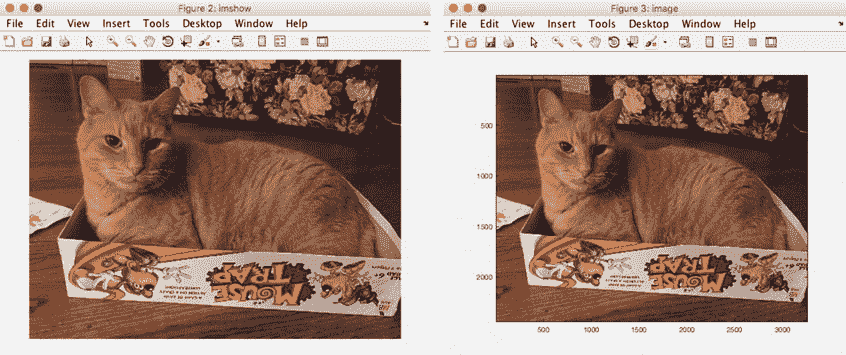

第 2 章

MATLAB 中机器学习数据的表示

DigitalCamera: [1x1 struct]

GPSInfo: [1x1 struct]

ExifThumbnail: [1x1 struct]

这些是元数据，它们告知相机软件和图像数据库图像的生成地点和方式。这在从图像中学习时非常有用，因为它允许你校正分辨率（宽度和高度）、位深度以及其他因素。

如果我们使用 `imshow` 查看此图像，它会发布一条警告，提示图像太大无法在屏幕上显示，并以 33% 的比例显示。如果我们使用 `image` 查看，则会看到一组可见的坐标轴。`image` 对于显示其他二维矩阵数据（例如每个像素的单个元素）很有用。这两个函数都返回一个图像对象的句柄；只是坐标轴的属性不同。

>> **figure**; hI = **image**(imread('IMG_2398_Zoom.png'))

hI =

Image with properties:

CData: [680x680x3 uint8]

CDataMapping: 'direct'

Show all properties

**图 2.1：**图像显示选项。


第 2 章

在 MATLAB 中为机器学习表示数据

**表 2.4：**图像关键函数

**函数**

**用途**

imread

读取多种格式的图像

imfinfo

收集图像文件的信息

imformats

判断结构中是否存在某个字段

imwrite

将数据写入图像文件

image

从数组显示图像

imagesc

显示缩放至当前颜色映射的图像数据

imshow

显示图像，优化图形、坐标轴和图像对象属性，并接受数组或文件名作为输入

rgb2gray

将数据写入图像文件

ind2rgb

将索引数据转换为 RGB

rgb2ind

将 RGB 数据转换为索引图像数据

fitsread

读取 FITS 文件

fitswrite

将数据写入 FITS 文件

fitsinfo

以数据结构返回 FITS 文件的信息

fitsdisp

显示文件中所有 HDU 的 FITS 文件元数据

**2.1.6 数据存储**

数据存储允许您处理包含数据但文件过大无法装入内存的文件。对于表格数据、图像、电子表格、数据库和自定义文件，存在不同类型的数据存储。每种数据存储都提供函数，用于提取适合内存分析的较小数据量。例如，您可以在一组图像中搜索具有最亮像素或最大饱和度值的图像。我们将以猫图像目录为例。

>> location = **pwd**

location =

/Users/Shared/svn/Manuals/MATLABMachineLearning/MATLAB/Cats

>> ds = datastore(location)

ds =

ImageDatastore 属性:

Files: {

' .../Shared/svn/Manuals/MATLABMachineLearning/MATLAB/

Cats/IMG_0191.png';

' .../Shared/svn/Manuals/MATLABMachineLearning/MATLAB/

Cats/IMG_1603.png';

' .../Shared/svn/Manuals/MATLABMachineLearning/MATLAB/

Cats/IMG_1625.png'

... 以及另外 19 个

}

Labels: {}

ReadFcn: @readDatastoreImage


第 2 章

在 MATLAB 中为机器学习表示数据

创建数据存储后，您可以使用相应的类函数与其进行交互。数据存储具有标准的容器式函数，例如 `read`、`partition` 和 `reset`。每种类型的数据存储都有不同的属性。`DatabaseDatastore` 需要 Database Toolbox，并允许您使用 SQL 查询。

MATLAB 提供了 MapReduce 框架来处理数据存储中的内存外数据。输入数据可以是任何数据存储类型，输出是一个键值数据存储。`map` 函数分块处理数据存储输入，`reduce` 函数计算每个键的输出值。通过与 MATLAB Parallel Computing Toolbox、Distributed Computer Server 或 Compiler 结合使用，可以加速 `mapreduce`。

**表 2.5：**数据存储的关键函数

**函数**

**用途**

`datastore`

创建数据存储

`read`

从数据存储中读取数据子集

`readall`

读取数据存储中的所有数据

`hasdata`

检查数据存储中是否还有更多数据

`reset`

使用文件夹内容初始化数据存储

`partition`

提取数据存储的一部分

`numpartitions`

估计合理的分区数量

`ImageDatastore`

图像文件列表的数据存储。

`TabularTextDatastore`

一个或多个表格文本文件的集合。

`SpreadsheetDatastore`

电子表格的数据存储。

`FileDatastore`

自定义格式文件的数据存储，您需要为其提供读取函数。

`KeyValueDatastore`

键值对的数据存储。

`DatabaseDatastore`

数据库连接，需要 Database Toolbox。

**2.1.7 高数组**

高数组是在 MATLAB 的 R2016b 版本中引入的。它们允许包含比内存能容纳的更多的行。您可以使用它们来处理可能包含数百万行的数据存储。高数组几乎可以使用任何 MATLAB 类型作为列变量，包括数值数据、元胞数组、字符串、日期时间和分类数据。MATLAB 文档提供了支持高数组的函数列表。对数组的操作结果仅在通过 `gather` 函数显式请求时才会被计算。`histogram` 函数可以与高数组一起使用，并且会立即执行。

MATLAB Statistic and Machine Learning Toolbox™、Database Toolbox、Parallel Computing Toolbox、Distributed Computing Server 和 Compiler 都提供了额外的扩展，用于处理高数组。有关此新功能的更多信息，请参阅文档中的以下主题：

• 高数组
• 使用高数组分析大数据
• 支持高数组的函数（A–Z）
• 索引和查看高数组元素
• 高数组的可视化
• 使用其他产品扩展高数组
• 高数组支持、使用说明和限制

**表 2.6：**高数组的关键函数

**函数**

**用途**

`tall`

初始化高数组

`gather`

执行请求的操作

`summary`

向命令行显示摘要信息

`head`

访问高数组的前几行

`tail`

访问高数组的后几行

`istall`

检查数组类型以确定是否为高数组

`write`


将高密度数组写入磁盘

**2.1.8 稀疏矩阵**

稀疏矩阵是一种特殊的矩阵类别，其中大部分元素为零。它们常见于大型优化问题中，并被许多此类软件包使用。零元素被“压缩”掉，MATLAB 仅存储非零元素及其索引数据，以便可以重建完整矩阵。许多常规的 MATLAB 函数，例如 `chol` 或 `diag`，会保留输入矩阵的稀疏性。

**2.1.9 表格与分类变量**

表格在 MATLAB R2013 版本中引入，允许将表格数据及其元数据存储在一个工作区变量中。这是一种存储和处理可能放入电子表格或从电子表格导入的数据的有效方式。表格列可以命名、分配单位和描述，并像访问数据结构中的字段一样进行访问，例如 `T.DataName`。

关于从文件创建表格，请参阅 `readtable`，或者尝试在命令窗口中使用“导入数据”按钮。


第 2 章

MATLAB 中机器学习数据的表示

**表 2.7：** 稀疏矩阵的关键函数

**函数**

**用途**

`sparse`

从完整矩阵或索引与值列表创建稀疏矩阵

`issparse`

判断矩阵是否为稀疏矩阵

`nnz`

稀疏矩阵中非零元素的数量

`spalloc`

为稀疏矩阵分配非零空间

`spy`

可视化稀疏模式

`spfun`

选择性地对稀疏矩阵的非零元素应用函数

`full`

将稀疏矩阵转换为完整形式

分类数组允许存储离散的非数值数据，并且通常在表格中用于定义行组。例如，时间数据可能包含星期几，地理数据可能按州或县组织。它们可以利用 `unstack` 来重新排列表格中的数据。

您还可以使用 `join`、`innerjoin` 和 `outerjoin` 将多个数据集合并到单个表格中，如果您使用过数据库，对这些函数会感到熟悉。

**表 2.8：** 表格的关键函数


**函数**

**用途**

table

在工作区中创建包含数据的表

readtable

从文件创建表

join

通过匹配变量合并表

innerjoin

连接表 A 和 B，仅保留匹配的行

outerjoin

连接表，包含所有行

stack

将多个表变量中的数据堆叠到一个变量中

unstack

将单个变量中的数据解堆叠到多个变量中

summary

计算并显示表的汇总数据

categorical

离散分类数据的数组

iscategorical

创建分类数组

categories

数组中的类别列表

iscategory

测试特定类别

addcats

向数组添加类别

removecats

从数组中移除类别

mergecats

合并类别


第 2 章

MATLAB 中机器学习数据的表示

**2.1.10 大型 MAT 文件**

你可以通过使用 `matfile` 函数访问大型 MAT 文件的部分内容，而无需将整个文件加载到内存中。这会创建一个与请求的 MAT 文件连接的对象，但不会加载它。仅当你请求特定变量或变量的一部分时，数据才会被加载。你还可以动态地向 MAT 文件添加新数据。

例如，我们可以加载后续章节生成的神经网络权重的 MAT 文件。

>> m = matfile('PitchNNWeights','Writable',true)

m =

matlab.io.MatFile

属性:

Properties.Source: '/Users/Shared/svn/Manuals/

MATLABMachineLearning/MATLAB/PitchNNWeights.mat'

Properties.Writable: true

w: [1x8 double]

我们可以访问之前未加载的 `w` 变量的一部分，或者添加一个新变量名，所有这些都通过这个对象 `m` 来完成。

>> y = m.w(1:4)

y =

>> m.name = 'Pitch Weights'

m =

matlab.io.MatFile

属性:

Properties.Source: '/Users/Shared/svn/Manuals/

MATLABMachineLearning/MATLAB/PitchNNWeights.mat'

Properties.Writable: true

name: [1x13 char]

w: [1x8

double]

>> d = **load**('PitchNNWeights')

d =

w: [1 1 1 1 1 1 1 1]

name: 'Pitch Weights'

对未加载数据的索引存在一些限制，例如结构体数组和稀疏数组。此外，`matfile` 要求使用版本 7.3 的 MAT 文件，而自 MATLAB R2016b 版本起，这并非通用保存操作的默认设置。你必须使用 `matfile` 创建 MAT 文件以利用这些特性，或者在保存文件时使用 `-v7.3` 标志。


第 2 章

MATLAB 中机器学习数据的表示

**2.2**

**使用参数初始化数据结构**

在代码库中，使用一个专门的函数来定义用作类型的数据结构总是一个好主意，这类似于编写一个类，但开销更小。用户随后可以在其代码中重载单个字段，但还有一种一次性设置多个字段的替代方法：一个能够处理参数对输入列表的初始化函数。这允许你在初始化函数中执行额外的处理。此外，你的参数字符串名称可以比字段名称更具描述性。

**2.2.1 问题**

我们希望初始化一个数据结构，以便用户清楚地知道他们正在输入什么。

**2.2.2 解决方案**

实现参数对的最简单方法是使用 `varargin` 和 `switch` 语句。或者，你可以编写一个 `inputParser`，它允许你指定必需输入、可选输入以及命名参数。在这种情况下，你必须编写单独的或匿名函数用于验证，这些函数可以传递给 `inputParser`，而不是直接在代码中写出验证逻辑。

**2.2.3 工作原理**

我们将以第 12 章中为汽车仿真开发的数据结构为例。标题列出了输入参数以及输入维度和单位（如果适用）。

%% AUTOMOBILEINITIALIZE 初始化汽车数据结构。

%

%% 格式

%

d = AutomobileInitialize( varargin )

%

%% 描述


% 使用参数对初始化数据结构。

%

%% 输入参数

% varargin:

('参数名',值,...)

%

% '质量'

(1,1) (kg)

% '转向角'

(1,1) (rad)

% '轮胎位置'

(2,4) (m)

% '正面阻力系数'

(1,1)

% '侧面阻力系数'

(1,1)

% '轮胎摩擦系数'

(1,1)

% '轮胎半径'

(1,1) (m)

% '发动机扭矩'

(1,1) (Nm)


第 2 章

MATLAB 中机器学习数据的表示

% '转动惯量'

(1,1) (kg-mˆ2)

% '状态'

(6,1) [m;m;m/s;m/s;rad;rad/s]

该函数首先使用一组默认值创建数据结构，然后处理用户输入的参数对。参数处理完成后，将根据尺寸和高度计算两个面积。

**function** d = AutomobileInitialize( varargin )

% 默认值

d.mass = 1513;

d.delta = 0;

d.r = [ 1.17 1.17 -1.68 -1.68;... -0.77 0.77 -0.77 0.77];

d.cDF = 0.25;

d.cDS = 0.5;

d.cF = 0.01; % 普通汽车轮胎在混凝土上

d.radiusTire = 0.4572; % m

d.torque = d.radiusTire*200.0; % N

d.inr = 2443.26;

d.x = [0;0;0;0;0;0];

d.fRR = [0.013 6.5e-6];

d.dim = [1.17+1.68 2*0.77];

d.h = 2/0.77;

d.errOld = 0;

d.passState = 0;

d.model = 'MyCar.obj';

d.scale = 4.7981;

**for** k = 1:2:**length**(varargin)

    **switch** **lower**(varargin{k})

        case 'mass'

            d.mass = varargin{k+1};

        case 'steering angle'

            d.delta = varargin{k+1};

        case 'position tires'

            d.r = varargin{k+1};

        case 'frontal drag coefficient'

            d.cDF = varargin{k+1};

        case 'side drag coefficient'

            d.cDS = varargin{k+1};

        case 'tire friction coefficient'

            d.cF = varargin{k+1};

        case 'tire radius'

            d.radiusTire = varargin{k+1};

        case 'engine torque'

            d.torque = varargin{k+1};

        case 'rotational inertia'


第 2 章

MATLAB 中机器学习数据的表示

            d.inertia = varargin{k+1};

        case 'state'

            d.x = varargin{k+1};

        case 'rolling resistance coefficients'

            d.fRR = varargin{k+1};

        case 'height automobile'

            d.h = varargin{k+1};

        case 'side and frontal automobile dimensions'

            d.dim = varargin{k+1};

        case 'car model'

            d.model = varargin{k+1};

        case 'car scale'

            d.scale = varargin{k+1};

    **end**

**end**

% 处理

d.areaF = d.dim(2)*d.h;

d.areaS = d.dim(1)*d.h;

d.g = LoadOBJ(d.model,[],d.scale);

要使用 inputParser 执行相同任务，需要为 switch 语句中的每一项添加 addRequired、addOptional 或 addParameter 调用。命名参数需要默认值。您可以选择指定一个验证函数；在下面的示例中，我们使用 isNumeric 将值限制为数值数据。

>> p = inputParser

p.addParameter('mass',0.25);

p.addParameter('cDF',1513);

p.parse('cDF',2000);

d = p.Results

p =

inputParser 具有以下属性:

    FunctionName: ''

    CaseSensitive: 0

    KeepUnmatched: 0

    PartialMatching: 1

    StructExpand: 1

    Parameters: {1x0 **cell**}

    Results: [1x1 struct]

    Unmatched: [1x1 struct]

    UsingDefaults: {1x0 **cell**}


第 2 章

MATLAB 中机器学习的数据表示

d =

包含以下字段的 struct：

cDF: 2000

mass: 0.2500

在此情况下，解析参数的结果存储在一个 Results 子结构中。

**2.3**

**对图像数据存储执行 MapReduce**

**2.3.1 问题**

我们在本章引言中讨论了数据存储类。现在，让我们使用它对完整的猫图像集执行分析，采用 mapreduce 方法，该方法可扩展至处理非常大量的图像。这涉及两个步骤：首先是一个 *map* 步骤，对数据存储进行操作并创建中间值；然后是一个 *reduce* 步骤，对中间值进行操作以生成最终输出。

**2.3.2 解决方案**

我们通过传入猫图像文件夹的路径来创建数据存储。我们还需要创建一个 map 函数和一个 reduce 函数，以传入 mapreduce。如果你正在使用其他工具箱，例如并行计算工具箱，则需要使用 mapreducer 指定 reduce 环境。

**2.3.3 工作原理**

首先，使用图像路径创建数据存储。

>> imds = imageDatastore('MATLAB/Cats');

imds =

包含以下属性的 ImageDatastore：

Files: {

' .../MATLABMachineLearning/MATLAB/Cats/IMG_0191.png';

' .../MATLABMachineLearning/MATLAB/Cats/IMG_1603.png';

' .../MATLABMachineLearning/MATLAB/Cats/IMG_1625.png'

... 以及另外 19 个 **文件**

}

Labels: {}

ReadFcn: @readDatastoreImage

其次，我们编写 map 函数。该函数必须生成并存储一组将由 reduce 函数处理的中间值。每个中间值都必须使用 add 作为键存储在中间键值数据存储中。在此情况下，map 函数每次被调用时将接收一张图像。我们将其命名为 catColorMapper，因为它使用简单的平均值处理每张图像的红色、绿色和蓝色值。


第 2 章

MATLAB 中机器学习的数据表示

**function** catColorMapper(data, **info**, intermediateStore)

% 计算平均 (R,G,B) 值

avgRed = **mean**(**mean**(data(:,:,1)));

avgGreen = **mean**(**mean**(data(:,:,2)));

avgBlue = **mean**(**mean**(data(:,:,3)));

% 使用文本键存储计算出的值

add(intermediateStore, 'Avg Red', struct('Filename', **info**.Filename, 'Val', avgRed));

add(intermediateStore, 'Avg Green', struct('Filename', **info**.Filename, 'Val', avgGreen));

add(intermediateStore, 'Avg Blue', struct('Filename', **info**.Filename, 'Val', avgBlue));

然后，reduce 函数将针对中间数据中的每个键，从数据存储中接收一次图像文件列表。它接收一个指向中间数据存储的迭代器以及一个输出数据存储。同样，每个输出必须是一个键值对。所使用的 hasnext 和 getnext 函数是 mapreduce 的 ValueIterator 类的一部分。在此情况下，我们找出所有图像中每个键的最小值。

**function** catColorReducer(key, intermediateIter, outputStore)

% 遍历每个键的值

minVal = 255;

minImageFilename = '';

**while** hasnext(intermediateIter)

value = getnext(intermediateIter);

% 比较值以找出最小值

**if** value.Val < minVal

minVal = value.Val;

minImageFilename = value.Filename;

**end**

**end**

% 添加最终的键值对

add(outputStore, ['Minimum - ' key], minImageFilename);

最后，我们使用指向两个辅助函数的函数句柄调用 mapreduce。进度更新会打印到命令行，首先是映射步骤，然后是 reduce 步骤（一旦映射进度达到 100%）。


minRGB = mapreduce(imds, @catColorMapper, @catColorMapper);


第 2 章

在 MATLAB 中为机器学习表示数据

********************************

*

MAPREDUCE 进度

*

********************************

Map

0% Reduce

0%

Map

13% Reduce

0%

Map

27% Reduce

0%

Map

40% Reduce

0%

Map

50% Reduce

0%

Map

63% Reduce

0%

Map

77% Reduce

0%

Map

90% Reduce

0%

Map 100% Reduce

0%

Map 100% Reduce

33%

Map 100% Reduce

67%

Map 100% Reduce 100%

结果存储在一个 MAT 文件中，例如，results 1 28-Sep-2016 16-28-38 347。返回的存储是一个指向该 MAT 文件的键值存储，而该 MAT 文件又包含最终键值结果的存储。

>> output = readall(minRGB)

output =

Key

Value

_______________

______________________________________________

''Minimum - Avg Red'

'/MATLAB/Cats/IMG_1625.png'

''Minimum - Avg Blue'

'/MATLAB/Cats/IMG_4866.jpg'

''Minimum - Avg Green'

'/MATLAB/Cats/IMG_4866.jpg'

你会注意到这些图像文件是不同的文件类型。这是因为它们来自不同的来源。MATLAB 能够很好地处理大多数图像类型。

**2.4**

**从文件创建表**

在处理大数据时，我们经常会在多个文件中遇到复杂的数据。MATLAB 提供了函数来简化处理海量数据集的过程。在本节中，我们将从一组气象文件中收集数据，并对两年的数据执行快速傅里叶变换（FFT）。首先，我们将编写 FFT 函数。

**2.4.1 问题**

我们想要进行 FFT。


第 2 章

在 MATLAB 中为机器学习表示数据

**2.4.2 解决方案**

编写一个使用 `fft` 的函数，并计算 FFT 的能量。能量就是 FFT 输出与其转置乘积的实部。

**2.4.3 工作原理**

以下函数接收带有采样时间 `tSamp` 的数据 `y`，并执行 FFT

**function** [e, w] = FFTEnergy( y, tSamp )

% 演示

**if**( **nargin** < 1 )

Demo;

**return**;

**end**

[n, m] = **size**( y );

**if**( n < m )

y = y';

**end**

n = **size**( y, 1 );

% 检查是否为奇数并使其变为偶数

**if**(2***floor**(n/2) ~= n )

n = n - 1;

y = y(1:n,:);

**end**

x = **fft**(y);

e = **real**(x.***conj**(x))/n;

hN = n/2;

e = e(1:hN,:);

r = 2***pi**/(n*tSamp);

w = r*(0:(hN-1));

**if**( **nargout** == 0 )

tL = **sprintf**('FFT 能量图：分辨率 = %10.2e 弧度/秒',r); PlotSet(w,e','x 标签','频率 (弧度/秒)','y 标签', '能量',

'绘图标题', tL,'绘图类型', 'xlog', '图形标题', 'FFT');

**clear** e

**end**

我们通过以下两行代码获取能量

x = **fft**(y);


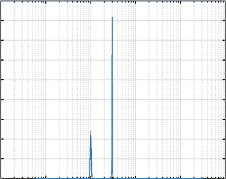

第 2 章

在 MATLAB 中为机器学习表示数据

取实部只是为了处理数值误差。一个数与其复共轭的乘积应该是实数。

该函数计算分辨率。注意，它是采样周期和点数的函数。

e = e(1:hN,:);

内置的演示创建了一个包含频率为 1 弧度/秒和另一个频率为 2 弧度/秒的序列。频率较高、振幅为 2 的序列，其能量也如预期般更大。

**end**

**function** Demo

%% 演示

tSamp = 0.1;

omega1 = 1;

omega2 = 3;

t = **linspace**(0,1000,10000)*tSamp;

y = **sin**(omega1*t) + 2***sin**(omega2*t);


图 2.2 展示了数据及其 FFT 结果。请注意，FFT 图中清晰可见的频率与时间图中的振荡相匹配。

**图 2.2：** FFT 的输入数据及其结果。

**FFT 数据**

**FFT 能量图：分辨率 = 6.28e-03 rad/sec**

能量

振幅

10-3

10-2

10-1

时间 (秒)

频率 (弧度/秒)

**2.5**

**处理表格数据**

**2.5.1 问题**

我们希望使用表格中的数据比较 1999 年和 2015 年的温度频率。


第 2 章

在 MATLAB 中为机器学习表示数据

**2.5.2 解决方案**

使用 `tabularTextDatastore` 加载数据，并对数据执行 FFT。

**2.5.3 工作原理**

首先，让我们看看从气象文件读取数据时会发生什么。

>> tds = tabularTextDatastore('./Weather')

tds =

TabularTextDatastore 属性：

Files: {

' .../MATLABMachineLearning2/MATLAB/

Chapter_02/Weather/HistKTTN_1990.txt

';

' .../MATLABMachineLearning2/MATLAB/

Chapter_02/Weather/HistKTTN_1993.txt

';

' .../MATLABMachineLearning2/MATLAB/

Chapter_02/Weather/HistKTTN_1999.txt

'

... 以及另外 5 个文件

}

FileEncoding: 'UTF-8'

AlternateFileSystemRoots: {}

ReadVariableNames: true

VariableNames: {'EST', 'MaxTemperatureF', '

MeanTemperatureF' ... 以及另外 20 个}

文本格式属性：

NumHeaderLines: 0

Delimiter: ','

RowDelimiter: '\r\n'

TreatAsMissing: ''

MissingValue: **NaN**

高级文本格式属性：

TextscanFormats: {'%{uuuu-MM-dd}D', '%f', '%f' ... 以及另外 20

个}

TextType: 'char'

ExponentCharacters: 'eEdD'

CommentStyle: ''

Whitespace: ' \b\t'

MultipleDelimitersAsOne: false


第 2 章

在 MATLAB 中为机器学习表示数据

控制 `preview`、`read`、`readall` 返回表格的属性：

SelectedVariableNames: {'EST', 'MaxTemperatureF', '

MeanTemperatureF' ... 以及另外 20 个}

SelectedFormats: {'%{uuuu-MM-dd}D', '%f', '%f' ... 以及另外 20

个}

ReadSize: 20000 行

`WeatherFFT` 选择要使用的数据。它会在文件中的杂乱数据中找到所有数据。

运行脚本时，您需要位于与 `WeatherFFT` 相同的文件夹中。

tDS

= tabularTextDatastore('./Weather/');

tDS.SelectedVariableNames = {'EST','MaxTemperatureF'};

preview(tDS)

secInDay = 86400;

z = readall(tDS);

% 单元格数组中的第一列是日期。year 提取年份

y

= year(z{:,1});

k1993 = **find**(y == 1993);

k2015 = **find**(y == 2015);

tSamp = secInDay;

t

= (1:365)*tSamp;

j

= {[1 2]};

%% 绘制 FFT

% 获取 1993 年数据

d1993

= z{k1993,2}';

m1993

= **mean**(d1993);

d1993

= d1993 - m1993;

e1993

= FFTEnergy( d1993, tSamp );

% 获取 2015 年数据

d2015

= z{k2015,2}';

如果数据不存在，`TabularTextDatastore` 会在数据点位置放置 `NaN`。

我们恰好选择了两个没有缺失数据的年份。我们使用 `preview` 来查看我们得到的数据。

>> WeatherFFT

警告：变量名已被修改，以使其成为有效的 MATLAB

标识符。


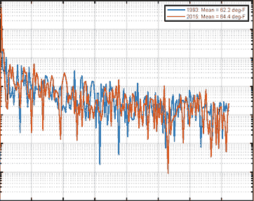

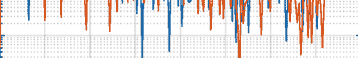

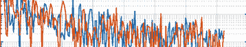

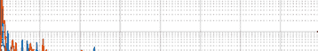

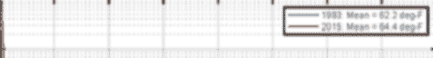


第 2 章

在 MATLAB 中为机器学习表示数据

**ans** =

8x2 表格

EST

MaxTemperatureF

__________

_______________

1990-01-01


1990-01-02

1990-01-03

1990-01-04

1990-01-05

1990-01-06

1990-01-07

1990-01-08

在本脚本中，我们从 `FFTEnergy` 获取输出，以便组合绘图。我们选择将数据放在同一坐标轴上。图 2.3 展示了温度数据和 FFT 结果。

**图 2.3：**1993 年和 2015 年数据。

**温度**

**FFT 数据**

1993 年：平均值 = 62.2 华氏度

1993 年：平均值 = 62.2 华氏度

2015 年：平均值 = 64.4 华氏度

2015 年：平均值 = 64.4 华氏度

幅值

振幅（华氏度）

10-1

10-2

0.5

1.5

2.5

3.5

0.5

1.5

2.5

3.5

天数

弧度/秒

10-5

我们使用 `plotset` 进行了一些美化。图例条目经过计算，包含了平均温度。

`d2015 = d2015 - m2015;`

`[e2015,f] = FFTEnergy( d2015, tSamp );`

`lG = {{**sprintf**('1993: Mean = %4.1f deg-F',m1993) **sprintf**('2015: Mean = %4.1f deg-F',m2015)}};`

`PlotSet(t,[d1993;d2015], 'x label', 'Days', 'y label','Amplitude ( deg-F)',...`


第 2 章

在 MATLAB 中为机器学习表示数据

`'plot title','Temperature', 'figure title', 'Temperature','legend', lG,'plot set',j);`

**2.6**

**使用 MATLAB 字符串**

机器学习通常需要与人类交互，这往往意味着要处理语音。此外，专家系统和模糊逻辑系统可以利用文本描述。MATLAB 的字符串数据类型使这变得更加容易。字符串由双引号括起来。在本节中，我们将给出一些适用于字符串但不适用于字符数组的操作示例。

**2.6.1 字符串拼接**

**2.6.1.1 问题**

我们希望拼接两个字符串。

**2.6.1.2 解决方案**

创建两个字符串，并使用“+”运算符。

**2.6.1.3 工作原理**

你可以使用 `+` 运算符来拼接字符串。结果是将第二个字符串附加在第一个字符串之后。

>> a = "12345";

>> b = "67";

>> c = a + b

c =

"1234567"

**2.6.2 字符串数组**

**2.6.2.1 问题**

我们希望得到一个字符串数组。

**2.6.2.2 解决方案**

创建两个字符串，并将它们放入一个矩阵中。

**2.6.2.3 工作原理**

我们创建与上面相同的两个字符串，并使用矩阵运算符。如果它们是字符数组，我们需要用空格填充较短的字符串，使其与较长的字符串大小相同。

>> a = "12345";

>> b = "67";

>> c = [a;b]

c =

2$\times$1 字符串数组


第 2 章

在 MATLAB 中为机器学习表示数据

"12345"

"67"

>> c = [a b]

c =

1$\times$2 字符串数组

"12345"

"67"

你也可以使用元胞数组来实现这一点，但字符串通常更方便。

**2.6.3 子字符串**

**2.6.3.1 问题**

我们希望获取固定前缀之后的字符串。

**2.6.3.2 解决方案**

创建一个字符串数组，并使用 `extractAfter`。

**2.6.3.3 工作原理**

创建一个待搜索的字符串数组，并使用 `extractAfter`。

>> a = ["1234";"12456";"12890"];

f = extractAfter(a,"12")

f =

3$\times$1 字符串数组

"34"

"456"

"890"

大多数字符串函数都适用于 `char`，但**字符串**更简洁一些。以下是使用**元胞**数组的上述示例。

>> a = {'1234';'12456';'12890'};

>> f = extractAfter(a,"12")

f =

3$\times$1 **元胞**数组

{'34' }

{'456'}

{'890'}


第 2 章

在 MATLAB 中为机器学习表示数据

**2.7**

**总结**

MATLAB 中有多种数据容器，可帮助您分析用于机器学习的数据。如果您可以访问计算机集群或专门的计算工具箱，您将有更多选择。表 2.9 列出了随附代码中包含的函数和脚本。


**表 2.9：**章节代码清单

**文件**

**描述**

AutomobileInitialize

第 12. 章的数据结构初始化示例

catReducer

与 mapreduce 配合使用的图像数据存储。

FFTEnergy

从 FFT 计算能量。

weatherFFT

对天气数据进行 FFT。


**第 3 章**

**MATLAB 图形**

机器学习面临的一个问题在于理解算法以及算法为何做出特定决策。此外，你还希望能够轻松理解这些决策。MATLAB 拥有丰富的图形工具，可用于实现这一目的。

绘图在机器学习问题中被广泛使用。MATLAB 的绘图可以是二维或三维的。MATLAB 还提供了多种绘图类型，例如线图、条形图和饼图。不同类型的绘图更适合传达特定类型的数据。MATLAB 还具备强大的曲面和等高线绘图能力，能够以易于理解的方式显示复杂数据。另一个功能是三维建模。你可以绘制动画对象，例如机器人或汽车。当你的机器学习涉及仿真时，这些功能尤其有价值。

MATLAB 图形的一个重要部分是图形用户界面（GUI）的构建。

MATLAB 拥有丰富的 GUI 制作工具。这些工具是让你的设计工具或机器学习系统易于用户操作的一种宝贵方式。

本章将介绍 MATLAB 中多种多样的图形工具。

它们应能让你为自己的应用充分利用 MATLAB 的图形功能。

**3.1**

**二维线图**

**3.1.1 问题**

你希望用一个函数来生成二维线图，避免为生成每个图形编写一长串代码。

**3.1.2 解决方案**

编写一个函数，接收数据以及 *参数对*，以封装 MATLAB 二维线图函数的功能。图 3.1 展示了一个用单行代码创建的绘图示例。

© Michael Paluszek 和 Stephanie Thomas 2019

M. Paluszek 和 S. Thomas， *MATLAB 机器学习秘籍*，

[`doi.org/10.1007/978-1-4842-3916-2_3`](https://doi.org/10.1007/978-1-4842-3916-2_3)


第 3 章

MATLAB 图形

**图 3.1：**PlotSet 的内置演示。

**cos**

A

B

0.5

y

-0.5

x

**sin**

0.5

y

-0.5

x

**3.1.3 工作原理**

PlotSet 生成二维图，包括在一页上显示多个图。

**function** h = PlotSet( x, y, varargin )

这段代码将 varargin 作为参数对进行处理以设置选项。一个参数对包含两个输入。第一个是值的名称，第二个是值。例如，用于标记 x 轴的参数对是：

'x label','Time (s)'

varargin 使得扩展绘图选项变得容易。核心函数代码如下所示。我们为 *x* 和 *y* 轴标签以及图形名称提供了默认值。参数对在 switch 语句中处理。以下代码是当所有图只有一个 x 轴标签时的分支。它根据 plotSet 中的数据（一个元胞数组）来排列图形。

**for** k = 1:m

**subplot**(m,nCol,k);

j = plotSet{k};

**for** i = 1:**length**(j)

plotXY(x,y(j(i),:),plotType);

**hold** on

**end**


第 3 章

MATLAB 图形

**hold** off

**xlabel**(xLabel{1});

**ylabel**(yLabel{k});

**if**( **length**(plotTitle) == 1 )

**title**(plotTitle{1})

**else**

**title**(plotTitle{k})

**end**

**if**( ˜**isempty**(leg{k}) )

**legend**(leg{k});

**end**

**grid** on

**end**

绘图操作是在名为 plotXY 的子函数中完成的。在这里，你可以看到所有熟悉的 MATLAB 绘图函数调用。

**function** plotXY(x,y, **type**)

switch **type**

case 'plot'

**plot**(x,y);

case {'log' 'loglog' 'log log'}

**loglog**(x,y);

case {'xlog' 'semilogx' 'x log'}

**semilogx**(x,y);

case {'ylog' 'semilogy' 'y log'}

**semilogy**(x,y);

otherwise

**error**('%s 不是可用的绘图类型', **type**);

**end**

图 3.1 中的示例是由 PlotSet 函数末尾的一个专用演示函数生成的。该演示展示了该函数的几个特性，包括：1. 每张图的多条曲线
2. 图例
3. 图标题
4. 默认坐标轴标签

使用专用的演示子函数是一种为函数提供内置示例的简洁方式，并且在图形函数中提供典型绘图的示例尤为重要。代码如下所示。

**function** Demo

x = **linspace**(1,1000);

y = [**sin**(0.01*x); **cos**(0.01*x); **cos**(0.03*x)];

**disp**('PlotSet: 一个 x 和两个 y 行')


第 3 章

MATLAB 图形

**3.2**

**通用二维图形**

**3.2.1 问题**

你希望以不同的方式表示二维数据集。线图非常有用，但有时以不同形式可视化数据会更简单。MATLAB 提供了许多用于二维图形显示的函数。

**3.2.2 解决方案**

编写一个脚本来展示 MATLAB 不同的二维绘图类型。在我们的示例中，我们在一个图形中使用子图来帮助减少图形数量。

**3.2.3 工作原理**

使用 NewFigure 函数创建一个带有合适名称的新图形窗口。然后运行以下脚本。

>> NewFigure('我的图形名称')

**ans** =

Figure (1: 我的**图形**名称) 具有以下属性:

Number: 1

Name: '我的图形名称'

Color: [0.9400 0.9400 0.9400]

Position: [560 528 560 420]

Units: 'pixels'

显示**所有**属性

**subplot**(4,1,1);

**plot**(x,y);

**subplot**(4,1,2);

**bar**(x,y);

**subplot**(4,1,3);

barh(x,y);

ax4 = **subplot**(4,1,4);

pie(y)

**colormap**(ax4,'gray')

这里展示了四种有助于显示二维数据的绘图类型。第一种是二维线图，与 PlotSet 中使用的相同。中间两种是条形图。最后一种是饼图。每种类型都能让你对数据有不同的洞察。图 3.2 展示了这些绘图类型。

有许多 MATLAB 函数可以让这些图更具信息性。你可以：

• 添加标签
• 添加网格


第 3 章

MATLAB 图形

**图 3.2：** 四种不同类型的 MATLAB 二维图。

0.5

0.5

0.1

0.2

0.3

0.4

0.5

0.6

0.7

0.8

0.9

10% 9%

2%

2%

5%

21%

19%

3%

11%

18%

• 更改字体类型和大小
• 更改线条粗细
• 添加图例
• 更改坐标轴范围

最后一项需要查看坐标轴的属性。以下是最后一个图的属性——列表非常长！gca 是当前坐标轴的句柄。get(gca) 会返回一个巨大的列表，我们在此不打印。其中每一个属性都可以通过使用 set 函数来更改：

**set**(**gca**,'YMinorGrid','on','YGrid','on')

这与 PlotSet 一样使用参数对。在此列表中，children 是指向坐标轴子对象的指针。你可以使用 get 访问它们，并使用 set 更改它们的属性。任何添加到坐标轴上的项目，例如坐标轴标签、标题、线条或其他图形对象，都是该坐标轴的子对象。


第 3 章

MATLAB 图形

**3.3**

**自定义二维图表**

**3.3.1 问题**

许多机器学习算法受益于二维图表（例如树状图），以帮助用户理解结果和软件的操作。由软件自动生成的此类图表在许多类型的学习系统中都很有用。本节给出了如何为树状图编写 MATLAB 代码的示例。

**3.3.2 解决方案**

我们的解决方案是使用 MATLAB 的 patch 函数自动生成块，并使用 line 函数在 TreeDiagram 函数中生成连接线。图 3.3 显示了生成的层次树状图。圆圈按行排列，每行都有标签。

**3.3.3 工作原理**

树状图对于机器学习非常有用。此函数生成一个层次树状图，节点为圆圈，每个节点内包含文本。此函数中使用的图形函数是：

1. line
2. patch
3. text

绘制树所需的数据包含在一个数据结构中，该结构在头部有文档说明。每个节点都有一个父节点字段。这些信息足以建立连接。

节点数据以元胞数组的形式输入。

**图 3.3：** 一个自定义树状图。

第 1 行

第 2 行

第 3 行

第 4 行


第 3 章

MATLAB 图形

该函数使用一个图形句柄作为持久变量，以便在需要时可以通过后续调用更新同一个图形。

**if**( ˜update )

figHandle = NewFigure(w.name);

**else**

**clf**(figHandle)

**end**

核心绘图代码位于 DrawNode 中，它绘制方框；以及 ConnectNode 中，它用线条连接节点。我们的节点是带有 20 个线段的圆。linspace 代码确保 0 和 2 *π* 都不在角度列表中。

**function** [xC,yCT,yCB] = DrawNode( x0, y0, k, w )

n = 20;

a = **linspace**(0,2***pi***(1-1/n),n);

x = w.width***cos**(a)/2 + x0;

y = w.width***sin**(a)/2 + y0;

**patch**(x,y,'w');

**text**(x0,y0, **sprintf**('%d',k),'fontname',w.fontName,'fontsize',w.fontSize,'horizontalalignment','center');

xC = x0;

yCT = y0 + w.width/2;

yCB = y0 - w.width/2;

%% TreeDiagram>ConnectNode

**function** ConnectNode( n, nP, w )

x = [n.xC nP.xC];

y = [n.yCT nP.yCB];

**line**(x,y,'linewidth',w.linewidth,'color',w.linecolor);

TreeDiagram 中的内置演示。

**3.4**

**三维方框**

三维图形有两大类。一类是绘制物体，比如地球。另一类是绘制大型数据集。本小节以及下一小节将向你展示如何实现这两种情况。


第 3 章

MATLAB 图形

**3.4.1 问题**

我们希望绘制一个三维方框。

**3.4.2 解决方案**

Box3 函数使用 patch 函数来绘制该物体。图 3.4 显示了一个示例。

**3.4.3 工作原理**


三维物体由顶点和面构成。顶点是空间中的一个点。你需要创建一个顶点列表，这些顶点是三维物体的角点。然后创建面，面是顶点的列表。有两个顶点的面是一条线，有三个顶点的面是一个三角形。多边形可以有任意数量的顶点。然而，在底层，图形处理器处理的是三角形，因此最好将所有面片都做成三角形。你会注意到法线 **图 3.4：** 一个用面片绘制的盒子。

1.5

0.5

**z**

-0.5

-1.5

0.5

0.5

-0.5

**y**

-0.5

**x**


第 3 章

MATLAB 图形

**图 3.5：** 一个面片。法线朝向相机或物体的“外部”。

法线

向量。这是向外指向的向量。面片中的顶点应按照右手定则排序，也就是说，如果法线方向是你的拇指方向，那么面的顺序就是你的手指弯曲的方向。在此图中，两个三角形的顺序应为：

[3 2 1]

[1 4 3]

MATLAB 的光照对顶点顺序要求并不严格，但如果你要导出模型，则需要遵循此约定。否则，你最终可能会得到内外颠倒的物体！

以下代码创建了一个由三角形面片组成的盒子。面和顶点数组是手动创建的。顶点每行一个，因此顶点数组是 n 行 3 列。面数组是 n 行 m 列，其中 m 是每个面最多拥有的顶点数。在 Box 函数中，我们只处理三角形。

所有图形处理器最终都会绘制三角形，因此，如果可能，最好只使用三角形来创建物体。

**function** [v, f] = Box( x, y, z )

% 演示

**if**( **nargin** < 1 )

Demo

**return**

**end**

% 面

f

= [2 3 6;3 7 6;3 4 8;3 8 7;4 5 8;4 1 5;2 6 5;2 5 1;1 3 2;1 4 3;5

6 7;5 7 8];


第 3 章

MATLAB 图形

% 顶点

v = [-x

x

x -x -x

x

x -x;...

-y -y

y

y -y -y

y

y;...

-z -z -z -z

z

z

z

z]'/2;

% 默认输出

**if**( **nargout** == 0 )

DrawVertices( v, f, 'Box' );

**clear** v

**end**

该盒子是在 DrawVertices 函数中使用 patch 绘制的。这里只调用了一次 patch。patch 接受参数对来指定面和边的颜色以及面片的许多其他特性。一个面片只能指定一种颜色。如果你想要一个每个面颜色不同的盒子，则需要使用多个面片。我们启用 rotate3d，以便可以用鼠标重新定向物体。view3 是标准的 MATLAB 视图，视角从网格盒子的一个角向下看。

NewFigure(name)

**patch**('vertices',v,'faces',f,'facecolor',[0.8 0.1 0.2]);

**axis image**

**xlabel**('x')

**ylabel**('y')

**zlabel**('z')

参见 SimGUI.m 和 SimGUI.fig。

**view**(3)

**grid** on

rotate3d on

我们只使用最基本的光照。你可以使用 light 在绘图中添加各种光源。光源可以是环境光，也可以来自多种光源。

**3.5**

**绘制带纹理的三维物体**

**3.5.1 问题**

我们想要绘制一个带纹理的行星。

**3.5.2 解决方案**

使用曲面并在曲面上叠加纹理。图 3.6 展示了一个使用 Globe 函数绘制冥王星近期图像的示例。

>> Globe

**ans** =

Figure (2: Globe) with properties:


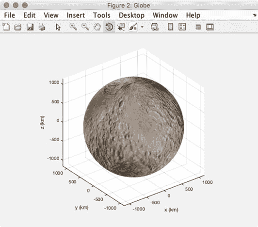

第 3 章

MATLAB 图形

**图 3.6：** 冥王星的三维球体。

Number: 2

Name: 'Globe'

Color: [0.9400 0.9400 0.9400]

Position: [560 528 560 420]

Units: 'pixels'

显示 **所有** 属性

**3.5.3 工作原理**

我们首先生成球面上的 *x, y, z* 点，然后叠加从图像文件中读取的纹理，从而生成图片。可以使用 imread 从文件中读取纹理贴图。

如果是彩色图像，它将是一个三维矩阵。第三个元素是颜色索引，对应红色、蓝色或绿色。但是，如果是灰度图像，则必须通过复制图像来创建三维的“颜色”矩阵。

p = imread('PlutoGray.png');

p3(:,:,1) = p;

p3(:,:,2) = p;

p3(:,:,3) = p;


起始点 `p` 是一个二维矩阵。

首先，你使用由 `sphere` 函数生成的坐标来创建曲面。

这一步通过 `surface` 函数完成。然后，你应用纹理：


第 3 章

MATLAB 图形

**for** i = 1:3

planetMap(:,:,i) = **flipud**(planetMap(:,:,i));

**end**

**set**(hSurf,'Cdata',planetMap,'Facecolor','texturemap');

**set**(hSurf,'edgecolor', 'none',...

'EdgeLighting', 'phong','FaceLighting', 'phong',...

'specularStrength',0.1,'diffuseStrength',0.9,...

'SpecularExponent',0.5,'ambientStrength',0.2,...

'BackFaceLighting','unlit');

`flipup` 使地图看起来“正常”。Phong 是一种光照类型。它获取顶点处的颜色，并基于插值后的法线，在多边形上的像素点处插值颜色。Diffuse 和 specular 指的是不同类型的光反射。当你将纹理应用到曲面时，它们并不太重要。

**3.6**

**通用 3D 图形**

**3.6.1 问题**

我们想使用 3D 图形来研究一个 2D 数据集。一个 2D 数据集是一个矩阵，或者说是一个 n 行 m 列的数组。

**3.6.2 解决方案**

使用 MATLAB 的 `surface`、`mesh`、`bar` 和 `contour` 函数。`TwoDDataDisplay` 给出了一个随机数据集的示例，其不同可视化效果展示在图 3.7 中。

**3.6.3 工作原理**

我们使用 `rand` 生成一个 8x8 的随机 2D 数据集。我们在一个带有子图的图形窗口中，以多种方式显示它。在这个例子中，我们创建了两行三列的子图。图 3.7 展示了六种类型的 2D 图。`surf`、`mesh` 和 `surfl`（带光照的 3D 着色曲面）非常相似。当应用光照时，曲面图会更有趣。两个 `bar3` 图展示了为条形着色的不同方式。在第二个条形图中，颜色随长度变化。这需要一些代码来更改 `CData` 和 `FaceColor`。

m = **rand**(8,8);

h = NewFigure('二维数据');

**colormap**(h,'gray')

**subplot**(2,3,1)

**surf**(m)

**title**('surf')

**subplot**(2,3,2)

**surfl**(m,'light')


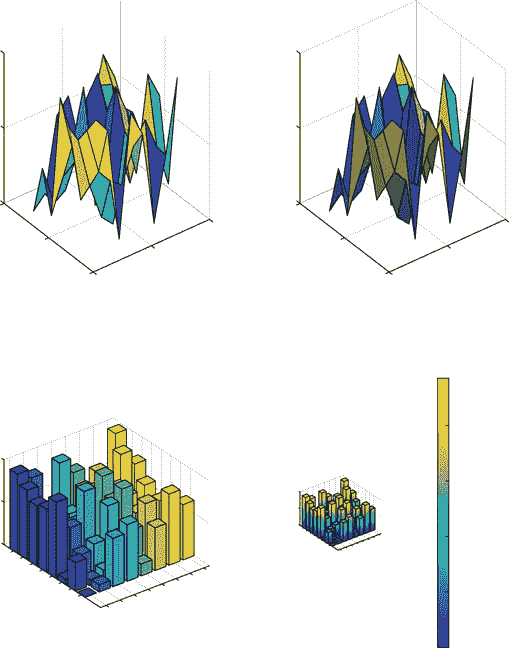


第 3 章

MATLAB 图形

**图 3.7：** 使用六种不同绘图类型显示的二维数据。

**surf**

**surfl**

**mesh**

0.5

0.5

0.5

**contour**

**bar3**

0.8

**bar3**

0.6

0.5

0.5

0.4

0.2

**title**('surfl')

**subplot**(2,3,3)

**mesh**(m)

**title**('mesh')

**subplot**(2,3,4)

bar3(m)

**title**('bar3')

**subplot**(2,3,5)

h = bar3(m);

**title**('bar3')

**colorbar**

**for** k = 1:**length**(h)


第 3 章

MATLAB 图形

zdata = h(k).ZData;

h(k).CData = zdata;

h(k).FaceColor = 'interp';

**end**

**subplot**(2,3,6)

**contour**(m);

**title**('contour')

**3.7**

**构建 GUI**

**3.7.1 问题**

我们想要一个 GUI 来为二阶系统仿真提供图形界面。

**3.7.2 解决方案**

我们将使用 MATLAB 的 GUIDE 来构建一个 GUI，该 GUI 允许我们：1. 设置阻尼常数

2. 设置仿真的结束时间

3. 设置输入类型（脉冲、阶跃或正弦波）

4. 显示输入和输出图

**3.7.3 工作原理**

我们想要构建一个 GUI 来与下面所示的 `SecondOrderSystemSim` 交互。`SecondOrderSystemSim` 的第一部分是在一个循环中的仿真代码。

omega

= **max**([d.omega d.omegaU]); % 仿真的最大频率

dT

= 0.1*2***pi**/omega; % 从频率获取时间步长

n

= **floor**(d.tEnd/dT); % 获取整数步数

xP

= **zeros**(2,n); % 设置绘图数组大小

x

= [0;0]; % [位置;速度] 的初始条件

t

= 0; % 初始时间

**for** k = 1:n

[˜,u]

= RHS(t,x,d);

xP(:,k) = [x(1);u];

x

= RungeKutta( @RHS, t, x, dT, d );

t

= t + dT;

**end**


第 3 章


MATLAB 图形

**图 3.8：** 二阶系统仿真。

x

-20 0

时间（秒）

0.8

0.6

u

0.4

0.2

0 0

时间（秒）

运行后得到图 3.8 所示的图形。绘图代码如下：

[t,tL] = TimeLabel((0:n-1)*dT);

**if**( **nargout** == 0 )

PlotSet(t,xP,'x label',tL,'y label', {'x' 'u'}, 'figure title','

Filter');

**end**

`TimeLabel` 会根据仿真时长生成合理的时间单位，并自动重新缩放时间向量。该函数内置了仿真循环。

MATLAB 的 GUI 构建系统 GUIDE 通过在命令行输入 `guide` 来启动。我们使用的是 MATLAB R2018a 版本。您的版本可能存在细微差异。

GUI 模板有多种选择，也可以选择空白 GUI。我们将从空白 GUI 开始。首先，根据上述所需功能列表，列出我们将需要的控件：

• 用于输入以下内容的编辑框：

**–** 仿真时长

**–** 阻尼比

**–** 无阻尼自然频率

**–** 正弦输入频率

**–** 脉冲开始和结束时间


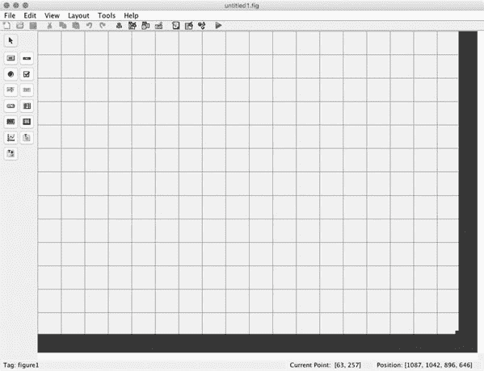

第 3 章

MATLAB 图形

**图 3.9：** 空白 GUI。

• 用于选择输入类型的单选按钮

• 用于启动仿真的运行按钮

• 绘图坐标轴

我们在命令窗口中输入“guide”，系统会提示我们选择现有 GUI 或创建新 GUI。我们选择空白 GUI。图 3.9 显示了在 GUIDE 中尚未进行任何修改时的模板 GUI。您可以通过从左侧的表格中拖放来添加元素。

图 3.10 显示了 GUI 检查器。您可以在此处编辑 GUI 元素。可以看到这些元素具有许多属性。我们不打算将这个 GUI 做得非常精美，但稍加努力，您就能让它成为一件艺术品。我们将要修改的是标签（tag）和文本（text）属性。标签为软件提供了一个内部使用的名称。文本则是在设备上显示的内容。

然后，我们通过拖放添加所有所需的元素。我们选择将 GUI 命名为“GUI”。生成的初始 GUI 如图 3.11 所示。在每个元素的检查器中，您会看到一个“标签”字段。将诸如 `edit1` 之类的名称更改为您容易识别的名称。当您保存它们并从 `.fig` 文件运行 GUI 时，`GUI.m` 中的代码将自动更改。

我们创建一个单选按钮组并添加单选按钮。这样可以处理除所选单选按钮之外的所有按钮的禁用。当您点击布局框中的绿色箭头时，它会将所有更改保存到 m 文件中并进行仿真。如果有错误，它会发出警告。


第 3 章

MATLAB 图形

**图 3.10：** GUI 检查器。

至此，我们可以开始编写 GUI 代码本身了。模板 GUI 将其数据（根据用户在编辑框中输入的数据计算得出）存储在一个名为 `simdata` 的字段中。自动生成的代码位于 `SimGUI` 中。

当 GUI 加载时，我们使用默认数据结构中的数据初始化文本字段。确保初始化内容与 GUI 中显示的内容一致。您需要小心处理单选按钮和按钮状态。

**function** SimGUI_OpeningFcn(hObject, eventdata, handles, varargin)

% 为 SimGUI 选择默认命令行输出

handles.output = hObject;

% 获取默认数据

handles.simData = SecondOrderSystemSim;

% 设置默认状态

**set**(handles.editDuration,'string', **num2str**(handles.simData.tEnd)); **set**(handles.editUndamped,'string', **num2str**(handles.simData.omega)); **set**(handles.editPulseStart,'string', **num2str**(handles.simData.

tPulseBegin));


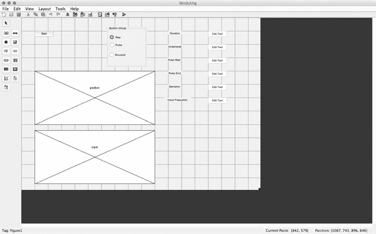

第 3 章

MATLAB 图形

**图 3.11：** 添加所有元素后，编辑窗口中的 GUI 快照。

**set**(handles.editPulseEnd,'string', **num2str**(handles.simData.tPulseEnd))

;


**set**(handles.editDamping,'string', **num2str**(handles.simData.zeta)); **set**(handles.editInputFrequency,'string', **num2str**(handles.simData.omegaU));

% 更新 handles 结构体

guidata(hObject, handles);

当按下启动按钮时，我们运行仿真并绘制结果。这本质上与二阶仿真中的演示代码相同。

**function** start_Callback(hObject, eventdata, handles)

[xP, t, tL] = SecondOrderSystemSim(handles.simData);

**axes**(handles.position)

**plot**(t,xP(1,:));

**ylabel**('位置')

**grid**

**axes**(handles.**input**)

**plot**(t,xP(2,:));

**xlabel**(tL);

**ylabel**('输入');

**grid**


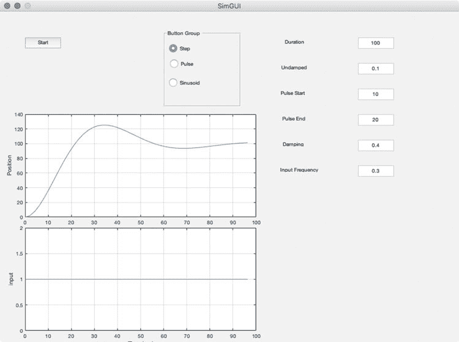

第 3 章

MATLAB 图形

**图 3.12：** 仿真中的 GUI 快照。

编辑框的回调函数需要少量代码来设置存储数据中的数据。所有数据都存储在 GUI 的 handles 中。必须调用 guidata 来将新数据存储到 handles 中。

**function** editDuration_Callback(hObject, eventdata, handles) handles.simData.tEnd = str2double(**get**(hObject,'String'));

guidata(hObject, handles);

图 3.12 展示了一次仿真。GUI 中的另一次仿真如图 3.13 所示。

**3.8**

**为条形图添加动画效果**

二维数组通常是机器学习算法的一部分。当它们动态变化时，我们希望为显示添加动画效果。


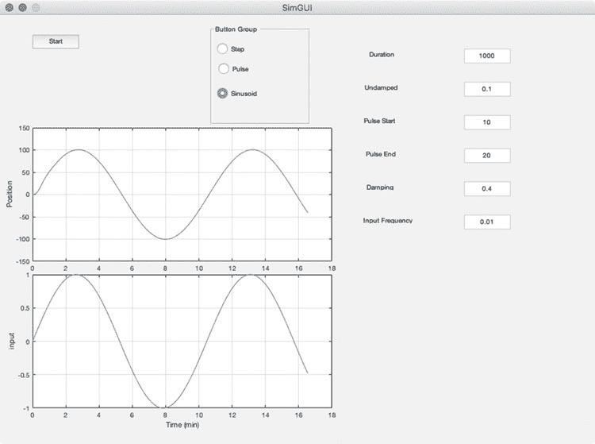

第 3 章

MATLAB 图形

**图 3.13：** 仿真中的 GUI 快照。

**3.8.1 问题**

我们想要为一个 3D 条形图添加动画效果。

**3.8.2 解决方案**

我们将编写代码来为 MATLAB 的 bar3 函数添加动画效果。

**3.8.3 工作原理**

我们的 Bar3D 函数将使用 bar3 设置图形，然后替换条形长度的值。这比听起来要棘手。

以下是 bar3 的一个示例。我们使用句柄来获取 z 数据。

>> m = [1 2 3;4 5 6];

h = bar3(m);

>> z = **get**(h(1),'zdata')

z =

NaN

NaN


第 3 章

MATLAB 图形

NaN

NaN

NaN

NaN

NaN

NaN

NaN

NaN

NaN

NaN

NaN

NaN

NaN

NaN

NaN

NaN

NaN

NaN

我们看到数组中的每一列。我们需要替换 m 中每个数字对应的所有四个值。查看 h。它的长度为 3。m 中的每一列都有一个曲面数据结构。

>> h

h =

1x3 曲面数组：

曲面

曲面

曲面

图 3.14 显示了该条形图。

代码如下所示。我们有两个操作：“initialize”（初始化），用于创建图形，以及“update”（更新），用于更新 z 值。幸运的是，z 值总是在相同的位置，因此替换它们并不太难。colorbar 绘制了图 3.15 右侧所示的颜色条。

我们使用 persistent 来存储 bar3 的句柄。

**function** Bar3D(action,v,xL,yL,zL,t)

**if**( **nargin** < 1 )

Demo

**return**

**end**

persistent h

switch **lower**(action)

case 'initialize'

NewFigure('3D 条形图动画');

h = bar3(v);

**colorbar**

**xlabel**(xL)

**xlabel**(yL)

**xlabel**(zL)

**title**(t);

**view**(3)

rotate3d on

case 'update'

nRows = **length**(h);

**for** i = 1:nRows

z = **get**(h(i),'zdata');

n = **size**(v,1);

j = 2;

**for** k = 1:n

z(j, 2) = v(k,i);

z(j, 3) = v(k,i);

z(j+1,2) = v(k,i);

z(j+1,3) = v(k,i);

j = j + 6;

**end**

**set**(h(i),'zdata',z);

**end**

**end**


第 3 章

MATLAB 图形

**图 3.15：** 两行三列的条形图及动画结束状态。

**Bar3D 动画**

0.5

-0.5

Z

动画结束时的图形如图 3.15 所示。

**3.9**

**绘制机器人**


本节展示了编写图形代码以绘制机器人的要素。如果你正在进行涉及人类或机器人的机器学习，这段代码会很有用。我们将展示如何让机器人手臂动起来。

**3.9.1 问题**

我们希望让一个机器人手臂动起来。

**3.9.2 解决方案**

我们编写代码来创建顶点和面，以供 MATLAB 的 `patch` 函数使用。

**3.9.3 工作原理**

`DrawSCARA` 函数用于绘制并动画化一个机器人。代码的第一部分实际上只是通过一个 `switch` 语句来组织函数的操作。

switch( **lower**(action) )

case 'defaults'

m = Defaults;

case 'initialize'

**if**( **nargin** < 2 )

d = Defaults;


第 3 章 MATLAB 图形

**else**

d = x;

**end**

p = Initialize( d );

case 'update'

**if**( **nargout** == 1 )

m = Update( p, x );

**else**

Update( p, x );

**end**

**end**

`Initialize` 函数使用 `Box`、`Frustrum` 和 `UChannel` 函数来创建顶点和面。编写这些函数很繁琐，并且是特定于几何形状的。不过，你可以将它们应用于各种问题。你应该注意，它会存储这些面片，这样我们在动画化手臂时只需传入新的顶点。“新”顶点只是手臂顶点经过旋转和平移后的结果，以匹配手臂的位置。手臂本身不会变形。

我们按正确的顺序进行计算，以便变换能够沿着链条向上/向下传递，从而让所有部件正确运动。

`Update` 函数通过计算新的顶点并将其传递给面片来更新手臂位置。`drawnow` 用于绘制手臂。我们也可以保存这些帧，然后使用 MATLAB 的电影函数来制作动画。

**function** m = Update( p, x )

**for** k = 1:**size**(x,2)

% 连杆 1

c = **cos**(x(1,k));

s = **sin**(x(1,k));

b1 = [c -s 0;s c 0;0 0 1];

v = (b1*p.v1')';

**set**(p.link1,'vertices',v);

% 连杆 2

r2 = b1*[p.a1;0;0];

c = **cos**(x(2,k));

s = **sin**(x(2,k));


第 3 章 MATLAB 图形

b2 = [c -s 0;s c 0;0 0 1];

v = (b2*b1*p.v2')';

v(:,1) = v(:,1) + r2(1);

v(:,2) = v(:,2) + r2(2);

**set**(p.link2,'vertices',v);

% 连杆 3

r3 = b2*b1*[p.r3;0;0] + r2;

v = p.v3;

v(:,1) = v(:,1) + r3(1);

v(:,2) = v(:,2) + r3(2);

v(:,3) = v(:,3) + x(3,k);

**set**(p.link3,'vertices',v);

% 连杆 4

c = **cos**(x(4,k));

s = **sin**(x(4,k));

b4 = [c -s 0;s c 0;0 0 1];

v = (b4*b2*b1*p.v4')';

r4 = b2*b1*[p.r4;0;0] + r2;

v(:,1) = v(:,1) + r4(1);

v(:,2) = v(:,2) + r4(2);

v(:,3) = v(:,3) + x(3,k);

**set**(p.link4,'vertices',v);

**if**( **nargout** > 0 )

m(k) = **getframe**;

**else**

**drawnow**;

**end**

**end**

演示中的 SCARA 机器人手臂最终如图 3.16 所示。演示代码可以用手臂动力学仿真来替代。在这个例子中，我们选择角速率并生成一个角度数组。请注意，这个备用的演示函数根本不需要是内置的演示函数。同样的代码块可以直接在命令行中执行。


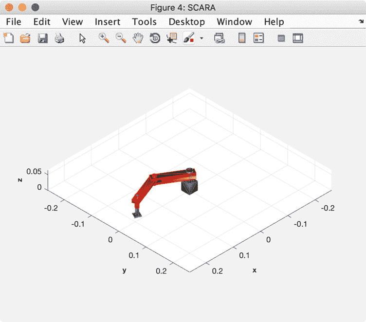

第 3 章 MATLAB 图形

**图 3.16：** 由 `DrawSCARA` 生成的机器人手臂。

**function** Demo

DrawSCARA( 'initialize' );

t = **linspace**(0,100);

omega1 = 0.1;

omega2 = 0.2;

omega3 = 0.3;

omega4 = 0.4;

x = [**sin**(omega1*t); **sin**(omega2*t);0.01***sin**(omega3*t); **sin**(omega4*t)];

DrawSCARA( 'update', x );


第 3 章

MATLAB 图形

**3.10**

**本章小结**

本章演示了有助于理解机器学习软件结果的图形。展示了二维和三维图形。本章还介绍了如何构建图形用户界面以帮助自动化功能。表 3.1 列出了随附代码中包含的函数和脚本。

**表 3.1：** 章节代码清单

**文件**

**描述**

Bar3D

三维条形图

Box

绘制一个方框。

DrawSCARA

绘制一个机械臂。

DrawVertices

绘制一组顶点和面。

Frustrum

绘制一个平截头体（顶部被切掉的圆锥体）

Globe

绘制一个纹理映射的地球仪。

PlotSet

二维线图。

SecondOrderSystemSim

模拟一个二阶系统。

SimGUI

仿真图形用户界面的代码。

SimGUI.fig

图形文件。

SurfaceOfRevolution

绘制一个旋转曲面

TreeDiagram

绘制一个树状图。

TwoDDataDisplay

一个用于在三维图形中显示二维数据的脚本。

UChannel

绘制一个 U 形通道


**第 4 章**

**卡尔曼滤波器**

理解或控制一个物理系统通常需要该系统的模型，即了解系统的特性和结构。模型可以是预定义的结构，也可以完全通过数据来确定。在卡尔曼滤波中，我们创建一个模型，并将其作为了解系统的框架。这是第 1 章中自主学习方法论中控制分支的一部分。

自主

学习

机器

控制

学习

智能

卡尔曼滤波器的重要性在于，它们严谨地处理了你想进一步了解的系统中存在的不确定性。如果你有系统模型，那么模型中存在不确定性；系统的测量值中也存在不确定性（即噪声）。

一个系统可以通过其动态状态和名义上恒定的参数来定义。例如，如果你正在研究一个在桌子上滑动的物体，其状态将是位置和速度。参数将是物体的质量和摩擦系数。物体上可能还存在我们想要估计的外力。

参数和状态共同构成了模型。你需要了解两者才能正确理解系统。有时很难判断某个量应该被视为状态还是参数。质量通常是一个参数，但在飞机、汽车或火箭中，质量会随着燃料消耗而变化，因此通常被建模为一个状态。

由 R. E. Kalman 等人发明的卡尔曼滤波器，是一个用于估计或学习系统状态的数学框架。估计器能给出系统动态状态（例如移动质点的位置和速度）的统计最优估计。

© Michael Paluszek 和 Stephanie Thomas 2019

M. Paluszek 和 S. Thomas, *MATLAB 机器学习秘籍*,

[`doi.org/10.1007/978-1-4842-3916-2_4`](https://doi.org/10.1007/978-1-4842-3916-2_4)


第 4 章

卡尔曼滤波器

卡尔曼滤波器也可以被编写用于识别系统的参数。因此，卡尔曼滤波器为状态识别和参数识别提供了一个框架。


卡尔曼滤波器的另一个应用是系统辨识。系统辨识是识别任何系统结构和参数的过程。例如，对于一个简单的弹簧上的质量块，它就是要识别或确定质量与弹簧常数的值，同时确定用于建模该系统的微分方程。这是一种起源于控制理论的机器学习形式。系统辨识有许多方法。在本章中，我们只研究卡尔曼滤波器。“学习”这个词通常不与估计相关联，但实际上它们是同一回事。

系统辨识问题的一个重要方面是，根据可用的测量值，确定哪些参数和状态实际上可以被估计。这适用于所有学习系统。问题在于，我们能否通过观察来了解我们需要知道的关于某事物的信息？为此，我们需要知道一个参数或状态是否可观测，并且能否被独立区分。例如，假设我们使用牛顿定律：*F* = *ma*

(4.1)

其中 *F* 是力，*m* 是质量，*a* 是加速度，作为我们的模型，并且我们的测量值是加速度。我们能同时估计力和质量吗？答案是否定的，因为我们测量的是力与质量的*比值*

*a* = *F* / *m*

(4.2)

我们无法将两者分开。如果我们有一个力传感器或一个质量传感器，我们就可以分别确定它们。在所有学习系统中，包括卡尔曼滤波器，你都需要注意这个问题。

**4.1 使用线性卡尔曼滤波器的状态估计器**

**4.1.1 问题**

你想要估计一个通过弹簧和阻尼器连接到结构上的质量块的速度和位置。该系统如图 4.1 所示。*m* 是质量，*k* 是弹簧常数，*c* 是阻尼常数，*f* 是外力。*x* 是位置。质量块仅在一个方向上移动。

假设我们在质量块附近有一个摄像头。摄像头将在质量块上升期间对准它。这将产生一个地面与摄像头视轴之间夹角的测量值。角度测量几何关系如图 4.2 所示。该角度是从一个偏移基线上测量的。

我们想使用传统的线性卡尔曼滤波器来估计系统的状态。这适用于可以用线性方程建模的简单系统。


第 4 章

卡尔曼滤波器

**图 4.1：** 弹簧-质量-阻尼器系统。质量块在右侧。弹簧在质量块左上方。阻尼器在下方。

k

m

f

c

x

**图 4.2：** 角度测量几何关系。

质量块

r

角度

基线

**4.1.2 解决方案**

首先，我们需要为质量系统定义一个数学模型并将其编码。然后，我们将使用贝叶斯定理从基本原理推导出卡尔曼滤波器。最后，我们给出实现卡尔曼滤波器估计器以解决弹簧-质量问题的代码。

**4.1.3 工作原理**

**弹簧-质量系统模型**

对系统进行建模的连续时间微分方程为：

*dr* / *dt* = *v*

(4.3)

*m* * *dv* / *dt* = *f* − *cv* − *kx*

(4.4)


第 4 章

卡尔曼滤波器

这表明位置 *r* 相对于时间 *t* 的变化率是速度 *v*。速度相对于时间的变化率（乘以质量）等于外力减去阻尼常数乘以速度，再减去弹簧常数乘以位置。第二个方程就是牛顿定律，其中总力为 *F*，总加速度 *aT* 等于总力除以质量 *m*，即 *F* = *f* − *cv* − *kx*


(4.5)

*dv*

=

*a*

*dt*

*T*

(4.6)

为简化问题，我们将第二个方程两边同时除以质量，得到： *dr*

=

*v*

(4.7)

*dt*

*dv*

=

*a − * 2 *ζωv − ω* 2 *x*

(4.8)

*dt*

其中

*c*

=

2 *ζω*

(4.9)

*m*

*k*

=

*ω* 2

(4.10)

*m*

*a * 是外力 *f * 产生的加速度， *ζ * 是阻尼比， *ω * 是无阻尼 *m*

固有频率。无阻尼固有频率是指质量在没有阻尼的情况下振动的频率。阻尼比表示系统阻尼的快慢以及我们观察到的振动水平。当阻尼比为零时，系统永不衰减，质量将永远振动下去。当阻尼比为 1 时，则观察不到任何振动。这种形式使我们更容易理解预期的阻尼和振动情况。你可以立即知道频率以及振动衰减的速率。而 *m*、 *c* 和 *k* 虽然包含相同的信息，但并不能如此直观地体现这一点。

以下展示了带阻尼的振荡器仿真（OscillatorDampingRatioSim）。它显示了不同的阻尼比。运行不同阻尼比仿真的循环如下所示。

**for **j = 1:**length**(zeta)

% 初始状态 [位置;速度]

x = [0;1];

% 从数组中选取阻尼比

d.zeta= zeta(j);

% 为图例打印字符串

s{j} = **sprintf**('zeta = %6.4f',zeta(j));


第 4 章

卡尔曼滤波器

**for **k = 1:nSim

% 绘图存储

xPlot(j,k)

= x(1);

% 传播（数值积分）状态方程

x

= RungeKutta( @RHSOscillator, 0, x, dT, d );

**end**

**end**

阻尼比演示的结果如图 4.3 所示。初始条件为零位置和速度为 1。可以看到对不同阻尼比水平的响应。

当 zeta 为零时，系统无阻尼，将永远振动。临界阻尼（从最小化执行器能耗的角度来看是理想的）为 0.7071。阻尼比为 1 时，对阶跃扰动不会产生过冲。在本例中，由于初始条件并非静止状态，因此出现了“过冲”。

**图 4.3：** 不同阻尼比 zeta 下的弹簧-质量-阻尼系统仿真。

zeta = 0.0000

zeta = 0.2000

zeta = 0.7071

zeta = 1.0000

r 0

-5 0

时间 (秒)

动力学方程采用所谓的状态空间形式，因为状态向量：

*r*

*x *=

(4.11)

*v*


第 4 章

卡尔曼滤波器

的导数没有乘以任何系数，并且左侧只有一阶导数。有时你会看到如下方程：

*Q *˙

*x *=  *Ax *+  *Bu*

(4.12)

如果 *Q * 不可逆，则无法进行如下操作：

˙

*x *=  *Q−* 1 *Ax *+  *Q−* 1 *Bu*

(4.13)

来得到状态空间方程。从概念上讲，如果 *Q * 不可逆，这等同于少于 *N * 个独立方程（其中 *N * 是 *x* 的长度，即状态的数量）。

我们所有的滤波器推导都基于状态空间形式的动力学方程。此外，大多数数值积分方案都是为求解一阶微分方程组而设计的。

状态方程（一阶微分方程）的右侧函数 RHSOscillator 如下所示。请注意，如果没有输入参数，它将返回默认数据结构。代码 `if (nargin < 1)` 指示函数在没有输入时返回数据结构。这是一种使函数自文档化并保持数据结构一致性的便捷方法。实际的工作代码只有一行。

xDot = [x(2);d.a-2*d.zeta*d.omega*x(2)-d.omegaˆ2*x(1)];

以下列出了仿真脚本 OscillatorSim。它使用 RungeKutta 函数对右侧函数 RHSOscillator 进行数值积分。

我们首先从右侧函数获取默认数据结构，然后填入所需的参数。每一步都会生成包含随机噪声的测量值 *y*。共有两个测量值：位置和角度。


以下代码仅展示了 OscillatorSim 的仿真循环。角度测量仅涉及三角学。第一行测量代码计算角度，这是一个非线性测量。第二行测量垂直距离，这是线性测量。

**for** k = 1:nSim

% 测量值

yTheta = **atan**(x(1)/baseline) + yTheta1Sigma***randn**(1,1); yR

= x(1) + yR1Sigma***randn**(1,1);

% 绘图存储

xPlot(:,k) = [x;yTheta;yR];

% 传播（数值积分）状态方程

x = RungeKutta( @RHSOscillator, 0, x, dT, dRHS );

**end**


第 4 章

卡尔曼滤波器

仿真结果如图 4.4 所示。输入是一个扰动加速度，在时间 *t* = 0 时从零跳变到其值。它在整个仿真期间保持恒定。

这被称为阶跃扰动。这会导致系统振荡。由于阻尼的存在，振荡幅度会缓慢衰减至零。如果阻尼比为 1，我们将看不到任何振荡，如图 4.3 所示。

**图 4.4：** 弹簧-质量-阻尼器系统仿真。输入是一个阶跃加速度。振荡缓慢衰减，即随时间推移趋于零。由于恒定加速度，位置 *r* 产生了一个偏移。

**振荡器**

r (m)

时间 (秒)

0.5

v (m/s)

-0.5

时间 (秒)

(rad)y

时间 (秒)

(m)

r

y

时间 (秒)

通过设置 *v* = 0，可以解析地找到 *r* 图中所示的偏移。本质上，弹簧力与外力相平衡。

*dv*

0 =

= *a* − *ω*² *x*

(4.14)

*dt*

*a*

*x* = *ω*²

(4.15)

我们现在已经完成了模型的推导，可以继续构建卡尔曼滤波器了。


第 4 章

卡尔曼滤波器

**卡尔曼滤波器推导**

卡尔曼滤波器可以从贝叶斯定理推导出来。什么是贝叶斯定理？贝叶斯定理是：

*P*(*B|A*)

*P*(*A*

*i*) *P*(*Ai*)

*i|B*) =

(4.16)

*P*(*B|Ai*)

*P*(*B|A*

*P*(*A*

*i*) *P*(*Ai*)

*i|B*) =

(4.17)

*P*(*B*)

这只是在给定 *B* 的情况下 *Ai* 的概率。*P* 表示“概率”。竖线 *|* 表示“给定”。这假设 *B* 的概率不为零，即 *P*(*B*) ≠ 0。在贝叶斯解释中，该定理引入了证据对信念的影响。这为整合任何存在不确定性的数据提供了一个严谨的框架。简而言之，给定迄今为止的所有证据（或数据），贝叶斯定理允许你确定新证据如何影响信念。在状态估计的背景下，这就是对状态估计准确性的信念。

图 4.5 展示了卡尔曼滤波器家族及其与贝叶斯滤波器的关系。本书仅涵盖彩色框中的滤波器。下面给出了卡尔曼滤波器的完整推导；这为所有卡尔曼滤波实现提供了一个连贯的框架。不同的滤波器是基于对模型和传感器噪声的假设，以及测量和动力学模型的线性或非线性特性，从贝叶斯模型中推导出来的。让我们看看蓝色分支。加性高斯噪声滤波器可以是线性的或非线性的，具体取决于动力学和测量模型的类型。在许多情况下，你可以对一个非线性系统进行线性化处理，使其围绕正常工作点线性化。然后你可以使用线性卡尔曼滤波器。例如，航天器动力学模型是非线性的，而用于获取滚动和俯仰信息的地球传感器（测量地球弦宽）也是非线性的。

然而，如果我们只关心对地指向，以及相对于标称指向的小偏差，我们可以将动力学方程和测量方程都线性化，并使用线性卡尔曼滤波器。

如果非线性特性很重要，我们必须使用非线性滤波器。扩展卡尔曼滤波器（EKF）使用测量方程和动力学方程的偏导数。这些偏导数在每个时间步或每次测量输入时计算。实际上，我们是在每一步对系统进行线性化，并使用线性方程。我们不必进行线性状态传播，即传播动力学方程，而是可以通过数值积分来传播它们。如果我们能获得测量方程和动力学方程的解析导数，这是一种合理的方法。如果任何方程中存在奇点，这种方法可能失效。

无迹卡尔曼滤波器（UKF）直接使用非线性方程。它有两种形式：增广型和非增广型。在前者中，我们创建了一个增广状态向量，其中包含状态以及状态和测量噪声变量。这可能会以增加计算量为代价获得更好的结果。

本章中的所有滤波器都是马尔可夫型的，即当前动力学状态完全由前一状态决定。粒子滤波器不在本书讨论范围内。它们是一类蒙特卡洛方法。蒙特卡洛（以著名赌场命名）方法是依赖随机抽样来获得结果的计算算法。例如，对我们的振荡器仿真采用蒙特卡洛方法，就是使用 MATLAB 函数`randn`来生成加速度。我们会运行多次测试，以验证我们的质量块按预期运动。

我们的推导将使用符号 *N*(*μ*, *σ*²) 来表示正态变量。正态变量是高斯变量的另一种说法。高斯意味着它服从均值为 *μ*（平均值）、方差为 *σ*² 的正态分布。以下来自 Gaussian 的代码计算了围绕均值 2、具有一系列标准差的高斯或正态分布。

图 4.6 显示了一个图。图的高度表示该变量取该值的可能性有多大。

%% 初始化

mu

= 2;

% 均值

sigma

= [1 2 3 4]; % 标准差

n

= **length**(sigma);

x

= **linspace**(-7,10);

%% 仿真

xPlot = **zeros**(n, **length**(x));

s

= **cell**(1,n);

**for** k = 1:**length**(sigma)

s{k}

= **sprintf**('Sigma = %3.1f',sigma(k));

f

= -(x-mu).ˆ2/(2*sigma(k)ˆ2);

xPlot(k,:) = **exp**(f)/**sqrt**(2***pi***sigma(k)ˆ2);

**end**


第 4 章

卡尔曼滤波器

**图 4.6：** 围绕均值 2 的正态或高斯随机变量。

0.4

Sigma = 1.0

Sigma = 2.0

0.35

Sigma = 3.0

Sigma = 4.0

0.3

0.25

0.2

高斯

0.15

0.1

0.05

x

给定离散时间下的概率状态空间模型[[23]](#index_split_007.html#p350)

*xk* = *fk*(*xk*−1 *, wk*−1)

(4.18)

其中 *x* 是状态向量，*w* 是噪声向量，测量方程为：*yk* = *hk*(*xk, vn*)

(4.19)

其中 *vn* 是测量噪声。这具有隐马尔可夫模型（HMM）的形式，因为状态是隐藏的。


如果过程是马尔可夫性的，那么未来状态 *xk* 仅依赖于当前状态 *xk−1*，而不依赖于过去的状态。这可以用方程表示为：*p*( *xk|x*1:*k−1*, *y*1:*k−1*) = *p*( *xk|xk−1*) (4.20)

这里的 *|* 表示“给定”。在这种情况下，第一项读作“给定 *x*1:*k−1* 和 *y*1:*k−1* 时 *xk* 的概率”。这是给定所有过去状态以及直到第 *k−1* 次测量的所有测量值时，当前状态的概率。过去状态 *xk−1* 在给定当前状态的情况下与未来无关。

*p*( *xk−1*|*xk*:*T*, *yk*:*T*) = *p*( *xk−1*|*xk*) (4.21)

其中 *T* 是最后一个样本，并且测量值 *yk* 在给定 *xk* 的条件下是条件独立的；也就是说，它们可以仅使用 *xk* 来确定，而不依赖于 *x*1:*k* 或 *y*1:*k−1*。这可以表示为：

*p*( *yk|x*1:*k*, *y*1:*k−1*) = *p*( *yk|xk*) (4.22)

我们可以定义计算分布的递归贝叶斯最优滤波器：*p*( *xk|y*1:*k*)

(4.23)


第 4 章

卡尔曼滤波器

给定：

• 先验分布 *p*( *x*0)，其中 *x*0 是第一次测量前的状态，

• 状态空间模型

*xk ∼ p*( *xk|xk−1*)

(4.24)

*yk ∼ p*( *yk|xk*)

(4.25)

• 测量序列 *y*1:*k* = *y*1, ..., *yk*。

计算基于递归规则

*p*( *xk−1*|*y*1:*k−1*) → *p*( *xk|y*1:*k*) (4.26)

这意味着我们从先验状态 *xk−1* 和所有过去的测量值 *y*1:*k−1* 得到当前状态 *xk*。假设我们知道前一个时间步的后验分布：*p*( *xk−1*|*y*1:*k−1*)

(4.27)

给定 *y*1:*k−1* 时 *xk*, *xk−1* 的联合分布可以计算为：*p*( *xk*, *xk−1*|*y*1:*k−1*) = *p*( *xk|xk−1*, *y*1:*k−1*) *p*( *xk−1*|*y*1:*k−1*) (4.28)

= *p*( *xk|xk−1*) *p*( *xk−1*|*y*1:*k−1*) (4.29)

因为这是一个马尔可夫过程。对 *xk−1* 进行积分得到最优滤波器的预测步骤，即查普曼-科尔莫戈罗夫方程

*p*( *xk|y*1:*k−1*) = ∫ *p*( *xk|xk−1*, *y*1:*k−1*) *p*( *xk−1*|*y*1:*k−1*) *dxk−1*

(4.30)

查普曼-科尔莫戈罗夫方程是一个恒等式，关联了随机过程中不同坐标集合的联合概率分布。测量更新状态由贝叶斯规则得出：

*P*( *xk|y*1:*k*) = [*p*( *yk|xk*) *p*( *xk|yk−1*)] / *Ck*

(4.31)

*Ck* = *p*( *yk|y*1:*k−1*) = ∫ *p*( *yk|xk*) *p*( *xk|y*1:*k−1*) *dxk* (4.32)

*Ck* 是给定所有过去测量值时当前测量值的概率。

如果噪声是加性的且服从高斯分布，状态协方差为 *Qn*，测量协方差为 *Rn*，模型和测量噪声均值为零，那么我们可以将状态方程写为：

*xk* = *fk*( *xk−1*) + *wk−1*

(4.33)


第 4 章

卡尔曼滤波器

其中 *x* 是状态向量，*w* 是噪声向量。测量方程变为：*yk* = *hk*( *xk*) + *vn*

(4.34)

假设 *Q* 不随时间变化，我们可以写出：

*p*( *xk|xk−1*, *y*1:*k−1*) = *N*( *xk*; *f*( *xk−1*), *Q*) (4.35)

其中回忆 *N* 是一个正态变量，在这种情况下，均值为 *xk*; *f*( *xk−1*)，这意味着（给定 *f*( *xk−1*) 且方差为 *Q* 时的 *xk*）。我们现在可以将预测步骤方程 4.30 写为：

*p*( *xk|y*1:*k−1*) = ∫ *N*( *xk*; *f*( *xk−1*), *Q*) *p*( *xk−1*|*y*1:*k−1*) *dxk−1*

(4.36)

我们需要找到 *xk* 的前两个矩。矩是变量的期望值（或均值）。第一个矩是变量本身，第二个矩是变量的平方，依此类推。它们是：

*E*[ *xk*] = ∫ *xk* *p*( *xk|y*1:*k−1*) *dxk*

(4.37)

*E*[ *xk* *xTk*] = ∫ *xk* *xTk* *p*( *xk|y*1:*k−1*) *dxk*

(4.38)

*E* 表示期望值。*E*[ *xk*] 是均值，*E*[ *xk* *xTk*] 是协方差。展开第一个矩并利用恒等式 *E*[ *x*] =


*xN *( *x*;  *f *( *s*) *, Σ) *dx *=  *f *( *s*) 其中 *s * 是任意参数。

*E*[ *xk*] =

*xk*

d( *xk*;  *f *( *xk−* 1) *, Q*) *p*( *xk−* 1 *|y* 1: *k−* 1) *dxk−* 1  *dxk* (4.39)

=

*xk*

*N *( *xk*;  *f *( *xk−* 1) *, Q*) *dxk p*( *xk−* 1 *|y* 1: *k−* 1) *dxk−* 1

(4.40)

=

*f *( *xk−* 1) *p*( *xk−* 1 *|y* 1: *k−* 1) *dxk−* 1

(4.41)

假设  *p*( *xk−* 1 *|y* 1: *k−* 1) =  *N*( *xk−* 1; ˆ

*xk−* 1 *|k−* 1 *, P xx*

*k−* 1 *|k−* 1) 其中  *P xx * 是 *x * 的协方差

并注意到  *xk *=  *fk*( *xk−* 1) +  *wk−* 1，我们得到：

ˆ

*xk|k−* 1 =

*f *( *xk−* 1) *N*( *xk−* 1; ˆ

*xk−* 1 *|k−* 1 *, P xx*

*k−* 1 *|k−* 1) *dxk−* 1

(4.42)

对于二阶矩：

*E*[ *xkxTk *] =

*xkxTk p*( *xk|y* 1: *k−* 1) *dxk*

(4.43)

=

*N *( *xk*;  *f *( *xk−* 1) *, Q*) *xkxT dx* *p*( *x*

*k*

*k*

*k−* 1 *|y* 1: *k−* 1) *dxk−* 1

(4.44)


第 4 章

卡尔曼滤波器

结果如下：

*P xx*

*f *( *x*

*k|k−* 1 =  *Q *+

*k−* 1) *f T *( *xk−* 1) *N *( *xk−* 1; ˆ

*xk−* 1 *|k−* 1 *, P xx*

*k−* 1 *|k−* 1) *dxk−* 1  *− *ˆ

*xT*

*k|k−* 1 ˆ

*xk|k−* 1

(4.45)

初始状态的协方差是高斯分布，记为  *P xx*

0 。卡尔曼滤波器可以无需进一步近似地写为：

ˆ

*xk|k *= ˆ *xk|k−* 1 +  *Kn yk − *ˆ *yk|k−* 1

(4.46)

*P xx*

=

*P xx*

*k|k*

*k|k−* 1  *− KnP yy*

*k|k−* 1 *KT*

*n*

(4.47)

*−* 1

*Kn *=  *P xy*

*P yy*

(4.48)

*k|k−* 1

*k|k−* 1

其中  *Kn * 是卡尔曼增益， *P yy * 是测量协方差。这些方程的解需要求解以下形式的五个积分：

*I *=

*g*( *x*) *N *( *x*; ˆ

*x, P xx*) *dx*

(4.49)

滤波器所需的三个积分是：

*P yy*

*h*( *x*

*k|k−* 1

=

*R *+

*n*) *hT *( *xn*) *N *( *xn*; ˆ

*xk|k−* 1 *, P xx*

*k|k−* 1) *dxk − *ˆ

*xT*

*k|k−* 1 ˆ

*yk|k−* 1 (4.50)

*P xy*

*x*

*k|k−* 1

=

*nhT *( *xn*) *N *( *xn*; ˆ

*xk|k−* 1 *, P xx*

*k|k−* 1) *dx*

(4.51)

ˆ

*yk|k−* 1 =

*h*( *xk*) *N*( *xk*; ˆ

*xk|k−* 1 *, P xx*

*k|k−* 1) *dxk*

(4.52)

假设我们有一个如下形式的模型：

*xk *=  *Ak−* 1 *xk−* 1 +  *Bk−* 1 *uk−* 1 +  *qk−* 1

(4.53)

*yk *=  *Hkxk *+  *rk*

(4.54)

其中

•  *xk ∈ n * 是系统在时刻 *k *的状态

•  *mk * 是时刻 *k *的均值状态

•  *Ak−* 1 是时刻 *k − * 1 的状态转移矩阵

•  *Bk − * 1 是时刻 *k − * 1 的输入矩阵

•  *uk − * 1 是时刻 *k − * 1 的输入

•  *qk−* 1 *, N*(0 *, Qk*), 是时刻 *k − * 1 的高斯过程噪声


第 4 章

卡尔曼滤波器

•  *yk ∈ m * 是时刻 *k *的测量值

•  *Hk * 是时刻 *k *的测量矩阵。该矩阵由 *h*( *x*) 的雅可比矩阵（导数）求得。

•  *rk *=  *N*(0 *, Rk*), 是时刻 *k *的高斯测量噪声

• 状态的先验分布是  *x* 0 =  *N*( *m* 0 *, P* 0)，其中参数  *m* 0 和  *P* 0 包含了关于系统的所有先验知识。 *m* 0 是零时刻的均值， *P* 0 是协方差。由于我们的状态是高斯分布，这完全描述了状态。

• ˆ

*xk|k−* 1 是在给定 ˆ *x * at  *k − * 1 的条件下， *x *在 *k *时刻的均值

• ˆ

*yk|k−* 1 是在给定 ˆ *x * at  *k − * 1 的条件下， *y *在 *k *时刻的均值

*n * 表示 *n *阶向量中的实数，即状态有 *n *个量。用概率术语表示，该模型为：

*p*( *xk|xk−* 1) =  *N*( *xk*;  *Ak−* 1 *xk−* 1 *, Qk*) (4.55)

*p*( *yk|xk*) =  *N*( *yk*;  *Hkxk, Rk*) (4.56)

这些积分变成了简单的矩阵方程。在以下方程中， *P − * 表示测量更新前的协方差。

*k*

*P yy*

*HT*

*k|k−* 1

=

*HkP −*

*k*

*k *+  *Rk*

(4.57)

*P xy*

*HT*

*k|k−* 1

=

*P −*

*k*

*k*

(4.58)

*P xx*

*k|k−* 1

=

*Ak−* 1 *Pk−* 1 *ATk−* 1 +  *Qk−* 1

(4.59)

ˆ

*xk|k−* 1 =  *m−*

(4.60)

*k*

ˆ

*yk|k−* 1 =  *Hkm−*

(4.61)

*k*

预测步骤变为：

*m−*

=

*A*

*k*

*k−* 1 *mk−* 1

(4.62)

*P −*

=

*A*

*k*

*k−* 1 *Pk−* 1 *AT*

*k−* 1 +  *Qk−* 1

(4.63)


上述协方差方程中的第一项基于状态转移矩阵 *A* 传播协方差。*Qk*+1 在此基础上累加，形成下一个协方差。过程噪声 *Qk*+1 是衡量数学模型 *A* 在表示系统时精确度的指标。例如，假设 *A* 是一个将所有状态阻尼至零的数学模型。如果没有 *Q*，*P* 将变为零。但如果我们对模型并非那么确定，协方差就永远不会小于 *Q*。选取 *Q* 可能很困难。在一个存在不确定扰动的动态系统中，你可以计算扰动的标准差来得到 *Q*。如果模型 *A* 不确定，那么你可以对模型的范围进行统计分析。或者，你可以在仿真中尝试不同的 *Q*，看看哪些效果最好！


第 4 章

卡尔曼滤波器

更新步骤如下：

*vk* = *yk* − *Hkm−*

(4.64)

*k*

*Sk* = *HkP−HT*

*k*

*k* + *Rk*

(4.65)

*Kk* = *P−HT*

(4.66)

*k*

*k S−* 1

*k*

*mk* = *m−* + *K*

*k*

*kvk*

(4.67)

*Pk* = *P−* − *K*

*k*

*kSkKT*

*k*

(4.68)

*Sk* 是一个中间量。*vk* 是残差。残差是测量值与根据估计状态得出的测量估计值之间的差值。*R* 就是测量值的协方差矩阵。如果噪声不是白噪声，则应使用不同的滤波器。白噪声在所有频率上具有相等的能量。许多类型的噪声，例如来自成像器的噪声，并非真正的白噪声，而是带限的，即其噪声存在于有限的频率范围内。有时你可以向 *A* 添加额外的状态来更好地建模噪声，例如，添加一个低通滤波器来限制噪声的带宽。这会使 *A* 变大，但通常不是问题。

**卡尔曼滤波器实现**

现在我们将为质量-弹簧振荡器实现一个卡尔曼滤波器估计器。首先，我们需要一种将连续时间问题转换为离散时间的方法。我们只需要知道离散时刻或固定间隔 *T* 下的状态。我们使用连续到离散的变换，该变换使用了 MATLAB 的 expm 函数，该函数执行矩阵指数运算。

此变换在 CToDZOH 中编码，其主体如下列代码所示。T 是采样周期。

[n,m] = **size**(b);

q

= **expm**([a*T b*T; **zeros**(m,n+m)]);

f

= q(1:n,1:n);

g

= q(1:n,n+1:n+m);

CToDZOH 包含一个针对双积分器的演示。双积分器是一个系统，其中状态的二阶导数直接依赖于外部输入。在此示例中，*x* 是状态，代表位置，而 *a* 是加速度的外部输入。

*d* 2 *r*

*dt* 2 = *a*

(4.69)

写成状态空间形式为：

*dr* = *v*

(4.70)

*dt*

*dv* = *a*

(4.71)

*dt*

或矩阵形式

˙

*x* = *Ax* + *Bu*

(4.72)


第 4 章

卡尔曼滤波器

其中

*r*

*x*

=

(4.73)

*v*

*u*

=

(4.74)

*a*

*A*

=

(4.75)

*B*

=

(4.76)

要运行演示，只需在命令行中不带任何输入地运行 CToDZOH。

>> CToDZOH

双积分器，时间步长为 0.5 秒。

a =

b =

f =

1.0000

0.5000

1.0000

g =

0.1250

0.5000

离散系统矩阵 *f* 很容易理解。第 *k*+1 步的位置状态是第 *k* 步的状态加上第 *k* 步的速度乘以时间步长 *T*（0.5 秒）。第 *k*+1 步的速度是第 *k* 步的速度加上时间步长乘以第 *k* 步的加速度。第 *k* 时刻的加速度乘以 12 *T* 2 得到对位置的贡献。这只是一个粒子在恒定加速度下的标准解。

*rk*+1 = *rk* + *T vk* + *T* 2 *a*

*k*

(4.77)

*vk*+1 = *vk* + *T ak*

(4.78)

写成矩阵形式为：

*xk*+1 = *f xk* + *buk*

(4.79)


通过离散时间近似，我们可以在每一步 *k* 改变加速度，从而获得时间历程。这假设加速度在周期 *T* 内是恒定的。为了获得良好结果，我们需要选择足够小的 *T*，使得该假设近似成立。

用于测试卡尔曼滤波器的脚本是 `KFSim.m`。`KFInitialize` 用于初始化滤波器（本例中为卡尔曼滤波器，即 `'kf'`）。该函数被编写为能够处理多种类型的卡尔曼滤波器，我们将在 EKF 和 UKF（分别为 `'ekf'` 和 `'ukf'`）的示例中再次使用它。下面展示了该函数。此函数使用动态字段名将输入值分配给每个字段。

仿真开始时，会为仿真中使用的所有变量赋值。我们从函数 `RHSOscillator` 获取数据结构，然后修改其值。我们将连续时间模型写成矩阵形式，然后将其转换为离散时间。请注意，乘以状态 `h` 的测量方程矩阵是 `[1 0]`，表示我们正在测量质量块的位置。使用 MATLAB 的 `randn` 随机数函数向仿真中添加高斯噪声。脚本的其余部分是仿真循环，之后是绘图。

脚本的第一部分创建连续时间状态空间矩阵，并使用 `CToDZOH` 将其转换为离散时间。然后使用 `KFInitialize` 初始化卡尔曼滤波器。

```matlab
%% 初始化
tEnd   = 100.0;      % 仿真结束时间（秒）
dT     = 0.1;        % 时间步长（秒）
d      = RHSOscillator(); % 获取默认数据结构
d.a    = 0.1;        % 扰动加速度
d.omega = 0.2;       % 振荡器频率
d.zeta = 0.1;        % 阻尼比
x      = [0;0];      % 初始状态 [位置;速度]
y1Sigma = 1;         % 1 sigma 位置测量噪声
% xdot = a*x + b*u
a = [0 1;-2*d.zeta*d.omega -d.omega²]; % 连续时间模型
b = [0;1];           % 连续时间输入矩阵
% x[k+1] = f*x[k] + g*u[k]
[f,g] = CToDZOH(a,b,dT); % 离散时间模型
xE    = [0.3; 0.1];  % 估计的初始状态
q     = [1e-6 1e-6]; % 模型噪声协方差；
                     % [1e-6 1e-6] 用于低模型噪声测试
                     % [1e-4 1e-4] 用于高模型噪声测试
dKF = KFInitialize('kf','m',xE,'a',f,'b',g,'h',[1 0],...
                   'r',y1Sigma²,'q', **diag**(q),'p', **diag**(xE.²));
```

仿真循环依次执行状态测量、卡尔曼滤波器更新和预测步骤，分别使用代码 `KFPredict` 和 `KFUpdate`。积分器位于两者之间，以确保更新和预测的相位正确。你必须小心地将预测和更新步骤放在脚本中的正确位置，以使估计器与仿真时间同步。

```matlab
%% 仿真
nSim = **floor**(tEnd/dT) + 1;
xPlot = **zeros**(5,nSim);

**for** k = 1:nSim
    % 带随机噪声的位置测量
    y = x(1) + y1Sigma***randn**(1,1);
    % 更新卡尔曼滤波器
    dKF.y = y;
    dKF = KFUpdate(dKF);
    % 存储绘图数据
    xPlot(:,k) = [x;y;dKF.m-x];
    % 传播（数值积分）状态方程
    x = RungeKutta( @RHSOscillator, 0, x, dT, d );
    % 传播卡尔曼滤波器
    dKF.u = d.a;
    dKF = KFPredict(dKF);
**end**
```

预测卡尔曼滤波器步骤 `KFPredict` 如下所示，其头部已简化。该预测将状态向前传播一个时间步长，并同时传播协方差矩阵。这意味着当我们传播状态时，存在不确定性，因此我们必须将其添加到协方差矩阵中。

```matlab
%% KFPREDICT 线性卡尔曼滤波器预测步骤。
**function** d = KFPredict( d )
% 第一种情况：没有输入矩阵 b
**if**( **isempty**(d.b) )
    d.m = d.a*d.m;
**else**
    d.m = d.a*d.m + d.b*d.u;
**end**
d.p = d.a*d.p*d.a' + d.q;
```

更新卡尔曼滤波器步骤 `KFUpdate` 如下所示。该步骤将测量值添加到估计中，并考虑测量中的不确定性（噪声）。

```matlab
%% KFUPDATE 线性卡尔曼滤波器测量更新步骤。
**function** d = KFUpdate( d )
s = d.h*d.p*d.h' + d.r;
```


% 中间值

k

= d.p * d.h' / s;

% 卡尔曼增益

v

= d.y - d.h * d.m;

% 残差

d.m = d.m + k * v;

% 均值更新

d.p = d.p - k * s * k';

% 协方差更新


第 4 章

卡尔曼滤波器

你会注意到，滤波器的“记忆”存储在数据结构 `d` 中。没有使用持久化数据存储。这使得在你的代码中多处使用这些函数变得更加容易。

另请注意，你不需要在每个时间步都调用 `KFUpdate`。你只需要在有新数据时调用它。不过，该滤波器确实假设时间步长是均匀的。

该脚本给出了模型噪声协方差矩阵的两个示例。图 4.7 显示了使用较高数值 `[1e-4 1e-4]` 作为模型协方差时的结果。图 4.8 显示了使用较低数值 `[1e-6 1e-6]` 时的结果。我们没有更改测量协方差，因为只有噪声协方差与模型协方差之间的比值才是重要的。

当使用较高数值时，误差呈高斯分布但带有噪声。当使用较低数值时，结果非常平滑，几乎看不到噪声。然而，在低模型协方差的情况下，误差很大。这是因为滤波器基本上忽略了测量值，因为它认为模型非常精确。你应该在脚本中尝试不同的选项，看看它的表现如何。正如你所见，参数对滤波器学习系统状态的效果有着巨大的影响。

**图 4.7：** 使用较高模型噪声矩阵 `[1e-4 1e-4]` 的卡尔曼滤波器结果。

**振荡器**

r (m) 0

时间 (秒)

0.5

v (m/s) -0.5

时间 (秒)

y (m) -10

时间 (秒)

(m) E 0

r

时间 (秒)

0.1

(m/s)

E

v -0.1

时间 (秒)


第 4 章

卡尔曼滤波器

**图 4.8：** 使用较低模型噪声矩阵 `[1e-6 1e-6]` 的卡尔曼滤波器结果。噪声较少，但误差很大。

**振荡器**

r (m) 0

时间 (秒)

0.5

v (m/s) -0.5

时间 (秒)

y (m) -10

时间 (秒)

0.5

(m) E

r

-0.5

时间 (秒)

0.1

(m/s)

E

v -0.1

时间 (秒)

**4.2**

**使用扩展卡尔曼滤波器进行状态估计**

**4.2.1 问题**

我们希望使用带有非线性角度测量的 EKF 来跟踪阻尼振荡器。

EKF 是为了处理具有非线性动力学模型和/或非线性测量模型的系统而开发的。传统的或线性的滤波器需要线性动力学方程和线性测量模型，即测量值是状态的线性函数。如果模型不是线性的，线性滤波器将无法很好地跟踪状态。

给定一个如下形式的非线性模型：

*xk* = *f*(*x*<sub>*k*−1</sub>, *k* − 1) + *q*<sub>*k*−1</sub>

(4.80)

*yk* = *h*(*xk*, *k*) + *rk*

(4.81)

预测步骤为：

*m*<sub>*k*</sub><sup>−</sup> = *f*(*m*<sub>*k*−1</sub>, *k* − 1)

(4.82)

*P*<sub>*k*</sub><sup>−</sup> = *F*<sub>*x*</sub>(*m*<sub>*k*−1</sub>, *k* − 1) *P*<sub>*k*−1</sub> *F*<sub>*x*</sub>(*m*<sub>*k*−1</sub>, *k* − 1)<sup>T</sup> + *Q*<sub>*k*−1</sub>

(4.83)


第 4 章

卡尔曼滤波器

*F* 是 *f* 的雅可比矩阵。更新步骤为：

*vk* = *yk* − *h*(*m*<sub>*k*</sub><sup>−</sup>, *k*)

(4.84)

*Sk* = *H*<sub>*x*</sub>(*m*<sub>*k*</sub><sup>−</sup>, *k*) *P*<sub>*k*</sub><sup>−</sup> *H*<sub>*x*</sub>(*m*<sub>*k*</sub><sup>−</sup>, *k*)<sup>T</sup> + *Rk*

(4.85)

*Kk* = *P*<sub>*k*</sub><sup>−</sup> *H*<sub>*x*</sub>(*m*<sub>*k*</sub><sup>−</sup>, *k*)<sup>T</sup> *S*<sub>*k*</sub><sup>−1</sup>

(4.86)

*mk* = *m*<sub>*k*</sub><sup>−</sup> + *Kk* *vk*

(4.87)

*Pk* = *P*<sub>*k*</sub><sup>−</sup> − *Kk* *Sk* *K*<sub>*k*</sub><sup>T</sup>

(4.88)

*F*<sub>*x*</sub>(*m*, *k* − 1) 和 *H*<sub>*x*</sub>(*m*, *k*) 是非线性函数 *f* 和 *h* 的雅可比矩阵。雅可比矩阵只是 *F* 和 *H* 的偏导数矩阵。这导致从向量 *F* 和 *H* 得到矩阵。例如，假设我们有 *f*(*x*, *y*)，其形式为：

*f* = *f*<sub>*x*</sub>(*x*, *y*)

(4.89)

*f*<sub>*y*</sub>(*x*, *y*)

雅可比矩阵为

*Fk* = [ ∂*f*<sub>*x*</sub>(*xk*,*yk*)/∂*x* , ∂*f*<sub>*x*</sub>(*xk*,*yk*)/∂*y* ; ∂*f*<sub>*y*</sub>(*xk*,*yk*)/∂*x* , ∂*f*<sub>*y*</sub>(*xk*,*yk*)/∂*y* ]

(4.90)

该矩阵在 *xk*, *yk* 处计算。


雅可比矩阵可以通过解析或数值方法求得。若采用数值方法，则需要围绕 *mk* 的当前值计算雅可比矩阵。在迭代扩展卡尔曼滤波中，更新步骤会在第一次迭代后，使用 *mk* 的更新值进行循环计算。每一步都需要更新 *Hx*(*m, k*)。

**4.2.2 解决方案**

我们将使用与前一个示例中相同的 `KFInitialize` 函数，但现在使用 `'ekf'` 作为输入参数。我们需要为模型动态的导数、测量函数以及测量导数编写函数。这些函数分别在 `RHSOscillatorPartial`、`AngleMeasurement` 和 `AngleMeasurementPartial` 中实现。

我们还需要自定义版本的滤波器来执行预测和更新步骤。

**4.2.3 工作原理**

EKF 需要一个测量函数、一个测量导数函数和一个状态导数函数。状态导数函数用于计算 *a* 矩阵：*xk*+1 = *akxk*

(4.91)

只有当 *ak* 随时间变化时，你才需要使用 EKF。在本问题中，它并不随时间变化。计算 *a* 的函数是 `RHSOscillatorPartial`。它使用了 `CToDZOH`。我们本可以只计算一次 *a*，但使用 `CToDZOH` 使得该函数更具通用性。


第 4 章

卡尔曼滤波器

**function** a = RHSOscillatorPartial( ˜, ˜, dT, d )

**if**( **nargin** < 1 )

a = struct('zeta',0.7071,'omega',0.1);

**return**

**end**

b = [0;1];

a = [0 1;d.omegaˆ2 -2*d.zeta*d.omega];

a = CToDZOH( a, b, dT );

我们的测量是非线性的（反正切函数），需要围绕每个位置值进行线性化。`AngleMeasurement` 计算测量值，该测量值是非线性但平滑的。

y = **atan**(x(1)/d.baseline);

`AngleMeasurementPartial` 计算导数。以下函数计算 *c* 矩阵

*yk* = *ckxk*

(4.92)

通过求取基线角度的反正切函数的导数，可以得到偏导数测量值。注释提醒了你这一事实。

% y = atan(x(1)/d.baseline);

u = x(1)/d.baseline;

dH = 1/(1+uˆ2);

h = [dH 0]/d.baseline;

测量函数是平滑的，这很方便。如果存在不连续性，测量偏导数将难以计算。EKF 实现可以处理函数形式的导数或矩阵。对于函数形式，我们使用 `feval` 来调用它们。这可以在 `EKFPredict` 和 `EKFUpdate` 函数中看到。

`EKFPredict` 是 EKF 的状态传播步骤。它使用 `RungeKutta` 对右侧函数进行数值积分。在某些问题中，`RungeKutta` 可能过于复杂，简单的欧拉积分可能更合适。欧拉积分如下：

*xk*+1 = *xk* + Δ*T f* (*x, u, t*)

(4.93)

其中 *f* (*x, u, t*) 是右侧函数，它可以是状态 *x*、时间 *t* 和输入 *u* 的函数。

**function** d = EKFPredict( d )

% 获取状态转移矩阵

**if**( **isempty**(d.a) )

a = **feval**( d.fX, d.m, d.t, d.dT, d.fData );

**else**


第 4 章

卡尔曼滤波器

a = d.a;

**end**

% 传播均值

d.m = RungeKutta( d.f, d.t, d.m, d.dT, d.fData );

% 传播协方差

d.p = a*d.p*a' + d.q;

%% EKFUPDATE 扩展卡尔曼滤波器测量更新步骤。

%% 格式

%

d = EKFUpdate( d )

%

%% 描述

% 所有输入均在预测状态之后（参见 EKFPredict）。h

% 数据字段可以包含一个用于计算估计测量值的函数名，

% 或者一个 m 乘 n 的矩阵。如果 h 是一个函数名，

% 则必须包含 hX，它是一个用于计算 m 乘 n 矩阵

% 作为函数 h 的线性化版本的函数。

%

%% 输入

%

d (.) EKF 数据结构

%

.m (n,1) 均值

%

.p (n,n) 协方差

%

.h (m,n) 可以是矩阵，也可以是函数名或句柄

%

.hX (*) 用于 h 的雅可比矩阵的函数名或句柄

%

.y (m,1) 测量向量

%

.r (m,m) 测量协方差向量

%

.hData (.) 用于 h 和 hX 函数的数据结构

%

%% 输出

%

d (.) 更新后的 EKF 数据结构

%

.m (n,1) 均值

%

.p (n,n) 协方差

%

.v (m,1) 残差

**function** d = EKFUpdate( d )

% 残差

**if**( isnumeric( d.h ) )

h = d.h;

yE = h*d.m;


第 4 章


卡尔曼滤波器

**否则**

h

= **feval**( d.hX, d.m, d.hData );

yE

= **feval**( d.h, d.m, d.hData );

**结束**

% 残差

d.v

= d.y - yE;

% 更新步骤

s

= h*d.p*h' + d.r;

k

= d.p*h'/s;

d.m = d.m + k*d.v;

d.p = d.p - k*s*k';

EKFSim 脚本利用上述所有函数实现了扩展卡尔曼滤波器，如下列代码所示。这些函数通过 KFInitialize 生成的数据结构传递给 EKF。请注意使用 @ 符号的函数句柄，例如 @RHSOscillator。注意 KFInitialize 需要 hX 和 fX 来计算动力学方程和测量方程的偏导数。

%% 仿真

xPlot = **zeros**(5,nSim);

**for** k = 1:nSim

% 带随机噪声的角度测量

y = AngleMeasurement( x, dMeas ) + y1Sigma***randn**;

% 更新卡尔曼滤波器

dKF.y = y;

dKF = EKFUpdate(dKF);

% 绘图存储

xPlot(:,k) = [x;y;dKF.m-x];

% 传播（数值积分）状态方程

x = RungeKutta( @RHSOscillator, 0, x, dT, d );

% 传播卡尔曼滤波器

dKF = EKFPredict(dKF);

**end**

图 4.9 显示了结果。误差很小。由于问题动力学是线性的，我们预计它与传统卡尔曼滤波器没有任何差异。


第 4 章

卡尔曼滤波器

**图 4.9：**扩展卡尔曼滤波器利用角度测量跟踪振荡器。

**EKF 仿真**

r (m)

时间 (分钟)

**EKF 仿真**

v (m/s) -1

时间 (分钟)

**EKF 仿真**

0.5

y (弧度)

时间 (分钟)

**EKF 仿真**

0.5

(m) E

r -0.5

时间 (分钟)

**EKF 仿真**

0.1

(m/s) E -0.1

v

时间 (分钟)

**4.3**

**使用无迹卡尔曼滤波器进行状态估计**

**4.3.1 问题**

给定一个非线性角度测量，您希望了解弹簧-阻尼-质量系统的状态。这次我们将使用 UKF。使用 UKF 时，我们直接处理非线性动力学方程和测量方程。我们无需像对 EKF 那样对 RHSOscillatorPartial 和 AngleMeasurementPartial 进行线性化。UKF 也被称为 sigma *σ* 点滤波器，因为它同时维护距离均值一个 sigma（标准差）的模型。

**4.3.2 解决方案**

我们将创建一个 UKF 作为状态估计器。它将吸收测量值并确定状态。它将基于预先存在的模型自主学习系统的状态。

在以下文本中，我们推导非增广卡尔曼滤波器的方程。这种形式仅允许加性高斯噪声。给定一个如下形式的非线性模型 *xk* = *f*(*xk−*1*, k −* 1) + *qk−*1

(4.94)

*yk* = *h*(*xk, k*) + *rk*

(4.95)


第 4 章

卡尔曼滤波器

定义权重为

*λ*

*W* 0 *m* = (4.96)

*n* + *λ*

*λ*

*W* 0 *c* = + 1 *− α*2 + *β* (4.97)

*n* + *λ*

*λ*

*W im* = *, i* = 1 *, . . . ,* 2 *n* (4.98)

2(*n* + *λ*)

*λ*

*W ic* = *, i* = 1 *, . . . ,* 2 *n* (4.99)

2(*n* + *λ*)

*m* 是均值状态的权重（*m* 代表均值），*c* 是协方差的权重。注意 *W im* = *W ic*。

*λ* = *α*2(*n* + *κ*) *− n* (4.100)

*c* = *λ* + *n* = *α*2(*n* + *κ*) (4.101)

*c* 缩放协方差以计算 sigma 点，即均值周围用于计算待传播附加状态的点分布。*α*、*β* 和 *κ* 是缩放常数。

缩放常数的一般规则是：

• *α* – 状态估计时为 0，参数估计时为 3 减去状态数量。

• *β* – 决定 sigma 点的分布范围。值越小，sigma 点间距越近。

• *κ* – 先验知识的常数。对于高斯过程设为 2。

*n* 是系统的阶数。权重可以写成矩阵形式：

*T*

*wm* = *W* 0 *· · ·* *m* *W* 2*n* *m* (4.102)

⎡ ⎤

*W* 0 *· · ·*

⎢ *c* . . ⎥

*W* = (*I −*[*w* . *m · · · wm*]) ⎣ .. . . .. ⎦ (*I −*[*wm · · · wm*]) *T* (4.103)

*· · · W* 2*n* *c*


*I* 是 2*n*+1 乘 2*n*+1 的单位矩阵。在方程中，向量 *wm* 被复制了 2*n*+1 次。

*W* 是 2*n*+1 乘 2*n*+1 的矩阵。

预测步骤如下：

*√*

*Xk−* 1 =

*mk−* 1 *· · · mk−* 1

+

*c*

*Pk−* 1 *− Pk−* 1

(4.104)

ˆ

*Xk* = *f*(*Xk−* 1 *, k −* 1)

(4.105)

*m−*

=

ˆ

*X*

*k*

*kwm*

(4.106)

*P −*

=

ˆ

*X*

*k*

*kW*ˆ

*XT*

*k* + *Qk−* 1

(4.107)


第 4 章

卡尔曼滤波器

其中 *X* 是一个矩阵，其列是状态向量，可能附加了一个 sigma 点向量。更新步骤如下：

*√*

*X−*

=

*m−*

*· · · m−* + *c*

*−*

(4.108)

*k*

*k*

*k*

*P −*

*P −*

*k*

*k*

*Y −*

=

*h*(*X−, k*)

(4.109)

*k*

*k*

*μk* = *Y −w*

*k*

*m*

(4.110)

*Sk* = *Y −W*[*Y −*]*T* + *R*

*k*

*k*

*k*

(4.111)

*Ck* = *X−W*[*Y −*]*T*

(4.112)

*k*

*k*

*Kk* = *CkS−* 1

(4.113)

*k*

*mk* = *m−* + *K*

*k*

*k*(*yk − μk*)

(4.114)

*Pk* = *P − − K*

*k*

*kSkKT*

*k*

(4.115)

*μk* 是一个测量值矩阵，其中每一列都是经过 sigma 点修改的副本。*Sk* 和 *Ck* 是中间量。*Y −* 周围的括号仅为了清晰起见。

*k*

**4.3.3 工作原理**

权重在 UKFWeight 中计算。

%% UKFWEIGHT 无迹卡尔曼滤波器权重计算

%%

格式

%

d = UKFWeight( d )

%

%% 描述

% 无迹卡尔曼滤波器权重。

%

% 权重矩阵用于无迹变换的矩阵形式。

% UKFPredict 和 UKFUpdate 都使用此函数生成的数据结构。

%

% 常数 alpha 决定了 sigma 点围绕 x 的分布范围，

% 通常设置在 10e-4 到 1 之间。beta 包含了 x 分布的

% 先验知识，对于高斯分布取值为 2。kappa 对于状态估计设为 0，

% 对于参数估计设为 3 减去状态数。

%

%% 输入

%

d

(.)

包含常数的数据结构

%

.kappa

(1,1)

状态估计时为 0，参数估计时为 3-#states

%

.m

(:,1)

平均状态向量

%

.alpha

(1,1)

决定 sigma 点的分布范围

%

.beta

(1,1)

先验知识 - 高斯分布时为 2


第 4 章

卡尔曼滤波器

%

%% 输出

%

d

(.)

包含常数的数据结构

%

.w

(2*n+1,2*n+1)

权重矩阵

%

.wM

(1,2*n+1)

权重数组

%

.wC

(2*n+1,1)

权重数组

%

.c

(1,1)

缩放常数

%

.lambda (1,1)

缩放常数

%

**function** d = UKFWeight( d )

% 计算基本常数

n

= **length**(d.m);

a2

= d.alphaˆ2;

d.lambda

= a2*(n + d.kappa) - n;

nL

= n + d.lambda;

wMP

= 0.5***ones**(1,2*n)/nL;

d.wM

= [d.lambda/nL

wMP]';

d.wC

= [d.lambda/nL+(1-a2+d. **beta**) wMP];

d.c

= **sqrt**(nL);

% 构建矩阵

f

= **eye**(2*n+1) - repmat(d.wM,1,2*n+1);

d.w

= f***diag**(d.wC)*f';

预测 UKF 步骤显示在以下 UKFPredict 的摘录中。

%% UKFPREDICT 无迹卡尔曼滤波器测量更新步骤

**function** d = UKFPredict( d )

pS

= **chol**(d.p)';

nS

= **length**(d.m);

nSig

= 2*nS + 1;

mM

= repmat(d.m,1,nSig);

x

= mM + d.c*[**zeros**(nS,1) pS -pS];

xH

= Propagate( x, d );

d.m

= xH*d.wM;

d.p

= xH*d.w*xH' + d.q;

d.p

= 0.5*(d.p + d.p'); % 强制对称

%% 传播每个 sigma 点状态向量

**function** x = Propagate( x, d )


第 4 章

卡尔曼滤波器

**for** j = 1:**size**(x,2)

x(:,j) = RungeKutta( d.f, d.t, x(:,j), d.dT, d.fData );

**end**

UKFPredict 使用 RungeKutta 进行预测，这是通过数值积分完成的。

实际上，我们正在运行模型的模拟，并通过下一个函数 UKFUpdate 来修正结果。这触及了卡尔曼滤波器的核心。它只是对您的模型进行模拟，并附加一个测量修正步骤。对于传统的线性卡尔曼滤波器，我们使用线性离散时间模型。

更新 UKF 步骤显示在以下列表中。更新将状态传播一个时间步长。

%% UKFUPDATE 无迹卡尔曼滤波器测量更新步骤。

**function** d = UKFUpdate( d )

% 获取 sigma 点

pS

= d.c***chol**(d.p)';

nS

= **length**(d.m);

nSig

= 2*nS + 1;

mM

= repmat(d.m,1,nSig);

x

= mM + [**zeros**(nS,1) pS -pS];

[y, r]

= Measurement( x, d );

mu

= y*d.wM;

s

= y*d.w*y' + r;

c

= x*d.w*y';

k

= c/s;

d.v

= d.y - mu;


d.m

= d.m + k*d.v;

d.p

= d.p - k*s*k';

%% 基于 sigma 点的量测估计

**function** [y, r] = Measurement( x, d )

nSigma = **size**(x,2);

% 创建数组

lR

= **length**(d.r);

y

= **zeros**(lR,nSigma);

r

= d.r;

**for** j = 1:nSigma

f

= **feval**(d.hFun, x(:,j), d.hData );

iR

= 1:lR;

y(iR,j)

= f;

**end**


第 4 章

卡尔曼滤波器

sigma 点通过 `chol` 生成。`chol` 是 Cholesky 分解，用于生成矩阵的近似平方根。真正的矩阵平方根计算成本更高，且结果并不足以证明其额外开销是合理的。其思想是将 sigma 点分布在均值周围，而 `chol` 能很好地完成这一任务。下面是一个比较两种方法的示例：

>> z = [1 0.2;0.2 2]

z =

1.0000

0.2000

0.2000

2.0000

>> b = **chol**(z)

b =

1.0000

0.2000

1.4000

>> b*b

**ans** =

1.0000

0.4800

1.9600

>> q = **sqrtm**(z)

q =

0.9965

0.0830

0.0830

1.4118

>> q*q

**ans** =

1.0000

0.2000

0.2000

2.0000

平方根函数确实生成了一个平方根！`b*b` 的对角线元素与 `z` 接近，而这正是关键所在。

用于测试 UKF 的脚本 `UKFSim` 如下所示。如前所述，我们不需要像对卡尔曼滤波器和 EKF 那样将连续时间模型转换为离散时间模型。

相反，我们将微分方程的右侧传递给滤波器。你还必须传递一个量测模型，该模型可以是非线性的。你需要在仿真循环中添加 `UKFUpdate` 和 `UKFPredict` 函数调用。我们首先初始化所有参数。`KFInitialize` 在 `'ukf'` 之后接受参数对，以初始化滤波器。其余部分为仿真循环和绘图。初始化需要在调用 `KFInitialize` 后计算权重矩阵。

%% 初始化

dKF

= KFInitialize( 'ukf','m',xE,'f',@RHSOscillator,'fData',d,...

'r',y1Sigmaˆ2,'q',q,'p',p,...

'hFun',@AngleMeasurement,'hData',dMeas,'dT',dT);

dKF

= UKFWeight( dKF );

这里展示仿真循环：

%% 仿真

xPlot = **zeros**(5,nSim);


第 4 章

卡尔曼滤波器

**for** k = 1:nSim

% 量测

y = AngleMeasurement( x, dMeas ) + y1Sigma***randn**;

% 更新卡尔曼滤波器

dKF.y = y;

dKF

= UKFUpdate(dKF);

% 存储绘图数据

xPlot(:,k)

= [x;y;dKF.m-x];

% 传播（数值积分）状态方程

x = RungeKutta( @RHSOscillator, 0, x, dT, d );

% 传播卡尔曼滤波器

dKF = UKFPredict(dKF);

**end**

结果如图 4.10 所示。误差 Δ *rE* 和 Δ *vE* 仅为噪声。量测覆盖了较大的角度范围，这会使线性近似出现问题。

**图 4.10：** 用于状态估计的无迹卡尔曼滤波结果。

**UKF 仿真**

r (m)

时间 (min)

v (m/s) -1

时间 (min)

y (rad) -2

时间 (min)

0.5

(m) E

r

-0.5

时间 (min)

0.2

(m/s)

E

v -0.2

时间 (min)


第 4 章

卡尔曼滤波器

**4.4**

**使用 UKF 进行参数估计**

**4.4.1 问题**

给定一个非线性角度量测，你希望学习弹簧-阻尼-质量系统的参数。UKF 可以配置为完成此任务。

**4.4.2 解决方案**

解决方案是创建一个配置为参数估计器的 UKF。它将吸收量测数据并确定无阻尼固有频率。它将基于预先存在的模型自主学习系统特性。我们开发的版本需要状态估计，该估计可以通过并行运行的 UKF 生成，如上一节所述。

**4.4.3 工作原理**

用参数的期望值 *η* [[28]](#index_split_007.html#p350) 初始化参数滤波器

ˆ

*η*( *t* 0) = *E*{ˆ

*η* 0 *}*

(4.116)

以及参数的协方差

*Pηo* = *E*{( *η*( *t* 0) *−* ˆ

*η* 0)( *η*( *t* 0) *−* ˆ

*η* 0) *T*}*

(4.117)

更新序列首先将参数模型不确定性 *Q* 添加到协方差 *P* 中，

*P* = *P* + *Q*

(4.118)


*Q* 是针对参数，而非状态。随后计算 sigma 点。这些点是通过将协方差矩阵的平方根加到当前参数估计值上得到的。

*√*

*√*

*ησ* =

ˆ

*η*

ˆ

*η* + *γ P*

ˆ

*η* − *γ P*

(4.119)

*γ* 是一个决定 sigma 点分布范围的因子。我们使用 `chol` 函数来计算平方根。

如果有 *L* 个参数，那么 *P* 矩阵是 *L × L* 的，因此这个数组的维度将是 *L ×* (2*L* + 1)。

状态方程的形式如下：

˙
*x* = *f* (*x, u, t*)

(4.120)

测量方程的形式如下：

*y* = *h*(*x, u, t*)

(4.121)

*x* 是系统的先前状态，由状态估计器或其他过程确定。*u* 是一个结构体，包含系统中所有其他未被估计的输入。*η* 是一个正在被估计的参数向量，*t* 是时间。*y* 是测量向量。这是一种双重估计方法，因为我们并非同时估计 *x* 和 *η*。


第 4 章

卡尔曼滤波器

用于测试 UKF 参数估计的脚本 `UKFPSim` 如下所示。为了简化脚本，我们没有进行 UKF 状态估计。通常情况下，你会并行运行 UKF。我们首先初始化所有参数。`KFInitialize` 接受参数对来初始化滤波器。其余部分是仿真循环和绘图。请注意，这里只有更新调用，因为参数与状态不同，不会传播。

**for** k = 1:nSim
% 更新卡尔曼滤波器参数估计
dKF.x = x;

% 绘图存储
xPlot(:,k) = [y;x;dKF.eta;dKF.p];

% 传播（数值积分）状态方程
x = RungeKutta( @RHSOscillator, 0, x, dT, d );

% 引入测量值
y = LinearMeasurement( x ) + y1Sigma***randn**;
dKF.y = y;
dKF = UKFPUpdate(dKF);
**end**

UKF 参数更新函数如下所示。它使用 UKF 生成的状态估计值。如前所述，我们使用的是仿真生成的状态精确值。此函数需要一个专门的右侧函数，该函数使用参数估计值 `d.eta`。为此，我们修改了 `RHSOscillator` 并编写了 `RHSOscillatorUKF`。

**function** d = UKFPUpdate( d )
d.wA = **zeros**(d.L,d.n);
D = **zeros**(d.lY,d.n);
yD = **zeros**(d.lY,1);

% 更新协方差
d.p = d.p + d.q;

% 计算 sigma 点
d = SigmaPoints( d );

% 我们计算状态，然后计算测量值
% 针对参数 +/- 1 sigma
**for** k = 1:d.n
d.fData.eta = d.wA(:,k);
x = RungeKutta( d.f, d.t, d.x, d.dT, d.fData );
D(:,k) = **feval**( d.hFun, x, d.hData );
yD = yD + d.wM(k)*D(:,k);
**end**


第 4 章

卡尔曼滤波器

pWD = **zeros**(d.L,d.lY);
pDD = d.r;
**for** k = 1:d.n
wD = D(:,k) - yD;
pDD = pDD + d.wC(k)*(wD*wD');
pWD = pWD + d.wC(k)*(d.wA(:,k) - d.eta)*wD';
**end**
pDD = 0.5*(pDD + pDD');

% 引入测量值
K = pWD/pDD;
dY = d.y - yD;
d.eta = d.eta + K*dY;
d.p = d.p - K*pDD*K';
d.p = 0.5*(d.p + d.p'); % 强制对称

%% 为参数创建 sigma 点
**function** d = SigmaPoints( d )
n = 2:(d.L+1);
m = (d.L+2):(2*d.L + 1);
etaM = repmat(d.eta, **length**(d.eta));
sqrtP = **chol**(d.p);
d.wA(:,1) = d.eta;
d.wA(:,n) = etaM + d. **gamma***sqrtP;
d.wA(:,m) = etaM - d. **gamma***sqrtP;

它还有自己的权重初始化函数 `UKFPWeight.m`。权重矩阵用于无迹变换的矩阵形式。常数 alpha 决定了 sigma 点围绕参数向量的分布范围，通常设置在 10e-4 到 1 之间。beta 用于整合参数向量分布的先验知识，对于高斯分布取值为 2。kappa 在状态估计时设为 0，在参数估计时设为状态数量的 3 倍。

**function** d = UKFPWeight( d )
d.L = **length**(d.eta);
d.lambda = d.alphaˆ2*(d.L + d.kappa) - d.L;
d.gamma = **sqrt**(d.L + d.lambda);
d.wC(1) = d.lambda/(d.L + d.lambda) + (1 - d.alphaˆ2 + d. **beta**);
d.wM(1) = d.lambda/(d.L + d.lambda);
d.n = 2*d.L + 1;
**for** k = 2:d.n
d.wC(k) = 1/(2*(d.L + d.lambda));


d.wM(k) = d.wC(k);

**结束**


第 4 章

卡尔曼滤波器

d.wA

= **zeros**(d.L, d.n);

y

= **feval**( d.hFun, d.x, d.hData );

d.lY

= **length**(y);

d.D

= **zeros**(d.lY, d.n);

`RHSOscillatorUKF` 是 UKF 使用的振荡器模型。它的输入格式与 `RHSOscillator` 不同。只有一行代码。

xDot = [x(2); d.a - 2*d.zeta*d.eta*x(2) - d.etaˆ2*x(1)];

`LinearMeasurement` 是一个用于演示目的的简单测量函数。UKF 可以使用任意复杂的测量函数。

无阻尼振荡器的仿真结果如图 4.11 所示。滤波器能够快速估计无阻尼固有频率。然而，结果存在噪声。您可以通过修改脚本中的数值来探索此脚本。

**图 4.11：**无迹卡尔曼参数估计结果。*p* 是协方差。它表明我们的参数估计已经收敛。

**UKF 参数估计**

y (弧度) -1

0.5

1.5

时间 (秒)

r (米) -1

0.5

1.5

时间 (秒)

v (米/秒) -2

0.5

1.5

时间 (秒)

(弧度/秒) 1

0.5

1.5

时间 (秒)

0.4

p 0.2

0.5

1.5

时间 (秒)


第 4 章

卡尔曼滤波器

**4.5**

**总结**

本章演示了使用卡尔曼滤波器进行学习。在本例中，学习是指对阻尼振荡器的状态和参数进行估计。我们研究了传统卡尔曼滤波器和无迹卡尔曼滤波器，并探讨了后者的参数学习版本。

所有示例均使用阻尼振荡器完成。表 4.1 列出了随附代码中包含的函数和脚本。

**表 4.1：**章节代码清单

**文件**

**描述**

AngleMeasurement

质量块的角测量。

AngleMeasurementPartial

角测量导数。


LinearMeasurement

质量的位置测量。

OscillatorSim

阻尼振荡器的仿真。

OscillatorDampingRatioSim

不同阻尼比下的阻尼振荡器仿真。

RHSOscillator

阻尼振荡器的动力学模型。

RHSOscillatorPartial

阻尼振荡器的导数模型。

RungeKutta

四阶龙格-库塔积分器。

PlotSet

从数据集创建二维图。

TimeLabel

生成时间标签和缩放后的时间向量。

Gaussian

绘制高斯分布。

KFInitialize

初始化卡尔曼滤波器。

KFSim

传统卡尔曼滤波器的演示。

KFPredict

传统卡尔曼滤波器的预测步骤。

KFUpdate

传统卡尔曼滤波器的更新步骤。

EKFPredict

扩展卡尔曼滤波器的预测步骤。

EKFUpdate

扩展卡尔曼滤波器的更新步骤。

UKFPredict

无迹卡尔曼滤波器的预测步骤。

UKFUpdate

无迹卡尔曼滤波器的更新步骤。

UKFPUpdate

无迹卡尔曼滤波器参数更新的更新步骤。

UKFSim

无迹卡尔曼滤波器的演示。

UKFPSim

无迹卡尔曼滤波器参数估计的演示。

UKFWeights

生成无迹卡尔曼滤波器的权重。

UKFPWeights

生成无迹卡尔曼滤波器参数估计器的权重。

RHSOscillatorUKF

用于无迹卡尔曼滤波器参数估计的阻尼振荡器动力学模型。


**第 5 章**

**自适应控制**

控制系统需要以可预测且可重复的方式对环境做出反应。控制系统进行测量，并利用这些测量结果来控制过程。例如，船舶测量其航向，并改变舵角以达到期望航向。

自主

学习

机器

控制

学习

智能

通常，控制系统的设计和实现会将所有参数硬编码到软件中。这在大多数情况下效果很好，尤其是在设计过程中对系统非常了解的情况下。当系统定义不明确，或预计在运行过程中会发生显著变化时，可能有必要实施学习控制。例如，电动汽车中的电池会随着时间的推移而退化，这会导致续航里程减少。

自动驾驶系统需要学习到续航里程正在减少。这可以通过将行驶距离与电池荷电状态进行比较来实现。更剧烈、更突然的变化可能会改变系统。例如，在飞机上，大气数据系统可能因传感器故障而失效。如果 GPS 仍在运行，飞机将希望切换到仅使用 GPS 的系统。在多输入多输出控制系统中，某个分支可能因执行器或传感器故障而失效。在这种情况下，系统可能必须修改运行分支。

学习和自适应控制通常可以互换使用。在本章中，您将学习针对不同系统的多种自适应控制技术。每种技术都应用于不同的系统，但通常都适用于任何控制系统。

图 5.1 提供了自适应控制和学习控制的分类。路径取决于动态系统的性质。最右边的分支是调谐。这是设计人员在测试过程中会做的事情，但也可以自动完成，如下所述。

© Michael Paluszek 和 Stephanie Thomas 2019

M. Paluszek 和 S. Thomas，*MATLAB 机器学习秘籍*，

[`doi.org/10.1007/978-1-4842-3916-2_5`](https://doi.org/10.1007/978-1-4842-3916-2_5)


第 5 章

自适应控制

**图 5.1：**自适应控制或学习控制的分类。

待控

动态系统

恒定

时变

参数

参数

已知

未知

已知

未知

数值

数值

变化

变化

离线

离线

离线

离线

迭代

离线

控制系统

控制系统

控制系统

控制系统

控制系统

自主

调谐


控制系统

设计

设计

设计

设计

带学习的设计

设计

在线更新

恒定

增益调度

自动更新

控制系统

控制系统

控制系统

参数

参数

参数

自整定 方案 5.1. 接下来的路径适用于随时间变化的系统。我们第一个关于时变参数系统的例子，是对一个旋转轮应用**模型参考自适应控制**。这在章节 5.3.中讨论。

下一个例子是关于船舶控制。你的目标是控制航向角。船舶的动力学特性是其前进速度的函数。虽然这并非真正从经验中学习，但它确实基于环境信息进行自适应。

最后一个例子是一个具有可变惯性的航天器。这展示了一个非常简单的参数估计。

**5.1**

**自整定：振荡器建模**

我们希望调整一个阻尼器，以便对一个弹簧常数变化的弹簧系统进行临界阻尼。我们的系统将通过给无阻尼弹簧施加一个阶跃扰动，并使用快速傅里叶变换测量频率来工作。然后我们利用该频率计算阻尼，并将一个阻尼器添加到仿真中。接着我们再次测量无阻尼固有频率，以确认其是正确的值。最后，我们将阻尼比设为 1 并观察响应。该系统如图 5.2.所示。


第 5 章

自适应控制

**图 5.2：** 弹簧-质量-阻尼器系统。质量块在右侧。弹簧在质量块左上方。阻尼器在下方。 *F* 是外力， *m* 是质量， *k* 是刚度， *c* 是阻尼。

k

m

F

c

r

在第 4 章中，我们在卡尔曼滤波的背景下介绍了参数辨识，这是寻找频率的另一种方法。这里的方法是收集大量数据样本，并对其进行批量处理以找到固有频率。该系统的方程如下：

˙ *r*

=

*v*

(5.1)

*m* ˙ *v*

=

*−cv − kr*

(5.2)

*c* 是阻尼， *k* 是刚度。阻尼项导致速度趋于零。刚度项限制了运动范围（除非阻尼为负）。符号上方的点表示对时间的一阶导数，即：

*dr*

˙ *r* =

(5.3)

*dt*

这些方程表明，位置随时间的变化率是速度，质量乘以速度随时间的变化率等于一个与速度和位置成比例的力。第二个方程是牛顿定律：

*F* = *ma*

(5.4)

其中 *F* 是力， *m* 是质量， *a* 是加速度。

**提示**

重量是质量乘以重力加速度。

*F*

=

*−cv − kr*

(5.5)

*dv*

*a*

=

(5.6)

*dt*


第 5 章

自适应控制

**5.2**

**自整定：调谐振荡器**

**5.2.1 问题**

我们希望识别振荡器的频率，并将控制系统调谐到该频率。

**5.2.2 解决方案**

解决方案是让控制系统测量弹簧的频率。我们将使用 FFT 来识别振荡频率。

**5.2.3 工作原理**

以下脚本展示了 FFT 如何识别阻尼振荡器的振荡频率。

该函数在以下代码中展示。我们使用 RHSOscillator 动力学模型作为系统模型。我们从一个小初始位置开始，使其振荡。我们还设置了一个小的阻尼比，以便振荡会衰减。频谱的分辨率取决于样本数量：

2 *π*

*r* =

(5.7)

*nT*

其中 *n* 是样本数量， *T* 是采样周期。最大频率为： *nr*

*ω* =

(5.8)

以下展示了仿真循环和 FFTEnergy 调用。

%% 初始化

nSim

= 2ˆ16;

% 时间步数

dT

= 0.1;

% 时间步长（秒）


dRHS

= RHSOscillator;

% 获取默认数据结构

dRHS.omega

= 0.1;

% 振荡器频率

dRHS.zeta

= 0.1;

% 阻尼比

x

= [1;0];

% 初始状态 [位置;速度]

y1Sigma

= 0.000;

% 1 西格玛位置测量噪声

%% 仿真

xPlot = **zeros**(3,nSim);

**for **k = 1:nSim

% 测量值

y

= x(1) + y1Sigma***randn**;

% 绘图存储

xPlot(:,k)

= [x;y];

% 传播（数值积分）状态方程

x

= RungeKutta( @RHSOscillator, 0, x, dT, dRHS );

**end**


第 5 章

自适应控制

FFTEnergy 如下所示。

**function **[e, w, wP] = FFTEnergy( y, tSamp, aPeak )

**if**( **nargin **< 3 )

aPeak

= 0.95;

**end**

n = **size**( y, 2 );

% 如果输入向量长度为奇数，则丢弃一个样本

**if**( 2***floor**(n/2) ˜= n )

n = n - 1;

y = y(1:n,:);

**end**

x

= **fft**(y);

e

= **real**(x.***conj**(x))/n;

hN = n/2;

e

= e(1,1:hN);

r

= 2***pi**/(n*tSamp);

w

= r*(0:(hN-1));

**if**( **nargin **> 1 )

k

= **find**( e > aPeak***max**(e) );

wP

= w(k);

**end**

FFT 对采样的时间序列进行处理，并计算其频谱。我们使用 MATLAB 的 fft 函数来计算 FFT。将结果与其共轭相乘，即可得到能量。结果的前半部分包含频率信息。aPeak 用于指示输出的峰值。它只是寻找大于某个阈值的值。

图 5.3 展示了阻尼振荡。图 5.4 展示了频谱。我们通过搜索最大值来找到峰值。信号中的噪声在高频部分可见。

图 5.5 展示了一个无噪声的仿真。

调谐方法如下：

1.  用一个脉冲激励振荡器
2.  运行 2 *n * 步
3.  执行 FFT
4.  如果只有一个峰值，则计算阻尼增益

脚本 TuningSim 调用 FFTEnergy.m，并将 aPeak 设置为 0.7。aPeak 的值是通过查看图形并选取一个合适的数值来确定的。扰动是高斯分布的加速度，并且测量中存在噪声。


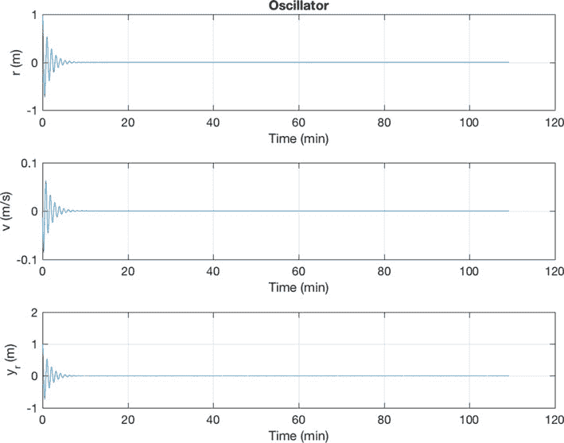


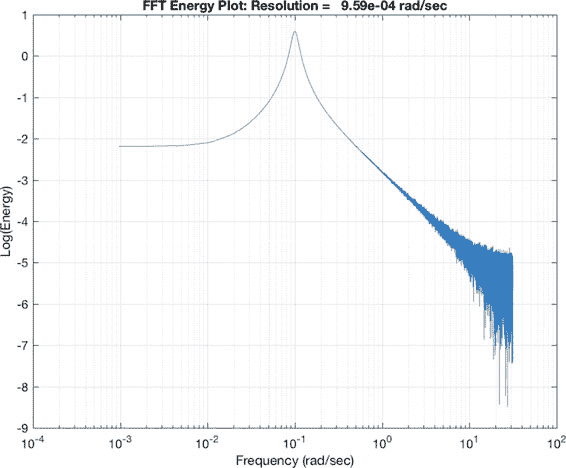

第 5 章

自适应控制

**图 5.3：** 阻尼振荡器的仿真。阻尼比 *ζ * 为 0.5，无阻尼固有频率 *ω * 为 0.1 rad/s。

**图 5.4：** 频率频谱。峰值位于 0.1 rad/s 的振荡频率处。


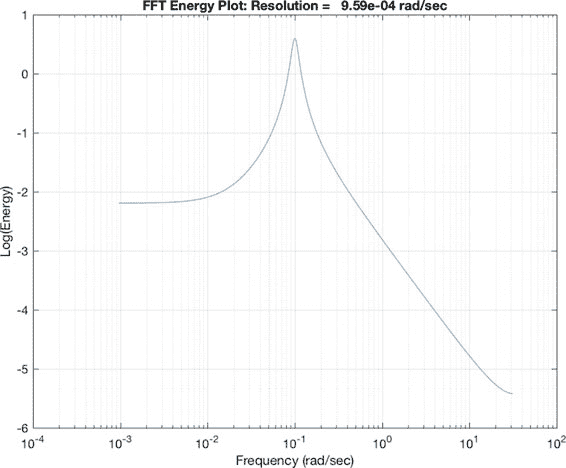

第 5 章

自适应控制

**图 5.5：** 无噪声的频率频谱。频谱峰值位于 0.1 rad/s 处，与仿真结果一致。

命令窗口中的结果如下：

TuningSim

估计的振荡器频率

0.0997 rad/s

已调谐

已调谐

已调谐

从图 5.6 中的 FFT 图可以看出，由于传感器噪声和高斯扰动，频谱显得“嘈杂”。判断系统是否欠阻尼的标准是是否存在一个明显的峰值。如果噪声足够大，我们必须设置更低的阈值来触发调谐。左上角的 FFT 图显示了 0.1 rad/s 的峰值。调谐后，我们充分阻尼了振荡器，使得峰值减小。图 5.6 中的时间图（底部图）显示系统最初是弱阻尼的。调谐后，其振荡非常小。每次在 1.9、3.6 和 5.5 秒调整调谐时，都会出现轻微的瞬态。FFT 图（右上角和中间两个）显示了调谐中使用的数据。

重要的一点是，我们必须激励系统以识别峰值。所有系统辨识、参数估计和调谐算法都有这个要求。脉冲（具有宽频谱）的替代方案是使用正弦扫频。


这将激发任何共振，并使峰值更容易识别。然而，在以不同频率激励物理系统时，必须小心谨慎，以确保其在固有频率下不会产生不安全或不稳定的响应。


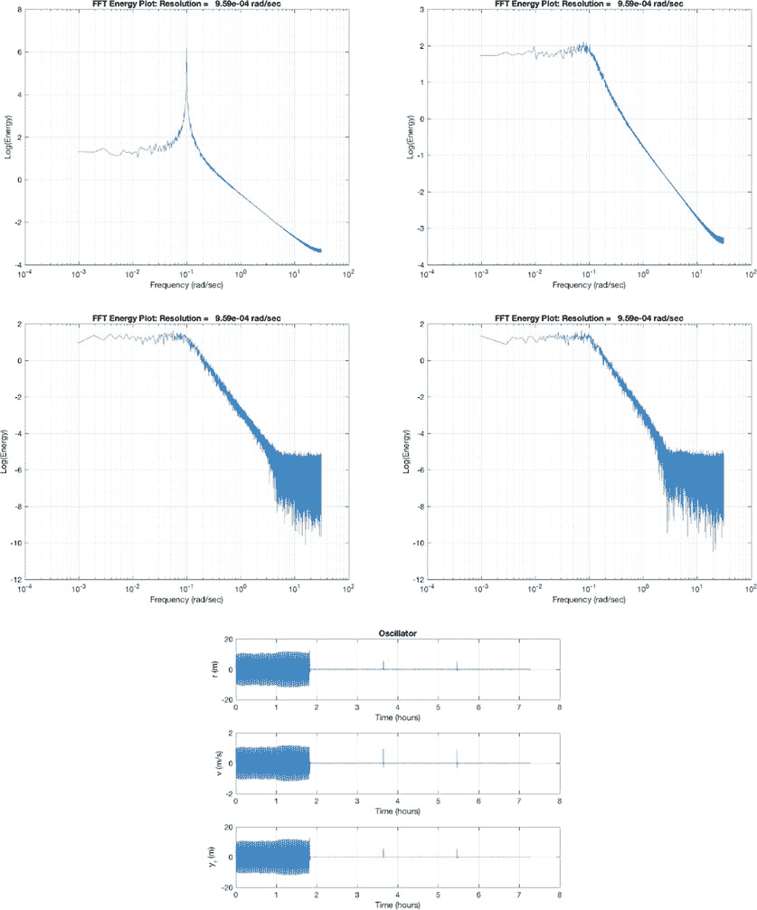

第 5 章

自适应控制

**图 5.6：** 调谐仿真结果。前四个图是每个采样间隔结束时采集的频谱；最后一个图显示了随时间变化的结果。


第 5 章

自适应控制

**5.3**

**实现模型参考自适应控制**

我们的下一个示例是控制一个带有未知负载的转子，使其按期望的方式运行。旋转关节的动力学模型为 [[2]:](#index_split_007.html#p349)

*dω * = *−aω * + *bu*

*dt*

*c * + *ud*

(5.9)

其中阻尼 *a* 和/或输入常数 *b* 是未知的。 *ω* 是角速率。 *uc* 是输入电压， *ud* 是扰动角加速度。这是一个一阶系统，由一个一阶微分方程建模。我们希望该系统表现得像参考模型：

*dω * = *−a*

*dt*

*mω * + *bmuc * + *ud*

(5.10)

**图 5.7：** 模型参考自适应控制演示中的转子速度控制。

**5.3.1 问题**

我们希望控制一个系统，使其表现得像一个特定的模型。我们的示例是一个简单的转子。

**5.3.2 解决方案**

解决方案是实现一个 MRAC 函数。

**5.3.3 工作原理**

其思想是拥有一个定义系统行为的动力学模型。您希望您的系统具有相同的动力学特性。这个期望的模型就是参考，因此得名模型参考自适应控制。我们将使用 MIT 规则 [[3]](#index_split_007.html#p349) 来设计自适应系统。MIT 规则最初由麻省理工学院仪器实验室（现为 Draper 实验室）开发，该实验室曾为 NASA 阿波罗计划和航天飞机开发制导与控制系统。


第 5 章

自适应控制

考虑一个具有一个可调参数 *θ* 的闭环系统。 *θ* 是一个参数，不是角度。期望输出是 *ym*。误差为：

*e * = *y − ym*

(5.11)

定义一个损失函数（或代价）为：

*J *( *θ*) =

*e* 2

(5.12)

平方运算去除了符号。如果误差为零，则代价为零。我们希望最小化 *J *( *θ*)。为了使 *J* 变小，我们沿着 *J* 的负梯度方向改变参数，即：

*dθ*

*∂J*

*∂e*

= *−γ*

= *−γe*

(5.13)

*dt*

*∂θ*

*∂θ*

这就是 MIT 规则。如果系统变化缓慢，那么我们可以假设在系统自适应过程中 *θ* 是常数。 *γ* 是自适应增益。我们的动力学模型是： *dω * = *aω * + *bu*

*dt*

*c*

(5.14)

我们希望它成为模型：

*dωm * = *a*

*dt*

*mωm * + *bmuc*

(5.15)

*a* 和 *b* 是实际的未知参数。 *am* 和 *bm* 是模型参数。我们希望 *a* 和 *b* 等于 *am* 和 *bm*。设我们转子的控制器为： *u * = *θ* 1 *uc − θ* 2 *ω*

(5.16)

第二项提供阻尼。该控制器有两个自适应参数。如果它们被选择为：

*b*

*θ*

*m*

=

(5.17)

*b*

*a*

*θ*

*m − a*

=

(5.18)

*b*

则系统与模型的输入-输出关系相同。这被称为完美模型跟随。这不是必需的。为了应用 MIT 规则，将误差写为： *e * = *ω − ωm*

(5.19)

对于参数 *θ* 1 和 *θ* 2，系统为：

*dω * = *−*( *a * + *bθ* 2) *ω * + *bθ* 1 *u* *dt*

*c*

(5.20)


第 5 章

自适应控制

其中 *γ* 是自适应增益。为了继续实现，我们引入算子 *p* = *d*。然后我们写出：

*dt*

*pω* = *−*( *a* + *bθ*²) *ω* + *bθ*₁ *u_c* (5.21)

或

*bθ*₁

*ω* =

*u*

*p* + *a* + *bθ*

*c*

(5.22)

我们需要求出误差关于 *θ*₁ 和 *θ*₂ 的偏导数。这些偏导数为：

*∂e*

*b*

=

*u*

*∂θ*

*c*

(5.23)

*p* + *a* + *bθ*₂

*∂e*

=

*−*

*b*² *θ*₁

*∂θ*₂

( *p* + *a* + *bθ*₂)² *u_c*

(5.24)

这是根据微分的链式法则得出的。注意到：

*p* + *a* + *bθ*₂

*u_c* =

*ω*

(5.25)

*bθ*₁

第二个方程变为：

*∂e*

*b*

=

*y*

(5.26)

*∂θ*₂

*p* + *a* + *bθ*₂

由于我们不知道 *a*，我们假设我们已经非常接近它。那么令：*p* + *a_m* ≈ *p* + *a* + *bθ*₂

(5.27)

我们的自适应律现在为：

*dθ*₁

*a*

=

*−γ*

*m*

*u*

*e*

(5.28)

*dt*

*p* + *a*

*c*

*m*

*dθ*₂

*a*

=

*γ*

*m*

*ω*

*e*

(5.29)

*dt*

*p* + *a_m*

令：

*a*

*x*

*m*

=

*u*

*p* + *a*

*c*

(5.30)

*m*

*a*

*x*

*m*

=

*ω*

(5.31)

*p* + *a_m*


第 5 章

自适应控制

这些是需要积分的微分方程。完整的方程组为：*dx*₁ = *−a*

*dt*

*m*x*₁ + *a_m*u_c*

(5.32)

*dx*₂ = *−a*

*dt*

*m*x*₂ + *a_m*ω*

(5.33)

*dθ*₁ = *−γx*₁ *e*

(5.34)

*dt*

*dθ*₂ = *γx*₂ *e*

(5.35)

*dt*

(5.36)

我们唯一的测量量是 *ω*，它将通过转速计测量。如前所述，控制器为

*u*

=

*θ*₁ *u_c* − *θ*₂ *ω*

(5.37)

*e*

=

*ω* − *ω_m*

(5.38)

*dω_m* = *−a*

*dt*

*m*ω_m* + *b_m*u_c*

(5.39)

MRAC 在下面完整展示的 MRAC 函数中实现。该控制器有五个需要传播的微分方程。状态为 [ *x*₁ *, x*₂ *, θ*₁ *, θ*₂ *, ω_m*]。

传播使用龙格-库塔法，但也可以使用计算量更小的低阶积分器，例如欧拉法。如果未指定输入且指定了一个输出，该函数将返回默认数据结构。默认数据结构具有合理的值。这使得用户更容易实现该函数。它只传播一步。

**function** d = MRAC( omega, d )

**if**( **nargin** < 1 )

d = DataStructure;

**return**

**end**

d.x = RungeKutta( @RHS, 0, d.x, d.dT, d, omega );

d.u = d.x(3)*d.uC - d.x(4)*omega;

%% MRAC>DataStructure

**function** d = DataStructure

% 默认数据结构

d = struct('aM',2.0,'bM',2.0,'x',[0;0;0;0;0],'uC',0,'u',0,'gamma',1,'dT',0.1);

%% MRAC>RHS

**function** xDot = RHS( ˜, x, d, omega )


第 5 章

自适应控制

% MRAC 的右端项

e

= omega - x(5);

xDot = [-d.aM*x(1) + d.aM*d.uC;...

-d.aM*x(2) + d.aM*omega;...

-d.gamma*x(1)*e;...

d.gamma*x(2)*e;...

-d.aM*x(5) + d.bM*d.uC];

现在我们已经完成了 MRAC 控制器，我们将编写一些支持函数，然后在 RotorSim 中进行全面测试。

**5.4**

**生成方波输入**

**5.4.1 问题**

我们需要生成一个方波来激励前一个配方中的转子。

**5.4.2 解决方案**

为了仿真和测试我们的控制器，我们将使用一个函数生成方波。

**5.4.3 工作原理**

SquareWave 生成一个方波。前几行是我们用于运行演示或返回数据结构的标准代码。

**function** [v,d] = SquareWave( t, d )

**if**( **nargin** < 1 )

**if**( **nargout** == 0 )

Demo;

**else**

v = DataStructure;

**end**

**return**

**end**

**if**( d.state == 0 )

**if**( t - d.tSwitch >= d.tLow )

v

= 1;

d.tSwitch = t;

d.state

= 1;

**else**

v

= 0;

**end**

**else**

**if**( t - d.tSwitch >= d.tHigh )


第 5 章

自适应控制

v

= 0;

d.tSwitch = t;

d.state

= 0;

**否则**

v

= 1;

**结束**

**结束**

该函数利用 d.state 来判断其处于方波的高电平部分还是低电平部分。波形的低电平宽度设置在 d.tLow 中，方波的高电平宽度设置在 d.tHigh 中。它将上次切换的时间存储在 d.tSwitch 中。

图 5.8 展示了一个方波。指定方波的方式有很多种。该函数生成一个最小值为 0、最大值为 1 的方波。你需要指定处于 0 的时间和处于 1 的时间来创建这个方波。

**图 5.8：** 方波。

**方波**

1.2

0.8

v 0.6

0.4

0.2

t (秒)

我们使用以下代码调整了 y 轴限制和线宽：

PlotSet(t,v,'x label', 't (sec)', 'y label', 'v', 'plot title','

Square Wave',...

'figure title', 'Square Wave');

**set**(**gca**,'ylim',[0 1.2])

h = **get**(**gca**,'children');

**set**(h,'linewidth',1);


第 5 章

自适应控制

**提示**

h = get(gca,’children’) 使你可以访问最近坐标轴中绘图内的线条数据结构。

**5.5**

**演示转子 MRAC**

**5.5.1 问题**

我们希望创建一个使用 MRAC 控制转子的方案。

**5.5.2 解决方案**

解决方案是在来自方案 5.3 的 MATLAB 脚本中使用并实现我们的 MRAC 函数。

**5.5.3 工作原理**

模型参考自适应控制在脚本 RotorSim 中实现。它调用 MRAC 来控制转子。与我们的其他脚本一样，我们使用 PlotSet 进行二维绘图。请注意，我们使用了两个新选项。一个是 'plot set'，允许你在一个子图上放置多条线。另一个是 'legend'，为每个绘图添加图例。'legend' 的元胞数组参数为每个绘图提供了一个元胞数组。在本例中，我们有两个绘图，每个绘图有两条线，因此元胞数组为：

{{'true', 'estimated'} ,{'Control' ,'Command'}}

每个绘图的图例都是整个元胞数组中的一个元胞条目。

带有 MRAC 的转子仿真脚本如下所示。方波函数生成系统应跟踪的 *ω* 指令。

RHSRotor、SquareWave 和 MRAC 都返回默认数据结构。MRAC 和 SquareWave 在每次循环迭代中被调用一次。然后使用 RungeKutta 对仿真右侧，即 RHSRotor 中的转子动力学进行传播。请注意，我们将指向 RHSRotor 的指针传递给了 RungeKutta。

%% 初始化

nSim

= 4000;

% 时间步数

dT

= 0.1;

% 时间步长 (秒)

dRHS

= RHSRotor;

% 获取默认数据结构

dC

= MRAC;

dS

= SquareWave;

x

= 0.1;

% 初始状态向量

%% 仿真

xPlot = **zeros**(4,nSim);

theta = **zeros**(2,nSim);

t

= 0;

**for** k = 1:nSim


第 5 章

自适应控制

% 绘图存储

xPlot(:,k)

= [x;dC.x(5);dC.u;dC.uC];

theta(:,k)

= dC.x(3:4);

[uC, dS]

= SquareWave( t, dS );

dC.uC

= 2*(uC - 0.5);

dC

= MRAC( x, dC );

dRHS.u

= dC.u;

% 传播（数值积分）状态方程

x

= RungeKutta( @RHSRotor, t, x, dT, dRHS );

t

= t + dT;

**结束**

**提示**

尽可能将指针 @fun 而不是字符串 'fun' 传递给函数。

RHSRotor 如下所示。

dRHS.u

= dC.u;

% 传播（数值积分）状态方程

x

= RungeKutta( @RHSRotor, t, x, dT, dRHS );

t

= t + dT;

**结束**

%% 绘制结果

动力学部分仅有一行代码。其余部分返回默认数据结构。

结果如图 5.9 所示。我们将自适应增益 *γ* 设置为 1。*am* 和 *bm* 均设置为 2。*a* 设置为 1，*b* 设置为 12。


第一个图展示了顶部转子的估计角速率和真实角速率，以及底部发送给轮子的控制需求与实际控制。期望的控制信号是一个方波（由 `SquareWave` 生成）。请注意方波跳变时施加控制中的瞬态过程。控制幅度大于指令控制幅度。同时请注意，角速率趋近于期望的指令方波形状。

图 5.10 展示了自适应增益 *θ*1 和 *θ*2 的收敛情况。它们在仿真结束时已经收敛。

模型参考自适应控制通过观察系统对控制激励的响应来学习系统增益。它需要激励才能收敛。这是所有学习系统的本质。如果激励不足，就无法观察系统的行为，因此就没有足够的信息进行学习。为一阶系统找到激励很容易。对于高阶系统或非线性系统，这可能更加困难。


第 5 章

自适应控制

**图 5.9：** 转子的 MRAC 控制。

**图 5.10：** MRAC 控制器中的增益收敛。


第 5 章

自适应控制

**5.6**

**船舶转向：实现增益调度以控制船舶转向**

**5.6.1 问题**

我们希望在所有速度下都能操控船舶转向。问题在于动力学特性是随速度变化的，这使得该问题成为一个非线性问题。

**5.6.2 解决方案**

解决方案是使用增益调度，根据速度来设定增益。增益调度是通过根据船舶动力学方程自动计算增益来学习的。这与自整定示例类似，不同之处在于我们寻求的是适用于所有速度的一组增益，而不仅仅是单一速度。此外，我们假设已知系统模型。

**图 5.11：** 增益调度控制的船舶航向控制。

x

u

v

y

**5.6.3 工作原理**

船舶航向的动力学方程以状态空间形式表示 [[2]](#index_split_007.html#p349)

⎡

⎤

⎡

⎤ ⎡

⎤ ⎡

⎤

*u* 2

⎡

⎤

˙ *v*

*u a* 11

*ua* 12 0

*v*

*b*

*l*

*αv*

⎣

*l*

⎢

⎥

˙ *r* ⎦ = ⎣

*u*

*a*

*u a*

⎦ ⎣  *r* ⎦ + ⎢  *u* 2

⎥

⎣  *α* ⎦

(5.40)

*l* 2

*l*

⎣

*b* 2 ⎦  *δ* +

*r*

˙

*l* 2

*ψ*

*ψ*

*v* 是横向速度， *u* 是船舶速度， *l* 是船舶长度， *r* 是转向速率， *ψ* 是航向角。 *αv* 和 *αr* 是扰动。假设船舶以速度 *u* 运动。这是由螺旋桨实现的，螺旋桨未建模。控制量为舵角 *δ*。

请注意，如果 *u* = 0，则船舶无法转向。状态矩阵中的所有系数都是 *u* 的函数，航向角除外。我们的目标是，在第一个方程中存在扰动加速度、第二个方程中存在扰动角速率的情况下，控制航向。

扰动仅影响动态状态 *r* 和 *v*。最后一个状态 *ψ* 是运动学状态，没有扰动。


第 5 章

自适应控制

**表 5.1：** 船舶参数 [[3]](#index_split_007.html#p349)

**参数**

**扫雷艇**

**货船**

**油轮**

*l*

*a* 11

-0.86

-0.77

-0.45

*a* 12

-0.48

-0.34

-0.44

*a* 21

-5.20

-3.39

-4.10

*a* 22

-2.40

-1.63

-0.81

*b* 1

0.18

0.17

0.10

*b* 2

1.40

-1.63

-0.81

船舶模型如下列代码 `RHSShip` 所示。第二和第三输出用于控制器。请注意，微分方程在状态和控制量上是线性的。两个矩阵都是前进速度的函数。我们并不试图控制前进速度，它是系统的一个输入。扫雷艇的默认参数见表 5.1。这些数字与默认数据结构中的相同。

**function** [xDot, a, b] = RHSShip( ˜, x, d )
**if**( **nargin** < 1 )
xDot = struct('l',100,'u',10,'a',[-0.86 -0.48;-5.2 -2.4],'b'
,[0.18;-1.4],'alpha',[0;0;0],'delta',0);
**return**
**end**
uOL = d.u/d.l;
uOLSq = d.u/d.lˆ2;
uSqOl = d.uˆ2/d.l;
a = [
uOL*d.a(1,1) d.u*d.a(1,2) 0;...
uOLSq*d.a(2,1) uOL*d.a(2,2) 0;...
1 0];
b = [uSqOl*d.b(1);...
uOLˆ2*d.b(2);...
0];
xDot = a*x + b*d.delta + d.alpha;

在船舶仿真 `ShipSim` 中，我们线性增加前进速度，同时指令一系列航向角 `psi` 的变化。控制器在每个时间步获取状态空间模型并计算新的增益，用于操纵船舶。该控制器是一个线性二次型调节器。由于状态易于建模，我们可以使用全状态反馈。此类控制器在这种情况下将完美工作，但当需要估计某些状态或存在未建模动态时，实现起来会稍显困难。


第 5 章

自适应控制

**for** k = 1:nSim
% 绘图存储
xPlot(:,k) = x;
dRHS.u = u(k);
% 控制
% 获取状态空间矩阵
[˜,a,b] = RHSShip( 0, x, dRHS );
gain(k,:) = QCR( a, b, qC, rC );
dRHS.delta = -gain(k,:)*[x(1);x(2);x(3) - psi(k)]; % 舵角
delta(k) = dRHS.delta;
% 传播（数值积分）状态方程
x = RungeKutta( @RHSShip, 0, x, dT, dRHS );
**end**

二次型调节器生成代码如下所示。它通过矩阵黎卡提方程生成增益。黎卡提方程是一个关于未知函数的二次型常微分方程。在稳态下，这简化为代数黎卡提方程，本函数即求解该方程。

**function** k = QCR( a, b, q, r )
[sinf,rr] = Riccati( [a,-(b/r)*b';-q',-a'] );
**if**( rr == 1 )
**disp**('出现重根。请调整 q、r 或 n');
**end**
k = r\(b'*sinf);

**function** [sinf, rr] = Riccati( g )
%% Ricatti
%
求解如下形式的矩阵黎卡提方程
%
%
g = [a r ]
%
[q -a']
rg = **size**(g);
[w, e] = **eig**(g);
es = **sort**(**diag**(e));
% 查找重根
j = 1:**length**(es)-1;
**if** ( **any**(**abs**(es(j)-es(j+1))<**eps*****abs**(es(j)+es(j+1))) ) rr = 1;
**else**


第 5 章

自适应控制

rr = 0;
**end**
% 对 w 的列进行排序
ws = w(:, **real**(**diag**(e)) < 0);
sinf = **real**(ws(rg/2+1:rg,:)/ws(1:rg/2,:));


a 是状态转移矩阵，b 是输入矩阵，q 是状态代价矩阵，r 是控制代价矩阵。q 的元素越大，我们对状态偏离零点的代价权重就越高。这会导致以更多控制为代价的紧密控制。b 的元素越大，我们对控制的代价权重就越高。更大的 b 意味着更少的控制。如果所有状态都可测量，二次型调节器能保证稳定性。它们是让系统正常工作的非常便捷的控制器。结果如图 5.12 所示。请注意增益的变化过程。角速率 *r* 的增益几乎恒定。注意 *ψ* 的范围非常小！通常，你会将图缩小显示。另外两个增益随速度增加而增加。这是一个增益调度的示例。不同之处在于，我们根据对船舶前进速度的完美测量来自主计算增益。

**图 5.12：** 船舶转向仿真。左侧显示状态及前进速度。

右侧显示增益和舵角。请注意舵角中用于完成机动动作的“脉冲”。

**船舶**

**船舶**

2.6

2.5

v (m/s)

增益 v 2.4

时间 (分钟)

时间 (分钟)

**船舶**

**船舶**

-0.05

r (rad/s)

增益 r

-0.1

时间 (分钟)

时间 (分钟)

**船舶**

**船舶**

-3.1622776601682

(rad)

-3.1622776601684

增益  -3.1622776601686

时间 (分钟)

时间 (分钟)

**船舶**

**船舶**

(rad) 0

u (m/s)

时间 (分钟)

时间 (分钟)


第 5 章

自适应控制

ShipSimDisturbance 是 ShipSim 的一个修改版本，其持续时间更短，仅有一次航向改变，并且在角速率和横向速度上都存在扰动。结果如图 5.13 所示。

**图 5.13：** 船舶转向仿真。左侧显示状态及舵角。

扰动为高斯白噪声。

**船舶**

-0.5

v (m/s)

0.5

1.5

2.5

3.5

4.5

时间 (分钟)

**船舶**

0.02

0.01

r (rad/s)

0.5

1.5

2.5

3.5

4.5

时间 (分钟)

**船舶**

0.5

(rad)

0.5

1.5

2.5

3.5

4.5

时间 (分钟)

**船舶**

(rad) -2

0.5

1.5

2.5

3.5

4.5

时间 (分钟)

**5.7**

**航天器指向**

**5.7.1 问题**

我们希望利用推进器来控制航天器的姿态。

**5.7.2 解决方案**

解决方案是使用参数估计器来估计转动惯量，并将其输入到控制系统中。


第 5 章

自适应控制

**5.7.3 工作原理**

航天器模型如图 5.14 所示。

**图 5.14：** 航天器模型。

动力学方程为

*I*

=

*I* 0 + *mf r* 2 *f*

(5.41)

*T*

˙

*c *+ *Td*

=

*I *¨

*θ *+ ˙

*mf r* 2 *fθ*

(5.42)

˙

*mf *= *− Tc*

(5.43)

*rue*

其中 *I* 是总转动惯量，*I* 0 是除燃料质量外所有部分的恒定转动惯量，*Tc* 是推进器控制力矩，*Td* 是扰动力矩，*mf* 是总燃料质量，*rf* 是到燃料箱中心的距离，*r* 是到推进器的矢量，*ue* 是推进器排气速度，*θ* 是航天器轴线的角度。两个燃料箱之间的燃料消耗是平衡的，因此质心保持在 (0,0)。第二个方程中的第二项是转动惯量导数项，它为系统增加了阻尼。

我们的控制器是比例微分控制器，形式如下：*Tc *= *Ia*

(5.44)

*a*

=

*−K*( *θ *+ *τ *˙ *θ*)

(5.45)

*K* 是前向增益，*τ* 是速率常数。我们为单位转动惯量设计控制器，然后估计实际转动惯量，以使我们的动态响应始终保持一致。我们将使用一个非常简单的算法来估计转动惯量：

*Tc*

*I*

*k-* 1

*k *=

(5.46)

¨

*θk − *¨

*θk-* 1

我们仅在控制力矩不为零且角速率变化不为零时执行此操作。

这是一个一阶差分近似，如果噪声不大，效果应该不错。以下代码片段展示了包含控制系统的仿真循环。


第 5 章

自适应控制

%% 初始化

nSim


= 50;

% 时间步数

dT

= 1;

% 时间步长（秒）

dRHS

= RHSSpacecraft;

% 获取默认数据结构

x

= [2.4;0.;1];

% [角度；角速率；燃料质量]

%% 控制器

kForward

= 0.1;

tau

= 10;

%% 仿真

xPlot

= **zeros**(6,nSim);

omegaOld

= x(2);

inrEst

= dRHS.i0 + dRHS.rFˆ2*x(3);

dRHS.tC

= 0;

tCThresh

= 0.01;

kI

= 0.99; % 惯性滤波器增益

**for **k = 1:nSim

% 收集绘图信息

xPlot(:,k)

= [x;inrEst;dRHS.tD;dRHS.tC];

% 控制

% 获取状态空间矩阵

dRHS.tC

= -inrEst*kForward*(x(1) + tau*x(2));

omega

= x(2);

omegaDot = (omega-omegaOld)/dT;

**if**( **abs**(dRHS.tC) > tCThresh

)

inrEst = kI*inrEst + (1-kI)*omegaDot/(dRHS.tC);

**end**

omegaOld = omega;

% 传播（数值积分）状态方程

x

= RungeKutta( @RHSSpacecraft, 0, x, dT, dRHS );

**end**

我们仅在控制力矩超过阈值时估计惯性。这可以防止我们对噪声做出响应。我们还通过一个简单的低通滤波器来整合惯性估计器。

结果如图 5.15 所示。阈值使得它仅在仿真刚开始减小姿态误差时估计惯性。

这个算法看似粗糙，但在仅能测量角速率的情况下，这基本上是我们所能做到的全部。更复杂的滤波器或估计器可以改善性能。


第 5 章

自适应控制

**图 5.15：**航天器仿真的状态与控制输出。

**角度**

**估计惯性**

)2

0.9

(rad) 1

I (kg-m

0.8

时间 (秒)

时间 (秒)

**角速率**

**干扰力矩**

-0.1

(rad/s)

(Nm)t d

-0.2

时间 (秒)

时间 (秒)

**燃料**

**控制力矩**

0.998

(kg)

-0.1

f 0.996

(Nm)

m

t c

0.994

-0.2

时间 (秒)

时间 (秒)

**5.8**

**总结**

本章演示了自适应控制或学习控制。您学习了模型调优、模型参考自适应控制、自适应控制和增益调度。表 5.2 列出了配套代码中包含的函数和脚本。

**表 5.2：**章节代码清单

**文件**

**描述**

Combinations

枚举从 1 到 n 中每次取 k 个的整数组合。

FFTEnergy

生成快速傅里叶变换能量。

FFTSim

快速傅里叶变换演示。

MRAC

实现模型参考自适应控制。

QCR

生成全状态反馈控制器。

RHSOscillatorControl

带速度增益的阻尼振荡器右侧函数。

RHSRotor

转子右侧函数。

RHSShip

船舶转向模型右侧函数。

RHSSpacecraft

航天器模型右侧函数。

RotorSim


模型参考自适应控制的仿真。

ShipSim

船舶转向仿真。

ShipSimDisturbance

带扰动的船舶转向仿真。

SpacecraftSim

时变惯性演示。

SquareWave

生成方波。

TuningSim

控制器调谐演示。

WrapPhase

将角度保持在 *−π* 和 *π* 之间。


**第 6 章**

**模糊逻辑**

模糊逻辑 [[26]](#index_split_007.html#p350) 是控制系统设计的一种替代方法。模糊逻辑在集合论的框架内运作，更擅长处理模糊性。例如，可以为传感器定义三个集合：硬故障、软故障和无故障。这三个集合可能重叠，并且在任何给定时刻，传感器在每个集合中可能都有一定的隶属度。每个集合中的隶属度可用于确定要采取的行动。而算法方法则必须为传感器状态分配一个数字。这可能存在问题，并且不一定能代表系统的实际状态。实际上，你是在应用一定程度的模糊性。

自主

学习

机器

控制

学习

智能

当你因疼痛去看医生时，医生通常会尝试让你将一个模糊的概念——疼痛——转换为 0 到 10 之间的数字。由于疼痛是个人感受，你的印象也不精确，你实际上是在给一个模糊的概念或信念赋予一个硬性数字。正如你可能经历过的，这并不十分有效或有用。

调查问卷也是如此。例如，你会被要求对餐厅的服务从 0 到 5 进行评分。然后你再用同样的标准评价其他一堆东西。这使得评论能够为你对餐厅的整体印象得出一个数字。最终得出的 4.8 分真的有意义吗？Netflix 已经放弃了对你看过的电影进行数字评分，转而采用点赞和点踩。似乎他们认为二元决策（实际上是两个集合）比数字更能说明问题。

NASA 和美国国防部喜欢使用从 1 到 9 的技术就绪水平来确定你的工作在就绪程度方面处于哪个阶段。9 表示一项技术已经在目标系统中运行。

© Michael Paluszek 和 Stephanie Thomas 2019

M. Paluszek 和 S. Thomas， *MATLAB 机器学习秘籍*，

[`doi.org/10.1007/978-1-4842-3916-2_6`](https://doi.org/10.1007/978-1-4842-3916-2_6)


第 6 章

模糊逻辑

1 仅仅是一个想法。对于任何稍微复杂的事物，其他所有级别都是模糊的。即使给一项技术评为 9 级，信息量也极其有限。M-16 步枪曾被部署到越南。它经常卡壳。按照 TRL 标准，它是 9 级，但 9 级并不能说明它运行得有多好。同样，当你阅读士兵和海军陆战队员的印象时，步枪的就绪程度最好用模糊信念来表示。

本章将向你展示如何为挡风玻璃雨刮器实现一个模糊逻辑控制系统。与其他章节不同，我们将使用语言概念，而不是硬性数字。当然，当你设置雨刮器电机速度时，你需要选择一个数字（对输出进行去模糊化），但所有中间步骤都采用模糊逻辑。

**6.1**

**构建模糊逻辑系统**

**6.1.1 问题**

我们希望有一个工具来构建模糊逻辑控制器。

**6.1.2 解决方案**

构建一个 MATLAB 函数，该函数接受定义模糊控制器所需一切内容的参数对。

**6.1.3 工作原理**

要创建一个模糊系统，你必须创建输入、输出和规则。你也可以为模糊推理的某些部分选择方法。模糊推理引擎有三个步骤：
1. 模糊化
2. 触发
3. 去模糊化

模糊系统数据存储在一个 MATLAB 数据结构中。该结构具有以下字段：

• 输入 *{*: *}*
• 输出 *{*: *}*
• 规则 *{*: *}*
• 蕴含
• 聚合
• 去模糊化

前三个字段是结构体的元胞数组。规则和模糊集有单独的结构体，如下所述。最后三个字段是包含所需函数名称的字符串。


第 6 章

模糊逻辑

模糊集结构体具有以下字段：

• name
• range(2) （包含最小值和最大值的两元素数组）
• comp *{*: *}* （标签字符串的元胞数组）
• type *{*: *}* （隶属函数名称的元胞数组）
• params *{*: *}* （参数向量的元胞数组）

模糊规则结构体具有以下字段：

• input(:) （输入分量编号的向量）
• output(:) （输出向量）
• operator *{*: *}* （运算符字符串的元胞数组）

需要组织的数据很多。我们通过函数 `BuildFuzzySystem` 来完成。以下代码片段展示了它如何使用参数对将数据分配给数据结构。

```matlab
d = load('SmartWipers');
j = 1;
for k = 1:2:length(varargin)
    switch (lower(varargin{k}))
        case 'id'
            j = varargin{k+1};
        case 'input comp'
            d.input(j).comp = varargin{k+1};
        case 'input type'
            d.input(j).type = varargin{k+1};
        case 'input name'
            d.input(j).name = varargin{k+1};
        case 'input params'
```

此代码继续处理其他情况。如果你不输入任何内容，`BuildFuzzySystem` 会加载如上所示的智能雨刮器演示，并原样返回。例如，如果你只输入一个输入类型，你会得到：

```matlab
SmartWipers = BuildFuzzySystem(...
    'id',1,...
    'input comp',{'Dry'
                  'Drizzle'
                  'Wet'} ,...
    'input type', {'Trapezoid'
                   'Triangle'
                   'Trapezoid'} ,...
    'input params',{[0 0 10 50]
                    [40 50]
                    [50 90 101 101]},...
```


第 6 章

模糊逻辑

```matlab
    'input range',[0 100])
SmartWipers =
struct with fields:
    SmartWipers: [1x1 struct]
    input: [1x1 struct]
```

在此上下文中，模糊集由一组定义变量的语言类别或分量组成。例如，如果变量是“年龄”，分量可能是“年轻”、“中年”和“老年”。每个模糊集都有一个有效范围，例如，“年龄”的一个合适范围可能是 0 到 100。每个分量都有一个隶属函数，描述该集合范围内的某个值属于每个分量的程度。例如，一个 50 岁的人很少被描述为“年轻”，但可能被描述为“中年”或“老年”，这取决于被问的人。

要构建一个模糊集，你必须将其划分为多个分量。提供了以下隶属函数：

1. 三角形
2. 梯形
3. 高斯型
4. 广义钟形
5. S 形

隶属函数的值限制在 0 到 1 之间。这些隶属函数如图 6.1 所示。

三角形隶属函数需要两个参数：三角形的中心以及所需三角形底边的一半宽度。三角形隶属函数仅限于对称三角形。

梯形隶属函数需要四个参数：最左边的点、平台起始点、平台结束点和最右边的点。

高斯隶属函数是一个连续函数，有两个参数：钟形的中心和钟形的宽度（标准差）。高斯隶属函数是对称的。


通用钟形函数也是连续且对称的，但它有三个参数，允许顶部平坦，使其类似于平滑后的梯形。它需要三个参数：钟形中心、在 y = 0.5 点处的钟形宽度，以及在 y = 0.5 点处的函数斜率。

正如钟形函数类似于平滑后的梯形，S 形隶属函数则类似于平滑后的阶跃函数。它需要两个参数：y = 0.5 的点以及函数的斜率。当斜率趋近于无穷大时，S 形函数趋近于阶跃函数。


第 6 章

模糊逻辑

**图 6.1：**隶属函数。

模糊规则是 if-then 语句。例如，一个空调规则可能是：如果室温高，那么鼓风机档位高。在这种情况下，“室温”是输入模糊集，“高”是该规则中它的分量，“鼓风机档位”是输出模糊集，“高”是它被选中的分量。

**6.2**

**实现模糊逻辑**

**6.2.1 问题**

我们想要实现模糊逻辑。

**6.2.2 解决方案**

构建一个模糊推理引擎。

**6.2.3 工作原理**

让我们重复模糊推理的三个步骤，在去模糊化中增加两个步骤：
1. 模糊化
2. 触发
3. 去模糊化
   (a) 蕴含
   (b) 聚合


第 6 章

模糊逻辑

控制流程位于主函数中，名为 `FuzzyInference`。它只是按顺序调用 `Fuzzify`、`Fire` 和 `Defuzzify`。如果输入不合理，它会调用 `warndlg`。

**function** y = FuzzyInference( x, system )

**if length**(x) == **length**( system.input )

fuzzyX = Fuzzify( x, system.input );

strength = Fire( fuzzyX, system.rules );

y = Defuzzify( strength, system );

**else**

warndlg({'The length of x must be equal to the',...

'number of input sets in the system.'})

**end**

你会注意到使用了 `eval` 来评估作为输入存储为字符串的函数名。你也可以存储指针并做同样的事情。例如，对于函数：**function** y = MyFun(x)

y = x;

`eval` 作用于字符串。本质上，它将 MATLAB 解析器应用于你自己的文本。你可以根据需要使字符串变得复杂，尽管这会牺牲可读性。你还可以做一些事情，比如制作自修改代码。

>> **eval**(['MyFun(', **sprintf**('%f',2),')'])

**ans** =

使用函数指针更简洁，处理时间也更少。

>> **feval**(@MyFun,2)

**ans** =

`feval` 作用于函数指针，通常速度更快。

**提示**

尽可能使用 `feval` 代替 `eval`。

模糊化子函数代码如下所示。它将数据放入各个输入隶属集。一个输入可能属于多个集合。

**function** fuzzyX = Fuzzify( x, sets )

m = **length**(sets);

fuzzyX = **cell**(1,m);

**for** i = 1:m

n = **length**(sets(i).comp);

range = sets(i).range(:);

**if** range(1) <= x(i) <= range(2)


第 6 章

模糊逻辑

**for** j = 1:n


fuzzyX{i}(j) = **eval**([sets(i). **type**{j} 'MF(x(i),[' **num2str**(sets(i).params{j}) '])']);

**end**

**else**

fuzzyX{i}(1:n) = **zeros**(1,n);

**end**

**end**

以下代码触发了模糊规则。该代码应用了“模糊与”或“模糊或”。

“模糊与”是一组隶属度值中的最小值。“模糊或”是一组隶属度值中的最大值。假设我们有一个向量 [1 0 1 0]。最大值是 1，最小值是 0。

>> 1 && 0 && 1 && 0

**ans =**

logical

>> 1 || 0 || 1 || 0

**ans =**

logical

这对应于模糊逻辑中的“与”和“或”。

下一个代码片段展示了 FuzzyInference 中的 Fire 子函数。

**function** strength = Fire( FuzzyX, rules )

m = **length**( rules );

n = **length**( FuzzyX );

strength = **zeros**(1,m);

**for** i = 1:m

method = rules(i).operator;

**for** j = 1:n

comp = rules(i). **input**(j);

**if** comp ˜= 0

dom(j) = FuzzyX{j}(comp);

**else**

dom(j) = inf;

**end**

**end**

strength(i) = **eval**([method '(dom(find(dom<=1)))']);

**end**


第 6 章

模糊逻辑

最后，我们对结果进行去模糊化。此函数首先使用蕴含函数来确定隶属度。然后使用聚合函数（本例中为 max）聚合输出。

**function** result = Defuzzify( strength, system )

rules = system.rules;

output = system.output;

m = **length**( output );

n = **length**( rules );

imp = system.implicate;

agg = system.aggregate;

defuzz = system.defuzzify;

result = **zeros**(1,m);

**for** i = 1:m

range = output(i).range(:);

x = **linspace**( range(1),range(2),200 );

**for** j = 1:n

comp = rules(j).output(i);

**if**( comp ˜= 0 )

mf = [output(i). **type**{comp} 'MF'];

params = output(i).params{comp};

mem(j,:) = **eval**([ imp 'IMP(' mf '(x,params),strength(j))']);

**else**

mem(j,:) = **zeros**(**size**(x));

**end**

**end**

aggregate = **eval**([ agg '(mem)' ]);

result(i) = **eval**([ defuzz 'DF(aggregate, x)']);

**end**

**6.3**

**演示模糊逻辑**

**6.3.1 问题**

我们希望有一个控制系统，能够根据降雨量选择雨刮器的速度和间隔。

**6.3.2 解决方案**

使用我们开发的工具构建一个模糊逻辑控制系统。


第 6 章

模糊逻辑

**6.3.3 工作原理**

要调用模糊系统，请使用函数 y = FuzzyInference( x, system )。

脚本 SmartWipersDemo 实现了降雨量演示。我们只展示调用推理引擎的代码。

如上所述，模糊系统通过 SmartWipers = BuildFuzzySystem() 加载。

% 在 2 个输入中生成规则间隔的数组

x = **linspace**(SmartWipers.input(1).range(1),SmartWipers.input(1).range (2),n);


y = **linspace**(SmartWipers.input(2).range(1),SmartWipers.input(2).range (2),n);

PlotSet(1:n,[x;y],'x label','输入','y label',{'湿度','强度'},...

'figure title','输入','Plot Title',{'湿度','强度'})

h = **waitbar**(0,'智能雨刷演示：绘制规则库'); z1 = **zeros**(n,n);

z2 = **zeros**(n,n);

**for** k = 1:n

**for** j = 1:n

temp = FuzzyInference([x(k),y(j)], SmartWipers);

z1(k,j) = temp(1);

z2(k,j) = temp(2);

**end**

**waitbar**(k/n)

**end**

**close**(h);

NewFigure('基于模糊逻辑的雨刷速度')

智能雨刷是一个用于自动挡风玻璃雨刮器的控制系统[[7].](#index_split_007.html#p349) 首先，该演示将绘制输入和输出的模糊变量。对绘制的每一组清晰输入执行模糊推理。图 6.2 显示了模糊逻辑系统的输入。图 6.3 显示了输出。

在模糊逻辑系统中测试的输入如图 6.4 所示。

图 6.5 给出了曲面图，以显示输出与输入的关系。曲面图由以下代码生成。我们添加了一个颜色条以使图形更易读。

颜色与 z 值相关。我们在第二个图中使用 view，以便于在图中阅读。您可以使用 rotate3d on 来允许您用鼠标旋转图形。

NewFigure('基于模糊逻辑的雨刷速度')

**surf**(x,y,z1)

**xlabel**('雨滴湿度')

**ylabel**('液滴频率')

**zlabel**('雨刷速度')

**colorbar**


第 6 章

模糊逻辑

**图 6.2：** 雨水湿度和强度是智能雨刮器控制系统的输入。

**图 6.3：** 雨刷速度和间隔是智能雨刮器控制系统的输出。

**速度**

**间隔**

1.2

1.2

停止

慢速

快速

零

短

长

0.8

0.8

0.6

0.6

隶属度

0.4

隶属度

0.4

0.2

0.2

清晰值

清晰值

NewFigure('基于模糊逻辑的雨刷间隔')

**surf**(x,y,z2)

**xlabel**('雨滴湿度')

**ylabel**('液滴频率')

**zlabel**('雨刷间隔')

**view**([142.5 30])

**提示**

使用 rotate3d on 可以用鼠标旋转图形。


第 6 章

模糊逻辑

**图 6.4：** 雨水湿度和强度输入数值。

**图 6.5：** 雨刷速度和间隔与液滴频率和湿度的关系。


第 6 章

模糊逻辑

**6.4**

**本章小结**

本章演示了模糊逻辑。雨刮器演示给出了一个应用示例。表 6.1 列出了随附代码中包含的函数和脚本。

**表 6.1：**章节代码清单

**文件**

**描述**

BuildFuzzySystem

使用参数对构建模糊逻辑系统（数据结构）。

SmartWipersDemo

演示用于雨刮器的模糊逻辑控制系统。

FuzzyPlot

绘制模糊集合。

TriangleMF

三角形隶属函数。

TrapezoidMF

梯形隶属函数。

SigmoidalMF

显示具有多个层的神经网络。

ScaleIMP

缩放蕴含函数。

ClipIMP

裁剪蕴含函数。

GeneralBellMF

广义钟形隶属函数。

GaussianMF

高斯隶属函数。

FuzzyOR

模糊或（隶属度最大值）。

FuzzAND

模糊与（隶属度最小值）。

FuzzyInference

给定模糊系统和清晰数据 x，执行模糊推理。

CentroidDF

重心去模糊化。


**第 7 章**

**基于决策树的数据分类**

在本章中，我们将阐述二叉决策树的理论。决策树可用于对数据进行分类，属于我们自主分类法中的学习类别。二叉树最容易实现，因为每个节点要么分支到两个其他节点，要么没有分支。我们将创建用于决策树和生成待分类数据集的函数。图 7.1 展示了一个简单的二叉树。点“a”位于左上象限。第一个二叉测试发现其*x*值大于 1。下一个测试发现其*y*值大于 1，并将其归入集合 2。尽管边界显示为方形区域，但二叉树实际上测试的是在*x*和*y*两个方向上均延伸至无穷远的区域。

自主

学习

机器

控制

学习

智能

二叉决策树是一种在每个决策节点上只有两个决策可供选择的决策树。一旦做出决策，下一个决策节点会提供两个额外的选项。每个节点接受一个二进制值 0 或 1。0 将你导向一条路径，1 则导向另一条路径。在每个决策节点，你都在测试一个新的变量。当你到达底部时，你将找到一条所有值都为真的路径。包含*n*个变量的二叉树的问题在于，它将拥有 2*n* − 1 个节点。四个变量需要 15 个决策节点。八个变量则需要 65 个决策节点，以此类推。如果测试变量的顺序是固定的，我们称之为有序树。

© Michael Paluszek 和 Stephanie Thomas 2019
M. Paluszek 和 S. Thomas，《MATLAB 机器学习实践》，
[`doi.org/10.1007/978-1-4842-3916-2_7`](https://doi.org/10.1007/978-1-4842-3916-2_7)


第 7 章

基于决策树的数据分类

**图 7.1：**一个简单的二叉树，带有一个待分类的点。

对于分类，我们假设可以通过一系列二叉决策来对某物进行分类。如果可以，我们就可以在二叉树中实现这种推理。

**7.1**

**生成测试数据**

**7.1.1 问题**

我们希望生成一组用于分类的训练数据和测试数据。

**7.1.2 解决方案**

编写一个使用`rand`函数的函数，在*x*和*y*两个维度的选定范围内生成数据。

**7.1.3 工作原理**

函数`ClassifierSet`生成随机数据并将其分配到各个类别。函数调用如下：


**function** p = ClassifierSets( n, xRange, yRange, name, v, f, setName ) `ClassifierSets` 的第一个参数是点数的平方根。第二个参数 `xRange` 指定数据的 x 范围，第三个参数 `yRange` 指定 y 范围。*n*² 个点将随机放置在该区域内。下一个参数是一个包含集合名称的元胞数组 `name`，这些名称用于图标签。其余输入是顶点列表 `v` 和面 `f`。面用于选择每个多边形中使用的顶点，并将这些顶点连接成特定的多边形。`f` 是一个元胞数组，因为每个面数组的长度可以不同。三角形的长度为 3，六边形的长度为 6。三角形、矩形和六边形可以轻松地拼接在一起，不留空隙。

通过添加将数据划分为区域的多边形来定义类别。可以使用任何多边形。应选择多边形以确保没有空隙。矩形很简单，但也可以使用大小均匀的六边形。以下代码是内置的演示程序。该演示是函数中的最后一个子函数，用于指定顶点和面。

**function** Demo

v = [0 0;0 4; 4 4; 4 0; 0 2; 2 2; 2 0;2 1;4 1;2 1];

f = {[5 6 7 1] [5 2 3 9 10 6] [7 8 9 4]};

ClassifierSets( 5, [0 4], [0 4], {'width', 'length'}, v, f );

在此演示中，有三个多边形。所有点都定义在一个 x 和 y 方向范围均为 0 到 4 的正方形内。

其他子函数是 `PointInPolygon` 和 `Membership`。`Membership` 用于判断一个点是否在多边形内。`Membership` 调用 `PointInPolygon` 来将点分配到各个集合。`ClassifierSets` 随机将点放置在区域内，并通过函数中的以下代码 `PointInPolygon` 来确定每个点所在的区域。

**function** r = PointInPolygon( p, v )

m = **size**(v,2);

% 所有点均在外部

r = 0;

% 将第一个点放在末尾以简化循环

v = [v v(:,1)];

**for** i = 1:m

j = i + 1;

v2J = v(2,j);

v2I = v(2,i);

**if** (((v2I > p(2)) ˜= (v2J > p(2))) && ...

(p(1) < (v(1,j) - v(1,i)) * (p(2) - v2I) / (v2J - v2I) + v(1,i) ))

r = ˜r;

**end**

**end**

这段代码可以判断一个点是否位于由一组顶点定义的多边形内部。当需要知道一个物体的顶点是否在另一个多边形内时，该代码在计算机图形学和游戏中经常被使用。你可以合理地认为，对于这类问题，此函数可以替代我们的决策树逻辑。然而，决策树可以计算更复杂数据集的成员关系。我们的分类器集合很简单，便于验证结果。

运行 `ClassifierSets` 查看演示。给定输入范围，它会确定随机选择的点的成员关系。`p` 是一个数据结构，用于保存顶点和成员关系。它使用 `NewFigure` 创建新图形后绘制这些点，然后使用 `patch` 创建矩形区域。

p.x = (xRange(2) - xRange(1))*(**rand**(n,n)-0.5) + **mean**(xRange); p.y = (yRange(2) - yRange(1))*(**rand**(n,n)-0.5) + **mean**(yRange); p.m = Membership( p, v, f );

NewFigure(setName);

i = 0;

drawNum = nˆ2 < 50;

**for** j = 1:n

**for** k = 1:n

i = i + 1;

**plot**(p.x(k,j),p.y(k,j),'marker','o','MarkerEdgeColor','k')

**if**( drawNum )

**text**(p.x(k,j),p.y(k,j), **sprintf**(' %3d',i));

**end**

**hold** on

**end**

**end**

m = **length**(f);

a = **linspace**(0,2***pi**-2***pi**/m,m)';

c = **abs**(**cos**([a a+**pi**/6 a+3***pi**/5]));

**for** k = 1:m

**patch**('vertices',v,'faces',f{k},'facecolor',c(k,:),'facealpha',0.1) **end**

**xlabel**(name{1});

**ylabel**(name{2});

**grid** on

如果点数少于 50，该函数会显示数据编号。使用 MATLAB 函数 `patch` 来生成多边形。代码展示了一系列图形编程技巧，包括图形参数的使用。注意我们创建 m 种颜色的方式。


**提示**

你可以使用 `linspace` 和 `cos` 为绘图创建无限数量的颜色。

`ClassifierTestSet` 可以生成测试集或演示训练好的决策树。该图显示，分类区域是边与 *x* 轴或 *y* 轴平行的区域。

这些区域不应重叠。


第 7 章

使用决策树进行数据分类

**图 7.2：** 演示中具有三个区域的分类器集合。其中两个是矩形，一个是 L 形。

**7.2**

**绘制决策树**

**7.2.1 问题**

我们希望绘制一棵二叉决策树来展示决策树思维。

**7.2.2 解决方案**

解决方案是使用 MATLAB 图形函数 `patch`、`text` 和 `line` 来绘制一棵树。

**7.2.3 工作原理**

函数 `DrawBinaryTree` 可以绘制任意二叉树。函数调用方式为 **function** d = DrawBinaryTree( d, name )

您需要传入一个数据结构 `d`，其中包含一个元胞数组形式的决策标准。`name` 输入是可选的，它有一个默认名称选项。方框从左侧开始，逐行排列。

在二叉树中，行数与节点数通过等比数列公式相关联：

*m* = log2( *n*)

(7.1)

其中 *m* 是行数，*n* 是方框数。因此，该函数可以计算出行数。

该函数首先检查输入参数的数量，然后要么运行演示，要么返回默认的数据结构。编写函数时，应始终为所有可能的情况提供默认值。


第 7 章

使用决策树进行数据分类

**提示**

只要可能，就为函数参数提供默认输入。

它会立即创建一个具有该名称的新图形。然后，它遍历所有方框，根据二叉树的结构将它们分配到各行。第一行有一个方框，接下来一行有两个方框，再下一行有四个方框，以此类推。由于这是一个等比数列，很快就会变得难以管理！这指出了决策树的一个问题。如果树的深度超过四层，即使绘制它们也是不可能的。在绘制方框时，它会计算底部和顶部的点，这些点将作为方框之间连线的锚点。绘制完所有方框后，再绘制所有连线。

所有绘图功能都在子函数 `DrawBox` 中实现。

v = [x y 0; x y+h 0; x+w y+h 0; x+w y 0];

**patch**('vertices', v, 'faces', [1 2 3 4], 'facecolor', [1; 1; 1]);

**text**(x+w/2, y + h/2, t, 'fontname', d.font, 'fontsize', ...

d.fontSize, 'HorizontalAlignment', 'center');

%% DrawBinaryTree>DefaultDataStructure

这段代码使用 `patch` 函数绘制方框，并使用 `text` 函数绘制文本。

`'facecolor'` 设置为白色。

红绿蓝 (RGB) 数值范围从 0 到 1。

将 `'facecolor'` 设置为 `[1 1 1]` 会使面为白色，并保留黑色边缘。与所有 MATLAB 图形一样，您可以编辑数十个属性来生成精美的图形。请注意 `text` 函数中的额外参数。最后一行中的 `'HorizontalAlignment'` 最为有趣，它允许您将文本在方框中居中。MATLAB 会自动为您处理所有字体大小的计算。

以下清单展示了 `DrawBinaryTree` 中用于绘制树的代码，从检查演示之后开始。如果指定了一个输出且没有输入，该函数将返回默认的数据结构。代码的第一部分创建一个新图形，并在每个节点处绘制方框。它还会创建用于存储方框位置的数组，以便后续绘制连接方框的线条。它从 `name` 的默认参数开始。第一组循环用于绘制树的方框。`rowID` 是一个元胞数组。元胞中的每一行都是一个数组。元胞数组允许每个元胞的内容不同，这使得在元胞中存储不同长度的数组变得容易。如果使用标准矩阵，则在添加新行时需要调整行的大小。

**if** ( **nargin** < 2 )

name = 'Binary Tree';

**end**

NewFigure(name);

m = **length**(d.box);

nRows


= **ceil**(**log2**(m+1));

w

= d.w;

h

= d.h;

i

= 1;


第 7 章

基于决策树的数据分类

x

= -w/2;

y

= 1.5*nRows*h;

nBoxes

= 1;

bottom

= **zeros**(m,2);

top

= **zeros**(m,2);

rowID

= **cell**(nRows,1);

% 在每个节点处绘制一个方框

**for** k = 1:nRows

**for** j = 1:nBoxes

bottom(i,:)

= [x+w/2 y ];

top(i,:)

= [x+w/2 y+h];

DrawBox(d.box{i},x,y,w,h,d);

rowID{k}

= [rowID{k} i];

i

= i + 1;

x

= x + 1.5*w;

**if**( i > **length**(d.box) )

**break**;

**end**

**end**

nBoxes

= 2*nBoxes;

x

= -(0.25+0.5*(nBoxes/2-1))*w - nBoxes*w/2;

y

= y - 1.5*h;

**end**

其余代码用于绘制方框之间的连线。

**for** k = 1:**length**(rowID)-1

iD = rowID{k};

i0 = 0;

% 从当前行的左侧向右侧处理

**for** j = 1:**length**(iD)

x(1) = bottom(iD(j),1);

y(1) = bottom(iD(j),2);

iDT

= rowID{k+1};

**if**( i0+1 > **length**(iDT) )

**break**;

**end**

**for** i = 1:2

x(2) = top(iDT(i0+i),1);

y(2) = top(iDT(i0+i),2);

**line**(x,y);

**end**

i0 = i0 + 2;

**end**

**end**

**axis** off


第 7 章

基于决策树的数据分类

以下内置演示程序绘制了一棵二叉树。该演示创建了三行，从默认数据结构开始。你只需为决策点添加字符串即可。方框以扁平列表形式存储。

**function** Demo

% 绘制一个简单的二叉树数据结构

d

= DefaultDataStructure;

d.box{1}

= 'a > 0.1';

d.box{2}

= 'b > 0.2';

d.box{3}

= 'b > 0.3';

d.box{4}

= 'a > 0.8';

d.box{5}

= 'b > 0.4';

d.box{6}

= 'a > 0.2';

d.box{7}

= 'b > 0.3';

DrawBinaryTree( d );

请注意，它调用了子函数 DefaultDataStructure 来初始化演示。

%% DrawBinaryTree>DefaultDataStructure

**function** d = DefaultDataStructure

% 默认数据结构

d

= struct();

d.fontSize

= 12;

d.font

= 'courier';

d.w

= 1;

d.h

= 0.5;

d.box

= {};

**提示**

始终让函数返回其默认数据结构。默认值应包含可正常工作的数值。

它首先为名称设置一个默认参数。循环用于绘制树的方框。

rowID 是一个元胞数组。元胞中的每一行都是一个数组。元胞数组允许每个元胞各不相同。这使得在元胞中存储不同长度的数组变得容易。如果使用标准矩阵，则在添加新行时需要调整行的大小。演示生成的二叉树如图 7.3 所示。方框中的文本可以是任何你想要的内容。

方框的输入本可以在循环中完成。你可以使用 sprintf 来创建它们。

例如，对于第一个方框，你可以这样写：

d.box{1}= **sprintf**('%s %s %3.1f','a','>',0.1);

并将类似的代码放入循环中。


第 7 章

基于决策树的数据分类

**图 7.3：** DrawBinaryTree 演示程序生成的二叉树。

**7.3**

**实现**

决策树是本章的重点。我们将首先探讨如何判断决策树是否正常工作。然后，我们将手动构建一棵决策树，最后编写学习代码来为树的每个节点生成决策。

**7.3.1 问题**

我们需要衡量决策树不同节点上数据集的同质性。如果数据点彼此相似，则该数据集是同质的。例如，如果你试图研究一所经济背景多样化的学校中的成绩点，你会想知道你的样本是否全部来自富裕家庭的孩子。我们在决策树中的目标是最终得到同质的集合。

**7.3.2 解决方案**

解决方案是对数据集实现基尼不纯度度量。该函数将返回一个单一数值作为同质性度量。

**7.3.3 工作原理**

同质性度量被称为信息增益（IG）。IG 定义为在节点处进行分裂所增加的信息量。其公式为：

Δ *I* = *I*( *p*) *− Nc*1 *I*( *c*1) *− Nc*2 *I*( *c*2) (7.2)

*Np*

*Np*


其中 *I* 是不纯度度量，*N* 是该节点上的样本数量。如果我们的树正常工作，该值应该下降，最终降至零或一个非常小的数字。在我们的训练集中，我们知道每个数据点的类别。因此，我们可以确定信息增益（IG）。本质上，我们有 155


第 7 章

使用决策树进行数据分类

如果子节点中的混合程度降低，我们就获得了信息。例如，在决策树的第一个节点中，所有数据都混合在一起。第一个节点有两个子节点。

在第一个节点做出决策后，我们期望每个子节点中某一类别的数据会多于另一个子节点。我们查看每个节点中各类别的百分比，并寻找非均匀性的最大增量。

有三种不纯度度量：

• 基尼不纯度

• 熵

• 分类误差

基尼不纯度 *IG* 是使误分类概率最小化的准则。我们不希望将样本推入错误的类别。

*c*

*IG* = 1 *−*

*p*( *i|t*)²

(7.3)

*p*( *i|t*) 是节点 *t* 上属于类别 *ci* 的样本比例。对于二元分类，熵 *IE* 要么是零，要么是一。

*c*

*IE* = 1 *−*

*p*( *i|t*) log₂ *p*( *i|t*)

(7.4)

分类误差 *IC* 为：

*IC* = 1 *−* max *p*( *i|t*)

(7.5)

我们将在决策树中使用基尼不纯度。以下代码实现了基尼度量。第一部分只是决定是初始化函数还是更新函数。所有数据都保存在数据结构 `d` 中。这通常比使用全局数据更容易。一个优点是，你可以在同一个脚本或函数中多次使用该函数，而不会混淆函数中的持久数据。

**function** [i, d] = HomogeneityMeasure( action, d, data )

**if**( **nargin** == 0 )

**if**( **nargout** == 1 )

i = DefaultDataStructure;

**else**

Demo;

**end**

**return**

**end**

switch **lower**(action)

case 'initialize'

d = Initialize( d, data );


第 7 章

使用决策树进行数据分类

i = d.i;

case 'update'

d = Update( d, data );

i = d.i;

otherwise

**error**('%s 不是一个可用的操作',action);

**end**

`Initialize` 函数初始化数据结构并计算数据的不纯度度量。数据的每个不同值对应一个类别。例如，[1 2 3 3] 会有三个类别。

**function** d = Initialize( d, data )

%% HomogeneityMeasure>Initialize

m = **reshape**(data,[],1);

c = 1:**max**(m);

n = **length**(m);

d.dist = **zeros**(1,c(**end**));

d.class = c;

**if**( n > 0 )

**for** k = 1:**length**(c)

j = **find**(m==c(k));

d.dist(k) = **length**(j)/n;

**end**

**end**

d.i = 1 - **sum**(d.dist.ˆ2);

演示如下。我们尝试四组不同的数据并获取度量值。0 表示完全均匀。1 表示没有数据。

**function** d = Demo

% 演示数据集的不纯度度量。

data = [1 2 3 4 3 1 2 4 4 1 1 1 2 2 3 4]; **fprintf**(1,'%2.0f',data); d = HomogeneityMeasure;

[i, d] = HomogeneityMeasure( 'initialize', d, data );

**fprintf**(1,'\n 不纯度度量 %6.3f\n',i);

**fprintf**(1,'类别 [%1d %1d %1d %1d]\n',d.class);

**fprintf**(1,'分布 [%5.3f %5.3f %5.3f %5.3f]\n',d.dist);

data = [1 1 1 2 2]; **fprintf**(1,'%2.0f',data);

[i, d] = HomogeneityMeasure( 'update', d, data );

**fprintf**(1,'\n 不纯度度量 %6.3f\n',i);

**fprintf**(1,'类别 [%1d %1d %1d %1d]\n',d.class);

**fprintf**(1,'分布 [%5.3f %5.3f %5.3f %5.3f]\n',d.dist);


第 7 章

使用决策树进行数据分类

data = [1 1 1 1]; **fprintf**(1,'%2.0f',data);

[i, d] = HomogeneityMeasure( 'update', d, data );

**fprintf**(1,'\n 不纯度度量 %6.3f\n',i);

**fprintf**(1,'类别 [%1d %1d %1d %1d]\n',d.class);

**fprintf**(1,'分布 [%5.3f %5.3f %5.3f %5.3f]\n',d.dist);

data = []; **fprintf**(1,'%2.0f',data);

[i, d] = HomogeneityMeasure( 'update', d, data );

**fprintf**(1,'\n 不纯度度量 %6.3f\n',i);

**fprintf**(1,'类别 [%1d %1d %1d %1d]\n',d.class);


**fprintf**(1,'分布

[%5.3f %5.3f %5.3f %5.3f]\n',d.dist);

*i* 是均匀性度量。*d.dist* 是数据点中属于该类别的比例。类别即不同的取值。演示的输出如下所示。

>> HomogeneityMeasure

1 2 3 4 3 1 2 4 4 1 1 1 2 2 3 4

均匀性度量

0.742

类别

[1 2 3 4]

分布

[0.312 0.250 0.188 0.250]

1 1 1 2 2

均匀性度量

0.480

类别

[1 2 3 4]

分布

[0.600 0.400 0.000 0.000]

1 1 1 1

均匀性度量

0.000

类别

[1 2 3 4]

分布

[1.000 0.000 0.000 0.000]

均匀性度量

1.000

类别

[1 2 3 4]

分布

[0.000 0.000 0.000 0.000]

倒数第二组数据包含一个零，这是期望值。如果没有输入，则返回 1，因为根据定义，一个类别要存在，必须有其成员。

**7.4**

**创建决策树**

**7.4.1 问题**

我们希望实现一个决策树，用于对具有两个参数的数据进行分类。

**7.4.2 解决方案**

解决方案是在 MATLAB 中编写一个名为 `DecisionTree` 的二元决策树函数。


第 7 章

基于决策树的数据分类

**7.4.3 工作原理**

决策树 [[20]](#index_split_007.html#p350) 通过提出一系列关于数据的问题来分解数据。我们的决策树将是二元的，即每个问题只有“是”或“否”两种答案。对于数据中的每个特征，我们在每个决策节点提出一个问题。这总是将数据分割成两个子节点。我们将关注两个决定类别归属的参数。这些参数将是数值型度量。

在后续节点中，我们提出更多问题，进一步分割数据。图 7.4 展示了父节点/子节点的结构。我们持续此过程，直到每个节点上的样本都属于某一类别。在每个节点上，我们希望提出那个能为我们提供关于样本所属类别最多信息的问题。在构建用于双参数分类的决策树时，我们在每个节点上有两个决策：

• 检查哪个参数（*x* 或 *y*）。

• 在决策中使用该参数的哪个值。

**图 7.4：** 父节点/子节点。

特征问题

父节点

否

是

特征问题

特征问题

子节点

训练过程使用前一个配方中给出的基尼系数值。我们在每个节点上，针对两个参数中的每一个，分别使用一次 MATLAB 函数 `fminbnd`。`fminbnd` 是一个一维局部最小化器，用于在指定的两个端点之间寻找函数的最小值。如果你知道感兴趣的范围，那么这是一种非常有效的寻找最小值的方法。

最小化 *f*(*x*)，满足 *x*₁ < *x* < *x*₂

(7.6)

*x*

有两个操作：“train”（训练）和“test”（测试）。“train”创建决策树，“test”运行生成的决策树。你也可以输入你自己的决策树。`FindOptimalAction` 寻找能使分割两侧不均匀性最小化的参数。由 `fminbnd` 调用的函数是 `RHSGT`。我们只实现了“大于”操作。函数调用如下：

**function** [d, r] = DecisionTree( action, d, t )


第 7 章

基于决策树的数据分类

`action` 是一个字符串，可以是“train”或“test”。`d` 是定义树的数据结构。`t` 是用于训练或测试的输入。输出是更新后的数据结构 `d` 和包含结果的 `r`。

该函数首先使用训练数据和动作“train”进行调用。主函数很简短。

switch **lower**(action)

case 'train'

d = Training( d, t );

d.box(1)

case 'test'

**for** k = 1:**length**(d.box)

d.box(k).id = [];

**end**

[r, d] = Testing( d, t );

**for** k = 1:**length**(d.box)

d.box(k)

**end**

otherwise

**error**('%s 不是一个可用的操作', action);

**end**


我们添加了错误情况以保持完整性。请注意，我们使用 `lower` 来消除大小写敏感性。训练过程会创建决策树。决策树是由线条连接的一组方框。如果一个方框是决策框，则它有两个子框。类别框没有子节点。子函数 `Training` 负责训练该树，并在每个节点添加方框。

%% DecisionTree>Training

**function** d = Training( d, t )

[n,m] = **size**(t.x);

nClass = **max**(t.m);

box(1) = AddBox( 1, 1:n*m, [] );

box(1).child = [2 3];

[˜, dH] = HomogeneityMeasure( 'initialize', d, t.m );

class = 0;

nRow = 1;

kR0 = 0;

kNR0 = 1; % 下一行

kInRow = 1;

kInNRow = 1;

**while**( class < nClass )

k = kR0 + kInRow;

idK = box(k).id; % 该方框中的数据，用于计算下一步操作

% 如果该方框不是非决策框，则进入此循环

**if**( **isempty**(box(k).class) )


第七章 基于决策树的数据分类

[action, param, val, cMin] = FindOptimalAction( t, idK, d.xLim, d.yLim, dH );

box(k).value = val;

box(k).param = param;

box(k).action = action;

x = t.x(idK);

y = t.y(idK);

**if**( box(k).param == 1 ) % x 轴

id = **find**(x > d.box(k).value );

idX = **find**(x <= d.box(k).value );

**else** % y 轴

id = **find**(y > d.box(k).value );

idX = **find**(y <= d.box(k).value );

**end**

% 子方框

**if**( cMin < d.cMin) % 表示我们处于类别框中

class = class + 1;

kN = kNR0 + kInNRow;

box(k).child = [kN kN+1];

box(kN) = AddBox( kN, idK(id), class );

class = class + 1;

kInNRow = kInNRow + 1;

kN = kNR0 + kInNRow;

box(kN) = AddBox( kN, idK(idX), class );

kInNRow = kInNRow + 1;

**else**

kN = kNR0 + kInNRow;

box(k).child = [kN kN+1];

box(kN) = AddBox( kN, idK(id) );

kInNRow = kInNRow + 1;

kN = kNR0 + kInNRow;

box(kN) = AddBox( kN, idK(idX) );

kInNRow = kInNRow + 1;

**end**

**end**

% 更新当前行

kInRow = kInRow + 1;

**if**( kInRow > nRow )

kR0 = kR0 + nRow;

nRow = 2*nRow; % 增加两行

kNR0 = kNR0 + nRow;

kInRow = 1;

kInNRow = 1;

**end**

**end**

**for** k = 1:**length**(box)


第七章 基于决策树的数据分类

**if**( ˜**isempty**(box(k).class) )

box(k).child = [];

**end**

box(k).id = [];

**fprintf**(1,'Box %3d action %2s Value %4.1f\n',k,box(k).action,box(k).value);

**end**

d.box = box;

我们使用 `fminbnd` 来寻找最优切换点。需要计算切换点两侧的均匀性，并对这些值求和。在子函数 `FindOptimalAction` 中，通过 `fminbnd` 最小化该总和。此代码专为矩形区域类别设计。其他边界可能无法正常工作。该代码相当复杂，需要跟踪方框编号以建立父子连接。当均匀性度量足够低时，它会将这些方框标记为包含相应类别。

数据结构 `box` 包含多个字段。其中一个是决策框中要执行的操作。`param` 为 1 表示基于 x 轴，其他值表示基于 y 轴。这决定了决策是基于 x 还是 y。`value` 是决策中使用的值。`child` 是子方框的索引。

其余代码用于确定方框所在的行。类别框没有子节点。这些字段如表 7.1 所示。

**表 7.1：** 方框数据结构字段

**字段**

**决策框**

**类别框**

action

字符串

未使用

value

决策中使用的值


未使用

参数

x 或 y

未使用

子节点

包含两个子节点的数组

空

ID

空

类中数据的 ID

类

类 ID

未使用

**7.5**

**创建手工决策树**

**7.5.1 问题**

我们希望测试一个手工构建的决策树。

**7.5.2 解决方案**

解决方案是编写一个脚本来测试手工构建的决策树。


第 7 章

使用决策树进行数据分类

**7.5.3 工作原理**

我们编写了如下所示的测试脚本 `SimpleClassifierDemo`。它使用 `DecisionTree` 的 `'test'` 动作。该脚本生成了 52 个点。我们创建矩形区域，使得每个多边形的面数组包含四个元素。`DrawBinaryTree` 负责绘制树。

```matlab
d = DecisionTree;

% 各集合的顶点
v = [ 0 0; 0 4; 4 4; 4 0; 2 4; 2 2; 2 0; 0 2; 4 2];

% 各集合的面
f = { [6 5 2 8] [6 7 4 9] [6 9 3 5] [1 7 6 8] };

% 生成测试集
pTest = ClassifierSets( 5, [0 4], [0 4], {'width', 'length'}, v, f, 'Testing Set' );

% 测试树
[d, r] = DecisionTree( 'test', d, pTest );

q = DrawBinaryTree;
c = 'xy';

for k = 1:length(d.box)
    if( ~isempty(d.box(k).action) )
        q.box{k} = sprintf('%c %s %4.1f', c(d.box(k).param), d.box(k).action, d.box(k).value);
    else
        q.box{k} = sprintf('Class %d', d.box(k).class);
    end
end

DrawBinaryTree(q);

m = reshape(pTest.m, [], 1);

for k = 1:length(r)
    fprintf(1, 'Class %d\n', m(r{k}(1)));
    for j = 1:length(r{k})
        fprintf(1, '%d ', r{k}(j));
    end
    fprintf(1, '\n')
end
```

`SimpleClassifierDemo` 使用了 `DecisionTree` 中手工构建的示例。

```matlab
function d = DefaultDataStructure
%% DecisionTree>DefaultDataStructure
% 生成默认数据结构

d.tree = DrawBinaryTree;
```


第 7 章

使用决策树进行数据分类

```matlab
d.threshold = 0.01;
d.xLim = [0 4];
d.yLim = [0 4];
d.data = [];
d.cMin = 0.01;

d.box(1) = struct('action','>','value',2,'param',1,'child',[2 3],'id',[],'class',[]);
d.box(2) = struct('action','>','value',2,'param',2,'child',[4 5],'id',[],'class',[]);
d.box(3) = struct('action','>','value',2,'param',2,'child',[6 7],'id',[],'class',[]);

for k = 4:7
    d.box(k) = struct('action','','value',0,'param',0,'child',[],'id',[],'class',[]);
end
```

图 7.5 展示了 `SimpleClassifierDemo` 的运行结果。其中有四个矩形区域，即我们定义的集合。

**图 7.5：** 测试集中的数据和类别。

我们可以手工创建一个决策树，如图 7.6 所示。

该决策树将样本分类到四个集合中。在此例中，我们已知边界，并可以利用它们来编写不等式。在软件中，我们需要确定哪些值能提供最短的分支。以下是 `SimpleClassifierDemo` 的输出结果。

该决策树正确地对所有数据进行了分类。


第 7 章

使用决策树进行数据分类

**图 7.6：** 一个手工创建的决策树。该图由 `DecisionTree` 生成。

最后一行的方框是将数据分类到四个类别后的结果。最后的节点即为类别。

每个方框都是一个决策树节点。

```
>> SimpleClassifierDemo
Class 3
4 6 9 13 18
Class 2
7 14 17 21
Class 1
1 2 5 8 10 11 12 23 25
Class 4
3 15 16 19 20 22 24
```

**7.6**

**训练与测试**

**7.6.1 问题**

我们希望训练决策树并测试其结果。

**7.6.2 解决方案**

我们复现了之前的方案，但这次由 `DecisionTree` 自动创建决策树，而非手工构建。


第 7 章

使用决策树进行数据分类

**7.6.3 工作原理**

`TestDecisionTree` 负责训练和测试决策树。它与手工构建决策树的演示代码 `SimpleClassifierDemo` 非常相似。我们再次使用矩形作为区域。

```matlab
% 各集合的顶点
v = [ 0 0; 0 4; 4 4; 4 0; 2 4; 2 2; 2 0; 0 2; 4 2];

% 各集合的面
f = { [6 5 2 8] [6 7 4 9] [6 9 3 5] [1 7 6 8] };

% 生成训练集
pTrain = ClassifierSets( 40, [0 4], [0 4], {'width', 'length'},...
```


v, f, '训练集' );

% 创建决策树

d

= DecisionTree;

d

= DecisionTree( 'train', d, pTrain );

% 生成测试集

pTest

= ClassifierSets( 5, [0 4], [0 4], {'宽度', '长度'},...

v, f, '测试集' );

% 测试决策树

[d, r] = DecisionTree( 'test',

d, pTest

);

q = DrawBinaryTree;

c = 'xy';

**for** k = 1:**length**(d.box)

**if**( ˜**isempty**(d.box(k).action) )

q.box{k} = **sprintf**('%c %s %4.1f',c(d.box(k).param),...

d.box(k).action,d.box(k).value);

**else**

q.box{k} = **sprintf**('类别 %d',d.box(k).class);

**end**

**end**

DrawBinaryTree(q);

m = **reshape**(pTest.m,[],1);

**for** k = 1:**length**(r)

**fprintf**(1,'类别 %d\n',m(r{k}(1)));

**for** j = 1:**length**(r{k})

**fprintf**(1,'%d ',r{k}(j));

**end**


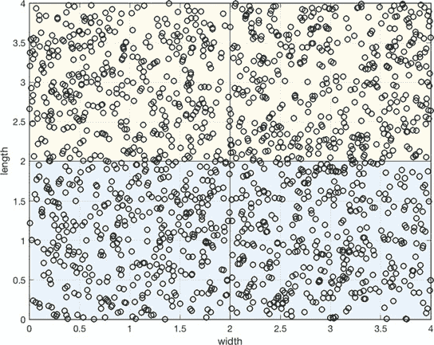

第 7 章

使用决策树进行数据分类

它使用 ClassifierSets 生成训练数据。输出包括坐标及其所属的集合。然后我们创建默认数据结构，并以训练模式调用 DecisionTree。

决策树如图 7.9 所示。训练数据如图 7.7 所示，测试数据如图 7.8 所示。我们需要足够的测试数据来填充各个类别。否则，决策树生成器可能会绘制仅包含训练集数据的边界线。

**图 7.7：** 训练数据。需要大量数据来填充各个类别。

结果与简单测试类似。

类别 3

1 14 16 21 23

类别 2

2 4 5 6 9 13 17 18 19 20 25

类别 1

3 7 8 10 11 15 24

类别 4

12 22

生成的决策树有效地分离了数据。


第 7 章

使用决策树进行数据分类

**图 7.8：** 测试数据。

**图 7.9：** 从训练数据推导出的决策树。它与手动推导的决策树基本相同。生成的决策树中的值并不完全是 2.0。


第 7 章

使用决策树进行数据分类

**7.7**

**总结**

本章演示了在 MATLAB 中使用决策树进行数据分类。我们还编写了一个新的图形函数来绘制决策树。该决策树软件并非通用软件，但可以作为编写更通用代码的指南。表 7.2 列出了随附代码中包含的函数和脚本。

**表 7.2：** 章节代码清单

**文件**

**描述**

ClassifierSets

生成用于分类或训练的数据。

DecisionTree

实现用于数据分类的决策树。

DrawBinaryTree

生成用于分类或训练的数据。

HomogeneityMeasure

计算基尼不纯度。

SimpleClassifierDemo

演示决策树测试。

SimpleClassifierExample

为简单问题生成数据。

TestDecisionTree

测试决策树。


**第 8 章**

**神经网络简介**

神经网络是一种流行的实现机器“智能”的方式。

其理念是它们的行为类似于大脑中的神经元。在我们的分类体系中，神经网络属于真正的机器学习范畴，如右图所示。

自主

学习

机器

控制

学习


智能

在本章中，我们将探索神经网络的工作原理，从单个神经元的最基本概念开始，逐步深入到多层神经网络。我们以摆锤为例，展示如何使用神经网络解决预测问题。这是神经网络的两大用途之一：预测与分类。我们将从一个简单的分类示例开始。在第 9 章和第 10 章中，我们将介绍更复杂的分类神经网络。

**8.1**

**日光检测器**

**8.1.1 问题**

我们希望使用一个简单的神经网络来检测日光。

© Michael Paluszek 和 Stephanie Thomas 2019

M. Paluszek 和 S. Thomas 著， *MATLAB 机器学习秘籍*，

[`doi.org/10.1007/978-1-4842-3916-2_8`](https://doi.org/10.1007/978-1-4842-3916-2_8)


第 8 章

神经网络入门

**8.1.2 解决方案**

历史上，第一个神经元是感知器。这是一种具有阈值激活函数的神经网络。其输出为 0 或 1。对于本章后续秘籍中涉及的摆锤角度估计等问题，这并不实用。然而，它非常适合分类问题。在本示例中，我们将使用单个感知器。

**8.1.3 工作原理**

假设我们的输入是光电管测量的光照强度。如果你对输入进行加权，使得 1 代表黄昏时的亮度值，那么你就得到了一个晴天检测器。

这在以下脚本`SunnyDay`中展示。该脚本以那个著名的、本应检测坦克却检测了晴天的神经网络命名；这是因为所有坦克的训练照片都是在晴天无意中拍摄的，而所有没有坦克的照片则是在阴天拍摄的。太阳通量使用余弦函数建模，并缩放至正午时为 1。任何大于 0 的值都表示白天。

%% 数据

t = **linspace**(0,24);

% 时间，单位：小时

d = **zeros**(1, **length**(t));

s = **cos**((2***pi**/24)*(t-12)); % 太阳通量模型

%% 激活函数

% 非线性激活函数，是一个阈值检测器

j = s < 0;

s(j) = 0;

j = s > 0;

d(j) = 1;

%% 绘制结果

PlotSet(t,[s;d],'x label','小时', 'y label',...

{'太阳通量', '白天/黑夜'}, 'figure title','日光检测器',...

'plot title', '日光检测器');

**set**([**subplot**(2,1,1) **subplot**(2,1,2)],'xlim',[0 24],'xtick',[0 6 12 18 24]);

图 8.1 显示了检测器的结果。`set(gca,...)`代码将 x 轴刻度设置为精确结束于 24 小时。这是一个非常简单的例子，但确实展示了分类的工作原理。

如果我们有多个神经元，其阈值设置为检测不同太阳通量波段内的阳光水平，那么我们就有了一个神经网络太阳钟。


第 8 章

神经网络入门

**图 8.1：** 日光检测器。

**日光检测器**

0.8

0.6

0.4

太阳通量

0.2

小时

**日光检测器**

0.8

0.6

0.4

白天/黑夜

0.2

小时

**8.2**

**摆锤建模**

**8.2.1 问题**

我们希望实现如图 8.2 所示的摆锤动力学。摆锤将被建模为一个点质量，通过刚性连接连接到其支点。刚性连接是一根不能收缩或伸长的杆。

**图 8.2：** 摆锤。运动由重力加速度驱动。


第 8 章

神经网络入门

**8.2.2 解决方案**

解决方案是在 MATLAB 中编写一个摆锤动力学函数。动力学将以扭矩形式编写，即我们将其建模为刚体旋转。刚体旋转就是你旋转轮子时发生的情况。它将使用包含工具箱中 General 文件夹内的 RungeKutta 积分例程来积分运动方程。

**8.2.3 工作原理**

图 8.2 展示了摆锤。获得方程最简单的方法是将其视为一个扭矩问题，即刚体旋转。当你观察一个二维摆锤时，它在一个平面内运动，其位置具有 *x* 和 *y* 坐标。然而，这两个坐标受到固定摆长 *L* 的约束。我们可以写出：*L*² = *x*² + *y*²

(8.1)

其中 *L* 是杆的长度，是一个常数，*x* 和 *y* 是平面内的坐标。它们也是问题中的自由度。这表明 *x* 由 *y* 唯一确定。如果我们写出：

*x* = *L* sin *θ*

(8.2)

*y* = *L* cos *θ*

(8.3)

其中 *θ* 是偏离垂直方向的角度，即当摆锤垂直悬挂时为零，我们看到只需要一个自由度 *θ* 来建模运动。因此，我们的力问题变成了刚体旋转运动问题。扭矩与角加速度通过惯性矩相关联：

*T* = *I* *d²θ* / *dt²*

(8.4)

其中 *I* 是惯性矩，*T* 是扭矩。惯性矩是常数，取决于摆长的平方和质量 *m*：

*I* = *mL*²

(8.5)

扭矩由重力分量 *mg* 产生，该分量垂直于摆锤，其中 *g* 是重力加速度。回想一下，扭矩是施加的力 *mg* sin *θ* 乘以力臂，在此例中为 *L*。因此扭矩为：*T* = *−mgL* sin *θ*

(8.6)

那么运动方程为：

*− mgL* sin *θ* = *mL*² *d²θ* / *dt²*

(8.7)


第 8 章

神经网络入门

或者简化后：

*d²θ* / *dt²* + (*g* / *mL*) sin *θ* = 0

(8.8)

我们设：

*g* / *mL* = Ω²

(8.9)

其中Ω是摆锤振荡的频率。由于存在 sin *θ*，该方程是非线性的。我们可以将其在垂直方向附近的小角度 *θ* 处线性化。对于小角度：sin *θ* ≈ *θ*

(8.10)

cos *θ* ≈ 1

(8.11)

从而得到线性常系数方程。正弦的线性版本来自泰勒级数展开：

sin *θ* = *θ* − *θ*³/3! + *θ*⁵/5! − *θ*⁷/7! + · · ·

(8.12)

可以看出，第一项在 *θ* = 0（即摆锤垂直悬挂时）附近是一个相当好的近似。实际上，我们可以将其应用于任何角度。设 *θ* = *θ* + *θk*，其中 *θk* 是当前角度，*θ* 现在是微小量。我们可以展开正弦项：sin (*θ* + *θk*) = sin *θ* cos *θk* + sin *θk* cos *θ* ≈ *θ* cos *θk* + sin *θk*

(8.13)

我们得到一个带有新扭矩项和不同 *θ* 系数的线性方程。

*d²θ* / *dt²* + cos *θk* Ω² *θ* = −Ω² sin *θk*

(8.14)

这告诉我们，无论当前角度如何，线性近似都可能是有用的。

我们最终的方程（非线性和线性）是：

*d²θ* / *dt²* + Ω² sin *θ* = 0

(8.15)

*d²θ* / *dt²* + Ω² *θ* ≈ 0

(8.16)


以下代码展示了动力学模型，并附有头文件片段。该模型可通过 MATLAB Recipes 的 RungeKutta 函数或任何 MATLAB 积分器调用。其中提供了一个选项，可通过名为 `linear` 的布尔字段选择使用完整非线性动力学或线性化动力学形式。状态向量的第一个元素是角度，第二个元素是角导数，即角速度 *ω*。第一个输入参数时间未被使用，因为它仅以 *dt* 形式出现在方程中，因此用波浪号替代。输出是状态 x 的导数 xDot。如果未指定输入参数，函数将返回默认数据结构 d。


第 8 章

神经网络导论

%

x

(2,1) 状态向量 [theta;theta dot]

%

d

(.) 数据结构

%

.linear

(1,1) 若为真则使用线性模型

%

.omega

(1,1) 输入增益

**function** xDot = RHSPendulum( ˜, x, d )

**if**( **nargin** < 1 )

xDot = struct('linear',false,'omega',0.5);

**return**

**end**

**if**( d.linear )

f = x(1);

**else**

f = **sin**(x(1));

**end**

xDot = [x(2);-d.omegaˆ2*f];

xDot 的代码包含两个元素。第一个元素就是状态的第二个元素，因为角度的导数就是角速度。第二个元素是根据方程计算出的角加速度。所实现的微分方程组是一组一阶微分方程：

*dθ*

=

*ω*

(8.17)

*dt*

*dω*

=

*−*Ω2 sin *θ*

(8.18)

*dt*

一阶意味着左侧只有一阶导数。

下面的脚本 PendulumSim 通过对动力学模型进行积分来模拟摆。将数据结构字段 linear 设置为 true 即可得到线性模型。注意，状态初始化为一个较大的初始角度 3 弧度，以突出模型之间的差异。

%% 摆的仿真

%% 初始化仿真

n = 1000; % 时间步数

dT = 0.1; % 时间步长（秒）

dRHS = RHSPendulum; % 获取默认数据结构

dRHS.linear = false; % 若为线性模型则设为 true

%% 仿真

xPlot = **zeros**(2,n);

theta0 = 3; % 弧度

x = [theta0;0]; % [角度;速度]


第 8 章

神经网络导论

**for** k = 1:n

xPlot(:,k) = x;

x = RungeKutta( @RHSPendulum, 0, x, dT, dRHS );

**end**

%% 绘制结果

yL = {'\theta (rad)' '\omega (rad/s)'};

[t,tL] = TimeLabel(dT*(0:n-1));

PlotSet( t, xPlot, 'x label', tL, 'y label', yL, ...

'plot title', 'Pendulum', 'figure title', 'Pendulum State' );

图 8.3 展示了两种模型的结果。非线性模型的周期与线性模型不同。

**图 8.3：** 由线性和非线性方程建模的摆。非线性模型的周期与线性模型不同。左侧图为线性模型，右侧图为非线性模型。

**8.3**

**单神经元角度估计器**

**8.3.1 问题**

我们希望使用一个简单的神经网络来估计刚性摆与垂直方向之间的角度。

**8.3.2 解决方案**

我们将推导线性估计器的方程，然后通过一个由单个神经元组成的神经网络来复制它。


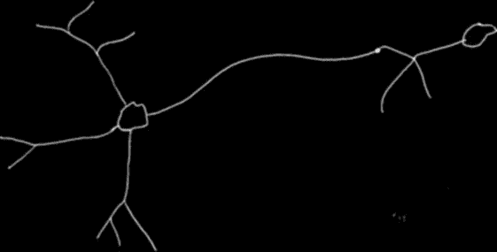


第 8 章

神经网络导论

**8.3.3 工作原理**


让我们先来看一个具有两个输入的单神经元。如图 8.4 所示，该神经元有输入 *x*1 和 *x*2、偏置 *b*、权重 *w*1 和 *w*2，以及单个输出 *z*。激活函数 *σ* 接收加权输入并产生输出。

*z* = *σ*(*w*1*x*1 + *w*2*x*2 + *b*) (8.19)

**图 8.4：** 一个双输入神经元。

让我们将其与图 8.5 所示的真实神经元进行比较。真实神经元通过树突接收多个输入。其中一些树突会分支，这意味着多个输入可以通过同一树突连接到细胞体。输出通过轴突进行。每个神经元只有一个输出。轴突通过突触连接到树突。信号通过突触从轴突传递到树突。

**图 8.5：** 一个真实神经元可以有 10,000 个输入！

突触

神经元

神经元

轴突

细胞体

树突

有许多常用的激活函数。我们展示三种：*σ*(*y*) = tanh(*y*) (8.20)

*σ*(*y*) = *−* 1 (8.21)

1 *− e−y*

*σ*(*y*) = *y* (8.22)


第 8 章

神经网络导论

指数函数经过归一化和零偏移处理，使其范围在 -1 到 1 之间。脚本 `OneNeuron` 中的以下代码计算并绘制了输入 q 的这三个激活函数。

%% 查看激活函数

q = **linspace**(-4,4);

v1 = **tanh**(q);

v2 = 2./(1+**exp**(-q)) - 1;

PlotSet(q,[v1;v2;q],'x label','Input', 'y label',...

'Output', 'figure title','Activation Functions','plot title', '

Activation Functions',...

'plot set',{[1 2 3]},'legend',{{'Tanh','Exp','Linear'}});

图 8.6 在同一张图上展示了这三个激活函数。

**图 8.6：** 三个激活函数。

**激活函数**

Tanh

Exp

Linear

输出

输入

饱和的激活函数模拟了具有最大放电频率的生物神经元。这些特定函数还具有有助于学习的良好数值特性。

既然我们已经定义了神经元模型，让我们回到摆的动力学问题。线性摆方程的解是：

*θ* = *a* sin Ω*t* + *b* cos Ω*t* (8.23)

给定初始角度 *θ*0 和角速率 ˙*θ*0，我们得到角度随时间变化的函数：

˙*θ*0

*θ*(*t*) = sin Ω*t* + *θ*0 cos Ω*t* (8.24)

Ω


第 8 章

神经网络导论

对于较小的 Ω*t*：

*θ*(*t*) = ˙*θ*0*t* + *θ*0 (8.25)

这是一个线性方程。将其转换为离散时间问题：*θk*+1 = ˙*θk*Δ*t* + *θk* (8.26)

其中 Δ*t* 是测量之间的时间步长，*θk* 是当前角度，*θk*+1 是下一步的角度。角速率的线性近似为：

˙*θk* = (*θk* − *θk*−1) / Δ*t* (8.27)

因此，结合公式 8.26 和 8.27，我们的“估计器”为：

*θk*+1 = 2*θk* − *θk*−1 (8.28)

这非常简单。它不需要知道时间步长。

让我们用神经网络做同样的事情。我们的神经元输入是 *x*1 和 *x*2。如果我们设置：

*x*1 = *θk* (8.29)

*x*2 = *θk*−1 (8.30)

*w*1 = 2 (8.31)

*w*2 = *−*1 (8.32)

*b* = 0 (8.33)

我们得到：

*z* = *σ*(2*θk* − *θk*−1) (8.34)

除了激活函数 *σ* 之外，这正是我们的估计器。


继续讲解 OneNeuron，以下代码实现了估计器。我们输入一个仅对小摆角有效的纯正弦波，然后分别使用线性激活函数和 tanh 激活函数计算神经元。请注意，变量 thetaN 等效于使用线性激活函数。

%% 查看摆的估计器

omega

= 1;

% 摆的频率，单位 rad/s

t

= **linspace**(0,20);

theta

= **sin**(omega*t);

thetaN

= 2*theta(2:**end**) - theta(1:**end**-1); % 用于估计“下一个”theta 的线性估计器

truth

= theta(3:**end**);

tOut

= t(3:**end**);

thetaN

= thetaN(1:**end**-1);


第 8 章

神经网络导论

% 应用激活函数

z = **tanh**(thetaN);

PlotSet(tOut,[truth;thetaN;z],'x label','时间 (s)', 'y label',...

'下一个角度', 'figure title','单个神经元','plot title', '单个神经元

',...

'plot set',{[1 2 3]},'legend',{{'真实值','估计值','神经元'}});

图 8.7 展示了两个神经元的输出（线性和 tanh）与真实值的对比。使用线性激活函数的神经元与真实值吻合得很好。tanh 则不然，但这在预料之中，因为它会饱和。

**图 8.7：** 真实摆的动态特性与线性和 tanh 神经元输出的对比。

**单个神经元**

1.5

真实值

估计值

神经元

0.5

下一个角度

-0.5

-1.5

时间 (s)

使用线性激活函数的单个神经元功能与估计器本身相同。通常，输出节点（并且这个神经网络只有一个输出节点）具有线性激活函数。这是合理的，否则输出将受限于激活函数的饱和值，正如我们在 tanh 中看到的那样。使用任何其他激活函数，输出都不会产生期望的结果。这个特定示例是一个神经网络并未真正带来任何优势的例子，之所以选择它，是因为它简化为一个简单的线性估计器。对于更一般的问题，如果输入更多且输入之间存在非线性依赖关系，具有饱和特性的激活函数可能会很有价值。

为此，我们需要一个多神经元网络，这将在本章最后一节讨论。

请注意，即使是使用线性激活函数的神经元，也不能完全匹配真实值。如果我们真的将线性激活函数用于非线性摆，效果不会很好。非线性估计器会很复杂，但可以训练一个多层神经网络（深度学习）来覆盖更广泛的条件。


第 8 章

神经网络导论

**8.4**

**为摆设计神经网络**

**8.4.1 问题**

我们希望估计非线性摆的角度。

**8.4.2 解决方案**

我们将使用 NeuralNetMLFF 根据训练集构建一个神经网络。（MLFF 代表多层前馈）。

我们将使用 NeuralNetMLFF 运行该网络。NeuralNetMLFF 的代码包含在下一章的神经网络开发者 GUI 中。

**8.4.3 工作原理**

本配方的脚本是 NNPendulumDemo。第一部分生成测试数据，运行与配方 8.2 中 PendulumSim.m 相同的仿真。我们计算摆的周期，以便将仿真时间步长设置为周期的一小部分。请注意，我们将使用 tanh 作为网络的激活函数。

% 演示参数

nSamples

= 800;

% 仿真中的样本数


nRuns

= 2000;

% 训练运行次数

activation

= 'tanh';

% 激活函数

omega

= 0.5;

% 频率（弧度/秒）

tau

= 2***pi**/omega; % 周期（秒）

dT

= tau/100;

% 以 20*omega 的速率采样

rng(100);

% 一致的随机数生成器

%% 初始化仿真右端项

dRHS

= RHSPendulum; % 获取默认数据结构

dRHS.linear = false;

dRHS.omega

= omega;

%% 仿真

nSim

= nSamples + 2;

x

= **zeros**(2,nSim);

theta0 = 0.1;

% 起始位置（角度）

x(:,1) = [theta0;0];

**for **k = 1:nSim-1

x(:,k+1) = RungeKutta( @RHSPendulum, 0, x(:,k), dT, dRHS );

**end**

下一个代码块定义了网络，并使用 NeuralNetTraining 对其进行训练。

NeuralNetTraining 和 NeuralNetMLFF 将在下一章中描述。简而言之，我们定义了一个包含三个神经元的第一个层和一个包含单个神经元的第二个输出层；该网络有两个输入，即前两个角度。


第 8 章

神经网络简介

'plot title', 'Pendulum', 'figure title', 'Pendulum State' );

%% 定义一个具有两个输入、三个内部节点和一个输出的网络

layer

= struct;

layer(1,1). **type**

= activation;

layer(1,1).alpha = 1;

layer(2,1). **type**

= 'sum'; %'sum';

layer(2,1).alpha = 1;

% 阈值

layer(1,1).w0 = **rand**(3,1) - 0.5;

layer(2,1).w0 = **rand**(1,1) - 0.5;

% 从第 j 个输入到第 i 个节点的权重 w(i,j)

layer(1,1).w

= **rand**(3,2) - 0.5;

layer(2,1).w

= **rand**(1,3) - 0.5;

%% 训练网络

% 使用随机列表对样本进行排序

kR

= **ceil**(**rand**(1,nRuns)*nSamples);

thetaE

= x(1,kR+2); % 待估计的角度

theta

= [x(1,kR);x(1,kR+1)]; % 前两个角度

e

= thetaE - (2*theta(1,:) - theta(2,:));

[w,e,layer] = NeuralNetTraining( theta, thetaE, layer );

PlotSet(1:**length**(e), e.ˆ2, 'x label','Sample', 'y label','Errorˆ2'

,...

'figure title','Training Error','plot title','Training Error','plot type','ylog');

% 使用计算出的权重组装一个新网络

layerNew

= struct;

layerNew(1,1). **type**

= layer(1,1). **type**;

训练数据结构包含待计算的权重。它定义了层数和激活函数的类型。初始权重是随机的。训练返回新的权重和训练误差。我们使用索引数组 k 将训练数据以随机顺序传递给函数。这比按原始顺序传递能得到更好的结果。我们还使用参数 nRuns 多次发送相同的训练数据。图 8.8 显示了训练误差。看起来不错。要查看计算出的权重，只需在命令行显示 w 即可。例如，输出节点的权重现在是：

>> w(2)

ans =

包含以下字段的结构体：


第 8 章

神经网络简介

**图 8.8：**训练误差。

**训练误差**

10-2

10-4

10-6

误差

10-8

10-10

10-12 0

样本

w: [-0.67518 -0.21789 -0.065903]

w0: -0.014379

type: 'tanh'

我们在最后一个代码块中测试神经网络。我们重新运行仿真，然后使用 NeuralNetMLFF 运行神经网络。请注意，您可以通过更改 thetaD 的值，选择使用与训练数据不同的起始点来初始化仿真。

layerNew

= struct;

layerNew(1,1). **type**

= layer(1,1). **type**;

layerNew(1,1).w

= w(1).w;

layerNew(1,1).w0

= w(1).w0;

layerNew(2,1). **type**

= layer(2,1). **type**; %'sum';

layerNew(2,1).w

= w(2).w;

layerNew(2,1).w0

= w(2).w0;

network.layer


= layerNew;

%% 使用不同的起始点模拟摆

x(:,1) = [0.1;0];

%% 模拟摆并测试训练好的网络

% 选择相同或不同的起始点进行模拟

thetaD = 0.5;

x(:,1) = [thetaD;0];

**for** k = 1:nSim-1

x(:,k+1) = RungeKutta( @RHSPendulum, 0, x(:,k), dT, dRHS );

**end**


第 8 章

神经网络简介

**图 8.9：** 神经网络结果：模拟状态、测试误差以及真实角度与神经网络估计值的对比。

% 测试新网络

theta = [x(1,1:**end**-2);x(1,2:**end**-1)];

thetaE = NeuralNetMLFF( theta, network );

eTSq = (x(1,3:**end**)-thetaE).ˆ2;

图 8.9 中的结果看起来不错。神经网络估计的角度与真实角度非常接近。但请注意，我们运行的是完全相同幅度的摆振荡（thetaD = theta0），这正是我们训练它识别的模式。如果我们使用不同的起始点进行测试，例如 0.5 弧度（而训练数据为 0.1 弧度），则估计角度的误差会更大，如图 8.10 所示。

如果我们希望神经网络能够预测其他幅度的角度，就需要使用能够模拟所有条件的多样化数据集进行训练。在训练网络时，我们让它多次看到相同的振荡幅度。这实际上效果不佳。可能还需要向网络中添加更多节点或更多层，以构建一个更通用的估计器。


第 8 章

神经网络简介

**图 8.10：** 针对不同幅度振荡的神经网络估计角度。

**角度**

0.5

估计值

真实值

0.4

0.3

0.2

0.1

下一个角度 -0.1

-0.2

-0.3

-0.4

-0.5

样本

**8.5**

**总结**

本章演示了利用神经网络学习预测摆的角度。它介绍了神经元的概念，展示了一个用于摆的单神经元网络，并说明了它与线性估计器的对比。此外，还给出了一个感知机示例和一个多层摆角度估计器。表 8.1 列出了配套代码中包含的函数和脚本。最后两个函数借用了下一章的内容，下一章将更深入地介绍多层神经网络。

**表 8.1：** 章节代码清单

**文件**

**描述**

NNPendulumDemo

训练神经网络以跟踪摆的运动。

OneNeuron

探索单个神经元。

PendulumSim

模拟摆的运动。

RHSPendulum

非线性摆的右侧函数。

SunnyDay

识别日光。

第 9 章函数

NeuralNetMLFF

计算多层前馈神经网络的输出。

NeuralNetTraining

使用反向传播进行训练。


**第 9 章**

**使用神经网络进行数字分类**

图像中的模式识别是神经网络的经典应用。本章在前一章的基础上，进一步探索多层网络，这属于我们自主学习方法论中的机器学习分支。在本例中，我们将研究计算机生成数字的图像，以及正确识别这些数字的问题。这些图像将代表扫描文档中的数字。试图通过算法规则（考虑字体和其他因素）来捕捉数字的变化，很快就会变得极其复杂，但通过大量样本，神经网络可以轻松完成这项任务。我们让网络中的权重来推断每个数字可能形状的规则，而不是显式地编码这些规则。

自主

学习

机器

控制

学习

智能

就本章而言，我们将只关注单个数字的图像。将一系列数字分割成单个图像的过程，可以通过多种技术解决，而不仅仅是神经网络。

© Michael Paluszek 和 Stephanie Thomas 2019

M. Paluszek 和 S. Thomas, *MATLAB Machine Learning Recipes*,

[`doi.org/10.1007/978-1-4842-3916-2_9`](https://doi.org/10.1007/978-1-4842-3916-2_9)


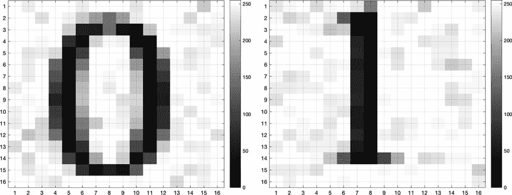

第 9 章

使用神经网络进行数字分类

**9.1**

**生成带有缺陷的测试图像**

**9.1.1 问题**

创建分类系统的第一步是生成样本数据。在本例中，我们希望加载 0 到 9 的数字图像，并生成带有缺陷的测试图像。出于我们的目的，缺陷将通过简单的泊松噪声或散粒噪声（像素值平方根的标准差随机数）引入。

**9.1.2 解决方案**

我们将通过使用`text`将数字写入坐标轴，然后使用`print`创建图像的方式，在 MATLAB 中生成图像。有一个选项可以直接从`print`捕获像素数据，而无需创建中间文件，我们将利用这一点。我们将提取包含数字的 16x16 像素区域，然后应用噪声。我们还允许将字体作为输入。示例见图 9.1。

**图 9.1：** 添加了噪声的数字 0 和 1 的示例图像。

**9.1.3 工作原理**

`CreateDigitImage`函数的代码清单如下。输入参数是数字和所需的字体。它创建一个 16x16 像素的单个数字图像。用于显示数字文本的中间图形是不可见的。我们将使用`print`的`'RGBImage'`选项来获取像素值，而无需创建图像文件。该函数有一个内置演示选项，如果没有输入或输出参数，它将为数字 0 创建像素并在图形中显示图像。如果未指定字体，默认字体为 Courier。

**function** pixels = CreateDigitImage( num, fontname )

**if nargin** < 1

num = 0;

CreateDigitImage( num );

**return**;


第 9 章

使用神经网络进行数字分类

**end**

**if nargin** < 2

fontname = 'courier';

**end**

fonts = **listfonts**;

avail = strcmpi(fontname,fonts);

**if** ˜**any**(avail)

**error**('MachineLearning:CreateDigitImage',...

'Sorry, the font ''%s'' is not available.',fontname);

**end**

f = **figure**('Name','Digit','visible','off');

a1 = **axes**( 'Parent', f, 'box', 'off', 'units', 'pixels', 'position',

[0 0 16 16] );

% 20 磅字体的数字高度为 15 像素（在 Mac OS 上）

% text(axes,x,y,string)


**text**(a1,4,10, **num2str**(num),'fontsize',19,'fontunits','pixels','unit','

pixels',...

'fontname',fontname)

% 使用打印功能获取图像数据并转换为灰度图

cData = **print**('-RGBImage','-r0');

iGray = **rgb2gray**(cData);

% 打印图像坐标系从图形左上角开始，而非底部，因此我们的数字位于最后 16 行和前 16 列

pixels = iGray(**end**-15:**end**,1:16);

% 应用泊松（散粒）噪声；必须先将像素值转换为双精度类型以进行操作，然后再转换回 uint8 类型进行求和。uint8 类型会自动处理超过 255 的溢出，因此无需施加限制。

noise = **uint8**(**sqrt**(**double**(pixels)).***randn**(16,16)); pixels = pixels - noise;

**close**(f);

**if nargout **== 0

h = **figure**('name','数字图像');

**imagesc**(pixels);

**colormap**(h,'gray');


第 9 章

使用神经网络进行数字分类

**grid **on

**set**(**gca**,'xtick',1:16)

**set**(**gca**,'ytick',1:16)

**colorbar**

**end**

**提示**

请注意，我们在尝试使用字体之前，会先使用 listfonts 检查该字体是否存在，如果未找到则会抛出错误。

现在，我们可以使用新函数生成的图像来创建训练数据。在下面的示例中，我们将同时使用用于单个数字识别和多个数字识别网络的数据。我们使用 for 循环创建一组图像，并通过辅助函数 SaveTS 将它们保存到 MAT 文件中。该函数将训练集及其输入、输出以及用于训练和测试的索引，以一种特殊结构格式保存。请注意，我们将像素值（名义上是 0 到 255 之间的整数）缩放到 0 到 1 之间。

我们的数据生成脚本 DigitTrainingData 使用 for 循环为每个所需数字（0 到 9 之间）创建一组带噪声的图像。它将数据连同用于训练的数据索引一起保存。图像的像素输出从 0（黑色）缩放到 1（白色），因此适合神经网络中的神经元激活。脚本顶部有两个标志，一个用于单数字模式，另一个用于自动更改字体。

%% 生成训练数据

% 控制开关

oneDigitMode = true;

% 第一个数字是期望的输出

changeFonts = true;

% 随机选择一种字体

% 训练数据集数量

digits

= 0:5;

nImagesPer = 20;

% 准备数据

nDigits

= **length**(digits);

nImages

= nDigits*nImagesPer;

**input**

= **zeros**(256,nImages);

output

= **zeros**(1,nImages);

trainSets = [];

testSets

= [];

**if **(changeFonts)

fonts = {'times','helvetica','courier'};

**else**

fonts = 'times';

kFont = 1;

**end**


第 9 章

使用神经网络进行数字分类

% 遍历数字

kImage = 1;

**for **j = 1:nDigits

**fprintf**('数字 %d\n', digits(j));

**for **k = 1:nImagesPer

**if **(changeFonts)

% 随机选择一种字体

kFont = **ceil**(**rand***3);

**end**

pixels = CreateDigitImage( digits(j), fonts{kFont} );

% 将像素缩放到 0 到 1 的范围

pixels = **double**(pixels);

pixels = pixels/255;

**input**(:,kImage) = pixels(:);

**if **(oneDigitMode)

**if **(j == 1)

output(j,kImage) = 1;

**end**

**else**

output(j,kImage) = 1;

**end**

kImage = kImage + 1;

**end**

sets = **randperm**(10);

trainSets = [trainSets (j-1)*nImages+sets(1:5)]; %#ok

testSets = [testSets (j-1)*nImages+sets(6:10)]; %#ok

**end**

% 使用 75%的图像进行训练，其余保存用于测试 trainSets = **sort**(**randperm**(nImages, **floor**(0.75*nImages))); testSets = **setdiff**(1:nImages,trainSets);

% 将训练集保存到 MAT 文件（将打开对话框）

SaveTS( **input**, output, trainSets, testSets );

辅助函数会要求输入文件名并保存训练集。您可以在命令行加载它以验证字段。以下是训练集和测试集被截断后的示例：

>> trainingData = **load**('Digit0TrainingTS')


trainingData =

struct with fields:

Digit0TrainingTS: [1x1 struct]

>> trainingData.Digit0TrainingTS

**ans =**

struct with fields:

inputs: [256x120 double]


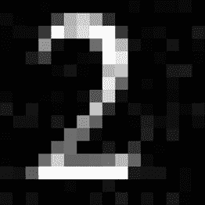

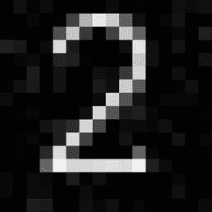

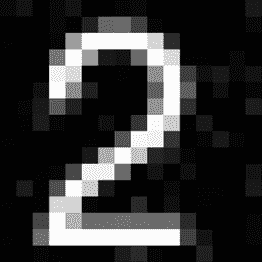

第 9 章

使用神经网络进行数字分类

desOutputs: [1x120 double]

trainSets: [1 3 4 5 6 8 9 ...

115 117 118 120]

testSets: [2 7 16 20 28 33 37 ... 112 114 116 119]

请注意，输出字段是一个布尔值，当图像是所需数字时，其值为 1，否则为 0。在使用布尔标志 oneDigitMode 选择的单数字数据集中，输出为单行。在多数字数据集中，输出行数与集合中的数字个数相同。如果 changeFonts 布尔值为 true，则图像会从 Times、Helvetica 和 Courier 中随机选择一种字体。表 9.1 显示了使用此脚本创建的三个训练集。

我们创建了以下集合用于这些方案：

**表 9.1：** 数字训练集

'Digit0TrainingTS'

包含数字 0 到 5 的 120 张图像的单数字集，所有图像使用同一种字体

'Digit0FontsTS'

包含数字 0 到 5 的单数字集，使用随机字体

'DigitTrainingTS'

包含数字 0 到 9 的 200 张图像的多数字集，使用同一种字体

图 9.2 展示了来自 Digit0TrainingTS 的数字 2 在三种不同字体下的示例图像。

**图 9.2：** 不同字体下的数字 2 图像。

**9.2**

**创建神经网络函数**

**9.2.1 问题**

我们希望创建一个神经网络工具，该工具可以经过训练来识别数字。在本方案中，我们将讨论 NeuralNetDeveloper 工具所依赖的函数，该工具将在下一个方案中展示。此界面并未使用 MATLAB 最新的图形用户界面（GUI）构建功能，因此我们不会深入探讨 GUI 代码本身的细节，不过完整的 GUI 可在配套代码中找到。


第 9 章

使用神经网络进行数字分类

**9.2.2 解决方案**

该 GUI 使用多层前馈（MLFF）神经网络函数对数字进行分类。在这种类型的网络中，每个神经元仅依赖于它从前一层接收到的输入。

我们将讨论实现该神经元的函数。

**9.2.3 工作原理**

神经网络的基础是 Neuron 函数。我们的神经元函数提供了六种不同的激活类型：符号函数、sigmoid 幅度函数、阶跃函数、逻辑函数、双曲正切函数和求和函数 [[22]](#index_split_007.html#p350)。如图 9.3 所示。

默认的激活函数类型是双曲正切函数。另外两个在多层级网络中很有用的函数是指数函数（sigmoid 逻辑函数）：

(9.1)

1 + *e−x*

或 sigmoid 幅度函数：

*x*

1 + *|x|*

(9.2)

其中，“sigmoid” 指的是具有 S 形状的函数。

对于任何新问题，尝试不同的激活函数是一个好主意。激活函数是神经网络和机器学习区别于曲线拟合的关键。输入 x 是所有输入加上一个偏置的总和。

**提示**

求和激活函数是线性的，其输出就是输入的总和。

以下代码展示了 Neuron，它在神经网络中实现了一个单一的神经元。

它的输入是类型（即激活函数），输出包括该函数的导数。默认启用 log 类型（用于 sigmoid 逻辑函数）。

**function** [y, dYDX] = Neuron( x, type, t )

% 输入处理

**if**( **nargin** < 1 )

x = [];

**end**

**if**( **nargin** < 2 )

type = [];

**end**

**if**( **nargin** < 3 )

t = 0;

**end**


**if**( **isempty**(type) )

type = 'log';

**end**

**if**( **isempty**(x) )


第 9 章

使用神经网络进行数字分类

**图 9.3：** 可用的神经元激活函数：sign、sigmoid mag、step、logistic (log)、tanh 和 sum。

**sign 神经元**

**mag 神经元**

**step 神经元**

0.8

0.8

0.6

0.6

0.8

0.4

0.4

0.2

0.2

0.6

输出

输出

输出

-0.2

0.4

-0.2

-0.4

-0.4

0.2

-0.6

-0.6

-0.8

-0.8

输入

输入

输入

**sum 神经元**

**输出**

**tanh 神经元**

**Log 神经元**

0.9

0.8

0.8

0.6

0.7

0.4

0.6

0.2

0.5

输出

输出

输出

0.4

-0.2

0.3

-0.4

0.2

-0.6

-0.8

0.1

输入

Princeton Satellite Systems

输入

输入

x = **sort**( [**linspace**(-5,5) 0 ] );

**end**

% 计算函数值和导数

switch **lower**( **deblank**(type) )

case 'tanh'

yX

= **tanh**(x);

dYDX = **sech**(x).ˆ2;

case 'log'

% sigmoid logistic 函数

yX

= 1./(1 + **exp**(-x));

dYDX = yX.*(1 - yX);

case 'mag'

% sigmoid magnitude 函数

d

= 1 + **abs**(x);

yX

= x./d;

dYDX = 1./d.ˆ2;

case 'sign'

yX

= **ones**(**size**(x));

yX(x < 0)

= -1;

dYDX

= **zeros**(**size**(yX));


第 9 章

使用神经网络进行数字分类

dYDX(x == 0) = inf;

case 'step'

yX

= **ones**(**size**(x));

yX(x < t)

= 0;

dYDX

= **zeros**(**size**(yX));

dYDX(x == t) = inf;

case 'sum'

yX

= x;

dYDX = **ones**(**size**(yX));

otherwise

**error**([type ' is not recognized'])

**end**

% 输出处理

**if**( **nargout** == 0 )

PlotSet( x, yX, 'x label', 'Input', 'y label', 'Output',...

'plot title', [type ' Neuron'] );

PlotSet( x, dYDX, 'x label','Input', 'y label','dOutput/dX',...

'plot title',['Derivative of ' type ' Function'] );

**else**

y = yX;

**end**

神经元通过一个简单的层和权重数据结构组合成前馈神经网络。每个神经元的输入是信号 *y*、权重 *w* 和偏置 *w*0 的组合，如下所示：

y = Neuron( w*y - w0, **type** );

网络的输出由函数 NeuralNetMLFF 计算。该函数计算多层前馈神经网络的输出。请注意，该函数还会输出从神经元激活函数获得的导数，用于训练。该函数描述如下：

%% NEURALNETMLFF 计算多层前馈神经网络的输出。

% 输入层是一个包含网络数据的数据结构。

% 该数据结构必须包含每一层的权重和激活函数。

% 调用 Neuron 函数。

%

% 输出层是经过增强的输入数据结构，其中包含

% 每次运行的每一层的输入、输出和导数。

%% 格式

%

[y, dY, layer] = NeuralNetMLFF( x, network )

输入层和输出层是包含每一层权重和激活函数的数据结构。我们的网络将使用反向传播作为训练方法 [[19]。](#index_split_007.html#p350) 这是 195


第 9 章

使用神经网络进行数字分类


一种梯度下降方法，它直接使用网络输出的导数。由于使用了导数，任何阈值函数（如阶跃函数）都会被替换为 Sigmoid 函数进行训练，以使其连续且可微。主要参数是学习率 *α*，它乘以每次迭代中应用于权重的梯度变化。这在`NeuralNetTraining`中实现。

`NeuralNetTraining`函数执行训练，即通过反向传播计算神经元中的权重。如果未提供输入，它将针对节点 1 和节点 2 使用 exp 函数作为激活函数的网络进行演示。函数形式如下所示。

%% NEURALNETTRAINING 使用反向传播进行训练。

% 使用反向传播计算神经网络的权重。如果未提供输入，

% 它将针对节点 1 和节点 2 使用 exp 函数的网络进行演示。

% 调用实现网络的 NeuralNetMLFF。

%

%

sin(

x) -- 节点 1

%

\ /

\

%

\

---> 输出

%

/ \

/

%

sin(0.2*x) -- 节点 2

%

%% 格式

%

[w, e, layer] = NeuralNetTraining( x, y, layer )

反向传播通过在循环中调用`NeuralNetMLFF`执行指定的运行次数。由于训练可能需要一些时间，会显示一个等待条。请注意，这可以处理任意数量的中间层。字段`alpha`包含该方法的学习率。

% 执行反向传播

h = **waitbar**(0, '神经网络训练进行中' );

**for** j = 1:nRuns

% 从输出层开始反向工作

[yN, dYN,layerT] = NeuralNetMLFF( x(:,j), temp );

e(:,j)

= y(:,j) - yN(:,1); % 误差

**for** k = 1:nLayers

layer(k,j).w

= temp.layer(k,1).w;

layer(k,j).w0 = temp.layer(k,1).w0;

layer(k,j).x

= layerT(k,1).x;

layer(k,j).y

= layerT(k,1).y;

layer(k,j).dY = layerT(k,1).dY;

**end**

% 首先计算最后一层的 delta

layer(nLayers,j).delta = e(:,j).*dYN(:,1);


第 9 章

使用神经网络进行数字分类

% 中间层使用后续层的 delta

**for** k

= (nLayers-1):-1:1

layer(k,j).delta = layer(k,j).dY.*(temp.layer(k+1,1).w'*layer(k

+1,j).delta);

**end**

% 现在我们有了所有 delta，更新权重(w)和偏置(w0)

**for** k = 1:nLayers

temp.layer(k,1).w

= temp.layer(k,1).w

+ layer(k,1).alpha*layer(

k,j).delta*layer(k,j).x';

temp.layer(k,1).w0 = temp.layer(k,1).w0 - layer(k,1).alpha*layer(

k,j).delta;

**end**

**waitbar**(j/nRuns);

**end**

w = temp.layer;

**close**(h);

**9.3**

**训练具有一个输出节点的网络**

**9.3.1 问题**

我们希望训练神经网络来对数字进行分类。一个好的第一步是识别单个数字。在这种情况下，我们将有一个输出节点，我们的训练数据将包括我们想要的数字（从 0 开始），以及一些其他数字（1-5）。

**9.3.2 解决方案**

我们可以使用我们的图形用户界面（GUI）创建这个神经网络，如图 9.4.所示。网络在图形中从左到右流动。我们可以尝试用不同类型的输出节点（例如符号函数和逻辑函数）来训练网络。在我们的案例中，我们从隐藏层使用 Sigmoid 函数和输出节点使用阶跃函数开始。

GUI 左上角的框允许您设置网络，包括输入数量（本例中每个像素一个）、输出数量（因为我们想识别一个数字，所以为一个）以及隐藏层数量。右侧的框允许我们设计每一层。一层中的所有神经元都是相同的。最右侧的框允许我们设置每个节点输入的权重和节点的偏置。路径是训练数据的路径。显示区域会显示生成的网络。图形很有用，但隐藏层中的节点数量使其难以阅读。


我们的图形用户界面（GUI）有一个独立的训练窗口，如图 9.5 所示。它包含用于加载和保存训练集、训练以及测试已训练神经网络的按钮。它会根据所选偏好自动绘制结果。在此例中，我们加载了来自方案 9.1 的训练集，该训练集使用了多种字体，即`Digit0FontsTS`，显示在图形窗口的顶部。


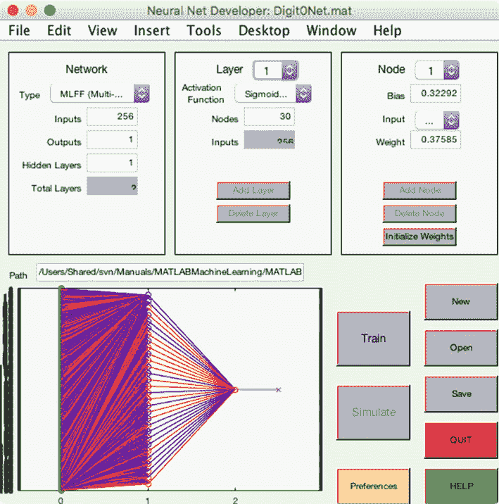

第 9 章

使用神经网络进行数字分类

**图 9.4：**一个具有 256 个输入（每个像素一个）、一个包含 30 个节点的中间层和一个输出的神经网络。

**9.3.3 工作原理**

我们使用 GUI 构建网络，该网络有 256 个输入（每个像素一个）、一个隐藏层中的 30 个节点以及 1 个输出节点。我们将第一个方案中的训练数据加载到训练器 GUI 中，并且必须选择训练运行的次数。如果我们的神经元函数选择得当，2000 次运行应该足够了。我们还需要选择一个额外的参数，即反向传播的学习率；从 1.0 的值开始是合理的。请注意，我们的训练数据脚本使用`randperm`提取随机图像集，将 75%的图像分配用于训练，其余保留用于测试。训练过程会记录每次运行的权重和偏置，并在完成后生成图表。我们可以轻松地为输出节点绘制这些图表，该节点只有 30 个节点和一个偏置。见图 9.6。

训练函数还会输出网络演变过程中的训练误差以及均方根误差（RMSE），到大约第 1000 次运行时，RMSE 已降至接近 1e-2。


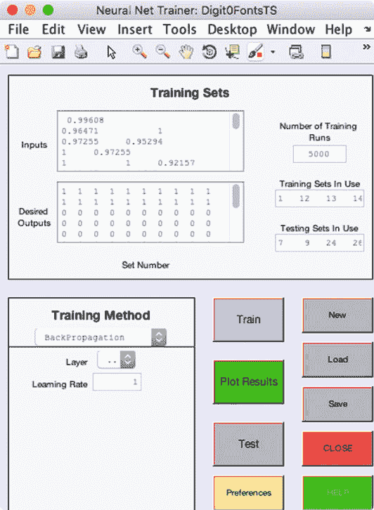

第 9 章

使用神经网络进行数字分类

**图 9.5：**在开发者界面中点击训练按钮时，会打开神经网络训练 GUI。

由于我们有大量的输入神经元，折线图对于可视化隐藏层权重的演变并不是很有用。但是，我们可以将任何给定迭代的权重视为图像来查看。图 9.8 展示了使用`imagesc`可视化的、训练后具有 30 个节点的网络的权重。我们可能会想，是否真的需要隐藏层中的所有 30 个节点，或者我们是否可以用更少的节点提取识别所选数字所需的必要特征数量。

在右侧的图像中，权重按每个节点的输入像素维度进行排序显示；我们可以清楚地看到，只有少数几个节点（尤其是节点 14、18 和 21）的权重与它们初始化时的随机值相比有较大变化。也就是说，我们的许多节点似乎没有产生影响。

由于这种可视化似乎很有帮助，我们在生成权重折线图之后，将代码添加到了训练 GUI 中。我们在一个图形中创建了两幅图像，左侧是权重的初始值，右侧是训练后的值。HSV 颜色映射看起来更引人注目。199


第 9 章

使用神经网络进行数字分类

**图 9.6：**训练期间第 2 层节点权重和偏置的演变。

**第 2 层节点权重**

**第 2 层节点偏置**

1.5

0.2

0.1

0.5

1 -0.1

-0.5

-0.2

-0.3

-1.5

-0.4

运行次数

运行次数

**图 9.7：**单个数字的训练误差和 RMSE

**训练误差**

**RMS 训练误差**

0.8

0.6

0.4

10-1

0.2

RMS 误差

-0.2

10-2

-0.4

-0.6

-0.8

10-3

运行次数


运行

这里比默认的 parula 颜色图效果更好。`NeuralNetTrainer` 中生成图像的代码如下所示：

% 新图形：将权重显示为图像

newH = **figure**('name',['节点权重 - 第 ' **num2str**(j) ' 层']); endWeights = [h.train.network(j,1).w(:); h.train.network(j, **end**).w(:)]; minW = **min**(endWeights);

maxW = **max**(endWeights);

**subplot**(1,2,1)

**imagesc**(h.train.network(j,1).w,[minW maxW])

**colorbar**

**ylabel**('输出节点')

**xlabel**('输入节点')

**title**('训练前的权重')


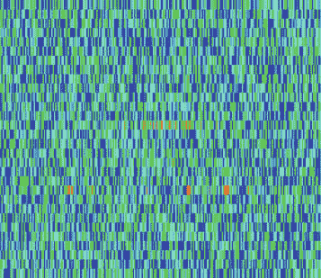


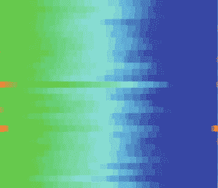


第 9 章

使用神经网络进行数字分类

**图 9.8：** 单数字网络，30 节点隐藏层权重。左侧图显示权重值。右侧图显示按像素排序后的每个节点权重。

**第 1 层节点权重**

**第 1 层排序后的节点权重**

0.8

0.8

0.6

0.6

0.4

0.4

0.2

0.2

输出节点

-0.2

输出节点

-0.2

-0.4

-0.4

-0.6

-0.6

-0.8

-0.8

输入节点

输入节点

**subplot**(1,2,2)

**imagesc**(h.train.network(j, **end**).w,[minW maxW])

**colorbar**

**xlabel**('输入节点')

**title**('训练后的权重')

**colormap hsv**

h.resultsFig = [newH; h.resultsFig];

请注意，我们计算了初始迭代和最终迭代中的最小和最大权重值，以便两个颜色图的缩放比例保持一致。现在，由于我们最初的 30 个节点中有许多似乎是不必要的，我们将该层的节点数减少到 10 个，重新初始化权重（随机），然后再次训练。现在我们得到了新的图形，其中权重在训练前后以图像形式显示，如图 9.9 所示。

现在，在 256 个像素权重的图像中，我们可以看到更多与初始随机权重不同的颜色块，并且我们也看到第二层的权重有明显的差异。GUI 允许您保存训练好的网络以供将来使用。


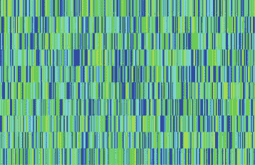


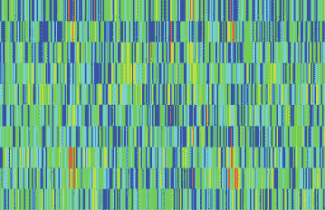


第 9 章

使用神经网络进行数字分类

**图 9.9：** 单数字网络，10 节点隐藏层在训练前后的权重。第一行显示第一层的数据，第二行显示第二层的数据，该层只有一个输出。

*第 1 层节点权重：*

**训练前的权重**

**训练后的权重**

[X,Y]: [13 2]

索引: -0.5

[R,G,B]: [0.8745 1 0]

0.8

0.8

0.6

0.6

0.4

0.4

0.2

0.2

输出节点

输出节点

-0.2

-0.2

-0.4

-0.4

-0.6

-0.6

-0.8

-0.8

输入节点

输入节点

*第 2 层节点权重：*

0.5

0.5

0.6

0.6

1.5

1.5

0.7

0.7

0.8

0.8

0.9

0.9

0.5

0.5

1.1

输出节点

1.1

输出节点

1.2

-0.5

1.2

-0.5

1.3

1.3

1.4

1.4

-1.5

-1.5

1.5

1.5

输入节点

输入节点

**9.4**

**测试神经网络**

**9.4.1 问题**

我们想要测试在前一个秘籍中训练的单数字神经网络。

**9.4.2 解决方案**

我们可以使用训练中未使用的输入来测试网络。这在 GUI 中是明确允许的，因为它为训练数据和测试数据设置了单独的索引。我们在秘籍 9.1 的 `DigitTrainingData` 脚本中，选择了 75% 的样本图像用于训练，并保留了剩余的图像用于测试。


第 9 章

使用神经网络进行数字分类

**9.4.3 工作原理**

在我们的 GUI 中，只需单击测试按钮，即可使用每个被选为测试的样本运行神经网络。


图 9.10 展示了输出节点使用 **sigmoid** 幅度函数和另一种使用阶跃函数（即输出限制为 0 或 1）的网络结果。请注意，数据集中的前 20 张图像是数字 0，输出值为 1，其余是数字 1 到 5，输出值为 0。对于阶跃函数，前 20 组输出为 1，其他所有组输出为 0，符合预期。sigmoid 函数类似，区别在于 20 组之后输出并非为 0，而是在 +0.1 和 -0.1 之间变化。在 20 到 120 组之间，输出几乎平均为零，与阶跃函数的结果相同。这表明激活函数以类似的方式解释数据。

**图 9.10：** 使用 sigmoid（左）和阶跃（右）激活函数的神经网络结果。

**带阶跃输出的网络**

**神经网络**

0.9

0.8

0.7

0.8

0.6

0.5

0.6

0.4

输出

0.4

0.3

0.2

0.2

0.1

-0.1

阶跃

普林斯顿卫星系统

测试输入集

**9.5**

**训练具有多个输出的网络**

**9.5.1 问题**

我们希望构建一个能够分别检测所有十个数字的神经网络。

**9.5.2 解决方案**

增加节点，使输出层拥有十个节点，当输入代表数字（0–9）时，每个节点输出为 0 或 1。尝试为输出节点使用不同的函数，例如 logistic 函数和阶跃函数。既然我们现在有更多数字，我们将把隐藏层的节点数恢复为 30 个。


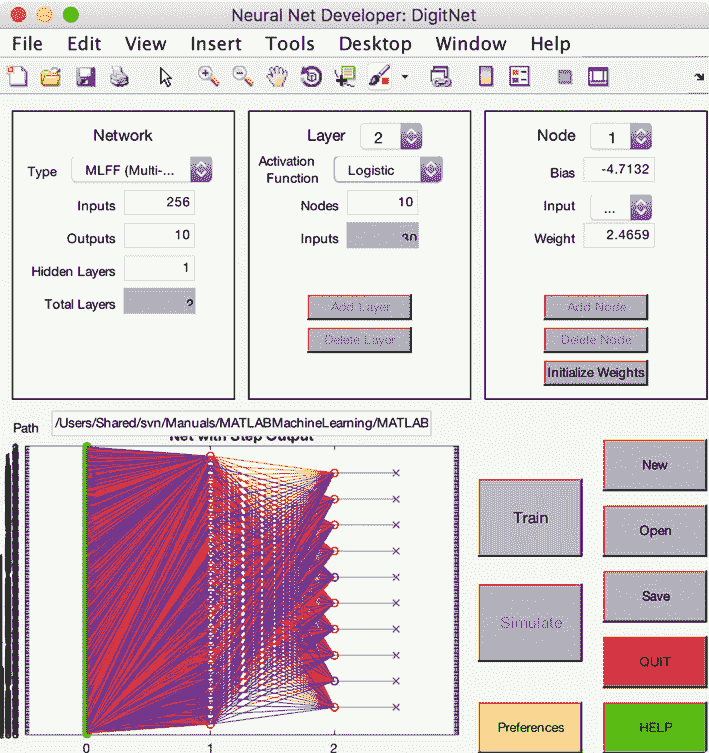

第 9 章

使用神经网络进行数字分类

**9.5.3 工作原理**

我们的训练数据现在包含所有 10 个数字，输出为二进制形式，在正确的位置为 1，其余为 0。例如，数字 1 将表示为：

[0 1 0 0 0 0 0 0 0]

数字 3 将在第四个元素处为 1。我们遵循相同的训练步骤。

我们初始化网络，将训练集加载到 GUI 中，并指定反向传播的训练轮数。

**图 9.11：** 具有多个输出的网络。

图 9.12 中的训练数据显示，大部分学习在前 3000 轮中完成。

图 9.13 中的测试数据显示，每组数字（本例中每组 20 个，共 200 个测试）均被正确识别。


第 9 章

使用神经网络进行数字分类

**图 9.12：** 多数字神经网络的训练均方根误差。

均方根误差

10-1

10-2 0

运行轮数

**图 9.13：** 多数字神经网络的测试结果。

**测试输出**

1 0.5

2 0.5

测试输入集

1 0

3 0.5

测试输入集

1 0

4 0.5

测试输入集

1 0

5 0.5

测试输入集

1 0

6 0.5

测试输入集

1 0

7 0.5

测试输入集

1 0

8 0.5

测试输入集

1 0

9 0.5

测试输入集

1 0

0.5

测试输入集

测试输入集


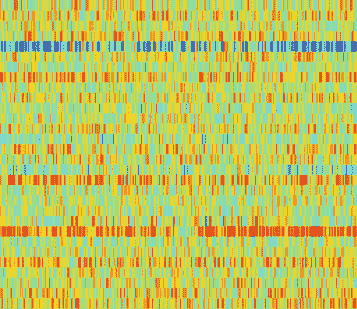


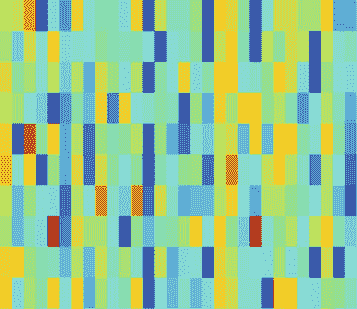


第 9 章

使用神经网络进行数字分类

一旦你将一个运行良好的网络保存到 MAT 文件中，就可以使用 `NeuralNetMLFF` 函数调用它来处理新数据。

>> data = **load**('NeuralNetMat');

>> network = data.DigitsStepNet;

>> y = NeuralNetMLFF( DigitTrainingTS.inputs(:,1), data.DigitsStepNet )

y =

同样，通过可视化神经网络的权重来深入理解问题也很有趣，而且我们的问题规模足够小，可以用图像来实现。我们可以将单个隐藏神经元的 256 个权重视为一张 16x16 的图像，并像之前一样将每个神经元的权重按行排列（图 9.14），以观察涌现出的模式。

**图 9.14：** 多数字神经网络的权重。


**第 1 层节点权重**

**第 2 层节点权重**

2.5

0.5

1.5

0.5

输出节点

输出节点

-0.5

-0.5

-1.5

输入节点

输入节点

你可以在各个节点权重中看到数字的局部部分，它们就像微型图案。只需像这样使用 `imagesc` 和 `reshape`：

>> **figure**;

>> **imagesc**(**reshape**(net.DigitsStepNet.layer(1).w(23,:),16,16));

>> **title**('指向隐藏节点 23 的权重')


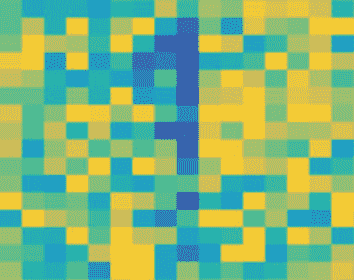

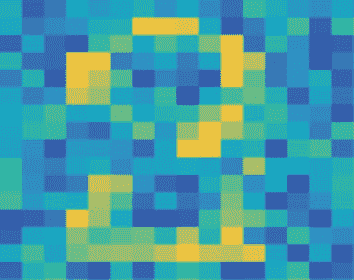

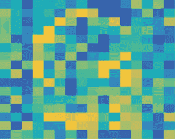


第 9 章

使用神经网络进行数字分类

并查看如图 9.15 所示的图像。这三个节点（随机选取）分别显示了一个数字 1、2 和 3。我们可以预期这 30 个节点各自都拥有数字的“带噪”副本。

**图 9.15：** 多数字神经网络权重。

**指向隐藏节点 23 的权重**

**指向隐藏节点 5 的权重**

**指向隐藏节点 22 的权重**

**9.6**

**总结**

本章演示了用于数字分类的神经网络学习。我们工具的一个有趣扩展是使用图像数据存储，而不是输入数据的矩阵表示。

表 9.2 列出了随附代码中包含的函数和脚本。

**表 9.2：** 章节代码清单

**文件**

**描述**

DigitTrainingData

创建一组数字图像训练集。

CreateDigitImage

创建单个数字的带噪图像。

Neuron

使用多种激活函数对单个神经元进行建模。

NeuralNetMLFF

计算 MLFF 神经网络的输出。

NeuralNetTraining

使用反向传播进行训练。

DrawNeuralNet

显示具有多个层的神经网络。

SaveTS

保存包含索引数据的训练集 MAT 文件。


**第 10 章**

**基于深度学习的模式识别**

神经网络属于我们分类体系中的“学习”类别。在本章中，我们将通过添加卷积层和池化层来扩展我们的神经网络工具箱。图 10.1 展示了一个通用的神经网络。这是一个“深度学习”神经网络，因为它具有多个内部层。每一层可能具有不同的功能和形式。在上一章中，我们的多层网络也有多个层，但它们在功能上都是相似的，并且是全连接的。

自主

学习

机器

控制

学习

智能

**图 10.1：** 深度学习神经网络。

输入

输出

层

© Michael Paluszek 和 Stephanie Thomas 2019

M. Paluszek 和 S. Thomas, *MATLAB 机器学习实践*,

[`doi.org/10.1007/978-1-4842-3916-2_10`](https://doi.org/10.1007/978-1-4842-3916-2_10)


第 10 章

基于深度学习的模式识别

卷积神经网络是一种深度学习网络，它是一个包含多个阶段的流水线[[18]](#index_split_007.html#p350)。共有三种类型的层：

• 卷积层（因此得名）—— 将一个特征与输入矩阵进行卷积，使得输出突出该特征。这用于寻找模式。

• 池化层 —— 这些层减少了后续链中层需要处理的输入数量。

• 全连接层


图 10.2 展示了一个**卷积神经网络**。这也是一种“深度学习”神经网络，因为它包含多个内部层，但现在这些层属于上述三种类型。

**图 10.2：**深度学习卷积神经网络 [[13]](#index_split_007.html#p349)

卷积层
卷积层
卷积层
卷积层
全连接层
全连接层
池化层
池化层
输入层
层
层
概率
训练权重

我们可以根据需要设置任意数量的层。以下步骤将详细说明该流程中的每一步。我们将首先展示如何在线收集图像数据。我们实际上不会使用在线数据，但这个过程可能对你的工作有所帮助。

接着，我们将描述卷积过程。卷积过程有助于突出图像中的特征。例如，如果圆形是一个关键特征，那么将圆形与输入图像进行卷积运算，就会强化圆形特征。

下一步将实现池化。这是一种压缩数据的方法。例如，如果你有一张人脸图像，你可能不需要每一个像素。你需要找到主要特征，比如嘴巴和眼睛，但可能不需要人物虹膜的细节。这与人们素描时的做法相反。优秀的艺术家可以用寥寥几笔清晰地勾勒出一张脸，然后在后续的绘画过程中逐步填充细节。而池化则是在冒着丢失信息的风险下，减少需要处理的像素数量。


第 10 章

基于深度学习的模式识别

然后，我们将使用随机权重演示完整的网络。最后，我们将像之前一样，使用数据的一个子集来训练网络，并在剩余数据上对其进行测试。

在本章中，我们将使用猫的图片。我们的网络将输出给定图像是猫的概率。我们将使用猫的图像来训练网络，并复用前一章中的一些数字图像。

**10.1**

**在线获取数据以训练神经网络**

**10.1.1 问题**

我们希望在线查找用于训练猫识别神经网络的照片。

**10.1.2 解决方案**

使用在线数据库 ImageNet 搜索猫的图像。

**10.1.3 工作原理**

ImageNet（[`www.image-net.org`](http://www.image-net.org)）是一个根据 WordNet 层次结构组织的图像数据库。WordNet 中每个有意义的概念被称为一个“同义词集”。ImageNet 中有超过 10 万个同义词集和 1400 万张图像。例如，输入“暹罗猫”。点击链接，你会看到 445 张图片。你会注意到这些图片从多种角度和距离拍摄，种类繁多。

同义词集：暹罗猫，暹罗
定义：一种体型纤细、短毛、蓝眼睛的猫品种，毛色浅淡，耳朵、爪子、面部和尾尖为深色。
流行度百分位：57%
在 WordNet 中的深度：8

这是一个很棒的资源！不过，为了避免版权问题，我们将改用我们自己猫的照片进行测试。ImageNet 上的照片数据库对于你训练自己的神经网络来说，可能是一个极好的资源。但是，你应该查看 ImageNet 的许可协议，以确定你的应用程序是否可以不受限制地使用这些图像。

**10.2**

**生成猫的训练图像**

**10.2.1 问题**

我们需要用于训练猫识别神经网络的灰度照片。

**10.2.2 解决方案**

使用数码相机拍摄照片。手动将它们裁剪成标准尺寸，然后使用原生 MATLAB 函数进行处理，以创建灰度图像。


第 10 章

基于深度学习的模式识别

**10.2.3 工作原理**

我们首先拍摄几只猫的照片。我们将用这些照片来训练网络。照片使用 iPhone 6 拍摄。我们将照片限制为猫的面部特写。然后我们对照片进行取景裁剪，使其尺寸相对一致，并尽量减少背景。最后，我们将它们转换为灰度图像。


我们使用 `ImageArray` 函数来读取图像。该函数接收一个包含待处理图像的文件夹路径。代码中有很多部分与图像处理无关，只是用于处理文件夹中非图像文件的 Unix 文件。`ScaleImage` 位于文件读取循环中，用于缩放图像。我们将图像上下翻转，以便从我们的视角看它们是正向的。然后，我们对颜色值进行平均，以生成灰度图像。这将一个 n×n×3 的数组缩减为 n×n。其余代码用于显示打包到帧中的图像。最后，我们将所有像素值除以 256，使每个值介于 0 到 1 之间。`ImageArray` 的主体如下所示。

%% IMAGEARRAY 从目录中读取图像数组

**function** [s, sName] = ImageArray( folderPath, scale )

c = **cd**;

**cd**(folderPath)

d = **dir**;

n = **length**(d);

j = 0;

s = **cell**(n-2,1);

sName = **cell**(1, **length**(n));

**for** k = 1:n

name = d(k).name;

**if**( ˜**strcmp**(name,'.') && ˜**strcmp**(name,'..') ) j = j + 1;

sName{j} = name;

t = ScaleImage(**flipud**(imread(name)),scale);

s{j} = (t(:,:,1)+ t(:,:,2) + t(:,:,3))/3;

**end**

**end**

del = **size**(s{1},1);

lX = 3*del;

% 绘制图像

NewFigure(folderPath);

**colormap**(**gray**);

n = **length**(s);

x = 0;

y = 0;

**for** k = 1:n


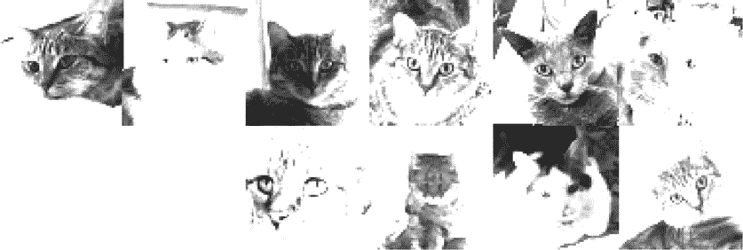

第 10 章

基于深度学习的模式识别

**image**('xdata',[x;x+del],'ydata',[y;y+del],'cdata', s{k} );

**hold** on

x = x + del;

**if** ( x == lX )

x = 0;

y = y + del;

**end**

**end**

**axis** off

**axis image**

**for** k = 1:**length**(s)

s{k} = double(s{k})/256;

**end**

**cd**(c)

该函数内置了一个演示，使用我们本地的猫图像文件夹。图像按 24 或 16 的因子缩小，以便显示为 64x64 像素的图像。

%%% ImageArray>Demo

% 生成猫图像数组

c0 = **cd**;

p = mfilename('fullpath');

**cd**(fileparts(p));

ImageArray( fullfile('..','Cats'), 4 );

**cd**(c0);

Cats 文件夹中的完整图像集（如演示中加载和缩放的那样）如图 10.3 所示。

**图 10.3：** 64x64 像素的灰度猫图像。


第 10 章

基于深度学习的模式识别

`ImageArray` 对三种颜色进行平均，将彩色图像转换为灰度图像。它会将图像上下翻转，因为图像坐标与 MATLAB 的坐标相反。我们使用 GraphicConverterTM 应用程序将图像裁剪到猫脸周围，并使它们全部为 1024x1024 像素。图像匹配的挑战之一就是自动完成此过程。

此外，通常训练会使用数千张图像。我们将只使用几张，看看我们的神经网络能否判断测试图像是否为猫，甚至是否是我们训练中使用过的猫！`ImageArray` 使用下面所示的 `ScaleImage` 函数来缩放图像。

%% SCALEIMAGE 按 2 的幂缩放图像。

**function** s2 = ScaleImage( s1, q )

% 演示

**if**( **nargin** < 1 )

Demo

**return**

**end**

n = 2ˆq;

[mR,˜,mD] = **size**(s1);

m = mR/n;

s2 = **zeros**(m,m,mD,'uint8');

**for** i = 1:mD

**for** j = 1:m

r = (j-1)*n+1:j*n;

**for** k = 1:m

c = (k-1)*n+1:k*n;

s2(j,k,i) = **mean**(**mean**(s1(r,c,i)));

**end**

**end**

**end**

请注意，它将新图像数组创建为 `uint8` 类型。图 10.4 显示了缩放全彩色图像的结果。


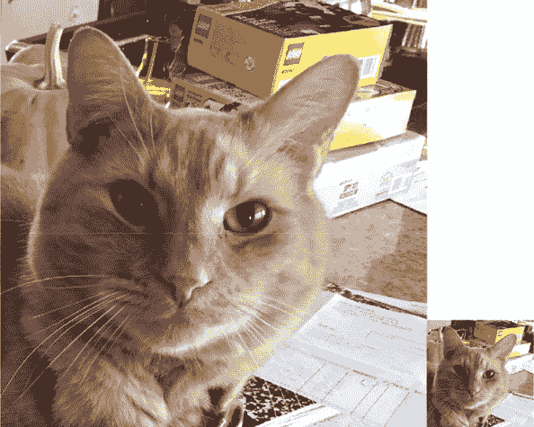

第 10 章

基于深度学习的模式识别

**图 10.4：** 图像从 1024x1024 缩放至 256x256。

**10.3**

**矩阵卷积**

**10.3.1 问题**

我们希望实现卷积，作为一种强调图像关键特征的技术，以使学习更有效。这将在下一个方法中用于为神经网络创建卷积层。

**10.3.2 解决方案**

使用 MATLAB 矩阵运算实现卷积。

**10.3.3 工作原理**


我们创建一个 n×n 的掩码，并将其应用于一个 m×m 的矩阵，其中 m 大于 n。我们从矩阵的左上角开始，如图 10.5 所示。我们将掩码与输入矩阵中对应的元素相乘，然后进行双重求和。这就是卷积输出的第一个元素。接着，我们逐列移动掩码，直到掩码的最高列与输入矩阵的最高列对齐。然后，我们将掩码移回第一列，并向下移动一行。我们继续这个过程，直到遍历整个输入矩阵，并且掩码与最大行和最大列对齐。

掩码代表一个特征。实际上，我们是在检查该特征是否出现在图像的不同区域。我们可以有多个掩码。对于每个特征，掩码的每个元素都有一个偏置和一个权重。在这种情况下，我们只有 4 组权重和偏置，而不是 16 组。对于大图像来说，这种节省是相当可观的。在这种情况下，卷积 215


第 10 章

基于深度学习的模式识别

**图 10.5：** 卷积过程，展示了过程开始和结束时的掩码。

输入矩阵

卷积矩阵

掩码

直接作用于图像本身。卷积也可以应用于其他卷积层或池化层的输出，如图 10.2 所示。

卷积在 `Convolve.m` 中实现。掩码是输入 `a`，待卷积的矩阵是输入 `b`。

**function** c = Convolve( a, b )

% Demo

**if**( **nargin** < 1 )

Demo

**return**

**end**

[nA,mA] = **size**(a);

[nB,mB] = **size**(b);

nC = nB - nA + 1;

mC = mB - mA + 1;

c = **zeros**(nC,mC);

**for** j = 1:mC

jR = j:j+nA-1;

**for** k = 1:nC

kR = k:k+mA-1;

c(j,k) = **sum**(**sum**(a.*b(jR,kR)));

**end**

**end**


第 10 章

基于深度学习的模式识别

该演示将一个 3x3 的掩码与一个 6x6 的矩阵进行卷积，产生以下 4x4 矩阵输出。

>> Convolve

a =

b =

**ans** =

**10.4**

**卷积层**

**10.4.1 问题**

我们想要实现一个卷积连接层。这将把一个掩码应用于输入图像。

**10.4.2 解决方案**

使用 `Convolve` 中的代码来实现该层。它会在图像上滑动掩码，并且输出的数量会减少。

**10.4.3 工作原理**

“卷积”神经网络使用掩码扫描输入。掩码的每个输入都通过一个激活函数，对于给定的掩码，该激活函数是相同的。`ConvolutionLayer` 有其内置的神经元函数，如下面的代码清单所示。

%% CONVOLUTIONLAYER 神经网络的卷积层

**function** y = ConvolutionLayer( x, d )

% Demo

**if**( **nargin** < 1 )

**if**( **nargout** > 0 )

y = DefaultDataStructure;

**else**

Demo;

**end**


第 10 章

基于深度学习的模式识别

**return**

**end**

a = d.mask;

aFun = str2func(d.aFun);

[nA,mA] = **size**(a);

[nB,mB] = **size**(x);

nC = nB - nA + 1;

mC = mB - mA + 1;

y = **zeros**(nC,mC);

scale = nA*mA;

**for** j = 1:mC

jR = j:j+nA-1;

**for** k = 1:nC

kR = k:k+mA-1;

y(j,k) = **sum**(**sum**(a.*Neuron(x(jR,kR),d, aFun)));

**end**

**end**

y = y/scale;

%%% ConvolutionLayer>Neuron

**function** y = Neuron( x, d, afun )

% 神经元函数

y = afun(x.*d.w + d.b);

图 10.6 展示了该演示的输入和输出（未在代码清单中显示）。本演示中使用了 `tanh` 激活函数。权重和偏置是随机的。全为 1 的掩码的卷积结果就是它所乘的所有点的总和。输出结果会按掩码中的元素数量进行缩放。

**10.5**

**对层输出进行池化**

**10.5.1 问题**

我们希望对卷积层的输出进行池化，以减少需要在后续层中处理的数据点数量。这使用了上一个方法中创建的 `Convolve` 函数。

**10.5.2 解决方案**

实现一个新函数来处理卷积函数的输出。


第 10 章

基于深度学习的模式识别

**图 10.6：** 卷积层的输入与输出。

**输入**

0.5

**输出**

0.62

0.6

**掩码**

**10.5.3 工作原理**

池化层从卷积层的输出中选取一个子集，并将其传递下去。它们不包含任何权重。池化层可以使用池内的最大值，也可以取中位数或平均值。我们的池化函数提供了这三种选项。池化函数将输入划分为 n×n 的子区域，并返回一个 n×n 的矩阵。

池化功能在`Pool.m`中实现。请注意，我们使用了`str2func`而不是`switch`语句。`a`是要进行池化的矩阵，`n`是池的数量，`type`是池化函数的名称。

**function** b = Pool( a, n, type )

% 演示

**if**( **nargin** < 1 )

Demo

**return**

**end**

**if**( **nargin** <3 )

type = 'mean';

**end**

n = n/2;

p = str2func(type);

nA = **size**(a,1);


第 10 章

基于深度学习的模式识别

nPP = nA/n;

b = **size**(n,n);

**for** j = 1:n

r = (j-1)*nPP +1:j*nPP;

**for** k = 1:n

c = (k-1)*nPP +1:k*nPP;

b(j,k) = p(p(a(r,c)));

**end**

**end**

以下两个演示从一个 4x4 矩阵中创建了四个池。输出矩阵中的每个数字都是输入矩阵四分之一区域的池化结果。它使用了默认的'mean'（均值）池化方法。

>> Pool([1:4;3:6;6:9;7:10],4)

**ans** =

2.5000

4.5000

7.0000

9.0000

>> Pool([1:4;3:6;6:9;7:10],4,'max')

**ans** =

`Pool`是一个神经层，其激活函数实际上就是传递给`Pool`的参数。

**10.6**

**全连接层**

**10.6.1 问题**

我们希望实现一个全连接层。

**10.6.2 解决方案**

使用`FullyConnectedNN`来实现该网络。

**10.6.3 工作原理**

“全连接”神经网络层是传统的神经网络，其中每个输入都连接到每个输出，如图 10.7 所示。我们实现了一个具有 n 个输入和 m 个输出的全连接网络。通向每个输出的路径可以有不同的权重和偏置。

`FullyConnectedNN`可以处理任意数量的输入或输出。下面的代码展示了数据结构函数以及函数主体。

% FullyConnectedNN>Demo

**function** y = FullyConnectedNN( x, d )

% 演示

**if**( **nargin** < 1 )


第 10 章

基于深度学习的模式识别

**图 10.7：** 全连接神经网络。此处仅显示一个输出。

b

输入

+

W

b

+

输出

W

b

+

W

b

+

W

激活函数

每条分支上的权重

**if**( **nargout** > 0 )

y = DefaultDataStructure;

**else**

Demo;

**end**

**return**

**end**

y = **zeros**(d.m, **size**(x,2));

aFun = str2func(d.aFun);

n = **size**(x,1);

**for** k = 1:d.m

**for** j = 1:n

y(k,:) = y(k,:) + aFun(d.w(j,k)*x(j,:) + d.b(j,k));

**end**

**end**

**function** d = DefaultDataStructure

%%% FullyConnectedNN>DefaultDataStructure

% 默认数据结构

图 10.8 显示了内置函数演示的输出。该演示中使用了`tanh`激活函数。权重和偏置是随机的。从输入到输出的形状变化是激活函数作用的结果。


第 10 章

基于深度学习的模式识别

**图 10.8：** 展示了`FullyConnectedNN`演示函数的两个输出与两个输入之间的关系。

x

步长

x

步长

1 1

y

步长

y

步长

**10.7**

**确定概率**

**10.7.1 问题**

我们希望计算一个输出符合我们预期的概率，该输出来自神经网络的输出。

**10.7.2 解决方案**

实现 Softmax 函数。给定一组输入，它计算一组总和为 1 的正数值。这将用于我们网络的输出节点。

**10.7.3 工作原理**

*softmax* 函数是逻辑函数的一种泛化。其公式为：*eqj*

*pj* =

(10.1)

*N*

*k*=1 *eqk*

其中，*q* 是输入向量，*N* 是输入的数量，*p* 是总和为 1 的输出值。

该函数在`Softmax.m`中实现。


**function **[p, pMax, kMax] = Softmax( q )

q = **reshape**(q,[],1);

n = **length**(q);

p = **zeros**(1,n);


第 10 章

基于深度学习的模式识别

den = **sum**(**exp**(q));

**for **k = 1:n

p(k) = **exp**(q(k))/den;

**end**

[pMax,kMax] = **max**(p);

内置演示传入一个简短的输出列表。

**function **Demo

%% Softmax>Demo

q = [1,2,3,4,1,2,3];

[p, pMax, kMax] = Softmax( q )

**sum**(p)

演示的结果如下：

>> Softmax

p =

0.0236

0.0643

0.1747

0.4748

0.0236

0.0643

0.1747

pMax =

0.4748

kMax =

**ans **=

1.0000

最后一个数字是 p 的总和，结果应为（且确实为）1。

**10.8**

**测试神经网络**

**10.8.1 问题**

我们希望整合卷积、池化、全连接层和 Softmax，使网络输出概率值。

**10.8.2 解决方案**

解决方案是编写一个卷积神经网络。我们整合了卷积、池化、全连接网络和 Softmax 函数，然后使用随机生成的权重对其进行测试。

**10.8.3 工作原理**

图 10.9 展示了图像处理神经网络。它包含一个卷积层、一个池化层、一个全连接层，最后一层是 Softmax。


第 10 章

基于深度学习的模式识别

**图 10.9：**用于图像处理的神经网络。

训练

权重

全连接

卷积

池化

Softmax

层

层

层

图像

`ConvolutionNN`实现了该网络。它使用了我们在之前章节中实现的`ConvolutionLayer`、`Pool`、`FullyConnectedNN`和`Softmax`函数。

实现该网络的`ConvolutionNN`代码（位于子函数`NeuralNet`中）如下所示。如果请求使用`mesh`绘图，它可以生成图形。

**function **r = NeuralNet( d, t, ˜ )

%%% ConvolutionalNN>NeuralNet

% 执行神经网络。如果有三个输入参数则绘图。

% 对图像进行卷积

yCL

= ConvolutionLayer( t, d.cL );

% 池化输出

yPool = Pool( yCL, d.pool.n, d.pool. **type **);

% 应用全连接层

yFC

= FullyConnectedNN( yPool, d.fCNN );

[˜,r] = Softmax( yFC );

% 如果请求则绘图

**if**( **nargin **> 2 )

NewFigure('ConvolutionNN');

**subplot**(3,1,1);

**mesh**(yCL);

**title**('卷积层')

**subplot**(3,1,2);

**mesh**(yPool);

**title**('池化层')

**subplot**(3,1,3);

**mesh**(yFC);

**title**('全连接层')

**end**


第 10 章

基于深度学习的模式识别

`ConvolutionNN`还包含用于定义数据结构、训练和测试网络的附加子函数。

我们首先使用`TestNN`测试用随机权重初始化的神经网络。这是一个脚本，它使用`ImageArray`加载猫图像，用随机权重初始化卷积网络，然后使用选定的测试图像运行该网络。

>> TestNN

图像 IMG_3886.png 有 13.1%的概率是一只猫

不出所料，未经训练的神经网络无法识别出猫！图 10.10 展示了网络处理各个阶段的输出。

**图 10.10：**卷积神经网络处理的各个阶段。

**卷积层**

**池化层**

1.8

1.6

1.8

1.4

1.6

1.2

1.4

1.2

**全连接层**

1.9

1.8

1.8

1.6

1.4

1.2

**10.9**

**识别数字**

**10.9.1 问题**

我们希望判断一张图像是否为数字 3 的图像。

**10.9.2 解决方案**

我们使用一系列数字 3 的图像来训练神经网络。然后，从训练集中取一张图片，再取另一张单独的图片，计算它们属于数字 3 的概率。


第 10 章

基于深度学习的模式识别

**10.9.3 工作原理**


我们首先运行脚本 `Digit3TrainingData` 来生成训练集。这是第 5 章 `DigitTrainingData` 中训练图像生成脚本的简化版本。它只生成一个数字，在本例中是数字 3。`input` 将图像的 256 个比特全部放在单列中。`output` 对所有图像都输出数字 1。我们循环使用三种字体

`'times'`、`'helvetica'`、`'courier'` 以增加多样性。这将使神经网络在看到不同字体时训练更有效。与第 4 章的脚本不同，我们将图像存储为 16x16 像素的图像。我们还直接使用 `save` 将三个数组 `'input'`、`'trainSets'`、

`'testSets'` 保存到一个 `.mat` 文件中。

%% 为数字 3 生成网络训练数据

digits

= 3;

nImagesPer = 20;

% 准备数据

nDigits

= **length**(digits);

nImages

= nDigits*nImagesPer;

**input**

= **cell**(1,nImages);

output

= **zeros**(1,nImages);

fonts

= {'times','helvetica','courier'};

% 循环

kImage = 1;

**for** j = 1:nDigits

**fprintf**('Digit %d\n', digits(j));

**for** k = 1:nImagesPer

kFont

= **ceil**(**rand*****length**(fonts));

pixels = CreateDigitImage( digits(j), fonts{kFont} );

% 将像素缩放到 0 到 1 的范围

**input**{kImage} = double(pixels)/255;

kImage

= kImage + 1;

**end**

sets = **randperm**(10);

**end**

% 使用 75% 的图像进行训练，其余保存用于测试 trainSets = **sort**(**randperm**(nImages, **floor**(0.75*nImages))); testSets

= setdiff(1:nImages,trainSets);

**save**('digit3.mat', 'input', 'trainSets', 'testSets');

然后我们运行脚本 `TrainNNNumber` 来检查输入图像是否为数字 3。该脚本将 `.mat` 文件中的数据加载到工作区，以便 `input`、`trainSets` 和 226


第 10 章

基于深度学习的模式识别

`testSets` 可以直接使用。我们从 `ConvolutionalNN` 获取默认数据结构，并修改设置以优化 `fminsearch`。

%% 在单个数字上训练神经网络

% 从加载的 mat 文件中的图像训练网络。

% 切换为使用一张图像或全部图像进行训练

useOneImage = false;

% 这是为了确保运行结果一致

rng('default')

% 加载图像数据

**load**('digit3');

% 训练

**if** useOneImage


% 仅使用一张图像进行训练

trainSets

= 2;

testSets

= setdiff(1:**length**(**input**),trainSets);

**end**

**fprintf**(1,'训练图像 [')

**fprintf**(1,'%1d ',trainSets);

d

= ConvolutionalNN;

d.opt = optimset('TolX',1e-5,'MaxFunEvals',400000,'maxiter',200000); d

= ConvolutionalNN( 'train', d, **input**(trainSets) );

**fprintf**(1,']\n 函数值（应为零）%12.4f\n',d.fVal);

% 使用测试图像测试网络

**for** k = 1:**length**(testSets)

[d, r] = ConvolutionalNN( 'test', d, **input**{testSets(k)} );

**fprintf**(1,'测试图像 %d 有 %4.1f%% 的概率是数字 3\n', testSets(k),100*r);

**end**

% 使用测试图像测试网络

[d, r] = ConvolutionalNN( 'test', d, **input**{trainSets(1)} ); **fprintf**(1,'训练图像 %2d 有 %4.1f%% 的概率是数字 3\n', trainSets(1),100*r);

我们设置 rng('default')，因为 fminsearch 有时会使用随机数。这确保了每次运行的结果相同。我们运行该脚本两次。第一次，我们使用顶部的布尔开关，仅用一张图像进行训练。第二次，我们使用完整的训练集，如第 9 章所述，将布尔开关设置为 false。我们设置 tolX = 1e-5。这是权重的容差，我们正在尝试求解这些权重。将其设置得更小不会改善任何结果。如果将其设置得非常大，比如 1，则会降低学习效果。迭代次数需要大于 10,000。同样，如果设置得太小，将无法收敛。对于单张训练图像

227


第 10 章

基于深度学习的模式识别

，脚本返回图像 2 或 19 是数字 3 的概率为 80.3%（推测是相同字体的数字）。其他测试图像的概率范围从 35.6% 到 47.4%。

>> TrainNNNumber

训练图像 [2 ]

函数值（应为零）0.1969

测试**图像** 1 有 35.6% 的概率是数字 3

测试**图像** 6 有 37.1% 的概率是数字 3

测试**图像** 11 有 47.4% 的概率是数字 3

测试**图像** 18 有 47.4% 的概率是数字 3

测试**图像** 19 有 80.3% 的概率是数字 3

训练**图像** 2 有 80.3% 的概率是数字 3

>> TrainNNNumber

训练图像 [2 3 4 5 7 8 9 10 12 13 14 15 16 17 20 ]

函数值（应为零）0.5734

测试**图像** 1 有 42.7% 的概率是数字 3

测试**图像** 6 有 42.7% 的概率是数字 3

测试**图像** 11 有 42.7% 的概率是数字 3

测试**图像** 18 有 42.7% 的概率是数字 3

测试**图像** 19 有 42.7% 的概率是数字 3

训练**图像** 2 有 42.7% 的概率是数字 3

当我们使用大量代表不同字体的图像进行训练时，概率变得一致，尽管没有达到我们期望的高水平。虽然 fminsearch 确实找到了合理的权重，但我们不能说这个网络非常准确。

**10.10**

**识别图像**

**10.10.1 问题**

我们想要判断一张图像是否是猫的图像。

**10.10.2 解决方案**

我们用一系列猫的图像来训练神经网络。然后，我们从训练集中取一张图片，并从预留的测试集中取另一张图片，计算它们是猫的概率。

**10.10.3 工作原理**

我们运行脚本 TrainNN 来判断输入图像是否是猫。它根据 Cats 文件夹中的图像训练网络。有意义的训练需要成千上万次函数评估，但仅允许少量函数评估也能表明函数正在工作。

%% 在 Cats 图像上训练神经网络

p

= mfilename('fullpath');

c0 = **cd**;

**cd**(fileparts(p));


第 10 章

基于深度学习的模式识别

folderPath = fullfile('..','Cats');

[s, name] = ImageArray( folderPath, 4 );

d = ConvolutionalNN;

% 使用除最后一张之外的所有图像进行训练

s = s(1:**end**-1);

% 这可能需要一段时间

% 至少使用 10000 次迭代才能看到更高的“是猫”概率变化

**disp**('开始训练...')

d.opt.Display = 'iter';

d.opt.MaxFunEvals = 500;

d = ConvolutionalNN( 'train', d, s );

% 使用未参与训练的最后一张图像测试网络

[d, r] = ConvolutionalNN( 'test', d, s{**end**} );

**fprintf**(1,'图像 %s 是猫的概率为 %4.1f%%\n',name{**end**},100*r);

% 使用第一张图像测试网络

[d, r] = ConvolutionalNN( 'test', d, s{1} );

**fprintf**(1,'图像 %s 是猫的概率为 %4.1f%%\n',name{1},100*r);

脚本返回的结果显示，两张图像是猫的概率均为 38.8%。考虑到我们仅用一张图像进行训练，这已经是一个进步。处理过程花费了几个小时。

>> TrainNN

Exiting: 超过最大**函数**求值次数

- 请增加 MaxFunEvals 选项。

当前**函数**值: 0.612029

图像 IMG_3886.png 是猫的概率为 38.8%

图像 IMG_0191.png 是猫的概率为 38.8%

`fminsearch` 使用直接搜索方法（Nelder–Mead 单纯形法），并且对初始条件非常敏感。

事实上，使用这种搜索方法给该神经网络训练带来了根本性的性能障碍，尤其是在深度学习领域，不同权重组合的组合数非常庞大。使用全局优化方法可能会获得更好（且更快）的结果。

下面展示了来自 `ConvolutionNN` 的训练代码。

它使用了 MATLAB 的 `fminsearch`。`fminsearch` 会不断调整增益和偏置，直到所有输入图像与训练图像之间达到良好的拟合。


第 10 章

基于深度学习的模式识别

**function** d = Training( d, t )

%%% ConvolutionalNN>Training

d = Indices( d );

x0 = DToX( d );

[x,d.fVal] = fminsearch( @RHS, x0, d.opt, d, t );

d = XToD( x, d );


我们可以通过以下方式改进结果：

• 调整 `fminsearch` 参数。
• 增加更多图像。
• 增加更多特征（掩码）。
• 更改全连接层中的连接方式。
• 增加卷积神经网络直接处理 RGB 图像的能力，而不是将其转换为灰度图。
• 使用不同的搜索方法，例如遗传算法。

**10.11**

**总结**

本章演示了使用 MATLAB 实现卷积神经网络的步骤。卷积神经网络被用于处理数字和猫的图片以进行学习。训练完成后，要求神经网络识别其他图片，以判断它们是猫的图片还是数字的图片。表 10.1 列出了随附代码中包含的函数和脚本。

**表 10.1：** 章节代码清单

**文件**

**描述**

Activation

生成激活函数。

ConvolutionalNN

实现卷积神经网络。

ConvolutionLayer

实现卷积层。

Convolve

使用掩码对二维数组进行卷积。

Digit3TrainingData

为单个数字创建训练数据。

FullyConnectedNN

实现全连接神经网络。

ImageArray

读取文件夹中的图像并转换为灰度图。

Pool

对二维数组进行池化。

ScaleImage

缩放图像。

Softmax

实现 Softmax 函数。

TrainNN

使用猫图像训练卷积神经网络。

TrainNNNumber

使用数字图像训练卷积神经网络。

TestNN

在猫图像上测试卷积神经网络。

TrainingData.mat

来自 TestNN 的数据。


**第 11 章**

**神经飞机控制**

纵向控制是指飞机在高度和速度变化时所需的控制。在本章中，我们将实现一个神经网络，用于生成非线性飞机控制系统的关键参数。这是一个在线学习的示例，并应用了前几章中的多种技术。

自主

学习

机器

控制

学习

智能

飞机的纵向动力学也称为俯仰动力学。该动力学完全位于飞机的对称平面内。对称平面被定义为将飞机垂直切成两半的平面。大多数飞机关于该平面对称。

这些动力学包括飞机的前向和垂直运动，以及飞机绕垂直于对称平面的轴的俯仰运动。图 11.1 展示了一架飞行中的飞机。*α* 是攻角，即机翼与速度矢量之间的夹角。我们假设风向与速度矢量方向相反，也就是说，飞机产生了其全部的风。阻力沿风向，升力垂直于阻力。俯仰力矩围绕质心。我们将推导的模型使用少量参数，却能相当好地再现纵向动力学。您也可以轻松修改该模型以模拟任何感兴趣的飞机。

© Michael Paluszek 和 Stephanie Thomas 2019

M. Paluszek 和 S. Thomas，*MATLAB 机器学习实践*，

[`doi.org/10.1007/978-1-4842-3916-2_11`](https://doi.org/10.1007/978-1-4842-3916-2_11)


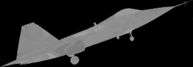

第 11 章

神经飞机控制

**图 11.1：** 飞行中飞机的示意图，显示了纵向动力学模拟的所有重要量。

升力

X

俯仰力矩

阻力

速度

惯性坐标系

Z

X

Z

**11.1**

**纵向运动**

接下来的几个实践将涉及使用神经网络对飞机进行纵向控制以提供学习能力。我们将：

1. 对飞机动力学进行建模
2. 找到一个平衡解，我们将围绕该解控制飞机
3. 学习如何编写 sigma-pi 神经网络
4. 实现 PID 控制
5. 实现神经网络
6. 对系统进行仿真


在本教程中，我们将为学习控制建模飞机的纵向动力学。我们将推导一个参数数量“较少”的简单纵向动力学模型。我们的控制将采用带有比例积分微分（PID）控制器的非线性动力学反演来控制俯仰动力学[[16, 17]](#index_split_007.html#p350)。学习将使用 sigma-pi 神经网络来完成。

我们将采用 NASA 德莱顿研究中心开发的学习方法[[30]](#index_split_007.html#p351)。基线控制器是一种带有 PID 控制律的动态反演型控制器。在飞机运行期间，神经网络[[15]](#index_split_007.html#p350)提供学习功能。该神经网络是一种 sigma-pi 类型的网络，这意味着该网络将输入与其相关权重的乘积进行求和。


第 11 章

神经飞机控制

神经网络的权重由训练算法确定，该算法使用：
1. 来自参考模型的指令飞机速率
2. PID 误差
3. 从神经网络反馈的自适应控制速率

**11.1.1 问题**

我们希望对飞机的纵向动力学进行建模。

**11.1.2 解决方案**

解决方案是编写飞机纵向动力学微分方程的右侧函数。

**11.1.3 工作原理**

我们在表 11.1 中总结了动力学模型的符号。我们的气动模型非常简单。升力和阻力为：

*L* = *pSCL* (11.1)

*D* = *pSCD* (11.2)

其中，*S* 是浸润面积，即与气流相互作用的面积，也是计算气动力时计入的面积；*p* 是动压，即飞机因速度而产生的压力：

*p* = *ρv*² (11.3)

其中，*ρ* 是大气密度，*v* 是速度的大小。大气密度是高度的函数。对于低速飞行，这主要涉及机翼。大多数书籍使用 *q* 表示动压。我们使用 *q* 表示俯仰角速率（这也是一种惯例），因此为了避免混淆，我们在此使用 *p* 表示压力。

升力系数 *CL* 为：

*CL* = *CLαα* (11.4)

阻力系数 *CD* 为：

*CD* = *CD*₀ + *kC*²*L* (11.5)

阻力方程被称为阻力极曲线。增大迎角会增加飞机的升力，但也会增加飞机的阻力。系数 *k* 为：

*k* = 1 / (*π*₀ *AR*) (11.6)


第 11 章

神经飞机控制

**表 11.1：**飞机动力学符号

**符号**

**描述**

**单位**

*g*

海平面重力加速度

9.806 m/s²

*h*

高度

m

*k*

升致阻力系数

*m*

质量

kg

*p*

动压

N/m²

*q*

俯仰角速率

rad/s

*u*

x 轴速度

m/s

*w*

z 轴速度

m/s

*CL*

升力系数

*CD*

阻力系数

*D*

阻力

N

*Iy*

俯仰转动惯量

kg·m²

*L*

升力

N

*M*

俯仰力矩（扭矩）

N·m

*Me*

升降舵产生的俯仰力矩

N·m

*re*

升降舵力臂

m

*S*

机翼浸润面积（产生升力和阻力的面积）

m²

*Se*

升降舵浸润面积

m²

*T*

推力

N

*X*

机体坐标系 X 轴力

N

*Z*

机体坐标系 Z 轴力

N

*α*

迎角

rad

*γ*

航迹角

rad

*ρ*

空气密度

kg/m³

*θ*

俯仰角

rad

其中，0 为奥斯瓦尔德效率因子，通常在 0.75 到 0.85 之间。*AR* 是机翼展弦比。展弦比是机翼展长与弦长之比。对于复杂形状，其近似公式为：

*b*²

*AR* =

(11.7)

*S*

其中 *b* 为展长，*S* 为机翼面积。展长从一侧翼尖测量到另一侧翼尖。滑翔机具有非常高的展弦比，而三角翼飞机的展弦比较低。

空气动力学系数是无量纲系数，当乘以飞机的浸润面积和动压时，可产生空气动力。


第 11 章

神经飞机控制

动力学方程，即运动微分方程，如[[5]：](#index_split_007.html#p349)

*m*( *u̇* + *qw* ) = *X* − *mg* sin *θ* + *T* cos (11.8)

*m*( *ẇ* − *qu* ) = *Z* + *mg* cos *θ* − *T* sin (11.9)

*Iy* *q̇* = *M* (11.10)

*θ̇* = *q* (11.11)

*m* 为质量，*u* 为 x 轴速度，*w* 为 z 轴速度，*q* 为俯仰角速率，*θ* 为俯仰角，*T* 为发动机推力， 为推力矢量与 x 轴之间的夹角，*Iy* 为俯仰惯量，*X* 为 x 轴力，*Z* 为 z 轴力，*M* 为绕俯仰轴的扭矩。x 轴与 z 轴速度之间的耦合是由于在旋转坐标系中列写力方程所致。

俯仰方程是关于质心的。这些量是 *u*、*w*、*q* 和高度 *h* 的函数，高度由下式求得：

*ḣ* = *u* sin *θ* − *w* cos *θ* (11.12)

迎角 *α* 是 *u* 与 *w* 速度之间的夹角，其关系为：*w*

tan *α* = (11.13)

*u*

航迹角 *γ* 是速度矢量方向与水平线之间的夹角。它与 *θ* 和 *α* 的关系为：

*γ* = *θ* − *α* (11.14)


好的，作为一名高级文档工程师和翻译员，我将严格遵循您提供的注意事项和示例，将给定的英文文本翻译成中文。


这在方程式中并未出现，但在研究飞机运动时，计算它非常有用。

力为：

*X*

=

*L * sin *α − D * cos *α*

(11.15)

*Z*

=

*−L * cos *α − D * sin *α*

(11.16)

假设力矩（或扭矩）是由于压力中心与质心沿 *x* 轴偏移而产生的：

*M *= ( *cp − c*) *Z*

(11.17)

其中， *cp * 是压力中心的位置。由升降舵产生的力矩为： *Me *=  *qreSe * sin( *δ*)

(11.18)

*Se * 是升降舵的浸润面积， *rE * 是从质心到升降舵的距离。动力学模型位于 `RHSAircraft` 中。大气密度模型是一个指数模型，并作为此函数中的一个子函数包含在内。如果未提供输入，`RHSAircraft` 将返回默认数据结构。


第 11 章

神经飞机控制

**function **[xDot, lift, drag, pD] = RHSAircraft( ˜, x, d )

**if**( **nargin **< 1 )

xDot = DataStructure;

**return**

**end**

g

= 9.806; % 重力加速度 (m/sˆ2)

u

= x(1); % 前进速度

w

= x(2); % 上升速度

q

= x(3); % 俯仰角速率

theta = x(4); % 俯仰角

h

= x(5); % 高度

rho

= AtmDensity( h ); % 密度 (kg/mˆ3)

alpha = **atan**(w/u);

cA

= **cos**(alpha);

sA

= **sin**(alpha);

v

= **sqrt**(uˆ2 + wˆ2);

pD

= 0.5*rho*vˆ2; % 动压

cL

= d.cLAlpha*alpha;

cD

= d.cD0 + d.k*cLˆ2;

drag

= pD*d.s*cD;

lift

= pD*d.s*cL;

x

=

lift*sA - drag*cA;

z

= -lift*cA - drag*sA;

m

=

d.c*z + pD*d.sE*d.rE***sin**(d.delta);

sT

= **sin**(theta);

cT

= **cos**(theta);

tEng

= d.thrust*d.throttle;

cE

= **cos**(d.epsilon);

sE

= **sin**(d.epsilon);

uDot

= (x + tEng*cE)/d.mass - q*w - g*sT + d.externalAccel(1);

wDot

= (z - tEng*sE)/d.mass + q*u + g*cT + d.externalAccel(2);

qDot

= m/d.inertia

+ d.externalAccel(3);

hDot

= u*sT - w*cT;

xDot

= [uDot;wDot;qDot;q;hDot];


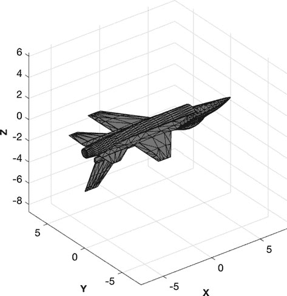


第 11 章

神经飞机控制

我们将使用 F-16 飞机模型进行仿真。F-16 是一种单引擎超音速多用途战斗机，被许多国家使用。F-16 如图 11.2 所示。

**图 11.2：** F-16 模型。

惯性矩阵是通过获取该模型，将质量分布到所有顶点，并根据以下公式计算惯性得到的：

*m*

*mk *=

(11.19)

*N*

*c*

=

*mkrk*

(11.20)

*k*

*I*

=

*mk*( *rk − c*)2

(11.21)

*k*

其中， *N * 是节点数， *rk * 是从原点（任意）到节点 *k* 的向量。

inr =

1.0e+05 *

0.3672

0.0002

-0.0604

0.0002

1.4778

0.0000

-0.0604

0.0000

1.7295


第 11 章

神经飞机控制

**表 11.2：** F-16 数据

**符号**

**字段**

**值**

**描述**

**单位**

*CLα*

cLAlpha

6.28

升力系数

*CD* 0

cD0

0.0175

零升阻力系数

*k*

k

0.1288

升力耦合系数

epsilon

推力与 x 轴的夹角

弧度

*T*

thrust

76.3e3

发动机推力

牛

*S*

s

27.87

机翼面积

平方米

*m*

mass

12,000

飞机质量

千克

*Iy*

inertia

1.7295e5

z 轴惯性矩

千克·平方米

*c − cp*

c

重心与压力中心的偏移量

米

*Se*

sE

3.5

升降舵面积

平方米

*re*

(rE)

4.0

升降舵力臂

米

F-16 数据见表 11.2。

该模型存在许多局限性。首先，推力是立即以 100% 的精度施加的。推力也不是空速或高度的函数。真实的发动机需要一些时间才能达到指令推力，并且推力水平会随空速和高度而变化。在该模型中，升降舵也是瞬时响应的。升降舵由电机驱动，通常是液压电机，但有时是纯电动电机，它们需要时间才能达到指令角度。在我们的模型中，空气动力学非常简单。实际上，升力和阻力是空速和迎角的复杂函数，通常使用大型系数表进行建模。我们还通过力臂对俯仰力矩进行建模。通常，扭矩是通过表格建模的。尽管这在大多数完整的飞机空气动力学模型中都会出现，但我们的模型没有考虑空气动力学阻尼。你可以通过创建函数轻松添加这些特性：

C_L = CL(v, h, alpha, delta)

C_D = CD(v, h, alpha, delta)

C_M = CL(v, h, vdot, alpha, delta)

**11.2**

**数值求解平衡状态**

**11.2.1 问题**

我们希望确定飞机的平衡状态。这是所有力和力矩都平衡的姿态。

**11.2.2 解决方案**

解决方案是计算动力学的雅可比矩阵。雅可比矩阵是一个包含向量值函数（此处为飞机动力学）所有一阶偏导数的矩阵。


第 11 章

神经飞机控制

**11.2.3 工作原理**

我们希望每次仿真都从一个平衡状态开始。这是通过函数 EquilibriumState 实现的。它使用 fminsearch 来最小化：

˙*u*² + ˙*w*²

(11.22)

给定飞行速度、高度和飞行路径角。然后计算使俯仰角加速度为零所需的升降舵角度。它内置了一个在 10 公里高度进行平衡水平飞行的演示。

**function** [x, thrust, delta, cost] = EquilibriumState( gamma, v, h, d )

%% 代码

**if**( **nargin** < 1 )

Demo;

**return**

**end**

% [前向速度, 垂直速度, 俯仰角速率, 俯仰角, 高度]

x = [v;0;0;0;h];

[~,~,drag] = RHSAircraft( 0, x, d );

y0 = [0;drag];

cost(1) = CostFun( y0, d, **gamma**, v, h );

y = fminsearch( @CostFun, y0, [], d, **gamma**, v, h );

w = y(1);

thrust = y(2);

u = **sqrt**(v² - w²);

alpha = **atan**(w/u);

theta = **gamma** + alpha;

cost(2) = CostFun( y, d, **gamma**, v, h );

x = [u;w;0;theta;h];

d.thrust = thrust;

d.delta = 0;

[xDot,~,~,p] = RHSAircraft( 0, x, d );

CostFun 是下面给出的代价函数。

**function** cost = CostFun ( y, d, **gamma**, v, h )

%% EquilibriumState>CostFun

% fminsearch 的代价函数。代价是速度导数的平方
%（来自 RHSAircraft 的 xDot 的前两项）。
%
% 另请参阅 RHSAircraft。


第 11 章

神经飞机控制

w = y(1);

d.thrust = y(2);

d.delta = 0;

u = **sqrt**(v² - w²);

alpha = **atan**(w/u);

theta = gamma + alpha;

x = [u;w;0;theta;h];

xDot = RHSAircraft( 0, x, d );

cost = xDot(1:2)' * xDot(1:2);


数值向量是第一个输入。我们初步猜测推力等于阻力。垂直速度和推力通过 `fminsearch` 求解。`fminsearch` 在推力和垂直速度的范围内进行搜索，以找到平衡状态。

演示的结果如下：

>> EquilibriumState

速度

250.00 m/s

高度

10000.00 m

飞行路径角

0.00 deg

Z 轴速度

13.84 m/s

推力

11148.95 N

攻角

3.17 deg

升降舵

-11.22 deg

初始代价

9.62e+01

最终代价

1.17e-17

初始代价和最终代价显示了 `fminsearch` 在实现最小化 *w* 和 *u* 加速度这一目标方面的成功程度。

**11.3**

**飞机数值仿真**

**11.3.1 问题**

我们希望对飞机进行仿真。

**11.3.2 解决方案**

解决方案是创建一个脚本，在循环中调用动力学方程的右侧函数 `RHSAircraft`，并绘制结果。

**11.3.3 工作原理**

仿真脚本如下所示。它首先计算平衡状态，然后通过调用 `RungeKutta` 在循环中模拟动力学过程。它对飞机施加一个扰动，然后使用 `PlotSet` 绘制结果。


第 11 章

神经飞机控制

%% 初始化

nSim

= 2000;

% 时间步数

dT

= 0.1;

% 时间步长（秒）

dRHS

= RHSAircraft;

% 获取默认数据结构

h

= 10000;

gamma

= 0.0;

v

= 250;

nPulse

= 10;

[x,

dRHS.thrust, dRHS.delta, cost] = EquilibriumState( **gamma**, v, h, dRHS );

**fprintf**(1,'Finding Equilibrium: Starting Cost %12.4e Final Cost %12.4

e\n',cost);

accel = [0.0;0.1;0.0];

%% 仿真

xPlot = **zeros**(**length**(x)+2,nSim);

**for **k = 1:nSim

% 绘图存储

[˜,L,D]

= RHSAircraft( 0, x, dRHS );

xPlot(:,k)

= [x;L;D];

% 传播（数值积分）状态方程

**if**( k > nPulse )

dRHS.externalAccel = [0;0;0];

**else**

dRHS.externalAccel = accel;

**end**

x

= RungeKutta( @RHSAircraft, 0, x, dT, dRHS );

**if**( x(5) <= 0 )

**break**;

**end**

**end**

施加的外部加速度使飞机进入轻微爬升状态，并伴有明显的振荡。

>> AircraftSimOpenLoop

速度

250.00 m/s

高度

10000.00 m

飞行路径角

0.57 deg

Z 轴速度

13.83 m/s

推力

12321.13 N

攻角

3.17 deg

升降舵

11.22 deg

初始代价

9.62e+01

最终代价

5.66e-17

寻找平衡：初始代价

9.6158e+01 最终代价

5.6645e


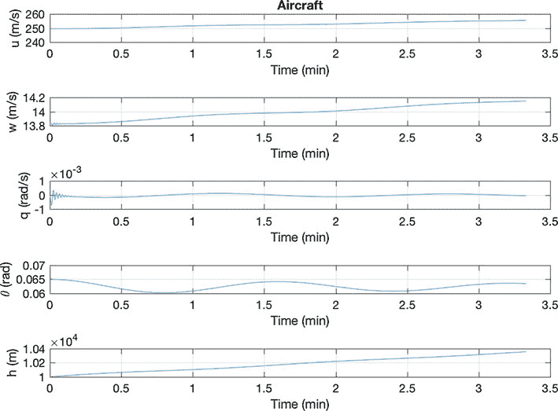


第 11 章

神经飞机控制

仿真结果如图 11.3.所示。飞机稳定爬升。观察到两种振荡：一种主要与俯仰相关的高频振荡，另一种与飞机速度相关的低频振荡。

**图 11.3：** F-16 在浅爬升状态下对脉冲的开环响应。

**11.4**

**激活函数**

**11.4.1 问题**

我们将实现一个神经网络，以便我们的飞机控制系统能够学习。我们需要一个激活函数来缩放和限制测量值。

**11.4.2 解决方案**

使用 Sigmoid 函数作为我们的激活函数。

**11.4.3 工作原理**

神经网络使用以下 Sigmoid 函数

1  *− e−kx*

*g*( *x*) =

(11.23)

1 +  *e−kx*


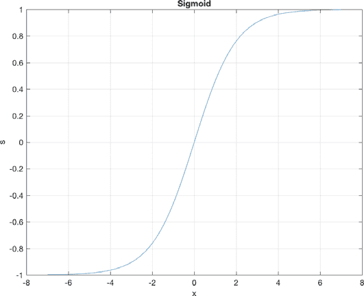

第 11 章

神经飞机控制

*K* = 1 时的 Sigmoid 函数绘制在以下脚本中。

s = (1-**exp**(-x))./(1+**exp**(-x));

PlotSet( x, s, 'x label', 'x', 'y label', 's',...

'plot title', 'Sigmoid', 'figure title', 'Sigmoid' );

结果如图 11.4.所示。

**图 11.4：** Sigmoid 函数。当 *x* 值较大时，Sigmoid 函数返回 *±* 1。

**11.5**

**用于学习控制的神经网络**

**11.5.1 问题**

我们希望使用神经网络为飞机控制系统增加学习能力。

**11.5.2 解决方案**

使用 sigma-pi 神经网络函数。sigma-pi 神经网络对输入及其乘积进行求和，以生成一个模型。

**11.5.3 工作原理**


用于俯仰轴的自适应神经网络有七个输入。神经网络的输出是一个俯仰角加速度，用于增强来自动态逆控制器的控制信号。控制系统如图 11.5 所示。最左侧的方框根据飞行员输入生成参考模型。参考模型的输出是一个包含 243 个期望状态的向量。


第 11 章

神经飞机控制

这些期望状态与真实状态进行差分，并馈送给 PID 控制器和神经网络。PID 的输出与神经网络的输出进行差分。然后将其输入到驱动飞机动态的模型逆模块中。

**图 11.5：**飞机控制系统。它结合了 PID 控制器与动态逆来处理非线性。神经网络提供学习能力。

飞行员输入

参考

+

PID

模型

飞机

模型

控制器

逆

-

-

神经网络

图 11.6 展示了一个用于双输入系统的 sigma-pi 神经网络。

**图 11.6：**Sigma-pi 神经网络。Π代表乘积，Σ代表求和。

输出为：

*y* = *w*1*c* + *w*2*x*1 + *w*3*x*2 + *w*4*x*1*x*2

(11.24)


第 11 章

神经飞机控制

权重被选择用来表示一个非线性函数。例如，假设我们要表示动压：

*y* = *ρv*²

(11.25)

我们令 *x*1 = *ρ* 且 *x*2 = *v*²。设置 *w*4 = 12，并将所有其他权重设为零。假设我们不知道常数 12。我们希望我们的神经网络能够通过测量来确定这个权重。

神经网络的学习意味着确定权重，使我们的网络能够复现它所建模的函数。定义向量 *z*，它是乘积运算的结果。在我们的双输入情况下，这将是：

⎡ ⎤
*c*
⎢ *x*1 ⎥
*z* = ⎢ ⎥
⎣ *x*2 ⎦
*x*1*x*2

(11.26)

*c* 是一个常数。输出为：

*y* = *wᵀz*

(11.27)

我们可以组合多个输入和输出：

*y*1 *y*2 *···* = *wᵀ* [*z*1 *z*2 *···*]

(11.28)

其中 *zₖ* 是一个列数组。给定输出 *y* 和输入 *x*，我们可以使用最小二乘法求解权重 *w*。定义 *y* 的向量为 *Y*，*z* 的矩阵为 *Z*。*w* 的解为：

*Y* = *Zᵀw*

(11.29)

最小二乘解为：

*w* = (*ZZᵀ*)⁻¹ *ZYᵀ*

(11.30)

这给出了对于测量值 *Y* 和输入 *Z* 的最佳拟合 *w*。假设我们又进行了一次测量。那么我们将使用更大的矩阵重复此过程。顺便提一下，你实际上不会使用求逆来计算这个。有更好的数值方法来进行最小二乘计算。

MATLAB 有 `pinv` 函数。例如：

>> z = **rand**(4,4);
>> w = **rand**(4,1);
>> y = w'*z;
>> wL = **inv**(z*z')*z*y'
wL =
    0.8308
    0.5853
    0.5497
    0.9172


第 11 章

神经飞机控制

>> w
w =
    0.8308
    0.5853
    0.5497
    0.9172

>> **pinv**(z')*y'
**ans** =
    0.8308
    0.5853
    0.5497
    0.9172

如你所见，它们都一致！这是初始化训练你的神经网络的好方法。收集与 *z* 值数量一样多的测量值，并计算权重。然后你的网络就可以使用了。

递归方法是用 *n* 个 *z* 和 *y* 的值来初始化递归训练器。

*p* = (*ZZᵀ*)⁻¹

(11.31)

*w* = *pZY*

(11.32)

递归学习算法为：

*p* = *p* − (*pzzᵀp*) / (1 + *zᵀpz*)

(11.33)

*k* = *pz*

(11.34)

*w* = *w* + *k*(*y* − *zᵀw*)

(11.35)

`RecursiveLearning` 演示了递归学习或训练。它从一个基于四元素训练集的初始估计开始。然后根据新数据进行递归学习。

wN = w + 0.1***randn**(4,1); % 真实权重略有不同
n = 300;
zA = **randn**(4,n); % 随机输入
y = wN'*zA; % 100 个新测量值
% 批量训练
p = **inv**(Z*Z'); % 初始值
w = p*Z*Y; % 初始值
%% 递归学习
dW = **zeros**(4,n);


**for** j = 1:n

z = zA(:,j);

p = p - p*(z*z')*p/(1+z'*p*z);

w = w + p*z*(y(j) - z'*w);

dW(:,j) = w - wN; % 存储用于绘图

**end**


第 11 章

神经飞机控制

%% 绘制结果

yL = **cell**(1,4);

**for** j = 1:4

yL{j} = **sprintf**('\\Delta W_%d',j);

**end**

PlotSet(1:n,dW,'x label','样本','y label',yL,...

'plot title','递归训练',...

'figure title','递归训练');

图 11.7 展示了结果。经过初始瞬态后，学习过程收敛。每次运行此代码时，由于我们使用随机值进行初始化，因此会得到不同的结果。

**图 11.7：** 递归训练或学习。经过初始瞬态后，权重迅速收敛。

你会注意到，递归学习算法在形式上与第 4.1.3 节中给出的卡尔曼滤波器完全相同。我们的学习算法是从批量最小二乘法推导出来的，这也是卡尔曼滤波器的另一种推导方式。


第 11 章

神经飞机控制

**11.6**

**枚举所有输入集合**

**11.6.1 问题**

sigma-pi 神经网络的一个问题是可能的节点数量。出于设计目的，我们需要一个函数来枚举所有可能的输入组合集合。这是为了确定 sigma-pi 神经网络复杂度的限制。

**11.6.2 解决方案**

编写一个组合函数，用于计算集合的数量。

**11.6.3 工作原理**

在我们的 sigma-pi 网络中，我们手动编码了输入的乘积。对于更通用的代码，我们希望枚举所有输入组合。如果我们有 *n* 个输入，并且希望每次取 *k* 个，那么集合的数量为：

*n*!

(11.36)

( *n* − *k*)! *k*!

用于枚举所有集合的代码位于函数 Combinations 中。

**function** c = Combinations( r, k )

%% 演示

**if**( **nargin** < 1 )

Combinations(1:4,3)

**return**

**end**

%% 特殊情况

**if**( k == 1 )

c = r';

**return**

**elseif**( k == **length**(r) )

c = r;

**return**

**end**

%% 递归

rJ = r(2:**end**);

c = [];

**if**( **length**(rJ) > 1 )

**for** j = 2:**length**(r)-k+1

rJ = r(j:**end**);

nC = NumberOfCombinations(**length**(rJ),k-1);

cJ = **zeros**(nC,k);

cJ(:,2:**end**) = Combinations(rJ,k-1);

cJ(:,1) = r(j-1);


第 11 章

神经飞机控制

**if**( ˜**isempty**(c) )

c = [c;cJ];

**else**

c = cJ;

**end**

**end**

**else**

c = rJ;

**end**

c = [c;r(**end**-k+1:**end**)];

这段代码处理了两种输入特殊情况，然后对所有其他情况递归调用自身。以下是一些示例：

>> Combinations(1:4,3)

**ans** =

>> Combinations(1:4,2)

**ans** =

你可以看到，如果我们有四个输入并希望得到所有可能的组合，最终总共会有 14 种！这表明 sigma-pi 神经网络存在一个实际限制，因为随着输入数量的增加，权重的数量会快速增长。

**11.7**

**编写一个 Sigma-Pi 神经网络函数**

**11.7.1 问题**

我们需要一个适用于一般问题的 sigma-pi 网络函数。

**11.7.2 解决方案**

使用一个 sigma-pi 函数。


第 11 章

神经飞机控制

**11.7.3 工作原理**

以下代码展示了我们如何实现 sigma-pi 神经网络。SigmaPiNeuralNet 的第一个输入是 action。你可以通过它来访问该函数的功能。操作包括：

1. “initialize” – 初始化函数
2. “set constant” – 设置常数项
3. “batch learning” – 执行批量学习
4. “recursive learning” – 执行递归学习
5. “output” – 生成输出（无需训练）

运行该函数时，通常按顺序进行。如果默认值 1 没问题，则无需设置常数。

功能分布在从 switch 语句调用的子函数中。

演示展示了使用该函数对动压进行建模的示例。我们的输入是高度和速度的平方。神经网络将尝试拟合：*y* = *w*1 *c* + *w*2 *h* + *w*3 *v*2 + *w*4 *hv*2


(11.37)

至

*y* = 0.6125 *e*−0.0817 *h* 1.15 *v*²

(11.38)

我们首先获取一个默认的数据结构。然后，我们用一个空的 `x` 初始化滤波器。接着，我们通过批量学习获得初始权重。`x` 的列数至少应为输入数量的两倍。这会给出一个初始的 *p* 矩阵和权重的初始估计值。然后我们执行递归学习。重要的是，`kSigmoid` 字段要足够小，以便有效输入位于 sigmoid 函数的线性区域内。请注意，这可以是一个数组，以便您可以在不同的输入上使用不同的缩放比例。

**function** Demo

% 演示用于动态压力的 sigma-pi 神经网络

x = **zeros**(2,1);

d = SigmaPiNeuralNet;

[˜, d] = SigmaPiNeuralNet( 'initialize', x, d );

h = **linspace**(10,10000);

v = **linspace**(10,400);

v2 = v.ˆ2;

q = 0.5*AtmDensity(h).*v2;

n = 5;

x = [h(1:n);v2(1:n)];


第 11 章

神经飞机控制

d.y = q(1:n)';

[y, d] = SigmaPiNeuralNet( 'batch learning', x, d );

**fprintf**(1,'Batch Results\n# Truth Neural Net\n');

**for** k = 1:**length**(y)

**fprintf**(1,'%d: %12.2f %12.2f\n',k,q(k),y(k));

**end**

n = **length**(h);

y = **zeros**(1,n);

x = [h;v2];

**for** k = 1:n

d.y = q(k);

[y(k), d] = SigmaPiNeuralNet( 'recursive learning', x(:,k), d );

**end**

以下是低空五个动态压力示例的批量学习结果。如您所见，真实模型和神经网络输出非常接近：

>> SigmaPiNeuralNet

Batch Results

