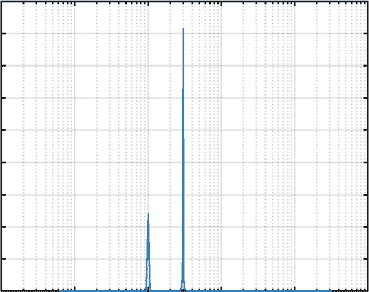
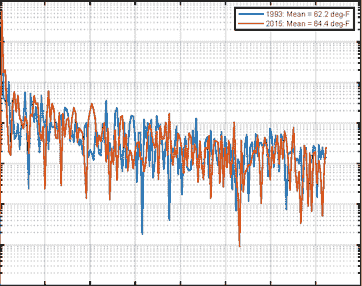
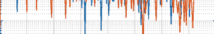
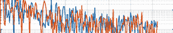
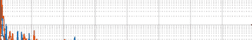

# 第 2 章 **数据的表示**

**MATLAB 中的机器学习**

**2.1**

**MATLAB 数据类型简介**

**2.1.1 矩阵**

默认情况下，MATLAB 中的所有变量都是双精度矩阵。您无需为这些变量声明类型。矩阵可以是多维的，并通过圆括号使用基于 1 的索引进行访问。您可以使用单个索引（按列顺序）或每个维度一个索引来寻址矩阵中的元素。要创建一个矩阵变量，只需为其赋值，例如这个 2x2 矩阵 a：

>> a = [1 2; 3 4];

>> a(1,1)

>> a(3)

**提示**

分号用于终止表达式，使其不会显示在命令窗口中。如果省略分号，表达式的结果将打印在命令窗口中。省略分号是一种无需使用 MATLAB 调试器即可进行调试的便捷方法，但日后可能很难找到那些缺失的分号！

您可以使用简单的语法对矩阵进行加、减、乘、除运算。矩阵的尺寸必须符合所请求的线性代数运算的要求。转置使用单引号后缀 A' 表示，矩阵幂运算使用运算符 ^。

>> b = a'*a;

>> c = a²;

>> d = b + c;

© Michael Paluszek 和 Stephanie Thomas 2019

M. Paluszek 和 S. Thomas， *MATLAB 机器学习秘籍*，

[`doi.org/10.1007/978-1-4842-3916-2_2`](https://doi.org/10.1007/978-1-4842-3916-2_2)

默认情况下，每个变量都是数值变量。您可以使用 `zeros`、`ones`、`eye` 或 `rand` 函数将矩阵初始化为指定大小，这些函数分别生成全零矩阵、全一矩阵、单位矩阵（对角线为 1）和随机数矩阵。使用 `isnumeric` 来识别数值变量。

**表 2.1：**矩阵的关键函数

**函数**

**用途**

`zeros`

将矩阵初始化为全零

`ones`

将矩阵初始化为全一

`eye`

初始化一个单位矩阵

`rand`、`randn`

初始化一个随机数矩阵

`isnumeric`

识别矩阵或标量数值

`isscalar`

识别标量值（1 x 1 矩阵）

`size`

返回矩阵的大小

MATLAB 支持 n 维数组。二维数组类似于表格。三维数组可以想象成一个立方体，其中立方体内的每个盒子都包含一个数字。四维数组更难想象，但我们不必止步于此！

**2.1.2 元胞数组**

MATLAB 特有的一种变量类型是元胞数组。它实际上是一个列表容器，您可以在元胞数组的元素中存储任何类型的变量。与矩阵一样，元胞数组可以是多维的，并且在许多情况下都很有用。

元胞数组用花括号 *{}* 表示。它们可以是任意维度，并包含任何数据，包括字符串、结构体和对象。您可以使用 `cell` 函数初始化它们，使用 `celldisp` 递归显示其内容，并使用圆括号访问子集，就像访问矩阵一样。下面是一个简短的示例。

>> c = **cell**(3,1);

>> c{1} = 'string';

>> c{2} = false;

>> c{3} = [1 2; 3 4];

>> b = c(1:2);

>> celldisp(b)

b{1} =

string

b{2} =

使用花括号进行访问会以底层类型返回元素数据。当您使用圆括号访问元胞数组的元素时，返回的内容是另一个元胞数组，而不是元胞内的实际内容。MATLAB 帮助中有一个名为 *逗号分隔列表* 的特殊章节。20

*列表*，强调了将元胞数组用作列表。代码分析器还会建议更高效地使用元胞数组的方法。例如，

将

a = {b{:} c};

替换为

a = [b {c}];

元胞数组对于字符串集合尤其有用，MATLAB 的许多字符串搜索函数（如 `strcmp`）都针对元胞数组进行了优化。

使用 `iscell` 来识别元胞数组变量。使用 `deal` 来操作结构数组和元胞数组的内容。

**表 2.2：**元胞数组的关键函数

**函数**

**用途**

`cell`

初始化一个元胞数组

`cellstr`

从字符数组创建一个元胞数组

`iscell`

识别元胞数组

`iscellstr`

识别仅包含字符串的元胞数组

`celldisp`

递归显示元胞数组的内容

**2.1.3 数据结构**

MATLAB 中的数据结构非常灵活，由用户自行确保字段和类型的一致性。你无需在分配字段之前初始化数据结构，但这样做是个好习惯，尤其是在脚本中，可以避免变量冲突。

将

d.fieldName = 0;

替换为

d = struct;

d.fieldName = 0;

事实上，我们发现，通常最好创建一个专门的函数来初始化在一组函数中使用的较大型结构。这类似于创建类定义。通过函数生成数据结构，而不是在脚本中逐字输入字段，意味着你始终能以正确的字段开始。拥有初始化函数还可以让你指定变量类型，并提供示例数据或默认数据。请记住，由于 MATLAB 不要求你声明变量类型，因此通过默认数据自行声明类型会使你的代码更加清晰。

**提示**

为数据结构创建初始化函数。

只需分配一个额外的副本，即可将数据结构转换为数组。字段必须名称相同（区分大小写）且顺序一致，这也是使用函数初始化结构的另一个原因。你可以嵌套数据结构，深度不限。

d = MyStruct;
d(2) = MyStruct;

**function** d = MyStruct
    d = struct;
    d.a = 1.0;
    d.b = 'string';

MATLAB 现在允许使用变量实现*动态字段名*，即 `structName.(dynamicExpression)`。与将字段名作为字符串传递的 `getfield` 相比，这提供了更好的性能。这允许进行各种创造性的结构编程。以上面代码片段中的数据结构数组为例，让我们使用动态字段名获取字段 `a` 的值；这些值将以元胞数组的形式返回。

>> field = 'a';
>> values = {d.(field)}

values =
    [1]
    [1]

使用 `isstruct` 来识别结构体变量，并用 `isfield` 检查字段是否存在。请注意，对于使用 `struct` 初始化的结构体，即使它没有字段，`isempty` 也会返回 *false*。

>> d = struct

d =

struct with no fields.

>> **isempty**(d)

**ans** =

logical

**表 2.3：**结构体关键函数

**函数**

**用途**

struct

初始化一个带有或不带字段的结构体

isstruct

识别结构体

isfield

判断结构体中是否存在某个字段

fieldnames

以元胞数组形式获取结构体的字段

rmfield

从结构体中移除一个字段

deal

将结构体数组中的字段设置为某个值

**2.1.4 数值类型**

尽管 MATLAB 对在命令行或脚本中输入的任何数据默认使用双精度浮点数，但你可以指定多种其他数值类型，包括单精度浮点数、uint8、uint16、uint32、uint64、逻辑型（即布尔数组）。整数类型的使用对于处理大型数据集（如图像）尤其重要。请使用所需的最小数据类型，特别是在数据集较大时。

**2.1.5 图像**

MATLAB 支持多种格式，包括 GIF、JPG、TIFF、PNG、HDF、FITS 和 BMP。

你可以直接使用 `imread` 读取图像，它能根据扩展名自动判断类型，或者使用 `fitsread`。（FITS 代表灵活图像传输系统，其接口由 CFITSIO 库提供。）`imread` 对某些图像类型有特殊的语法，例如处理 PNG 的 alpha 通道，因此你应该针对特定图像查看相关选项。`imformats` 管理文件格式注册表，如果你能提供读写函数，它允许你指定对新用户定义类型的处理。

你可以使用 `imshow`、`image` 或 `imagesc` 来显示图像，其中 `imagesc` 会根据图像中的数据范围缩放颜色映射。

例如，我们在第 7 章关于人脸识别的部分使用了一组猫的图像。以下是其中一张示例图像的图像信息：

>> imfinfo('IMG_4901.JPG')

**ans** =

Filename: 'MATLAB/Cats/IMG_4901.JPG'

FileModDate: '28-Sep-2016 12:48:15'

FileSize: 1963302

Format: 'jpg'

FormatVersion: ''

Width: 3264

Height: 2448

BitDepth: 24

ColorType: 'truecolor'

FormatSignature: ''

NumberOfSamples: 3

CodingMethod: 'Huffman'

CodingProcess: 'Sequential'

Comment: {}

Make: 'Apple'

Model: 'iPhone 6'

Orientation: 1

XResolution: 72

YResolution: 72

ResolutionUnit: 'Inch'

Software: '9.3.5'

DateTime: '2016:09:17 22:05:08'

YCbCrPositioning: 'Centered'

DigitalCamera: [1x1 struct]

GPSInfo: [1x1 struct]

ExifThumbnail: [1x1 struct]

这些是元数据，它们告知相机软件和图像数据库图像的生成地点和方式。这在从图像中学习时非常有用，因为它允许你校正分辨率（宽度和高度）、位深度以及其他因素。

如果我们使用 `imshow` 查看此图像，它会发布一条警告，提示图像太大无法在屏幕上显示，并以 33% 的比例显示。如果我们使用 `image` 查看，则会看到一组可见的坐标轴。`image` 对于显示其他二维矩阵数据（例如每个像素的单个元素）很有用。这两个函数都返回一个图像对象的句柄；只是坐标轴的属性不同。

>> **figure**; hI = **image**(imread('IMG_2398_Zoom.png'))

hI =

Image with properties:

CData: [680x680x3 uint8]

CDataMapping: 'direct'

Show all properties

**图 2.1：**图像显示选项。

**表 2.4：**图像关键函数

**函数**

**用途**

imread

读取多种格式的图像

imfinfo

收集图像文件的信息

imformats

判断结构中是否存在某个字段

imwrite

将数据写入图像文件

image

从数组显示图像

imagesc

显示缩放至当前颜色映射的图像数据

imshow

显示图像，优化图形、坐标轴和图像对象属性，并接受数组或文件名作为输入

rgb2gray

将数据写入图像文件

ind2rgb

将索引数据转换为 RGB

rgb2ind

将 RGB 数据转换为索引图像数据

fitsread

读取 FITS 文件

fitswrite

将数据写入 FITS 文件

fitsinfo

以数据结构返回 FITS 文件的信息

fitsdisp

显示文件中所有 HDU 的 FITS 文件元数据

**2.1.6 数据存储**

数据存储允许您处理包含数据但文件过大无法装入内存的文件。对于表格数据、图像、电子表格、数据库和自定义文件，存在不同类型的数据存储。每种数据存储都提供函数，用于提取适合内存分析的较小数据量。例如，您可以在一组图像中搜索具有最亮像素或最大饱和度值的图像。我们将以猫图像目录为例。

>> location = **pwd**

location =

/Users/Shared/svn/Manuals/MATLABMachineLearning/MATLAB/Cats

>> ds = datastore(location)

ds =

ImageDatastore 属性:

Files: {

' .../Shared/svn/Manuals/MATLABMachineLearning/MATLAB/

Cats/IMG_0191.png';

' .../Shared/svn/Manuals/MATLABMachineLearning/MATLAB/

Cats/IMG_1603.png';

' .../Shared/svn/Manuals/MATLABMachineLearning/MATLAB/

Cats/IMG_1625.png'

... 以及另外 19 个

}

Labels: {}

ReadFcn: @readDatastoreImage

创建数据存储后，您可以使用相应的类函数与其进行交互。数据存储具有标准的容器式函数，例如 `read`、`partition` 和 `reset`。每种类型的数据存储都有不同的属性。`DatabaseDatastore` 需要 Database Toolbox，并允许您使用 SQL 查询。

MATLAB 提供了 MapReduce 框架来处理数据存储中的内存外数据。输入数据可以是任何数据存储类型，输出是一个键值数据存储。`map` 函数分块处理数据存储输入，`reduce` 函数计算每个键的输出值。通过与 MATLAB Parallel Computing Toolbox、Distributed Computer Server 或 Compiler 结合使用，可以加速 `mapreduce`。

**表 2.5：**数据存储的关键函数

**函数**

**用途**

`datastore`

创建数据存储

`read`

从数据存储中读取数据子集

`readall`

读取数据存储中的所有数据

`hasdata`

检查数据存储中是否还有更多数据

`reset`

使用文件夹内容初始化数据存储

`partition`

提取数据存储的一部分

`numpartitions`

估计合理的分区数量

`ImageDatastore`

图像文件列表的数据存储。

`TabularTextDatastore`

一个或多个表格文本文件的集合。

`SpreadsheetDatastore`

电子表格的数据存储。

`FileDatastore`

自定义格式文件的数据存储，您需要为其提供读取函数。

`KeyValueDatastore`

键值对的数据存储。

`DatabaseDatastore`

数据库连接，需要 Database Toolbox。

**2.1.7 高数组**

高数组是在 MATLAB 的 R2016b 版本中引入的。它们允许包含比内存能容纳的更多的行。您可以使用它们来处理可能包含数百万行的数据存储。高数组几乎可以使用任何 MATLAB 类型作为列变量，包括数值数据、元胞数组、字符串、日期时间和分类数据。MATLAB 文档提供了支持高数组的函数列表。对数组的操作结果仅在通过 `gather` 函数显式请求时才会被计算。`histogram` 函数可以与高数组一起使用，并且会立即执行。

MATLAB Statistic and Machine Learning Toolbox™、Database Toolbox、Parallel Computing Toolbox、Distributed Computing Server 和 Compiler 都提供了额外的扩展，用于处理高数组。有关此新功能的更多信息，请参阅文档中的以下主题：

• 高数组
• 使用高数组分析大数据
• 支持高数组的函数（A–Z）
• 索引和查看高数组元素
• 高数组的可视化
• 使用其他产品扩展高数组
• 高数组支持、使用说明和限制

**表 2.6：**高数组的关键函数

**函数**

**用途**

`tall`

初始化高数组

`gather`

执行请求的操作

`summary`

向命令行显示摘要信息

`head`

访问高数组的前几行

`tail`

访问高数组的后几行

`istall`

检查数组类型以确定是否为高数组

`write`

将高密度数组写入磁盘

**2.1.8 稀疏矩阵**

稀疏矩阵是一种特殊的矩阵类别，其中大部分元素为零。它们常见于大型优化问题中，并被许多此类软件包使用。零元素被“压缩”掉，MATLAB 仅存储非零元素及其索引数据，以便可以重建完整矩阵。许多常规的 MATLAB 函数，例如 `chol` 或 `diag`，会保留输入矩阵的稀疏性。

**2.1.9 表格与分类变量**

表格在 MATLAB R2013 版本中引入，允许将表格数据及其元数据存储在一个工作区变量中。这是一种存储和处理可能放入电子表格或从电子表格导入的数据的有效方式。表格列可以命名、分配单位和描述，并像访问数据结构中的字段一样进行访问，例如 `T.DataName`。

关于从文件创建表格，请参阅 `readtable`，或者尝试在命令窗口中使用“导入数据”按钮。

**表 2.7：** 稀疏矩阵的关键函数

**函数**

**用途**

`sparse`

从完整矩阵或索引与值列表创建稀疏矩阵

`issparse`

判断矩阵是否为稀疏矩阵

`nnz`

稀疏矩阵中非零元素的数量

`spalloc`

为稀疏矩阵分配非零空间

`spy`

可视化稀疏模式

`spfun`

选择性地对稀疏矩阵的非零元素应用函数

`full`

将稀疏矩阵转换为完整形式

分类数组允许存储离散的非数值数据，并且通常在表格中用于定义行组。例如，时间数据可能包含星期几，地理数据可能按州或县组织。它们可以利用 `unstack` 来重新排列表格中的数据。

您还可以使用 `join`、`innerjoin` 和 `outerjoin` 将多个数据集合并到单个表格中，如果您使用过数据库，对这些函数会感到熟悉。

**表 2.8：** 表格的关键函数

**函数**

**用途**

table

在工作区中创建包含数据的表

readtable

从文件创建表

join

通过匹配变量合并表

innerjoin

连接表 A 和 B，仅保留匹配的行

outerjoin

连接表，包含所有行

stack

将多个表变量中的数据堆叠到一个变量中

unstack

将单个变量中的数据解堆叠到多个变量中

summary

计算并显示表的汇总数据

categorical

离散分类数据的数组

iscategorical

创建分类数组

categories

数组中的类别列表

iscategory

测试特定类别

addcats

向数组添加类别

removecats

从数组中移除类别

mergecats

合并类别

**2.1.10 大型 MAT 文件**

你可以通过使用 `matfile` 函数访问大型 MAT 文件的部分内容，而无需将整个文件加载到内存中。这会创建一个与请求的 MAT 文件连接的对象，但不会加载它。仅当你请求特定变量或变量的一部分时，数据才会被加载。你还可以动态地向 MAT 文件添加新数据。

例如，我们可以加载后续章节生成的神经网络权重的 MAT 文件。

>> m = matfile('PitchNNWeights','Writable',true)

m =

matlab.io.MatFile

属性:

Properties.Source: '/Users/Shared/svn/Manuals/

MATLABMachineLearning/MATLAB/PitchNNWeights.mat'

Properties.Writable: true

w: [1x8 double]

我们可以访问之前未加载的 `w` 变量的一部分，或者添加一个新变量名，所有这些都通过这个对象 `m` 来完成。

>> y = m.w(1:4)

y =

>> m.name = 'Pitch Weights'

m =

matlab.io.MatFile

属性:

Properties.Source: '/Users/Shared/svn/Manuals/

MATLABMachineLearning/MATLAB/PitchNNWeights.mat'

Properties.Writable: true

name: [1x13 char]

w: [1x8

double]

>> d = **load**('PitchNNWeights')

d =

w: [1 1 1 1 1 1 1 1]

name: 'Pitch Weights'

对未加载数据的索引存在一些限制，例如结构体数组和稀疏数组。此外，`matfile` 要求使用版本 7.3 的 MAT 文件，而自 MATLAB R2016b 版本起，这并非通用保存操作的默认设置。你必须使用 `matfile` 创建 MAT 文件以利用这些特性，或者在保存文件时使用 `-v7.3` 标志。

**2.2**

**使用参数初始化数据结构**

在代码库中，使用一个专门的函数来定义用作类型的数据结构总是一个好主意，这类似于编写一个类，但开销更小。用户随后可以在其代码中重载单个字段，但还有一种一次性设置多个字段的替代方法：一个能够处理参数对输入列表的初始化函数。这允许你在初始化函数中执行额外的处理。此外，你的参数字符串名称可以比字段名称更具描述性。

**2.2.1 问题**

我们希望初始化一个数据结构，以便用户清楚地知道他们正在输入什么。

**2.2.2 解决方案**

实现参数对的最简单方法是使用 `varargin` 和 `switch` 语句。或者，你可以编写一个 `inputParser`，它允许你指定必需输入、可选输入以及命名参数。在这种情况下，你必须编写单独的或匿名函数用于验证，这些函数可以传递给 `inputParser`，而不是直接在代码中写出验证逻辑。

**2.2.3 工作原理**

我们将以第 12 章中为汽车仿真开发的数据结构为例。标题列出了输入参数以及输入维度和单位（如果适用）。

%% AUTOMOBILEINITIALIZE 初始化汽车数据结构。

%

%% 格式

%

d = AutomobileInitialize( varargin )

%

%% 描述

% 使用参数对初始化数据结构。

%

%% 输入参数

% varargin:

('参数名',值,...)

%

% '质量'

(1,1) (kg)

% '转向角'

(1,1) (rad)

% '轮胎位置'

(2,4) (m)

% '正面阻力系数'

(1,1)

% '侧面阻力系数'

(1,1)

% '轮胎摩擦系数'

(1,1)

% '轮胎半径'

(1,1) (m)

% '发动机扭矩'

(1,1) (Nm)

% '转动惯量'

(1,1) (kg-mˆ2)

% '状态'

(6,1) [m;m;m/s;m/s;rad;rad/s]

该函数首先使用一组默认值创建数据结构，然后处理用户输入的参数对。参数处理完成后，将根据尺寸和高度计算两个面积。

**function** d = AutomobileInitialize( varargin )

% 默认值

d.mass = 1513;

d.delta = 0;

d.r = [ 1.17 1.17 -1.68 -1.68;... -0.77 0.77 -0.77 0.77];

d.cDF = 0.25;

d.cDS = 0.5;

d.cF = 0.01; % 普通汽车轮胎在混凝土上

d.radiusTire = 0.4572; % m

d.torque = d.radiusTire*200.0; % N

d.inr = 2443.26;

d.x = [0;0;0;0;0;0];

d.fRR = [0.013 6.5e-6];

d.dim = [1.17+1.68 2*0.77];

d.h = 2/0.77;

d.errOld = 0;

d.passState = 0;

d.model = 'MyCar.obj';

d.scale = 4.7981;

**for** k = 1:2:**length**(varargin)

    **switch** **lower**(varargin{k})

        case 'mass'

            d.mass = varargin{k+1};

        case 'steering angle'

            d.delta = varargin{k+1};

        case 'position tires'

            d.r = varargin{k+1};

        case 'frontal drag coefficient'

            d.cDF = varargin{k+1};

        case 'side drag coefficient'

            d.cDS = varargin{k+1};

        case 'tire friction coefficient'

            d.cF = varargin{k+1};

        case 'tire radius'

            d.radiusTire = varargin{k+1};

        case 'engine torque'

            d.torque = varargin{k+1};

        case 'rotational inertia'

            d.inertia = varargin{k+1};

        case 'state'

            d.x = varargin{k+1};

        case 'rolling resistance coefficients'

            d.fRR = varargin{k+1};

        case 'height automobile'

            d.h = varargin{k+1};

        case 'side and frontal automobile dimensions'

            d.dim = varargin{k+1};

        case 'car model'

            d.model = varargin{k+1};

        case 'car scale'

            d.scale = varargin{k+1};

    **end**

**end**

% 处理

d.areaF = d.dim(2)*d.h;

d.areaS = d.dim(1)*d.h;

d.g = LoadOBJ(d.model,[],d.scale);

要使用 inputParser 执行相同任务，需要为 switch 语句中的每一项添加 addRequired、addOptional 或 addParameter 调用。命名参数需要默认值。您可以选择指定一个验证函数；在下面的示例中，我们使用 isNumeric 将值限制为数值数据。

>> p = inputParser

p.addParameter('mass',0.25);

p.addParameter('cDF',1513);

p.parse('cDF',2000);

d = p.Results

p =

inputParser 具有以下属性:

    FunctionName: ''

    CaseSensitive: 0

    KeepUnmatched: 0

    PartialMatching: 1

    StructExpand: 1

    Parameters: {1x0 **cell**}

    Results: [1x1 struct]

    Unmatched: [1x1 struct]

    UsingDefaults: {1x0 **cell**}

d =

包含以下字段的 struct：

cDF: 2000

mass: 0.2500

在此情况下，解析参数的结果存储在一个 Results 子结构中。

**2.3**

**对图像数据存储执行 MapReduce**

**2.3.1 问题**

我们在本章引言中讨论了数据存储类。现在，让我们使用它对完整的猫图像集执行分析，采用 mapreduce 方法，该方法可扩展至处理非常大量的图像。这涉及两个步骤：首先是一个 *map* 步骤，对数据存储进行操作并创建中间值；然后是一个 *reduce* 步骤，对中间值进行操作以生成最终输出。

**2.3.2 解决方案**

我们通过传入猫图像文件夹的路径来创建数据存储。我们还需要创建一个 map 函数和一个 reduce 函数，以传入 mapreduce。如果你正在使用其他工具箱，例如并行计算工具箱，则需要使用 mapreducer 指定 reduce 环境。

**2.3.3 工作原理**

首先，使用图像路径创建数据存储。

>> imds = imageDatastore('MATLAB/Cats');

imds =

包含以下属性的 ImageDatastore：

Files: {

' .../MATLABMachineLearning/MATLAB/Cats/IMG_0191.png';

' .../MATLABMachineLearning/MATLAB/Cats/IMG_1603.png';

' .../MATLABMachineLearning/MATLAB/Cats/IMG_1625.png'

... 以及另外 19 个 **文件**

}

Labels: {}

ReadFcn: @readDatastoreImage

其次，我们编写 map 函数。该函数必须生成并存储一组将由 reduce 函数处理的中间值。每个中间值都必须使用 add 作为键存储在中间键值数据存储中。在此情况下，map 函数每次被调用时将接收一张图像。我们将其命名为 catColorMapper，因为它使用简单的平均值处理每张图像的红色、绿色和蓝色值。

**function** catColorMapper(data, **info**, intermediateStore)

% 计算平均 (R,G,B) 值

avgRed = **mean**(**mean**(data(:,:,1)));

avgGreen = **mean**(**mean**(data(:,:,2)));

avgBlue = **mean**(**mean**(data(:,:,3)));

% 使用文本键存储计算出的值

add(intermediateStore, 'Avg Red', struct('Filename', **info**.Filename, 'Val', avgRed));

add(intermediateStore, 'Avg Green', struct('Filename', **info**.Filename, 'Val', avgGreen));

add(intermediateStore, 'Avg Blue', struct('Filename', **info**.Filename, 'Val', avgBlue));

然后，reduce 函数将针对中间数据中的每个键，从数据存储中接收一次图像文件列表。它接收一个指向中间数据存储的迭代器以及一个输出数据存储。同样，每个输出必须是一个键值对。所使用的 hasnext 和 getnext 函数是 mapreduce 的 ValueIterator 类的一部分。在此情况下，我们找出所有图像中每个键的最小值。

**function** catColorReducer(key, intermediateIter, outputStore)

% 遍历每个键的值

minVal = 255;

minImageFilename = '';

**while** hasnext(intermediateIter)

value = getnext(intermediateIter);

% 比较值以找出最小值

**if** value.Val < minVal

minVal = value.Val;

minImageFilename = value.Filename;

**end**

**end**

% 添加最终的键值对

add(outputStore, ['Minimum - ' key], minImageFilename);

最后，我们使用指向两个辅助函数的函数句柄调用 mapreduce。进度更新会打印到命令行，首先是映射步骤，然后是 reduce 步骤（一旦映射进度达到 100%）。

minRGB = mapreduce(imds, @catColorMapper, @catColorMapper);

********************************

*

MAPREDUCE 进度

*

********************************

Map

0% Reduce

0%

Map

13% Reduce

0%

Map

27% Reduce

0%

Map

40% Reduce

0%

Map

50% Reduce

0%

Map

63% Reduce

0%

Map

77% Reduce

0%

Map

90% Reduce

0%

Map 100% Reduce

0%

Map 100% Reduce

33%

Map 100% Reduce

67%

Map 100% Reduce 100%

结果存储在一个 MAT 文件中，例如，results 1 28-Sep-2016 16-28-38 347。返回的存储是一个指向该 MAT 文件的键值存储，而该 MAT 文件又包含最终键值结果的存储。

>> output = readall(minRGB)

output =

Key

Value

_______________

______________________________________________

''Minimum - Avg Red'

'/MATLAB/Cats/IMG_1625.png'

''Minimum - Avg Blue'

'/MATLAB/Cats/IMG_4866.jpg'

''Minimum - Avg Green'

'/MATLAB/Cats/IMG_4866.jpg'

你会注意到这些图像文件是不同的文件类型。这是因为它们来自不同的来源。MATLAB 能够很好地处理大多数图像类型。

**2.4**

**从文件创建表**

在处理大数据时，我们经常会在多个文件中遇到复杂的数据。MATLAB 提供了函数来简化处理海量数据集的过程。在本节中，我们将从一组气象文件中收集数据，并对两年的数据执行快速傅里叶变换（FFT）。首先，我们将编写 FFT 函数。

**2.4.1 问题**

我们想要进行 FFT。

**2.4.2 解决方案**

编写一个使用 `fft` 的函数，并计算 FFT 的能量。能量就是 FFT 输出与其转置乘积的实部。

**2.4.3 工作原理**

以下函数接收带有采样时间 `tSamp` 的数据 `y`，并执行 FFT

**function** [e, w] = FFTEnergy( y, tSamp )

% 演示

**if**( **nargin** < 1 )

Demo;

**return**;

**end**

[n, m] = **size**( y );

**if**( n < m )

y = y';

**end**

n = **size**( y, 1 );

% 检查是否为奇数并使其变为偶数

**if**(2***floor**(n/2) ~= n )

n = n - 1;

y = y(1:n,:);

**end**

x = **fft**(y);

e = **real**(x.***conj**(x))/n;

hN = n/2;

e = e(1:hN,:);

r = 2***pi**/(n*tSamp);

w = r*(0:(hN-1));

**if**( **nargout** == 0 )

tL = **sprintf**('FFT 能量图：分辨率 = %10.2e 弧度/秒',r); PlotSet(w,e','x 标签','频率 (弧度/秒)','y 标签', '能量',

'绘图标题', tL,'绘图类型', 'xlog', '图形标题', 'FFT');

**clear** e

**end**

我们通过以下两行代码获取能量

x = **fft**(y);

取实部只是为了处理数值误差。一个数与其复共轭的乘积应该是实数。

该函数计算分辨率。注意，它是采样周期和点数的函数。

e = e(1:hN,:);

内置的演示创建了一个包含频率为 1 弧度/秒和另一个频率为 2 弧度/秒的序列。频率较高、振幅为 2 的序列，其能量也如预期般更大。

**end**

**function** Demo

%% 演示

tSamp = 0.1;

omega1 = 1;

omega2 = 3;

t = **linspace**(0,1000,10000)*tSamp;

y = **sin**(omega1*t) + 2***sin**(omega2*t);

图 2.2 展示了数据及其 FFT 结果。请注意，FFT 图中清晰可见的频率与时间图中的振荡相匹配。

**图 2.2：** FFT 的输入数据及其结果。

**FFT 数据**

**FFT 能量图：分辨率 = 6.28e-03 rad/sec**

能量

振幅

10-3

10-2

10-1

时间 (秒)

频率 (弧度/秒)

**2.5**

**处理表格数据**

**2.5.1 问题**

我们希望使用表格中的数据比较 1999 年和 2015 年的温度频率。

**2.5.2 解决方案**

使用 `tabularTextDatastore` 加载数据，并对数据执行 FFT。

**2.5.3 工作原理**

首先，让我们看看从气象文件读取数据时会发生什么。

>> tds = tabularTextDatastore('./Weather')

tds =

TabularTextDatastore 属性：

Files: {

' .../MATLABMachineLearning2/MATLAB/

Chapter_02/Weather/HistKTTN_1990.txt

';

' .../MATLABMachineLearning2/MATLAB/

Chapter_02/Weather/HistKTTN_1993.txt

';

' .../MATLABMachineLearning2/MATLAB/

Chapter_02/Weather/HistKTTN_1999.txt

'

... 以及另外 5 个文件

}

FileEncoding: 'UTF-8'

AlternateFileSystemRoots: {}

ReadVariableNames: true

VariableNames: {'EST', 'MaxTemperatureF', '

MeanTemperatureF' ... 以及另外 20 个}

文本格式属性：

NumHeaderLines: 0

Delimiter: ','

RowDelimiter: '\r\n'

TreatAsMissing: ''

MissingValue: **NaN**

高级文本格式属性：

TextscanFormats: {'%{uuuu-MM-dd}D', '%f', '%f' ... 以及另外 20

个}

TextType: 'char'

ExponentCharacters: 'eEdD'

CommentStyle: ''

Whitespace: ' \b\t'

MultipleDelimitersAsOne: false

控制 `preview`、`read`、`readall` 返回表格的属性：

SelectedVariableNames: {'EST', 'MaxTemperatureF', '

MeanTemperatureF' ... 以及另外 20 个}

SelectedFormats: {'%{uuuu-MM-dd}D', '%f', '%f' ... 以及另外 20

个}

ReadSize: 20000 行

`WeatherFFT` 选择要使用的数据。它会在文件中的杂乱数据中找到所有数据。

运行脚本时，您需要位于与 `WeatherFFT` 相同的文件夹中。

tDS

= tabularTextDatastore('./Weather/');

tDS.SelectedVariableNames = {'EST','MaxTemperatureF'};

preview(tDS)

secInDay = 86400;

z = readall(tDS);

% 单元格数组中的第一列是日期。year 提取年份

y

= year(z{:,1});

k1993 = **find**(y == 1993);

k2015 = **find**(y == 2015);

tSamp = secInDay;

t

= (1:365)*tSamp;

j

= {[1 2]};

%% 绘制 FFT

% 获取 1993 年数据

d1993

= z{k1993,2}';

m1993

= **mean**(d1993);

d1993

= d1993 - m1993;

e1993

= FFTEnergy( d1993, tSamp );

% 获取 2015 年数据

d2015

= z{k2015,2}';

如果数据不存在，`TabularTextDatastore` 会在数据点位置放置 `NaN`。

我们恰好选择了两个没有缺失数据的年份。我们使用 `preview` 来查看我们得到的数据。

>> WeatherFFT

警告：变量名已被修改，以使其成为有效的 MATLAB

标识符。

**ans** =

8x2 表格

EST

MaxTemperatureF

__________

_______________

1990-01-01

1990-01-02

1990-01-03

1990-01-04

1990-01-05

1990-01-06

1990-01-07

1990-01-08

在本脚本中，我们从 `FFTEnergy` 获取输出，以便组合绘图。我们选择将数据放在同一坐标轴上。图 2.3 展示了温度数据和 FFT 结果。

**图 2.3：**1993 年和 2015 年数据。

**温度**

**FFT 数据**

1993 年：平均值 = 62.2 华氏度

1993 年：平均值 = 62.2 华氏度

2015 年：平均值 = 64.4 华氏度

2015 年：平均值 = 64.4 华氏度

幅值

振幅（华氏度）

10-1

10-2

0.5

1.5

2.5

3.5

0.5

1.5

2.5

3.5

天数

弧度/秒

10-5

我们使用 `plotset` 进行了一些美化。图例条目经过计算，包含了平均温度。

`d2015 = d2015 - m2015;`

`[e2015,f] = FFTEnergy( d2015, tSamp );`

`lG = {{**sprintf**('1993: Mean = %4.1f deg-F',m1993) **sprintf**('2015: Mean = %4.1f deg-F',m2015)}};`

`PlotSet(t,[d1993;d2015], 'x label', 'Days', 'y label','Amplitude ( deg-F)',...`

`'plot title','Temperature', 'figure title', 'Temperature','legend', lG,'plot set',j);`

**2.6**

**使用 MATLAB 字符串**

机器学习通常需要与人类交互，这往往意味着要处理语音。此外，专家系统和模糊逻辑系统可以利用文本描述。MATLAB 的字符串数据类型使这变得更加容易。字符串由双引号括起来。在本节中，我们将给出一些适用于字符串但不适用于字符数组的操作示例。

**2.6.1 字符串拼接**

**2.6.1.1 问题**

我们希望拼接两个字符串。

**2.6.1.2 解决方案**

创建两个字符串，并使用“+”运算符。

**2.6.1.3 工作原理**

你可以使用 `+` 运算符来拼接字符串。结果是将第二个字符串附加在第一个字符串之后。

>> a = "12345";

>> b = "67";

>> c = a + b

c =

"1234567"

**2.6.2 字符串数组**

**2.6.2.1 问题**

我们希望得到一个字符串数组。

**2.6.2.2 解决方案**

创建两个字符串，并将它们放入一个矩阵中。

**2.6.2.3 工作原理**

我们创建与上面相同的两个字符串，并使用矩阵运算符。如果它们是字符数组，我们需要用空格填充较短的字符串，使其与较长的字符串大小相同。

>> a = "12345";

>> b = "67";

>> c = [a;b]

c =

2$\times$1 字符串数组

"12345"

"67"

>> c = [a b]

c =

1$\times$2 字符串数组

"12345"

"67"

你也可以使用元胞数组来实现这一点，但字符串通常更方便。

**2.6.3 子字符串**

**2.6.3.1 问题**

我们希望获取固定前缀之后的字符串。

**2.6.3.2 解决方案**

创建一个字符串数组，并使用 `extractAfter`。

**2.6.3.3 工作原理**

创建一个待搜索的字符串数组，并使用 `extractAfter`。

>> a = ["1234";"12456";"12890"];

f = extractAfter(a,"12")

f =

3$\times$1 字符串数组

"34"

"456"

"890"

大多数字符串函数都适用于 `char`，但**字符串**更简洁一些。以下是使用**元胞**数组的上述示例。

>> a = {'1234';'12456';'12890'};

>> f = extractAfter(a,"12")

f =

3$\times$1 **元胞**数组

{'34' }

{'456'}

{'890'}

**2.7**

**总结**

MATLAB 中有多种数据容器，可帮助您分析用于机器学习的数据。如果您可以访问计算机集群或专门的计算工具箱，您将有更多选择。表 2.9 列出了随附代码中包含的函数和脚本。

**表 2.9：**章节代码清单

**文件**

**描述**

AutomobileInitialize

第 12. 章的数据结构初始化示例

catReducer

与 mapreduce 配合使用的图像数据存储。

FFTEnergy

从 FFT 计算能量。

weatherFFT

对天气数据进行 FFT。

