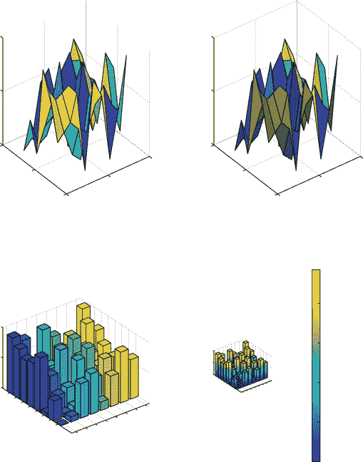
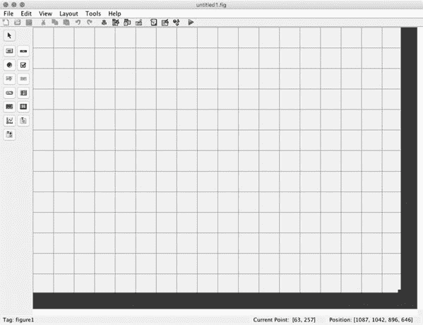
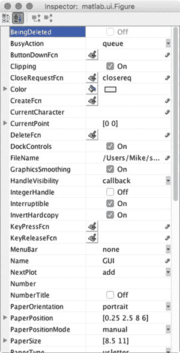
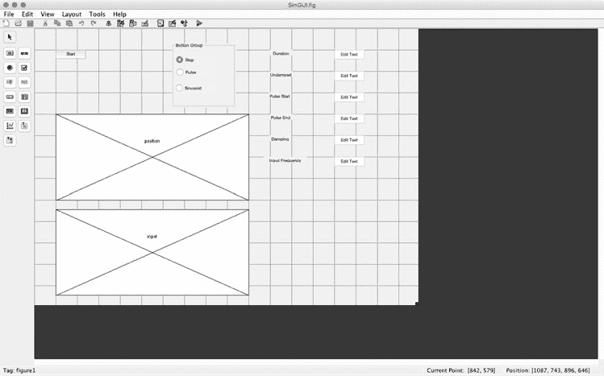
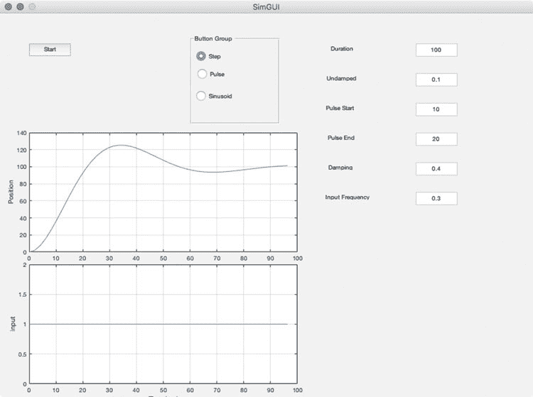
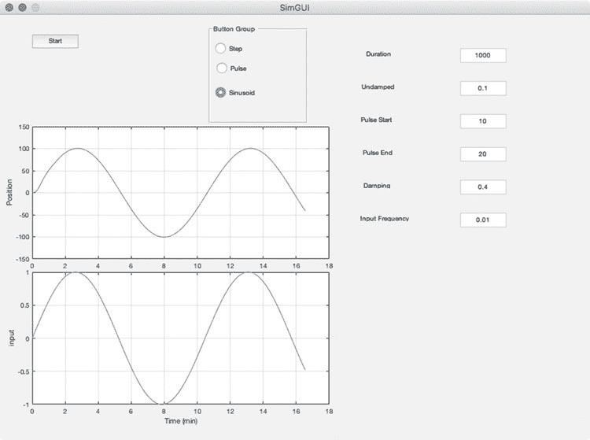
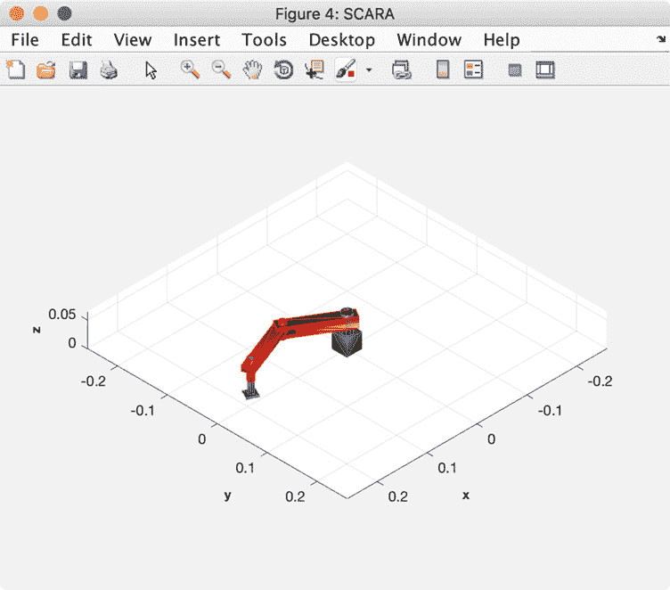

# 第 3 章 MATLAB 图形

机器学习面临的一个问题在于理解算法以及算法为何做出特定决策。此外，你还希望能够轻松理解这些决策。`MATLAB` 拥有丰富的图形工具，可用于实现这一目的。

绘图在机器学习问题中被广泛使用。`MATLAB` 的绘图可以是二维或三维的。`MATLAB` 还提供了多种绘图类型，例如`线图`、`条形图`和`饼图`。不同类型的绘图更适合传达特定类型的数据。`MATLAB` 还具备强大的曲面和等高线绘图能力，能够以易于理解的方式显示复杂数据。另一个功能是三维建模。你可以绘制动画对象，例如机器人或汽车。当你的机器学习涉及仿真时，这些功能尤其有价值。

`MATLAB` 图形的一个重要部分是图形用户界面（`GUI`）的构建。`MATLAB` 拥有丰富的 `GUI` 制作工具。这些工具是让你的设计工具或机器学习系统易于用户操作的一种宝贵方式。本章将介绍 `MATLAB` 中多种多样的图形工具。它们应能让你为自己的应用充分利用 `MATLAB` 的图形功能。

## 3.1 二维线图

### 3.1.1 问题

你希望用一个函数来生成二维线图，避免为生成每个图形编写一长串代码。

### 3.1.2 解决方案

编写一个函数，接收数据以及 *参数对*，以封装 `MATLAB` 二维线图函数的功能。图 3.1 展示了一个用单行代码创建的绘图示例。

© Michael Paluszek 和 Stephanie Thomas 2019
M. Paluszek 和 S. Thomas， *MATLAB 机器学习秘籍*，
[`doi.org/10.1007/978-1-4842-3916-2_3`](https://doi.org/10.1007/978-1-4842-3916-2_3)


**图 3.1：** `PlotSet` 的内置演示。

### 3.1.3 工作原理

`PlotSet` 生成二维图，包括在一页上显示多个图。

```matlab
function h = PlotSet( x, y, varargin )
```

这段代码将 `varargin` 作为参数对进行处理以设置选项。一个参数对包含两个输入。第一个是值的名称，第二个是值。例如，用于标记 x 轴的参数对是：`'x label','Time (s)'`。

`varargin` 使得扩展绘图选项变得容易。核心函数代码如下所示。我们为 *x* 和 *y* 轴标签以及图形名称提供了默认值。参数对在 `switch` 语句中处理。以下代码是当所有图只有一个 x 轴标签时的分支。它根据 `plotSet` 中的数据（一个元胞数组）来排列图形。

```matlab
for k = 1:m
    subplot(m,nCol,k);
    j = plotSet{k};
    for i = 1:length(j)
        plotXY(x,y(j(i),:),plotType);
        hold on
    end
```

 ... 

```matlab
hold off
xlabel(xLabel{1});
ylabel(yLabel{k});
if( length(plotTitle) == 1 )
    title(plotTitle{1})
else
    title(plotTitle{k})
end
if( ˜isempty(leg{k}) )
    legend(leg{k});
end
grid on
end
```

绘图操作是在名为 `plotXY` 的子函数中完成的。在这里，你可以看到所有熟悉的 `MATLAB` 绘图函数调用。

```matlab
function plotXY(x,y, type)
    switch type
        case 'plot'
            plot(x,y);
        case {'log' 'loglog' 'log log'}
            loglog(x,y);
        case {'xlog' 'semilogx' 'x log'}
            semilogx(x,y);
        case {'ylog' 'semilogy' 'y log'}
            semilogy(x,y);
        otherwise
            error('%s 不是可用的绘图类型', type);
    end
```

图 3.1 中的示例是由 `PlotSet` 函数末尾的一个专用演示函数生成的。该演示展示了该函数的几个特性，包括：1. 每张图的多条曲线；2. 图例；3. 图标题；4. 默认坐标轴标签。

使用专用的演示子函数是一种为函数提供内置示例的简洁方式，并且在图形函数中提供典型绘图的示例尤为重要。代码如下所示。

```matlab
function Demo
x = linspace(1,1000);
y = [sin(0.01*x); cos(0.01*x); cos(0.03*x)];
disp('PlotSet: 一个 x 和两个 y 行')
```

 ... 

## 3.2 通用二维图形

### 3.2.1 问题

你希望以不同的方式表示二维数据集。线图非常有用，但有时以不同形式可视化数据会更简单。`MATLAB` 提供了许多用于二维图形显示的函数。

### 3.2.2 解决方案

# 编写一个脚本来展示 MATLAB 不同的二维绘图类型

在我们的示例中，我们在一个图形中使用子图来帮助减少图形数量。

## 3.2.3 工作原理

使用 `NewFigure` 函数创建一个带有合适名称的新图形窗口。然后运行以下脚本。

```
>> NewFigure('我的图形名称')
```

`ans` =

Figure (1: 我的图形名称) 具有以下属性:

*   Number: 1
*   Name: '我的图形名称'
*   Color: [0.9400 0.9400 0.9400]
*   Position: [560 528 560 420]
*   Units: 'pixels'

显示所有属性

```
subplot(4,1,1);
plot(x,y);

subplot(4,1,2);
bar(x,y);

subplot(4,1,3);
barh(x,y);

ax4 = subplot(4,1,4);
pie(y)

colormap(ax4,'gray')
```

这里展示了四种有助于显示二维数据的绘图类型。第一种是二维线图，与 `PlotSet` 中使用的相同。中间两种是条形图。最后一种是饼图。每种类型都能让你对数据有不同的洞察。图 3.2 展示了这些绘图类型。

有许多 MATLAB 函数可以让这些图更具信息性。你可以：

*   添加标签
*   添加网格


**图 3.2：** 四种不同类型的 MATLAB 二维图。

0.5
0.5
0.1
0.2
0.3
0.4
0.5
0.6
0.7
0.8
0.9

10% 9%
2%
2%
5%
21%
19%
3%
11%
18%

*   更改字体类型和大小
*   更改线条粗细
*   添加图例
*   更改坐标轴范围

最后一项需要查看坐标轴的属性。以下是最后一个图的属性——列表非常长！`gca` 是当前坐标轴的句柄。`get(gca)` 会返回一个巨大的列表，我们在此不打印。其中每一个属性都可以通过使用 `set` 函数来更改：

```
set(gca,'YMinorGrid','on','YGrid','on')
```

这与 `PlotSet` 一样使用参数对。在此列表中，`children` 是指向坐标轴子对象的指针。你可以使用 `get` 访问它们，并使用 `set` 更改它们的属性。任何添加到坐标轴上的项目，例如坐标轴标签、标题、线条或其他图形对象，都是该坐标轴的子对象。


## 3.3 自定义二维图表

### 3.3.1 问题

许多机器学习算法受益于二维图表（例如树状图），以帮助用户理解结果和软件的操作。由软件自动生成的此类图表在许多类型的学习系统中都很有用。本节给出了如何为树状图编写 MATLAB 代码的示例。

### 3.3.2 解决方案

我们的解决方案是使用 MATLAB 的 `patch` 函数自动生成块，并使用 `line` 函数在 `TreeDiagram` 函数中生成连接线。图 3.3 显示了生成的层次树状图。圆圈按行排列，每行都有标签。

### 3.3.3 工作原理

树状图对于机器学习非常有用。此函数生成一个层次树状图，节点为圆圈，每个节点内包含文本。此函数中使用的图形函数是：

1.  `line`
2.  `patch`
3.  `text`

绘制树所需的数据包含在一个数据结构中，该结构在头部有文档说明。每个节点都有一个父节点字段。这些信息足以建立连接。

节点数据以元胞数组的形式输入。

**图 3.3：** 一个自定义树状图。

第 1 行
第 2 行
第 3 行
第 4 行


该函数使用一个图形句柄作为持久变量，以便在需要时可以通过后续调用更新同一个图形。

```
if( ˜update )
    figHandle = NewFigure(w.name);
else
    clf(figHandle)
end
```

核心绘图代码位于 `DrawNode` 中，它绘制方框；以及 `ConnectNode` 中，它用线条连接节点。我们的节点是带有 20 个线段的圆。`linspace` 代码确保 0 和 2 *π* 都不在角度列表中。

```
function [xC,yCT,yCB] = DrawNode( x0, y0, k, w )
    n = 20;
    a = linspace(0,2*pi*(1-1/n),n);
    x = w.width*cos(a)/2 + x0;
    y = w.width*sin(a)/2 + y0;
    patch(x,y,'w');
    text(x0,y0, sprintf('%d',k),'fontname',w.fontName,'fontsize',w.fontSize,'horizontalalignment','center');
    xC = x0;
    yCT = y0 + w.width/2;
    yCB = y0 - w.width/2;
```

```
%% TreeDiagram>ConnectNode
function ConnectNode( n, nP, w )
    x = [n.xC nP.xC];
    y = [n.yCT nP.yCB];
    line(x,y,'linewidth',w.linewidth,'color',w.linecolor);
```

`TreeDiagram` 中的内置演示。

## 3.4 三维方框

三维图形有两大类。一类是绘制物体，比如地球。另一类是绘制大型数据集。本小节以及下一小节将向你展示如何实现这两种情况。


### 3.4.1 问题

我们希望绘制一个三维方框。

### 3.4.2 解决方案

`Box3` 函数使用 `patch` 函数来绘制该物体。图 3.4 显示了一个示例。

### 3.4.3 工作原理

三维物体由顶点和面构成。顶点是空间中的一个点。你需要创建一个顶点列表，这些顶点是三维物体的角点。然后创建面，面是顶点的列表。有两个顶点的面是一条线，有三个顶点的面是一个三角形。多边形可以有任意数量的顶点。然而，在底层，图形处理器处理的是三角形，因此最好将所有面片都做成三角形。你会注意到法线

**图 3.4：** 一个用面片绘制的盒子。

1.5
0.5
**z**
-0.5
-1.5

0.5
0.5
-0.5
**y**
-0.5
**x**


**图 3.5：** 一个面片。法线朝向相机或物体的“外部”。

法线向量。这是向外指向的向量。面片中的顶点应按照右手定则排序，也就是说，如果法线方向是你的拇指方向，那么面的顺序就是你的手指弯曲的方向。在此图中，两个三角形的顺序应为：

*   `[3 2 1]`
*   `[1 4 3]`

MATLAB 的光照对顶点顺序要求并不严格，但如果你要导出模型，则需要遵循此约定。否则，你最终可能会得到内外颠倒的物体！

以下代码创建了一个由三角形面片组成的盒子。面和顶点数组是手动创建的。顶点每行一个，因此顶点数组是 n 行 3 列。面数组是 n 行 m 列，其中 m 是每个面最多拥有的顶点数。在 `Box` 函数中，我们只处理三角形。

> 所有图形处理器最终都会绘制三角形，因此，如果可能，最好只使用三角形来创建物体。

```
function [v, f] = Box( x, y, z )
    % 演示
    if( nargin < 1 )
        Demo
        return
    end
    % 面
    f = [2 3 6;3 7 6;3 4 8;3 8 7;4 5 8;4 1 5;2 6 5;2 5 1;1 3 2;1 4 3;5 6 7;5 7 8];
```

## 3.5 绘制带纹理的三维物体

### 3.5.1 问题
我们想要绘制一个带纹理的行星。

### 3.5.2 解决方案
使用曲面并在曲面上叠加纹理。图 3.6 展示了一个使用 `Globe` 函数绘制冥王星近期图像的示例。

```matlab
>> Globe

ans =

  Figure (2: Globe) with properties:

              Number: 2
                Name: 'Globe'
               Color: [0.9400 0.9400 0.9400]
            Position: [560 528 560 420]
              Units: 'pixels'

  显示 所有 属性
```


**图 3.6：** 冥王星的三维球体。

### 3.5.3 工作原理
我们首先生成球面上的 *x, y, z* 点，然后叠加从图像文件中读取的纹理，从而生成图片。可以使用 `imread` 从文件中读取纹理贴图。

如果是彩色图像，它将是一个三维矩阵。第三个元素是颜色索引，对应红色、蓝色或绿色。但是，如果是灰度图像，则必须通过复制图像来创建三维的“颜色”矩阵。

```matlab
p = imread('PlutoGray.png');
p3(:,:,1) = p;
p3(:,:,2) = p;
p3(:,:,3) = p;
```

起始点 `p` 是一个二维矩阵。

首先，你使用由 `sphere` 函数生成的坐标来创建曲面。

这一步通过 `surface` 函数完成。然后，你应用纹理：


```matlab
for i = 1:3
  planetMap(:,:,i) = flipud(planetMap(:,:,i));
end

set(hSurf,'Cdata',planetMap,'Facecolor','texturemap');
set(hSurf,'edgecolor', 'none',...
          'EdgeLighting', 'phong','FaceLighting', 'phong',...
          'specularStrength',0.1,'diffuseStrength',0.9,...
          'SpecularExponent',0.5,'ambientStrength',0.2,...
          'BackFaceLighting','unlit');
```

`flipud` 使地图看起来“正常”。Phong 是一种光照类型。它获取顶点处的颜色，并基于插值后的法线，在多边形上的像素点处插值颜色。Diffuse 和 specular 指的是不同类型的光反射。当你将纹理应用到曲面时，它们并不太重要。

## 3.6 通用 3D 图形

### 3.6.1 问题
我们想使用 3D 图形来研究一个 2D 数据集。一个 2D 数据集是一个矩阵，或者说是一个 `n` 行 `m` 列的数组。

### 3.6.2 解决方案
使用 MATLAB 的 `surface`、`mesh`、`bar` 和 `contour` 函数。`TwoDDataDisplay` 给出了一个随机数据集的示例，其不同可视化效果展示在图 3.7 中。

### 3.6.3 工作原理
我们使用 `rand` 生成一个 8x8 的随机 2D 数据集。我们在一个带有子图的图形窗口中，以多种方式显示它。在这个例子中，我们创建了两行三列的子图。图 3.7 展示了六种类型的 2D 图。`surf`、`mesh` 和 `surfl`（带光照的 3D 着色曲面）非常相似。当应用光照时，曲面图会更有趣。两个 `bar3` 图展示了为条形着色的不同方式。在第二个条形图中，颜色随长度变化。这需要一些代码来更改 `CData` 和 `FaceColor`。





**图 3.7：** 使用六种不同绘图类型显示的二维数据。

```matlab
m = rand(8,8);
h = NewFigure('二维数据');
colormap(h,'gray')

subplot(2,3,1)
surf(m)
title('surf')

subplot(2,3,2)
surfl(m,'light')
title('surfl')

subplot(2,3,3)
mesh(m)
title('mesh')

subplot(2,3,4)
bar3(m)
title('bar3')

subplot(2,3,5)
h = bar3(m);
title('bar3')
colorbar

for k = 1:length(h)
    
    
    zdata = h(k).ZData;
    h(k).CData = zdata;
    h(k).FaceColor = 'interp';
end

subplot(2,3,6)
contour(m);
title('contour')
```

## 3.7 构建 GUI

### 3.7.1 问题
我们想要一个 GUI 来为二阶系统仿真提供图形界面。

### 3.7.2 解决方案
我们将使用 MATLAB 的 GUIDE 来构建一个 GUI，该 GUI 允许我们：
1. 设置阻尼常数
2. 设置仿真的结束时间
3. 设置输入类型（脉冲、阶跃或正弦波）
4. 显示输入和输出图

### 3.7.3 工作原理
我们想要构建一个 GUI 来与下面所示的 `SecondOrderSystemSim` 交互。`SecondOrderSystemSim` 的第一部分是在一个循环中的仿真代码。

```matlab
omega = max([d.omega d.omegaU]);       % 仿真的最大频率
dT = 0.1*2*pi/omega;                   % 从频率获取时间步长
n = floor(d.tEnd/dT);                  % 获取整数步数
xP = zeros(2,n);                       % 设置绘图数组大小
x = [0;0];                             % [位置;速度] 的初始条件
t = 0;                                 % 初始时间

for k = 1:n
    [~,u] = RHS(t,x,d);
```

# 第 3 章 MATLAB 图形

## 图 3.8：二阶系统仿真

```matlab
xP(:,k) = [x(1);u];

x = RungeKutta( @RHS, t, x, dT, d );

t = t + dT;

end
```


图 3.8 显示了结果。
*   x
*   时间（秒）: -20 0
*   u
*   时间（秒）: 0.8, 0.6, 0.4, 0.2, 0 0

运行后得到图 3.8 所示的图形。绘图代码如下：

```matlab
[t,tL] = TimeLabel((0:n-1)*dT);
if( nargout == 0 )
    PlotSet(t,xP,'x label',tL,'y label', {'x' 'u'}, 'figure title','Filter');
end
```

`TimeLabel` 会根据仿真时长生成合理的时间单位，并自动重新缩放时间向量。该函数内置了仿真循环。

MATLAB 的 GUI 构建系统 GUIDE 通过在命令行输入 `guide` 来启动。我们使用的是 MATLAB R2018a 版本。您的版本可能存在细微差异。

GUI 模板有多种选择，也可以选择空白 GUI。我们将从空白 GUI 开始。首先，根据上述所需功能列表，列出我们将需要的控件：

*   用于输入以下内容的编辑框：
    *   仿真时长
    *   阻尼比
    *   无阻尼自然频率
    *   正弦输入频率
    *   脉冲开始和结束时间




## 图 3.9：空白 GUI

*   用于选择输入类型的单选按钮
*   用于启动仿真的运行按钮
*   绘图坐标轴

我们在命令窗口中输入“guide”，系统会提示我们选择现有 GUI 或创建新 GUI。我们选择空白 GUI。图 3.9 显示了在 GUIDE 中尚未进行任何修改时的模板 GUI。您可以通过从左侧的表格中拖放来添加元素。

图 3.10 显示了 GUI 检查器。您可以在此处编辑 GUI 元素。可以看到这些元素具有许多属性。我们不打算将这个 GUI 做得非常精美，但稍加努力，您就能让它成为一件艺术品。我们将要修改的是标签（tag）和文本（text）属性。标签为软件提供了一个内部使用的名称。文本则是在设备上显示的内容。

然后，我们通过拖放添加所有所需的元素。我们选择将 GUI 命名为“GUI”。生成的初始 GUI 如图 3.11 所示。在每个元素的检查器中，您会看到一个“标签”字段。将诸如 `edit1` 之类的名称更改为您容易识别的名称。当您保存它们并从 `.fig` 文件运行 GUI 时，`GUI.m` 中的代码将自动更改。

我们创建一个单选按钮组并添加单选按钮。这样可以处理除所选单选按钮之外的所有按钮的禁用。当您点击布局框中的绿色箭头时，它会将所有更改保存到 m 文件中并进行仿真。如果有错误，它会发出警告。




## 图 3.10：GUI 检查器

至此，我们可以开始编写 GUI 代码本身了。模板 GUI 将其数据（根据用户在编辑框中输入的数据计算得出）存储在一个名为 `simdata` 的字段中。自动生成的代码位于 `SimGUI` 中。

当 GUI 加载时，我们使用默认数据结构中的数据初始化文本字段。确保初始化内容与 GUI 中显示的内容一致。您需要小心处理单选按钮和按钮状态。

```matlab
function SimGUI_OpeningFcn(hObject, eventdata, handles, varargin)
    % 为 SimGUI 选择默认命令行输出
    handles.output = hObject;

    % 获取默认数据
    handles.simData = SecondOrderSystemSim;

    % 设置默认状态
    set(handles.editDuration,'string', num2str(handles.simData.tEnd));
    set(handles.editUndamped,'string', num2str(handles.simData.omega));
    set(handles.editPulseStart,'string', num2str(handles.simData.tPulseBegin));

    
    
    
    

## 图 3.11：添加所有元素后，编辑窗口中的 GUI 快照

    set(handles.editPulseEnd,'string', num2str(handles.simData.tPulseEnd));
    set(handles.editDamping,'string', num2str(handles.simData.zeta));
    set(handles.editInputFrequency,'string', num2str(handles.simData.omegaU));

    % 更新 handles 结构体
    guidata(hObject, handles);
```

当按下启动按钮时，我们运行仿真并绘制结果。这本质上与二阶仿真中的演示代码相同。

```matlab
function start_Callback(hObject, eventdata, handles)
    [xP, t, tL] = SecondOrderSystemSim(handles.simData);

    axes(handles.position)
    plot(t,xP(1,:));
    ylabel('位置')
    grid

    axes(handles.input)
    plot(t,xP(2,:));
    xlabel(tL);
    ylabel('输入');
    grid

    
    
    
    

## 图 3.12：仿真中的 GUI 快照
```

编辑框的回调函数需要少量代码来设置存储数据中的数据。所有数据都存储在 GUI 的 handles 中。必须调用 `guidata` 来将新数据存储到 handles 中。

```matlab
function editDuration_Callback(hObject, eventdata, handles)
    handles.simData.tEnd = str2double(get(hObject,'String'));
    guidata(hObject, handles);
```

图 3.12 展示了一次仿真。GUI 中的另一次仿真如图 3.13 所示。




## 图 3.13：仿真中的 GUI 快照

## 3.8 为条形图添加动画效果

二维数组通常是机器学习算法的一部分。当它们动态变化时，我们希望为显示添加动画效果。

### 3.8.1 问题

我们想要为一个 3D 条形图添加动画效果。

### 3.8.2 解决方案

我们将编写代码来为 MATLAB 的 `bar3` 函数添加动画效果。

### 3.8.3 工作原理

我们的 `Bar3D` 函数将使用 `bar3` 设置图形，然后替换条形长度的值。这比听起来要棘手。

以下是 `bar3` 的一个示例。我们使用句柄来获取 z 数据。

```matlab
>> m = [1 2 3;4 5 6];
>> h = bar3(m);
>> z = get(h(1),'zdata')
z =
   NaN
   NaN
```


NaN

NaN

NaN

NaN

NaN

NaN

NaN

NaN

NaN

NaN

NaN

NaN

NaN

NaN

NaN

NaN

NaN

NaN

我们看到数组中的每一列。我们需要替换 `m` 中每个数字对应的所有四个值。查看 `h`。它的长度为 3。`m` 中的每一列都有一个曲面数据结构。

```
>> h

h =

1x3 曲面数组：

曲面

曲面

曲面
```

图 3.14 显示了该条形图。

代码如下所示。我们有两个操作：`initialize`（初始化），用于创建图形，以及 `update`（更新），用于更新 `z` 值。幸运的是，`z` 值总是在相同的位置，因此替换它们并不太难。`colorbar` 绘制了图 3.15 右侧所示的颜色条。

我们使用 `persistent` 来存储 `bar3` 的句柄。

```
function Bar3D(action,v,xL,yL,zL,t)

if( nargin < 1 )

Demo

return

end

persistent h

switch lower(action)

case 'initialize'

NewFigure('3D 条形图动画');

h = bar3(v);

colorbar

xlabel(xL)

xlabel(yL)

xlabel(zL)

title(t);

view(3)

rotate3d on

case 'update'

nRows = length(h);

for i = 1:nRows

z = get(h(i),'zdata');

n = size(v,1);

j = 2;

for k = 1:n

z(j, 2) = v(k,i);

z(j, 3) = v(k,i);

z(j+1,2) = v(k,i);

z(j+1,3) = v(k,i);

j = j + 6;

end

set(h(i),'zdata',z);

end

end
```


**图 3.15：** 两行三列的条形图及动画结束状态。

**Bar3D 动画**

0.5

-0.5

Z

动画结束时的图形如图 3.15 所示。

## 3.9 绘制机器人

本节展示了编写图形代码以绘制机器人的要素。如果你正在进行涉及人类或机器人的机器学习，这段代码会很有用。我们将展示如何让机器人手臂动起来。

### 3.9.1 问题

我们希望让一个机器人手臂动起来。

### 3.9.2 解决方案

我们编写代码来创建顶点和面，以供 MATLAB 的 `patch` 函数使用。

### 3.9.3 工作原理

`DrawSCARA` 函数用于绘制并动画化一个机器人。代码的第一部分实际上只是通过一个 `switch` 语句来组织函数的操作。

```
switch( lower(action) )

case 'defaults'

m = Defaults;

case 'initialize'

if( nargin < 2 )

d = Defaults;

else

d = x;

end

p = Initialize( d );

case 'update'

if( nargout == 1 )

m = Update( p, x );

else

Update( p, x );

end

end
```


第 3 章 MATLAB 图形

`Initialize` 函数使用 `Box`、`Frustrum` 和 `UChannel` 函数来创建顶点和面。编写这些函数很繁琐，并且是特定于几何形状的。不过，你可以将它们应用于各种问题。你应该注意，它会存储这些面片，这样我们在动画化手臂时只需传入新的顶点。“新”顶点只是手臂顶点经过旋转和平移后的结果，以匹配手臂的位置。手臂本身不会变形。

我们按正确的顺序进行计算，以便变换能够沿着链条向上/向下传递，从而让所有部件正确运动。

`Update` 函数通过计算新的顶点并将其传递给面片来更新手臂位置。`drawnow` 用于绘制手臂。我们也可以保存这些帧，然后使用 MATLAB 的电影函数来制作动画。

```
function m = Update( p, x )

for k = 1:size(x,2)

% 连杆 1

c = cos(x(1,k));

s = sin(x(1,k));

b1 = [c -s 0;s c 0;0 0 1];

v = (b1*p.v1')';

set(p.link1,'vertices',v);

% 连杆 2

r2 = b1*[p.a1;0;0];

c = cos(x(2,k));

s = sin(x(2,k));

b2 = [c -s 0;s c 0;0 0 1];

v = (b2*b1*p.v2')';

v(:,1) = v(:,1) + r2(1);

v(:,2) = v(:,2) + r2(2);

set(p.link2,'vertices',v);

% 连杆 3

r3 = b2*b1*[p.r3;0;0] + r2;

v = p.v3;

v(:,1) = v(:,1) + r3(1);

v(:,2) = v(:,2) + r3(2);

v(:,3) = v(:,3) + x(3,k);

set(p.link3,'vertices',v);

% 连杆 4

c = cos(x(4,k));

s = sin(x(4,k));

b4 = [c -s 0;s c 0;0 0 1];

v = (b4*b2*b1*p.v4')';

r4 = b2*b1*[p.r4;0;0] + r2;

v(:,1) = v(:,1) + r4(1);

v(:,2) = v(:,2) + r4(2);

v(:,3) = v(:,3) + x(3,k);

set(p.link4,'vertices',v);

if( nargout > 0 )

m(k) = getframe;

else

drawnow;

end

end
```


第 3 章 MATLAB 图形

演示中的 SCARA 机器人手臂最终如图 3.16 所示。演示代码可以用手臂动力学仿真来替代。在这个例子中，我们选择角速率并生成一个角度数组。请注意，这个备用的演示函数根本不需要是内置的演示函数。同样的代码块可以直接在命令行中执行。




第 3 章 MATLAB 图形

**图 3.16：** 由 `DrawSCARA` 生成的机器人手臂。

```
function Demo

DrawSCARA( 'initialize' );

t = linspace(0,100);

omega1 = 0.1;

omega2 = 0.2;

omega3 = 0.3;

omega4 = 0.4;

x = [sin(omega1*t); sin(omega2*t);0.01*sin(omega3*t); sin(omega4*t)];

DrawSCARA( 'update', x );
```


### 3.10 本章小结

本章演示了有助于理解机器学习软件结果的图形。展示了二维和三维图形。本章还介绍了如何构建图形用户界面以帮助自动化功能。表 3.1 列出了随附代码中包含的函数和脚本。

**表 3.1：** 章节代码清单

| **文件** | **描述** |
| :--- | :--- |
| `Bar3D` | 三维条形图 |
| `Box` | 绘制一个方框。 |
| `DrawSCARA` | 绘制一个机械臂。 |
| `DrawVertices` | 绘制一组顶点和面。 |
| `Frustrum` | 绘制一个平截头体（顶部被切掉的圆锥体） |
| `Globe` | 绘制一个纹理映射的地球仪。 |
| `PlotSet` | 二维线图。 |
| `SecondOrderSystemSim` | 模拟一个二阶系统。 |
| `SimGUI` | 仿真图形用户界面的代码。 |
| `SimGUI.fig` | 图形文件。 |
| `SurfaceOfRevolution` | 绘制一个旋转曲面 |
| `TreeDiagram` | 绘制一个树状图。 |
| `TwoDDataDisplay` | 一个用于在三维图形中显示二维数据的脚本。 |
| `UChannel` | 绘制一个 U 形通道 |


