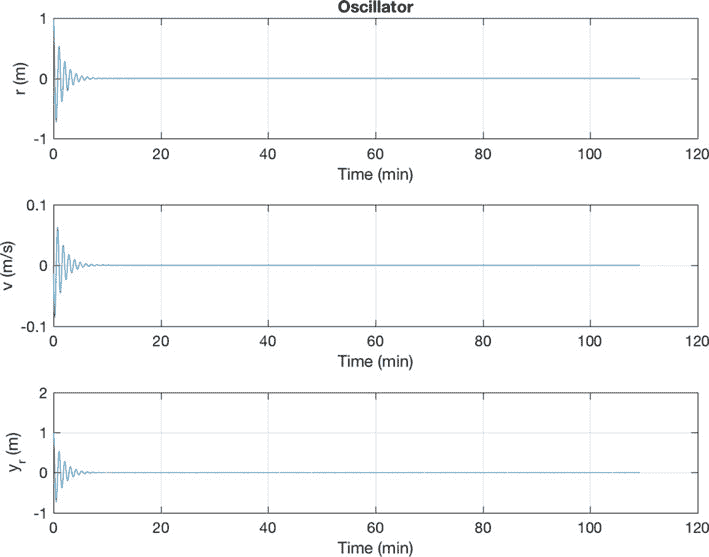
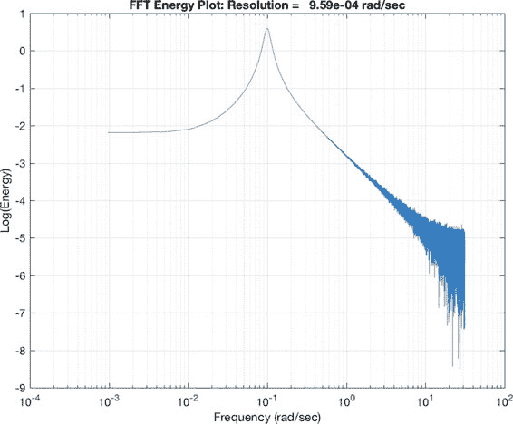
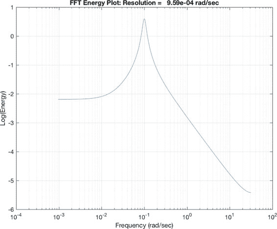
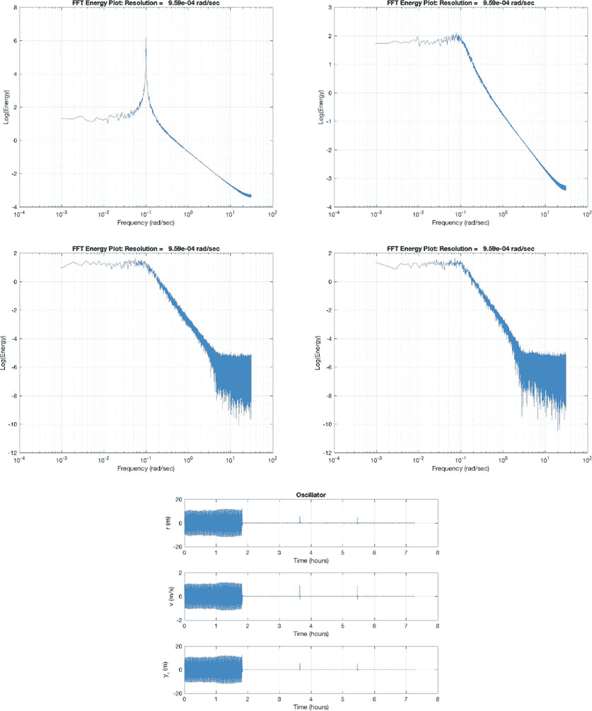

# 第 5 章 自适应控制

控制系统需要以可预测且可重复的方式对环境做出反应。控制系统进行测量，并利用这些测量结果来控制过程。例如，船舶测量其航向，并改变舵角以达到期望航向。

自主

学习

机器

控制

学习

智能

通常，控制系统的设计和实现会将所有参数硬编码到软件中。这在大多数情况下效果很好，尤其是在设计过程中对系统非常了解的情况下。当系统定义不明确，或预计在运行过程中会发生显著变化时，可能有必要实施学习控制。例如，电动汽车中的电池会随着时间的推移而退化，这会导致续航里程减少。

自动驾驶系统需要学习到续航里程正在减少。这可以通过将行驶距离与电池荷电状态进行比较来实现。更剧烈、更突然的变化可能会改变系统。例如，在飞机上，大气数据系统可能因传感器故障而失效。如果 `GPS` 仍在运行，飞机将希望切换到仅使用 `GPS` 的系统。在多输入多输出控制系统中，某个分支可能因执行器或传感器故障而失效。在这种情况下，系统可能必须修改运行分支。

学习和自适应控制通常可以互换使用。在本章中，您将学习针对不同系统的多种自适应控制技术。每种技术都应用于不同的系统，但通常都适用于任何控制系统。

图 5.1 提供了自适应控制和学习控制的分类。路径取决于动态系统的性质。最右边的分支是调谐。这是设计人员在测试过程中会做的事情，但也可以自动完成，如下所述。

© Michael Paluszek 和 Stephanie Thomas 2019

M. Paluszek 和 S. Thomas，*MATLAB 机器学习秘籍*，

[`doi.org/10.1007/978-1-4842-3916-2_5`](https://doi.org/10.1007/978-1-4842-3916-2_5)


**图 5.1：** 自适应控制或学习控制的分类。

待控

动态系统

恒定

时变

参数

参数

已知

未知

已知

未知

数值

数值

变化

变化

离线

离线

离线

离线

迭代

离线

控制系统

控制系统

控制系统

控制系统

控制系统

自主

调谐

控制系统

设计

设计

设计

设计

带学习的设计

设计

在线更新

恒定

增益调度

自动更新

控制系统

控制系统

控制系统

参数

参数

参数

自整定

## 方案 5.1.

接下来的路径适用于随时间变化的系统。我们第一个关于时变参数系统的例子，是对一个旋转轮应用`模型参考自适应控制`。这在章节 5.3.中讨论。

下一个例子是关于船舶控制。你的目标是控制航向角。船舶的动力学特性是其前进速度的函数。虽然这并非真正从经验中学习，但它确实基于环境信息进行自适应。

最后一个例子是一个具有可变惯性的航天器。这展示了一个非常简单的参数估计。

## 5.1 自整定：振荡器建模

我们希望调整一个阻尼器，以便对一个弹簧常数变化的弹簧系统进行临界阻尼。我们的系统将通过给无阻尼弹簧施加一个阶跃扰动，并使用快速傅里叶变换测量频率来工作。然后我们利用该频率计算阻尼，并将一个阻尼器添加到仿真中。接着我们再次测量无阻尼固有频率，以确认其是正确的值。最后，我们将阻尼比设为 1 并观察响应。该系统如图 5.2.所示。


**图 5.2：** 弹簧-质量-阻尼器系统。质量块在右侧。弹簧在质量块左上方。阻尼器在下方。`F` 是外力，`m` 是质量，`k` 是刚度，`c` 是阻尼。

`k`

`m`

`F`

`c`

`r`

在第 4 章中，我们在卡尔曼滤波的背景下介绍了参数辨识，这是寻找频率的另一种方法。这里的方法是收集大量数据样本，并对其进行批量处理以找到固有频率。该系统的方程如下：

`˙ r` = `v` (5.1)

`m ˙ v` = `−cv − kr` (5.2)

`c` 是阻尼，`k` 是刚度。阻尼项导致速度趋于零。刚度项限制了运动范围（除非阻尼为负）。符号上方的点表示对时间的一阶导数，即：

`dr`

`˙ r` = (5.3)

`dt`

这些方程表明，位置随时间的变化率是速度，质量乘以速度随时间的变化率等于一个与速度和位置成比例的力。第二个方程是牛顿定律：

`F` = `ma` (5.4)

其中 `F` 是力，`m` 是质量，`a` 是加速度。

**提示**

重量是质量乘以重力加速度。

`F` = `−cv − kr` (5.5)

`dv`

`a` = (5.6)

`dt`


## 5.2 自整定：调谐振荡器

### 5.2.1 问题

我们希望识别振荡器的频率，并将控制系统调谐到该频率。

### 5.2.2 解决方案

解决方案是让控制系统测量弹簧的频率。我们将使用 `FFT` 来识别振荡频率。

### 5.2.3 工作原理

以下脚本展示了 `FFT` 如何识别阻尼振荡器的振荡频率。

该函数在以下代码中展示。我们使用 `RHSOscillator` 动力学模型作为系统模型。我们从一个小初始位置开始，使其振荡。我们还设置了一个小的阻尼比，以便振荡会衰减。频谱的分辨率取决于样本数量：

`2 *π`

`r` = (5.7)

`nT`

其中 `n` 是样本数量，`T` 是采样周期。最大频率为：`nr`

`ω` = (5.8)

以下展示了仿真循环和 `FFTEnergy` 调用。

```
%% 初始化
nSim    = 2^16;          % 时间步数
dT      = 0.1;           % 时间步长（秒）
dRHS    = RHSOscillator; % 获取默认数据结构
dRHS.omega = 0.1;        % 振荡器频率
dRHS.zeta  = 0.1;        % 阻尼比
x       = [1;0];         % 初始状态 [位置;速度]
y1Sigma = 0.000;         % 1 西格玛位置测量噪声
%% 仿真
xPlot = zeros(3,nSim);
for k = 1:nSim
    % 测量值
    y       = x(1) + y1Sigma*randn;
    % 绘图存储
    xPlot(:,k) = [x;y];
    % 传播（数值积分）状态方程
    x       = RungeKutta( @RHSOscillator, 0, x, dT, dRHS );
end
```


`FFTEnergy` 如下所示。

```
function [e, w, wP] = FFTEnergy( y, tSamp, aPeak )
if( nargin < 3 )
    aPeak = 0.95;
end
n = size( y, 2 );
% 如果输入向量长度为奇数，则丢弃一个样本
if( 2*floor(n/2) ~= n )
    n = n - 1;
    y = y(1:n,:);
end
x   = fft(y);
e   = real(x.*conj(x))/n;
hN  = n/2;
e   = e(1,1:hN);
r   = 2*pi/(n*tSamp);
w   = r*(0:(hN-1));
if( nargin > 1 )
    k   = find( e > aPeak*max(e) );
    wP  = w(k);
end
```

`FFT` 对采样的时间序列进行处理，并计算其频谱。我们使用 MATLAB 的 `fft` 函数来计算 `FFT`。将结果与其共轭相乘，即可得到能量。结果的前半部分包含频率信息。`aPeak` 用于指示输出的峰值。它只是寻找大于某个阈值的值。

图 5.3 展示了阻尼振荡。图 5.4 展示了频谱。我们通过搜索最大值来找到峰值。信号中的噪声在高频部分可见。

图 5.5 展示了一个无噪声的仿真。

调谐方法如下：
1.  用一个脉冲激励振荡器
2.  运行 `2 *n` * 步
3.  执行 `FFT`
4.  如果只有一个峰值，则计算阻尼增益

脚本 `TuningSim` 调用 `FFTEnergy.m`，并将 `aPeak` 设置为 0.7。`aPeak` 的值是通过查看图形并选取一个合适的数值来确定的。扰动是高斯分布的加速度，并且测量中存在噪声。







**图 5.3：** 阻尼振荡器的仿真。阻尼比 `ζ` 为 `0.5`，无阻尼固有频率 `ω` 为 `0.1` rad/s。

**图 5.4：** 频率频谱。峰值位于 `0.1` rad/s 的振荡频率处。




**图 5.5：** 无噪声的频率频谱。频谱峰值位于 `0.1` rad/s 处，与仿真结果一致。

命令窗口中的结果如下：

```
TuningSim
估计的振荡器频率
0.0997 rad/s
已调谐
已调谐
已调谐
```

从图 `5.6` 中的 FFT 图可以看出，由于传感器噪声和高斯扰动，频谱显得“嘈杂”。判断系统是否欠阻尼的标准是是否存在一个明显的峰值。如果噪声足够大，我们必须设置更低的阈值来触发调谐。左上角的 FFT 图显示了 `0.1` rad/s 的峰值。调谐后，我们充分阻尼了振荡器，使得峰值减小。图 `5.6` 中的时间图（底部图）显示系统最初是弱阻尼的。调谐后，其振荡非常小。每次在 `1.9`、`3.6` 和 `5.5` 秒调整调谐时，都会出现轻微的瞬态。FFT 图（右上角和中间两个）显示了调谐中使用的数据。

重要的一点是，我们必须激励系统以识别峰值。所有系统辨识、参数估计和调谐算法都有这个要求。脉冲（具有宽频谱）的替代方案是使用正弦扫频。

这将激发任何共振，并使峰值更容易识别。然而，在以不同频率激励物理系统时，必须小心谨慎，以确保其在固有频率下不会产生不安全或不稳定的响应。




**图 5.6：** 调谐仿真结果。前四个图是每个采样间隔结束时采集的频谱；最后一个图显示了随时间变化的结果。


## 5.3 实现模型参考自适应控制

我们的下一个示例是控制一个带有未知负载的转子，使其按期望的方式运行。旋转关节的动力学模型为 [[2]:](#index_split_007.html#p349)

`dω = −aω + bu` (5.9)
`dt`

`c + ud`

其中阻尼 `a` 和/或输入常数 `b` 是未知的。 `ω` 是角速率。 `uc` 是输入电压， `ud` 是扰动角加速度。这是一个一阶系统，由一个一阶微分方程建模。我们希望该系统表现得像参考模型：

`dω = −a` (5.10)
`dt` `mω + bmuc + ud`

**图 5.7：** 模型参考自适应控制演示中的转子速度控制。

### 5.3.1 问题

我们希望控制一个系统，使其表现得像一个特定的模型。我们的示例是一个简单的转子。

### 5.3.2 解决方案

解决方案是实现一个 `MRAC` 函数。

### 5.3.3 工作原理

其思想是拥有一个定义系统行为的动力学模型。您希望您的系统具有相同的动力学特性。这个期望的模型就是参考，因此得名模型参考自适应控制。我们将使用 MIT 规则 [[3]](#index_split_007.html#p349) 来设计自适应系统。MIT 规则最初由麻省理工学院仪器实验室（现为 Draper 实验室）开发，该实验室曾为 NASA 阿波罗计划和航天飞机开发制导与控制系统。


考虑一个具有一个可调参数 `θ` 的闭环系统。 `θ` 是一个参数，不是角度。期望输出是 `ym`。误差为：

`e = y − ym` (5.11)

定义一个损失函数（或代价）为：

`J(θ) = e²` (5.12)

平方运算去除了符号。如果误差为零，则代价为零。我们希望最小化 `J(θ)`。为了使 `J` 变小，我们沿着 `J` 的负梯度方向改变参数，即：

`dθ = −γ ∂J = −γe` (5.13)
`dt ∂θ ∂θ`

这就是 MIT 规则。如果系统变化缓慢，那么我们可以假设在系统自适应过程中 `θ` 是常数。 `γ` 是自适应增益。我们的动力学模型是： `dω = aω + bu` (5.14)
`dt` `c`

我们希望它成为模型：

`dωm = a` (5.15)
`dt` `mωm + bmuc`

`a` 和 `b` 是实际的未知参数。 `am` 和 `bm` 是模型参数。我们希望 `a` 和 `b` 等于 `am` 和 `bm`。设我们转子的控制器为： `u = θ₁uc − θ₂ω` (5.16)

第二项提供阻尼。该控制器有两个自适应参数。如果它们被选择为：

`θ = bm / b` (5.17)
`θ = (am − a) / b` (5.18)

则系统与模型的输入-输出关系相同。这被称为完美模型跟随。这不是必需的。为了应用 MIT 规则，将误差写为： `e = ω − ωm` (5.19)

对于参数 `θ₁` 和 `θ₂`，系统为：

`dω = −(a + bθ₂)ω + bθ₁uc` (5.20)
`dt`


其中 `γ` 是自适应增益。为了继续实现，我们引入算子 `p = d`。然后我们写出：
`dt`

`pω = −(a + bθ₂)ω + bθ₁uc` (5.21)

或

`ω = bθ₁ / (p + a + bθ₂) * uc` (5.22)

我们需要求出误差关于 `θ₁` 和 `θ₂` 的偏导数。这些偏导数为：

`∂e / ∂θ₁ = b / (p + a + bθ₂) * uc` (5.23)

`∂e / ∂θ₂ = −b²θ₁ / (p + a + bθ₂)² * uc` (5.24)

这是根据微分的链式法则得出的。注意到：

`uc = (p + a + bθ₂) / (bθ₁) * ω` (5.25)

第二个方程变为：

`∂e / ∂θ₂ = b / (p + a + bθ₂) * y` (5.26)

由于我们不知道 `a`，我们假设我们已经非常接近它。那么令： `p + am ≈ p + a + bθ₂` (5.27)

我们的自适应律现在为：

`dθ₁ / dt = −γ * am / (p + am) * uc * e` (5.28)

`dθ₂ / dt = γ * am / (p + am) * ω * e` (5.29)

令：

`am / (p + am) * uc = xm`

## 5.4 生成方波输入

### 5.4.1 问题

我们需要生成一个方波来激励前一个配方中的转子。

### 5.4.2 解决方案

为了仿真和测试我们的控制器，我们将使用一个函数生成方波。

### 5.4.3 工作原理

`SquareWave` 生成一个方波。前几行是我们用于运行演示或返回数据结构的标准代码。

```
function [v,d] = SquareWave( t, d )
if( nargin < 1 )
    if( nargout == 0 )
        Demo;
    else
        v = DataStructure;
    end
    return
end

if( d.state == 0 )
    if( t - d.tSwitch >= d.tLow )
        v = 1;
        d.tSwitch = t;
        d.state = 1;
    else
        v = 0;
    end
else
    if( t - d.tSwitch >= d.tHigh )
        v = 0;
        d.tSwitch = t;
        d.state = 0;
    else
        v = 1;
    end
end
```

该函数利用 `d.state` 来判断其处于方波的高电平部分还是低电平部分。波形的低电平宽度设置在 `d.tLow` 中，方波的高电平宽度设置在 `d.tHigh` 中。它将上次切换的时间存储在 `d.tSwitch` 中。

图 5.8 展示了一个方波。指定方波的方式有很多种。该函数生成一个最小值为 0、最大值为 1 的方波。你需要指定处于 0 的时间和处于 1 的时间来创建这个方波。

**图 5.8：** 方波。

**方波**
1.2
0.8
v 0.6
0.4
0.2
t (秒)

我们使用以下代码调整了 y 轴限制和线宽：

```
PlotSet(t,v,'x label', 't (sec)', 'y label', 'v', 'plot title','Square Wave',...
        'figure title', 'Square Wave');
set(gca,'ylim',[0 1.2])
h = get(gca,'children');
set(h,'linewidth',1);
```


**提示**
`h = get(gca,'children')` 使你可以访问最近坐标轴中绘图内的线条数据结构。

## 5.5 演示转子 MRAC

### 5.5.1 问题

我们希望创建一个使用 MRAC 控制转子的方案。

### 5.5.2 解决方案

解决方案是在来自方案 5.3 的 MATLAB 脚本中使用并实现我们的 MRAC 函数。

### 5.5.3 工作原理

模型参考自适应控制在脚本 `RotorSim` 中实现。它调用 `MRAC` 来控制转子。与我们的其他脚本一样，我们使用 `PlotSet` 进行二维绘图。请注意，我们使用了两个新选项。一个是 'plot set'，允许你在一个子图上放置多条线。另一个是 'legend'，为每个绘图添加图例。'legend' 的元胞数组参数为每个绘图提供了一个元胞数组。在本例中，我们有两个绘图，每个绘图有两条线，因此元胞数组为：

```
{{'true', 'estimated'} ,{'Control' ,'Command'}}
```

每个绘图的图例都是整个元胞数组中的一个元胞条目。

带有 MRAC 的转子仿真脚本如下所示。方波函数生成系统应跟踪的 `ω` 指令。

`RHSRotor`、`SquareWave` 和 `MRAC` 都返回默认数据结构。`MRAC` 和 `SquareWave` 在每次循环迭代中被调用一次。然后使用 `RungeKutta` 对仿真右侧，即 `RHSRotor` 中的转子动力学进行传播。请注意，我们将指向 `RHSRotor` 的指针传递给了 `RungeKutta`。

```
%% 初始化
nSim = 4000;                % 时间步数
dT = 0.1;                   % 时间步长 (秒)
dRHS
```

# 5.6 船舶转向：实现增益调度以控制船舶转向

## 5.6.1 问题

我们希望在所有速度下都能操控船舶转向。问题在于动力学特性是随速度变化的，这使得该问题成为一个非线性问题。

## 5.6.2 解决方案

解决方案是使用增益调度，根据速度来设定增益。增益调度是通过根据船舶动力学方程自动计算增益来学习的。这与自整定示例类似，不同之处在于我们寻求的是适用于所有速度的一组增益，而不仅仅是单一速度。此外，我们假设已知系统模型。


## 5.6.3 工作原理

船舶航向的动力学方程以状态空间形式表示 [[2]](#index_split_007.html#p349)

$$
\begin{bmatrix} \dot{v} \\ \dot{r} \\ \dot{\psi} \end{bmatrix} =
\begin{bmatrix} ua_{11} & ua_{12} & 0 \\ ua_{21} & ua_{22} & 0 \\ 0 & 1 & 0 \end{bmatrix}
\begin{bmatrix} v \\ r \\ \psi \end{bmatrix} +
\begin{bmatrix} bu_{1} \\ bu_{2} \\ 0 \end{bmatrix}
\delta +
\begin{bmatrix} \alpha_v \\ \alpha_r \\ 0 \end{bmatrix}
\tag{5.40}
$$

`v` 是横向速度， `u` 是船舶速度， `l` 是船舶长度， `r` 是转向速率， `ψ` 是航向角。 `αv` 和 `αr` 是扰动。假设船舶以速度 `u` 运动。这是由螺旋桨实现的，螺旋桨未建模。控制量为舵角 `δ`。

请注意，如果 `u = 0`，则船舶无法转向。状态矩阵中的所有系数都是 `u` 的函数，航向角除外。我们的目标是，在第一个方程中存在扰动加速度、第二个方程中存在扰动角速率的情况下，控制航向。

扰动仅影响动态状态 `r` 和 `v`。最后一个状态 `ψ` 是运动学状态，没有扰动。

**表 5.1：** 船舶参数 [[3]](#index_split_007.html#p349)

| 参数 | 扫雷艇 | 货船 | 油轮 |
| :--- | :--- | :--- | :--- |
| `l` | | | |
| `a11` | -0.86 | -0.77 | -0.45 |
| `a12` | -0.48 | -0.34 | -0.44 |
| `a21` | -5.20 | -3.39 | -4.10 |
| `a22` | -2.40 | -1.63 | -0.81 |
| `b1` | 0.18 | 0.17 | 0.10 |
| `b2` | 1.40 | -1.63 | -0.81 |

---
**5.5 模型参考自适应控制（续）**

动力学部分仅有一行代码。其余部分返回默认数据结构。

结果如图 5.9 所示。我们将自适应增益 *γ* 设置为 1。*am* 和 *bm* 均设置为 2。*a* 设置为 1，*b* 设置为 12。

第一个图展示了顶部转子的估计角速率和真实角速率，以及底部发送给轮子的控制需求与实际控制。期望的控制信号是一个方波（由 `SquareWave` 生成）。请注意方波跳变时施加控制中的瞬态过程。控制幅度大于指令控制幅度。同时请注意，角速率趋近于期望的指令方波形状。

图 5.10 展示了自适应增益 *θ*1 和 *θ*2 的收敛情况。它们在仿真结束时已经收敛。

模型参考自适应控制通过观察系统对控制激励的响应来学习系统增益。它需要激励才能收敛。这是所有学习系统的本质。如果激励不足，就无法观察系统的行为，因此就没有足够的信息进行学习。为一阶系统找到激励很容易。对于高阶系统或非线性系统，这可能更加困难。


**提示**
尽可能将指针 `@fun` 而不是字符串 `'fun'` 传递给函数。

`RHSRotor` 如下所示。

```matlab
% 获取默认数据结构
dC = MRAC;
dS = SquareWave;
x = 0.1; % 初始状态向量

%% 仿真
xPlot = zeros(4, nSim);
theta = zeros(2, nSim);
t = 0;

for k = 1:nSim
    
    
    
    
    
    

    % 绘图存储
    xPlot(:, k) = [x; dC.x(5); dC.u; dC.uC];
    theta(:, k) = dC.x(3:4);

    [uC, dS] = SquareWave(t, dS);
    dC.uC = 2 * (uC - 0.5);
    dC = MRAC(x, dC);
    dRHS.u = dC.u;

    % 传播（数值积分）状态方程
    x = RungeKutta(@RHSRotor, t, x, dT, dRHS);
    t = t + dT;
end
```

船舶模型如下列代码`RHSShip`所示。第二和第三输出用于控制器。请注意，微分方程在状态和控制量上是线性的。两个矩阵都是前进速度的函数。我们并不试图控制前进速度，它是系统的一个输入。扫雷艇的默认参数见表 5.1。这些数字与默认数据结构中的相同。

```matlab
function [xDot, a, b] = RHSShip(˜, x, d)

if(nargin < 1)
    xDot = struct('l',100,'u',10,'a',[-0.86 -0.48;-5.2 -2.4],'b',[0.18;-1.4],'alpha',[0;0;0],'delta',0);
    return
end

uOL = d.u/d.l;
uOLSq = d.u/d.l^2;
uSqOl = d.u^2/d.l;

a = [
    uOL*d.a(1,1) d.u*d.a(1,2) 0;...
    uOLSq*d.a(2,1) uOL*d.a(2,2) 0;...
    1 0];

b = [uSqOl*d.b(1);...
    uOL^2*d.b(2);...
    0];

xDot = a*x + b*d.delta + d.alpha;
```

在船舶仿真`ShipSim`中，我们线性增加前进速度，同时指令一系列航向角`psi`的变化。控制器在每个时间步获取状态空间模型并计算新的增益，用于操纵船舶。该控制器是一个线性二次型调节器。由于状态易于建模，我们可以使用全状态反馈。此类控制器在这种情况下将完美工作，但当需要估计某些状态或存在未建模动态时，实现起来会稍显困难。


```matlab
for k = 1:nSim
    % 绘图存储
    xPlot(:,k) = x;
    dRHS.u = u(k);
    % 控制
    % 获取状态空间矩阵
    [˜,a,b] = RHSShip(0, x, dRHS);
    gain(k,:) = QCR(a, b, qC, rC);
    dRHS.delta = -gain(k,:)*[x(1);x(2);x(3) - psi(k)]; % 舵角
    delta(k) = dRHS.delta;
    % 传播（数值积分）状态方程
    x = RungeKutta(@RHSShip, 0, x, dT, dRHS);
end
```

二次型调节器生成代码如下所示。它通过矩阵黎卡提方程生成增益。黎卡提方程是一个关于未知函数的二次型常微分方程。在稳态下，这简化为代数黎卡提方程，本函数即求解该方程。

```matlab
function k = QCR(a, b, q, r)
    [sinf,rr] = Riccati([a,-(b/r)*b';-q',-a']);
    if(rr == 1)
        disp('出现重根。请调整 q、r 或 n');
    end
    k = r\(b'*sinf);
end

function [sinf, rr] = Riccati(g)
    %% Ricatti
    % 求解如下形式的矩阵黎卡提方程
    % g = [a r ]
    %     [q -a']
    rg = size(g);
    [w, e] = eig(g);
    es = sort(diag(e));
    % 查找重根
    j = 1:length(es)-1;
    if (any(abs(es(j)-es(j+1)) < eps*abs(es(j)+es(j+1))))
        rr = 1;
    else
        rr = 0;
    end
    % 对 w 的列进行排序
    ws = w(:, real(diag(e)) < 0);
    sinf = real(ws(rg/2+1:rg,:)/ws(1:rg/2,:));
end
```

`a`是状态转移矩阵，`b`是输入矩阵，`q`是状态代价矩阵，`r`是控制代价矩阵。`q`的元素越大，我们对状态偏离零点的代价权重就越高。这会导致以更多控制为代价的紧密控制。`b`的元素越大，我们对控制的代价权重就越高。更大的`b`意味着更少的控制。如果所有状态都可测量，二次型调节器能保证稳定性。它们是让系统正常工作的非常便捷的控制器。结果如图 5.12 所示。请注意增益的变化过程。角速率`r`的增益几乎恒定。注意`ψ`的范围非常小！通常，你会将图缩小显示。另外两个增益随速度增加而增加。这是一个增益调度的示例。不同之处在于，我们根据对船舶前进速度的完美测量来自主计算增益。

**图 5.12：** 船舶转向仿真。左侧显示状态及前进速度。右侧显示增益和舵角。请注意舵角中用于完成机动动作的“脉冲”。


`ShipSimDisturbance`是`ShipSim`的一个修改版本，其持续时间更短，仅有一次航向改变，并且在角速率和横向速度上都存在扰动。结果如图 5.13 所示。

**图 5.13：** 船舶转向仿真。左侧显示状态及舵角。扰动为高斯白噪声。

## 5.7 航天器指向

### 5.7.1 问题

我们希望利用推进器来控制航天器的姿态。

### 5.7.2 解决方案

解决方案是使用参数估计器来估计转动惯量，并将其输入到控制系统中。


### 5.7.3 工作原理

航天器模型如图 5.14 所示。

**图 5.14：** 航天器模型。

动力学方程为

$$ I = I_0 + m_f r_f^2 \tag{5.41} $$

$$ T_c \dot{} + T_d = I \ddot{\theta} + \dot{m_f} r_f^2 \dot{\theta} \tag{5.42} $$

$$ \dot{m_f} = - \frac{T_c}{r u_e} \tag{5.43} $$

其中`I`是总转动惯量，`I0`是除燃料质量外所有部分的恒定转动惯量，`Tc`是推进器控制力矩，`Td`是扰动力矩，`mf`是总燃料质量，`rf`是到燃料箱中心的距离，`r`是到推进器的矢量，`ue`是推进器排气速度，`θ`是航天器轴线的角度。两个燃料箱之间的燃料消耗是平衡的，因此质心保持在 (0,0)。第二个方程中的第二项是转动惯量导数项，它为系统增加了阻尼。

我们的控制器是比例微分控制器，形式如下：`Tc = Ia`

(5.44)

`a = -K(θ + τ̇θ)`

(5.45)

`K` 是前向增益，`τ` 是速率常数。我们为单位转动惯量设计控制器，然后估计实际转动惯量，以使我们的动态响应始终保持一致。我们将使用一个非常简单的算法来估计转动惯量：

`Tc I_{k-1} k =` (5.46)

`θ̈k − θ̈_{k-1}`

我们仅在控制力矩不为零且角速率变化不为零时执行此操作。

这是一个一阶差分近似，如果噪声不大，效果应该不错。以下代码片段展示了包含控制系统的仿真循环。


```matlab
%% 初始化
nSim = 50;           % 时间步数
dT = 1;              % 时间步长（秒）
dRHS = RHSSpacecraft; % 获取默认数据结构
x = [2.4;0.;1];      % [角度；角速率；燃料质量]

%% 控制器
kForward = 0.1;
tau = 10;

%% 仿真
xPlot = zeros(6,nSim);
omegaOld = x(2);
inrEst = dRHS.i0 + dRHS.rF^2*x(3);
dRHS.tC = 0;
tCThresh = 0.01;
kI = 0.99;           % 惯性滤波器增益

for k = 1:nSim
    % 收集绘图信息
    xPlot(:,k) = [x;inrEst;dRHS.tD;dRHS.tC];
    
    % 控制
    % 获取状态空间矩阵
    dRHS.tC = -inrEst*kForward*(x(1) + tau*x(2));
    omega = x(2);
    omegaDot = (omega-omegaOld)/dT;
    if (abs(dRHS.tC) > tCThresh)
        inrEst = kI*inrEst + (1-kI)*omegaDot/(dRHS.tC);
    end
    omegaOld = omega;
    
    % 传播（数值积分）状态方程
    x = RungeKutta( @RHSSpacecraft, 0, x, dT, dRHS );
end
```

我们仅在控制力矩超过阈值时估计惯性。这可以防止我们对噪声做出响应。我们还通过一个简单的低通滤波器来整合惯性估计器。

结果如图 5.15 所示。阈值使得它仅在仿真刚开始减小姿态误差时估计惯性。

这个算法看似粗糙，但在仅能测量角速率的情况下，这基本上是我们所能做到的全部。更复杂的滤波器或估计器可以改善性能。


**图 5.15：** 航天器仿真的状态与控制输出。

**角度**

**估计惯性**

)2

0.9

(rad) 1

I (kg-m

0.8

时间 (秒)

时间 (秒)

**角速率**

**干扰力矩**

-0.1

(rad/s)

(Nm)t d

-0.2

时间 (秒)

时间 (秒)

**燃料**

**控制力矩**

0.998

(kg)

-0.1

f 0.996

(Nm)

m

t c

0.994

-0.2

时间 (秒)

时间 (秒)

## 5.8 总结

本章演示了自适应控制或学习控制。您学习了模型调优、模型参考自适应控制、自适应控制和增益调度。表 5.2 列出了配套代码中包含的函数和脚本。

**表 5.2：** 章节代码清单

**文件**

**描述**

`Combinations`

枚举从 1 到 n 中每次取 k 个的整数组合。

`FFTEnergy`

生成快速傅里叶变换能量。

`FFTSim`

快速傅里叶变换演示。

`MRAC`

实现模型参考自适应控制。

`QCR`

生成全状态反馈控制器。

`RHSOscillatorControl`

带速度增益的阻尼振荡器右侧函数。

`RHSRotor`

转子右侧函数。

`RHSShip`

船舶转向模型右侧函数。

`RHSSpacecraft`

航天器模型右侧函数。

`RotorSim`

模型参考自适应控制的仿真。

`ShipSim`

船舶转向仿真。

`ShipSimDisturbance`

带扰动的船舶转向仿真。

`SpacecraftSim`

时变惯性演示。

`SquareWave`

生成方波。

`TuningSim`

控制器调谐演示。

`WrapPhase`

将角度保持在 `-π` 和 `π` 之间。


