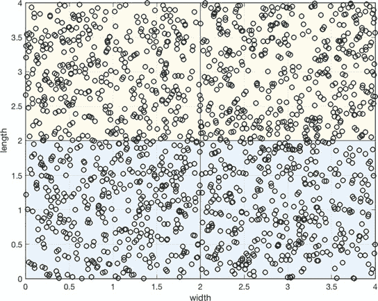

# 第 7 章 基于决策树的数据分类

在本章中，我们将阐述二叉决策树的理论。决策树可用于对数据进行分类，属于我们自主分类法中的学习类别。二叉树最容易实现，因为每个节点要么分支到两个其他节点，要么没有分支。我们将创建用于决策树和生成待分类数据集的函数。图 7.1 展示了一个简单的二叉树。点“a”位于左上象限。第一个二叉测试发现其`x`值大于 1。下一个测试发现其`y`值大于 1，并将其归入集合 2。尽管边界显示为方形区域，但二叉树实际上测试的是在`x`和`y`两个方向上均延伸至无穷远的区域。

二叉决策树是一种在每个决策节点上只有两个决策可供选择的决策树。一旦做出决策，下一个决策节点会提供两个额外的选项。每个节点接受一个二进制值 0 或 1。0 将你导向一条路径，1 则导向另一条路径。在每个决策节点，你都在测试一个新的变量。当你到达底部时，你将找到一条所有值都为真的路径。包含`n`个变量的二叉树的问题在于，它将拥有 2`n` − 1 个节点。四个变量需要 15 个决策节点。八个变量则需要 65 个决策节点，以此类推。如果测试变量的顺序是固定的，我们称之为有序树。

© Michael Paluszek 和 Stephanie Thomas 2019

M. Paluszek 和 S. Thomas，《MATLAB 机器学习实践》，

[`doi.org/10.1007/978-1-4842-3916-2_7`](https://doi.org/10.1007/978-1-4842-3916-2_7)


图 7.1：一个简单的二叉树，带有一个待分类的点。

对于分类，我们假设可以通过一系列二叉决策来对某物进行分类。如果可以，我们就可以在二叉树中实现这种推理。

## 7.1 生成测试数据

### 7.1.1 问题
我们希望生成一组用于分类的训练数据和测试数据。

### 7.1.2 解决方案
编写一个使用`rand`函数的函数，在`x`和`y`两个维度的选定范围内生成数据。

### 7.1.3 工作原理
函数`ClassifierSet`生成随机数据并将其分配到各个类别。函数调用如下：
```matlab
function p = ClassifierSets( n, xRange, yRange, name, v, f, setName )
```
`ClassifierSets`的第一个参数是点数的平方根。第二个参数`xRange`指定数据的 x 范围，第三个参数`yRange`指定 y 范围。`n`² 个点将随机放置在该区域内。下一个参数是一个包含集合名称的元胞数组`name`，这些名称用于图标签。其余输入是顶点列表`v`和面`f`。面用于选择每个多边形中使用的顶点，并将这些顶点连接成特定的多边形。`f`是一个元胞数组，因为每个面数组的长度可以不同。三角形的长度为 3，六边形的长度为 6。三角形、矩形和六边形可以轻松地拼接在一起，不留空隙。

通过添加将数据划分为区域的多边形来定义类别。可以使用任何多边形。应选择多边形以确保没有空隙。矩形很简单，但也可以使用大小均匀的六边形。以下代码是内置的演示程序。该演示是函数中的最后一个子函数，用于指定顶点和面。
```matlab
function Demo

v = [0 0;0 4; 4 4; 4 0; 0 2; 2 2; 2 0;2 1;4 1;2 1];

f = {[5 6 7 1] [5 2 3 9 10 6] [7 8 9 4]};

ClassifierSets( 5, [0 4], [0 4], {'width', 'length'}, v, f );
```
在此演示中，有三个多边形。所有点都定义在一个 x 和 y 方向范围均为 0 到 4 的正方形内。

其他子函数是`PointInPolygon`和`Membership`。`Membership`用于判断一个点是否在多边形内。`Membership`调用`PointInPolygon`来将点分配到各个集合。`ClassifierSets`随机将点放置在区域内，并通过函数中的以下代码`PointInPolygon`来确定每个点所在的区域。
```matlab
function r = PointInPolygon( p, v )

m = size(v,2);

% 所有点均在外部

r = 0;

% 将第一个点放在末尾以简化循环

v = [v v(:,1)];

for i = 1:m

j = i + 1;

v2J = v(2,j);

v2I = v(2,i);

if (((v2I > p(2)) ~= (v2J > p(2))) && ...

(p(1) < (v(1,j) - v(1,i)) * (p(2) - v2I) / (v2J - v2I) + v(1,i) ))

r = ~r;

end

end
```
这段代码可以判断一个点是否位于由一组顶点定义的多边形内部。当需要知道一个物体的顶点是否在另一个多边形内时，该代码在计算机图形学和游戏中经常被使用。你可以合理地认为，对于这类问题，此函数可以替代我们的决策树逻辑。然而，决策树可以计算更复杂数据集的成员关系。我们的分类器集合很简单，便于验证结果。

运行`ClassifierSets`查看演示。给定输入范围，它会确定随机选择的点的成员关系。`p`是一个数据结构，用于保存顶点和成员关系。它使用`NewFigure`创建新图形后绘制这些点，然后使用`patch`创建矩形区域。
```matlab
p.x = (xRange(2) - xRange(1))*(rand(n,n)-0.5) + mean(xRange); p.y = (yRange(2) - yRange(1))*(rand(n,n)-0.5) + mean(yRange); p.m = Membership( p, v, f );

NewFigure(setName);

i = 0;

drawNum = n² < 50;

for j = 1:n

for k = 1:n

i = i + 1;

plot(p.x(k,j),p.y(k,j),'marker','o','MarkerEdgeColor','k')

if( drawNum )

text(p.x(k,j),p.y(k,j), sprintf(' %3d',i));

end

hold on

end

end

m = length(f);

a = linspace(0,2*pi-2*pi/m,m)';

c = abs(cos([a a+pi/6 a+3*pi/5]));

for k = 1:m

patch('vertices',v,'faces',f{k},'facecolor',c(k,:),'facealpha',0.1) end

xlabel(name{1});

ylabel(name{2});

grid on
```
如果点数少于 50，该函数会显示数据编号。使用 MATLAB 函数`patch`来生成多边形。代码展示了一系列图形编程技巧，包括图形参数的使用。注意我们创建 m 种颜色的方式。

**提示**
你可以使用`linspace`和`cos`为绘图创建无限数量的颜色。

`ClassifierTestSet`可以生成测试集或演示训练好的决策树。该图显示，分类区域是边与`x`轴或`y`轴平行的区域。这些区域不应重叠。


图 7.2： 演示中具有三个区域的分类器集合。其中两个是矩形，一个是 L 形。

## 7.2 绘制决策树

### 7.2.1 问题
我们希望绘制一棵二叉决策树来展示决策树思维。

### 7.2.2 解决方案
解决方案是使用 MATLAB 图形函数`patch`、`text`和`line`来绘制一棵树。

### 7.2.3 工作原理
函数`DrawBinaryTree`可以绘制任意二叉树。函数调用方式为
```matlab
function d = DrawBinaryTree( d, name )
```
您需要传入一个数据结构`d`，其中包含一个元胞数组形式的决策标准。`name`输入是可选的，它有一个默认名称选项。方框从左侧开始，逐行排列。

在二叉树中，行数与节点数通过等比数列公式相关联：

`m` = log2( `n`)

(7.1)

其中`m`是行数，`n`是方框数。因此，该函数可以计算出行数。

该函数首先检查输入参数的数量，然后要么运行演示，要么返回默认的数据结构。编写函数时，应始终为所有可能的情况提供默认值。


**提示**

只要可能，就为函数参数提供默认输入。

它会立即创建一个具有该名称的新图形。然后，它遍历所有方框，根据二叉树的结构将它们分配到各行。第一行有一个方框，接下来一行有两个方框，再下一行有四个方框，以此类推。由于这是一个等比数列，很快就会变得难以管理！这指出了决策树的一个问题。如果树的深度超过四层，即使绘制它们也是不可能的。在绘制方框时，它会计算底部和顶部的点，这些点将作为方框之间连线的锚点。绘制完所有方框后，再绘制所有连线。

所有绘图功能都在子函数 `DrawBox` 中实现。

```
v = [x y 0; x y+h 0; x+w y+h 0; x+w y 0];
```

```
patch('vertices', v, 'faces', [1 2 3 4], 'facecolor', [1; 1; 1]);
```

```
text(x+w/2, y + h/2, t, 'fontname', d.font, 'fontsize', ...
d.fontSize, 'HorizontalAlignment', 'center');
```

%% `DrawBinaryTree`>`DefaultDataStructure`

这段代码使用 `patch` 函数绘制方框，并使用 `text` 函数绘制文本。

`'facecolor'` 设置为白色。

红绿蓝 (RGB) 数值范围从 0 到 1。

将 `'facecolor'` 设置为 `[1 1 1]` 会使面为白色，并保留黑色边缘。与所有 MATLAB 图形一样，您可以编辑数十个属性来生成精美的图形。请注意 `text` 函数中的额外参数。最后一行中的 `'HorizontalAlignment'` 最为有趣，它允许您将文本在方框中居中。MATLAB 会自动为您处理所有字体大小的计算。

以下清单展示了 `DrawBinaryTree` 中用于绘制树的代码，从检查演示之后开始。如果指定了一个输出且没有输入，该函数将返回默认的数据结构。代码的第一部分创建一个新图形，并在每个节点处绘制方框。它还会创建用于存储方框位置的数组，以便后续绘制连接方框的线条。它从 `name` 的默认参数开始。第一组循环用于绘制树的方框。`rowID` 是一个元胞数组。元胞中的每一行都是一个数组。元胞数组允许每个元胞的内容不同，这使得在元胞中存储不同长度的数组变得容易。如果使用标准矩阵，则在添加新行时需要调整行的大小。

```
if ( nargin < 2 )
    name = 'Binary Tree';
end
NewFigure(name);
m = length(d.box);
nRows = ceil(log2(m+1));
w = d.w;
h = d.h;
i = 1;
```


```
x = -w/2;
y = 1.5*nRows*h;
nBoxes = 1;
bottom = zeros(m,2);
top = zeros(m,2);
rowID = cell(nRows,1);
% 在每个节点处绘制一个方框
for k = 1:nRows
    for j = 1:nBoxes
        bottom(i,:) = [x+w/2 y ];
        top(i,:) = [x+w/2 y+h];
        DrawBox(d.box{i},x,y,w,h,d);
        rowID{k} = [rowID{k} i];
        i = i + 1;
        x = x + 1.5*w;
        if( i > length(d.box) )
            break;
        end
    end
    nBoxes = 2*nBoxes;
    x = -(0.25+0.5*(nBoxes/2-1))*w - nBoxes*w/2;
    y = y - 1.5*h;
end
```

其余代码用于绘制方框之间的连线。

```
for k = 1:length(rowID)-1
    iD = rowID{k};
    i0 = 0;
    % 从当前行的左侧向右侧处理
    for j = 1:length(iD)
        x(1) = bottom(iD(j),1);
        y(1) = bottom(iD(j),2);
        iDT = rowID{k+1};
        if( i0+1 > length(iDT) )
            break;
        end
        for i = 1:2
            x(2) = top(iDT(i0+i),1);
            y(2) = top(iDT(i0+i),2);
            line(x,y);
        end
        i0 = i0 + 2;
    end
end
axis off
```


以下内置演示程序绘制了一棵二叉树。该演示创建了三行，从默认数据结构开始。你只需为决策点添加字符串即可。方框以扁平列表形式存储。

```
function Demo
    % 绘制一个简单的二叉树数据结构
    d = DefaultDataStructure;
    d.box{1} = 'a > 0.1';
    d.box{2} = 'b > 0.2';
    d.box{3} = 'b > 0.3';
    d.box{4} = 'a > 0.8';
    d.box{5} = 'b > 0.4';
    d.box{6} = 'a > 0.2';
    d.box{7} = 'b > 0.3';
    DrawBinaryTree( d );
```

请注意，它调用了子函数 `DefaultDataStructure` 来初始化演示。

%% `DrawBinaryTree`>`DefaultDataStructure`

```
function d = DefaultDataStructure
    % 默认数据结构
    d = struct();
    d.fontSize = 12;
    d.font = 'courier';
    d.w = 1;
    d.h = 0.5;
    d.box = {};
```

**提示**

始终让函数返回其默认数据结构。默认值应包含可正常工作的数值。

它首先为名称设置一个默认参数。循环用于绘制树的方框。

`rowID` 是一个元胞数组。元胞中的每一行都是一个数组。元胞数组允许每个元胞各不相同。这使得在元胞中存储不同长度的数组变得容易。如果使用标准矩阵，则在添加新行时需要调整行的大小。演示生成的二叉树如图 7.3 所示。方框中的文本可以是任何你想要的内容。

方框的输入本可以在循环中完成。你可以使用 `sprintf` 来创建它们。

例如，对于第一个方框，你可以这样写：

```
d.box{1}= sprintf('%s %s %3.1f','a','>',0.1);
```

并将类似的代码放入循环中。


**图 7.3：** `DrawBinaryTree` 演示程序生成的二叉树。

### 7.3 实现

决策树是本章的重点。我们将首先探讨如何判断决策树是否正常工作。然后，我们将手动构建一棵决策树，最后编写学习代码来为树的每个节点生成决策。

#### 7.3.1 问题

我们需要衡量决策树不同节点上数据集的同质性。如果数据点彼此相似，则该数据集是同质的。例如，如果你试图研究一所经济背景多样化的学校中的成绩点，你会想知道你的样本是否全部来自富裕家庭的孩子。我们在决策树中的目标是最终得到同质的集合。

#### 7.3.2 解决方案

解决方案是对数据集实现基尼不纯度度量。该函数将返回一个单一数值作为同质性度量。

#### 7.3.3 工作原理

同质性度量被称为信息增益（IG）。IG 定义为在节点处进行分裂所增加的信息量。其公式为：

`ΔI = I(p) - (Nc1/Np)I(c1) - (Nc2/Np)I(c2) (7.2)`

其中 `I` 是不纯度度量，`N` 是该节点上的样本数量。如果我们的树正常工作，该值应该下降，最终降至零或一个非常小的数字。在我们的训练集中，我们知道每个数据点的类别。因此，我们可以确定信息增益（IG）。本质上，我们有 155


如果子节点中的混合程度降低，我们就获得了信息。例如，在决策树的第一个节点中，所有数据都混合在一起。第一个节点有两个子节点。

在第一个节点做出决策后，我们期望每个子节点中某一类别的数据会多于另一个子节点。我们查看每个节点中各类别的百分比，并寻找非均匀性的最大增量。

### 不纯度度量

有三种不纯度度量：

• 基尼不纯度

• 熵

• 分类误差

基尼不纯度 `IG` 是使误分类概率最小化的准则。我们不希望将样本推入错误的类别。

`IG = 1 − Σ p(i|t)²` (7.3)

`p(i|t)` 是节点 `t` 上属于类别 `ci` 的样本比例。对于二元分类，熵 `IE` 要么是零，要么是一。

`IE = 1 − Σ p(i|t) log₂ p(i|t)` (7.4)

分类误差 `IC` 为：

`IC = 1 − max p(i|t)` (7.5)

### 基尼不纯度的MATLAB实现

我们将在决策树中使用基尼不纯度。以下代码实现了基尼度量。第一部分只是决定是初始化函数还是更新函数。所有数据都保存在数据结构 `d` 中。这通常比使用全局数据更容易。一个优点是，你可以在同一个脚本或函数中多次使用该函数，而不会混淆函数中的持久数据。

```matlab
function [i, d] = HomogeneityMeasure( action, d, data )
if( nargin == 0 )
    if( nargout == 1 )
        i = DefaultDataStructure;
    else
        Demo;
    end
    return
end

switch lower(action)
    case 'initialize'
        d = Initialize( d, data );
        
        
        i = d.i;
    case 'update'
        d = Update( d, data );
        i = d.i;
    otherwise
        error('%s 不是一个可用的操作',action);
end
```

`Initialize` 函数初始化数据结构并计算数据的不纯度度量。数据的每个不同值对应一个类别。例如，`[1 2 3 3]` 会有三个类别。

```matlab
function d = Initialize( d, data )
%% HomogeneityMeasure>Initialize
m = reshape(data,[],1);
c = 1:max(m);
n = length(m);
d.dist = zeros(1,c(end));
d.class = c;

if( n > 0 )
    for k = 1:length(c)
        j = find(m==c(k));
        d.dist(k) = length(j)/n;
    end
end

d.i = 1 - sum(d.dist.^2);
```

演示如下。我们尝试四组不同的数据并获取度量值。0 表示完全均匀。1 表示没有数据。

```matlab
function d = Demo
% 演示数据集的不纯度度量。
data = [1 2 3 4 3 1 2 4 4 1 1 1 2 2 3 4]; fprintf(1,'%2.0f',data); d = HomogeneityMeasure;

[i, d] = HomogeneityMeasure( 'initialize', d, data );
fprintf(1,'\n 不纯度度量 %6.3f\n',i);
fprintf(1,'类别 [%1d %1d %1d %1d]\n',d.class);
fprintf(1,'分布 [%5.3f %5.3f %5.3f %5.3f]\n',d.dist);

data = [1 1 1 2 2]; fprintf(1,'%2.0f',data);
[i, d] = HomogeneityMeasure( 'update', d, data );
fprintf(1,'\n 不纯度度量 %6.3f\n',i);
fprintf(1,'类别 [%1d %1d %1d %1d]\n',d.class);
fprintf(1,'分布 [%5.3f %5.3f %5.3f %5.3f]\n',d.dist);


data = [1 1 1 1]; fprintf(1,'%2.0f',data);
[i, d] = HomogeneityMeasure( 'update', d, data );
fprintf(1,'\n 不纯度度量 %6.3f\n',i);
fprintf(1,'类别 [%1d %1d %1d %1d]\n',d.class);
fprintf(1,'分布 [%5.3f %5.3f %5.3f %5.3f]\n',d.dist);

data = []; fprintf(1,'%2.0f',data);
[i, d] = HomogeneityMeasure( 'update', d, data );
fprintf(1,'\n 不纯度度量 %6.3f\n',i);
fprintf(1,'类别 [%1d %1d %1d %1d]\n',d.class);
fprintf(1,'分布 [%5.3f %5.3f %5.3f %5.3f]\n',d.dist);
```

`i` 是均匀性度量。`d.dist` 是数据点中属于该类别的比例。类别即不同的取值。演示的输出如下所示。

```
>> HomogeneityMeasure
1 2 3 4 3 1 2 4 4 1 1 1 2 2 3 4
均匀性度量
    0.742
类别
     1     2     3     4
分布
 0.312 0.250 0.188 0.250
1 1 1 2 2
均匀性度量
    0.480
类别
     1     2     3     4
分布
 0.600 0.400 0.000 0.000
1 1 1 1
均匀性度量
    0.000
类别
     1     2     3     4
分布
 1.000 0.000 0.000 0.000
均匀性度量
    1.000
类别
     1     2     3     4
分布
 0.000 0.000 0.000 0.000
```

倒数第二组数据包含一个零，这是期望值。如果没有输入，则返回 1，因为根据定义，一个类别要存在，必须有其成员。

### 7.4 创建决策树

#### 7.4.1 问题

我们希望实现一个决策树，用于对具有两个参数的数据进行分类。

#### 7.4.2 解决方案

解决方案是在 MATLAB 中编写一个名为 `DecisionTree` 的二元决策树函数。


#### 7.4.3 工作原理

决策树 [[20]](#index_split_007.html#p350) 通过提出一系列关于数据的问题来分解数据。我们的决策树将是二元的，即每个问题只有“是”或“否”两种答案。对于数据中的每个特征，我们在每个决策节点提出一个问题。这总是将数据分割成两个子节点。我们将关注两个决定类别归属的参数。这些参数将是数值型度量。

在后续节点中，我们提出更多问题，进一步分割数据。图 7.4 展示了父节点/子节点的结构。我们持续此过程，直到每个节点上的样本都属于某一类别。在每个节点上，我们希望提出那个能为我们提供关于样本所属类别最多信息的问题。在构建用于双参数分类的决策树时，我们在每个节点上有两个决策：

• 检查哪个参数（`x` 或 `y`）。

• 在决策中使用该参数的哪个值。

**图 7.4：** 父节点/子节点。

训练过程使用前一个配方中给出的基尼系数值。我们在每个节点上，针对两个参数中的每一个，分别使用一次 MATLAB 函数 `fminbnd`。`fminbnd` 是一个一维局部最小化器，用于在指定的两个端点之间寻找函数的最小值。如果你知道感兴趣的范围，那么这是一种非常有效的寻找最小值的方法。

最小化 `f(x)`，满足 `x₁ < x < x₂` (7.6)

`DecisionTree` 有两个操作：“train”（训练）和“test”（测试）。“train”创建决策树，“test”运行生成的决策树。你也可以输入你自己的决策树。`FindOptimalAction` 寻找能使分割两侧不均匀性最小化的参数。由 `fminbnd` 调用的函数是 `RHSGT`。我们只实现了“大于”操作。函数调用如下：

```matlab
function [d, r] = DecisionTree( action, d, t )
```

# 第七章 基于决策树的数据分类


`action` 是一个字符串，可以是“train”或“test”。`d` 是定义树的数据结构。`t` 是用于训练或测试的输入。输出是更新后的数据结构 `d` 和包含结果的 `r`。

该函数首先使用训练数据和动作“train”进行调用。主函数很简短。

```
switch lower(action)

case 'train'

d = Training( d, t );

d.box(1)

case 'test'

for k = 1:length(d.box)

d.box(k).id = [];

end

[r, d] = Testing( d, t );

for k = 1:length(d.box)

d.box(k)

end

otherwise

error('%s 不是一个可用的操作', action);

end
```

我们添加了错误情况以保持完整性。请注意，我们使用 `lower` 来消除大小写敏感性。训练过程会创建决策树。决策树是由线条连接的一组方框。如果一个方框是决策框，则它有两个子框。类别框没有子节点。子函数 `Training` 负责训练该树，并在每个节点添加方框。

## %% DecisionTree>Training

```
function d = Training( d, t )

[n,m] = size(t.x);

nClass = max(t.m);

box(1) = AddBox( 1, 1:n*m, [] );

box(1).child = [2 3];

[~, dH] = HomogeneityMeasure( 'initialize', d, t.m );

class = 0;

nRow = 1;

kR0 = 0;

kNR0 = 1; % 下一行

kInRow = 1;

kInNRow = 1;

while( class < nClass )

k = kR0 + kInRow;

idK = box(k).id; % 该方框中的数据，用于计算下一步操作

% 如果该方框不是非决策框，则进入此循环

if( isempty(box(k).class) )


[action, param, val, cMin] = FindOptimalAction( t, idK, d.xLim, d.yLim, dH );

box(k).value = val;

box(k).param = param;

box(k).action = action;

x = t.x(idK);

y = t.y(idK);

if( box(k).param == 1 ) % x 轴

id = find(x > d.box(k).value );

idX = find(x <= d.box(k).value );

else % y 轴

id = find(y > d.box(k).value );

idX = find(y <= d.box(k).value );

end

% 子方框

if( cMin < d.cMin) % 表示我们处于类别框中

class = class + 1;

kN = kNR0 + kInNRow;

box(k).child = [kN kN+1];

box(kN) = AddBox( kN, idK(id), class );

class = class + 1;

kInNRow = kInNRow + 1;

kN = kNR0 + kInNRow;

box(kN) = AddBox( kN, idK(idX), class );

kInNRow = kInNRow + 1;

else

kN = kNR0 + kInNRow;

box(k).child = [kN kN+1];

box(kN) = AddBox( kN, idK(id) );

kInNRow = kInNRow + 1;

kN = kNR0 + kInNRow;

box(kN) = AddBox( kN, idK(idX) );

kInNRow = kInNRow + 1;

end

end

% 更新当前行

kInRow = kInRow + 1;

if( kInRow > nRow )

kR0 = kR0 + nRow;

nRow = 2*nRow; % 增加两行

kNR0 = kNR0 + nRow;

kInRow = 1;

kInNRow = 1;

end

end

for k = 1:length(box)


if( ~isempty(box(k).class) )

box(k).child = [];

end

box(k).id = [];

fprintf(1,'Box %3d action %2s Value %4.1f\n',k,box(k).action,box(k).value);

end

d.box = box;
```

我们使用 `fminbnd` 来寻找最优切换点。需要计算切换点两侧的均匀性，并对这些值求和。在子函数 `FindOptimalAction` 中，通过 `fminbnd` 最小化该总和。此代码专为矩形区域类别设计。其他边界可能无法正常工作。该代码相当复杂，需要跟踪方框编号以建立父子连接。当均匀性度量足够低时，它会将这些方框标记为包含相应类别。

数据结构 `box` 包含多个字段。其中一个是决策框中要执行的操作。`param` 为 1 表示基于 x 轴，其他值表示基于 y 轴。这决定了决策是基于 x 还是 y。`value` 是决策中使用的值。`child` 是子方框的索引。

其余代码用于确定方框所在的行。类别框没有子节点。这些字段如表 7.1 所示。

**表 7.1：** 方框数据结构字段

| 字段 | 决策框 | 类别框 |
| :--- | :--- | :--- |
| `action` | 字符串 | 未使用 |
| `value` | 决策中使用的值 | 未使用 |
| `param` | x 或 y | 未使用 |
| `child` | 包含两个子节点的数组 | 空 |
| `id` | 空 | 类中数据的 ID |
| `class` | 类 ID | 未使用 |

## 7.5 创建手工决策树

### 7.5.1 问题

我们希望测试一个手工构建的决策树。

### 7.5.2 解决方案

解决方案是编写一个脚本来测试手工构建的决策树。


### 7.5.3 工作原理

我们编写了如下所示的测试脚本 `SimpleClassifierDemo`。它使用 `DecisionTree` 的 `'test'` 动作。该脚本生成了 52 个点。我们创建矩形区域，使得每个多边形的面数组包含四个元素。`DrawBinaryTree` 负责绘制树。

```matlab
d = DecisionTree;

% 各集合的顶点
v = [ 0 0; 0 4; 4 4; 4 0; 2 4; 2 2; 2 0; 0 2; 4 2];

% 各集合的面
f = { [6 5 2 8] [6 7 4 9] [6 9 3 5] [1 7 6 8] };

% 生成测试集
pTest = ClassifierSets( 5, [0 4], [0 4], {'width', 'length'}, v, f, 'Testing Set' );

% 测试树
[d, r] = DecisionTree( 'test', d, pTest );

q = DrawBinaryTree;
c = 'xy';

for k = 1:length(d.box)
    if( ~isempty(d.box(k).action) )
        q.box{k} = sprintf('%c %s %4.1f', c(d.box(k).param), d.box(k).action, d.box(k).value);
    else
        q.box{k} = sprintf('Class %d', d.box(k).class);
    end
end

DrawBinaryTree(q);

m = reshape(pTest.m, [], 1);

for k = 1:length(r)
    fprintf(1, 'Class %d\n', m(r{k}(1)));
    for j = 1:length(r{k})
        fprintf(1, '%d ', r{k}(j));
    end
    fprintf(1, '\n')
end
```

`SimpleClassifierDemo` 使用了 `DecisionTree` 中手工构建的示例。

```matlab
function d = DefaultDataStructure
%% DecisionTree>DefaultDataStructure
% 生成默认数据结构

d.tree = DrawBinaryTree;
```


```matlab
d.threshold = 0.01;
d.xLim = [0 4];
d.yLim = [0 4];
d.data = [];
d.cMin = 0.01;

d.box(1) = struct('action','>','value',2,'param',1,'child',[2 3],'id',[],'class',[]);
d.box(2) = struct('action','>','value',2,'param',2,'child',[4 5],'id',[],'class',[]);
d.box(3) = struct('action','>','value',2,'param',2,'child',[6 7],'id',[],'class',[]);

for k = 4:7
    d.box(k) = struct('action','','value',0,'param',0,'child',[],'id',[],'class',[]);
end
```

图 7.5 展示了 `SimpleClassifierDemo` 的运行结果。其中有四个矩形区域，即我们定义的集合。

**图 7.5：** 测试集中的数据和类别。

我们可以手工创建一个决策树，如图 7.6 所示。

该决策树将样本分类到四个集合中。在此例中，我们已知边界，并可以利用它们来编写不等式。在软件中，我们需要确定哪些值能提供最短的分支。以下是 `SimpleClassifierDemo` 的输出结果。

该决策树正确地对所有数据进行了分类。


**图 7.6：** 一个手工创建的决策树。该图由 `DecisionTree` 生成。

最后一行的方框是将数据分类到四个类别后的结果。最后的节点即为类别。

每个方框都是一个决策树节点。

```
>> SimpleClassifierDemo
Class 3
4 6 9 13 18
Class 2
7 14 17 21
Class 1
1 2 5 8 10 11 12 23 25
Class 4
3 15 16 19 20 22 24
```

## 7.6 训练与测试

### 7.6.1 问题

我们希望训练决策树并测试其结果。

### 7.6.2 解决方案

我们复现了之前的方案，但这次由 `DecisionTree` 自动创建决策树，而非手工构建。


### 7.6.3 工作原理

`TestDecisionTree` 负责训练和测试决策树。它与手工构建决策树的演示代码 `SimpleClassifierDemo` 非常相似。我们再次使用矩形作为区域。

```matlab
% 各集合的顶点
v = [ 0 0; 0 4; 4 4; 4 0; 2 4; 2 2; 2 0; 0 2; 4 2];

% 各集合的面
f = { [6 5 2 8] [6 7 4 9] [6 9 3 5] [1 7 6 8] };

% 生成训练集
pTrain = ClassifierSets( 40, [0 4], [0 4], {'width', 'length'},...
v, f, '训练集' );

% 创建决策树
d = DecisionTree;
d = DecisionTree( 'train', d, pTrain );

% 生成测试集
pTest = ClassifierSets( 5, [0 4], [0 4], {'宽度', '长度'},...
v, f, '测试集' );

% 测试决策树
[d, r] = DecisionTree( 'test', d, pTest );

q = DrawBinaryTree;
c = 'xy';

for k = 1:length(d.box)
    if( ~isempty(d.box(k).action) )
        q.box{k} = sprintf('%c %s %4.1f',c(d.box(k).param),...
            d.box(k).action,d.box(k).value);
    else
        q.box{k} = sprintf('类别 %d',d.box(k).class);
    end
end

DrawBinaryTree(q);

m = reshape(pTest.m,[],1);

for k = 1:length(r)
    fprintf(1,'类别 %d\n',m(r{k}(1)));
    for j = 1:length(r{k})
        fprintf(1,'%d ',r{k}(j));
    end
end
```




它使用 `ClassifierSets` 生成训练数据。输出包括坐标及其所属的集合。然后我们创建默认数据结构，并以训练模式调用 `DecisionTree`。

决策树如图 7.9 所示。训练数据如图 7.7 所示，测试数据如图 7.8 所示。我们需要足够的测试数据来填充各个类别。否则，决策树生成器可能会绘制仅包含训练集数据的边界线。

**图 7.7：** 训练数据。需要大量数据来填充各个类别。

结果与简单测试类似。

```
类别 3
1 14 16 21 23
类别 2
2 4 5 6 9 13 17 18 19 20 25
类别 1
3 7 8 10 11 15 24
类别 4
12 22
```

生成的决策树有效地分离了数据。


**图 7.8：** 测试数据。

**图 7.9：** 从训练数据推导出的决策树。它与手动推导的决策树基本相同。生成的决策树中的值并不完全是 2.0。


## 7.7 总结

本章演示了在 MATLAB 中使用决策树进行数据分类。我们还编写了一个新的图形函数来绘制决策树。该决策树软件并非通用软件，但可以作为编写更通用代码的指南。表 7.2 列出了随附代码中包含的函数和脚本。

**表 7.2：** 章节代码清单

| **文件**                | **描述**                             |
| ----------------------- | ------------------------------------ |
| `ClassifierSets`        | 生成用于分类或训练的数据。           |
| `DecisionTree`          | 实现用于数据分类的决策树。           |
| `DrawBinaryTree`        | 生成用于分类或训练的数据。           |
| `HomogeneityMeasure`    | 计算基尼不纯度。                     |
| `SimpleClassifierDemo`  | 演示决策树测试。                     |
| `SimpleClassifierExample` | 为简单问题生成数据。               |
| `TestDecisionTree`      | 测试决策树。                         |


