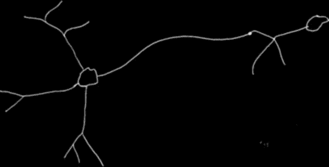

# 第 8 章 神经网络简介

神经网络是一种流行的实现机器“智能”的方式。

其理念是它们的行为类似于大脑中的神经元。在我们的分类体系中，神经网络属于真正的机器学习范畴，如右图所示。

自主
学习
机器
控制
学习
智能

在本章中，我们将探索神经网络的工作原理，从单个神经元的最基本概念开始，逐步深入到多层神经网络。我们以摆锤为例，展示如何使用神经网络解决预测问题。这是神经网络的两大用途之一：预测与分类。我们将从一个简单的分类示例开始。在第 9 章和第 10 章中，我们将介绍更复杂的分类神经网络。

## 8.1 日光检测器

### 8.1.1 问题

我们希望使用一个简单的神经网络来检测日光。

© Michael Paluszek 和 Stephanie Thomas 2019

M. Paluszek 和 S. 著， *MATLAB 机器学习秘籍*，

[`doi.org/10.1007/978-1-4842-3916-2_8`](https://doi.org/10.1007/978-1-4842-3916-2_8)


### 8.1.2 解决方案

历史上，第一个神经元是感知器。这是一种具有阈值激活函数的神经网络。其输出为 0 或 1。对于本章后续秘籍中涉及的摆锤角度估计等问题，这并不实用。然而，它非常适合分类问题。在本示例中，我们将使用单个感知器。

### 8.1.3 工作原理

假设我们的输入是光电管测量的光照强度。如果你对输入进行加权，使得 1 代表黄昏时的亮度值，那么你就得到了一个晴天检测器。

这在以下脚本`SunnyDay`中展示。该脚本以那个著名的、本应检测坦克却检测了晴天的神经网络命名；这是因为所有坦克的训练照片都是在晴天无意中拍摄的，而所有没有坦克的照片则是在阴天拍摄的。太阳通量使用余弦函数建模，并缩放至正午时为 1。任何大于 0 的值都表示白天。

```matlab
%% 数据
t = linspace(0,24);
% 时间，单位：小时
d = zeros(1, length(t));
s = cos((2*pi/24)*(t-12)); % 太阳通量模型

%% 激活函数
% 非线性激活函数，是一个阈值检测器
j = s < 0;
s(j) = 0;
j = s > 0;
d(j) = 1;

%% 绘制结果
PlotSet(t,[s;d],'x label','小时', 'y label',...
{'太阳通量', '白天/黑夜'}, 'figure title','日光检测器',...
'plot title', '日光检测器');
set([subplot(2,1,1) subplot(2,1,2)],'xlim',[0 24],'xtick',[0 6 12 18 24]);
```

`set(gca,...)`代码将 x 轴刻度设置为精确结束于 24 小时。这是一个非常简单的例子，但确实展示了分类的工作原理。

如果我们有多个神经元，其阈值设置为检测不同太阳通量波段内的阳光水平，那么我们就有了一个神经网络太阳钟。


**图 8.1：** 日光检测器。

**日光检测器**
0.8
0.6
0.4
太阳通量
0.2
小时

**日光检测器**
0.8
0.6
0.4
白天/黑夜
0.2
小时

## 8.2 摆锤建模

### 8.2.1 问题

我们希望实现如图 8.2 所示的摆锤动力学。摆锤将被建模为一个点质量，通过刚性连接连接到其支点。刚性连接是一根不能收缩或伸长的杆。

**图 8.2：** 摆锤。运动由重力加速度驱动。


### 8.2.2 解决方案

解决方案是在 `MATLAB` 中编写一个摆锤动力学函数。动力学将以扭矩形式编写，即我们将其建模为刚体旋转。刚体旋转就是你旋转轮子时发生的情况。它将使用包含工具箱中 `General` 文件夹内的 `RungeKutta` 积分例程来积分运动方程。

### 8.2.3 工作原理

图 8.2 展示了摆锤。获得方程最简单的方法是将其视为一个扭矩问题，即刚体旋转。当你观察一个二维摆锤时，它在一个平面内运动，其位置具有 *x* 和 *y* 坐标。然而，这两个坐标受到固定摆长 *L* 的约束。我们可以写出：*L*² = *x*² + *y*²
(8.1)

其中 *L* 是杆的长度，是一个常数，*x* 和 *y* 是平面内的坐标。它们也是问题中的自由度。这表明 *x* 由 *y* 唯一确定。如果我们写出：
*x* = *L* sin *θ*
(8.2)

*y* = *L* cos *θ*
(8.3)

其中 *θ* 是偏离垂直方向的角度，即当摆锤垂直悬挂时为零，我们看到只需要一个自由度 *θ* 来建模运动。因此，我们的力问题变成了刚体旋转运动问题。扭矩与角加速度通过惯性矩相关联：
*T* = *I* *d²θ* / *dt²*
(8.4)

其中 *I* 是惯性矩，*T* 是扭矩。惯性矩是常数，取决于摆长的平方和质量 *m*：
*I* = *mL*²
(8.5)

扭矩由重力分量 *mg* 产生，该分量垂直于摆锤，其中 *g* 是重力加速度。回想一下，扭矩是施加的力 *mg* sin *θ* 乘以力臂，在此例中为 *L*。因此扭矩为：*T* = *−mgL* sin *θ*
(8.6)

那么运动方程为：
*− mgL* sin *θ* = *mL*² *d²θ* / *dt²*
(8.7)


或者简化后：
*d²θ* / *dt²* + (*g* / *mL*) sin *θ* = 0
(8.8)

我们设：
*g* / *mL* = Ω²
(8.9)

其中Ω是摆锤振荡的频率。由于存在 sin *θ*，该方程是非线性的。我们可以将其在垂直方向附近的小角度 *θ* 处线性化。对于小角度：sin *θ* ≈ *θ*
(8.10)

cos *θ* ≈ 1
(8.11)

从而得到线性常系数方程。正弦的线性版本来自泰勒级数展开：
sin *θ* = *θ* − *θ*³/3! + *θ*⁵/5! − *θ*⁷/7! + · · ·
(8.12)

可以看出，第一项在 *θ* = 0（即摆锤垂直悬挂时）附近是一个相当好的近似。实际上，我们可以将其应用于任何角度。设 *θ* = *θ* + *θk*，其中 *θk* 是当前角度，*θ* 现在是微小量。我们可以展开正弦项：sin (*θ* + *θk*) = sin *θ* cos *θk* + sin *θk* cos *θ* ≈ *θ* cos *θk* + sin *θk*
(8.13)

我们得到一个带有新扭矩项和不同`θ`系数的线性方程。

`d²θ / dt² + cos θk Ω² θ = −Ω² sin θk` (8.14)

这告诉我们，无论当前角度如何，线性近似都可能是有用的。

我们最终的方程（非线性和线性）是：

`d²θ / dt² + Ω² sin θ = 0` (8.15)

`d²θ / dt² + Ω² θ ≈ 0` (8.16)

以下代码展示了动力学模型，并附有头文件片段。该模型可通过 `MATLAB Recipes` 的 `RungeKutta` 函数或任何 `MATLAB` 积分器调用。其中提供了一个选项，可通过名为`linear`的布尔字段选择使用完整非线性动力学或线性化动力学形式。状态向量的第一个元素是角度，第二个元素是角导数，即角速度`ω`。第一个输入参数时间未被使用，因为它仅以`dt`形式出现在方程中，因此用波浪号替代。输出是状态`x`的导数`xDot`。如果未指定输入参数，函数将返回默认数据结构`d`。


%

`x`

(2,1) 状态向量 [theta;theta dot]

%

`d`

(.) 数据结构

%

`.linear`

(1,1) 若为真则使用线性模型

%

`.omega`

(1,1) 输入增益

```
function xDot = RHSPendulum( ˜, x, d )

if( nargin < 1 )
    xDot = struct('linear',false,'omega',0.5);
    return
end

if( d.linear )
    f = x(1);
else
    f = sin(x(1));
end

xDot = [x(2);-d.omegaˆ2*f];
```

`xDot` 的代码包含两个元素。第一个元素就是状态的第二个元素，因为角度的导数就是角速度。第二个元素是根据方程计算出的角加速度。所实现的微分方程组是一组一阶微分方程：

`dθ/dt = ω` (8.17)

`dω/dt = −Ω² sin θ` (8.18)

一阶意味着左侧只有一阶导数。

下面的脚本`PendulumSim`通过对动力学模型进行积分来模拟摆。将数据结构字段`linear`设置为`true`即可得到线性模型。注意，状态初始化为一个较大的初始角度3弧度，以突出模型之间的差异。

```
%% 摆的仿真
%% 初始化仿真
n = 1000; % 时间步数
dT = 0.1; % 时间步长（秒）
dRHS = RHSPendulum; % 获取默认数据结构
dRHS.linear = false; % 若为线性模型则设为 true
%% 仿真
xPlot = zeros(2,n);
theta0 = 3; % 弧度
x = [theta0;0]; % [角度;速度]
```


```
for k = 1:n
    xPlot(:,k) = x;
    x = RungeKutta( @RHSPendulum, 0, x, dT, dRHS );
end
%% 绘制结果
yL = {'\theta (rad)' '\omega (rad/s)'};
[t,tL] = TimeLabel(dT*(0:n-1));
PlotSet( t, xPlot, 'x label', tL, 'y label', yL, ...
    'plot title', 'Pendulum', 'figure title', 'Pendulum State' );
```

图8.3展示了两种模型的结果。非线性模型的周期与线性模型不同。

**图8.3：** 由线性和非线性方程建模的摆。非线性模型的周期与线性模型不同。左侧图为线性模型，右侧图为非线性模型。

## 8.3 单神经元角度估计器

### 8.3.1 问题

我们希望使用一个简单的神经网络来估计刚性摆与垂直方向之间的角度。

### 8.3.2 解决方案

我们将推导线性估计器的方程，然后通过一个由单个神经元组成的神经网络来复制它。





### 8.3.3 工作原理

让我们先来看一个具有两个输入的单神经元。如图8.4所示，该神经元有输入`x1`和`x2`、偏置`b`、权重`w1`和`w2`，以及单个输出`z`。激活函数`σ`接收加权输入并产生输出。

`z = σ(w1*x1 + w2*x2 + b)` (8.19)

**图8.4：** 一个双输入神经元。

让我们将其与图8.5所示的真实神经元进行比较。真实神经元通过树突接收多个输入。其中一些树突会分支，这意味着多个输入可以通过同一树突连接到细胞体。输出通过轴突进行。每个神经元只有一个输出。轴突通过突触连接到树突。信号通过突触从轴突传递到树突。

**图8.5：** 一个真实神经元可以有10,000个输入！

有许多常用的激活函数。我们展示三种：

`σ(y) = tanh(y)` (8.20)

`σ(y) = −1 / (1 − e^−y)` (8.21)

`σ(y) = y` (8.22)


指数函数经过归一化和零偏移处理，使其范围在 -1 到 1 之间。脚本`OneNeuron`中的以下代码计算并绘制了输入`q`的这三个激活函数。

```
%% 查看激活函数
q = linspace(-4,4);
v1 = tanh(q);
v2 = 2./(1+exp(-q)) - 1;
```

PlotSet(`q`,[`v1`;`v2`;`q`], 'x label', 'Input', 'y label', 'Output', 'figure title', 'Activation Functions', 'plot title', 'Activation Functions', 'plot set', {[1 2 3]}, 'legend', {{'Tanh','Exp','Linear'}});

图 8.6 在同一张图上展示了这三个激活函数。

**图 8.6：** 三个激活函数。

**激活函数**

Tanh

Exp

Linear

输出

输入

饱和的激活函数模拟了具有最大放电频率的生物神经元。这些特定函数还具有有助于学习的良好数值特性。

既然我们已经定义了神经元模型，让我们回到摆的动力学问题。线性摆方程的解是：

*θ* = *a* sin Ω*t* + *b* cos Ω*t* (8.23)

给定初始角度 *θ*0 和角速率 ˙*θ*0，我们得到角度随时间变化的函数：

˙*θ*0

*θ*(*t*) = sin Ω*t* + *θ*0 cos Ω*t* (8.24)

Ω


对于较小的 Ω*t*：

*θ*(*t*) = ˙*θ*0*t* + *θ*0 (8.25)

这是一个线性方程。将其转换为离散时间问题：*θk*+1 = ˙*θk*Δ*t* + *θk* (8.26)

其中 Δ*t* 是测量之间的时间步长，*θk* 是当前角度，*θk*+1 是下一步的角度。角速率的线性近似为：

˙*θk* = (*θk* − *θk*−1) / Δ*t* (8.27)

因此，结合公式 8.26 和 8.27，我们的“估计器”为：

*θk*+1 = 2*θk* − *θk*−1 (8.28)

这非常简单。它不需要知道时间步长。

让我们用神经网络做同样的事情。我们的神经元输入是 *x*1 和 *x*2。如果我们设置：

*x*1 = *θk* (8.29)

*x*2 = *θk*−1 (8.30)

*w*1 = 2 (8.31)

*w*2 = *−*1 (8.32)

*b* = 0 (8.33)

我们得到：

*z* = *σ*(2*θk* − *θk*−1) (8.34)

除了激活函数 *σ* 之外，这正是我们的估计器。

继续讲解 `OneNeuron`，以下代码实现了估计器。我们输入一个仅对小摆角有效的纯正弦波，然后分别使用线性激活函数和 tanh 激活函数计算神经元。请注意，变量 `thetaN` 等效于使用线性激活函数。

```matlab
% 查看摆的估计器
omega = 1; % 摆的频率，单位 rad/s
t = linspace(0,20);
theta = sin(omega*t);
thetaN = 2*theta(2:end) - theta(1:end-1); % 用于估计“下一个”theta 的线性估计器
truth = theta(3:end);
tOut = t(3:end);
thetaN = thetaN(1:end-1);


% 应用激活函数
z = tanh(thetaN);

PlotSet(tOut,[truth;thetaN;z],'x label','时间 (s)', 'y label', '下一个角度', 'figure title','单个神经元','plot title', '单个神经元', 'plot set',{[1 2 3]},'legend',{{'真实值','估计值','神经元'}});

图 8.7 展示了两个神经元的输出（线性和 tanh）与真实值的对比。使用线性激活函数的神经元与真实值吻合得很好。tanh 则不然，但这在预料之中，因为它会饱和。

**图 8.7：** 真实摆的动态特性与线性和 tanh 神经元输出的对比。

**单个神经元**

1.5
真实值
估计值
神经元
0.5
下一个角度
-0.5
-1.5
时间 (s)

使用线性激活函数的单个神经元功能与估计器本身相同。通常，输出节点（并且这个神经网络只有一个输出节点）具有线性激活函数。这是合理的，否则输出将受限于激活函数的饱和值，正如我们在 `tanh` 中看到的那样。使用任何其他激活函数，输出都不会产生期望的结果。这个特定示例是一个神经网络并未真正带来任何优势的例子，之所以选择它，是因为它简化为一个简单的线性估计器。对于更一般的问题，如果输入更多且输入之间存在非线性依赖关系，具有饱和特性的激活函数可能会很有价值。

为此，我们需要一个多神经元网络，这将在本章最后一节讨论。

请注意，即使是使用线性激活函数的神经元，也不能完全匹配真实值。如果我们真的将线性激活函数用于非线性摆，效果不会很好。非线性估计器会很复杂，但可以训练一个多层神经网络（深度学习）来覆盖更广泛的条件。


## 8.4 为摆设计神经网络

### 8.4.1 问题

我们希望估计非线性摆的角度。

### 8.4.2 解决方案

我们将使用 `NeuralNetMLFF` 根据训练集构建一个神经网络。（MLFF 代表多层前馈）。

我们将使用 `NeuralNetMLFF` 运行该网络。`NeuralNetMLFF` 的代码包含在下一章的神经网络开发者 GUI 中。

### 8.4.3 工作原理

本配方的脚本是 `NNPendulumDemo`。第一部分生成测试数据，运行与配方 8.2 中 `PendulumSim.m` 相同的仿真。我们计算摆的周期，以便将仿真时间步长设置为周期的一小部分。请注意，我们将使用 tanh 作为网络的激活函数。

```matlab
% 演示参数
nSamples = 800; % 仿真中的样本数
nRuns = 2000; % 训练运行次数
activation = 'tanh'; % 激活函数
omega = 0.5; % 频率（弧度/秒）
tau = 2*pi/omega; % 周期（秒）
dT = tau/100; % 以 20*omega 的速率采样
rng(100); % 一致的随机数生成器

%% 初始化仿真右端项
dRHS = RHSPendulum; % 获取默认数据结构
dRHS.linear = false;
dRHS.omega = omega;

%% 仿真
nSim = nSamples + 2;
x = zeros(2,nSim);
theta0 = 0.1; % 起始位置（角度）
x(:,1) = [theta0;0];
for k = 1:nSim-1
    x(:,k+1) = RungeKutta( @RHSPendulum, 0, x(:,k), dT, dRHS );
end
```

下一个代码块定义了网络，并使用 `NeuralNetTraining` 对其进行训练。

# 神经网络训练与测试

`NeuralNetTraining` 和 `NeuralNetMLFF` 将在下一章中描述。简而言之，我们定义了一个包含三个神经元的第一个层和一个包含单个神经元的第二个输出层；该网络有两个输入，即前两个角度。


## 定义网络结构

%% 定义一个具有两个输入、三个内部节点和一个输出的网络

```matlab
layer = struct;
layer(1,1).type = activation;
layer(1,1).alpha = 1;
layer(2,1).type = 'sum'; %'sum';
layer(2,1).alpha = 1;

% 阈值
layer(1,1).w0 = rand(3,1) - 0.5;
layer(2,1).w0 = rand(1,1) - 0.5;

% 从第 j 个输入到第 i 个节点的权重 w(i,j)
layer(1,1).w = rand(3,2) - 0.5;
layer(2,1).w = rand(1,3) - 0.5;
```

## 训练网络

%% 训练网络

% 使用随机列表对样本进行排序

```matlab
kR = ceil(rand(1,nRuns)*nSamples);
thetaE = x(1,kR+2); % 待估计的角度
theta = [x(1,kR);x(1,kR+1)]; % 前两个角度
e = thetaE - (2*theta(1,:) - theta(2,:));
[w,e,layer] = NeuralNetTraining( theta, thetaE, layer );
PlotSet(1:length(e), e.ˆ2, 'x label','Sample', 'y label','Errorˆ2', ...
'figure title','Training Error','plot title','Training Error','plot type','ylog');
```

% 使用计算出的权重组装一个新网络

```matlab
layerNew = struct;
layerNew(1,1).type = layer(1,1).type;
```

训练数据结构包含待计算的权重。它定义了层数和激活函数的类型。初始权重是随机的。训练返回新的权重和训练误差。我们使用索引数组 `k` 将训练数据以随机顺序传递给函数。这比按原始顺序传递能得到更好的结果。我们还使用参数 `nRuns` 多次发送相同的训练数据。图 8.8 显示了训练误差。看起来不错。要查看计算出的权重，只需在命令行显示 `w` 即可。例如，输出节点的权重现在是：

```matlab
>> w(2)
ans =

  包含以下字段的结构体:
```


**图 8.8：** 训练误差。

**训练误差**
10-2
10-4
10-6
误差
10-8
10-10
10-12 0
样本

```
w: [-0.67518 -0.21789 -0.065903]
w0: -0.014379
type: 'tanh'
```

## 测试神经网络

我们在最后一个代码块中测试神经网络。我们重新运行仿真，然后使用 `NeuralNetMLFF` 运行神经网络。请注意，您可以通过更改 `thetaD` 的值，选择使用与训练数据不同的起始点来初始化仿真。

```matlab
layerNew = struct;
layerNew(1,1).type = layer(1,1).type;
layerNew(1,1).w = w(1).w;
layerNew(1,1).w0 = w(1).w0;
layerNew(2,1).type = layer(2,1).type; %'sum';
layerNew(2,1).w = w(2).w;
layerNew(2,1).w0 = w(2).w0;
network.layer = layerNew;
```

%% 使用不同的起始点模拟摆

```matlab
x(:,1) = [0.1;0];
```

%% 模拟摆并测试训练好的网络

% 选择相同或不同的起始点进行模拟

```matlab
thetaD = 0.5;
x(:,1) = [thetaD;0];
for k = 1:nSim-1
    x(:,k+1) = RungeKutta( @RHSPendulum, 0, x(:,k), dT, dRHS );
end
```


**图 8.9：** 神经网络结果：模拟状态、测试误差以及真实角度与神经网络估计值的对比。

% 测试新网络

```matlab
theta = [x(1,1:end-2);x(1,2:end-1)];
thetaE = NeuralNetMLFF( theta, network );
eTSq = (x(1,3:end)-thetaE).ˆ2;
```

图 8.9 中的结果看起来不错。神经网络估计的角度与真实角度非常接近。但请注意，我们运行的是完全相同幅度的摆振荡（`thetaD = theta0`），这正是我们训练它识别的模式。如果我们使用不同的起始点进行测试，例如 0.5 弧度（而训练数据为 0.1 弧度），则估计角度的误差会更大，如图 8.10 所示。

如果我们希望神经网络能够预测其他幅度的角度，就需要使用能够模拟所有条件的多样化数据集进行训练。在训练网络时，我们让它多次看到相同的振荡幅度。这实际上效果不佳。可能还需要向网络中添加更多节点或更多层，以构建一个更通用的估计器。


**图 8.10：** 针对不同幅度振荡的神经网络估计角度。

- 角度
- 0.5
- 估计值
- 真实值
- 0.4
- 0.3
- 0.2
- 0.1
- 下一个角度 -0.1
- -0.2
- -0.3
- -0.4
- -0.5
- 样本

## 8.5 总结

本章演示了利用神经网络学习预测摆的角度。它介绍了神经元的概念，展示了一个用于摆的单神经元网络，并说明了它与线性估计器的对比。此外，还给出了一个感知机示例和一个多层摆角度估计器。表 8.1 列出了配套代码中包含的函数和脚本。最后两个函数借用了下一章的内容，下一章将更深入地介绍多层神经网络。

**表 8.1：章节代码清单**

| 文件 | 描述 |
|------|------|
| `NNPendulumDemo` | 训练神经网络以跟踪摆的运动。 |
| `OneNeuron` | 探索单个神经元。 |
| `PendulumSim` | 模拟摆的运动。 |
| `RHSPendulum` | 非线性摆的右侧函数。 |
| `SunnyDay` | 识别日光。 |
| 第 9 章函数 |  |
| `NeuralNetMLFF` | 计算多层前馈神经网络的输出。 |
| `NeuralNetTraining` | 使用反向传播进行训练。 |


