# 第 9 章 使用神经网络进行数字分类

图像中的模式识别是神经网络的经典应用。本章在前一章的基础上，进一步探索多层网络，这属于我们自主学习方法论中的机器学习分支。在本例中，我们将研究计算机生成数字的图像，以及正确识别这些数字的问题。这些图像将代表扫描文档中的数字。试图通过算法规则（考虑字体和其他因素）来捕捉数字的变化，很快就会变得极其复杂，但通过大量样本，神经网络可以轻松完成这项任务。我们让网络中的权重来推断每个数字可能形状的规则，而不是显式地编码这些规则。

自主
学习
机器
控制
学习
智能

就本章而言，我们将只关注单个数字的图像。将一系列数字分割成单个图像的过程，可以通过多种技术解决，而不仅仅是神经网络。

© Michael Paluszek 和 Stephanie Thomas 2019

M. Paluszek 和 S. Thomas, *MATLAB Machine Learning Recipes*,
[`doi.org/10.1007/978-1-4842-3916-2_9`](https://doi.org/10.1007/978-1-4842-3916-2_9)


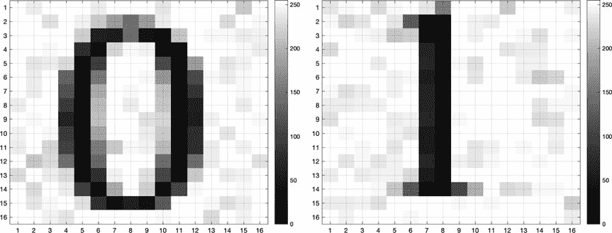

## 9.1 生成带有缺陷的测试图像

### 9.1.1 问题

创建分类系统的第一步是生成样本数据。在本例中，我们希望加载 0 到 9 的数字图像，并生成带有缺陷的测试图像。出于我们的目的，缺陷将通过简单的泊松噪声或散粒噪声（像素值平方根的标准差随机数）引入。

### 9.1.2 解决方案

我们将通过使用 `text` 将数字写入坐标轴，然后使用 `print` 创建图像的方式，在 MATLAB 中生成图像。有一个选项可以直接从 `print` 捕获像素数据，而无需创建中间文件，我们将利用这一点。我们将提取包含数字的 16x16 像素区域，然后应用噪声。我们还允许将字体作为输入。示例见图 9.1。

**图 9.1：** 添加了噪声的数字 0 和 1 的示例图像。

### 9.1.3 工作原理

`CreateDigitImage` 函数的代码清单如下。输入参数是数字和所需的字体。它创建一个 16x16 像素的单个数字图像。用于显示数字文本的中间图形是不可见的。我们将使用 `print` 的 `'RGBImage'` 选项来获取像素值，而无需创建图像文件。该函数有一个内置演示选项，如果没有输入或输出参数，它将为数字 0 创建像素并在图形中显示图像。如果未指定字体，默认字体为 Courier。

```matlab
function pixels = CreateDigitImage( num, fontname )

if nargin < 1
    num = 0;
    CreateDigitImage( num );
    return;
end

if nargin < 2
    fontname = 'courier';
end

fonts = listfonts;
avail = strcmpi(fontname,fonts);
if ~any(avail)
    error('MachineLearning:CreateDigitImage',...
        'Sorry, the font ''%s'' is not available.',fontname);
end

f = figure('Name','Digit','visible','off');
a1 = axes( 'Parent', f, 'box', 'off', 'units', 'pixels', 'position', ...
    [0 0 16 16] );
% 20 磅字体的数字高度为 15 像素（在 Mac OS 上）
% text(axes,x,y,string)
text(a1,4,10, num2str(num),'fontsize',19,'fontunits','pixels','unit', ...
    'pixels','fontname',fontname)
% 使用打印功能获取图像数据并转换为灰度图
cData = print('-RGBImage','-r0');
iGray = rgb2gray(cData);
% 打印图像坐标系从图形左上角开始，而非底部，因此我们的数字位于最后 16 行和前 16 列
pixels = iGray(end-15:end,1:16);
% 应用泊松（散粒）噪声；必须先将像素值转换为双精度类型以进行操作，然后再转换回 uint8 类型进行求和。uint8 类型会自动处理超过 255 的溢出，因此无需施加限制。
noise = uint8(sqrt(double(pixels)).*randn(16,16));
pixels = pixels - noise;

close(f);

if nargout == 0
    h = figure('name','数字图像');
    imagesc(pixels);
    colormap(h,'gray');
    grid on
    set(gca,'xtick',1:16)
    set(gca,'ytick',1:16)
    colorbar
end
```

**提示**

请注意，我们在尝试使用字体之前，会先使用 `listfonts` 检查该字体是否存在，如果未找到则会抛出错误。

现在，我们可以使用新函数生成的图像来创建训练数据。在下面的示例中，我们将同时使用用于单个数字识别和多个数字识别网络的数据。我们使用 for 循环创建一组图像，并通过辅助函数 `SaveTS` 将它们保存到 MAT 文件中。该函数将训练集及其输入、输出以及用于训练和测试的索引，以一种特殊结构格式保存。请注意，我们将像素值（名义上是 0 到 255 之间的整数）缩放到 0 到 1 之间。

我们的数据生成脚本 `DigitTrainingData` 使用 for 循环为每个所需数字（0 到 9 之间）创建一组带噪声的图像。它将数据连同用于训练的数据索引一起保存。图像的像素输出从 0（黑色）缩放到 1（白色），因此适合神经网络中的神经元激活。脚本顶部有两个标志，一个用于单数字模式，另一个用于自动更改字体。

```matlab
%% 生成训练数据
% 控制开关
oneDigitMode = true;  % 第一个数字是期望的输出
changeFonts = true;  % 随机选择一种字体

% 训练数据集数量
digits = 0:5;
nImagesPer = 20;

% 准备数据
nDigits = length(digits);
nImages = nDigits*nImagesPer;
input = zeros(256,nImages);
output = zeros(1,nImages);
trainSets = [];
testSets = [];

if (changeFonts)
    fonts = {'times','helvetica','courier'};
else
```

`fonts = 'times'`;

`kFont = 1`;

**end**


% 遍历数字

`kImage = 1`;

**for** `j` = 1:`nDigits`

`fprintf`('数字 %d\n', `digits`(`j`));

**for** `k` = 1:`nImagesPer`

**if** (`changeFonts`)

% 随机选择一种字体

`kFont` = `ceil`(`rand`*3);

**end**

`pixels` = `CreateDigitImage`( `digits`(`j`), `fonts`{`kFont`} );

% 将像素缩放到 0 到 1 的范围

`pixels` = `double`(`pixels`);

`pixels` = `pixels`/255;

`input`(:,`kImage`) = `pixels`(:);

**if** (`oneDigitMode`)

**if** (`j` == 1)

`output`(`j`,`kImage`) = 1;

**end**

**else**

`output`(`j`,`kImage`) = 1;

**end**

`kImage` = `kImage` + 1;

**end**

`sets` = `randperm`(10);

`trainSets` = [`trainSets` (`j`-1)*`nImages`+`sets`(1:5)]; %#ok

`testSets` = [`testSets` (`j`-1)*`nImages`+`sets`(6:10)]; %#ok

**end**

% 使用 75%的图像进行训练，其余保存用于测试

`trainSets` = `sort`(`randperm`(`nImages`, `floor`(0.75*`nImages`)));

`testSets` = `setdiff`(1:`nImages`,`trainSets`);

% 将训练集保存到 MAT 文件（将打开对话框）

`SaveTS`( `input`, `output`, `trainSets`, `testSets` );

辅助函数会要求输入文件名并保存训练集。您可以在命令行加载它以验证字段。以下是训练集和测试集被截断后的示例：

```matlab
>> trainingData = load('Digit0TrainingTS')

trainingData =

struct with fields:

Digit0TrainingTS: [1x1 struct]

>> trainingData.Digit0TrainingTS

ans =

struct with fields:

inputs: [256x120 double]
```


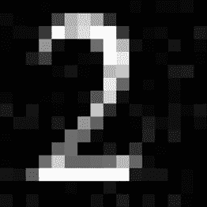

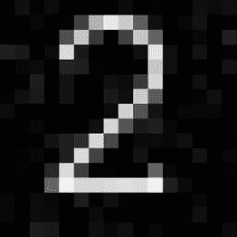

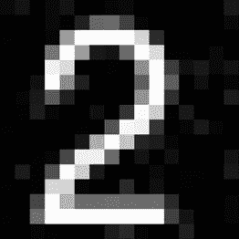

`desOutputs: [1x120 double]`

`trainSets: [1 3 4 5 6 8 9 ... 115 117 118 120]`

`testSets: [2 7 16 20 28 33 37 ... 112 114 116 119]`

请注意，输出字段是一个布尔值，当图像是所需数字时，其值为 1，否则为 0。在使用布尔标志 `oneDigitMode` 选择的单数字数据集中，输出为单行。在多数字数据集中，输出行数与集合中的数字个数相同。如果 `changeFonts` 布尔值为 `true`，则图像会从 Times、Helvetica 和 Courier 中随机选择一种字体。表 9.1 显示了使用此脚本创建的三个训练集。

我们创建了以下集合用于这些方案：

## 表 9.1： 数字训练集

- **'Digit0TrainingTS'**: 包含数字 0 到 5 的 120 张图像的单数字集，所有图像使用同一种字体。
- **'Digit0FontsTS'**: 包含数字 0 到 5 的单数字集，使用随机字体。
- **'DigitTrainingTS'**: 包含数字 0 到 9 的 200 张图像的多数字集，使用同一种字体。

图 9.2 展示了来自 `Digit0TrainingTS` 的数字 2 在三种不同字体下的示例图像。

**图 9.2：** 不同字体下的数字 2 图像。

## 9.2 创建神经网络函数

### 9.2.1 问题

我们希望创建一个神经网络工具，该工具可以经过训练来识别数字。在本方案中，我们将讨论 `NeuralNetDeveloper` 工具所依赖的函数，该工具将在下一个方案中展示。此界面并未使用 MATLAB 最新的图形用户界面（GUI）构建功能，因此我们不会深入探讨 GUI 代码本身的细节，不过完整的 GUI 可在配套代码中找到。


### 9.2.2 解决方案

该 GUI 使用多层前馈（MLFF）神经网络函数对数字进行分类。在这种类型的网络中，每个神经元仅依赖于它从前一层接收到的输入。

我们将讨论实现该神经元的函数。

### 9.2.3 工作原理

神经网络的基础是 `Neuron` 函数。我们的神经元函数提供了六种不同的激活类型：符号函数、sigmoid 幅度函数、阶跃函数、逻辑函数、双曲正切函数和求和函数 [[22]](#index_split_007.html#p350)。如图 9.3 所示。

默认的激活函数类型是双曲正切函数。另外两个在多层级网络中很有用的函数是指数函数（sigmoid 逻辑函数）：

(9.1)

`1 + e−x`

或 sigmoid 幅度函数：

`x`

`1 + |x|`

(9.2)

其中，“sigmoid” 指的是具有 S 形状的函数。

对于任何新问题，尝试不同的激活函数是一个好主意。激活函数是神经网络和机器学习区别于曲线拟合的关键。输入 `x` 是所有输入加上一个偏置的总和。

> **提示**
> 求和激活函数是线性的，其输出就是输入的总和。

以下代码展示了 `Neuron`，它在神经网络中实现了一个单一的神经元。

它的输入是类型（即激活函数），输出包括该函数的导数。默认启用 `log` 类型（用于 sigmoid 逻辑函数）。

```matlab
function [y, dYDX] = Neuron( x, type, t )

% 输入处理
if( nargin < 1 )
    x = [];
end
if( nargin < 2 )
    type = [];
end
if( nargin < 3 )
    t = 0;
end
if( isempty(type) )
    type = 'log';
end
if( isempty(x) )
    ...
end
```


**图 9.3：** 可用的神经元激活函数：sign、sigmoid mag、step、logistic (log)、tanh 和 sum。

**sign 神经元**

**mag 神经元**

**step 神经元**

0.8

0.8

0.8

0.6

0.6

0.6

0.4

0.4

0.4

0.2

0.2

0.2

输出

输出

输出

-0.2

-0.2

-0.4

-0.4

-0.4

-0.6

-0.6

-0.6

-0.8

-0.8

-0.8

输入

输入

输入

**sum 神经元**

**输出**

**tanh 神经元**

**Log 神经元**

0.9

0.8

0.8

0.6

0.7

0.4

0.6

0.2

0.5

0.4

-0.2

0.3

-0.4

0.2

-0.6

-0.8

0.1

# Princeton Satellite Systems

# 输入

```matlab
x = sort( [linspace(-5,5) 0 ] );

end

% 计算函数值和导数

switch lower( deblank(type) )

case 'tanh'

yX
= tanh(x);

dYDX = sech(x).ˆ2;

case 'log'

% sigmoid logistic 函数

yX
= 1./(1 + exp(-x));

dYDX = yX.*(1 - yX);

case 'mag'

% sigmoid magnitude 函数

d
= 1 + abs(x);

yX
= x./d;

dYDX = 1./d.ˆ2;

case 'sign'

yX
= ones(size(x));

yX(x < 0)
= -1;

dYDX
= zeros(size(yX));

dYDX(x == 0) = inf;

case 'step'

yX
= ones(size(x));

yX(x < t)
= 0;

dYDX
= zeros(size(yX));

dYDX(x == t) = inf;

case 'sum'

yX
= x;

dYDX = ones(size(yX));

otherwise

error([type ' is not recognized'])

end

% 输出处理

if( nargout == 0 )

PlotSet( x, yX, 'x label', 'Input', 'y label', 'Output',...
'plot title', [type ' Neuron'] );

PlotSet( x, dYDX, 'x label','Input', 'y label','dOutput/dX',...
'plot title',['Derivative of ' type ' Function'] );

else

y = yX;

end
```

神经元通过一个简单的层和权重数据结构组合成前馈神经网络。每个神经元的输入是信号 `y`、权重 `w` 和偏置 `w`0 的组合，如下所示：

```matlab
y = Neuron( w*y - w0, type );
```

网络的输出由函数 `NeuralNetMLFF` 计算。该函数计算多层前馈神经网络的输出。请注意，该函数还会输出从神经元激活函数获得的导数，用于训练。该函数描述如下：

## `NeuralNetMLFF` 计算多层前馈神经网络的输出。

% 输入层是一个包含网络数据的数据结构。

% 该数据结构必须包含每一层的权重和激活函数。

% 调用 `Neuron` 函数。

%

% 输出层是经过增强的输入数据结构，其中包含

% 每次运行的每一层的输入、输出和导数。

### 格式

%

```matlab
[y, dY, layer] = NeuralNetMLFF( x, network )
```

输入层和输出层是包含每一层权重和激活函数的数据结构。我们的网络将使用反向传播作为训练方法 [[19]。](#index_split_007.html#p350) 这是 195

一种梯度下降方法，它直接使用网络输出的导数。由于使用了导数，任何阈值函数（如阶跃函数）都会被替换为 Sigmoid 函数进行训练，以使其连续且可微。主要参数是学习率 `α`，它乘以每次迭代中应用于权重的梯度变化。这在 `NeuralNetTraining` 中实现。

`NeuralNetTraining` 函数执行训练，即通过反向传播计算神经元中的权重。如果未提供输入，它将针对节点 1 和节点 2 使用 `exp` 函数作为激活函数的网络进行演示。函数形式如下所示。

## `NeuralNetTraining` 使用反向传播进行训练。

% 使用反向传播计算神经网络的权重。如果未提供输入，

% 它将针对节点 1 和节点 2 使用 `exp` 函数的网络进行演示。

% 调用实现网络的 `NeuralNetMLFF`。

%

%

sin(

x) -- 节点 1

%

\ /

\

%

\

---> 输出

%

/ \

/

%

sin(0.2*x) -- 节点 2

%

### 格式

%

```matlab
[w, e, layer] = NeuralNetTraining( x, y, layer )
```

反向传播通过在循环中调用 `NeuralNetMLFF` 执行指定的运行次数。由于训练可能需要一些时间，会显示一个等待条。请注意，这可以处理任意数量的中间层。字段 `alpha` 包含该方法的学习率。

```matlab
% 执行反向传播

h = waitbar(0, '神经网络训练进行中' );

for j = 1:nRuns

% 从输出层开始反向工作

[yN, dYN,layerT] = NeuralNetMLFF( x(:,j), temp );

e(:,j)
= y(:,j) - yN(:,1); % 误差

for k = 1:nLayers

layer(k,j).w
= temp.layer(k,1).w;

layer(k,j).w0 = temp.layer(k,1).w0;

layer(k,j).x
= layerT(k,1).x;

layer(k,j).y
= layerT(k,1).y;
```

# 9.3 训练具有一个输出节点的网络

## 9.3.1 问题

我们希望训练神经网络来对数字进行分类。一个好的第一步是识别单个数字。在这种情况下，我们将有一个输出节点，我们的训练数据将包括我们想要的数字（从 0 开始），以及一些其他数字（1-5）。

## 9.3.2 解决方案

我们可以使用我们的图形用户界面（GUI）创建这个神经网络，如图 9.4 所示。网络在图形中从左到右流动。我们可以尝试用不同类型的输出节点（例如符号函数和逻辑函数）来训练网络。在我们的案例中，我们从隐藏层使用 Sigmoid 函数和输出节点使用阶跃函数开始。

GUI 左上角的框允许您设置网络，包括输入数量（本例中每个像素一个）、输出数量（因为我们想识别一个数字，所以为一个）以及隐藏层数量。右侧的框允许我们设计每一层。一层中的所有神经元都是相同的。最右侧的框允许我们设置每个节点输入的权重和节点的偏置。路径是训练数据的路径。显示区域会显示生成的网络。图形很有用，但隐藏层中的节点数量使其难以阅读。

我们的图形用户界面（GUI）有一个独立的训练窗口，如图 9.5 所示。它包含用于加载和保存训练集、训练以及测试已训练神经网络的按钮。它会根据所选偏好自动绘制结果。在此例中，我们加载了来自方案 9.1 的训练集，该训练集使用了多种字体，即 `Digit0FontsTS`，显示在图形窗口的顶部。


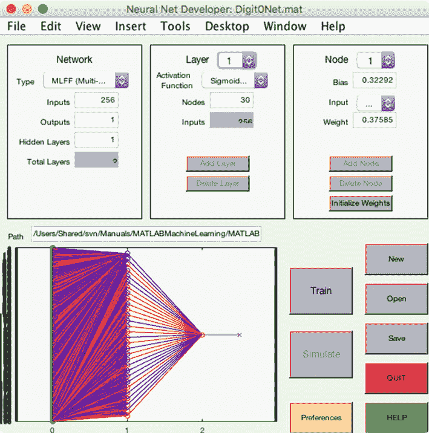

**图 9.4：** 一个具有 256 个输入（每个像素一个）、一个包含 30 个节点的中间层和一个输出的神经网络。

## 9.3.3 工作原理

我们使用 GUI 构建网络，该网络有 256 个输入（每个像素一个）、一个隐藏层中的 30 个节点以及 1 个输出节点。我们将第一个方案中的训练数据加载到训练器 GUI 中，并且必须选择训练运行的次数。如果我们的神经元函数选择得当，2000 次运行应该足够了。我们还需要选择一个额外的参数，即反向传播的学习率；从 1.0 的值开始是合理的。请注意，我们的训练数据脚本使用 `randperm` 提取随机图像集，将 75% 的图像分配用于训练，其余保留用于测试。训练过程会记录每次运行的权重和偏置，并在完成后生成图表。我们可以轻松地为输出节点绘制这些图表，该节点只有 30 个节点和一个偏置。见图 9.6。

训练函数还会输出网络演变过程中的训练误差以及均方根误差（RMSE），到大约第 1000 次运行时，RMSE 已降至接近 1e-2。


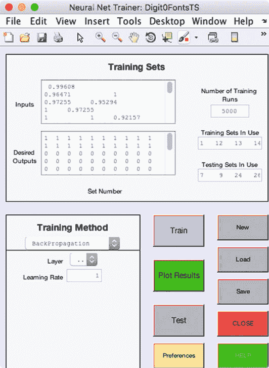

**图 9.5：** 在开发者界面中点击训练按钮时，会打开神经网络训练 GUI。

由于我们有大量的输入神经元，折线图对于可视化隐藏层权重的演变并不是很有用。但是，我们可以将任何给定迭代的权重视为图像来查看。图 9.8 展示了使用 `imagesc` 可视化的、训练后具有 30 个节点的网络的权重。我们可能会想，是否真的需要隐藏层中的所有 30 个节点，或者我们是否可以用更少的节点提取识别所选数字所需的必要特征数量。

在右侧的图像中，权重按每个节点的输入像素维度进行排序显示；我们可以清楚地看到，只有少数几个节点（尤其是节点 14、18 和 21）的权重与它们初始化时的随机值相比有较大变化。也就是说，我们的许多节点似乎没有产生影响。

由于这种可视化似乎很有帮助，我们在生成权重折线图之后，将代码添加到了训练 GUI 中。我们在一个图形中创建了两幅图像，左侧是权重的初始值，右侧是训练后的值。HSV 颜色映射看起来更引人注目。199


**图 9.6：** 训练期间第 2 层节点权重和偏置的演变。

**第 2 层节点权重**

**第 2 层节点偏置**

1.5

0.2

0.1

0.5

1 -0.1

-0.5

-0.2

-0.3

-1.5

-0.4

运行次数

运行次数

**图 9.7：** 单个数字的训练误差和 RMSE

**训练误差**

**RMS 训练误差**

0.8

0.6

0.4

10-1

0.2

RMS 误差

-0.2

10-2

-0.4

-0.6

-0.8

10-3

运行次数

运行

这里比默认的 parula 颜色图效果更好。`NeuralNetTrainer` 中生成图像的代码如下所示：

```matlab
% 新图形：将权重显示为图像
newH = figure('name',['节点权重 - 第 ' num2str(j) ' 层']);
endWeights = [h.train.network(j,1).w(:); h.train.network(j, end).w(:)];
minW = min(endWeights);
maxW = max(endWeights);
subplot(1,2,1)
imagesc(h.train.network(j,1).w,[minW maxW])
colorbar
ylabel('输出节点')
xlabel('输入节点')
title('训练前的权重')
```


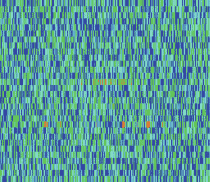


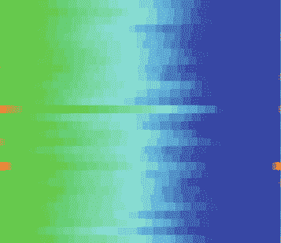


# 单数字神经网络训练与测试


**图 9.8：** 单数字网络，30 节点隐藏层权重。左侧图显示权重值。右侧图显示按像素排序后的每个节点权重。

**第 1 层节点权重**

**第 1 层排序后的节点权重**

0.8

0.8

0.6

0.6

0.4

0.4

0.2

0.2

输出节点

-0.2

输出节点

-0.2

-0.4

-0.4

-0.6

-0.6

-0.8

-0.8

输入节点

输入节点

```matlab
subplot(1,2,2)
imagesc(h.train.network(j, end).w,[minW maxW])
colorbar
xlabel('输入节点')
title('训练后的权重')
colormap hsv
h.resultsFig = [newH; h.resultsFig];
```

请注意，我们计算了初始迭代和最终迭代中的最小和最大权重值，以便两个颜色图的缩放比例保持一致。现在，由于我们最初的 30 个节点中有许多似乎是不必要的，我们将该层的节点数减少到 10 个，重新初始化权重（随机），然后再次训练。现在我们得到了新的图形，其中权重在训练前后以图像形式显示，如图 9.9 所示。

现在，在 256 个像素权重的图像中，我们可以看到更多与初始随机权重不同的颜色块，并且我们也看到第二层的权重有明显的差异。GUI 允许您保存训练好的网络以供将来使用。


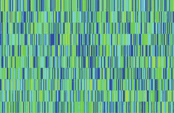


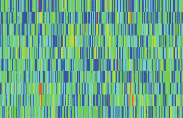


**图 9.9：** 单数字网络，10 节点隐藏层在训练前后的权重。第一行显示第一层的数据，第二行显示第二层的数据，该层只有一个输出。

*第 1 层节点权重：*

**训练前的权重**

**训练后的权重**

[X,Y]: [13 2]

索引: -0.5

[R,G,B]: [0.8745 1 0]

0.8

0.8

0.6

0.6

0.4

0.4

0.2

0.2

输出节点

输出节点

-0.2

-0.2

-0.4

-0.4

-0.6

-0.6

-0.8

-0.8

输入节点

输入节点

*第 2 层节点权重：*

0.5

0.5

0.6

0.6

1.5

1.5

0.7

0.7

0.8

0.8

0.9

0.9

0.5

0.5

1.1

输出节点

1.1

输出节点

1.2

-0.5

1.2

-0.5

1.3

1.3

1.4

1.4

-1.5

-1.5

1.5

1.5

输入节点

输入节点

# 9.4 测试神经网络

## 9.4.1 问题

我们想要测试在前一个秘籍中训练的单数字神经网络。

## 9.4.2 解决方案

我们可以使用训练中未使用的输入来测试网络。这在 GUI 中是明确允许的，因为它为训练数据和测试数据设置了单独的索引。我们在秘籍 9.1 的 `DigitTrainingData` 脚本中，选择了 75% 的样本图像用于训练，并保留了剩余的图像用于测试。


## 9.4.3 工作原理

在我们的 GUI 中，只需单击测试按钮，即可使用每个被选为测试的样本运行神经网络。

图 9.10 展示了输出节点使用 **sigmoid** 幅度函数和另一种使用阶跃函数（即输出限制为 0 或 1）的网络结果。请注意，数据集中的前 20 张图像是数字 0，输出值为 1，其余是数字 1 到 5，输出值为 0。对于阶跃函数，前 20 组输出为 1，其他所有组输出为 0，符合预期。sigmoid 函数类似，区别在于 20 组之后输出并非为 0，而是在 +0.1 和 -0.1 之间变化。在 20 到 120 组之间，输出几乎平均为零，与阶跃函数的结果相同。这表明激活函数以类似的方式解释数据。

**图 9.10：** 使用 sigmoid（左）和阶跃（右）激活函数的神经网络结果。

**带阶跃输出的网络**

**神经网络**

0.9

0.8

0.7

0.8

0.6

0.5

0.6

0.4

输出

0.4

0.3

0.2

0.2

0.1

-0.1

阶跃

普林斯顿卫星系统

测试输入集

# 9.5 训练具有多个输出的网络

## 9.5.1 问题

我们希望构建一个能够分别检测所有十个数字的神经网络。

## 9.5.2 解决方案

增加节点，使输出层拥有十个节点，当输入代表数字（0–9）时，每个节点输出为 0 或 1。尝试为输出节点使用不同的函数，例如 logistic 函数和阶跃函数。既然我们现在有更多数字，我们将把隐藏层的节点数恢复为 30 个。


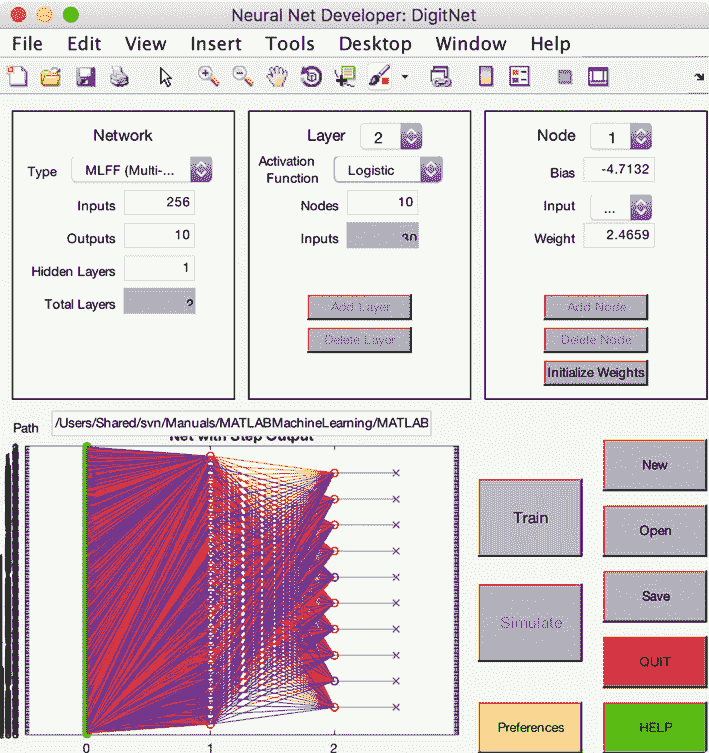

## 9.5.3 工作原理

我们的训练数据现在包含所有 10 个数字，输出为二进制形式，在正确的位置为 1，其余为 0。例如，数字 1 将表示为：

[0 1 0 0 0 0 0 0 0]

数字 3 将在第四个元素处为 1。我们遵循相同的训练步骤。

我们初始化网络，将训练集加载到 GUI 中，并指定反向传播的训练轮数。

**图 9.11：** 具有多个输出的网络。

图 9.12 中的训练数据显示，大部分学习在前 3000 轮中完成。

图 9.13 中的测试数据显示，每组数字（本例中每组 20 个，共 200 个测试）均被正确识别。


**图 9.12：** 多数字神经网络的训练均方根误差。

均方根误差

10-1

10-2 0

运行轮数

**图 9.13：** 多数字神经网络的测试结果。

**测试输出**

1 0.5

2 0.5

测试输入集

1 0

3 0.5

测试输入集

1 0

4 0.5

测试输入集

1 0

5 0.5

测试输入集

1 0

6 0.5

测试输入集

1 0

7 0.5

测试输入集

1 0

8 0.5

测试输入集

1 0

9 0.5

测试输入集

1 0

0.5

测试输入集

测试输入集


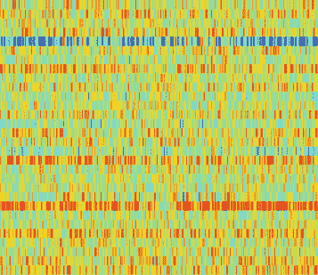


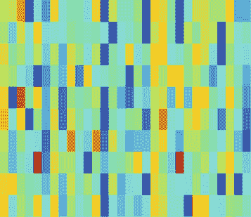


一旦你将一个运行良好的网络保存到 MAT 文件中，就可以使用 `NeuralNetMLFF` 函数调用它来处理新数据。

```
>> data = load('NeuralNetMat');
>> network = data.DigitsStepNet;
>> y = NeuralNetMLFF(DigitTrainingTS.inputs(:,1), data.DigitsStepNet)
y =

同样，通过可视化神经网络的权重来深入理解问题也很有趣，而且我们的问题规模足够小，可以用图像来实现。我们可以将单个隐藏神经元的 256 个权重视为一张 16x16 的图像，并像之前一样将每个神经元的权重按行排列（图 9.14），以观察涌现出的模式。

**图 9.14：** 多数字神经网络的权重。

**第 1 层节点权重**

**第 2 层节点权重**

2.5

0.5

1.5

0.5

输出节点

输出节点

-0.5

-0.5

-1.5

输入节点

输入节点

你可以在各个节点权重中看到数字的局部部分，它们就像微型图案。只需像这样使用`imagesc`和`reshape`：

```matlab
>> figure;
>> imagesc(reshape(net.DigitsStepNet.layer(1).w(23,:),16,16));
>> title('指向隐藏节点 23 的权重')
```


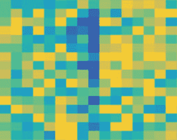

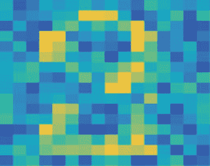

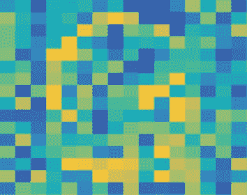


并查看如图 9.15 所示的图像。这三个节点（随机选取）分别显示了一个数字 1、2 和 3。我们可以预期这 30 个节点各自都拥有数字的“带噪”副本。

**图 9.15：** 多数字神经网络权重。

**指向隐藏节点 23 的权重**

**指向隐藏节点 5 的权重**

**指向隐藏节点 22 的权重**

## 9.6 总结

本章演示了用于数字分类的神经网络学习。我们工具的一个有趣扩展是使用图像数据存储，而不是输入数据的矩阵表示。

表 9.2 列出了随附代码中包含的函数和脚本。

**表 9.2：** 章节代码清单

**文件**

**描述**

`DigitTrainingData`

创建一组数字图像训练集。

`CreateDigitImage`

创建单个数字的带噪图像。

`Neuron`

使用多种激活函数对单个神经元进行建模。

`NeuralNetMLFF`

计算 MLFF 神经网络的输出。

`NeuralNetTraining`

使用反向传播进行训练。

`DrawNeuralNet`

显示具有多个层的神经网络。

`SaveTS`

保存包含索引数据的训练集 MAT 文件。


```