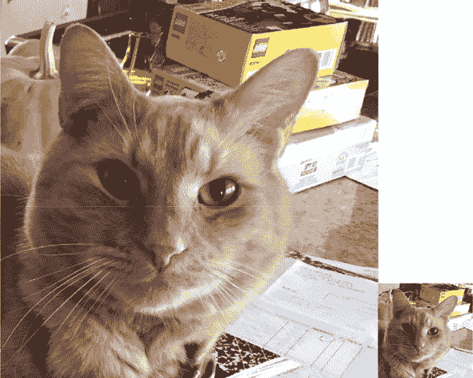
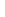

# 第 10 章 基于深度学习的模式识别

神经网络属于我们分类体系中的“学习”类别。在本章中，我们将通过添加卷积层和池化层来扩展我们的神经网络工具箱。图 10.1 展示了一个通用的神经网络。这是一个“深度学习”神经网络，因为它具有多个内部层。每一层可能具有不同的功能和形式。在上一章中，我们的多层网络也有多个层，但它们在功能上都是相似的，并且是全连接的。

自主

学习

机器

控制

学习

智能

**图 10.1：** 深度学习神经网络。

输入

输出

层

© Michael Paluszek 和 Stephanie Thomas 2019

M. Paluszek 和 S. Thomas, *MATLAB 机器学习实践*,

[`doi.org/10.1007/978-1-4842-3916-2_10`](https://doi.org/10.1007/978-1-4842-3916-2_10)


卷积神经网络是一种深度学习网络，它是一个包含多个阶段的流水线[[18]](#index_split_007.html#p350)。共有三种类型的层：

• 卷积层（因此得名）—— 将一个特征与输入矩阵进行卷积，使得输出突出该特征。这用于寻找模式。

• 池化层 —— 这些层减少了后续链中层需要处理的输入数量。

• 全连接层

图 10.2 展示了一个**卷积神经网络**。这也是一种“深度学习”神经网络，因为它包含多个内部层，但现在这些层属于上述三种类型。

**图 10.2：**深度学习卷积神经网络 [[13]](#index_split_007.html#p349)

卷积层

卷积层

卷积层

卷积层

全连接层

全连接层

池化层

池化层

输入层

层

层

概率

训练权重

我们可以根据需要设置任意数量的层。以下步骤将详细说明该流程中的每一步。我们将首先展示如何在线收集图像数据。我们实际上不会使用在线数据，但这个过程可能对你的工作有所帮助。

接着，我们将描述卷积过程。卷积过程有助于突出图像中的特征。例如，如果圆形是一个关键特征，那么将圆形与输入图像进行卷积运算，就会强化圆形特征。

下一步将实现池化。这是一种压缩数据的方法。例如，如果你有一张人脸图像，你可能不需要每一个像素。你需要找到主要特征，比如嘴巴和眼睛，但可能不需要人物虹膜的细节。这与人们素描时的做法相反。优秀的艺术家可以用寥寥几笔清晰地勾勒出一张脸，然后在后续的绘画过程中逐步填充细节。而池化则是在冒着丢失信息的风险下，减少需要处理的像素数量。


然后，我们将使用随机权重演示完整的网络。最后，我们将像之前一样，使用数据的一个子集来训练网络，并在剩余数据上对其进行测试。

在本章中，我们将使用猫的图片。我们的网络将输出给定图像是猫的概率。我们将使用猫的图像来训练网络，并复用前一章中的一些数字图像。

## 10.1 在线获取数据以训练神经网络

### 10.1.1 问题

我们希望在线查找用于训练猫识别神经网络的照片。

### 10.1.2 解决方案

使用在线数据库 ImageNet 搜索猫的图像。

### 10.1.3 工作原理

ImageNet（[`www.image-net.org`](http://www.image-net.org)）是一个根据 WordNet 层次结构组织的图像数据库。WordNet 中每个有意义的概念被称为一个“同义词集”。ImageNet 中有超过 10 万个同义词集和 1400 万张图像。例如，输入“暹罗猫”。点击链接，你会看到 445 张图片。你会注意到这些图片从多种角度和距离拍摄，种类繁多。

同义词集：暹罗猫，暹罗

定义：一种体型纤细、短毛、蓝眼睛的猫品种，毛色浅淡，耳朵、爪子、面部和尾尖为深色。

流行度百分位：57%

在 WordNet 中的深度：8

这是一个很棒的资源！不过，为了避免版权问题，我们将改用我们自己猫的照片进行测试。ImageNet 上的照片数据库对于你训练自己的神经网络来说，可能是一个极好的资源。但是，你应该查看 ImageNet 的许可协议，以确定你的应用程序是否可以不受限制地使用这些图像。

## 10.2 生成猫的训练图像

### 10.2.1 问题

我们需要用于训练猫识别神经网络的灰度照片。

### 10.2.2 解决方案

使用数码相机拍摄照片。手动将它们裁剪成标准尺寸，然后使用原生 MATLAB 函数进行处理，以创建灰度图像。


### 10.2.3 工作原理

我们首先拍摄几只猫的照片。我们将用这些照片来训练网络。照片使用 iPhone 6 拍摄。我们将照片限制为猫的面部特写。然后我们对照片进行取景裁剪，使其尺寸相对一致，并尽量减少背景。最后，我们将它们转换为灰度图像。

我们使用 `ImageArray` 函数来读取图像。该函数接收一个包含待处理图像的文件夹路径。代码中有很多部分与图像处理无关，只是用于处理文件夹中非图像文件的 Unix 文件。`ScaleImage` 位于文件读取循环中，用于缩放图像。我们将图像上下翻转，以便从我们的视角看它们是正向的。然后，我们对颜色值进行平均，以生成灰度图像。这将一个 `n×n×3` 的数组缩减为 `n×n`。其余代码用于显示打包到帧中的图像。最后，我们将所有像素值除以 256，使每个值介于 0 到 1 之间。`ImageArray` 的主体如下所示。

```matlab
%% IMAGEARRAY 从目录中读取图像数组

function [s, sName] = ImageArray( folderPath, scale )

c = cd;

cd(folderPath)
d = dir;
n = length(d);
j = 0;
s = cell(n-2,1);
sName = cell(1, length(n));

for k = 1:n
    name = d(k).name;
    if( ~strcmp(name,'.') && ~strcmp(name,'..') )
        j = j + 1;
        sName{j} = name;
        t = ScaleImage(flipud(imread(name)),scale);
        s{j} = (t(:,:,1)+ t(:,:,2) + t(:,:,3))/3;
    end
end

del = size(s{1},1);
lX = 3*del;
% 绘制图像
NewFigure(folderPath);
colormap(gray);
n = length(s);
x = 0;
y = 0;

for k = 1:n
    image('xdata',[x;x+del],'ydata',[y;y+del],'cdata', s{k} );
    hold on
    x = x + del;
    if ( x == lX )
        x = 0;
        y = y + del;
    end
end

axis off
axis image

for k = 1:length(s)
    s{k} = double(s{k})/256;
end

cd(c)
```

该函数内置了一个演示，使用我们本地的猫图像文件夹。图像按 24 或 16 的因子缩小，以便显示为 64x64 像素的图像。

```matlab
%%% ImageArray>Demo
% 生成猫图像数组
c0 = cd;
p = mfilename('fullpath');
cd(fileparts(p));
ImageArray( fullfile('..','Cats'), 4 );
cd(c0);
```

Cats 文件夹中的完整图像集（如演示中加载和缩放的那样）如图 10.3 所示。

**图 10.3：** 64x64 像素的灰度猫图像。


`ImageArray` 对三种颜色进行平均，将彩色图像转换为灰度图像。它会将图像上下翻转，因为图像坐标与 MATLAB 的坐标相反。我们使用 GraphicConverterTM 应用程序将图像裁剪到猫脸周围，并使它们全部为 1024x1024 像素。图像匹配的挑战之一就是自动完成此过程。

此外，通常训练会使用数千张图像。我们将只使用几张，看看我们的神经网络能否判断测试图像是否为猫，甚至是否是我们训练中使用过的猫！`ImageArray` 使用下面所示的 `ScaleImage` 函数来缩放图像。

```matlab
%% SCALEIMAGE 按 2 的幂缩放图像。

function s2 = ScaleImage( s1, q )

% 演示

if( nargin < 1 )

Demo

return

end

n = 2ˆq;

[mR,˜,mD] = size(s1);

m = mR/n;

s2 = zeros(m,m,mD,'uint8');

for i = 1:mD

    for j = 1:m
        r = (j-1)*n+1:j*n;
        for k = 1:m
            c = (k-1)*n+1:k*n;
            s2(j,k,i) = mean(mean(s1(r,c,i)));
        end
    end
end
```

请注意，它将新图像数组创建为 `uint8` 类型。图 10.4 显示了缩放全彩色图像的结果。




**图 10.4：** 图像从 1024x1024 缩放至 256x256。

## 10.3 矩阵卷积

### 10.3.1 问题

我们希望实现卷积，作为一种强调图像关键特征的技术，以使学习更有效。这将在下一个方法中用于为神经网络创建卷积层。

### 10.3.2 解决方案

使用 MATLAB 矩阵运算实现卷积。

### 10.3.3 工作原理

我们创建一个 n×n 的掩码，并将其应用于一个 m×m 的矩阵，其中 m 大于 n。我们从矩阵的左上角开始，如图 10.5 所示。我们将掩码与输入矩阵中对应的元素相乘，然后进行双重求和。这就是卷积输出的第一个元素。接着，我们逐列移动掩码，直到掩码的最高列与输入矩阵的最高列对齐。然后，我们将掩码移回第一列，并向下移动一行。我们继续这个过程，直到遍历整个输入矩阵，并且掩码与最大行和最大列对齐。

掩码代表一个特征。实际上，我们是在检查该特征是否出现在图像的不同区域。我们可以有多个掩码。对于每个特征，掩码的每个元素都有一个偏置和一个权重。在这种情况下，我们只有 4 组权重和偏置，而不是 16 组。对于大图像来说，这种节省是相当可观的。在这种情况下，卷积 215


**图 10.5：** 卷积过程，展示了过程开始和结束时的掩码。

输入矩阵

卷积矩阵

掩码

直接作用于图像本身。卷积也可以应用于其他卷积层或池化层的输出，如图 10.2 所示。

卷积在 `Convolve.m` 中实现。掩码是输入 `a`，待卷积的矩阵是输入 `b`。

```matlab
function c = Convolve( a, b )

% Demo

if( nargin < 1 )

Demo

return

end

[nA,mA] = size(a);

[nB,mB] = size(b);

nC = nB - nA + 1;

mC = mB - mA + 1;

c = zeros(nC,mC);

for j = 1:mC

    jR = j:j+nA-1;
    for k = 1:nC
        kR = k:k+mA-1;
        c(j,k) = sum(sum(a.*b(jR,kR)));
    end
end
```


该演示将一个 3x3 的掩码与一个 6x6 的矩阵进行卷积，产生以下 4x4 矩阵输出。

```matlab
>> Convolve

a =

b =

ans =
```

## 10.4 卷积层

### 10.4.1 问题

我们想要实现一个卷积连接层。这将把一个掩码应用于输入图像。

### 10.4.2 解决方案

使用 `Convolve` 中的代码来实现该层。它会在图像上滑动掩码，并且输出的数量会减少。

### 10.4.3 工作原理

“卷积”神经网络使用掩码扫描输入。掩码的每个输入都通过一个激活函数，对于给定的掩码，该激活函数是相同的。`ConvolutionLayer` 有其内置的神经元函数，如下面的代码清单所示。

```matlab
%% CONVOLUTIONLAYER 神经网络的卷积层

function y = ConvolutionLayer( x, d )

% Demo

if( nargin < 1 )

    if( nargout > 0 )
        y = DefaultDataStructure;
    else
        Demo;
    end

    

    

    return

end

a = d.mask;

aFun = str2func(d.aFun);

[nA,mA] = size(a);

[nB,mB] = size(x);

nC = nB - nA + 1;

mC = mB - mA + 1;

y = zeros(nC,mC);

scale = nA*mA;

for j = 1:mC

    jR = j:j+nA-1;
    for k = 1:nC
        kR = k:k+mA-1;
        y(j,k) = sum(sum(a.*Neuron(x(jR,kR),d, aFun)));
    end
end

y = y/scale;

%%% ConvolutionLayer>Neuron

function y = Neuron( x, d, afun )

% 神经元函数

y = afun(x.*d.w + d.b);
```

图 10.6 展示了该演示的输入和输出（未在代码清单中显示）。本演示中使用了 `tanh` 激活函数。权重和偏置是随机的。全为 1 的掩码的卷积结果就是它所乘的所有点的总和。输出结果会按掩码中的元素数量进行缩放。

## 10.5 对层输出进行池化

### 10.5.1 问题

我们希望对卷积层的输出进行池化，以减少需要在后续层中处理的数据点数量。这使用了上一个方法中创建的 `Convolve` 函数。

### 10.5.2 解决方案

实现一个新函数来处理卷积函数的输出。


**图 10.6：** 卷积层的输入与输出。

输入

0.5

输出

0.62

0.6

掩码

### 10.5.3 工作原理

池化层从卷积层的输出中选取一个子集，并将其传递下去。它们不包含任何权重。池化层可以使用池内的最大值，也可以取中位数或平均值。我们的池化函数提供了这三种选项。池化函数将输入划分为 n×n 的子区域，并返回一个 n×n 的矩阵。

池化功能在 `Pool.m` 中实现。请注意，我们使用了 `str2func` 而不是 `switch` 语句。`a` 是要进行池化的矩阵，`n` 是池的数量，`type` 是池化函数的名称。

```matlab
function b = Pool( a, n, type )

% 演示

if( nargin < 1 )

Demo

return

end

if( nargin <3 )

type = 'mean';

end

n = n/2;

p = str2func(type);

nA = size(a,1);


nPP = nA/n;

b = size(n,n);

for j = 1:n

    r = (j-1)*nPP +1:j*nPP;
    for k = 1:n
        c = (k-1)*nPP +1:k*nPP;
        b(j,k) = p(p(a(r,c)));
    end
end
```

以下两个演示从一个 4x4 矩阵中创建了四个池。输出矩阵中的每个数字都是输入矩阵四分之一区域的池化结果。它使用了默认的 'mean'（均值）池化方法。

```matlab
>> Pool([1:4;3:6;6:9;7:10],4)

ans =

2.5000

4.5000

7.0000

9.0000

>> Pool([1:4;3:6;6:9;7:10],4,'max')

ans =
```

# Pool

`Pool`是一个神经层，其激活函数实际上就是传递给`Pool`的参数。

## 10.6 全连接层

### 10.6.1 问题

我们希望实现一个全连接层。

### 10.6.2 解决方案

使用`FullyConnectedNN`来实现该网络。

### 10.6.3 工作原理

“全连接”神经网络层是传统的神经网络，其中每个输入都连接到每个输出，如图 10.7 所示。我们实现了一个具有 n 个输入和 m 个输出的全连接网络。通向每个输出的路径可以有不同的权重和偏置。

`FullyConnectedNN`可以处理任意数量的输入或输出。下面的代码展示了数据结构函数以及函数主体。

% FullyConnectedNN>Demo

```matlab
function y = FullyConnectedNN( x, d )

% 演示

if( nargin < 1 )
    DefaultDataStructure;
    Demo;
    return
end

y = zeros(d.m, size(x,2));
aFun = str2func(d.aFun);
n = size(x,1);
for k = 1:d.m
    for j = 1:n
        y(k,:) = y(k,:) + aFun(d.w(j,k)*x(j,:) + d.b(j,k));
    end
end

function d = DefaultDataStructure
%%% FullyConnectedNN>DefaultDataStructure
% 默认数据结构
```

图 10.8 显示了内置函数演示的输出。该演示中使用了`tanh`激活函数。权重和偏置是随机的。从输入到输出的形状变化是激活函数作用的结果。


**图 10.8：** 展示了`FullyConnectedNN`演示函数的两个输出与两个输入之间的关系。

## 10.7 确定概率

### 10.7.1 问题

我们希望计算一个输出符合我们预期的概率，该输出来自神经网络的输出。

### 10.7.2 解决方案

实现 Softmax 函数。给定一组输入，它计算一组总和为 1 的正数值。这将用于我们网络的输出节点。

### 10.7.3 工作原理

*softmax* 函数是逻辑函数的一种泛化。其公式为：

```math
p_j = \frac{e^{q_j}}{\sum_{k=1}^{N} e^{q_k}}
```

其中，`q`是输入向量，`N`是输入的数量，`p`是总和为 1 的输出值。

该函数在`Softmax.m`中实现。

```matlab
function [p, pMax, kMax] = Softmax( q )
q = reshape(q,[],1);
n = length(q);
p = zeros(1,n);
den = sum(exp(q));
for k = 1:n
    p(k) = exp(q(k))/den;
end
[pMax,kMax] = max(p);
```

内置演示传入一个简短的输出列表。

```matlab
function Demo
%% Softmax>Demo
q = [1,2,3,4,1,2,3];
[p, pMax, kMax] = Softmax( q )
sum(p)
```

演示的结果如下：

```
>> Softmax
p =
    0.0236
    0.0643
    0.1747
    0.4748
    0.0236
    0.0643
    0.1747
pMax =
    0.4748
kMax =
ans =
     4
```

最后一个数字是`p`的总和，结果应为（且确实为）1。

## 10.8 测试神经网络

### 10.8.1 问题

我们希望整合卷积、池化、全连接层和 Softmax，使网络输出概率值。

### 10.8.2 解决方案

解决方案是编写一个卷积神经网络。我们整合了卷积、池化、全连接网络和 Softmax 函数，然后使用随机生成的权重对其进行测试。

### 10.8.3 工作原理

图 10.9 展示了图像处理神经网络。它包含一个卷积层、一个池化层、一个全连接层，最后一层是 Softmax。


**图 10.9：** 用于图像处理的神经网络。

`ConvolutionNN`实现了该网络。它使用了我们在之前章节中实现的`ConvolutionLayer`、`Pool`、`FullyConnectedNN`和`Softmax`函数。

实现该网络的`ConvolutionNN`代码（位于子函数`NeuralNet`中）如下所示。如果请求使用`mesh`绘图，它可以生成图形。

```matlab
function r = NeuralNet( d, t, ~ )
%%% ConvolutionalNN>NeuralNet
% 执行神经网络。如果有三个输入参数则绘图。
% 对图像进行卷积
yCL     = ConvolutionLayer( t, d.cL );
% 池化输出
yPool   = Pool( yCL, d.pool.n, d.pool.type );
% 应用全连接层
yFC     = FullyConnectedNN( yPool, d.fCNN );
[~,r]   = Softmax( yFC );
% 如果请求则绘图
if( nargin > 2 )
    NewFigure('ConvolutionNN');
    subplot(3,1,1);
    mesh(yCL);
    title('卷积层')
    subplot(3,1,2);
    mesh(yPool);
    title('池化层')
    subplot(3,1,3);
    mesh(yFC);
    title('全连接层')
end
```


`ConvolutionNN`还包含用于定义数据结构、训练和测试网络的附加子函数。

我们首先使用`TestNN`测试用随机权重初始化的神经网络。这是一个脚本，它使用`ImageArray`加载猫图像，用随机权重初始化卷积网络，然后使用选定的测试图像运行该网络。

```
>> TestNN
图像 IMG_3886.png 有 13.1%的概率是一只猫
```

不出所料，未经训练的神经网络无法识别出猫！图 10.10 展示了网络处理各个阶段的输出。

**图 10.10：** 卷积神经网络处理的各个阶段。


## 10.9 识别数字

### 10.9.1 问题

我们希望判断一张图像是否为数字 3 的图像。

### 10.9.2 解决方案

我们使用一系列数字 3 的图像来训练神经网络。然后，从训练集中取一张图片，再取另一张单独的图片，计算它们属于数字 3 的概率。


### 10.9.3 工作原理

我们首先运行脚本 `Digit3TrainingData` 来生成训练集。这是第 5 章 `DigitTrainingData` 中训练图像生成脚本的简化版本。它只生成一个数字，在本例中是数字 3。`input` 将图像的 256 个比特全部放在单列中。`output` 对所有图像都输出数字 1。我们循环使用三种字体`'times'`、`'helvetica'`、`'courier'` 以增加多样性。这将使神经网络在看到不同字体时训练更有效。与第 4 章的脚本不同，我们将图像存储为 16x16 像素的图像。我们还直接使用 `save` 将三个数组 `'input'`、`'trainSets'`、`'testSets'` 保存到一个 `.mat` 文件中。

```matlab
% 为数字 3 生成网络训练数据
digits = 3;
nImagesPer = 20;
% 准备数据
nDigits = length(digits);
nImages = nDigits*nImagesPer;
input = cell(1,nImages);
output = zeros(1,nImages);
fonts = {'times','helvetica','courier'};
% 循环
kImage = 1;
for j = 1:nDigits
    fprintf('Digit %d\n', digits(j));
    for k = 1:nImagesPer
        kFont = ceil(rand*length(fonts));
        pixels = CreateDigitImage( digits(j), fonts{kFont} );
        % 将像素缩放到 0 到 1 的范围
        input{kImage} = double(pixels)/255;
        kImage = kImage + 1;
    end
    sets = randperm(10);
end
% 使用 75% 的图像进行训练，其余保存用于测试
trainSets = sort(randperm(nImages, floor(0.75*nImages)));
testSets = setdiff(1:nImages,trainSets);
save('digit3.mat', 'input', 'trainSets', 'testSets');
```

然后我们运行脚本 `TrainNNNumber` 来检查输入图像是否为数字 3。该脚本将 `.mat` 文件中的数据加载到工作区，以便 `input`、`trainSets` 和 `testSets` 可以直接使用。我们从 `ConvolutionalNN` 获取默认数据结构，并修改设置以优化 `fminsearch`。

```matlab
% 在单个数字上训练神经网络
% 从加载的 mat 文件中的图像训练网络。
% 切换为使用一张图像或全部图像进行训练
useOneImage = false;
% 这是为了确保运行结果一致
rng('default')
% 加载图像数据
load('digit3');
% 训练
if useOneImage
% 仅使用一张图像进行训练
trainSets = randperm(nImages,1);
end
```





```= 2;

`testSets` = `setdiff`(1:**length**(`input`), `trainSets`);

**end**

`fprintf`(1,'训练图像 [')

`fprintf`(1,'%1d ', `trainSets`);

`d` = `ConvolutionalNN`;

`d.opt` = `optimset`('TolX', 1e-5, 'MaxFunEvals', 400000, 'maxiter', 200000);
`d` = `ConvolutionalNN`( 'train', `d`, `input`(`trainSets`) );

`fprintf`(1,']\n 函数值（应为零）%12.4f\n', `d.fVal`);

% 使用测试图像测试网络

**for** `k` = 1:**length**(`testSets`)

[`d`, `r`] = `ConvolutionalNN`( 'test', `d`, `input`{`testSets`(`k`)} );

`fprintf`(1,'测试图像 %d 有 %4.1f%% 的概率是数字 3\n', `testSets`(`k`), 100*`r`);

**end**

% 使用测试图像测试网络

[`d`, `r`] = `ConvolutionalNN`( 'test', `d`, `input`{`trainSets`(1)} );
`fprintf`(1,'训练图像 %2d 有 %4.1f%% 的概率是数字 3\n', `trainSets`(1), 100*`r`);

我们设置 `rng('default')`，因为 `fminsearch` 有时会使用随机数。这确保了每次运行的结果相同。我们运行该脚本两次。第一次，我们使用顶部的布尔开关，仅用一张图像进行训练。第二次，我们使用完整的训练集，如第 9 章所述，将布尔开关设置为 `false`。我们设置 `tolX = 1e-5`。这是权重的容差，我们正在尝试求解这些权重。将其设置得更小不会改善任何结果。如果将其设置得非常大，比如 1，则会降低学习效果。迭代次数需要大于 10,000。同样，如果设置得太小，将无法收敛。对于单张训练图像


，脚本返回图像 2 或 19 是数字 3 的概率为 80.3%（推测是相同字体的数字）。其他测试图像的概率范围从 35.6% 到 47.4%。

```
>> TrainNNNumber
训练图像 [2 ]
函数值（应为零）0.1969
测试图像 1 有 35.6% 的概率是数字 3
测试图像 6 有 37.1% 的概率是数字 3
测试图像 11 有 47.4% 的概率是数字 3
测试图像 18 有 47.4% 的概率是数字 3
测试图像 19 有 80.3% 的概率是数字 3
训练图像 2 有 80.3% 的概率是数字 3
```

```
>> TrainNNNumber
训练图像 [2 3 4 5 7 8 9 10 12 13 14 15 16 17 20 ]
函数值（应为零）0.5734
测试图像 1 有 42.7% 的概率是数字 3
测试图像 6 有 42.7% 的概率是数字 3
测试图像 11 有 42.7% 的概率是数字 3
测试图像 18 有 42.7% 的概率是数字 3
测试图像 19 有 42.7% 的概率是数字 3
训练图像 2 有 42.7% 的概率是数字 3
```

当我们使用大量代表不同字体的图像进行训练时，概率变得一致，尽管没有达到我们期望的高水平。虽然 `fminsearch` 确实找到了合理的权重，但我们不能说这个网络非常准确。

## 10.10 识别图像

### 10.10.1 问题

我们想要判断一张图像是否是猫的图像。

### 10.10.2 解决方案

我们用一系列猫的图像来训练神经网络。然后，我们从训练集中取一张图片，并从预留的测试集中取另一张图片，计算它们是猫的概率。

### 10.10.3 工作原理

我们运行脚本 `TrainNN` 来判断输入图像是否是猫。它根据 Cats 文件夹中的图像训练网络。有意义的训练需要成千上万次函数评估，但仅允许少量函数评估也能表明函数正在工作。

```matlab
%% 在 Cats 图像上训练神经网络
p = mfilename('fullpath');
c0 = cd;
cd(fileparts(p));
```


```matlab
folderPath = fullfile('..','Cats');
[s, name] = ImageArray( folderPath, 4 );
d = ConvolutionalNN;
% 使用除最后一张之外的所有图像进行训练
s = s(1:**end**-1);
% 这可能需要一段时间
% 至少使用 10000 次迭代才能看到更高的“是猫”概率变化
disp('开始训练...')
d.opt.Display = 'iter';
d.opt.MaxFunEvals = 500;
d = ConvolutionalNN( 'train', d, s );
% 使用未参与训练的最后一张图像测试网络
[d, r] = ConvolutionalNN( 'test', d, s{**end**} );
fprintf(1,'图像 %s 是猫的概率为 %4.1f%%\n', name{**end**}, 100*r);
% 使用第一张图像测试网络
```

[d, r] = `ConvolutionalNN`( 'test', d, s{1} );

`fprintf`(1,'图像 %s 是猫的概率为 %4.1f%%\n',name{1},100*r);

脚本返回的结果显示，两张图像是猫的概率均为 38.8%。考虑到我们仅用一张图像进行训练，这已经是一个进步。处理过程花费了几个小时。

>> `TrainNN`

```
Exiting: 超过最大函数求值次数
- 请增加 MaxFunEvals 选项。
当前函数值: 0.612029
图像 IMG_3886.png 是猫的概率为 38.8%
图像 IMG_0191.png 是猫的概率为 38.8%
```

`fminsearch` 使用直接搜索方法（Nelder–Mead 单纯形法），并且对初始条件非常敏感。

事实上，使用这种搜索方法给该神经网络训练带来了根本性的性能障碍，尤其是在深度学习领域，不同权重组合的组合数非常庞大。使用全局优化方法可能会获得更好（且更快）的结果。

下面展示了来自 `ConvolutionNN` 的训练代码。

它使用了 MATLAB 的 `fminsearch`。`fminsearch` 会不断调整增益和偏置，直到所有输入图像与训练图像之间达到良好的拟合。


```matlab
function d = Training( d, t )
%%% ConvolutionalNN>Training
d = Indices( d );
x0 = DToX( d );
[x,d.fVal] = fminsearch( @RHS, x0, d.opt, d, t );
d = XToD( x, d );
```

我们可以通过以下方式改进结果：

• 调整 `fminsearch` 参数。

• 增加更多图像。

• 增加更多特征（掩码）。

• 更改全连接层中的连接方式。

• 增加卷积神经网络直接处理 RGB 图像的能力，而不是将其转换为灰度图。

• 使用不同的搜索方法，例如遗传算法。

## 10.11 总结

本章演示了使用 MATLAB 实现卷积神经网络的步骤。卷积神经网络被用于处理数字和猫的图片以进行学习。训练完成后，要求神经网络识别其他图片，以判断它们是猫的图片还是数字的图片。表 10.1 列出了随附代码中包含的函数和脚本。

### 表 10.1：章节代码清单

| 文件 | 描述 |
| :--- | :--- |
| `Activation` | 生成激活函数。 |
| `ConvolutionalNN` | 实现卷积神经网络。 |
| `ConvolutionLayer` | 实现卷积层。 |
| `Convolve` | 使用掩码对二维数组进行卷积。 |
| `Digit3TrainingData` | 为单个数字创建训练数据。 |
| `FullyConnectedNN` | 实现全连接神经网络。 |
| `ImageArray` | 读取文件夹中的图像并转换为灰度图。 |
| `Pool` | 对二维数组进行池化。 |
| `ScaleImage` | 缩放图像。 |
| `Softmax` | 实现 Softmax 函数。 |
| `TrainNN` | 使用猫图像训练卷积神经网络。 |
| `TrainNNNumber` | 使用数字图像训练卷积神经网络。 |
| `TestNN` | 在猫图像上测试卷积神经网络。 |
| `TrainingData.mat` | 来自 TestNN 的数据。 |


