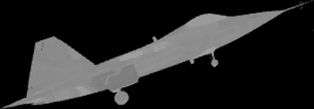
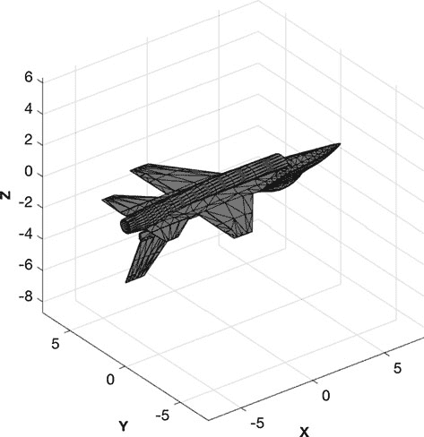
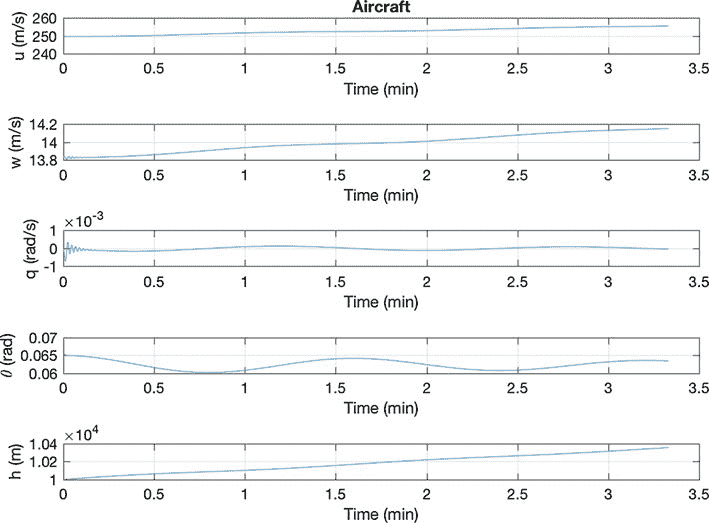
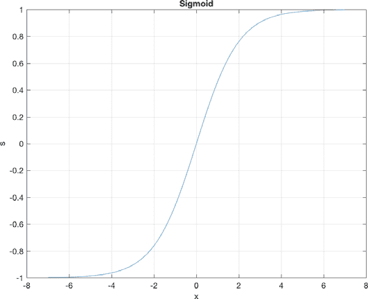

# 第 11 章 神经飞机控制

纵向控制是指飞机在高度和速度变化时所需的控制。在本章中，我们将实现一个神经网络，用于生成非线性飞机控制系统的关键参数。这是一个在线学习的示例，并应用了前几章中的多种技术。

飞机的纵向动力学也称为俯仰动力学。该动力学完全位于飞机的对称平面内。对称平面被定义为将飞机垂直切成两半的平面。大多数飞机关于该平面对称。

这些动力学包括飞机的前向和垂直运动，以及飞机绕垂直于对称平面的轴的俯仰运动。图 11.1 展示了一架飞行中的飞机。`α` 是攻角，即机翼与速度矢量之间的夹角。我们假设风向与速度矢量方向相反，也就是说，飞机产生了其全部的风。阻力沿风向，升力垂直于阻力。俯仰力矩围绕质心。我们将推导的模型使用少量参数，却能相当好地再现纵向动力学。您也可以轻松修改该模型以模拟任何感兴趣的飞机。

© Michael Paluszek 和 Stephanie Thomas 2019

M. Paluszek 和 S. Thomas，*MATLAB 机器学习实践*，

[`doi.org/10.1007/978-1-4842-3916-2_11`](https://doi.org/10.1007/978-1-4842-3916-2_11)




**图 11.1：** 飞行中飞机的示意图，显示了纵向动力学模拟的所有重要量。

## 11.1 纵向运动

接下来的几个实践将涉及使用神经网络对飞机进行纵向控制以提供学习能力。我们将：

1. 对飞机动力学进行建模
2. 找到一个平衡解，我们将围绕该解控制飞机
3. 学习如何编写 sigma-pi 神经网络
4. 实现 PID 控制
5. 实现神经网络
6. 对系统进行仿真

在本教程中，我们将为学习控制建模飞机的纵向动力学。我们将推导一个参数数量“较少”的简单纵向动力学模型。我们的控制将采用带有比例积分微分（PID）控制器的非线性动力学反演来控制俯仰动力学`[16, 17]`。学习将使用 sigma-pi 神经网络来完成。

我们将采用 NASA 德莱顿研究中心开发的学习方法`[30]`。基线控制器是一种带有 PID 控制律的动态反演型控制器。在飞机运行期间，神经网络`[15]`提供学习功能。该神经网络是一种 sigma-pi 类型的网络，这意味着该网络将输入与其相关权重的乘积进行求和。


神经网络的权重由训练算法确定，该算法使用：

1. 来自参考模型的指令飞机速率
2. PID 误差
3. 从神经网络反馈的自适应控制速率

### 11.1.1 问题

我们希望对飞机的纵向动力学进行建模。

### 11.1.2 解决方案

解决方案是编写飞机纵向动力学微分方程的右侧函数。

### 11.1.3 工作原理

我们在表 11.1 中总结了动力学模型的符号。我们的气动模型非常简单。升力和阻力为：

```
L = ρ * S * C_L   (11.1)
```

```
D = ρ * S * C_D   (11.2)
```

其中，`S` 是浸润面积，即与气流相互作用的面积，也是计算气动力时计入的面积；`ρ` 是动压，即飞机因速度而产生的压力：

```
p = ρ * v²        (11.3)
```

其中，`ρ` 是大气密度，`v` 是速度的大小。大气密度是高度的函数。对于低速飞行，这主要涉及机翼。大多数书籍使用 `q` 表示动压。我们使用 `q` 表示俯仰角速率（这也是一种惯例），因此为了避免混淆，我们在此使用 `p` 表示压力。

升力系数 `C_L` 为：

```
C_L = C_Lα * α    (11.4)
```

阻力系数 `C_D` 为：

```
C_D = C_D0 + k * C_L²   (11.5)
```

阻力方程被称为阻力极曲线。增大迎角会增加飞机的升力，但也会增加飞机的阻力。系数 `k` 为：

```
k = 1 / (π₀ * AR)       (11.6)
```


### 表 11.1：飞机动力学符号

| 符号 | 描述 | 单位 |
| :--- | :--- | :--- |
| `g` | 海平面重力加速度 | 9.806 m/s² |
| `h` | 高度 | m |
| `k` | 升致阻力系数 | |
| `m` | 质量 | kg |
| `p` | 动压 | N/m² |
| `q` | 俯仰角速率 | rad/s |
| `u` | x 轴速度 | m/s |
| `w` | z 轴速度 | m/s |
| `CL` | 升力系数 | |
| `CD` | 阻力系数 | |
| `D` | 阻力 | N |
| `Iy` | 俯仰转动惯量 | kg·m² |
| `L` | 升力 | N |
| `M` | 俯仰力矩（扭矩） | N·m |
| `Me` | 升降舵产生的俯仰力矩 | N·m |
| `re` | 升降舵力臂 | m |
| `S` | 机翼浸润面积（产生升力和阻力的面积） | m² |
| `Se` | 升降舵浸润面积 | m² |
| `T` | 推力 | N |
| `X` | 机体坐标系 X 轴力 | N |
| `Z` | 机体坐标系 Z 轴力 | N |
| `α` | 迎角 | rad |
| `γ` | 航迹角 | rad |
| `ρ` | 空气密度 | kg/m³ |
| `θ` | 俯仰角 | rad |

其中，0 为奥斯瓦尔德效率因子，通常在 0.75 到 0.85 之间。`AR` 是机翼展弦比。展弦比是机翼展长与弦长之比。对于复杂形状，其近似公式为：

$$
AR = \frac{b^2}{S}
\tag{11.7}
$$

其中 `b` 为展长，`S` 为机翼面积。展长从一侧翼尖测量到另一侧翼尖。滑翔机具有非常高的展弦比，而三角翼飞机的展弦比较低。

空气动力学系数是无量纲系数，当乘以飞机的浸润面积和动压时，可产生空气动力。


动力学方程，即运动微分方程，如[[5]：](#index_split_007.html#p349)

$$
m(\dot{u} + qw) = X - mg \sin\theta + T \cos
\tag{11.8}
$$

$$
m(\dot{w} - qu) = Z + mg \cos\theta - T \sin
\tag{11.9}
$$

$$
I_y \dot{q} = M
\tag{11.10}
$$

$$
\dot{\theta} = q
\tag{11.11}
$$

`m` 为质量，`u` 为 x 轴速度，`w` 为 z 轴速度，`q` 为俯仰角速率，`θ` 为俯仰角，`T` 为发动机推力， 为推力矢量与 x 轴之间的夹角，`I_y` 为俯仰惯量，`X` 为 x 轴力，`Z` 为 z 轴力，`M` 为绕俯仰轴的扭矩。x 轴与 z 轴速度之间的耦合是由于在旋转坐标系中列写力方程所致。

俯仰方程是关于质心的。这些量是 `u`、`w`、`q` 和高度 `h` 的函数，高度由下式求得：

$$
\dot{h} = u \sin\theta - w \cos\theta
\tag{11.12}
$$

迎角 `α` 是 `u` 与 `w` 速度之间的夹角，其关系为：

$$
\tan\alpha = \frac{w}{u}
\tag{11.13}
$$

航迹角 `γ` 是速度矢量方向与水平线之间的夹角。它与 `θ` 和 `α` 的关系为：

$$
\gamma = \theta - \alpha
\tag{11.14}
$$

好的，作为一名高级文档工程师和翻译员，我将严格遵循您提供的注意事项和示例，将给定的英文文本翻译成中文。

这在方程式中并未出现，但在研究飞机运动时，计算它非常有用。

力为：

$$
X = L \sin\alpha - D \cos\alpha
\tag{11.15}
$$

$$
Z = -L \cos\alpha - D \sin\alpha
\tag{11.16}
$$

假设力矩（或扭矩）是由于压力中心与质心沿 `x` 轴偏移而产生的：

$$
M = (cp - c) Z
\tag{11.17}
$$

其中，`cp` 是压力中心的位置。由升降舵产生的力矩为：

$$
M_e = q r_e S_e \sin(\delta)
\tag{11.18}
$$

`Se` 是升降舵的浸润面积，`r_E` 是从质心到升降舵的距离。动力学模型位于 `RHSAircraft` 中。大气密度模型是一个指数模型，并作为此函数中的一个子函数包含在内。如果未提供输入，`RHSAircraft` 将返回默认数据结构。


```matlab
function [xDot, lift, drag, pD] = RHSAircraft(~, x, d)
    if (nargin < 1)
        xDot = DataStructure;
        return
    end

    g = 9.806; % 重力加速度 (m/s²)
    u = x(1); % 前进速度
    w = x(2); % 上升速度
    q = x(3); % 俯仰角速率
    theta = x(4); % 俯仰角
    h = x(5); % 高度

    rho = AtmDensity(h); % 密度 (kg/m³)
    alpha = atan(w/u);
    cA = cos(alpha);
    sA = sin(alpha);
    v = sqrt(u^2 + w^2);
    pD = 0.5*rho*v^2; % 动压

    cL = d.cLAlpha*alpha;
    cD = d.cD0 + d.k*cL^2;

    drag = pD*d.s*cD;
    lift = pD*d.s*cL;

    xDot = lift*sA - drag*cA;
end
```


`z = -lift*cA - drag*sA`

`m = d.c*z + pD*d.sE*d.rE*sin(d.delta)`

`sT = sin(theta)`

`cT = cos(theta)`

`tEng = d.thrust*d.throttle`

`cE = cos(d.epsilon)`

`sE = sin(d.epsilon)`

`uDot = (x + tEng*cE)/d.mass - q*w - g*sT + d.externalAccel(1)`

`wDot = (z - tEng*sE)/d.mass + q*u + g*cT + d.externalAccel(2)`

`qDot = m/d.inertia + d.externalAccel(3)`

`hDot = u*sT - w*cT`

`xDot = [uDot;wDot;qDot;q;hDot]`





我们将使用 F-16 飞机模型进行仿真。F-16 是一种单引擎超音速多用途战斗机，被许多国家使用。F-16 如图 11.2 所示。

**图 11.2：** F-16 模型。

惯性矩阵是通过获取该模型，将质量分布到所有顶点，并根据以下公式计算惯性得到的：

`m_k = (11.19)`

`N*c = sum(m_k*r_k)` (11.20)

`I_k = m_k*(r_k - c)^2` (11.21)

其中，`N` 是节点数，`r_k` 是从原点（任意）到节点 `k` 的向量。

`inr = 1.0e+05 * [0.3672, 0.0002, -0.0604; 0.0002, 1.4778, 0.0000; -0.0604, 0.0000, 1.7295]`


**表 11.2：** F-16 数据

| 符号 | 字段 | 值 | 描述 | 单位 |
| :--- | :--- | :--- | :--- | :--- |
| `CLα` | cLAlpha | 6.28 | 升力系数 | |
| `CD` 0 | cD0 | 0.0175 | 零升阻力系数 | |
| `k` | k | 0.1288 | 升力耦合系数 | |
| `epsilon` | | | 推力与 x 轴的夹角 | 弧度 |
| `T` | thrust | 76.3e3 | 发动机推力 | 牛 |
| `S` | s | 27.87 | 机翼面积 | 平方米 |
| `m` | mass | 12,000 | 飞机质量 | 千克 |
| `Iy` | inertia | 1.7295e5 | z 轴惯性矩 | 千克·平方米 |
| `c − cp` | c | | 重心与压力中心的偏移量 | 米 |
| `Se` | sE | 3.5 | 升降舵面积 | 平方米 |
| `re` | (rE) | 4.0 | 升降舵力臂 | 米 |

F-16 数据见表 11.2。

该模型存在许多局限性。首先，推力是立即以 100% 的精度施加的。推力也不是空速或高度的函数。真实的发动机需要一些时间才能达到指令推力，并且推力水平会随空速和高度而变化。在该模型中，升降舵也是瞬时响应的。升降舵由电机驱动，通常是液压电机，但有时是纯电动电机，它们需要时间才能达到指令角度。在我们的模型中，空气动力学非常简单。实际上，升力和阻力是空速和迎角的复杂函数，通常使用大型系数表进行建模。我们还通过力臂对俯仰力矩进行建模。通常，扭矩是通过表格建模的。尽管这在大多数完整的飞机空气动力学模型中都会出现，但我们的模型没有考虑空气动力学阻尼。你可以通过创建函数轻松添加这些特性：

`C_L = CL(v, h, alpha, delta)`


# 11.2

## 数值求解平衡状态

### 11.2.1 问题

我们希望确定飞机的平衡状态。这是所有力和力矩都平衡的姿态。

### 11.2.2 解决方案

解决方案是计算动力学的雅可比矩阵。雅可比矩阵是一个包含向量值函数（此处为飞机动力学）所有一阶偏导数的矩阵。


### 11.2.3 工作原理

我们希望每次仿真都从一个平衡状态开始。这是通过函数 `EquilibriumState` 实现的。它使用 `fminsearch` 来最小化：

˙*u*² + ˙*w*²

(11.22)

给定飞行速度、高度和飞行路径角。然后计算使俯仰角加速度为零所需的升降舵角度。它内置了一个在 10 公里高度进行平衡水平飞行的演示。

```matlab
function [x, thrust, delta, cost] = EquilibriumState( gamma, v, h, d )
%% 代码
if( nargin < 1 )
    Demo;
    return
end

% [前向速度, 垂直速度, 俯仰角速率, 俯仰角, 高度]
x = [v;0;0;0;h];

[~,~,drag] = RHSAircraft( 0, x, d );
y0 = [0;drag];
cost(1) = CostFun( y0, d, gamma, v, h );
y = fminsearch( @CostFun, y0, [], d, gamma, v, h );
w = y(1);
thrust = y(2);
u = sqrt(v² - w²);
alpha = atan(w/u);
theta = gamma + alpha;
cost(2) = CostFun( y, d, gamma, v, h );
x = [u;w;0;theta;h];
d.thrust = thrust;
d.delta = 0;
[xDot,~,~,p] = RHSAircraft( 0, x, d );
```

`CostFun` 是下面给出的代价函数。

```matlab
function cost = CostFun ( y, d, gamma, v, h )
%% EquilibriumState>CostFun
% fminsearch 的代价函数。代价是速度导数的平方
%（来自 RHSAircraft 的 xDot 的前两项）。
%
% 另请参阅 RHSAircraft。
```


```matlab
w = y(1);
d.thrust = y(2);
d.delta = 0;
u = sqrt(v² - w²);
alpha = atan(w/u);
theta = gamma + alpha;
x = [u;w;0;theta;h];
xDot = RHSAircraft( 0, x, d );
cost = xDot(1:2)' * xDot(1:2);
```

数值向量是第一个输入。我们初步猜测推力等于阻力。垂直速度和推力通过 `fminsearch` 求解。`fminsearch` 在推力和垂直速度的范围内进行搜索，以找到平衡状态。

演示的结果如下：

```text
>> EquilibriumState
速度
250.00 m/s
高度
10000.00 m
飞行路径角
0.00 deg
Z 轴速度
13.84 m/s
推力
11148.95 N
攻角
3.17 deg
升降舵
-11.22 deg
初始代价
9.62e+01
最终代价
1.17e-17
```

初始代价和最终代价显示了 `fminsearch` 在实现最小化 *w* 和 *u* 加速度这一目标方面的成功程度。

# 11.3

## 飞机数值仿真

### 11.3.1 问题

我们希望对飞机进行仿真。

### 11.3.2 解决方案

解决方案是创建一个脚本，在循环中调用动力学方程的右侧函数 `RHSAircraft`，并绘制结果。

### 11.3.3 工作原理

仿真脚本如下所示。它首先计算平衡状态，然后通过调用 `RungeKutta` 在循环中模拟动力学过程。它对飞机施加一个扰动，然后使用 `PlotSet` 绘制结果。


```matlab
%% 初始化
nSim = 2000;          % 时间步数
dT = 0.1;             % 时间步长（秒）
dRHS = RHSAircraft;   % 获取默认数据结构
h = 10000;
gamma = 0.0;
v = 250;
nPulse = 10;
[x, dRHS.thrust, dRHS.delta, cost] = EquilibriumState( gamma, v, h, dRHS );
fprintf(1,'Finding Equilibrium: Starting Cost %12.4e Final Cost %12.4e\n',cost);
accel = [0.0;0.1;0.0];
%% 仿真
xPlot = zeros(length(x)+2,nSim);
for k = 1:nSim
    % 绘图存储
    [~,L,D] = RHSAircraft( 0, x, dRHS );
    xPlot(:,k) = [x;L;D];
    % 传播（数值积分）状态方程
    if( k > nPulse )
        dRHS.externalAccel = [0;0;0];
    else
        dRHS.externalAccel = accel;
    end
    x = RungeKutta( @RHSAircraft, 0, x, dT, dRHS );
    if( x(5) <= 0 )
        break;
    end
end
```

施加的外部加速度使飞机进入轻微爬升状态，并伴有明显的振荡。

```text
>> AircraftSimOpenLoop
速度
250.00 m/s
高度
10000.00 m
飞行路径角
0.57 deg
Z 轴速度
13.83 m/s
推力
12321.13 N
攻角
3.17 deg
升降舵
11.22 deg
初始代价
9.62e+01
最终代价
5.66e-17
寻找平衡：初始代价
9.6158e+01 最终代价
5.6645e
```





仿真结果如图 11.3.所示。飞机稳定爬升。观察到两种振荡：一种主要与俯仰相关的高频振荡，另一种与飞机速度相关的低频振荡。

**图 11.3：** F-16 在浅爬升状态下对脉冲的开环响应。

# 11.4

## 激活函数

### 11.4.1 问题

我们将实现一个神经网络，以便我们的飞机控制系统能够学习。我们需要一个激活函数来缩放和限制测量值。

### 11.4.2 解决方案

使用 Sigmoid 函数作为我们的激活函数。

### 11.4.3 工作原理

神经网络使用以下 Sigmoid 函数

1  *− e−kx*
*g*( *x*)  =
(11.23)
1+  *e−kx*




*K* = 1 时的 Sigmoid 函数绘制在以下脚本中。

```matlab
s = (1-exp(-x))./(1+exp(-x));
PlotSet( x, s, 'x label', 'x', 'y label', 's',...
    'plot title', 'Sigmoid', 'figure title', 'Sigmoid' );
```

结果如图 11.4.所示。

**图 11.4：** Sigmoid 函数。当 *x* 值较大时，Sigmoid 函数返回 *±* 1。

# 11.5

## 用于学习控制的神经网络

### 11.5.1 问题

我们希望使用神经网络为飞机控制系统增加学习能力。

### 11.5.2 解决方案

使用 sigma-pi 神经网络函数。sigma-pi 神经网络对输入及其乘积进行求和，以生成一个模型。

### 11.5.3 工作原理

## 自适应神经网络与控制系统

用于俯仰轴的自适应神经网络有七个输入。神经网络的输出是一个俯仰角加速度，用于增强来自动态逆控制器的控制信号。控制系统如图 11.5 所示。最左侧的方框根据飞行员输入生成参考模型。参考模型的输出是一个包含 243 个期望状态的向量。


这些期望状态与真实状态进行差分，并馈送给 `PID` 控制器和神经网络。`PID` 的输出与神经网络的输出进行差分。然后将其输入到驱动飞机动态的模型逆模块中。

**图 11.5：** 飞机控制系统。它结合了 `PID` 控制器与动态逆来处理非线性。神经网络提供学习能力。

飞行员输入 -> 参考模型 -> (+) -> 模型逆 -> 飞机
(-) <- PID控制器 | (-) <- 神经网络

图 11.6 展示了一个用于双输入系统的 `sigma-pi` 神经网络。

**图 11.6：** `Sigma-pi` 神经网络。`Π`代表乘积，`Σ`代表求和。

输出为：
`y = w1*c + w2*x1 + w3*x2 + w4*x1*x2` (11.24)


权重被选择用来表示一个非线性函数。例如，假设我们要表示动压：
`y = ρv²` (11.25)
我们令 `x1 = ρ` 且 `x2 = v²`。设置 `w4 = 12`，并将所有其他权重设为零。假设我们不知道常数 `12`。我们希望我们的神经网络能够通过测量来确定这个权重。

神经网络的学习意味着确定权重，使我们的网络能够复现它所建模的函数。定义向量 `z`，它是乘积运算的结果。在我们的双输入情况下，这将是：

`z = [c, x1, x2, x1*x2]ᵀ` (11.26)
`c` 是一个常数。输出为：
`y = wᵀz` (11.27)
我们可以组合多个输入和输出：
`[y1, y2, ...] = wᵀ [z1, z2, ...]` (11.28)
其中 `zk` 是一个列数组。给定输出 `y` 和输入 `x`，我们可以使用最小二乘法求解权重 `w`。定义 `y` 的向量为 `Y`，`z` 的矩阵为 `Z`。`w` 的解为：
`Y = Zᵀw` (11.29)
最小二乘解为：
`w = (ZZᵀ)⁻¹ ZYᵀ` (11.30)
这给出了对于测量值 `Y` 和输入 `Z` 的最佳拟合 `w`。假设我们又进行了一次测量。那么我们将使用更大的矩阵重复此过程。顺便提一下，你实际上不会使用求逆来计算这个。有更好的数值方法来进行最小二乘计算。

MATLAB 有 `pinv` 函数。例如：
```matlab
>> z = rand(4,4);
>> w = rand(4,1);
>> y = w'*z;
>> wL = inv(z*z')*z*y'
wL =
    0.8308
    0.5853
    0.5497
    0.9172
```


```matlab
>> w
w =
    0.8308
    0.5853
    0.5497
    0.9172
>> pinv(z')*y'
ans =
    0.8308
    0.5853
    0.5497
    0.9172
```
如你所见，它们都一致！这是初始化训练你的神经网络的好方法。收集与 `z` 值数量一样多的测量值，并计算权重。然后你的网络就可以使用了。

递归方法是用 `n` 个 `z` 和 `y` 的值来初始化递归训练器。
`p = (ZZᵀ)⁻¹` (11.31)
`w = pZY` (11.32)
递归学习算法为：
`p = p − (pzzᵀp) / (1 + zᵀpz)` (11.33)
`k = pz` (11.34)
`w = w + k(y − zᵀw)` (11.35)

`RecursiveLearning` 演示了递归学习或训练。它从一个基于四元素训练集的初始估计开始。然后根据新数据进行递归学习。
```matlab
wN = w + 0.1*randn(4,1); % 真实权重略有不同
n = 300;
zA = randn(4,n); % 随机输入
y = wN'*zA; % 300 个新测量值
% 批量训练
p = inv(Z*Z'); % 初始值
w = p*Z*Y; % 初始值
%% 递归学习
dW = zeros(4,n);
for j = 1:n
    z = zA(:,j);
    p = p - p*(z*z')*p/(1+z'*p*z);
    w = w + p*z*(y(j) - z'*w);
    dW(:,j) = w - wN; % 存储用于绘图
end
```


```matlab
%% 绘制结果
yL = cell(1,4);
for j = 1:4
    yL{j} = sprintf('\\Delta W_%d',j);
end
PlotSet(1:n,dW,'x label','样本','y label',yL,...
'plot title','递归训练',...
'figure title','递归训练');
```
图 11.7 展示了结果。经过初始瞬态后，学习过程收敛。每次运行此代码时，由于我们使用随机值进行初始化，因此会得到不同的结果。

**图 11.7：** 递归训练或学习。经过初始瞬态后，权重迅速收敛。

你会注意到，递归学习算法在形式上与第 4.1.3 节中给出的卡尔曼滤波器完全相同。我们的学习算法是从批量最小二乘法推导出来的，这也是卡尔曼滤波器的另一种推导方式。


## 11.6 枚举所有输入集合

### 11.6.1 问题

`sigma-pi` 神经网络的一个问题是可能的节点数量。出于设计目的，我们需要一个函数来枚举所有可能的输入组合集合。这是为了确定 `sigma-pi` 神经网络复杂度的限制。

### 11.6.2 解决方案

编写一个组合函数，用于计算集合的数量。

### 11.6.3 工作原理

在我们的 `sigma-pi` 网络中，我们手动编码了输入的乘积。对于更通用的代码，我们希望枚举所有输入组合。如果我们有 `n` 个输入，并且希望每次取 `k` 个，那么集合的数量为：
`n! / ((n − k)! k!)` (11.36)
用于枚举所有集合的代码位于函数 `Combinations` 中。
```matlab
function c = Combinations( r, k )
%% 演示
if( nargin < 1 )
    Combinations(1:4,3)
    return
end
%% 特殊情况
if( k == 1 )
    c = r';
    return
elseif( k == length(r) )
    c = r;
    return
end
%% 递归
rJ = r(2:end);
c = [];
if( length(rJ) > 1 )
    for j = 2:length(r)-k+1
        rJ = r(j:end);
        nC = NumberOfCombinations(length(rJ),k-1);
        cJ = zeros(nC,k);
        cJ(:,2:end) = Combinations(rJ,k-1);
        cJ(:,1) = r(j-1);
        if( ~isempty(c) )
            c = [c;cJ];
        else
            c = cJ;
        end
    end
else
    c = rJ;
end
c = [c;r(end-k+1:end)];
```


这段代码处理了两种输入特殊情况，然后对所有其他情况递归调用自身。以下是一些示例：
```matlab
>> Combinations(1:4,3)
ans =
    1     2     3
    1     2     4
    1     3     4
    2     3     4

>> Combinations(1:4,2)
```

# 11.7 编写一个 Sigma-Pi 神经网络函数

## 11.7.1 问题

我们需要一个适用于一般问题的 sigma-pi 网络函数。

## 11.7.2 解决方案

使用一个 sigma-pi 函数。


## 11.7.3 工作原理

以下代码展示了我们如何实现 sigma-pi 神经网络。`SigmaPiNeuralNet`的第一个输入是 `action`。你可以通过它来访问该函数的功能。操作包括：

1. “initialize” – 初始化函数
2. “set constant” – 设置常数项
3. “batch learning” – 执行批量学习
4. “recursive learning” – 执行递归学习
5. “output” – 生成输出（无需训练）

运行该函数时，通常按顺序进行。如果默认值 1 没问题，则无需设置常数。

功能分布在从 `switch` 语句调用的子函数中。

演示展示了使用该函数对动压进行建模的示例。我们的输入是高度和速度的平方。神经网络将尝试拟合：*y* = *w*1 *c* + *w*2 *h* + *w*3 *v*2 + *w*4 *hv*2 (11.37) 至 *y* = 0.6125 *e*−0.0817 *h* 1.15 *v*² (11.38)

我们首先获取一个默认的数据结构。然后，我们用一个空的 `x` 初始化滤波器。接着，我们通过批量学习获得初始权重。`x` 的列数至少应为输入数量的两倍。这会给出一个初始的 *p* 矩阵和权重的初始估计值。然后我们执行递归学习。重要的是，`kSigmoid` 字段要足够小，以便有效输入位于 sigmoid 函数的线性区域内。请注意，这可以是一个数组，以便您可以在不同的输入上使用不同的缩放比例。

```matlab
function Demo
% 演示用于动态压力的 sigma-pi 神经网络

x = zeros(2,1);
d = SigmaPiNeuralNet;
[~, d] = SigmaPiNeuralNet( 'initialize', x, d );

h = linspace(10,10000);
v = linspace(10,400);
v2 = v.^2;
q = 0.5*AtmDensity(h).*v2;

n = 5;
x = [h(1:n);v2(1:n)];
d.y = q(1:n)';

[y, d] = SigmaPiNeuralNet( 'batch learning', x, d );

fprintf(1,'Batch Results\n# Truth Neural Net\n');
for k = 1:length(y)
    fprintf(1,'%d: %12.2f %12.2f\n',k,q(k),y(k));
end

n = length(h);
y = zeros(1,n);
x = [h;v2];
for k = 1:n
    d.y = q(k);
    [y(k), d] = SigmaPiNeuralNet( 'recursive learning', x(:,k), d );
end
```

以下是低空五个动态压力示例的批量学习结果。如您所见，真实模型和神经网络输出非常接近：
```
>> SigmaPiNeuralNet
Batch Results
# Truth Neural Net
1: 61.22 61.17
2: 118.24 118.42
3: 193.12 192.88
4: 285.38 285.52
5: 394.51 394.48
```
递归学习结果如图 11.8 所示。在广泛的高度范围内，结果都相当不错。然后，您可以在飞机运行期间直接使用“更新”操作。

# 11.8 实现 PID 控制

## 11.8.1 问题

我们希望有一个 PID 控制器来控制飞机。

## 11.8.2 解决方案

编写一个函数来实现 PID 控制。输入将是俯仰角误差。


**图 11.8：** 动态压力示例的递归训练。

## 11.8.3 工作原理

假设我们有一个由恒定输入驱动的双重积分器：¨*x* = *u* (11.39) 其中 *u* = *ud* + *uc*。

结果是：*x* = *ut*² + *x*(0) + ˙*x*(0) *t* (11.40)

最简单的控制是添加一个反馈控制器 *uc* = −*K* ( *τd* ˙*x* + *x*) (11.41) 其中 *K* 是前向增益，*τ* 是阻尼时间常数。我们的动力学方程现在变为：¨*x* + *K* ( *τd* ˙*x* + *x*) = *ud* (11.42)

阻尼项将使瞬态过程衰减。当这种情况发生时，*x* 的二阶导数和一阶导数均为零，我们最终得到一个偏移量：*x* = *u* / *K* (11.43)


这通常是不希望的。您可以增大 *K* 直到偏移量变小，但这意味着您的执行器需要产生更大的力或扭矩。目前我们拥有的是一个比例微分（PD）控制器。让我们向控制器添加另一个项：*uc* = −*K* ( *τd* ˙*x* + *x* + *x* / *τi* ) (11.44)

这现在是一个比例积分微分（PID）控制器。现在有一个与 *x* 的积分成比例的增益。我们添加新的控制器，然后再次求导得到：...*x* + *K* ( *τd* ¨*x* + ˙*x* + *x* / *τi* ) = ˙*ud* (11.45)

现在在稳态下：*x* = *τi* / *K* ˙*ud* (11.46)

如果 *u* 是常数，则偏移量为零。将 *s* 定义为微分算子。*s* = *d* / *dt* (11.47)

那么：*s*³ *x*(*s*) + *K* ( *τd* *s*² *x*(*s*) + *sx*(*s*) + *x*(*s*) / *τi* ) = *s ud*(*s*) (11.48)

请注意：*uc*(*s*) / *x*(*s*) = *K* (1 + *τd s* + 1 / (*τi s*)) (11.49) 其中，*τd* 是速率时间常数，表示系统抑制振荡所需的时间；*τi* 是系统消除稳态扰动所需的积分速度。

其中，*s* = *jω*，且 *j* = *√*−1。闭环传递函数为：*x*(*s*) / *ud*(*s*) = *s* / (*s*³ + *Kτd s*² + *Ks* + *K/τi*) (11.50)

期望的闭环传递函数为：*x*(*s*) / *ud*(*s*) = *s* / ((*s* + *γ*)(*s*² + 2*ζσs* + *σ*²)) (11.51)

或 *x*(*s*) / *ud*(*s*) = *s* / (*s*³ + (*γ* + 2*ζσ*)*s*² + *σ*(*σ* + 2*ζγ*)*s* + *γσ*²) (11.52)


参数为：*K* = *σ*(*σ* + 2*ζγ*) / (*σ* + 2*ζγ*) (11.53) *τi* =

# PID设计与实现

## 基本公式与状态空间形式

(11.54)

`γσ`

`γ` + 2`ζσ`

`τd` =

(11.55)

`σ`(`σ` + 2`ζγ`)

这是一个PID的设计。然而，无法将其写成期望的状态空间形式：

`ẋ` = `Ax` + `Au` (11.56)

`y` = `Cx` + `Du` (11.57)

因为它包含一个纯微分器。我们需要给速率项添加一个滤波器，使其看起来像：`s`/(11.58)

`τrs` + 1

而不是`s`。我们不打算推导这些常数，将其留作读者练习。PID的代码位于PID中。

```
function [a, b, c, d] = PID( ...
    zeta, omega, tauInt, omegaR, tSamp )

% Demo
if( nargin < 1 )
    Demo;
    return
end

% 输入处理
if( nargin < 4 )
    omegaR = [];
end

% 默认滚降
if( isempty(omegaR) )
    omegaR = 5*omega;
end

% 计算 PID 增益
omegaI = 2*pi/tauInt;
c2 = omegaI*omegaR;
c1 = omegaI+omegaR;
b1 = 2*zeta*omega;
b2 = omega^2;
g = c1 + b1;
kI = c2*b2/g;
kP = (c1*b2 + b1.*c2 - kI)/g;
kR = (c1*b1 + c2 + b2 - kP)/g;

% 计算状态空间模型
a = [0 0;0 -g];
b = [1;g];
c = [kI -kR*g];
d = kP + kR*g;

% 转换为离散时间
if( nargin > 4 )
    [a,b] = CToDZOH(a,b,tSamp);
end
```

## 双积分器与PID仿真

评估积分器的影响是很有趣的。如图 11.9 所示。代码是PID中的演示。我们没有对微分方程进行数值积分，而是将其转换为采样时间并进行传播。这对于线性方程很方便。双积分器方程的形式为：

`x_{k+1}` = `ax_k` + `bu_k` (11.59)

`y` = `cx_k` + `du_k` (11.60)

这与PID控制器的形式相同。

```
% 双积分器对象
dT = 0.1; % 秒
aP = [0 1;0 0];
bP = [0;1];
[aP, bP] = CToDZOH( aP, bP, dT );

% 设计控制器
[a, b, c, d] = PID( ...
    1, 0.1, 100, 0.5, dT );

% 运行仿真
n = 2000;
p = zeros(2,n);
x = [0;0];
xC = [0;0];
for k = 1:n
    % PID 控制器
    y = x(1);
    xC = a*xC + b*y;
    uC = c*xC + d*y;
    p(:,k) = [y;uC];
    x = aP*x + bP*(1-uC); % 单位阶跃响应
end
```


**图 11.9：** 单位输入下的比例积分微分控制。

将`x`驱动到零大约需要2分钟，这接近为积分器指定的100秒。

## 俯仰的PID控制

### 问题

我们希望使用PID控制器控制飞机的俯仰角。

### 解决方案

编写一个脚本，使用PID控制器和俯仰动态逆补偿来实现控制器。

### 工作原理

PID控制器改变升降舵角度以产生俯仰加速度，从而旋转飞机。升降舵是通常位于飞机尾翼上的可移动水平面。此外，当飞机改变其俯仰姿态时，需要额外的升降舵运动来补偿由升力和阻力引起的加速度变化。这是通过俯仰动态逆函数完成的。该函数返回俯仰加速度，在施加俯仰控制时必须对其进行补偿。


```
function qDot = PitchDynamicInversion( x, d )
if( nargin < 1 )
    qDot = DataStructure;
    return
end
u = x(1);
w = x(2);
h = x(5);
rho = AtmDensity( h );
alpha = atan(w/u);
cA = cos(alpha);
sA = sin(alpha);
v = sqrt(u^2 + w^2);
pD = 0.5*rho*v^2; % 动压
cL = d.cLAlpha*alpha;
cD = d.cD0 + d.k*cL^2;
drag = pD*d.s*cD;
lift = pD*d.s*cL;
z = -lift*cA - drag*sA;
m = d.c*z;
qDot = m/d.inertia;
```

包含控制器的仿真如下面的AircraftSim所示。有一个标志用于开启控制，另一个标志用于开启学习控制。我们使用PID控制指令一个0.2弧度的俯仰角。结果如图11.10、图11.11和图11.12所示。

该机动增加了阻力，但我们没有调整油门进行补偿。这将导致空速下降。在实现控制器时，我们忽略了状态之间的耦合，但这可以很容易地添加进来。


**图 11.10：** 飞机俯仰角变化。由于俯仰动力学特性，飞机发生振荡。


**图 11.11：** 飞机俯仰角变化。注意升力和阻力随角度的变化。

**图 11.12：** 飞机俯仰角变化。PID加速度远低于俯仰反演加速度。

## 用于俯仰动力学的神经网络

### 问题

我们需要一个包含PID控制器和sigma-pi神经网络的反演控制器。

### 解决方案

使用一个脚本训练神经网络，该脚本接收角度和速度平方作为输入，并计算俯仰加速度误差。

### 工作原理

`PitchNeuralNetTraining`脚本为一组略有不同的参数计算俯仰加速度。然后处理增量加速度。该脚本将一系列俯仰角传递给函数，并学习加速度。我们使用速度平方作为输入，因为动压与速度平方成正比。基准加速度（在`dRHSL`中）对应我们的“先验”模型。`dRHS`是测量值。我们假设这些值是在飞行测试中获得的。

```
% 这来自飞行测试
dRHS = RHSAircraft;

% 获取默认数据结构，其中包含 F-16 数据
h = 10000;
gamma = 0.0;
v = 250;

% 获取平衡状态
[x, dRHS.thrust, deltaEq, cost] = EquilibriumState( gamma, v, h, dRHS );

% 攻角
alpha = atan(x(2)/x(1));
cA = cos(alpha);
sA = sin(alpha);

% 创建假设的属性
dRHSL = dRHS;
dRHSL.cD0 = 2.2*dRHS.cD0;
dRHSL.k = 1.0*dRHSL.k;

% 2 个输入
xNN = zeros(2,1);
d = SigmaPiNeuralNet;
[~, d] = SigmaPiNeuralNet( 'initialize', xNN, d );

theta = linspace(0, pi/8);
v = linspace(300,200);
n = length(theta);
aT = zeros(1,n);
aM = zeros(1,n);
for k = 1:n
    x(4) = theta(k);
    x(1) = cA*v(k);
    x(2) = sA*v(k);
    aT(k) = PitchDynamicInversion( x, dRHSL );
end
```


```markdown
aM(k) = PitchDynamicInversion( x, dRHS );

`end`

% 增量俯仰加速度

`dA = aM - aT;`

% 神经网络的输入

`v2 = v.ˆ2;`

`xNN = [theta;v2];`

% 训练输出

`d.y = dA';`

`[aNN, d] = SigmaPiNeuralNet( 'batch learning', xNN, d );`


% 保存数据用于飞机仿真

`thisPath = fileparts(mfilename('fullpath'));`

`save`( fullfile(thisPath,'DRHSL'),'dRHSL' );

`save`( fullfile(thisPath,'DNN'), 'd' );

`for` j = 1:`size`(xNN,2)

    `aNN(j,:) = SigmaPiNeuralNet( 'output', xNN(:,j), d );`

`end`

% 绘制结果

该脚本首先使用`EquilibriumState`找到平衡状态。然后使用`SigmaPiNeuralNet`设置 sigma-pi 神经网络。`PitchDynamicInversion`被调用了两次，一次用于获取模型飞机加速度`aM`（我们希望飞机表现出的方式），另一次用于获取真实加速度`aT`。增量加速度`dA`用于训练神经网络。神经网络产生`aNN`。得到的权重保存在一个`.mat`文件中，供`AircraftSim`使用。仿真使用`dRHS`，但我们的俯仰加速度模型使用`dRHSL`。后者保存在另一个`.mat`文件中。

```
>> PitchNeuralNetTraining
速度 250.00 m/s
高度 10000.00 m
飞行路径角 0.00 deg
Z 轴速度 13.84 m/s
推力 11148.95 N
攻角 3.17 deg
升降舵 11.22 deg
初始代价 9.62e+01
最终代价 1.17e-17
```

可以看出，神经网络很好地复现了模型。该脚本还输出了`DNN.mat`，其中包含训练好的神经网络数据。

## 11.11 非线性仿真

### 11.11.1 问题

我们希望演示用于控制飞机纵向动力学的学习控制系统。


**图 11.13：** 拟合到增量加速度的神经网络。

### 11.11.2 解决方案

启用`AircraftSimOpenLoop`中描述的仿真脚本的控制功能。

### 11.11.3 工作原理

在上一节中训练完神经网络后，我们将`addLearning`设置为`true`。读取权重。我们使用 PID 学习控制指令一个 0.2 弧度的俯仰角。结果如图 11.14、图 11.15 和图 11.16 所示。这些图左侧显示没有学习控制，右侧显示有学习控制。

学习控制有助于提高控制器的性能。然而，在整个仿真过程中权重是固定的。学习发生在控制器激活之前。由于控制的学习部分是基于预定轨迹计算的，因此控制系统仍然对参数变化敏感。我们的权重仅作为俯仰角和速度平方的函数确定。增加额外的输入将改善性能。您有很多机会尝试扩展和改进学习系统。


**图 11.14：** 飞机俯仰角变化。显示了升力和阻力的变化。

**图 11.15：** 飞机俯仰角变化。没有学习控制时，升降舵饱和。


**图 11.16：** 飞机俯仰角变化。PID 加速度远低于俯仰动态反演加速度。

## 11.12 总结

本章展示了飞行器的自适应或学习控制。您学习了模型调优、模型参考自适应控制、自适应控制以及增益调度。您还学习了如何使用神经网络作为飞行器控制系统的一部分。表 11.3 列出了随附代码中的函数和脚本。

**表 11.3：** 章节代码清单

| 文件 | 描述 |
|------|------|
| `AircraftSim` | 飞行器纵向动力学仿真。 |
| `AtmDensity` | 使用修正指数模型的大气密度。 |
| `EquilibriumState` | 寻找飞行器的平衡状态。 |
| `PID` | 实现一个 PID 控制器。 |
| `PitchDynamicInversion` | 俯仰角加速度。 |
| `PitchNeuralNetTraining` | 训练俯仰加速度神经网络。 |
| `QCR` | 生成一个全状态反馈控制器。 |
| `RecursiveLearning` | 演示递归神经网络训练或学习。 |
| `RHSAircraft` | 飞行器纵向动力学的右侧函数。 |
| `SigmaPiNeuralNet` | 实现一个 sigma-pi 神经网络。 |
| `Sigmoid` | 绘制一个 sigmoid 函数。 |


```