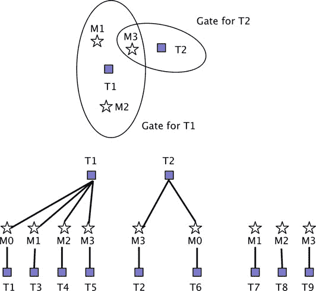
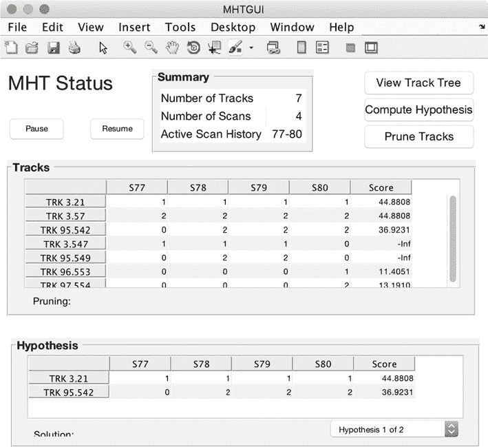
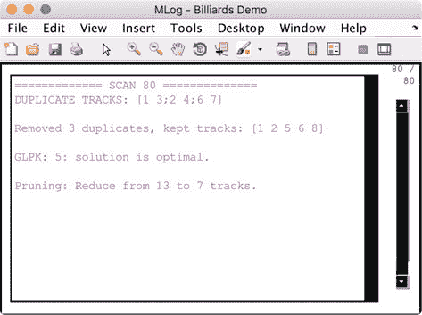
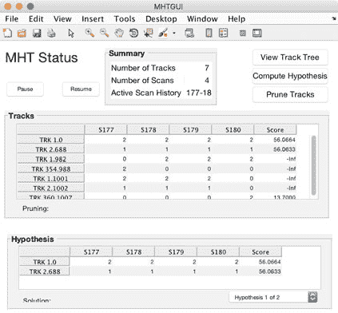

# 第 12 章 多重假设检验

## 12.1 概述

跟踪是确定其他物体位置随时间变化的过程。空中交通管制雷达系统用于跟踪飞行器。飞行中的飞行器必须跟踪所有附近的物体以避免碰撞，并判断它们是否构成威胁。配备雷达巡航控制的汽车使用其雷达来跟踪前方的车辆，以便保持安全距离并避免碰撞。

自主、学习、机器、控制、学习、智能。

当您驾驶时，您通过识别附近的汽车并判断它们接下来要做什么来保持态势感知。您的大脑处理来自眼睛的数据以描述一辆汽车的特征。您通过外观来跟踪物体，因为通常您周围的汽车看起来都不同。当然，在夜间您只能看到尾灯，因此这个过程更加困难。您通常可以猜测每辆车将要做什么，但有时您会猜错，这可能导致碰撞。

雷达系统只能看到模糊的斑点。摄像头应该能够做到您的眼睛和大脑所做的事情，但这需要大量的处理。如前所述，在夜间很难可靠地识别一辆汽车。当雷达测量到这些斑点时，我们希望收集所有斑点，因为它们的位置和速度各不相同，并将它们关联到特定汽车的轨迹上。这样我们就可以可靠地预测它下一步将去向何处。这就引出了本章的主题：面向轨迹的多重假设检验（`MHT`）。

© Michael Paluszek 和 Stephanie Thomas 2019

M. Paluszek 和 S. Thomas， *`MATLAB` 机器学习秘籍*，
[`doi.org/10.1007/978-1-4842-3916-2 12`](https://doi.org/10.1007/978-1-4842-3916-2_12)


**表 12.1：** 多重假设检验术语

| **术语** | **定义** |
| :--- | :--- |
| 杂波 | 对跟踪系统无意义的瞬态物体。 |
| 簇 | 由共同观测值链接的航迹集合。 |
| 误差椭球 | 围绕估计位置的椭球体区域。 |
| 族 | 具有共同根节点的一组航迹。一个假设中最多只能包含每个族中的一条航迹。一个族最多只能代表一个目标。 |
| 波门 | 围绕现有航迹位置的区域。波门内的测量值与航迹相关联。 |
| 假设 | 一组不共享任何共同观测值的航迹。 |
| N 次扫描剪枝 | 利用最近 N 次数据扫描的航迹得分来剪枝航迹。计数从根节点开始。当航迹被剪枝后，会建立一个新的根节点。 |
| 观测值 | 指示物体存在的测量值。观测值可能来自目标，也可能是虚假的。 |
| 剪枝 | 移除低得分的航迹。 |
| 根节点 | 一条已建立的航迹，观测值可以附加到该航迹上，并且该航迹可能衍生出额外的航迹。 |
| 扫描 | 同时获取的一组数据。 |
| 目标 | 被跟踪的物体。 |
| 轨迹 | 目标的路径。 |
| 航迹 | 一条被传播的轨迹。 |
| 航迹分支 | 一个族中代表不同数据关联假设的航迹。只有一个分支可能是正确的。 |
| 航迹得分 | 航迹的对数似然比。 |

当物体数量未知或变化时，面向航迹的 `MHT` 是一种将测量值分配给物体航迹的强大技术。对于多物体的精确跟踪来说，它绝对至关重要。`MHT` 术语在表 12.1 中定义。

假设是具有一致数据（即没有测量值被分配给多于一条航迹）的航迹集合。面向航迹的方法在接收到每次数据扫描后，使用新更新的航迹重新计算假设。面向航迹的方法不维护和扩展扫描间的假设，而是丢弃在第 *k −* 1 次扫描中形成的假设。存活下来的航迹被传播到下一次扫描 *k*，在那里使用新的观测值形成新航迹，并重新组合成假设。除了需要根据低概率删除某些航迹外，没有信息丢失，因为所维护的航迹得分包含了所有相关的统计数据。

本章中的软件使用了一种强大的航迹剪枝算法，该算法可以一步完成剪枝。由于其速度快，不需要临时性的剪枝方法，从而得到更稳健可靠的结果。因此，航迹管理软件相当简单。


`MHT` 模块需要 GNU 线性规划工具包（`GLPK`；http://www.gnu.org/software/glpk/），具体来说，还需要 `MATLAB` mex 封装器 `GLPKMEX`（http://glpkmex.sourceforge.net）。两者均在 GNU 许可证下发布。`GLPK` 库和 `GLPKMEX` 程序都依赖于操作系统，并且必须在您的计算机上从源代码编译。一旦安装了 `GLPK`，就必须从 `MATLAB` 中根据 `GLPKMEX` 源代码生成 mex 文件。

从 `MATLAB` 执行以创建 mex 文件的命令应类似于：
```
mex -v -I/usr/local/include glpkcc.cpp /usr/local/lib/libglpk.a
```
其中“v”指定详细输出，您应将 `/usr/local` 替换为您的操作系统相关的 `GLPK` 安装路径。生成的 mex 文件（Mac 系统）是：`glpkcc.mexmaci64`

该 `MHT` 软件已使用 `GLPK` 4.47 版本和 `GLPKMEX` 2.11 版本进行了测试。

## 12.2 理论

### 12.2.1 引言

## 12.2.2 示例

图 12.1 展示了汽车跟踪背景下的通用跟踪问题。图中显示了两次扫描的数据。当第一次扫描完成时，有两条航迹。图中显示了不确定性椭球，它们基于所有先前的信息。在第 `k − 1` 次扫描（一次扫描是在同一时间获取的一组测量值）中，观测到了三个测量值。每次扫描都有多个测量值，每次新扫描中的测量值从 1 开始编号，并且测量编号并不意味着与后续扫描有任何相关性。

测量值 1 和 3 位于两条航迹的椭球内，但测量值 2 同时位于两个椭球内。它可能是其中一条航迹的测量值，也可能是一个虚假测量值。在第 `k` 次扫描中，获取了四个测量值。只有测量值 4 位于其中一个不确定性椭球内。测量值 3 可能被解释为虚假的，但实际上它是因为第三辆车从蓝色航迹分离出来而形成的新航迹。测量值 1 位于红色椭球之外，但它实际上是红色航迹的一个有效测量值，并且（如果正确解释的话）表明模型是错误的。测量值 4 是蓝色航迹的一个有效测量值，表明模型是有效的。第 `k` 次扫描的测量值 2 位于两个不确定性椭球之外。该图示展示了跟踪系统应有的行为，但如果没有航迹，就很难解释这些测量值。如图所示，一个测量值可以是：

1.  有效的

2.  虚假的

3.  一个新航迹

“虚假的”意味着该测量值与任何被跟踪的物体无关，也不是一个新航迹。不经过 MHT 过程，我们无法确定任何测量值的性质。


**图 12.1：** 跟踪问题。

我们将接触定义为信噪比高于某个阈值的观测值。该观测值随后构成一个测量值。低信噪比的观测值可能发生在光学和雷达系统中。阈值化减少了需要与航迹关联的观测值数量，但可能会丢失有效数据。另一种方法是将所有观测值视为有效，但相应地调整测量误差。

然后必须将有效的测量值分配给航迹。一个理想的跟踪系统应该能够准确地对每个测量值进行分类，然后将它们分配给正确的航迹。系统还必须能够识别新航迹并移除不再存在的航迹。一个跟踪系统可能需要处理数百个物体（例如在碰撞后或由于道路上的碎片）。

一个复杂的系统应该能够将多个物体作为群组或簇来处理，如果这些物体大致朝同一方向移动的话。这减少了系统必须处理的状态数量。如果一个系统处理群组，那么它必须能够处理从群组中衍生出的子群组。

如果我们确信我们只跟踪一辆车，那么所有数据都可能被纳入状态估计中。另一种方法是只纳入协方差椭球内的数据，并将剩余数据视为异常值。如果采取后一种策略，那么记住这些数据是明智的，以防未来的测量值也是“异常值”，在这种情况下，滤波器可能会回溯并将不同的异常值集合纳入解中。如果模型无效，这种情况很容易发生，例如，如果一直以恒定速度巡航的车辆突然开始机动，而滤波器模型不允许机动。

多模型滤波器有助于解决模型错误的问题，并且应该在车辆可能改变模式时使用。但它并不能告诉我们正在跟踪多少辆车。

268


然而，当使用多个模型时，每个模型都有自己的误差椭球，并且假设其中一个模型是当前模式下对跟踪车辆的合理模型，那么测量值会更符合其中一个模型，而非另一个。

参考图 12.1，在第一次扫描中，我们有三个测量值。测量值 1 和 3 与现有航迹关联，并用于更新这些航迹。测量值 2 可能与两者中的任何一个关联。它可能是一个虚假测量值，也可能是一条新航迹，因此算法会形成一个新的假设。在第二次扫描中，测量值 4 与蓝色航迹关联。测量值 1、2 和 3 不在任何一条航迹的误差椭球内。由于该图显示了真实航迹，我们可以看到测量值 1 与红色航迹关联。测量值 1 和 2 都刚好位于红色航迹的误差椭球之外。

第二次扫描中的测量值 2 可能与第一次扫描中的测量值 2 一致，并可能产生一条新航迹。第二次扫描中的测量值 3 是一条新航迹，但在获得更多扫描数据之前，我们可能没有足够的信息来创建一条航迹。

## 12.2.3 算法

在经典的多目标跟踪中，[[24],](#index_split_007.html#p350) 问题被分为两个步骤：关联和估计。步骤 1 将接触点与目标关联，步骤 2 估计每个目标的状态。

当存在不止一种合理的方式将接触点与目标关联时，问题就变得复杂了。多假设检验（MHT）方法是通过形成备选假设来解释观测来源。每个假设都将观测值分配给目标或虚警。

MHT 有两种基本方法[[3].](#index_split_007.html#p349) 第一种方法遵循 Reid [[21],](#index_split_007.html#p350) 的思路，在一个结构中运行，在该结构中，随着观测数据的接收，假设被持续维护和更新。第二种方法是面向航迹的 MHT 方法，航迹在形成假设之前被初始化、更新和评分。评分过程包括比较该航迹代表真实目标的可能性与它是一系列虚警的可能性。因此，在下一阶段（即航迹被形成假设的阶段）之前，不太可能的航迹可以被删除。每次都丢弃旧假设并从头开始是件好事，因为这种方法在防止假设数量爆炸性增长到不切实际的大规模的同时，保留了重要的航迹数据。

面向航迹的方法在每次接收到一帧扫描数据后，使用新更新的航迹重新计算假设。面向航迹的方法不是从一次扫描到下一次扫描维护和扩展假设，而是丢弃在第 `k-1` 次扫描中形成的假设。经过剪枝后保留下来的航迹被预测到下一次扫描 `k`，在那里使用新的观测值形成新航迹，并重新组合成假设。除了需要根据低概率或 N 次扫描剪枝来删除一些航迹外，没有信息丢失，因为所维护的航迹评分包含了所有相关的统计数据。

航迹评分使用对数似然比进行。`LR` 是似然比，`LLR` 是对数似然比，`L` 是似然度。

```
K
L(K) = log[LR(K)] =    [LLR_K(k) + LLR_S(k)] + log[L_0]
k=1
```

(12.1)


其中下标 `K` 表示运动学（位置），下标 `S` 表示信号（测量值）。假设两者在统计上是独立的。

```
P_0(H_1)
L_0 = ---------
P_0(H_0)
```

(12.2)

其中 `H_1` 和 `H_0` 分别是真实目标和虚警假设。`log` 是自然对数。

运动学数据的似然比是数据由真实目标引起的概率除以数据由虚警引起的概率：

```
p(D_K | H_1)   e^{-d^2 / 2} / ((2\pi)^{M/2} |S|^{1/2})
LR_K =  ----------------- = ----------------------------------
p(D_K | H_0)              1 / V_C
```

(12.3)

其中

1.  第三个公式分母中的 `M` 是测量维度
2.  `V_C` 是测量体积
3.  `S = H P T^T + R` 是测量残差协方差矩阵
4.  `d^2 = y^T S^{-1} y` 是测量的归一化统计距离。统计距离由残差 `y`（测量值与估计测量值之差）和协方差矩阵 `S` 定义。分子是多元高斯分布。

## 12.2.4 测量分配与航迹

以下是每条测量的规则：

1.  每条测量都会创建一条新航迹。

2.  每个波门内的每条测量都会更新现有航迹。如果一个波门内有多条测量，则现有航迹会与新测量一起复制。

3.  所有现有航迹都会用一次“漏检”测量进行更新，从而创建一条新航迹。

图 12.2 给出了一个示例。我们从两条航迹开始。有两条航迹和三条测量。所有三条测量都在航迹 1 的波门内，但只有一条在航迹 2 的波门内。每条测量都会产生一条新航迹。三条测量基于航迹 1 产生三条航迹，一条测量基于航迹 2 产生一条航迹。

通常，每次扫描会创建三种类型的航迹：

1.  现有航迹用新测量进行更新，假设该测量与该航迹对应。

2.  现有航迹不进行更新而继续存在，假设在该次扫描中没有为其进行测量。




3.  为每条测量生成一条全新的航迹，假设该测量代表一个新目标。

每条航迹还会衍生出一条新航迹，假设该航迹没有测量值。

因此，在这种情况下，三条测量和两条航迹产生了九条新航迹。航迹 7–9 仅基于测量值初始化，这可能不足以初始化完整的状态向量。如果是这种情况，每条测量将关联无限数量的航迹，而不仅仅是一条新航迹。如果我们有雷达测量值，我们就有方位角、仰角、距离和距离变化率。这给出了所有位置状态和一个速度状态。

**图 12.2：** 测量与波门。`M0` 是一个“缺失”测量。缺失测量是指应该存在但实际不存在的测量。

## 12.2.5 假设形成

## 12.2.5 假设形成

在 MHT 中，一个有效的假设是任何一组兼容的航迹。要使两条或多条航迹兼容，它们不能描述同一个目标，并且它们在任何一次扫描中都不能共享同一条测量。假设形成的任务是找到一个或多个航迹组合，这些组合：1) 是兼容的，并且 2) 最大化某个性能函数。

在讨论假设形成的方法之前，首先考虑航迹形成以及航迹如何与唯一目标关联是很有用的。新航迹可以通过以下两种方式之一形成：

1. 新航迹基于某个现有航迹，并添加了一条新测量。
2. 新航迹不基于任何现有航迹；它完全基于一条单一的新测量。


回想一下，每条航迹都是作为跨多次扫描的测量序列形成的。除了原始测量历史之外，每条航迹还包含从卡尔曼滤波器计算出的状态和协方差数据的历史记录。卡尔曼滤波器在第 8 章中进行了探讨。当一条新测量被附加到现有航迹时，我们正在衍生出一条新航迹，该航迹包含原始航迹的所有测量值，再加上这条新测量。因此，新航迹描述的是与原始航迹相同的目标。

一项新的测量结果也可用于生成一条全新的轨迹，该轨迹与过去的测量结果无关。当这样做时，我们实际上是在表明该测量结果并不描述任何已被跟踪的对象。因此，它必然对应一个新的/不同的对象。

通过这种方式，每条轨迹都被赋予一个对象 ID，以区分它所描述的对象。在轨迹树图的上下文中，同一轨迹树内的所有轨迹都具有相同的对象 ID。例如，如果在某个时刻存在 `10` 个独立的轨迹树，这意味着在 MHT 系统中正在跟踪 `10` 个独立的对象。当形成一个有效假设时，结果可能只有其中少数几个对象拥有兼容的轨迹。

假设形成步骤被建模为一个混合整数线性规划（MILP），并使用 `GLPK` 求解。每条轨迹都被赋予一个综合得分，该得分反映了从每次测量中获得的各个分量得分。构建 MILP 模型是为了选择一组轨迹，使其总分最高，同时满足以下条件：

1. 没有两条轨迹具有相同的对象 ID
2. 对于任何扫描，没有两条轨迹具有相同的测量索引

此外，我们对模型进行了扩展，增加了一个选项，可以求解多个假设，而不仅仅是一个。该算法将按得分降序返回“`M` 个最佳”假设。这使得那些可能得分与最佳假设非常接近的备选假设中的轨迹得以保留。

## 12.2.6 轨迹剪枝

每一步都使用最近的 `n` 次扫描数据执行 `N` 扫描轨迹剪枝。我们采用一种剪枝方法，保留以下轨迹：

• 得分最高的“`N`”条轨迹
• 包含在“`M` 个最佳”假设中的轨迹
• 同时满足以下两个条件的轨迹：1) 对象 ID，以及 2) 在“`M` 个最佳”假设中找到的前“`P`”个测量值。

我们利用假设形成的结果来指导轨迹剪枝。参数 `N`、`M` 和 `P` 可以调整以优化性能。剪枝的目标是尽可能减少轨迹数量，同时不删除任何本应属于真实假设的轨迹。


上面列出的第二项是保留包含在“`M` 个最佳”假设中的所有轨迹。这些轨迹中的每一条都是穿过轨迹树的完整路径，这一点很明确。上面列出的第三项类似，但约束较少。考虑“`M` 个最佳”假设中的一条轨迹。我们将保留这条完整的轨迹。此外，我们还将保留从该轨迹的扫描“`P`”开始的所有分支轨迹。

图 12.3 给出了一个轨迹树中哪些轨迹可能被保留的示例。该图显示了五次扫描中的 `17` 条不同轨迹。绿色轨迹代表在假设形成步骤中从“`M` 个最佳”假设集合中找到的一条轨迹。这条轨迹将被保留。橙色轨迹都源自该轨迹在扫描 `2` 处的节点。如果我们根据上述描述设置 `P` = `2`，这些轨迹将被保留。

**图 12.3：** 轨迹剪枝示例。此图显示了多次扫描（同时测量）以及如何利用它们来移除不符合所有数据的轨迹。


## 12.3 台球卡尔曼滤波器

### 12.3.1 问题

你想要估计多个台球的轨迹。在台球示例中，我们假设有多个球同时运动。假设我们在球桌上方放置了一个摄像机，并且有软件可以测量每个球在每帧视频中的位置。然而，该软件无法确定任何球的身份。这就是 MHT 发挥作用的地方。我们使用 MHT 来为运动的球建立一组轨迹。

### 12.3.2 解决方案

解决方案是创建一个线性卡尔曼滤波器。

### 12.3.3 工作原理

MHT 系统的核心估计算法是卡尔曼滤波器。卡尔曼滤波器包含对动力学的模拟以及融合测量值的算法。在本章的示例中，我们使用固定增益卡尔曼滤波器。模型如下：
$$x_{k+1} = ax_k + bu_k$$
(12.4)
$$y_k = cx_k$$
(12.5)
`x_k` 是状态向量，是一个包含位置和速度的列向量。`y_k` 是测量向量。`u_k` 是输入，即作用在台球上的加速度。`c` 将状态与测量值 `y` 关联起来。

如果唯一的测量值是位置，那么：
$$c = \begin{bmatrix} 1 & 0 \end{bmatrix}$$
(12.6)
这是一个离散时间方程。由于第二列为零，因此它只测量位置。

假设没有输入加速度。同时假设时间步长为 `τ`。那么我们的方程变为：
$$ \begin{bmatrix} s \\ v \end{bmatrix}_{k+1} = \begin{bmatrix} 1 & \tau \\ 0 & 1 \end{bmatrix} \begin{bmatrix} s \\ v \end{bmatrix}_{k} $$
(12.7)
$$ y_k = \begin{bmatrix} 1 & 0 \end{bmatrix} \begin{bmatrix} s \\ v \end{bmatrix}_{k} $$
(12.8)
其中 `s` 是位置，`v` 是速度，`y_k = s`。这表明新位置等于旧位置加上速度乘以时间。我们的测量值只有位置。如果没有外部加速度，速度是恒定的。如果我们无法直接测量加速度，那么这就是我们的模型。我们的滤波器将根据位置的变化来估计速度。

在这种情况下，航迹是一系列 `s` 的序列。MHT 将测量值 `y` 分配给航迹。如果我们知道只有一个目标，并且传感器能准确测量该航迹，且没有虚假测量值或漏测的可能性，那么我们可以直接使用卡尔曼滤波器。


`KFBilliardsDemo` 模拟了台球运动。它包含两个表示动力学的函数。第一个是 `RHSBilliards`，即台球动力学的右侧函数，其内容如上所述。该函数根据外部加速度计算位置和速度。函数 `BilliardCollision` 在球碰到缓冲器时应用动量守恒定律。球之间不会发生碰撞。脚本的第一部分是模拟，为所有球生成测量向量。脚本的第二部分为每个球初始化一个卡尔曼滤波器。该脚本完美地将测量值分配给每条航迹。函数 `KFPredict` 是预测步骤，即模拟球的运动。它使用上述线性模型。`KFUpdate` 则融合测量值。

`MHTDistance` 仅用于提供信息。球的初始位置和速度向量是随机的。脚本固定了随机数生成器的种子，以确保每次运行结果相同，这便于调试。如果你注释掉这段代码，每次运行的结果都会不同。

这里，我们初始化球的位置。

```matlab
% 球的数量以及随机的初始位置和速度
d = struct('nBalls',3,'xLim',[-1 1], 'yLim', [-1 1]);
sigP = 0.4; % 位置噪声的 1 西格玛值
sigV = 1; % 速度噪声的 1 西格玛值
sigMeas = 0.00000001; % 测量噪声的 1 西格玛值

% 为 2 组位置和速度设置初始状态
x = zeros(4*d.nBalls,1);
rN = rand(4*d.nBalls,1);

for k = 1:d.nBalls
    j = 4*k-3;
    x(j,1) = sigP*(rN(j) - 0.5);
    x(j+1,1) = sigV*(rN(j+1) - 0.5);
    x(j+2,1) = sigP*(rN(j+2) - 0.5);
    x(j+3,1) = sigV*(rN(j+3) - 0.5);
end
```

然后我们对它们进行模拟。除非它们撞到缓冲器，否则它们的运动是直线运动。

```matlab
% 传感器测量值
nM = 2*d.nBalls;
y = zeros(nM,n);
iY = zeros(nM,1);
for k = 1:d.nBalls
    j = 2*k-1;
    iY(j) = 4*k-3;
    iY(j+1) = 4*k-1;
end

for k = 1:n


    % 碰撞
    x = BilliardCollision( x, d );

    % 绘图
    xP(:,k) = x;

    % 使用四阶龙格-库塔积分器进行积分
    x = RungeKutta(@RHSBilliards, 0, x, dT, d );

    % 带有高斯随机噪声的测量值
    y(:,k) = x(iY) + sigMeas*randn(nM,1);
end
```

我们随后通过卡尔曼滤波器处理这些测量值。`KFPredict` 预测球的下一个位置，而 `KFUpdate` 则融合测量数据。预测步骤并不知晓碰撞的存在。

```matlab
%% 实现卡尔曼滤波器

% 协方差
```

# 卡尔曼滤波器示例

## 初始化

```matlab
r0 = sigMeas^2*[1;1]; % 测量协方差

q0 = [1;60;1;60]; % 基准系统协方差对角线

p0 = [0.1;1;0.1;1]; % 初始状态协方差矩阵对角线

% 系统模型

a = [1 dT;0 1];

b = [dT^2/2;dT];

zA = zeros(2,2);

zB = zeros(2,1);

% 创建卡尔曼滤波器数据结构。a 适用于两个球。
for k = 1:d.nBalls
    kf(k) = KFInitialize( 'kf', 'm', x0(4*k-3:4*k), 'x', x0(4*k-3:4*k),...
        'a', [a zA;zA a], 'b', [b zB;zB b],'u',[0;0],...
        'h', [1 0 0 0;0 0 1 0], 'p', diag(p0), ...
        'q', diag(q0),'r', diag(r0) );
end

% 为绘图分配数组大小
pUKF = zeros(4*d.nBalls,n);

xUKF = zeros(4*d.nBalls,n);

t = 0;
```

## 主循环

```matlab
for k = 1:n
    % 运行滤波器
    for j = 1:d.nBalls
        % 存储用于绘图
        i = 4*j-3:4*j;
        pUKF(i,k) = diag(kf(j).p);
        xUKF(i,k) = kf(j).m;

        % 状态更新
        kf(j).t = t;
        kf(j) = KFPredict( kf(j) );

        % 融合测量值
        i = 2*j-1:2*j;
        kf(j).y = y(i,k);
        kf(j) = KFUpdate( kf(j) );
    end
    t = t + dT;
end
```

卡尔曼滤波器示例的结果如图 12.4、图 12.5 和图 12.6 所示。所有球的协方差和状态都被绘制出来，但此处仅展示一个。协方差总是随时间呈现相同趋势。随着滤波器累积测量值，它会根据模型协方差（即模型假设的精确度）与测量协方差之间的比率来调整协方差。协方差与实际测量值完全无关。卡尔曼滤波器的误差如图 12.6 所示。每当球撞击缓冲器时，误差会很大，因为模型未包含与缓冲器的碰撞。由于我们的测量噪声很小，误差会迅速减小。

以下代码摘自上述示例，是用于在台球桌上显示台球的专用绘图代码。它为每个球调用 `plot` 函数。颜色取自数组 `c`，分别为蓝色、绿色、红色、青色、品红色、黄色和黑色。一旦计算出球的 *x* 和 *y* 位置 `xP` 和 `yP`，即可从命令行运行此代码。该代码使用图例句柄将球与图中图例中的轨迹关联起来。它手动设置坐标轴范围（`gca` 作为当前坐标轴的句柄）。

## 绘图代码

```matlab
% 绘制仿真结果
NewFigure( '台球' )
c = 'bgrcmyk';

kX = 1;
kY = 3;

s = cell(1,d.nBalls);
l = [];

for k = 1:d.nBalls
    plot(xP(kX,1),xP(kY,1),['o',c(k)])
    hold on
    l(k) = plot(xP(kX,:),xP(kY,:),c(k));

    kX = kX + 4;
    kY = kY + 4;

    s{k} = sprintf('球 %d',k);
end

xlabel('x (m)');
ylabel('y (m)');
set(gca,'ylim',d.yLim,'xlim',d.xLim);
legend(l,s)
grid on
```

你可以在脚本中更改协方差 `sigP`、`sigV`、`sigMeas`，并观察它们如何影响误差和协方差。


# 12.4 台球 MHT

## 12.4.1 问题

你需要估计多个台球的运动轨迹。

## 12.4.2 解决方案

解决方案是创建一个结合线性卡尔曼滤波器的 MHT 系统。此示例涉及台球在球台边库上的反弹。该模型不包含与边库的碰撞。

## 12.4.3 工作原理

以下代码添加了 MHT 功能。它首先运行演示（与上例相同），然后尝试将测量值分配到航迹中。示例中只有两个球。运行演示时，你将看到图形用户界面（GUI）（图 12.7）和树状图（图 12.8）随着模拟的进行而变化。我们在下面的代码清单中仅包含 MHT 代码。

```matlab
% 创建航迹数据结构
mhtData = MHTInitialize('probability false alarm', 0.001,...
    'probability of signal if target present', 0.999,...
    'probability of signal if target absent', 0.001,...
    'probability of detection', 1, ...
    'measurement volume', 1.0, ...
    'number of scans', 3, ...
    'gate', 0.2,...
    'm best', 2,...
    'number of tracks', 1,...
    'scan to track function', @ScanToTrackBilliards,...
    'scan to track data', struct('r', `diag`(r0),'p', `diag`(p0)),...
    'distance function', @MHTDistance,...
    'hypothesis scan last', 0,...
    'filter data', kf(1),...
    'prune tracks', 1,...
    'remove duplicate tracks across all trees', 1,...
    'average score history weight', 0.01,...
    'filter type','kf');
% 创建航迹
for k = 1:d.nBalls
    trk(k) = MHTInitializeTrk( kf(k) );
end
```


```matlab
% 尺寸数组
b = MHTTrkToB( trk );

%% 初始化 MHT 图形用户界面
MHTGUI;
MLog('init')
MLog('name','台球演示')
TOMHTTreeAnimation( 'initialize', trk );
TOMHTTreeAnimation( 'update', trk );

t = 0;
for k = 1:n
    % 获取测量值 - zScan.data
    z = reshape( y(:,k), 2, d.nBalls );
    zScan = AddScan( z(:,1) );
    for j = 2:size(z,2)
        zScan = AddScan( z(:,j), [], zScan);
    end
    % 管理航迹并生成假设
    [b, trk, sol, hyp] = MHTTrackMgmt( b, trk, zScan, mhtData, k, t );
    % 更新 MHTGUI 显示
    if (~isempty(zScan) && graphicsOn)
        if (treeAnimationOn)
            TOMHTTreeAnimation( 'update', trk );
        end
        MHTGUI(trk,sol,'hide');
        drawnow
    end
    t = t + dT;
end
% 显示最终图形用户界面
if (~treeAnimationOn)
    TOMHTTreeAnimation( 'update', trk );
end
if (~graphicsOn)
    MHTGUI(trk,sol,'hide');
end
MHTGUI;
```

`MHTInitialize` 中的参数对在表 12.2 中进行了描述。

图 12.7 展示了 MHT 图形用户界面。该图显示了仿真结束时的 GUI。表格的 x 轴表示扫描次数，y 轴（垂直方向）表示航迹。每条航迹都按 281 进行编号。


                                                                         

**表 12.2：多重假设检验参数**

| 术语 | 定义 |
| :--- | :--- |
| '虚警概率' | 测量值为虚假值的概率 |
| '目标存在时的信号概率' | 目标存在时获取信号的概率 |
| '目标不存在时的信号概率' | 目标不存在时获取信号的概率 |
| '检测概率' | 检测到目标的概率 |
| '测量体积' | 用于缩放似然比。 |
| '扫描次数' | 假设形成中需要考虑的扫描次数 |
| '波门' | 波门的大小 |
| '最佳假设数' | 需要考虑的假设数量 |
| '航迹数量' | 需要维护的航迹数量 |
| '扫描到航迹函数' | 指向扫描到航迹函数的指针。该函数针对每个应用自定义。 |
| '扫描到航迹数据' | 扫描到航迹函数所需的数据 |
| '距离函数' | MHT 距离函数的指针。可以采用不同的定义。 |
| '假设最后扫描' | 假设中使用的最后一次扫描 |
| '修剪航迹' | 如果为真，则修剪航迹 |
| '滤波器类型' | 卡尔曼滤波器的类型 |
| '滤波器数据' | 卡尔曼滤波器的数据 |
| 'remove duplicate tracks across all trees' | 如果为真，则从所有树中移除重复的轨迹 |
| 'average score history weight' | 一个用于乘以平均分数历史的数字 |
| 'create track' | 如果输入此项，将创建一条新轨迹，而不是使用现有轨迹 |

`xxx.yyy`，其中`xxx`是轨迹编号，`yyy`是标签编号。每条轨迹都会被分配一个新的标签编号。例如，`95.542` 表示轨迹 95，标签 542 意味着它是生成的第 542 条轨迹。表格中的数字显示了与该轨迹和扫描相关联的测量值。`TRK 3.21` 和 `TRK 3.57` 是重复的。在这两种情况下，每次扫描都有一个测量值与 `TRK` 相关联。

它们的分数相同，因为它们是一致的。对于我们的假设，我们只能选择其中一个。`TRK 95.542` 没有从扫描 77 中获得测量值，但在其余扫描中，它获得了测量值 2。扫描 77 到 80 是活跃的。一次扫描包含四个位置测量值。摘要显示有七条活跃轨迹，但我们知道（尽管软件不一定知道）实际上只有四个球在运动中。扫描次数是当前用于确定有效轨迹的数量。有两个活跃的假设。

图 12.8 显示了决策树。你可以看到，在扫描 80 时，创建了两条新轨迹。这意味着 MHT 认为可能有多达四条轨迹。然而，在此时，只有轨迹 3 和 95 有多个与之关联的测量值。

   

**图 12.7：多假设检验（MHT）图形用户界面（GUI）。**

图 12.9 显示了信息窗口。这展示了 MHT 算法的思考过程。它给出了每次扫描所做的决策。

该演示表明，MHT 算法能够正确地将测量值与轨迹关联起来。

    

**图 12.8：MHT 树。蓝色条表示分配给每条轨迹的分数。越长越好。黑色框中的数字是轨迹编号。**

**3** 扫描 77 **95** 扫描 78 扫描 79 **96** **97** 扫描 80

**图 12.9：MHT 信息窗口。它告诉你 MHT 算法正在思考什么。**

  

## 12.5 一维运动

### 12.5.1 问题

你想要估计一个在未知加速度下沿单一方向运动的物体的位置。

### 12.5.2 解决方案

解决方案是创建一个包含加速度状态的线性卡尔曼滤波器。

### 12.5.3 工作原理

在这个演示中，我们有一个包含未知加速度状态的物体模型。

```
⎡ s ⎤   ⎡ 1  τ  0.5τ² ⎤   ⎡ s ⎤
⎣ v ⎦ = ⎣ 0  1    τ   ⎦ * ⎣ v ⎦    (12.9)
⎣ a ⎦   ⎣ 0  0    1   ⎦   ⎣ a ⎦
       k+1             k

⎡ s ⎤
yₖ = ⎣ v ⎦                       (12.10)
       ⎣ a ⎦
       k
```

其中 `s` 是位置，`v` 是速度，`a` 是加速度。`yk` = `s`。`τ` 是时间步长。加速度状态的输入是加速度的时间变化率。

函数 `DoubleIntegratorWithAccel` 创建了上面所示的矩阵：

```
[a, b]
```

```
DoubleIntegratorWithAccel( 0.5 )
```

```
a =

1.0000

0.5000

0.1250

1.0000

0.5000

1.0000

b =

```

其中 `τ` = 0.5 秒。

我们将设置仿真，使得一个物体没有加速度，但起始位置在另一个物体之前。另一个物体将超越第一个物体。我们想看看 MHT 是否能理清这些轨迹。

在自动驾驶中，超车会经常发生。

以下代码实现了两个车辆的卡尔曼滤波器。仿真首先运行以生成测量值。然后运行卡尔曼滤波器。请注意，绘图数组在滤波器更新后更新。这使其与仿真保持同步。


```
% 协方差
r = r(1,1);
q = diag([0.5*aRand*dT^2; aRand*dT; aRand].^2 + q0);

% 创建卡尔曼滤波器数据结构
d1 = KFInitialize( 'kf', 'm', [0;0;0],
    'x', [0;0;0], 'a', a, 'b', b, 'u', 0, ...
    'h', h(1,1:3), 'p', diag(p0), 'q', q, 'r', r );
d2 = d1;
d1.m = x(1:3,1) + sqrt(p0).*rand(3,1);
d2.m = x(4:6,1) + sqrt(p0).*rand(3,1);
xE = zeros(6,n);
for k = 1:n
    d1 = KFPredict( d1 );
    d1.y = z(1,k);
    d1 = KFUpdate( d1 );
    d2 = KFPredict( d2 );
    d2.y = z(2,k);
    d2 = KFUpdate( d2 );
    xE(:,k) = [d1.m;d2.m];
end
```

我们使用带有参数 `'plot set'` 的 `PlotSet` 来对输入进行分组，并使用参数 `'legend'` 在每个图上添加图例。`'plot set'` 接受一个由 1 × n 数组组成的元胞数组作为输入，而 `'legend'` 则接受一个由元胞数组组成的元胞数组。我们无需对运动方程进行数值积分，因为状态方程已经完成了这项工作。你可以始终以这种方式传播线性模型。我们使用 `aRand` 设置模型噪声矩阵，但实际上并未输入任何随机加速度。按照代码编写，我们的模型是完美的，但在真实系统中这绝无可能，因此需要引入模型不确定性。

图 12.10 展示了状态和误差。滤波器对两个物体的所有三个状态都跟踪得相当好。加速度和速度估计值在 10 秒内收敛。尽管仅有一个位置 `s` 的测量值，它仍能很好地估计固定扰动加速度。


**图 12.10：** 物体状态与滤波器误差。

## 12.6 带航迹关联的一维运动

下一个问题需要我们关联测量值与航迹。

### 12.6.1 问题

你希望利用需要与航迹关联的测量值，来估计一个沿一维方向运动的物体的位置。

### 12.6.2 解决方案

解决方案是创建一个以卡尔曼滤波器作为状态估计器的 MHT 系统。

### 12.6.3 工作原理

MHT 代码如下所示。我们将 MHT 软件附加到上面所示的脚本中。卡尔曼滤波器嵌入在 MHT 软件中。我们首先运行仿真并收集测量值，然后在 MHT 代码中处理它们。

```
% 初始化 MHT 参数
[mhtData, trk] = MHTInitialize( 'probability false alarm', 0.001, ...
    'probability of signal if target present', 0.999, ...
    'probability of signal if target absent', 0.001, ...
    'probability of detection', 1, ...
    'measurement volume', 1.0, ...
    'number of scans', 3, ...
    'gate', 0.2, ...
    'm best', 2, ...
    'number of tracks', 1, ...
    'scan to track function', @ScanToTrack1D, ...
```


```matlab
'scan to track data',struct('v',0)
,...
'distance function',@MHTDistance,...
'hypothesis scan last', 0,...
'prune tracks', true,...
'filter type','kf',...
'filter data', f,...
'remove duplicate tracks across all trees',true,...
'average score history weight',0.01,...
'create track', '');

% 数组大小
m = zeros(3,n);
p = zeros(3,n);
scan = cell(1,n);
b = MHTTrkToB( trk );
TOMHTTreeAnimation( 'initialize', trk );
TOMHTTreeAnimation( 'update', trk );

% 初始化 MHT 图形用户界面
MHTGUI;
MLog('init')
MLog('name','MHT 1D Demo')
t = 0;
for k = 1:n
    % 获取测量值
    zScan = AddScan( z(1,k) );
    zScan = AddScan( z(2,k), [], zScan );
    
    % 管理航迹
    [b, trk, sol, hyp] = MHTTrackMgmt( b, trk, zScan, mhtData, k, t );
    
    % 更新 MHTGUI 显示
    MHTGUI(trk,sol,'update');
    
    % 对新航迹初始速度的猜测
    for j = 1:length(trk)
        mhtData.fScanToTrackData.v = mhtData.fScanToTrackData.v + trk(j).m(1);
    end
    
    mhtData.fScanToTrackData.v = mhtData.fScanToTrackData.v/length(trk);
    
    % 动画显示树
    TOMHTTreeAnimation( 'update', trk );
    drawnow;
    t = t + dT;
end
```


图 12.11 显示了状态和误差。MHT 假设的航迹与数据拟合得很好。

**图 12.11：** MHT 对象状态与估计状态。两幅图中的颜色进行了互换。

图 12.12 显示了 MHT 图形用户界面和树。航迹 1 仅包含来自对象 2 的测量值。航迹 2 仅包含来自对象 1 的测量值。354 和 360 是虚假航迹。354 在扫描 177 处有一个测量值 1，但在后续扫描中无测量值。360 在扫描 180 处创建，且仅有一个测量值。航迹 1 和 2 具有相同的评分。结果表明，MHT 软件已成功区分测量值并正确分配。此时，仿真结束时，有四个扫描处于活动状态。

## 12.7 总结

本章演示了多重假设检验的基本原理。表 12.3 列出了随附代码中包含的函数和脚本。





**图 12.12：** GUI 与 MHT 树。该树展示了 MHT 的决策过程。

**1**

**2**

**354**

扫描 177 0

扫描 178 2

扫描 179 2

**360**

扫描 180 2

**表 12.3：** 章节代码清单

| 文件 | 描述 |
| :--- | :--- |
| `AddScan` | 向数据中添加一次扫描。 |
| `CheckForDuplicateTracks` | 检查已记录的航迹中是否存在重复项。 |
| `MHTDistanceUKF` | 计算 MHT 距离。 |
| `MHTGUI.fig` | MHT GUI 的已保存布局数据。 |
| `MHTGUI` | MHT 软件的图形用户界面。 |
| `MHTHypothesisDisplay` | 在 GUI 中显示假设。 |
| `MHTInitialize` | 初始化 MHT 算法。 |
| `MHTInitializeTrk` | 初始化一条航迹。 |
| `MHTLLRUpdate` | 更新对数似然比。 |
| `MHTMatrixSortRows` | 对 MHT 中的行进行排序。 |
| `MHTMatrixTreeConvert` | 在 MHT 数据的树形格式与矩阵格式之间进行转换。 |
| `MHTTrackMerging` | 合并 MHT 航迹。 |
| `MHTTrackMgmt` | 管理 MHT 航迹。 |
| `MHTTrackScore` | 计算航迹的总得分。 |
| `MHTTrackScoreKinematic` | 计算航迹得分的运动学部分。 |
| `MHTTrackScoreSignal` | 计算航迹得分的信号部分。 |
| `MHTTreeDiagram` | 绘制 MHT 树形图。 |
| `MHTTrkToB` | 将航迹转换为 B 矩阵。 |
| `PlotTracks` | 绘制目标航迹。 |
| `Residual` | 计算残差。 |
| `TOMHTTreeAnimation` | 面向航迹的 MHT 树形图动画。 |
| `TOMHTAssignment` | 为航迹分配一次扫描。 |
| `TOMHTPruneTracks` | 修剪航迹。 |


