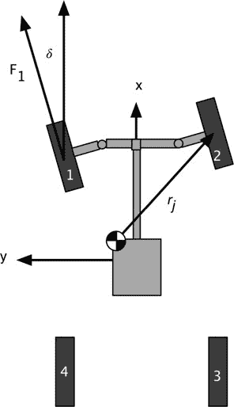
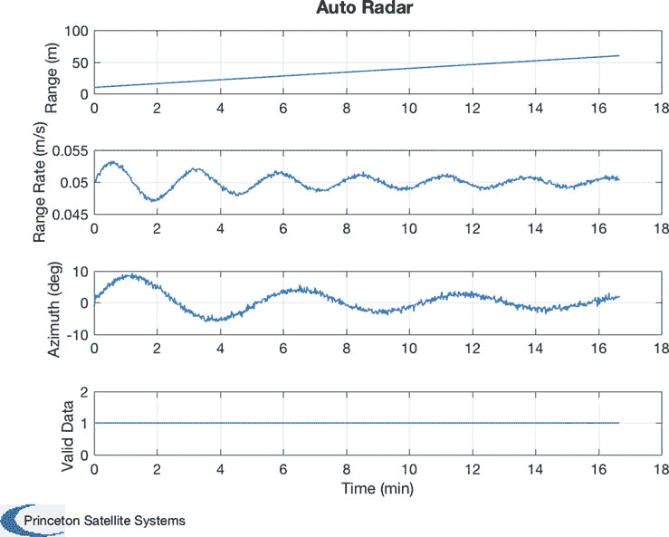
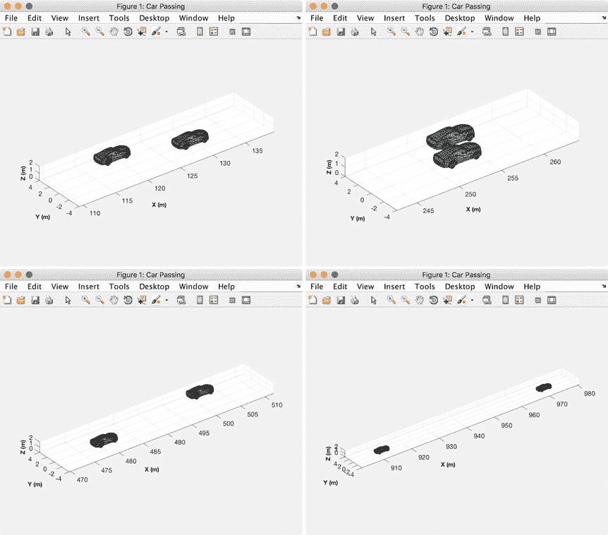
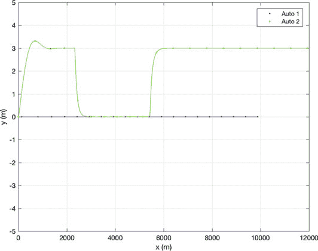
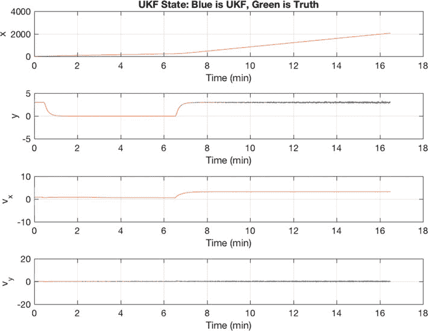
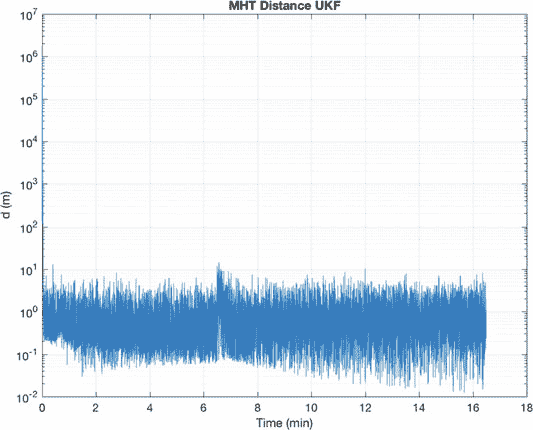
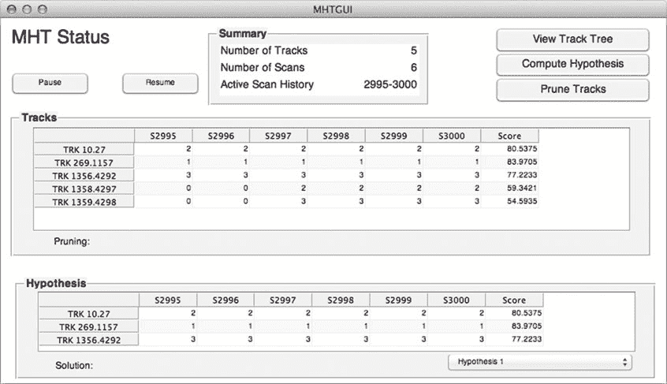
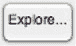

# 第 13 章 基于多重假设检验的自动驾驶

在本章中，我们将把上一章中的多重假设检验（MHT）技术应用于一个有趣的自动驾驶问题。考虑一辆主车，它以可变速度在高速公路上行驶。该车搭载了一个雷达，用于测量方位角、距离和距离变化率。其他车辆会超越主车，其中一些车辆会从主车后方变道并切入其前方。多重假设系统会跟踪主车周围的所有车辆。在仿真开始时，雷达视野内没有车辆。一辆车经过并切入雷达车前方。另外两辆车则在其各自车道内驶过。你需要精确跟踪雷达所能看到的所有车辆。

自主

学习

机器

控制

学习

智能

这个问题包含两个要素。一是利用测量值对被跟踪汽车的运动进行建模，以提高对每辆汽车位置和速度的估计精度。

第二个步骤是系统地将测量值分配给不同的轨迹。一条轨迹应代表一辆单独的汽车，但雷达只是根据回波返回测量值，它并不了解回波的来源。

你将通过首先实现一个卡尔曼滤波器来跟踪一辆汽车，从而解决这个问题。

我们需要编写测量函数和动力学函数，这些函数将被传递给卡尔曼滤波器，并且我们需要一个仿真来生成测量值。然后，我们将把上一章中开发的多假设跟踪（MHT）技术应用于这个问题。

© Michael Paluszek 和 Stephanie Thomas 2019

M. Paluszek 和 S. Thomas，*MATLAB 机器学习实战*，

[`doi.org/10.1007/978-1-4842-3916-2_13`](https://doi.org/10.1007/978-1-4842-3916-2_13)


在本章中，我们将完成以下工作。

1. 对汽车动力学进行建模
2. 对雷达系统进行建模
3. 编写控制算法
4. 实现可视化，以便我们能在 3D 中观察机动动作
5. 实现无迹卡尔曼滤波器
6. 实现多假设跟踪（MHT）

## 13.1 汽车动力学

### 13.1.1 问题

我们需要对汽车动力学进行建模。我们将此限制为二维平面模型。

我们正在对汽车的 *x/y* 位置以及车轮角度进行建模，这使得汽车能够改变方向。

### 13.1.2 解决方案

编写一个可被龙格-库塔法调用的右侧函数。

### 13.1.3 工作原理

与雷达类似，我们需要两个函数来处理汽车的动力学。

`RHSAutomobile` 被仿真程序使用。`RHSAutomobile` 包含完整的动力学模型，包括发动机和转向模型。空气阻力、滚动阻力和侧向力阻力（汽车不会毫无阻力地侧滑）都被建模。`RHSAutomobile` 处理多辆汽车的情况。另一种方法是编写一个单汽车函数，并为每辆汽车调用一次龙格-库塔法。后一种方法适用于所有情况，除非你想要对碰撞进行建模。在许多类型的碰撞中，两辆车相撞然后粘在一起，实际上变成了一辆车。一个真正的跟踪系统需要处理这种情况。

每辆车有六个状态。它们是：

1. x 位置
2. y 位置
3. x 速度
4. y 速度
5. 绕垂直轴的角度
6. 绕垂直轴的角速率





速度的导数由力驱动，角速率的导数由扭矩驱动。平面动力学模型如图 13.1[[29]](#index_split_007.html#p351)所示。与参考文献不同，我们约束后轮固定，并且前轮的角度相同。

**图 13.1：** 平面汽车动力学模型。

动力学方程是在旋转坐标系中编写的。

$m(\dot{v}_x - 2\omega v_y) = \sum_{k=1} F_{kx} - q C_{Dx} A_x u_x$ (13.1)

$m(\dot{v}_y + 2\omega v_x) = \sum_{k=1} F_{ky} - q C_{Dy} A_y u_y$ (13.2)

$I \dot{\omega} = \sum_{k=1} r_k \times F_k$ (13.3)

其中动压为：

$q = \frac{1}{2} \rho (v_x^2 + v_y^2)$ (13.4)

并且

$v = \sqrt{v_x^2 + v_y^2}$ (13.5)


单位向量为：

$u = \begin{bmatrix} v_x \\ v_y \end{bmatrix} / \sqrt{v_x^2 + v_y^2}$ (13.6)

法向力为 $mg$，其中 $g$ 是重力加速度。轮胎接触点（轮胎与路面接触处）的力，对于轮胎 $k$ 为：

$F_{tk} = \frac{T_k/\rho - F_{rk}}{1 - F_c}$ (13.7)

**图 13.2：** 车轮力和扭矩。

其中 $\rho$ 是轮胎半径，$F_{r}$ 是滚动摩擦力，为：$F_{r} = f_0 + K_1 v_{tx}^2$ (13.8)

其中 $v_{tx}$ 是轮胎坐标系中滚动方向的速度。对于前轮驱动汽车，后轮的扭矩 $T$ 为零。接触摩擦力为：$F_{c} = \frac{\mu_c m g |v_{ty}|}{v_{t}}$ (13.9)

这是垂直于车轮正常滚动方向的力，即图 13.2 中指向纸内或纸外的力。速度项确保摩擦力不会引起极限循环。也就是说，当 $y$ 方向速度为零时，该力也为零。$\mu_c$ 是轮胎的一个常数。

从轮胎坐标系到车身坐标系的变换为：

$c = \begin{bmatrix} \cos\delta & -\sin\delta \\ \sin\delta & \cos\delta \end{bmatrix}$ (13.10)


其中 $\delta$ 是转向角，因此：

$F_k = c F_{tk}$ (13.11)

$v_t = c V$ (13.12)

关联偏航角和偏航角速度的运动学方程为：

$\dot{\theta} = \omega$ (13.13)

而惯性速度 $V$，即用于确定汽车行驶方向的速度，为：

$V = \begin{bmatrix} \cos\theta & -\sin\theta \\ \sin\theta & \cos\theta \end{bmatrix} v$ (13.14)

我们将在本章第 13.4 节的图形部分向您展示动力学仿真。

## 13.2 汽车雷达建模

### 13.2.1 问题

本例使用的传感器是汽车雷达。雷达测量方位角、距离和距离变化率。我们需要两个函数：一个用于仿真，另一个供无迹卡尔曼滤波器使用。

### 13.2.2 解决方案

在 MATLAB 函数中构建一个雷达模型。该函数将使用距离和距离变化率的解析推导。

### 13.2.3 工作原理

雷达模型非常简单。它假设雷达测量的是视线距离、距离变化率和方位角（即与汽车前进轴之间的夹角）。该模型跳过了雷达信号处理的所有细节，直接输出这三个量。在项目启动阶段，这种简单模型总是最佳选择。后续，您将需要添加一个经过测试数据验证的、非常详细的模型，以证明您的系统按预期工作。

雷达的位置和速度通过数据结构输入。该模型不模拟雷达的信噪比。雷达接收到的功率与 $1/r^4$ 成正比。在此模型中，信号在函数指定的最大距离处衰减为零。距离由雷达与目标之间的位置差求得。如果 $\delta$ 表示差值，我们可写出：

$\delta = \begin{bmatrix} x - x_r \\ y - y_r \\ z - z_r \end{bmatrix}$ (13.15)


那么距离为：

$\rho = \sqrt{\delta_x^2 + \delta_y^2 + \delta_z^2}$ (13.16)

速度差为：

$\nu = \begin{bmatrix} v_x - v_{xr} \\ v_y - v_{yr} \\ v_z - v_{zr} \end{bmatrix}$ (13.17)

在上述两个方程中，下标 $r$ 表示雷达。距离变化率为：$\dot{\rho} = \frac{\nu^T \delta}{\rho}$ (13.18)

`AutoRadar` 函数可处理多个目标，并能生成整个轨迹的雷达测量值。这非常方便，因为您可以将轨迹输入其中，并查看其返回结果。这能让您在不运行仿真的情况下，对问题获得直观的物理感受。它还能让您确信传感器模型的行为符合预期！这一点很重要，因为所有模型都有假设条件和局限性。该模型可能并不适合您的应用。例如，此模型是二维的。如果您担心系统会混淆行驶在您汽车上方桥梁上的车辆，那么该模型在测试该场景时将毫无用处。

# 自动雷达与汽车控制演示

请注意，该函数内置了一个演示程序，如果没有输出，它将绘制结果图。为代码添加演示程序是一种很好的方式，可以使您的函数对使用您代码的其他人，甚至对几个月后再次遇到该代码的您自己来说，更加友好！我们将演示程序放在一个子函数中，因为它比较长。如果演示程序只有一两行，则无需子函数。在演示函数之前，是定义数据结构的函数。

第二个函数 `AutoRadarUKF` 的核心代码相同，但设计为与无迹卡尔曼滤波器兼容。我们本可以使用 `AutoRadar`，但这样更便捷。变换矩阵 `cITOC`（惯性到车辆变换）是二维的，因为仿真是在一个平坦世界中进行的。

```matlab
s = sin(d.theta);

c = cos(d.theta);

cIToC = [c s;-s c];

dR = cIToC*x(1:2);

dV = cIToC*x(3:4);

rng = sqrt(dR'*dR);

y = [rng; dR'*dV/rng; atan(dR(2)/dR(1))];
```

雷达返回目标的距离、距离变化率和方位角。尽管我们使用雷达作为传感器，但你完全可以使用摄像头、激光测距仪或声纳来代替。本书提供的算法和软件的限制在于，它只能处理单个传感器。你可以从普林斯顿卫星系统公司获取能够扩展到多个传感器的软件。




该软件可扩展至多个传感器。例如，汽车搭载了雷达、摄像头和激光雷达。你可能希望将它们的所有测量结果整合在一起。图 13.3 展示了内部雷达演示。

目标汽车在雷达前方蜿蜒行驶。它以稳定的速度远离，但蜿蜒行驶引入了随时间变化的距离变化率。

**图 13.3：** 内置雷达演示。目标在雷达前方蜿蜒行驶。

## 13.3 汽车自主超车控制

### 13.3.1 问题

为了让我们的雷达有有趣的东西可测量，我们需要让汽车执行一些机动动作。我们将开发一种汽车变道算法。

### 13.3.2 解决方案

汽车由执行基本汽车机动动作的转向控制器驱动。可以控制油门（加速踏板）和转向角。多个机动动作可以串联起来。这为 MHT 系统提供了一个具有挑战性的测试。第一个函数用于自主超车，第二个函数执行变道。


### 13.3.3 工作原理

`AutomobilePassing` 通过将车轮指向目标来实现超车控制。

它生成转向角需求和扭矩需求。需求是我们希望转向系统执行的操作。在真实汽车中，硬件会尝试满足需求，但在车轮角度或电机扭矩达到控制器指令的车轮角度或扭矩需求之前，会存在一个时间延迟。在许多情况下，你是将需求传递给另一个将尝试满足该需求的控制系统。这些算法非常简单。它们不关心是否有任何障碍物挡路。它们也没有任何避免与其他车辆碰撞的控制措施。代码假设车道是空的。不要在你的车上尝试！状态由 `passState` 变量定义。在超车之前，`passState` 为 0。在超车过程中，它为 1。

当它返回原车道时，状态被设置为 0。

```matlab
% 引导目标，除非超车车辆在前方
if( passee.x(1) + dX > passer.x(1) )
    xTarget = passee.x(1) + dX;
else
    xTarget = passer.x(1) + dX;
end

% 这会导致超车车辆切入被超车辆前方
if( passer(1).passState == 0 )
    if( passer.x(1) > passee.x(1) + 2*dX )
        dY = 0;
        passer(1).passState = 1;
    end
else
    dY = 0;
end

% 控制计算
target = [xTarget;passee.x(2) + dY];
theta = passer.x(5);
dR = target - passer.x(1:2);
angle = atan2(dR(2),dR(1));
err = angle - theta;
passer.delta = gain(1)*(err + gain(3)*(err - passer.errOld));
passer.errOld = err;
passer.torque = gain(2)*(passee.x(3) + dV - passer.x(3));
```

第二个函数执行变道。它通过将车轮指向目标来实现变道控制。该函数生成转向角需求和扭矩需求。

默认增益工作得相当好。你应该始终提供合理的默认值。

```matlab
% 默认增益
if( nargin < 5 )
    gain = [0.05 80 120];
end
```


```matlab
% 除非超车车辆在前方，否则跟随目标车辆
xTarget
= passer.x(1) + dX;

% 控制量计算
target
= [xTarget;y];
theta
= passer.x(5);
dR
= target - passer.x(1:2);
angle
= atan2(dR(2),dR(1));
err
= angle - theta;
passer.delta
= gain(1)*(err + gain(3)*(err - passer.errOld));
passer.errOld
= err;
passer.torque
= gain(2)*(v - passer.x(3));
```

## 13.4 汽车动画

### 13.4.1 问题

我们希望将车辆在机动过程中的状态可视化。

### 13.4.2 工作原理

我们创建一个函数来读取 `.obj` 文件。然后编写一个函数来绘制模型并为其制作动画。

### 13.4.3 解决方案

第一步是找到一个汽车模型。一个很好的资源是 TurboSquid [`www.turbosquid.com`](https://www.turbosquid.com)。您可以在其中找到成千上万个模型。我们需要 `.obj` 格式，并且倾向于使用低多边形数量的模型。理想情况下，我们希望模型由三角形构成。就本章找到的模型而言，它包含矩形，因此我们使用 Macintosh 应用程序 Cheetah3D [`www.cheetah3d.com`](https://www.cheetah3d.com) 将其转换为三角形。一个 OBJ 模型附带一个 `.obj` 文件、一个 `.mtl` 文件（材质文件）以及用于纹理的图像。我们只使用 `.obj` 文件。

`LoadOBJ` 加载该文件并将其放入一个数据结构中。该数据结构利用 OBJ 文件的 `g` 字段将文件分解为多个组件。在本例中，这些组件是四个轮胎和车身的其余部分。演示代码仅为：

`LoadOBJ( 'MyCar.obj' )`。您确实需要包含扩展名 `.obj`。该汽车模型如图 13.4 所示。

该图像是通过对每个组件调用一次 `patch` 生成的。

`DrawComponents` 的第一部分负责初始化模型并更新它。我们保存并返回指向这些 `patch` 对象的指针，这样每次调用时只需更新向量即可。


**图 13.4：** 汽车 3D 模型。

0.6

0.4

0.2

**Z**

-0.2

0.4

0.2

0.5

-0.2

-0.4

**Y**

**X**

-0.5

```matlab
switch( lower(action) )
case 'initialize'
    n = length(g.component);
    h = zeros(1,n);
    for k = 1:n
        h(k) = DrawMesh(g.component(k) );
    end
case 'update'
    UpdateMesh(h,g.component,x);
otherwise
    warning('%s not available',action);
end
```

网格通过调用`patch`来绘制。`patch`有许多值得探索的选项。我们使用最少的设置。我们将边缘设置为黑色，以使模型更易于观察。Phong反射模型是一种经验光照模型，它包含了漫反射和镜面反射光照。

```matlab
function h = DrawMesh( m )

h = patch(
    'Vertices', m.v, 'Faces',
    m.f, 'FaceColor', m.color,...
    'EdgeColor',[0 0 0],'EdgeLighting', 'phong',...
    'FaceLighting', 'phong');
```


更新是通过绕z轴旋转顶点，然后加上x和y方向的位置偏移来完成的。输入数组为`[x;y;yaw]`。然后我们设置新的顶点。该函数可以处理位置、速度和偏航角的数组。

```matlab
function UpdateMesh( h, c, x )
for j = 1:size(x,2)
    for k = 1:length(c)
        cs = cos(x(3,j));
        sn = sin(x(3,j));
        b = [cs -sn 0 ;sn cs 0;0 0 1];
        v = (b*c(k).v')';
        v(:,1) = v(:,1) + x(1,j);
        v(:,2) = v(:,2) + x(2,j);
        set(h(k),'vertices',v);
    end
end
```

图形演示程序`AutomobileDemo`实现了超车控制。`AutomobileInitialize`读取OBJ文件。以下代码设置了图形窗口：

```matlab
% 设置图形窗口
NewFig( 'Car Passing' )
axes('DataAspectRatio',[1 1 1],'PlotBoxAspectRatio',[1 1 1] ); h(1,:) = DrawComponents( 'initialize', d.car(1).g );
h(2,:) = DrawComponents( 'initialize', d.car(2).g );
XLabelS('X (m)')
YLabelS('Y (m)')
ZLabelS('Z (m)')
set(gca,'ylim',[-4 4],'zlim',[0 2]);
grid on
view(3)
rotate3d on
```

在仿真循环的每次迭代中，我们都会更新图形。我们为每辆车调用一次`DrawComponents`，并传入每辆车各部件对应的存储句柄。我们调整坐标轴范围，以便将焦点紧密锁定在两辆车上。我们本也可以使用坐标轴数据结构中的相机字段来实现这一点。在设置新的`xlim`以实现平滑动画后，我们调用`drawnow`。




```matlab
% 绘制车辆
pos1 = x([1 2]);
pos2 = x([7 8]);
DrawComponents( 'update', d.car(1).g, h(1,:), [pos1; pi/2 + x( 5)] ); DrawComponents( 'update', d.car(2).g, h(2,:), [pos2; pi/2 + x(11)] ); xlim = [min(x([1 7]))-10 max(x([1 7]))+10];
set(gca,'xlim',xlim);
drawnow
```

图13.5展示了超车过程中的四个时刻。

**图13.5：** 显示超车过程的汽车仿真快照。


## 13.5 汽车仿真与卡尔曼滤波器

### 13.5.1 问题

你希望利用雷达测量值来跟踪一辆在你车周围机动行驶的汽车。车辆可能随时出现或消失。需要将雷达测量值转换为被跟踪车辆的位置和速度。在两次雷达测量之间，你希望做出最佳估计，预测汽车在给定时刻的位置。

### 13.5.2 解决方案

解决方案是实现一个无迹卡尔曼滤波器，以接收雷达测量值并更新被跟踪汽车的动力学模型。

### 13.5.3 工作原理

我们首先创建包含卡尔曼滤波器动力学模型的函数`RHSAutomobileXY`。

卡尔曼滤波器的右侧就是微分方程。

```
˙*x* = *vx* (13.19)
˙*y* = *vy* (13.20)
˙*vx* = 0 (13.21)
˙*vy* = 0 (13.22)
```

点号表示对时间的导数或变化率。这些是汽车的状态方程。该模型表明，位置随时间的变化与速度成正比。它还表明速度是恒定的。关于速度变化的信息将完全来自测量值。我们也不对角速度或角速率进行建模。这是因为我们无法从雷达获取相关信息。不过，你可以尝试将其纳入模型！

`RHSAutomobileXY`函数如下所示；它只有一行代码！因为它只是对质点动力学进行建模。

```matlab
xDot = [x(3:4);0;0];
```

演示仿真与用于演示多假设系统跟踪的仿真相同。此仿真仅演示卡尔曼滤波器。由于卡尔曼滤波器是该包的核心，因此在添加测量分配部分之前，确保其工作良好非常重要。

`MHTDistanceUKF`使用无迹卡尔曼滤波器计算用于门控计算的MHT距离。MHT距离是观测位置与预测位置之间的距离。测量函数的形式为`h(x,d)`，其中`d`是UKF数据结构。`MHTDistanceUKF`使用sigma点。其代码与`UKFUpdate`类似。随着不确定性的减小，残差必须更小才能保持在门限内。


```matlab
pS = d.c*chol(d.p)';
nS = length(d.m);
nSig = 2*nS + 1;
mM = repmat(d.m,1,nSig);
if( length(d.m) == 1 )
    mM = mM';
end
x = mM + [zeros(nS,1) pS -pS];
[y, r] = Measurement( x, d );
mu = y*d.wM;
b = y*d.w*y' + r;
del = d.y - mu;
k = del'*(b\del);
```

```matlab
%% MHTDistanceUKF>Measurement
function [y, r] = Measurement( x, d )
%
% 根据 sigma 点进行测量
nSigma = size(x,2);
lR = length(d.r);
y = zeros(lR,nSigma);
r = d.r;
iR = 1:lR;
for j = 1:nSigma
    f = feval( d.hFun, x(:,j), d.hData );
    y(iR,j) = f;
    r(iR,iR) = d.r;
end
```

仿真示例`UKFAutomobileDemo`使用一个汽车数据结构来包含所有车辆信息。MATLAB函数`AutomobileInitialize`接收参数对并构建该数据结构。这比在脚本中逐个分配字段要简洁得多。

如果未输入任何参数，它将返回一个默认的数据结构。

该演示的第一部分是汽车仿真。它生成用于卡尔曼滤波器的汽车位置测量值。演示的第二部分在UKF中处理这些测量值，以生成对汽车轨迹的估计。如果你要重复使用仿真结果，可以将生成仿真数据的代码移到一个单独的文件中。

脚本的结果如图13.6、图13.7和图13.8所示。







**图13.6：** 汽车轨迹。

## 13.6 汽车目标跟踪

**图 13.7：** 真实状态与无迹卡尔曼滤波（UKF）估计状态。




**图 13.8：** 仿真过程中汽车之间的 MHT 距离。注意当汽车开始机动时距离的尖峰。

### 13.6.1 问题

我们需要演示对汽车的目标跟踪。

### 13.6.2 解决方案

构建一个包含目标跟踪的汽车仿真。

### 13.6.3 工作原理

该仿真基于一个二维汽车动力学模型。主车以可变速度沿高速公路行驶，并搭载雷达。许多车辆超过主车，其中一些从主车后方变道并切入前方。MHT 系统跟踪所有车辆。仿真开始时，雷达视野内没有车辆。一辆车经过并切入雷达车前方，另外两辆车则在其车道内驶过。这是对航迹起始的一个良好测试。

本章第一个方案中介绍的雷达，可测量雷达车坐标系下的距离、距离变化率和方位角。该模型直接从目标以及被跟踪车辆的相对速度和位置生成这些值。雷达信号处理过程未被建模，但雷达具有视野和距离限制。参见 `AutoRadar`。


车辆由执行汽车机动的转向控制器驱动。可以控制油门（加速踏板）和转向角。多个机动可以串联执行。这为 MHT 系统提供了一个具有挑战性的测试。你可以尝试不同的机动，并添加自己的额外机动函数。

本演示中使用了第 4 章描述的无迹卡尔曼滤波，因为雷达是一种高度非线性的测量设备。UKF 动力学模型 `RHSAutomobileXY` 是在雷达车惯性坐标系下的一对双积分器。该模型通过将过程协方差（包括位置和速度）设置为比通过分析相对加速度所预期的值更大，来适应转向和油门变化。另一种方法是使用交互式多模型（IMM），包含一个“转向”模型和一个“加速”模型。这种额外的复杂性似乎并无必要。即使使用 IMM，也会保留相当大的不确定性，因为转向模型可能仅限于一个或两个转向角。

使用 MHT 实现仿真的脚本是 `MHTAutomobileDemo`。演示中有四辆车；车 4 将执行超车。图 13.10 显示了被跟踪的最后一辆车——车 3 的雷达测量结果。MHT 系统能够很好地处理车辆捕获。图 13.11 中的 MHT 图形用户界面显示了仿真结束时包含三条航迹的一个假设。这是预期的结果。

**图 13.9：** 汽车演示中的车辆轨迹。

图 13.12 显示了最终的树。存在几条冗余航迹。这些航迹可以被移除，因为它们是其他航迹的克隆。这不会影响假设生成。




**图 13.10：** 汽车演示中车 3 的雷达测量结果。

**图 13.11：** MHT 图形用户界面显示三条航迹。每条航迹都具有一致的测量值。




**图 13.12：** 汽车演示的最终树。

## 13.7 总结

本章演示了一个汽车跟踪问题。该汽车配备了一个雷达系统，用于检测其视野内的车辆。该系统能够准确地将测量值分配给航迹，并成功学习每辆邻近车辆的运动路径。你首先构建了一个无迹卡尔曼滤波器来模拟汽车的运动，并融合来自雷达系统的测量值。这在仿真脚本中得到了演示。然后，你构建了一个脚本，该脚本结合了面向航迹的多假设检验，以分配雷达对多辆汽车的测量值。这使得我们的雷达系统能够自主且可靠地跟踪多辆汽车。

你还学习了如何制作简单的汽车控制器。这两个控制器负责操控汽车，并使其能够超越其他车辆。

表 13.1 列出了随附代码中包含的函数和脚本。

**表 13.1：** 章节代码清单

| 文件 | 描述 |
| :--- | :--- |
| `AutoRadar` | 用于仿真的汽车雷达模型。 |
| `AutoRadarUKF` | 用于无迹卡尔曼滤波器的汽车雷达模型。 |
| `AutomobileDemo` | 演示汽车动画。 |
| `AutomobileInitialize` | 初始化汽车数据结构。 |
| `AutomobileLaneChange` | 用于变道的汽车控制算法。 |
| `AutomobilePassing` | 用于超车的汽车控制算法。 |
| `DrawComponents` | 绘制 3D 模型。 |
| `LoadOBJ` | 加载 `.obj` 图形文件。 |
| `MHTAutomobileDemo` | |

# 演示多假设检验在汽车雷达系统中的应用

## RHSAutomobile
用于仿真的汽车动力学模型。

## RHSAutomobileXY
用于无迹卡尔曼滤波器的汽车动力学模型。

## UKFAutomobileDemo
演示用于汽车的无迹卡尔曼滤波器。


