# Truth Neural Net

1: 61.22 61.17

2: 118.24 118.42

3: 193.12 192.88

4: 285.38 285.52

5: 394.51 394.48

递归学习结果如图 11.8. 所示。在广泛的高度范围内，结果都相当不错。然后，您可以在飞机运行期间直接使用“更新”操作。

**11.8**

**实现 PID 控制**

**11.8.1 问题**

我们希望有一个 PID 控制器来控制飞机。

**11.8.2 解决方案**

编写一个函数来实现 PID 控制。输入将是俯仰角误差。


第 11 章

神经飞机控制

**图 11.8：** 动态压力示例的递归训练。

**11.8.3 工作原理**

假设我们有一个由恒定输入驱动的双重积分器：

¨*x* = *u* (11.39)

其中 *u* = *ud* + *uc*。

结果是：

*x* = *ut*² + *x*(0) + ˙*x*(0) *t* (11.40)

最简单的控制是添加一个反馈控制器

*uc* = −*K* ( *τd* ˙*x* + *x*) (11.41)

其中 *K* 是前向增益，*τ* 是阻尼时间常数。我们的动力学方程现在变为：

¨*x* + *K* ( *τd* ˙*x* + *x*) = *ud* (11.42)

阻尼项将使瞬态过程衰减。当这种情况发生时，*x* 的二阶导数和一阶导数均为零，我们最终得到一个偏移量：*x* = *u* / *K* (11.43)


第 11 章

神经飞机控制

这通常是不希望的。您可以增大 *K* 直到偏移量变小，但这意味着您的执行器需要产生更大的力或扭矩。目前我们拥有的是一个比例微分（PD）控制器。让我们向控制器添加另一个项：

*uc* = −*K* ( *τd* ˙*x* + *x* + *x* / *τi* ) (11.44)

这现在是一个比例积分微分（PID）控制器。现在有一个与 *x* 的积分成比例的增益。我们添加新的控制器，然后再次求导得到：

...*x* + *K* ( *τd* ¨*x* + ˙*x* + *x* / *τi* ) = ˙*ud* (11.45)

现在在稳态下：

*x* = *τi* / *K* ˙*ud* (11.46)

如果 *u* 是常数，则偏移量为零。将 *s* 定义为微分算子。

*s* = *d* / *dt* (11.47)

那么：

*s*³ *x*(*s*) + *K* ( *τd* *s*² *x*(*s*) + *sx*(*s*) + *x*(*s*) / *τi* ) = *s ud*(*s*) (11.48)

请注意：

*uc*(*s*)


= *K*

1 + *τ*

(11.49)

*x*(*s*)

*ds* + *τis*

其中，*τd* 是速率时间常数，表示系统抑制振荡所需的时间；*τi* 是系统消除稳态扰动所需的积分速度。

*√*

其中，*s* = *jω*，且 *j* =

*−* 1。闭环传递函数为：

*x*(*s*)

*s*

=

(11.50)

*ud*(*s*)

*s*³ + *Kτds*² + *Ks* + *K/τi*

期望的闭环传递函数为：

*x*(*s*)

*s*

=

(11.51)

*ud*(*s*)

(*s* + *γ*)(*s*² + 2*ζσs* + *σ*²)

或

*x*(*s*)

*s*

=

*ud*(*s*)

*s*³ + (*γ* + 2*ζσ*)*s*² + *σ*(*σ* + 2*ζγ*)*s* + *γσ*²

(11.52)


第 11 章

神经飞机控制

参数为：

*K*

=

*σ*(*σ* + 2*ζγ*)

(11.53)

*σ* + 2*ζγ*

*τi* =

(11.54)

*γσ*

*γ* + 2*ζσ*

*τd* =

(11.55)

*σ*(*σ* + 2*ζγ*)

这是一个 PID 的设计。然而，无法将其写成期望的状态空间形式：

˙*x*

=

*Ax* + *Au*

(11.56)

*y*

=

*Cx* + *Du*

(11.57)

因为它包含一个纯微分器。我们需要给速率项添加一个滤波器，使其看起来像：*s*

(11.58)

*τrs* + 1

而不是 *s*。我们不打算推导这些常数，将其留作读者练习。PID 的代码位于 PID 中。

**function** [a, b, c, d] = PID(

zeta, omega, tauInt, omegaR, tSamp )

% Demo

**if**( **nargin** < 1 )

Demo;

**return**

**end**

% 输入处理

**if**( **nargin** < 4 )

omegaR = [];

**end**

% 默认滚降

**if**( **isempty**(omegaR) )

omegaR = 5*omega;

**end**

% 计算 PID 增益

omegaI

= 2***pi**/tauInt;

c2

= omegaI*omegaR;

c1

= omegaI+omegaR;

b1

= 2*zeta*omega;

b2

= omegaˆ2;

g

= c1 + b1;


第 11 章

神经飞机控制

kI

= c2*b2/g;

kP

= (c1*b2 + b1.*c2

- kI)/g;

kR

= (c1*b1 + c2 + b2 - kP)/g;

% 计算状态空间模型

a

=

[0 0;0 -g];

b

=

[1;g];

c

=

[kI -kR*g];

d

=

kP + kR*g;

% 转换为离散时间

**if**( **nargin** > 4 )

[a,b] = CToDZOH(a,b,tSamp);

**end**

评估积分器的影响是很有趣的。如图 11.9 所示。代码是 PID 中的演示。我们没有对微分方程进行数值积分，而是将其转换为采样时间并进行传播。这对于线性方程很方便。双积分器方程的形式为：

*xk*+1 = *axk* + *buk*

(11.59)

*y*

=

*cxk* + *duk*

(11.60)

这与 PID 控制器的形式相同。

% 双积分器对象

dT

= 0.1; % 秒

aP

= [0 1;0 0];

bP

= [0;1];

[aP, bP]

= CToDZOH( aP, bP, dT );

% 设计控制器

[a, b, c, d]

= PID(

1, 0.1, 100, 0.5, dT );

% 运行仿真

n

= 2000;

p

= **zeros**(2,n);

x

= [0;0];

xC

= [0;0];

**for** k = 1:n

% PID 控制器

y

= x(1);

xC

= a*xC + b*y;

uC

= c*xC + d*y;

p(:,k)

= [y;uC];

x

= aP*x + bP*(1-uC); % 单位阶跃响应

**end**


第 11 章

神经飞机控制

**图 11.9：** 单位输入下的比例积分微分控制。

将 *x* 驱动到零大约需要 2 分钟，这接近为积分器指定的 100 秒。

**11.9**

**俯仰的 PID 控制**

**11.9.1 问题**

我们希望使用 PID 控制器控制飞机的俯仰角。

**11.9.2 解决方案**

编写一个脚本，使用 PID 控制器和俯仰动态逆补偿来实现控制器。

**11.9.3 工作原理**

PID 控制器改变升降舵角度以产生俯仰加速度，从而旋转飞机。升降舵是通常位于飞机尾翼上的可移动水平面。此外，当飞机改变其俯仰姿态时，需要额外的升降舵运动来补偿由升力和阻力引起的加速度变化。这是通过俯仰动态逆函数完成的。该函数返回俯仰加速度，在施加俯仰控制时必须对其进行补偿。


第 11 章

神经飞机控制

**function** qDot = PitchDynamicInversion( x, d )

**if**( **nargin** < 1 )

qDot = DataStructure;

**return**

**end**

u

= x(1);

w

= x(2);

h

= x(5);

rho


= AtmDensity( h );

alpha = **atan**(w/u);

cA = **cos**(alpha);

sA = **sin**(alpha);

v = **sqrt**(uˆ2 + wˆ2);

pD = 0.5*rho*vˆ2; % 动压

cL = d.cLAlpha*alpha;

cD = d.cD0 + d.k*cLˆ2;

drag = pD*d.s*cD;

lift = pD*d.s*cL;

z = -lift*cA - drag*sA;

m = d.c*z;

qDot = m/d.inertia;

包含控制器的仿真如下面的 AircraftSim 所示。有一个标志用于开启控制，另一个标志用于开启学习控制。我们使用 PID 控制指令一个 0.2 弧度的俯仰角。结果如图 11.10、图 11.11 和图 11.12 所示。

该机动增加了阻力，但我们没有调整油门进行补偿。这将导致空速下降。在实现控制器时，我们忽略了状态之间的耦合，但这可以很容易地添加进来。


第 11 章

神经飞机控制

**图 11.10：** 飞机俯仰角变化。由于俯仰动力学特性，飞机发生振荡。

**11.10**

**用于俯仰动力学的神经网络**

**11.10.1 问题**

我们需要一个包含 PID 控制器和 sigma-pi 神经网络的反演控制器。

**11.10.2 解决方案**

使用一个脚本训练神经网络，该脚本接收角度和速度平方作为输入，并计算俯仰加速度误差。

**11.10.3 工作原理**

PitchNeuralNetTraining 脚本为一组略有不同的参数计算俯仰加速度。然后处理增量加速度。该脚本将一系列俯仰角传递给函数，并学习加速度。我们使用速度平方作为输入，因为动压与速度平方成正比。基准加速度（在 dRHSL 中）对应我们的“先验”模型。dRHS 是测量值。我们假设这些值是在飞行测试中获得的。

% 这来自飞行测试

dRHS = RHSAircraft;

% 获取默认数据结构，其中包含 F-16 数据

h = 10000;


第 11 章

神经飞机控制

**图 11.11：** 飞机俯仰角变化。注意升力和阻力随角度的变化。

**图 11.12：** 飞机俯仰角变化。PID 加速度远低于俯仰反演加速度。


第 11 章

神经飞机控制

gamma = 0.0;

v = 250;

% 获取平衡状态

[x, dRHS.thrust, deltaEq, cost] = EquilibriumState( gamma, v, h, dRHS );

% 攻角

alpha = **atan**(x(2)/x(1));

cA = **cos**(alpha);

sA = **sin**(alpha);

% 创建假设的属性

dRHSL = dRHS;

dRHSL.cD0 = 2.2*dRHS.cD0;

dRHSL.k = 1.0*dRHSL.k;

% 2 个输入

xNN = **zeros**(2,1);

d = SigmaPiNeuralNet;

[˜, d] = SigmaPiNeuralNet( 'initialize', xNN, d );

theta = **linspace**(0, **pi**/8);

v = **linspace**(300,200);

n = **length**(theta);

aT = **zeros**(1,n);

aM = **zeros**(1,n);

**for** k = 1:n

    x(4) = theta(k);

    x(1) = cA*v(k);

    x(2) = sA*v(k);

    aT(k) = PitchDynamicInversion( x, dRHSL );

    aM(k) = PitchDynamicInversion( x, dRHS );

**end**

% 增量俯仰加速度

dA = aM - aT;

% 神经网络的输入

v2 = v.ˆ2;

xNN = [theta;v2];

% 训练输出

d.y = dA';

[aNN, d] = SigmaPiNeuralNet( 'batch learning', xNN, d );


第 11 章

神经飞机控制

% 保存数据用于飞机仿真

thisPath = fileparts(mfilename('fullpath'));

**save**( fullfile(thisPath,'DRHSL'),'dRHSL' );

**save**( fullfile(thisPath,'DNN'), 'd' );

**for** j = 1:**size**(xNN,2)

    aNN(j,:) = SigmaPiNeuralNet( 'output', xNN(:,j), d );

**end**

% 绘制结果

该脚本首先使用 EquilibriumState 找到平衡状态。然后使用 SigmaPiNeuralNet 设置 sigma-pi 神经网络。PitchDynamicInversion 被调用了两次，一次用于获取模型飞机加速度 aM（我们希望飞机表现出的方式），另一次用于获取真实加速度 aT。增量加速度 dA 用于训练神经网络。神经网络产生 aNN。得到的权重保存在一个 .mat 文件中，供 AircraftSim 使用。仿真使用 dRHS，但我们的俯仰加速度模型使用 dRHSL。后者保存在另一个 .mat 文件中。

>> PitchNeuralNetTraining

速度 250.00 m/s

高度 10000.00 m

飞行路径角 0.00 deg

Z 轴速度 13.84 m/s

推力 11148.95 N

攻角 3.17 deg

升降舵 11.22 deg

初始代价 9.62e+01

最终代价 1.17e-17

可以看出，神经网络很好地复现了模型。该脚本还输出了 DNN.mat，其中包含训练好的神经网络数据。

**11.11**

**非线性仿真**

**11.11.1 问题**

我们希望演示用于控制飞机纵向动力学的学习控制系统。


第 11 章

神经飞机控制

**图 11.13：** 拟合到增量加速度的神经网络。

**11.11.2 解决方案**

启用 AircraftSimOpenLoop 中描述的仿真脚本的控制功能。

**11.11.3 工作原理**

在上一节中训练完神经网络后，我们将 addLearning 设置为 true。读取权重。我们使用 PID 学习控制指令一个 0.2 弧度的俯仰角。结果如图 11.14、图 11.15 和图 11.16 所示。这些图左侧显示没有学习控制，右侧显示有学习控制。

学习控制有助于提高控制器的性能。然而，在整个仿真过程中权重是固定的。学习发生在控制器激活之前。由于控制的学习部分是基于预定轨迹计算的，因此控制系统仍然对参数变化敏感。我们的权重仅作为俯仰角和速度平方的函数确定。增加额外的输入将改善性能。您有很多机会尝试扩展和改进学习系统。


第 11 章

神经飞机控制

**图 11.14：** 飞机俯仰角变化。显示了升力和阻力的变化。

**图 11.15：** 飞机俯仰角变化。没有学习控制时，升降舵饱和。


第 11 章

神经飞机控制

**图 11.16：** 飞机俯仰角变化。PID 加速度远低于俯仰动态反演加速度。

**11.12**

**总结**


本章展示了飞行器的自适应或学习控制。您学习了模型调优、模型参考自适应控制、自适应控制以及增益调度。您还学习了如何使用神经网络作为飞行器控制系统的一部分。表 11.3 列出了随附代码中的函数和脚本。

**表 11.3：** 章节代码清单

**文件**

**描述**

AircraftSim

飞行器纵向动力学仿真。

AtmDensity

使用修正指数模型的大气密度。

EquilibriumState

寻找飞行器的平衡状态。

PID

实现一个 PID 控制器。

PitchDynamicInversion

俯仰角加速度。

PitchNeuralNetTraining

训练俯仰加速度神经网络。

QCR

生成一个全状态反馈控制器。

RecursiveLearning

演示递归神经网络训练或学习。

RHSAircraft

飞行器纵向动力学的右侧函数。

SigmaPiNeuralNet

实现一个 sigma-pi 神经网络。

Sigmoid

绘制一个 sigmoid 函数。


**第 12 章**

**多重假设检验**

**12.1**

**概述**

跟踪是确定其他物体位置随时间变化的过程。空中交通管制雷达系统用于跟踪飞行器。飞行中的飞行器必须跟踪所有附近的物体以避免碰撞，并判断它们是否构成威胁。配备雷达巡航控制的汽车使用其雷达来跟踪前方的车辆，以便保持安全距离并避免碰撞。

自主

学习

机器

控制

学习

智能

当您驾驶时，您通过识别附近的汽车并判断它们接下来要做什么来保持态势感知。您的大脑处理来自眼睛的数据以描述一辆汽车的特征。您通过外观来跟踪物体，因为通常您周围的汽车看起来都不同。当然，在夜间您只能看到尾灯，因此这个过程更加困难。您通常可以猜测每辆车将要做什么，但有时您会猜错，这可能导致碰撞。

雷达系统只能看到模糊的斑点。摄像头应该能够做到您的眼睛和大脑所做的事情，但这需要大量的处理。如前所述，在夜间很难可靠地识别一辆汽车。当雷达测量到这些斑点时，我们希望收集所有斑点，因为它们的位置和速度各不相同，并将它们关联到特定汽车的轨迹上。这样我们就可以可靠地预测它下一步将去向何处。这就引出了本章的主题：面向轨迹的多重假设检验（MHT）。

© Michael Paluszek 和 Stephanie Thomas 2019

M. Paluszek 和 S. Thomas， *MATLAB 机器学习秘籍*，

[`doi.org/10.1007/978-1-4842-3916-2 12`](https://doi.org/10.1007/978-1-4842-3916-2_12)


第 12 章

多重假设检验

**表 12.1：** 多重假设检验术语

**术语**

**定义**

杂波

对跟踪系统无意义的瞬态物体。

簇

由共同观测值链接的航迹集合。

误差椭球

围绕估计位置的椭球体区域。

族

具有共同根节点的一组航迹。一个假设中最多只能包含每个族中的一条航迹。一个族最多只能代表一个目标。

波门

围绕现有航迹位置的区域。波门内的测量值与航迹相关联。

假设

一组不共享任何共同观测值的航迹。

N 次扫描剪枝

利用最近 N 次数据扫描的航迹得分来剪枝航迹。计数从根节点开始。当航迹被剪枝后，会建立一个新的根节点。

观测值

指示物体存在的测量值。观测值可能来自目标，也可能是虚假的。

剪枝

移除低得分的航迹。

根节点

一条已建立的航迹，观测值可以附加到该航迹上，并且该航迹可能衍生出额外的航迹。

扫描

同时获取的一组数据。

目标

被跟踪的物体。

轨迹

目标的路径。

航迹

一条被传播的轨迹。

航迹分支

一个族中代表不同数据关联假设的航迹。只有一个分支可能是正确的。

航迹得分

航迹的对数似然比。

当物体数量未知或变化时，面向航迹的 MHT 是一种将测量值分配给物体航迹的强大技术。对于多物体的精确跟踪来说，它绝对至关重要。MHT 术语在表 12.1 中定义。

假设是具有一致数据（即没有测量值被分配给多于一条航迹）的航迹集合。面向航迹的方法在接收到每次数据扫描后，使用新更新的航迹重新计算假设。面向航迹的方法不维护和扩展扫描间的假设，而是丢弃在第 *k −* 1 次扫描中形成的假设。存活下来的航迹被传播到下一次扫描 *k*，在那里使用新的观测值形成新航迹，并重新组合成假设。除了需要根据低概率删除某些航迹外，没有信息丢失，因为所维护的航迹得分包含了所有相关的统计数据。

本章中的软件使用了一种强大的航迹剪枝算法，该算法可以一步完成剪枝。由于其速度快，不需要临时性的剪枝方法，从而得到更稳健可靠的结果。因此，航迹管理软件相当简单。


第 12 章

多重假设检验

MHT 模块需要 GNU 线性规划工具包（GLPK；http://www.gnu.org/software/glpk/），具体来说，还需要 MATLAB mex 封装器 GLPKMEX（http://glpkmex.sourceforge.net）。两者均在 GNU 许可证下发布。GLPK 库和 GLPKMEX 程序都依赖于操作系统，并且必须在您的计算机上从源代码编译。一旦安装了 GLPK，就必须从 MATLAB 中根据 GLPKMEX 源代码生成 mex 文件。

从 MATLAB 执行以创建 mex 文件的命令应类似于：`mex -v -I/usr/local/include glpkcc.cpp /usr/local/lib/libglpk.a`

其中“v”指定详细输出，您应将 `/usr/local` 替换为您的操作系统相关的 GLPK 安装路径。生成的 mex 文件（Mac 系统）是：`glpkcc.mexmaci64`

该 MHT 软件已使用 GLPK 4.47 版本和 GLPKMEX 2.11 版本进行了测试。

**12.2**

**理论**

**12.2.1 引言**

图 12.1 展示了汽车跟踪背景下的通用跟踪问题。图中显示了两次扫描的数据。当第一次扫描完成时，有两条航迹。图中显示了不确定性椭球，它们基于所有先前的信息。在第 *k −* 1 次扫描（一次扫描是在同一时间获取的一组测量值）中，观测到了三个测量值。每次扫描都有多个测量值，每次新扫描中的测量值从 1 开始编号，并且测量编号并不意味着与后续扫描有任何相关性。

测量值 1 和 3 位于两条航迹的椭球内，但测量值 2 同时位于两个椭球内。它可能是其中一条航迹的测量值，也可能是一个虚假测量值。在第 *k* 次扫描中，获取了四个测量值。只有测量值 4 位于其中一个不确定性椭球内。测量值 3 可能被解释为虚假的，但实际上它是因为第三辆车从蓝色航迹分离出来而形成的新航迹。测量值 1 位于红色椭球之外，但它实际上是红色航迹的一个有效测量值，并且（如果正确解释的话）表明模型是错误的。测量值 4 是蓝色航迹的一个有效测量值，表明模型是有效的。第 k 次扫描的测量值 2 位于两个不确定性椭球之外。该图示展示了跟踪系统应有的行为，但如果没有航迹，就很难解释这些测量值。如图所示，一个测量值可以是：

1.  有效的
2.  虚假的
3.  一个新航迹

“虚假的”意味着该测量值与任何被跟踪的物体无关，也不是一个新航迹。不经过 MHT 过程，我们无法确定任何测量值的性质。


第 12 章

多重假设检验

**图 12.1：** 跟踪问题。

我们将接触定义为信噪比高于某个阈值的观测值。该观测值随后构成一个测量值。低信噪比的观测值可能发生在光学和雷达系统中。阈值化减少了需要与航迹关联的观测值数量，但可能会丢失有效数据。另一种方法是将所有观测值视为有效，但相应地调整测量误差。

然后必须将有效的测量值分配给航迹。一个理想的跟踪系统应该能够准确地对每个测量值进行分类，然后将它们分配给正确的航迹。系统还必须能够识别新航迹并移除不再存在的航迹。一个跟踪系统可能需要处理数百个物体（例如在碰撞后或由于道路上的碎片）。

一个复杂的系统应该能够将多个物体作为群组或簇来处理，如果这些物体大致朝同一方向移动的话。这减少了系统必须处理的状态数量。如果一个系统处理群组，那么它必须能够处理从群组中衍生出的子群组。

如果我们确信我们只跟踪一辆车，那么所有数据都可能被纳入状态估计中。另一种方法是只纳入协方差椭球内的数据，并将剩余数据视为异常值。如果采取后一种策略，那么记住这些数据是明智的，以防未来的测量值也是“异常值”，在这种情况下，滤波器可能会回溯并将不同的异常值集合纳入解中。如果模型无效，这种情况很容易发生，例如，如果一直以恒定速度巡航的车辆突然开始机动，而滤波器模型不允许机动。

多模型滤波器有助于解决模型错误的问题，并且应该在车辆可能改变模式时使用。但它并不能告诉我们正在跟踪多少辆车。

268


第 12 章

多重假设检验


然而，当使用多个模型时，每个模型都有自己的误差椭球，并且假设其中一个模型是当前模式下对跟踪车辆的合理模型，那么测量值会更符合其中一个模型，而非另一个。

**12.2.2 示例**

参考图 12.1，在第一次扫描中，我们有三个测量值。测量值 1 和 3 与现有航迹关联，并用于更新这些航迹。测量值 2 可能与两者中的任何一个关联。它可能是一个虚假测量值，也可能是一条新航迹，因此算法会形成一个新的假设。在第二次扫描中，测量值 4 与蓝色航迹关联。测量值 1、2 和 3 不在任何一条航迹的误差椭球内。由于该图显示了真实航迹，我们可以看到测量值 1 与红色航迹关联。测量值 1 和 2 都刚好位于红色航迹的误差椭球之外。

第二次扫描中的测量值 2 可能与第一次扫描中的测量值 2 一致，并可能产生一条新航迹。第二次扫描中的测量值 3 是一条新航迹，但在获得更多扫描数据之前，我们可能没有足够的信息来创建一条航迹。

**12.2.3 算法**

在经典的多目标跟踪中，[[24],](#index_split_007.html#p350) 问题被分为两个步骤：关联和估计。步骤 1 将接触点与目标关联，步骤 2 估计每个目标的状态。

当存在不止一种合理的方式将接触点与目标关联时，问题就变得复杂了。多假设检验（MHT）方法是通过形成备选假设来解释观测来源。每个假设都将观测值分配给目标或虚警。

MHT 有两种基本方法[[3].](#index_split_007.html#p349) 第一种方法遵循 Reid [[21],](#index_split_007.html#p350) 的思路，在一个结构中运行，在该结构中，随着观测数据的接收，假设被持续维护和更新。第二种方法是面向航迹的 MHT 方法，航迹在形成假设之前被初始化、更新和评分。评分过程包括比较该航迹代表真实目标的可能性与它是一系列虚警的可能性。因此，在下一阶段（即航迹被形成假设的阶段）之前，不太可能的航迹可以被删除。每次都丢弃旧假设并从头开始是件好事，因为这种方法在防止假设数量爆炸性增长到不切实际的大规模的同时，保留了重要的航迹数据。

面向航迹的方法在每次接收到一帧扫描数据后，使用新更新的航迹重新计算假设。面向航迹的方法不是从一次扫描到下一次扫描维护和扩展假设，而是丢弃在第 k-1 次扫描中形成的假设。经过剪枝后保留下来的航迹被预测到下一次扫描 k，在那里使用新的观测值形成新航迹，并重新组合成假设。除了需要根据低概率或 N 次扫描剪枝来删除一些航迹外，没有信息丢失，因为所维护的航迹评分包含了所有相关的统计数据。

航迹评分使用对数似然比进行。*LR* 是似然比，*LLR* 是对数似然比，*L* 是似然度。

*K*

*L*( *K*) = log[LR( *K*)] =

[LLR *K*( *k*) + LLR *S*( *k*)] + log[ *L* 0]

(12.1)

*k*=1


第 12 章

多假设检验

其中下标 *K* 表示运动学（位置），下标 *S* 表示信号（测量值）。假设两者在统计上是独立的。

*P* 0( *H* 1)

*L* 0 =

(12.2)

*P* 0( *H* 0)

其中 *H* 1 和 *H* 0 分别是真实目标和虚警假设。log 是自然对数。

运动学数据的似然比是数据由真实目标引起的概率除以数据由虚警引起的概率：

*p*( *D*


*e−d* 2 */* 2 */*((2 *π*) *M/* 2

*|S|*

LR

*K |H* 1)

*K *=

=

(12.3)

*p*( *DK|H* 0)

1 */VC*

其中

1. 第三个公式分母中的 *M* 是测量维度
2. *VC* 是测量体积

3. *S* = *HP T T* + *R* 是测量残差协方差矩阵
4. *d* 2 = *yT S−* 1 *y* 是测量的归一化统计距离。统计距离由残差 *y*（测量值与估计测量值之差）和协方差矩阵 *S* 定义。分子是多元高斯分布。

**12.2.4 测量分配与航迹**

以下是每条测量的规则：

1. 每条测量都会创建一条新航迹。
2. 每个波门内的每条测量都会更新现有航迹。如果一个波门内有多条测量，则现有航迹会与新测量一起复制。
3. 所有现有航迹都会用一次“漏检”测量进行更新，从而创建一条新航迹。

图 12.2 给出了一个示例。我们从两条航迹开始。有两条航迹和三条测量。所有三条测量都在航迹 1 的波门内，但只有一条在航迹 2 的波门内。每条测量都会产生一条新航迹。三条测量基于航迹 1 产生三条航迹，一条测量基于航迹 2 产生一条航迹。

通常，每次扫描会创建三种类型的航迹：
1. 现有航迹用新测量进行更新，假设该测量与该航迹对应。
2. 现有航迹不进行更新而继续存在，假设在该次扫描中没有为其进行测量。


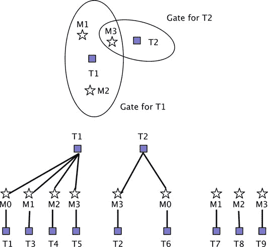

第 12 章

多假设检验

3. 为每条测量生成一条全新的航迹，假设该测量代表一个新目标。

每条航迹还会衍生出一条新航迹，假设该航迹没有测量值。

因此，在这种情况下，三条测量和两条航迹产生了九条新航迹。航迹 7–9 仅基于测量值初始化，这可能不足以初始化完整的状态向量。如果是这种情况，每条测量将关联无限数量的航迹，而不仅仅是一条新航迹。如果我们有雷达测量值，我们就有方位角、仰角、距离和距离变化率。这给出了所有位置状态和一个速度状态。

**图 12.2：** 测量与波门。M0 是一个“缺失”测量。缺失测量是指应该存在但实际不存在的测量。

**12.2.5 假设形成**

在 MHT 中，一个有效的假设是任何一组兼容的航迹。要使两条或多条航迹兼容，它们不能描述同一个目标，并且它们在任何一次扫描中都不能共享同一条测量。假设形成的任务是找到一个或多个航迹组合，这些组合：1) 是兼容的，并且 2) 最大化某个性能函数。

在讨论假设形成的方法之前，首先考虑航迹形成以及航迹如何与唯一目标关联是很有用的。新航迹可以通过以下两种方式之一形成：

1. 新航迹基于某个现有航迹，并添加了一条新测量。
2. 新航迹不基于任何现有航迹；它完全基于一条单一的新测量。


第 12 章

多假设检验

回想一下，每条航迹都是作为跨多次扫描的测量序列形成的。

除了原始测量历史之外，每条航迹还包含从卡尔曼滤波器计算出的状态和协方差数据的历史记录。卡尔曼滤波器在第 8 章中进行了探讨。当一条新测量被附加到现有航迹时，我们正在衍生出一条新航迹，该航迹包含原始航迹的所有测量值，再加上这条新测量。因此，新航迹描述的是与原始航迹相同的目标。


一项新的测量结果也可用于生成一条全新的轨迹，该轨迹与过去的测量结果无关。当这样做时，我们实际上是在表明该测量结果并不描述任何已被跟踪的对象。因此，它必然对应一个新的/不同的对象。

通过这种方式，每条轨迹都被赋予一个对象 ID，以区分它所描述的对象。在轨迹树图的上下文中，同一轨迹树内的所有轨迹都具有相同的对象 ID。例如，如果在某个时刻存在 10 个独立的轨迹树，这意味着在 MHT 系统中正在跟踪 10 个独立的对象。当形成一个有效假设时，结果可能只有其中少数几个对象拥有兼容的轨迹。

假设形成步骤被建模为一个混合整数线性规划（MILP），并使用 GLPK 求解。每条轨迹都被赋予一个综合得分，该得分反映了从每次测量中获得的各个分量得分。构建 MILP 模型是为了选择一组轨迹，使其总分最高，同时满足以下条件：

1.  没有两条轨迹具有相同的对象 ID
2.  对于任何扫描，没有两条轨迹具有相同的测量索引

此外，我们对模型进行了扩展，增加了一个选项，可以求解多个假设，而不仅仅是一个。该算法将按得分降序返回“M 个最佳”假设。这使得那些可能得分与最佳假设非常接近的备选假设中的轨迹得以保留。

**12.2.6 轨迹剪枝**

每一步都使用最近的 *n* 次扫描数据执行 N 扫描轨迹剪枝。我们采用一种剪枝方法，保留以下轨迹：

• 得分最高的“N”条轨迹
• 包含在“M 个最佳”假设中的轨迹
• 同时满足以下两个条件的轨迹：1) 对象 ID，以及 2) 在“M 个最佳”假设中找到的前“P”个测量值。

我们利用假设形成的结果来指导轨迹剪枝。参数 N、M 和 P 可以调整以优化性能。剪枝的目标是尽可能减少轨迹数量，同时不删除任何本应属于真实假设的轨迹。


第 12 章

多假设检验

上面列出的第二项是保留包含在“M 个最佳”假设中的所有轨迹。这些轨迹中的每一条都是穿过轨迹树的完整路径，这一点很明确。上面列出的第三项类似，但约束较少。考虑“M 个最佳”假设中的一条轨迹。我们将保留这条完整的轨迹。此外，我们还将保留从该轨迹的扫描“P”开始的所有分支轨迹。

图 12.3 给出了一个轨迹树中哪些轨迹可能被保留的示例。该图显示了五次扫描中的 17 条不同轨迹。绿色轨迹代表在假设形成步骤中从“M 个最佳”假设集合中找到的一条轨迹。这条轨迹将被保留。橙色轨迹都源自该轨迹在扫描 2 处的节点。如果我们根据上述描述设置 *P* = 2，这些轨迹将被保留。

**图 12.3：** 轨迹剪枝示例。此图显示了多次扫描（同时测量）以及如何利用它们来移除不符合所有数据的轨迹。


第 12 章

多假设检验

**12.3 台球卡尔曼滤波器**

**12.3.1 问题**

你想要估计多个台球的轨迹。在台球示例中，我们假设有多个球同时运动。假设我们在球桌上方放置了一个摄像机，并且有软件可以测量每个球在每帧视频中的位置。然而，该软件无法确定任何球的身份。这就是 MHT 发挥作用的地方。我们使用 MHT 来为运动的球建立一组轨迹。

**12.3.2 解决方案**

解决方案是创建一个线性卡尔曼滤波器。

**12.3.3 工作原理**


MHT 系统的核心估计算法是卡尔曼滤波器。卡尔曼滤波器包含对动力学的模拟以及融合测量值的算法。在本章的示例中，我们使用固定增益卡尔曼滤波器。模型如下：*xₖ₊₁* = *axₖ* + *buₖ*

(12.4)

*yₖ* = *cxₖ*

(12.5)

*xₖ* 是状态向量，是一个包含位置和速度的列向量。*yₖ* 是测量向量。

*uₖ* 是输入，即作用在台球上的加速度。*c* 将状态与测量值 *y* 关联起来。

如果唯一的测量值是位置，那么：

*c* =

(12.6)

这是一个离散时间方程。由于第二列为零，因此它只测量位置。

假设没有输入加速度。同时假设时间步长为 *τ*。那么我们的方程变为：

*s*

*τ*

*s*

=

(12.7)

*v*

*v*

ₖ₊₁

ₖ

*s*

*yₖ* =

(12.8)

*v*

ₖ

其中 *s* 是位置，*v* 是速度，*yₖ* = *s*。这表明新位置等于旧位置加上速度乘以时间。我们的测量值只有位置。如果没有外部加速度，速度是恒定的。如果我们无法直接测量加速度，那么这就是我们的模型。

我们的滤波器将根据位置的变化来估计速度。

在这种情况下，航迹是一系列 *s* 的序列。MHT 将测量值 *y* 分配给航迹。如果我们知道只有一个目标，并且传感器能准确测量该航迹，且没有虚假测量值或漏测的可能性，那么我们可以直接使用卡尔曼滤波器。


第 12 章

多假设检验

KFBilliardsDemo 模拟了台球运动。它包含两个表示动力学的函数。第一个是 RHSBilliards，即台球动力学的右侧函数，其内容如上所述。该函数根据外部加速度计算位置和速度。函数 BilliardCollision 在球碰到缓冲器时应用动量守恒定律。球之间不会发生碰撞。脚本的第一部分是模拟，为所有球生成测量向量。脚本的第二部分为每个球初始化一个卡尔曼滤波器。该脚本完美地将测量值分配给每条航迹。函数 KFPredict 是预测步骤，即模拟球的运动。它使用上述线性模型。KFUpdate 则融合测量值。

MHTDistance 仅用于提供信息。球的初始位置和速度向量是随机的。脚本固定了随机数生成器的种子，以确保每次运行结果相同，这便于调试。如果你注释掉这段代码，每次运行的结果都会不同。

这里，我们初始化球的位置。

% 球的数量以及随机的初始位置和速度
d = struct('nBalls',3,'xLim',[-1 1], 'yLim', [-1 1]);
sigP = 0.4; % 位置噪声的 1 西格玛值
sigV = 1; % 速度噪声的 1 西格玛值
sigMeas = 0.00000001; % 测量噪声的 1 西格玛值

% 为 2 组位置和速度设置初始状态
x = **zeros**(4*d.nBalls,1);
rN = **rand**(4*d.nBalls,1);
**for** k = 1:d.nBalls
    j = 4*k-3;
    x(j,1) = sigP*(rN(j) - 0.5);
    x(j+1,1) = sigV*(rN(j+1) - 0.5);
    x(j+2,1) = sigP*(rN(j+2) - 0.5);
    x(j+3,1) = sigV*(rN(j+3) - 0.5);
**end**

然后我们对它们进行模拟。除非它们撞到缓冲器，否则它们的运动是直线运动。

% 传感器测量值
nM = 2*d.nBalls;
y = **zeros**(nM,n);
iY = **zeros**(nM,1);
**for** k = 1:d.nBalls
    j = 2*k-1;
    iY(j) = 4*k-3;
    iY(j+1) = 4*k-1;
**end**
**for** k = 1:n


第 12 章

多假设检验

    % 碰撞
    x = BilliardCollision( x, d );
    % 绘图
    xP(:,k) = x;
    % 使用四阶龙格-库塔积分器进行积分
    x = RungeKutta(@RHSBilliards, 0, x, dT, d );
    % 带有高斯随机噪声的测量值
    y(:,k) = x(iY) + sigMeas***randn**(nM,1);
**end**


我们随后通过卡尔曼滤波器处理这些测量值。`KFPredict` 预测球的下一个位置，而 `KFUpdate` 则融合测量数据。预测步骤并不知晓碰撞的存在。

%% 实现卡尔曼滤波器

% 协方差

r0 = sigMeasˆ2*[1;1]; % 测量协方差

q0 = [1;60;1;60]; % 基准系统协方差对角线

p0 = [0.1;1;0.1;1]; % 初始状态协方差矩阵对角线

% 系统模型

a = [1 dT;0 1];

b = [dTˆ2/2;dT];

zA = **zeros**(2,2);

zB = **zeros**(2,1);

% 创建卡尔曼滤波器数据结构。a 适用于两个球。

**for** k = 1:d.nBalls

kf(k) = KFInitialize( 'kf', 'm', x0(4*k-3:4*k), 'x', x0(4*k-3:4*k),...

'a', [a zA;zA a], 'b', [b zB;zB b],'u',[0;0],...

'h', [1 0 0 0;0 0 1 0], 'p', **diag**(p0), ...

'q', **diag**(q0),'r', **diag**(r0) );

**end**

% 为绘图分配数组大小

pUKF = **zeros**(4*d.nBalls,n);

xUKF = **zeros**(4*d.nBalls,n);

t = 0;


第 12 章

多重假设检验

**for** k = 1:n

% 运行滤波器

**for** j = 1:d.nBalls

% 存储用于绘图

i = 4*j-3:4*j;

pUKF(i,k) = **diag**(kf(j).p);

xUKF(i,k) = kf(j).m;

% 状态更新

kf(j).t = t;

kf(j) = KFPredict( kf(j) );

% 融合测量值

i = 2*j-1:2*j;

kf(j).y = y(i,k);

kf(j) = KFUpdate( kf(j) );

**end**

t = t + dT;

**end**

卡尔曼滤波器示例的结果如图 12.4、图 12.5 和图 12.6 所示。所有球的协方差和状态都被绘制出来，但此处仅展示一个。协方差总是随时间呈现相同趋势。随着滤波器累积测量值，它会根据模型协方差（即模型假设的精确度）与测量协方差之间的比率来调整协方差。协方差与实际测量值完全无关。卡尔曼滤波器的误差如图 12.6 所示。每当球撞击缓冲器时，误差会很大，因为模型未包含与缓冲器的碰撞。由于我们的测量噪声很小，误差会迅速减小。

以下代码摘自上述示例，是用于在台球桌上显示台球的专用绘图代码。它为每个球调用 `plot` 函数。颜色取自数组 `c`，分别为蓝色、绿色、红色、青色、品红色、黄色和黑色。一旦计算出球的 *x* 和 *y* 位置 `xP` 和 `yP`，即可从命令行运行此代码。该代码使用图例句柄将球与图中图例中的轨迹关联起来。它手动设置坐标轴范围（`gca` 作为当前坐标轴的句柄）。

% 绘制仿真结果

NewFigure( '台球' )

c = 'bgrcmyk';

kX = 1;

kY = 3;

s = **cell**(1,d.nBalls);

l = [];

**for** k = 1:d.nBalls

**plot**(xP(kX,1),xP(kY,1),['o',c(k)])


第 12 章

多重假设检验

**图 12.4：** 台球桌上的四个球。

**图 12.5：** 滤波器协方差。


第 12 章

多重假设检验

**图 12.6：** 滤波器误差。

**hold** on

l(k) = **plot**(xP(kX,:),xP(kY,:),c(k));

kX = kX + 4;

kY = kY + 4;

s{k} = **sprintf**('球 %d',k);

**end**

**xlabel**('x (m)');

**ylabel**('y (m)');

**set**(**gca**,'ylim',d.yLim,'xlim',d.xLim);

**legend**(l,s)

**grid on**

你可以在脚本中更改协方差 `sigP`、`sigV`、`sigMeas`，并观察它们如何影响误差和协方差。


第 12 章

多重假设检验

**12.4**

**台球 MHT**

**12.4.1 问题**

你需要估计多个台球的运动轨迹。

**12.4.2 解决方案**

解决方案是创建一个结合线性卡尔曼滤波器的 MHT 系统。此示例涉及台球在球台边库上的反弹。该模型不包含与边库的碰撞。

**12.4.3 工作原理**

以下代码添加了 MHT 功能。它首先运行演示（与上例相同），然后尝试将测量值分配到航迹中。示例中只有两个球。运行演示时，你将看到图形用户界面（GUI）（图 12.7）和树状图（图 12.8）随着模拟的进行而变化。我们在下面的代码清单中仅包含 MHT 代码。

% 创建航迹数据结构

mhtData = MHTInitialize('probability false alarm', 0.001,...

'probability of signal if target present',

0.999,...

'probability of signal if target absent',

0.001,...

'probability of detection', 1, ...

'measurement volume', 1.0, ...

'number of scans', 3, ...

'gate', 0.2,...

'm best', 2,...

'number of tracks', 1,...

'scan to track function',

@ScanToTrackBilliards,...

'scan to track data',struct('r', **diag**(r0),'p',

**diag**(p0)),...

'distance function',@MHTDistance,...

'hypothesis scan last', 0,...

'filter data',kf(1),...

'prune tracks', 1,...

'remove duplicate tracks across all trees'

,1,...

'average score history weight',0.01,...

'filter type','kf');

% 创建航迹

**for** k = 1:d.nBalls

trk(k) = MHTInitializeTrk( kf(k) );

**end**


第 12 章

多重假设检验

% 尺寸数组

b = MHTTrkToB( trk );

%% 初始化 MHT 图形用户界面

MHTGUI;

MLog('init')

MLog('name','台球演示')

TOMHTTreeAnimation( 'initialize', trk );

TOMHTTreeAnimation( 'update', trk );

t = 0;

**for** k = 1:n

% 获取测量值 - zScan.data

z = **reshape**( y(:,k), 2, d.nBalls );

zScan = AddScan( z(:,1) );

**for** j = 2:**size**(z,2)

zScan = AddScan( z(:,j),[],zScan);

**end**

% 管理航迹并生成假设

[b, trk, sol, hyp] = MHTTrackMgmt( b, trk, zScan, mhtData, k, t );

% 更新 MHTGUI 显示

**if**( ˜**isempty**(zScan) && graphicsOn )

**if** (treeAnimationOn)

TOMHTTreeAnimation( 'update', trk );

**end**

MHTGUI(trk,sol,'hide');

**drawnow**

**end**

t = t + dT;

**end**

% 显示最终图形用户界面

**if** (˜treeAnimationOn)

TOMHTTreeAnimation( 'update', trk );

**end**

**if** (˜graphicsOn)

MHTGUI(trk,sol,'hide');

**end**

MHTGUI;

MHTInitialize 中的参数对在表 12.2 中进行了描述。

图 12.7 展示了 MHT 图形用户界面。该图显示了仿真结束时的 GUI。表格的 x 轴表示扫描次数，y 轴（垂直方向）表示航迹。每条航迹都按 281 进行编号。


第 12 章

多重假设检验

**表 12.2：** 多重假设检验参数

**术语**

**定义**

'虚警概率'

测量值为虚假值的概率

'目标存在时的信号概率'

目标存在时获取信号的概率

'目标不存在时的信号概率'

目标不存在时获取信号的概率

'检测概率'

检测到目标的概率

'测量体积'

用于缩放似然比。

'扫描次数'

假设形成中需要考虑的扫描次数

'波门'

波门的大小

'最佳假设数'

需要考虑的假设数量

'航迹数量'

需要维护的航迹数量

'扫描到航迹函数'

指向扫描到航迹函数的指针。该函数针对每个应用自定义。

'扫描到航迹数据'

扫描到航迹函数所需的数据

'距离函数'

MHT 距离函数的指针。可以采用不同的定义。

'假设最后扫描'

假设中使用的最后一次扫描

'修剪航迹'

如果为真，则修剪航迹

'滤波器类型'

卡尔曼滤波器的类型

'滤波器数据'

卡尔曼滤波器的数据


'remove duplicate tracks across all trees'

如果为真，则从所有树中移除重复的轨迹

'average score history weight'

一个用于乘以平均分数历史的数字

'create track'

如果输入此项，将创建一条新轨迹，而不是使用现有轨迹

xxx.yyy，其中 xxx 是轨迹编号，yyy 是标签编号。每条轨迹都会被分配一个新的标签编号。例如，95.542 表示轨迹 95，标签 542 意味着它是生成的第 542 条轨迹。表格中的数字显示了与该轨迹和扫描相关联的测量值。TRK 3.21 和 TRK 3.57 是重复的。在这两种情况下，每次扫描都有一个测量值与 TRK 相关联。

它们的分数相同，因为它们是一致的。对于我们的假设，我们只能选择其中一个。TRK 95.542 没有从扫描 77 中获得测量值，但在其余扫描中，它获得了测量值 2。扫描 77 到 80 是活跃的。一次扫描包含四个位置测量值。摘要显示有七条活跃轨迹，但我们知道（尽管软件不一定知道）实际上只有四个球在运动中。扫描次数是当前用于确定有效轨迹的数量。有两个活跃的假设。

图 12.8 显示了决策树。你可以看到，在扫描 80 时，创建了两条新轨迹。这意味着 MHT 认为可能有多达四条轨迹。然而，在此时，只有轨迹 3 和 95 有多个与之关联的测量值。


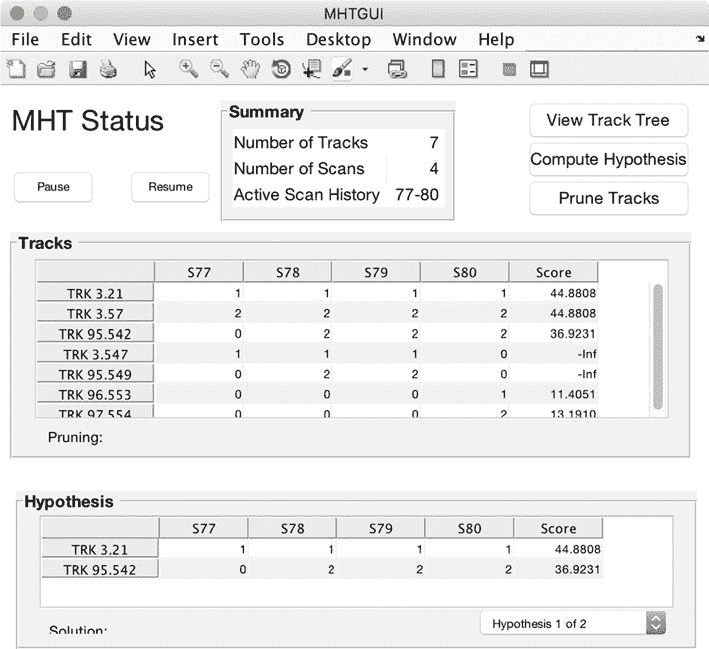

第 12 章

多假设检验

**图 12.7：** 多假设检验（MHT）图形用户界面（GUI）。

图 12.9 显示了信息窗口。这展示了 MHT 算法的思考过程。它给出了每次扫描所做的决策。

该演示表明，MHT 算法能够正确地将测量值与轨迹关联起来。


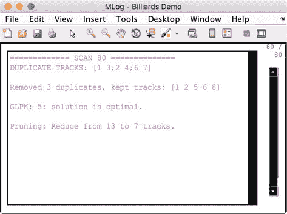

第 12 章

多假设检验

**图 12.8：** MHT 树。蓝色条表示分配给每条轨迹的分数。越长越好。黑色框中的数字是轨迹编号。

**3**

扫描 77

**95**

扫描 78

扫描 79

**96**

**97**

扫描 80

**图 12.9：** MHT 信息窗口。它告诉你 MHT 算法正在思考什么。


第 12 章

多假设检验

**12.5**

**一维运动**

**12.5.1 问题**

你想要估计一个在未知加速度下沿单一方向运动的物体的位置。

**12.5.2 解决方案**

解决方案是创建一个包含加速度状态的线性卡尔曼滤波器。

**12.5.3 工作原理**

在这个演示中，我们有一个包含未知加速度状态的物体模型。

⎡

⎤

⎡

⎤ ⎡

⎤

*s*

*τ*

*s*

⎣

2 *τ* 2

*v* ⎦

=

⎣ 0 1 *τ*

⎦ ⎣ *v* ⎦

(12.9)

*a*

*a*

*k*+1

*k*

⎡

⎤

*s*

*y*

⎣

⎦

*k*

=

*v*

(12.10)

*a*

*k*

其中 *s* 是位置，*v* 是速度，*a* 是加速度。*yk* = *s*。*τ* 是时间步长。加速度状态的输入是加速度的时间变化率。

函数 DoubleIntegratorWithAccel 创建了上面所示的矩阵：

>> [a, b]

= DoubleIntegratorWithAccel( 0.5 )

a =

1.0000

0.5000

0.1250

1.0000

0.5000

1.0000

b =

其中 *τ* = 0.5 秒。

我们将设置仿真，使得一个物体没有加速度，但起始位置在另一个物体之前。另一个物体将超越第一个物体。我们想看看 MHT 是否能理清这些轨迹。

在自动驾驶中，超车会经常发生。

以下代码实现了两个车辆的卡尔曼滤波器。仿真首先运行以生成测量值。然后运行卡尔曼滤波器。请注意，绘图数组在滤波器更新后更新。这使其与仿真保持同步。


第 12 章

多假设检验

%% 运行卡尔曼滤波器

% 协方差

r

= r(1,1);

q

= **diag**([0.5*aRand*dTˆ2;aRand*dT;aRand].ˆ2 + q0);

% 创建卡尔曼滤波器数据结构

d1


= KFInitialize( 'kf', 'm', [0;0;0],

'x', [0;0;0], 'a', a, 'b',

b, 'u',0,...

'h', h(1,1:3), 'p', **diag**(p0), 'q', q, 'r', r );

d2

= d1;

d1.m

= x(1:3,1) + **sqrt**(p0).***rand**(3,1);

d2.m

= x(4:6,1) + **sqrt**(p0).***rand**(3,1);

xE

= **zeros**(6,n);

**for** k = 1:n

d1

= KFPredict( d1 );

d1.y

= z(1,k);

d1

= KFUpdate( d1 );

d2

= KFPredict( d2 );

d2.y

= z(2,k);

d2

= KFUpdate( d2 );

xE(:,k) = [d1.m;d2.m];

**end**

我们使用带有参数 `'plot set'` 的 `PlotSet` 来对输入进行分组，并使用参数 `'legend'` 在每个图上添加图例。`'plot set'` 接受一个由 1 *×* n 数组组成的元胞数组作为输入，而 `'legend'` 则接受一个由元胞数组组成的元胞数组。我们无需对运动方程进行数值积分，因为状态方程已经完成了这项工作。你可以始终以这种方式传播线性模型。我们使用 `aRand` 设置模型噪声矩阵，但实际上并未输入任何随机加速度。按照代码编写，我们的模型是完美的，但在真实系统中这绝无可能，因此需要引入模型不确定性。

图 12.10 展示了状态和误差。滤波器对两个物体的所有三个状态都跟踪得相当好。加速度和速度估计值在 10 秒内收敛。尽管仅有一个位置 *s* 的测量值，它仍能很好地估计固定扰动加速度。


第 12 章

多假设检验

**图 12.10：** 物体状态与滤波器误差。

**12.6**

**带航迹关联的一维运动**

下一个问题需要我们关联测量值与航迹。

**12.6.1 问题**

你希望利用需要与航迹关联的测量值，来估计一个沿一维方向运动的物体的位置。

**12.6.2 解决方案**

解决方案是创建一个以卡尔曼滤波器作为状态估计器的 MHT 系统。

**12.6.3 工作原理**

MHT 代码如下所示。我们将 MHT 软件附加到上面所示的脚本中。卡尔曼滤波器嵌入在 MHT 软件中。我们首先运行仿真并收集测量值，然后在 MHT 代码中处理它们。

% 初始化 MHT 参数

[mhtData, trk] = MHTInitialize( 'probability false alarm', 0.001,...

'probability of signal if target

present', 0.999,...

'probability of signal if target

absent', 0.001,...

'probability of detection', 1, ...

'measurement volume', 1.0, ...

'number of scans', 3, ...

'gate', 0.2,...

'm best', 2,...

'number of tracks', 1,...

'scan to track function',

@ScanToTrack1D,...


第 12 章

多重假设检验

'scan to track data',struct('v',0)

,...

'distance function',@MHTDistance,...

'hypothesis scan last', 0,...

'prune tracks', true,...

'filter type','kf',...

'filter data', f,...

'remove duplicate tracks across all

trees',true,...

'average score history weight'

,0.01,...

'create track', '');

% 数组大小

m

= **zeros**(3,n);

p

= **zeros**(3,n);

scan

= **cell**(1,n);

b

= MHTTrkToB( trk );

TOMHTTreeAnimation( 'initialize', trk );

TOMHTTreeAnimation( 'update', trk );

% 初始化 MHT 图形用户界面

MHTGUI;

MLog('init')

MLog('name','MHT 1D Demo')

t = 0;

**for** k = 1:n

% 获取测量值

zScan = AddScan( z(1,k) );

zScan = AddScan( z(2,k), [], zScan );

% 管理航迹

[b, trk, sol, hyp] = MHTTrackMgmt( b, trk, zScan, mhtData, k, t );

% 更新 MHTGUI 显示

MHTGUI(trk,sol,'update');

% 对新航迹初始速度的猜测

**for** j = 1:**length**(trk)

mhtData.fScanToTrackData.v = mhtData.fScanToTrackData.v + trk(j

).m(1);

**end**


第 12 章

多重假设检验

mhtData.fScanToTrackData.v = mhtData.fScanToTrackData.v/**length**(trk)

;

% 动画显示树

TOMHTTreeAnimation( 'update', trk );

**drawnow**;

t = t + dT;

**end**

图 12.11 显示了状态和误差。MHT 假设的航迹与数据拟合得很好。

**图 12.11：** MHT 对象状态与估计状态。两幅图中的颜色进行了互换。

图 12.12 显示了 MHT 图形用户界面和树。航迹 1 仅包含来自对象 2 的测量值。航迹 2 仅包含来自对象 1 的测量值。354 和 360 是虚假航迹。354 在扫描 177 处有一个测量值 1，但在后续扫描中无测量值。360 在扫描 180 处创建，且仅有一个测量值。航迹 1 和 2 具有相同的评分。结果表明，MHT 软件已成功区分测量值并正确分配。此时，仿真结束时，有四个扫描处于活动状态。

**12.7**

**总结**

本章演示了多重假设检验的基本原理。表 12.3 列出了随附代码中包含的函数和脚本。


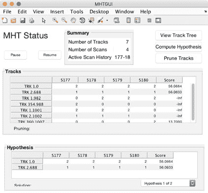


第 12 章

多重假设检验

**图 12.12：** GUI 与 MHT 树。该树展示了 MHT 的决策过程。

**1**

**2**

**354**

扫描 177 0

扫描 178 2

扫描 179 2

**360**

扫描 180 2

**表 12.3：** 章节代码清单

**文件**

**描述**

AddScan

向数据中添加一次扫描。

CheckForDuplicateTracks

检查已记录的航迹中是否存在重复项。

MHTDistanceUKF

计算 MHT 距离。

MHTGUI.fig

MHT GUI 的已保存布局数据。

MHTGUI

MHT 软件的图形用户界面。

MHTHypothesisDisplay

在 GUI 中显示假设。

MHTInitialize

初始化 MHT 算法。

MHTInitializeTrk

初始化一条航迹。

MHTLLRUpdate

更新对数似然比。

MHTMatrixSortRows

对 MHT 中的行进行排序。

MHTMatrixTreeConvert

在 MHT 数据的树形格式与矩阵格式之间进行转换。

MHTTrackMerging

合并 MHT 航迹。

MHTTrackMgmt

管理 MHT 航迹。

MHTTrackScore

计算航迹的总得分。

MHTTrackScoreKinematic

计算航迹得分的运动学部分。

MHTTrackScoreSignal

计算航迹得分的信号部分。

MHTTreeDiagram

绘制 MHT 树形图。

MHTTrkToB

将航迹转换为 B 矩阵。

PlotTracks

绘制目标航迹。

Residual

计算残差。

TOMHTTreeAnimation

面向航迹的 MHT 树形图动画。

TOMHTAssignment

为航迹分配一次扫描。

TOMHTPruneTracks

修剪航迹。


**第 13 章**

**基于多重假设检验的**

**自动驾驶**

在本章中，我们将把上一章中的多重假设检验（MHT）技术应用于一个有趣的自动驾驶问题。考虑一辆主车，它以可变速度在高速公路上行驶。该车搭载了一个雷达，用于测量方位角、距离和距离变化率。其他车辆会超越主车，其中一些车辆会从主车后方变道并切入其前方。多重假设系统会跟踪主车周围的所有车辆。在仿真开始时，雷达视野内没有车辆。一辆车经过并切入雷达车前方。另外两辆车则在其各自车道内驶过。你需要精确跟踪雷达所能看到的所有车辆。

自主

学习

机器

控制

学习

智能

这个问题包含两个要素。一是利用测量值对被跟踪汽车的运动进行建模，以提高对每辆汽车位置和速度的估计精度。


第二个步骤是系统地将测量值分配给不同的轨迹。一条轨迹应代表一辆单独的汽车，但雷达只是根据回波返回测量值，它并不了解回波的来源。

你将通过首先实现一个卡尔曼滤波器来跟踪一辆汽车，从而解决这个问题。

我们需要编写测量函数和动力学函数，这些函数将被传递给卡尔曼滤波器，并且我们需要一个仿真来生成测量值。然后，我们将把上一章中开发的多假设跟踪（MHT）技术应用于这个问题。

© Michael Paluszek 和 Stephanie Thomas 2019

M. Paluszek 和 S. Thomas， *MATLAB 机器学习实战*，

[`doi.org/10.1007/978-1-4842-3916-2_13`](https://doi.org/10.1007/978-1-4842-3916-2_13)


第 13 章

基于多假设测试的自动驾驶

在本章中，我们将完成以下工作。

1. 对汽车动力学进行建模
2. 对雷达系统进行建模
3. 编写控制算法
4. 实现可视化，以便我们能在 3D 中观察机动动作
5. 实现无迹卡尔曼滤波器
6. 实现多假设跟踪（MHT）

**13.1**

**汽车动力学**

**13.1.1 问题**

我们需要对汽车动力学进行建模。我们将此限制为二维平面模型。

我们正在对汽车的 *x/y* 位置以及车轮角度进行建模，这使得汽车能够改变方向。

**13.1.2 解决方案**

编写一个可被龙格-库塔法调用的右侧函数。

**13.1.3 工作原理**

与雷达类似，我们需要两个函数来处理汽车的动力学。

`RHSAutomobile` 被仿真程序使用。`RHSAutomobile` 包含完整的动力学模型，包括发动机和转向模型。空气阻力、滚动阻力和侧向力阻力（汽车不会毫无阻力地侧滑）都被建模。`RHSAutomobile` 处理多辆汽车的情况。另一种方法是编写一个单汽车函数，并为每辆汽车调用一次龙格-库塔法。后一种方法适用于所有情况，除非你想要对碰撞进行建模。在许多类型的碰撞中，两辆车相撞然后粘在一起，实际上变成了一辆车。一个真正的跟踪系统需要处理这种情况。

每辆车有六个状态。它们是：

1. x 位置
2. y 位置
3. x 速度
4. y 速度
5. 绕垂直轴的角度
6. 绕垂直轴的角速率


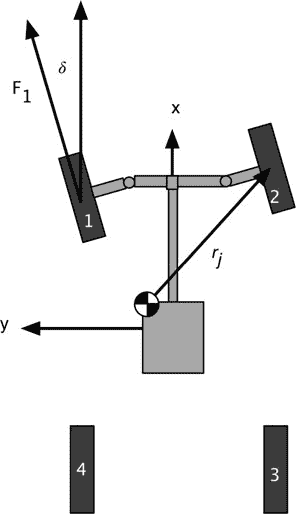


第 13 章

基于多假设测试的自动驾驶

速度的导数由力驱动，角速率的导数由扭矩驱动。平面动力学模型如图 13.1[[29]](#index_split_007.html#p351)所示。与参考文献不同，我们约束后轮固定，并且前轮的角度相同。

**图 13.1：** 平面汽车动力学模型。

动力学方程是在旋转坐标系中编写的。

*m*( *˙ vx* − 2 *ωvy*) =

*Fk* −

*x*

*qCDxAxux*

(13.1)

*k*=1

*m*( *˙ vy* + 2 *ωvx*) =

*Fk* −

*y*

*qCDy Ayuy*

(13.2)

*k*=1

*I *˙

*ω*

=

*r×F*

*k*

*k*

(13.3)

*k*=1

其中动压为：

*q* =

*ρ*

*v* 2

*x* + *v* 2

*y*

(13.4)

并且

*v*

*v* =

*x*

(13.5)

*vy*


第 13 章

基于多假设测试的自动驾驶

单位向量为：

*vx*

*vy*

*u* =

(13.6)

*v* 2 *x* + *v* 2 *y*

法向力为 *mg*，其中 *g* 是重力加速度。轮胎接触点（轮胎与路面接触处）的力，对于轮胎 *k* 为：

*T /ρ − F*

*F*

*r*

*t* =

(13.7)

*k*

*−Fc*

**图 13.2：** 车轮力和扭矩。

其中 *ρ* 是轮胎半径，*Fr* 是滚动摩擦力，为：*Fr* = *f*0 + *K*1 *v*2 *t*

(13.8)

*x*

其中 *vtx* 是轮胎坐标系中滚动方向的速度。对于前轮驱动汽车，后轮的扭矩 *T* 为零。接触摩擦力为：*vt*

*F*

*y*

*c* = *μcmg |vt|*

(13.9)


这是垂直于车轮正常滚动方向的力，即图 13.2 中指向纸内或纸外的力。速度项确保摩擦力不会引起极限循环。也就是说，当 *y* 方向速度为零时，该力也为零。*μc* 是轮胎的一个常数。

从轮胎坐标系到车身坐标系的变换为：

cos *δ*

*−* sin *δ*

*c* =

(13.10)

sin *δ*

cos *δ*


第 13 章

基于多重假设检验的自动驾驶

其中 *δ* 是转向角，因此：

*Fk* = *cFt*

(13.11)

*k*

*v*

*v*

*x*

*t* = *cT*

(13.12)

*vy*

关联偏航角和偏航角速度的运动学方程为：

˙

*θ* = *ω*

(13.13)

而惯性速度 *V*，即用于确定汽车行驶方向的速度，为：

cos *θ*

*−* sin *θ*

*V* =

*v*

(13.14)

sin *θ*

cos *θ*

我们将在本章第 13.4 节的图形部分向您展示动力学仿真。

**13.2**

**汽车雷达建模**

**13.2.1 问题**

本例使用的传感器是汽车雷达。雷达测量方位角、距离和距离变化率。我们需要两个函数：一个用于仿真，另一个供无迹卡尔曼滤波器使用。

**13.2.2 解决方案**

在 MATLAB 函数中构建一个雷达模型。该函数将使用距离和距离变化率的解析推导。

**13.2.3 工作原理**

雷达模型非常简单。它假设雷达测量的是视线距离、距离变化率和方位角（即与汽车前进轴之间的夹角）。该模型跳过了雷达信号处理的所有细节，直接输出这三个量。在项目启动阶段，这种简单模型总是最佳选择。后续，您将需要添加一个经过测试数据验证的、非常详细的模型，以证明您的系统按预期工作。

雷达的位置和速度通过数据结构输入。该模型不模拟雷达的信噪比。雷达接收到的功率与 1/*r*⁴ 成正比。在此模型中，信号在函数指定的最大距离处衰减为零。距离由雷达与目标之间的位置差求得。如果 *δ* 表示差值，我们可写出：

⎡

⎤

*x − xr*

*δ* = ⎣ *y − y* ⎦

*r*

(13.15)

*z − zr*


第 13 章

基于多重假设检验的自动驾驶

那么距离为：

*ρ* =

*δ*²*x* + *δ*²*y* + *δ*²*z*

(13.16)

速度差为：

⎡

⎤

*vx − vxr*

*ν* = ⎣ *v*

⎦

*y − vyr*

(13.17)

*vz − vzr*

在上述两个方程中，下标 *r* 表示雷达。距离变化率为：*νT δ*

˙

*ρ* =

(13.18)

*ρ*

`AutoRadar` 函数可处理多个目标，并能生成整个轨迹的雷达测量值。这非常方便，因为您可以将轨迹输入其中，并查看其返回结果。这能让您在不运行仿真的情况下，对问题获得直观的物理感受。它还能让您确信传感器模型的行为符合预期！这一点很重要，因为所有模型都有假设条件和局限性。该模型可能并不适合您的应用。例如，此模型是二维的。如果您担心系统会混淆行驶在您汽车上方桥梁上的车辆，那么该模型在测试该场景时将毫无用处。

请注意，该函数内置了一个演示程序，如果没有输出，它将绘制结果图。为代码添加演示程序是一种很好的方式，可以使您的函数对使用您代码的其他人，甚至对几个月后再次遇到该代码的您自己来说，更加友好！我们将演示程序放在一个子函数中，因为它比较长。如果演示程序只有一两行，则无需子函数。在演示函数之前，是定义数据结构的函数。


第二个函数 `AutoRadarUKF` 的核心代码相同，但设计为与无迹卡尔曼滤波器兼容。我们本可以使用 `AutoRadar`，但这样更便捷。变换矩阵 `cITOC`（惯性到车辆变换）是二维的，因为仿真是在一个平坦世界中进行的。

s = **sin**(d.theta);

c = **cos**(d.theta);

cIToC = [c s;-s c];

dR = cIToC*x(1:2);

dV = cIToC*x(3:4);

rng = **sqrt**(dR'*dR);

y = [rng; dR'*dV/rng; **atan**(dR(2)/dR(1))];

雷达返回目标的距离、距离变化率和方位角。尽管我们使用雷达作为传感器，但你完全可以使用摄像头、激光测距仪或声纳来代替。本书提供的算法和软件的限制在于，它只能处理单个传感器。你可以从普林斯顿卫星系统公司获取能够扩展到多个传感器的软件。


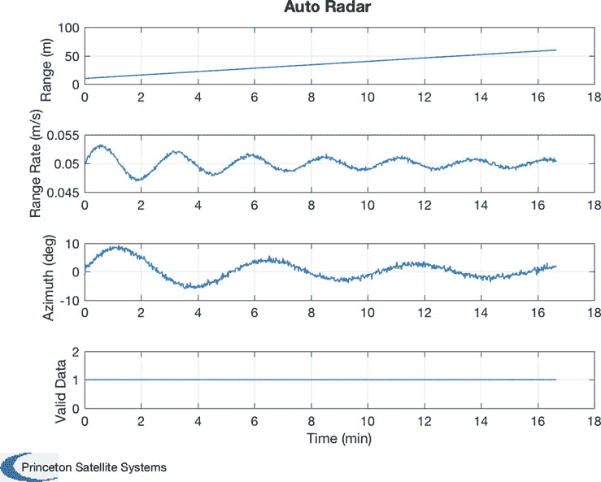

第 13 章

基于多假设检验的自动驾驶

该软件可扩展至多个传感器。例如，汽车搭载了雷达、摄像头和激光雷达。你可能希望将它们的所有测量结果整合在一起。图 13.3 展示了内部雷达演示。

目标汽车在雷达前方蜿蜒行驶。它以稳定的速度远离，但蜿蜒行驶引入了随时间变化的距离变化率。

**图 13.3：** 内置雷达演示。目标在雷达前方蜿蜒行驶。

**13.3**

**汽车自主超车控制**

**13.3.1 问题**

为了让我们的雷达有有趣的东西可测量，我们需要让汽车执行一些机动动作。我们将开发一种汽车变道算法。

**13.3.2 解决方案**

汽车由执行基本汽车机动动作的转向控制器驱动。可以控制油门（加速踏板）和转向角。多个机动动作可以串联起来。这为 MHT 系统提供了一个具有挑战性的测试。第一个函数用于自主超车，第二个函数执行变道。


第 13 章

基于多假设检验的自动驾驶

**13.3.3 工作原理**

`AutomobilePassing` 通过将车轮指向目标来实现超车控制。

它生成转向角需求和扭矩需求。需求是我们希望转向系统执行的操作。在真实汽车中，硬件会尝试满足需求，但在车轮角度或电机扭矩达到控制器指令的车轮角度或扭矩需求之前，会存在一个时间延迟。在许多情况下，你是将需求传递给另一个将尝试满足该需求的控制系统。这些算法非常简单。它们不关心是否有任何障碍物挡路。它们也没有任何避免与其他车辆碰撞的控制措施。代码假设车道是空的。不要在你的车上尝试！状态由 `passState` 变量定义。在超车之前，`passState` 为 0。在超车过程中，它为 1。

当它返回原车道时，状态被设置为 0。

% 引导目标，除非超车车辆在前方
**if**( passee.x(1) + dX > passer.x(1) )
    xTarget = passee.x(1) + dX;
**else**
    xTarget = passer.x(1) + dX;
**end**

% 这会导致超车车辆切入被超车辆前方
**if**( passer(1).passState == 0 )
    **if**( passer.x(1) > passee.x(1) + 2*dX )
        dY = 0;
        passer(1).passState = 1;
    **end**
**else**
    dY = 0;
**end**

% 控制计算
target = [xTarget;passee.x(2) + dY];
theta = passer.x(5);
dR = target - passer.x(1:2);
**angle** = **atan2**(dR(2),dR(1));
err = **angle** - theta;
passer.delta = gain(1)*(err + gain(3)*(err - passer.errOld));
passer.errOld = err;
passer.torque = gain(2)*(passee.x(3) + dV - passer.x(3));

第二个函数执行变道。它通过将车轮指向目标来实现变道控制。该函数生成转向角需求和扭矩需求。

默认增益工作得相当好。你应该始终提供合理的默认值。

% 默认增益
**if**( **nargin** < 5 )
    gain = [0.05 80 120];
**end**


第 13 章

基于多重假设检验的自动驾驶

% 除非超车车辆在前方，否则跟随目标车辆

xTarget

= passer.x(1) + dX;

% 控制量计算

target

= [xTarget;y];

theta

= passer.x(5);

dR

= target - passer.x(1:2);

**angle**

= **atan2**(dR(2),dR(1));

err

= **angle** - theta;

passer.delta

= gain(1)*(err + gain(3)*(err - passer.errOld));

passer.errOld

= err;

passer.torque

= gain(2)*(v - passer.x(3));

**13.4**

**汽车动画**

**13.4.1 问题**

我们希望将车辆在机动过程中的状态可视化。

**13.4.2 工作原理**

我们创建一个函数来读取 `.obj` 文件。然后编写一个函数来绘制模型并为其制作动画。

**13.4.3 解决方案**

第一步是找到一个汽车模型。一个很好的资源是 TurboSquid [`www.turbosquid.com`](https://www.turbosquid.com)。您可以在其中找到成千上万个模型。我们需要 `.obj` 格式，并且倾向于使用低多边形数量的模型。理想情况下，我们希望模型由三角形构成。就本章找到的模型而言，它包含矩形，因此我们使用 Macintosh 应用程序 Cheetah3D [`www.cheetah3d.com`](https://www.cheetah3d.com) 将其转换为三角形。一个 OBJ 模型附带一个 `.obj` 文件、一个 `.mtl` 文件（材质文件）以及用于纹理的图像。我们只使用 `.obj` 文件。

`LoadOBJ` 加载该文件并将其放入一个数据结构中。该数据结构利用 OBJ 文件的 `g` 字段将文件分解为多个组件。在本例中，这些组件是四个轮胎和车身的其余部分。演示代码仅为：

`LoadOBJ( 'MyCar.obj' )`。您确实需要包含扩展名 `.obj`。该汽车模型如图 13.4 所示。

该图像是通过对每个组件调用一次 `patch` 生成的。

`DrawComponents` 的第一部分负责初始化模型并更新它。我们保存并返回指向这些 `patch` 对象的指针，这样每次调用时只需更新向量即可。


第 13 章

基于多重假设检验的自动驾驶

**图 13.4：** 汽车 3D 模型。

0.6

0.4

0.2

**Z**

-0.2

0.4

0.2

0.5

-0.2

-0.4

**Y**

**X**

-0.5

switch( **lower**(action) )

case 'initialize'

n = **length**(g.component);

h = **zeros**(1,n);

**for** k = 1:n

h(k) = DrawMesh(g.component(k) );

**end**

case 'update'

UpdateMesh(h,g.component,x);

otherwise

warning('%s not available',action);

**end**

网格通过调用 `patch` 来绘制。`patch` 有许多值得探索的选项。我们使用最少的设置。我们将边缘设置为黑色，以使模型更易于观察。Phong 反射模型是一种经验光照模型，它包含了漫反射和镜面反射光照。

**function** h = DrawMesh( m )

h = **patch**(

'Vertices', m.v, 'Faces',

m.f, 'FaceColor', m.color,...

'EdgeColor',[0 0 0],'EdgeLighting', 'phong',...

'FaceLighting', 'phong');


第 13 章

基于多重假设检验的自动驾驶

更新是通过绕 z 轴旋转顶点，然后加上 x 和 y 方向的位置偏移来完成的。输入数组为 [x;y;yaw]。然后我们设置新的顶点。该函数可以处理位置、速度和偏航角的数组。

**function** UpdateMesh( h, c, x )

**for** j = 1:**size**(x,2)

**for** k = 1:**length**(c)

cs = **cos**(x(3,j));

sn = **sin**(x(3,j));

b = [cs -sn 0 ;sn cs 0;0 0 1];

v = (b*c(k).v')';

v(:,1) = v(:,1) + x(1,j);

v(:,2) = v(:,2) + x(2,j);

**set**(h(k),'vertices',v);

**end**

**end**

图形演示程序 `AutomobileDemo` 实现了超车控制。`AutomobileInitialize` 读取 OBJ 文件。以下代码设置了图形窗口：

% 设置图形窗口

NewFig( 'Car Passing' )


**axes**('DataAspectRatio',[1 1 1],'PlotBoxAspectRatio',[1 1 1] ); h(1,:) = DrawComponents( 'initialize', d.car(1).g );

h(2,:) = DrawComponents( 'initialize', d.car(2).g );

XLabelS('X (m)')

YLabelS('Y (m)')

ZLabelS('Z (m)')

**set**(**gca**,'ylim',[-4 4],'zlim',[0 2]);

**grid on**

**view**(3)

rotate3d on

在仿真循环的每次迭代中，我们都会更新图形。

我们为每辆车调用一次 DrawComponents，并传入每辆车各部件对应的存储句柄。我们调整坐标轴范围，以便将焦点紧密锁定在两辆车上。我们本也可以使用坐标轴数据结构中的相机字段来实现这一点。在设置新的 xlim 以实现平滑动画后，我们调用 drawnow。


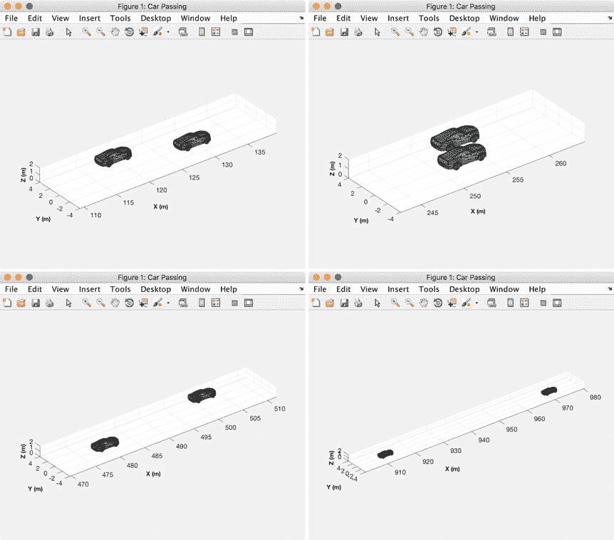

第 13 章

基于多假设检验的自动驾驶

% 绘制车辆

pos1 = x([1 2]);

pos2 = x([7 8]);

DrawComponents( 'update', d.car(1).g, h(1,:), [pos1; **pi**/2 + x( 5)] ); DrawComponents( 'update', d.car(2).g, h(2,:), [pos2; **pi**/2 + x(11)] ); xlim = [**min**(x([1 7]))-10 **max**(x([1 7]))+10];

**set**(**gca**,'xlim',xlim);

**drawnow**

图 13.5 展示了超车过程中的四个时刻。

**图 13.5：** 显示超车过程的汽车仿真快照。


第 13 章

基于多假设检验的自动驾驶

**13.5**

**汽车仿真与卡尔曼滤波器**

**13.5.1 问题**

你希望利用雷达测量值来跟踪一辆在你车周围机动行驶的汽车。车辆可能随时出现或消失。需要将雷达测量值转换为被跟踪车辆的位置和速度。在两次雷达测量之间，你希望做出最佳估计，预测汽车在给定时刻的位置。

**13.5.2 解决方案**

解决方案是实现一个无迹卡尔曼滤波器，以接收雷达测量值并更新被跟踪汽车的动力学模型。

**13.5.3 工作原理**

我们首先创建包含卡尔曼滤波器动力学模型的函数 RHSAutomobileXY。

卡尔曼滤波器的右侧就是微分方程。

˙*x* = *vx* (13.19)

˙*y* = *vy* (13.20)

˙*vx* = 0 (13.21)

˙*vy* = 0 (13.22)

点号表示对时间的导数或变化率。这些是汽车的状态方程。该模型表明，位置随时间的变化与速度成正比。它还表明速度是恒定的。关于速度变化的信息将完全来自测量值。我们也不对角速度或角速率进行建模。这是因为我们无法从雷达获取相关信息。不过，你可以尝试将其纳入模型！

RHSAutomobileXY 函数如下所示；它只有一行代码！因为它只是对质点动力学进行建模。

xDot = [x(3:4);0;0];

演示仿真与用于演示多假设系统跟踪的仿真相同。此仿真仅演示卡尔曼滤波器。由于卡尔曼滤波器是该包的核心，因此在添加测量分配部分之前，确保其工作良好非常重要。

MHTDistanceUKF 使用无迹卡尔曼滤波器计算用于门控计算的 MHT 距离。MHT 距离是观测位置与预测位置之间的距离。测量函数的形式为 h(x,d)，其中 d 是 UKF 数据结构。MHTDistanceUKF 使用 sigma 点。其代码与 UKFUpdate 类似。随着不确定性的减小，残差必须更小才能保持在门限内。


第 13 章

基于多假设检验的自动驾驶

pS = d.c***chol**(d.p)';

nS = **length**(d.m);

nSig = 2*nS + 1;

mM = repmat(d.m,1,nSig);

**if**( **length**(d.m) == 1 )

mM = mM';

**end**

x = mM + [**zeros**(nS,1) pS -pS];

[y, r] = Measurement( x, d );

mu = y*d.wM;

b = y*d.w*y' + r;

del = d.y - mu;

k = del'*(b\del);

%% MHTDistanceUKF>Measurement

**function** [y, r] = Measurement( x, d )

%

根据 sigma 点进行测量

nSigma = **size**(x,2);

lR


= **length**(d.r);

y

= **zeros**(lR,nSigma);

r

= d.r;

iR

= 1:lR;

**for** j = 1:nSigma

f

= **feval**( d.hFun, x(:,j), d.hData );

y(iR,j)

= f;

r(iR,iR)

= d.r;

**end**

仿真示例 UKFAutomobileDemo 使用一个汽车数据结构来包含所有车辆信息。MATLAB 函数 AutomobileInitialize 接收参数对并构建该数据结构。这比在脚本中逐个分配字段要简洁得多。

如果未输入任何参数，它将返回一个默认的数据结构。

该演示的第一部分是汽车仿真。它生成用于卡尔曼滤波器的汽车位置测量值。演示的第二部分在 UKF 中处理这些测量值，以生成对汽车轨迹的估计。如果你要重复使用仿真结果，可以将生成仿真数据的代码移到一个单独的文件中。

脚本的结果如图 13.6、图 13.7 和图 13.8 所示。


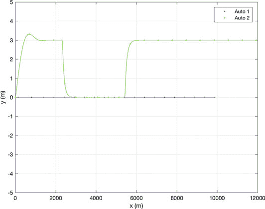


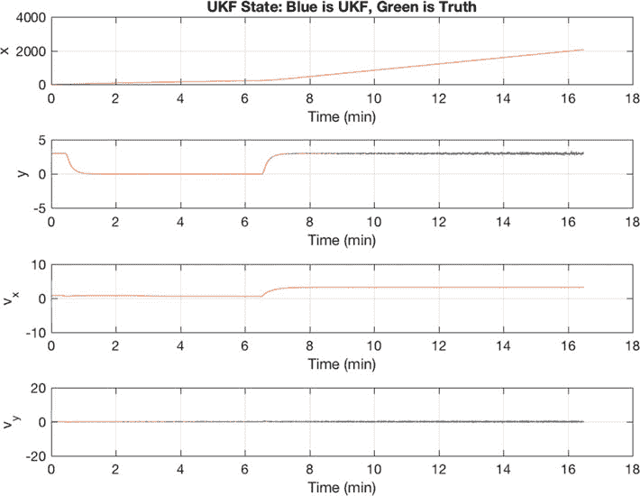

第 13 章

基于多假设检验的自动驾驶

**图 13.6：** 汽车轨迹。

**图 13.7：** 真实状态与无迹卡尔曼滤波（UKF）估计状态。


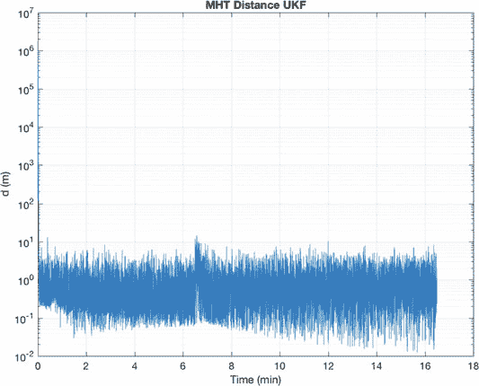

第 13 章

基于多假设检验的自动驾驶

**图 13.8：** 仿真过程中汽车之间的 MHT 距离。注意当汽车开始机动时距离的尖峰。

**13.6**

**汽车目标跟踪**

**13.6.1 问题**

我们需要演示对汽车的目标跟踪。

**13.6.2 解决方案**

构建一个包含目标跟踪的汽车仿真。

**13.6.3 工作原理**

该仿真基于一个二维汽车动力学模型。主车以可变速度沿高速公路行驶，并搭载雷达。许多车辆超过主车，其中一些从主车后方变道并切入前方。MHT 系统跟踪所有车辆。仿真开始时，雷达视野内没有车辆。一辆车经过并切入雷达车前方，另外两辆车则在其车道内驶过。这是对航迹起始的一个良好测试。

本章第一个方案中介绍的雷达，可测量雷达车坐标系下的距离、距离变化率和方位角。该模型直接从目标以及被跟踪车辆的相对速度和位置生成这些值。雷达信号处理过程未被建模，但雷达具有视野和距离限制。参见 AutoRadar。


第 13 章

基于多假设检验的自动驾驶

车辆由执行汽车机动的转向控制器驱动。可以控制油门（加速踏板）和转向角。多个机动可以串联执行。这为 MHT 系统提供了一个具有挑战性的测试。你可以尝试不同的机动，并添加自己的额外机动函数。

本演示中使用了第 4 章描述的无迹卡尔曼滤波，因为雷达是一种高度非线性的测量设备。UKF 动力学模型 RHSAutomobileXY 是在雷达车惯性坐标系下的一对双积分器。该模型通过将过程协方差（包括位置和速度）设置为比通过分析相对加速度所预期的值更大，来适应转向和油门变化。另一种方法是使用交互式多模型（IMM），包含一个“转向”模型和一个“加速”模型。这种额外的复杂性似乎并无必要。即使使用 IMM，也会保留相当大的不确定性，因为转向模型可能仅限于一个或两个转向角。


使用 MHT 实现仿真的脚本是 `MHTAutomobileDemo`。演示中有四辆车；车 4 将执行超车。图 13.10 显示了被跟踪的最后一辆车——车 3 的雷达测量结果。MHT 系统能够很好地处理车辆捕获。图 13.11 中的 MHT 图形用户界面显示了仿真结束时包含三条航迹的一个假设。这是预期的结果。

**图 13.9：** 汽车演示中的车辆轨迹。

Auto 1

Auto 2

Auto 3

Auto 4

**y (m)**

−1

−2

−3

−4

−50

**x (m)**

图 13.12 显示了最终的树。存在几条冗余航迹。这些航迹可以被移除，因为它们是其他航迹的克隆。这不会影响假设生成。


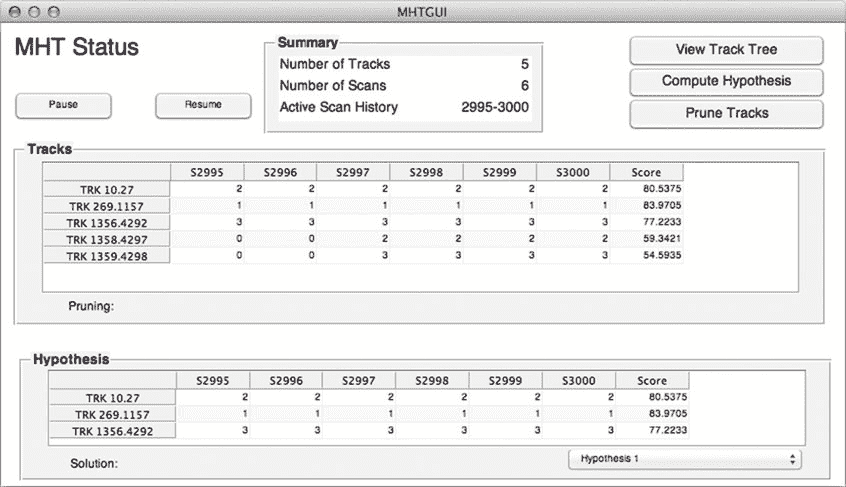

第 13 章

基于多假设检验的自动驾驶

**图 13.10：** 汽车演示中车 3 的雷达测量结果。

**雷达：车 3**

距离 (m)

0.5

1.5

2.5

3.5

4.5

0.5

距离变化率 (m/s)

0.5

1.5

2.5

3.5

4.5

0.5

−0.5

方位角 (rad)

0.5

1.5

2.5

3.5

4.5

0.5

有效

0.5

1.5

2.5

3.5

4.5

时间 (min)

Princeton Satellite Systems

**图 13.11：** MHT 图形用户界面显示三条航迹。每条航迹都具有一致的测量值。


第 13 章

基于多假设检验的自动驾驶

**图 13.12：** 汽车演示的最终树。

**10**

**269**

**1356**

扫描 2995

扫描 2996

**1358**

**1359**

扫描 2997

扫描 2998

扫描 2999

扫描 3000

**13.7**

**总结**

本章演示了一个汽车跟踪问题。该汽车配备了一个雷达系统，用于检测其视野内的车辆。该系统能够准确地将测量值分配给航迹，并成功学习每辆邻近车辆的运动路径。你首先构建了一个无迹卡尔曼滤波器来模拟汽车的运动，并融合来自雷达系统的测量值。这在仿真脚本中得到了演示。然后，你构建了一个脚本，该脚本结合了面向航迹的多假设检验，以分配雷达对多辆汽车的测量值。这使得我们的雷达系统能够自主且可靠地跟踪多辆汽车。

你还学习了如何制作简单的汽车控制器。这两个控制器负责操控汽车，并使其能够超越其他车辆。

表 13.1 列出了随附代码中包含的函数和脚本。


第 13 章

基于多假设检验的自动驾驶

**表 13.1：** 章节代码清单

**文件**

**描述**

AutoRadar

用于仿真的汽车雷达模型。

AutoRadarUKF

用于无迹卡尔曼滤波器的汽车雷达模型。

AutomobileDemo

演示汽车动画。

AutomobileInitialize

初始化汽车数据结构。

AutomobileLaneChange

用于变道的汽车控制算法。

AutomobilePassing

用于超车的汽车控制算法。

DrawComponents

绘制 3D 模型。

LoadOBJ

加载 .obj 图形文件。

MHTAutomobileDemo

演示多假设检验在汽车雷达系统中的应用。

RHSAutomobile

用于仿真的汽车动力学模型。

RHSAutomobileXY

用于无迹卡尔曼滤波器的汽车动力学模型。

UKFAutomobileDemo

演示用于汽车的无迹卡尔曼滤波器。


**第 14 章**

**基于案例的专家系统**

在本章中，我们将介绍基于案例的专家系统，这是自主学习方法论中人工智能分支的一个例子。专家系统有两大类：基于规则的和基于案例的。基于规则的系统拥有一套用于做出决策的规则；它们只是以更结构化的方式在计算机代码中编写决策语句。当决策涉及成百上千条规则时，这些系统提供了一种自动化流程的方法。基于案例的系统则通过示例（即一组预定义的案例）进行决策。

自主

学习

机器

控制

学习

智能

在专家系统的背景下，学习在很大程度上取决于专家系统的配置。主要有三种方法，它们在学习的自主性水平以及系统对新知识的平均泛化能力方面有所不同。

最不自主的学习方法是在简单的基于规则的专家系统中引入新的规则集。这种学习可以高度定制和聚焦，但完全是在外部教师的授意下进行的。通常，具有极其通用规则的非常具体的基于规则的系统，在处理需要规则例外的边缘情况时容易出现问题。因此，这种类型的学习虽然易于管理和实现，但既不具备自主性，也不具备泛化能力。

第二种方法是事实收集。专家系统基于已知的因果关系以及不断演化的世界模型做出决策；学习

© Michael Paluszek 和 Stephanie Thomas 2019

M. Paluszek 和 S. Thomas，*MATLAB 机器学习秘籍*，

[`doi.org/10.1007/978-1-4842-3916-2_14`](https://doi.org/10.1007/978-1-4842-3916-2_14)


第 14 章

基于案例的专家系统

因此被分解为两个子部分。学习新的因果关系系统规则与上述学习类型非常相似，需要外部指导，但可能更具泛化能力（因为它与比简单基于规则的系统可能拥有的更通用的世界知识相结合）。然而，学习新事实可以非常自主，并且涉及通过增加自动化推理系统可以利用的信息量来完善专家系统对现实的模型。

第三种方法是完全基于自主的推理，即观察行动及其后果，从而推断出哪些先验条件和行动组合会导致哪些结果。例如，如果两个相似的行动都产生了积极的结果，那么那些在这两种情况下都相同的先验条件就可以开始被推断为从该行动获得积极结果的必要前提条件。随着观察到更多的行动，这些推断可以得到完善，并且对所做预测的信心也会增加。


这三种方法按实现难度递增排列。向基于规则的专家系统添加规则相当直接，尽管规则间的依赖关系和优先级可能会变得复杂。在自动推理系统中，一旦建立了适当通用的传感系统来处理输入数据，基于事实的知识扩展也相当直接。第三种方法迄今为止最为困难；然而，基于规则的系统可以整合这种学习类型。此外，更通用的模式识别算法可应用于训练数据（包括在线、无监督的训练数据）来执行此功能，学习识别（例如，通过神经网络）那些会导致给定候选行动产生正面或负面结果的条件模式。然后，系统可以对照这些学习到的分类系统检查可能的行动，以评估候选行动的潜在结果。

在本章中，我们将探讨基于案例的推理系统。这是一个案例的集合，其状态和值由字符串给出。我们不处理拥有数千个案例的数据库问题。我们提供的代码会过于缓慢。我们也不会涉及能够自主学习的系统。不过，本章中的代码可以通过将新案例的结果反馈到基于案例的系统中来实现学习。

**14.1**

**构建专家系统**

**14.1.1 问题**

我们希望有一个工具来构建基于案例的专家系统。我们的工具需要适用于小规模的案例集。

**14.1.2 解决方案**

构建一个名为 `BuildExpertSystem` 的函数，该函数接受参数对来创建基于案例的专家系统。


第 14 章

基于案例的专家系统

**14.1.3 工作原理**

知识库由状态、值和产生式规则组成。一个新案例包含四个部分：案例名称、状态和值，以及结果。一个状态可以有多个值。

状态目录是推理系统可用的所有信息的列表。其格式为状态和状态值。只允许使用字符串值。所有数据都存储在元胞数组中。

以下是用于反作用轮控制系统的默认目录。每个状态可接受或可能的值组成的元胞数组跟在状态定义之后：

{
{'wheel-turning'},
{'yes','no'};
{'power'},
{'on','off'};
{'torque-command'},
{'yes','no'}
}

我们的案例数据库旨在检测故障。我们需要检查三件事来判断轮子是否正常工作。如果轮子正在转动、电源已开启并且有扭矩指令，那么它就是正常工作的。轮子可能在无扭矩指令或电源关闭的情况下转动，因为它可能只是由于先前的指令而惯性旋转。如果轮子不转动，可能的原因是没有扭矩指令或电源已关闭。

**14.2**

**运行专家系统**

**14.2.1 问题**

我们希望创建一个基于案例的专家系统并运行它。

**14.2.2 解决方案**

构建一个实现基于案例推理系统的专家系统引擎。它应设计为处理少量案例，并能够更新案例数据库。

**14.2.3 工作原理**

一旦你根据状态目录定义了几个案例，就可以测试系统了。函数 `CBREngine` 实现了基于案例的推理引擎。其思想是向其传递一个案例 `newCase`，并查看它是否与系统数据结构中存储的任何现有案例匹配。对于我们的问题，我们认为已经拥有检测任何故障所需的所有案例。我们使用内置函数 `strcmpi` 进行字符串匹配。然后找到第一个匹配的值。

该算法计算匹配案例的总比例，以确定示例是否与存储的案例匹配。引擎将新案例中的状态值与案例数据库中的状态值进行匹配。它根据状态数量对结果进行加权。如果新案例的状态数多于现有案例，它会通过数据库案例的状态数除以新案例的状态数来对结果进行偏置。如果多个案例与新案例匹配，并且这些匹配案例的结果不同，则结果被声明为“模糊”。如果结果相同，则赋予新案例该结果。案例名称使结果更易于理解。我们使用 `strcmpi` 使字符串匹配不区分大小写。

```matlab
function [outcome, pMatch] = CBREngine( newCase, system )
% 查找与给定状态值最匹配的案例

pMatch = zeros(1, length(system.case));
pMatchF = length(newCase.state); % 新案例中的状态数量
for k = 1:length(system.case)
    f = min([1 length(system.case(k).activeStates)/pMatchF]);
    for j = 1:length(newCase.state)
        % 状态 j 是否匹配任何活动状态？
        q = StringMatch( newCase.state(j), system.case(k).activeStates );
        if( ~isempty(q) )
            % 检查我们的值是否匹配
            i = strcmpi(newCase.values{j},system.case(k).values{q});
            if( i )
                pMatch(k) = pMatch(k) + f/pMatchF;
            end
        end
    end
end

i = find(pMatch == 1);
if( isempty(i) )
    i = max(pMatch,1);
end

outcome = system.case(i(1)).outcome;
for k = 2:length(i)
    if( ~strcmp(system.case(i(k)).outcome,outcome) )
        outcome = 'ambiguous';
    end
end
```

演示脚本 `ExpertSystemDemo` 非常简单。第一部分构建系统。其余代码运行一些案例。`'id'` 表示其元胞数组中后续数据的索引。例如，前三个条目用于目录，它们是第 1 到第 3 项。接下来的三个用于案例，它们是第 1 到第 4 项。当 `BuildExpertSystem` 遍历参数对列表时，它使用最后一个 `id` 作为后续参数对的索引。

```matlab
system = BuildExpertSystem( [], 'id',1,...
    'catalog state name','wheel-turning',...
    'catalog value',{'yes','no'},...
    'id',2,...
    'catalog state name','power',...
```


第 14 章

基于案例的专家系统

'catalog value',{'on' 'off'},...

'id',3,...

'catalog state name','torque-command',...

'catalog value',{'yes','no'},...

'id',1,...

'case name', 'Wheel operating',...

'case states',{'wheel-turning', 'power',

'torque-command'},...

'case values',{'yes' 'on' 'yes'},...

'case outcome','working',...

'id',2,...

'case name', 'Wheel power ambiguous',...

'case states',{'wheel-turning', 'power',

'torque-command'},...

'case values',{'yes' {'on' 'off'} 'no'

},...

'case outcome','working',...

'id',3,...

'case name', 'Wheel broken',...

'case states',{'wheel-turning', 'power',

'torque-command'},...

'case values',{'no' 'on' 'yes'},...

'case outcome','broken',...

'id',4,...

'case name', 'Wheel turning',...

'case states',{'wheel-turning', 'power'

},...

'case values',{'yes' 'on'},...

'case outcome','working',...

'match percent',80);

newCase.state

= {'wheel-turning', 'power', 'torque-command'};

newCase.values = {'yes','on','no'};

newCase.outcome = '';

[newCase.outcome, pMatch] = CBREngine( newCase, system );

**fprintf**(1,'New case outcome: %s\n\n',newCase.outcome);

**fprintf**(1,'Case ID Name

Percentage Match\n');

**for** k = 1:**length**(pMatch)

**fprintf**(1,'Case %d: %-30s %4.0f\n',k,system.case(k).name,pMatch(k)

*100);

**end**


第 14 章

基于案例的专家系统

如您所见，我们匹配了两个案例，但由于它们的结论相同，因此车轮被判定为“工作中”。之所以称为“车轮功率不明确”，是因为功率可能处于开启或关闭状态，因此具有歧义。我们可以使用`BuildExpertSystem`将这个新案例添加到数据库中。

我们在脚本中使用了`fprintf`将以下结果打印到命令窗口中。

>> ExpertSystemDemo

新案例结论：工作中

案例 ID 名称

匹配百分比

案例 1：车轮工作中

案例 2：车轮功率不明确

案例 3：车轮损坏

案例 4：车轮转动中

这个示例是一个规模非常小的基于案例的专家系统，其结论是二元的。无需对代码进行任何更改即可处理多个结论。然而，匹配过程较慢，因为它需要遍历所有案例。一个更健壮的系统，能够处理数千个案例，则需要某种决策树来筛选待测试的案例。例如，假设我们正在测试几个不同的组件。例如，对于起落架，我们需要知道轮胎没有漏气、刹车正常工作、起落架已放下且已锁定。如果起落架未放下，我们就不再需要测试刹车、轮胎或起落架是否锁定。

**14.3**

**总结**


本章演示了一个简单的基于案例推理的专家系统。该系统可配置为根据先前案例的结果添加新案例。另一种替代方案是基于规则的系统。表 14.1 列出了随附代码中包含的函数和脚本。

**表 14.1：** 章节代码清单

**文件**

**描述**

BuildExpertSystem

构建基于案例的专家系统数据库的函数。

CBREngine

基于案例的推理引擎。

ExpertSystemDemo

专家系统演示。


**附录 A**

**自主学习的简要历史**

**A.1**

**引言**

在本书的第一章中，你已经了解了自主学习。你看到自主学习可以分为机器学习、控制和人工智能（AI）这几个领域。在本附录中，我们将提供一些关于每个领域如何演变的背景信息。

自动控制早于人工智能。然而，我们感兴趣的是自适应控制或学习控制，这是一个相对较新的发展，实际上是在人工智能奠定基础的同时开始演变的。机器学习被认为是人工智能的一个分支。然而，机器学习中使用的许多方法来自不同的研究领域，例如统计学和优化。

**A.2**

**人工智能**

人工智能研究在第二次世界大战后不久就开始了[[22]](#index_split_007.html#p350)。早期的工作基于大脑结构、命题逻辑和图灵计算理论的知识。沃伦·麦卡洛克和沃尔特·皮茨基于阈值逻辑创建了神经网络的数学公式。这使得神经网络研究分为两种方法。一种侧重于大脑中的生物过程，另一种侧重于神经网络在人工智能中的应用。研究表明，任何函数都可以通过一组这样的神经元来实现，并且神经网络可以学习。1948 年，维纳的著作《控制论》出版，其中描述了控制、通信和统计信号处理中的概念。神经网络的下一步重大进展是 1949 年赫布出版的《行为的组织》一书，该书将大脑中的连接性与学习联系起来。他的书成为了学习和自适应系统的源泉。马文·明斯基和迪恩·埃德蒙兹于 1950 年建造了第一台神经计算机。

1956 年，艾伦·纽厄尔和赫伯特·西蒙设计了一个推理程序——逻辑理论家（LT），该程序以非数值方式工作。第一个版本是使用索引卡手工模拟的。它可以证明数学定理，甚至改进了人类的推导过程。它解决了《数学原理》中 52 个定理中的 38 个。LT 采用带有启发式方法的搜索树来限制搜索范围。LT 是在计算机上使用 IPL 实现的，IPL 是一种编程语言，后来发展成了 Lisp，这是一种将在下文讨论的编程语言。

积木世界是展示通用计算机推理能力的早期尝试之一。积木世界是一个微观世界。一组积木放在桌子上，有些积木叠在其他积木上。人工智能系统可以以特定方式重新排列积木。在其他积木下面的积木，必须等上面的积木移走后才能移动。这与汉诺塔问题颇为相似。积木世界是一项惊人的进步，因为它表明机器至少能在有限的环境中进行推理。积木世界是使用机器视觉的早期例子。


计算机必须处理“积木世界”的图像，并判断什么是积木以及它们的位置。

继“积木世界”以及纽厄尔和西蒙的“逻辑理论家”之后，出现了“通用问题求解器”。它旨在模仿人类的问题解决方法。在其有限的谜题类别中，它能像人类一样解决这些问题。尽管 GPS 能解决诸如汉诺塔之类的简单问题（见图 A-1），但它无法解决现实世界的问题，因为搜索过程会迷失在组合爆炸中，这代表了在广阔决策空间中对所有选择的枚举。

**图 A-1：** 汉诺塔。必须将圆盘从第一个柱子移动到最后一个柱子，且过程中不能将直径较大的圆盘放在直径较小的圆盘之上。

1959 年，赫尔曼·戈伦特尔编写了几何定理证明器，它能证明相当棘手的定理。第一批博弈程序也是在此时编写的。1958 年，约翰·麦卡锡发明了 Lisp 语言（表处理语言），它后来成为主要的 AI 语言。现在它以 Scheme 和 Common Lisp 的形式存在。Lisp 仅在 FORTRAN 问世一年后就被推出。一个典型的 Lisp 表达式是：

(defun **sqrt**-iter (guess x)

(**if** (good-enough-p guess x)

guess

(**sqrt**-iter (improve guess x) x)))

这通过递归计算平方根。最终，专用的 Lisp 机器被制造出来，但随着通用处理器速度的提升，它们便失宠了。

分时技术是在麻省理工学院为促进 AI 研究而发明的。麦卡锡教授创建了一个假设性的计算机程序“建议采纳器”，这是一个完整的 AI 系统，能够体现一般的世界信息。它会使用诸如谓词演算之类的形式语言。


附录 A

自主学习的简史

例如，它可以根据简单的规则规划出去机场的路线。马文·明斯基于 1958 年抵达麻省理工学院，并开始研究微世界。在这些有限的领域内，AI 可以解决问题，例如微积分中的闭式积分。明斯基（与西摩·帕珀特）合著了《感知机》一书，该书对人工神经网络的分析具有基础性意义。这本书推动了 AI 领域向符号处理的转变。书中指出，单个神经元无法实现某些逻辑功能，如异或，并错误地暗示多层网络也会存在同样的问题。后来发现，三层网络可以实现此类功能。

**提示**

三层网络是解决大多数学习问题所需的最小网络结构。

20 世纪 60 年代，人们尝试了更具挑战性的问题。AI 技术的局限性变得明显。第一批语言翻译程序的结果好坏参半。试图通过处理海量可能性（如下棋）来解决问题，遇到了计算难题。人类下棋有多种形式。有些涉及模式记忆，包括开局（棋盘位置定义明确）和残局（棋子数量相对较少）。局面性棋艺则依赖于人脑处理模式的能力来观察棋盘上的模式。一个优秀的局面型棋手会将自己的棋子布置在棋盘上，从而限制对手的选择。局部模式识别体现在“几步杀王”问题中。计算机下棋并未真正采用人类的方法。

计算机国际象棋程序之所以变得非常强大，主要是因为处理器速度更快，并且能够存储开局和残局。多层神经网络在 20 世纪 60 年代被发现，但直到 20 世纪 80 年代才得到真正的研究。

20 世纪 70 年代，使用竞争学习的自组织映射被引入[[12]](#index_split_007.html#p349)。神经网络在 20 世纪 80 年代复兴。基于知识的系统也是在 20 世纪 80 年代引入的。引自杰克逊[[14]](#index_split_007.html#p349)


专家系统是一种计算机程序，它能够表示并推理某个专业领域的知识，旨在解决问题或提供建议。

这包括能够存储海量领域知识的专家系统。这些系统还能在其处理过程中纳入不确定性。专家系统被应用于医疗诊断及其他问题。与当时的人工智能技术不同，专家系统能够处理具有现实复杂性的问题，并达到高性能。它们还能解释自身的推理过程。这最后一个特性在其实际应用中至关重要。有时，这些系统也被称为基于知识的系统。一个著名的开源专家系统是 CLIPS（C 语言集成产生式系统）。

神经网络的反向传播算法在 20 世纪 80 年代被重新发明，推动了该领域的再次进步。研究开始同时关注人类神经网络（即人脑）以及创建高效计算神经网络的算法。这最终导致了机器学习应用中的深度学习网络。

20 世纪 80 年代，随着人工智能研究人员开始应用严格的数学和统计分析来开发算法，该领域取得了进展。隐马尔可夫模型被应用于语音识别。


附录 A

自主学习的简史

隐马尔可夫模型是一种具有未观测（即隐藏）状态的模型。结合大规模数据库，它们极大地提升了语音识别的鲁棒性。机器翻译也得到了改进。数据挖掘，即当今所知机器学习的第一种形式，得以发展。国际象棋程序最初通过使用专用计算机（如 IBM 的深蓝）得到改进。随着处理能力的提升，现在个人电脑上已经可以运行比大多数人类棋手更强大的国际象棋程序。

贝叶斯网络形式被发明出来，以便在推理问题中严格应用不确定性。20 世纪 90 年代末，智能体被引入。搜索引擎、机器人程序和网站聚合器是互联网上使用的智能体的例子。

图 A-2 给出了自主系统历史上一些选定事件的时间线。

**图 A-2：**人工智能时间线。

MIT 规则

HAL

阿波罗 9000

Prolog

卡尔曼

DAP

贝叶斯网络

Lisp

滤波器

专家

日本第五代

反向传播

SHRDLU

DARPA

DARPA

特斯拉 Model S

系统

深蓝

生成 NN

NN

MADALINE

(积木世界)

击败

大

城市

神经网络

卡斯帕罗夫

挑战

挑战

模糊

逻辑

明斯基

MIT AI Lab

如今，人工智能的最新技术包括自动驾驶汽车、语音识别、规划与调度、游戏、机器人技术和机器翻译。所有这些都基于人工智能技术。它们如今被持续使用。你可以拿一份 PDF 文档，使用谷歌翻译将其翻译成任何语言。翻译并非完美。当然，人们不会用它们来翻译文学作品。

近期人工智能的进展包括 IBM 的沃森。沃森是一个问答计算系统，具备先进的自然语言处理能力和从海量数据库中检索信息的能力。它在 2011 年击败了《危险边缘》节目的冠军选手。目前，它正被应用于医疗问题和许多其他复杂问题。

**A.3**

**学习控制**

自适应控制或智能控制源于 20 世纪 50 年代[[2]](#index_split_007.html#p349)飞机控制问题的驱动。当时的控制系统在线性系统上表现非常好。飞机动力学可以在特定速度附近线性化。例如，水平飞行中总速度的一个简单方程是：

*m* *dv* = *T* − 1 *ρC* *DSv*² (A-1)

这表明质量 *m* 乘以速度随时间的变化率 *dv*/*dt* 等于推力 *T*（飞机发动机产生的力）减去阻力。*CD* 是气动阻力系数，*S* 是浸润面积（即产生阻力的面积，如机翼和机身）。推力用于控制。由于存在 *v*² 项，这是一个关于速度 *v* 的非线性方程。我们可以在特定速度 *vs* 附近将其线性化，令 *v* = *vδ* + *vs*，得到：

*m* *dvδ*/*dt* = *T* − *ρC* *DSvsvδ* (A-2)

这个方程关于 *vδ* 是线性的。我们可以用一个简单的推力控制律来控制速度：

*T* = *Ts* − *cvδ* (A-3)

其中 *Ts* = ½ *ρCDSvs*²。*c* 是阻尼系数。*ρ* 是大气密度，是高度的非线性函数。为了使线性控制有效，控制必须是自适应的。如果我们想保证某个阻尼值（即括号中的量）：

*m* *dvδ*/*dt* = −(*c* + *ρC* *DSvs*) *vδ* (A-4)

我们需要知道 *ρ*、*CD*、*S* 和 *vs*。这种方法导致了一种增益调度控制系统，我们测量飞行条件（高度、速度），并根据飞机在增益调度表中的位置来调度线性增益。

20 世纪 60 年代，自适应控制取得了进展。状态空间理论被发展出来，这使得设计多回路控制系统（即同时用不同控制回路控制多个状态的控制系统）变得更加容易。通用的状态空间控制器是：

*x*˙ = *Ax* + *Bu* (A-5)
*y* = *Cx* + *Du* (A-6)
*u* = −*Ky* (A-7)

其中 *A*、*B*、*C* 和 *D* 是矩阵，*x* 是状态，*y* 是测量值，*u* 是控制输入。状态是一个随时间变化的量，用于定义系统正在做什么。对于一个只能沿一个方向移动的质点，位置和速度构成了两个状态。如果 *A* 完全建模了系统，并且 *y* 包含了关于状态向量 *x* 的所有信息，那么这个系统是稳定的。全状态反馈将是 *x* = −*Kx*，其中 *K* 可以被计算出来，以保证具有确定的相位裕度和增益裕度（即对延迟的容忍度和对放大误差的容忍度）。这是控制理论的一个重大进步。在此之前，多回路系统必须分别设计并非常小心地组合。

人们发现学习控制和自适应控制可以从一个共同的框架中实现。卡尔曼滤波器，也称为线性二次估计，被引入。

航天器需要自主控制，因为它们常常与地面失去联系，或者时间延迟太长，无法进行有效的地面监控。第一个数字自动驾驶仪是在阿波罗飞船上，该飞船于 1968 年在阿波罗 7 号上首次飞行。唐·艾尔斯的书[[9]](#index_split_007.html#p349)讲述了登月舱数字自动驾驶仪的历史。地球同步通信卫星实现了高度自动化，以至于一名操作员可以操控十几颗卫星。


附录 A

自主学习的简史

系统辨识（即确定系统参数，如上述阻力系数的过程）取得了进展。自适应控制被应用于实际问题。自动驾驶仪已经从相当简单的机械式驾驶员增稳系统，发展到能够在计算机控制下完成起飞、巡航和着陆的复杂控制系统。


20 世纪 70 年代，自适应控制的稳定性得到了证明。线性控制系统的稳定性已得到充分确立，但自适应系统本质上是非线性的。通用稳定控制器得到了研究。自适应控制的鲁棒性取得了进展。鲁棒性是指系统处理那些原本假设已知的参数变化的能力，这些变化有时是由系统故障引起的。正是在 20 世纪 70 年代，数字控制变得普及，取代了由晶体管和运算放大器组成的传统模拟电路。

自适应控制器在 20 世纪 80 年代开始商业化。大多数现代单回路控制器都具有某种形式的自适应能力。自适应技术也被发现对于控制器整定非常有用。

最近，人工智能与控制领域出现了融合。专家系统已被提出，用于根据环境决定使用何种算法（不仅仅是参数）。例如，在带翼滑翔机的再入大气层过程中，控制系统会在轨道上使用一种系统，在高空使用第二种，在高马赫（马赫是速度与音速之比）飞行时使用第三种，在低马赫数和着陆时使用第四种。

一架 F3D 夜空战斗机于 1957 年 8 月 12 日使用了自动着舰系统。这是为自主着舰而设计的着舰系统进行的首次舰载测试。

奈拉·霍瓦基米扬（伊利诺伊大学厄巴纳-香槟分校）以及纳恩·阮（美国国家航空航天局）是该领域的先驱。

自适应控制已在缩比 F-18 模型上得到验证，该模型在失去大部分一侧机翼后仍能控制并着陆飞机！

**A.4**

**机器学习**

机器学习最初是人工智能的一个分支。然而，许多技术的历史要久远得多。托马斯·贝叶斯于 1763 年创立了贝叶斯定理。贝叶斯定理是：

*P*(*B|A*_i*)*P*(*A*_i*)
*P*(*A*_i*|B*) = ——————————
*P*(*B*)

其中 *P*(*B*) ≠ 0。在贝叶斯解释中，该定理引入了证据对信念的影响。一种名为回归的技术由勒让德于 1805 年和高斯于 1809 年发现。

正如人工智能部分所述，现代机器学习始于数据挖掘，即从数据中获取新见解的过程。在人工智能早期，有大量关于机器从数据中学习的研究。然而，这逐渐失宠，并在 20 世纪 90 年代被重新定义为机器学习领域。其目标是利用统计学解决模式识别的实际问题。在线可用的大量数据以及开发者可获得的处理能力的巨大提升极大地推动了这一领域的发展。机器学习与统计学密切相关。

在 20 世纪 90 年代早期，瓦普尼克及其同事发明了一类计算能力强大的监督学习网络，称为支持向量机（SVM）。这些网络可以解决模式识别、回归以及其他机器学习问题。

机器学习的一个日益增长的应用是自动驾驶。自动驾驶利用了自主学习的各个方面，包括控制、人工智能和机器学习。机器视觉在大多数系统中都有应用，因为摄像头成本低廉，并且能提供比激光雷达、雷达或声纳（这些也很有用）更丰富的信息。不通过经验学习，就不可能构建真正安全的自动驾驶系统。因此，此类系统的设计者将他们的汽车投入道路行驶，并收集用于微调系统的经验。

其他应用包括高频股票交易和指导投资的算法。

这些技术正在快速发展，并且现已面向消费者。数据挖掘和机器学习被用于预测事件，无论是人为事件还是自然事件。互联网搜索已被用于追踪疾病爆发。如果有大量数据，并且互联网使得收集海量数据变得容易，那么可以肯定，机器学习技术正被应用于挖掘这些数据。

**A.5**

**未来**

自主学习的各个分支如今都在快速发展。许多技术甚至在低成本消费技术中得到了实际应用。世界上几乎每家汽车公司，以及许多非汽车公司，都在致力于完善自动驾驶技术。军事组织对人工智能和机器学习极为感兴趣。如今的作战飞机都配备了系统，可以在飞行员操作失误时接管控制，防止飞机坠毁。

尽管完全自主系统是许多领域的目标，但人类智能与机器智能的融合也是一个活跃的研究领域。许多人工智能研究一直在探索人类思维的工作原理。除了通过利用大脑非凡的能力来提高性能外，这项工作还将使机器学习系统能够更无缝地与人类融合。这对于涉及人的自主控制至关重要，但也可能使人类能够增强自身能力。

这是一个令人兴奋的机器学习时代！我们希望这本书能帮助您为机器学习带来您自己的进步！


**附录 B**

**机器学习软件**

**B.1**

**自主学习软件**

机器学习软件有很多来源。机器学习既包括帮助用户从数据中学习的软件，也包括帮助机器学习和适应其环境的软件。本书为您提供了一些可以立即使用的软件示例。然而，这些软件并非为工业应用而设计。本章描述了可用于 MATLAB 环境的软件。将讨论专业版和开源版的 MATLAB 软件。本书可能无法涵盖所有可用的软件包，因为新的软件包不断涌现，而较旧的软件包可能会过时。

您为项目选择的软件包取决于您的目标以及您的软件专业水平。本章中的许多软件包是可用于设计、分析和改进各种类型机器学习系统的研究工具，但要将其转化为可部署、具有生产质量的系统，则需要为每个应用定制开发、集成和测试软件。其他软件包，例如商业专家系统外壳，可以直接部署为您的应用程序。您需要寻找与您的部署环境最兼容的软件包。例如，如果您的目标是嵌入式系统，您将需要用于嵌入式处理器的开发工具，以及与那个开发环境最兼容的软件包。

本章包含了传统上被称为“机器学习”的软件。这些是帮助我们洞察数据的统计函数。它们通常用于“大数据”的背景下。本章还包含了对自主学习系统其他分支（如系统辨识）软件包的描述。系统辨识是自动控制的一个分支，它学习被控系统的特性，从而实现更好、更精确的控制。


为完整起见，本章还涵盖了与 MATLAB 兼容的流行软件，但需要额外步骤才能在 MATLAB 中使用它们。示例包括 R、Python 和 SNOPT。在所有情况下，为这些包编写 MATLAB 接口都很简单。使用 MATLAB 作为前端会非常有帮助，并允许你创建包含 MATLAB、Simulink 和你选择的机器学习包的集成包。

© Michael Paluszek 和 Stephanie Thomas 2019

M. Paluszek 和 S. Thomas，*MATLAB 机器学习实践*

[`doi.org/10.1007/978-1-4842-3916-2`](https://doi.org/10.1007/978-1-4842-3916-2)


附录 B

机器学习软件

你会注意到我们包含了优化软件。优化是机器学习中用于寻找最佳或“最优”参数的工具。我们在本书的决策树章节中使用了它。

如果我们没有包含你喜欢的包，或者你自己的包，请不要沮丧！我们在此提前致歉。

**B.2**

**商业 MATLAB 软件**

**B.2.1 MathWorks 产品**

MathWorks 销售多个用于机器学习的包。这些包位于我们分类法的机器学习分支中，如图 1.3 所示。MathWorks 产品为数据分析提供了高质量的算法，以及用于数据可视化的图形工具。可视化工具是任何机器学习系统的关键部分。它们可用于数据采集，例如用于图像识别，或作为车辆自主控制系统的一部分，或用于开发过程中的诊断和调试。所有这些包都可以相互集成，并与其他 MATLAB 函数集成，以构建强大的机器学习系统。

我们将讨论的最适用的工具箱包括：

• 统计与机器学习工具箱
• 神经网络工具箱
• 计算机视觉系统工具箱
• 系统辨识工具箱
• 深度学习 MATLAB
• 模糊逻辑工具箱

**B.2.1.1 统计与机器学习工具箱**

统计与机器学习工具箱提供了从海量数据中收集趋势和模式的数据分析方法。这些方法不需要模型来分析数据。该工具箱的功能大致可分为分类工具、回归工具和聚类工具。

分类方法用于将数据归入不同类别。例如，以图像形式存在的数据可用于将某个器官的图像分类为含有肿瘤。分类用于手写识别、信用评分和人脸识别。分类方法包括支持向量机（SVM）、决策树和神经网络。

回归方法允许你根据现有数据构建模型以预测未来数据。然后，随着新数据的出现，可以更新这些模型。如果数据仅用于一次性创建模型，则这是一种批处理方法。一种在数据可用时即将其纳入的回归方法是递归方法。


附录 B

机器学习软件

聚类用于发现数据中的自然分组。物体识别是聚类方法的一个应用。例如，如果你想在图像中找到一辆汽车，你会寻找与图像中属于汽车部分相关联的数据。尽管汽车形状和大小各异，但它们有许多共同特征。

该工具箱拥有许多支持这些领域的功能，以及许多不完全属于这些类别的功能。对于希望获得无缝集成到 MATLAB 环境中的专业工具的用户来说，统计与机器学习工具箱是一个绝佳的起点。

**B.2.1.2 神经网络工具箱**

MATLAB 神经网络工具箱是一个全面的神经网络工具箱，可与 MATLAB 无缝集成。该工具箱提供了创建、训练和模拟神经网络的功能。该工具箱包括卷积神经网络和深度学习网络。

由于节点和相关权重的数量庞大，尤其是在训练期间，神经网络的计算量可能很大。如果你拥有并行计算工具箱（另一个 MATLAB 附加产品），神经网络工具箱允许你将计算分布到多核处理器和图形处理单元（GPU）上。你还可以使用 MATLAB Distributed Computing Server™ 将其进一步扩展到计算机的网络集群。

与所有 MATLAB 产品一样，神经网络工具箱提供了广泛的图形和可视化功能，使结果更易于理解。

神经网络工具箱能够处理大型数据集。这可能是千兆字节或兆兆字节的数据。这使得它适用于工业级问题和复杂的研究。MATLAB 还提供视频、网络研讨会和教程，包括一套完整的用于应用深度学习的资源。

**B.2.1.3 计算机视觉系统工具箱**

MATLAB 计算机视觉系统工具箱提供了用于开发计算机视觉系统的函数。该工具箱为视频处理提供了广泛支持，但也包括用于特征检测和提取的函数。它还支持 3D 视觉，并能处理来自立体相机的信息。支持 3D 运动检测。如果你的输入来自相机，这将特别有用。

**B.2.1.4 系统辨识工具箱**

系统辨识工具箱提供了用于构建系统数学模型的 MATLAB 函数和 Simulink 模块。你可以从输入/输出数据中辨识传递函数，并对模型执行参数辨识。支持线性和非线性系统辨识。这可用作控制系统的一部分。将系统分为可以用方程建模的部分和不能用方程建模的部分通常很有帮助。你的系统可以使用系统辨识工具箱来学习前一部分的参数。


附录 B

机器学习软件

**B.2.1.5 深度学习 MATLAB**

深度学习 MATLAB 允许你设计、构建和可视化卷积神经网络。你可以轻松实现诸如 GoogLENet、VGG-16、VGG 19、AlexNet 和 ResNet-59 等模型。它具有强大的神经网络可视化和调试能力。这对于确保系统正常运行非常重要。它包含许多预训练模型。深度学习是一种神经网络类型。当神经网络工具箱的功能不足以满足你的系统需求时，你可以使用它。你可以将这两个工具箱以及所有其他 MATLAB 工具箱一起使用。

**B.2.2 普林斯顿卫星系统产品**

我们自己的几个商业包提供了自主学习范畴内的工具。

**B.2.2.1 核心控制工具箱**

核心控制工具箱提供了我们航天器控制工具箱中的控制和估计函数，并附有通用工业动力学示例，包括机器人和化学处理。卡尔曼滤波器系列包括传统滤波器、扩展卡尔曼滤波器和无迹卡尔曼滤波器。无迹滤波器具有快速的 sigma 点计算算法。所有卡尔曼滤波器都使用通用的代码格式，并具有独立的预测和更新函数。这使得这两个步骤可以独立使用。这些滤波器可以处理多个测量源，这些测量源可以动态更改，并且测量数据在不同时间到达。

核心控制工具箱的附加组件包括成像和目标跟踪模块。

成像包括镜头模型、图像处理、光线追踪和图像分析工具。

**B.2.2.2 目标跟踪**


目标跟踪模块采用面向轨迹的多假设检验方法。当目标数量未知或变化时，面向轨迹的多假设检验是一种将测量值分配给目标轨迹的强大技术。对于多目标的精确跟踪而言，它绝对至关重要。

在许多情况下，传感器系统必须跟踪多个目标，例如在交通高峰时段。

这就引出了将测量值与目标或轨迹相关联的问题。这是任何实用跟踪系统的关键要素。

面向轨迹的方法在接收到每一帧数据后，会利用新更新的轨迹重新计算假设。面向轨迹的方法并非逐帧维护和扩展假设，而是丢弃在第 *k − 1* 帧形成的假设。经过剪枝后保留下来的轨迹会被传递到下一帧 *k*，在那里利用新的观测值形成新的轨迹，并重新组合成假设。假设形成步骤被表述为一个混合整数线性规划（MILP）问题，并使用 GLPK（GNU 线性规划工具包）求解。除了需要根据低概率删除某些轨迹外，不会丢失任何信息，因为所维护的轨迹得分包含了所有相关的统计数据。


附录 B

机器学习软件

MHT 模块使用一种强大的轨迹剪枝算法，该算法可一步完成剪枝。由于其速度快，无需采用临时性的剪枝方法，从而得到更稳健、更可靠的结果。因此，轨迹管理软件相当简单。

核心工具箱中的所有三个卡尔曼滤波器，包括扩展卡尔曼滤波和无迹卡尔曼滤波，都可以独立使用，也可以作为 MHT 系统的一部分使用。无迹卡尔曼滤波器自动使用 sigma 点，无需对测量函数求导，也无需使用测量模型的线性化版本。

交互式多模型系统（IMM）也可以作为 MHT 系统的一部分使用。

IMM 采用多个动态模型来辅助跟踪机动目标。一个模型可能涉及机动，而另一个模型则模拟恒定运动。测量值会被分配给所有模型。IMM 基于跳跃马尔可夫系统。

**B.3**

**MATLAB 开源资源**

MATLAB 开源工具是实现最先进机器学习的绝佳资源。提供了机器学习和凸优化软件包。

**B.3.1 DeepLearnToolbox**

由 Rasmus Berg Palm 开发的 Deep Learn Toolbox 是一个用于深度学习的 MATLAB 工具箱。它包括深度信念网络、堆叠自编码器、卷积神经网络以及其他神经网络功能。可通过 MathWorks 文件交换中心获取。

**B.3.2 深度神经网络**

由 Masayuki Tanaka 开发的深度神经网络提供了基于堆叠受限玻尔兹曼机的深度信念网络深度学习工具。它具备无监督学习和监督学习的功能。可通过 MathWorks 文件交换中心获取。

**B.3.3 MatConvNet**

MatConvNet 实现了用于图像处理的卷积神经网络。它包含一系列用于图像处理功能的预训练网络。您可以通过搜索名称找到它，或者在出版时访问 [`www.vlfeat.org/matconvnet/`](http://www.vlfeat.org/matconvnet/)。该软件包是开源的，并欢迎贡献者参与。

**B.4**

**用于机器学习的非 MATLAB 产品**

有许多用于机器学习的开源和商业产品。我们介绍一些比较流行的开源产品。将讨论机器学习和凸优化软件包。


附录 B

机器学习软件

**B.4.1 R**

R 是用于统计计算的开源软件。它可在 MacOS、UNIX 和 Windows 上编译。它与由 John Chambers 及其同事开发的贝尔实验室 S 语言类似。它包含许多统计函数和图形技术。

您可以使用 system 命令从 MATLAB 以批处理模式运行 R。编写 system('R CMD BATCH inputfile outputfile')；

这将运行 inputfile 中的代码并将结果输出到 outputfile。然后您可以将 outputfile 读入 MATLAB。

**B.4.2 scikit-learn**

scikit-learn 是一个用于 Python 的机器学习库。它包含多种工具，包括：

1.  分类
2.  回归
3.  聚类
4.  降维
5.  模型选择
6.  预处理

scikit-learn 非常适用于各种数据挖掘和数据分析问题。

MATLAB 支持 Python 的参考实现 CPython。Mac 用户和 Linux 用户已经安装了 Python。Windows 用户需要安装一个发行版。

**B.4.3 LIBSVM**

LIBSVM [[6]](#index_split_007.html#p349) 是一个用于支持向量机（SVM）的库。它拥有大量用于 SVM 的工具，包括许多 LIBSVM 用户的扩展。LIBSVM 工具包括分布式处理和多核扩展。作者是 Chih-Chung Chang 和 Chih-Jen Lin。您可以在以下网址找到它：

[`www.csie.ntu.edu.tw/~cjlin/libsvm/`](https://www.csie.ntu.edu.tw/~cjlin/libsvm/)。

**B.5**

**优化产品**

优化工具通常用作机器学习系统的一部分。优化器在给定一组对优化变量的约束条件下最小化成本。变量的最大值或最小值是一种约束类型。约束和成本可以是线性的或非线性的。


附录 B

机器学习软件

**B.5.1 LOQO**

LOQO [[27]](#index_split_007.html#p350) 是一个用于求解光滑约束优化问题的系统，可从普林斯顿大学获取。问题可以是线性或非线性的、凸或非凸的、有约束或无约束的。唯一真正的限制是定义问题的函数必须是光滑的（在算法评估的点上）。如果问题是凸的，LOQO 会找到全局最优解。否则，它会找到接近给定起始点的局部最优解。

一旦您编译了 LOQO 的 mex 文件接口，您必须向其传递一个初始猜测值和用于问题定义变量的稀疏矩阵。您还可以传入一个函数句柄，以便在求解过程的每次迭代中提供算法的动画演示。

**B.5.2 SNOPT**

SNOPT [[10]](#index_split_007.html#p349) 是一个用于求解大规模优化问题（线性和非线性规划）的软件包，托管于加州大学圣地亚哥分校。它对于函数和梯度计算代价高昂的非线性问题尤其有效。函数应该是光滑的，但不必是凸的。SNOPT 旨在利用雅可比矩阵的稀疏性，有效减小所求解问题的规模。对于最优控制问题，雅可比矩阵非常稀疏，因为矩阵的行和列跨越大量时间点，但只有相邻时间点才可能有非零项。

SNOPT 使用非线性函数和梯度值。获得的解将是局部最优解（可能是也可能不是全局最优解）。如果某些梯度未知，将通过有限差分法进行估计。不可行的问题通过弹性边界方法系统地处理。SNOPT 允许违反非线性约束，并最小化此类违反的总和。如果只有部分变量是非线性的，或者活跃约束的数量接近变量的数量，则大型问题的效率会得到提高。

**B.5.3 GLPK**


GLPK（GNU 线性规划工具包）可解决多种线性规划问题。它是 GNU 项目的一部分（https://www.gnu.org/software/glpk/）。其中最著名的是求解线性规划：

*Ax* = *b*

(B-1)

*y* = *cx*

(B-2)

其目标是找到 *x*，当 *x* 与 *A* 相乘时，结果等于 *b*。*c* 是成本向量，当 *c* 与 *x* 相乘时，得到应用 *x* 的标量成本。如果 *x* 与 *b* 长度相同，则解为：

*x* = *A*⁻¹ *b*

(B-3)

否则，我们可以使用 GLPK 求解 *x*，以最小化 *y*。GLPK 可以解决此问题以及其他问题，其中 *x* 的一个或多个元素必须为整数，甚至仅为 0 或 1。


附录 B

机器学习软件

**B.5.4 CVX**

CVX [[4]](#index_split_007.html#p349) 是一个基于 MATLAB 的凸优化建模系统。CVX 将 MATLAB 转变为一种建模语言，允许使用标准 MATLAB 表达式语法来指定约束和目标。

在其默认模式下，CVX 支持一种我们称之为**规范凸规划**的特定凸优化方法。在这种方法下，凸函数和集合是从凸分析的一小组规则出发，基于凸函数和集合的基础库构建的。使用这些规则表达的约束和目标会自动转换为规范形式并求解。CVX 可与 SeDuMi 等求解器免费使用，或者如果从 CVX Research 获得许可，也可与商业求解器一起使用。

**B.5.5 SeDuMi**

SeDuMi [[25]](#index_split_007.html#p350) 是一个用于二阶锥优化的 MATLAB 软件，目前由里海大学托管。它可以处理二次约束。SeDuMi 被 Acikmese [[1]](#index_split_007.html#p349) 所使用。

SeDuMi 代表自对偶最小化。它实现了在**自对偶**齐次锥上的**自对偶**嵌入技术。这使得可以在一个阶段内解决某些优化问题。SeDuMi 可作为 YALMIP 的一部分或作为独立软件包使用。

**B.5.6 YALMIP**

YALMIP 是 Johan Lofberg 开发的免费 MATLAB 软件，为其他求解器提供了易于使用的接口。它可以解释约束，并根据约束选择求解器。

SeDuMi 和 MATLAB 优化工具箱中的 *fmincon* 是可用的求解器。

**B.6**

**专家系统产品**

专家系统外壳有数十种，甚至数百种。对于 MATLAB 用户来说，最实用的外壳是那些提供 C 或 C++ 代码的外壳。使用 `.mex` 文件在 C 语言中编写接口非常直接。CLIPS 是一个专家系统外壳 https:http://www.clipsrules.net/?q=AboutCLIPS。它代表“C”语言集成生产系统。它是一种用于创建专家系统的基于规则的语言。它允许用户轻松实现启发式解决方案。它已被用于许多应用，包括：

• 航天飞机飞行控制人员的智能培训系统
• 人工智能在航天飞机任务控制中的应用
• PI-in-a-Box：用于空间科学实验的基于知识的系统
• DRAIR 顾问：用于物资缺陷分析的基于知识的系统
• 多任务 VICAR 规划器：科学数据的图像处理
• IMPACT：网络事件关联应用的开发和部署经验


附录 B

机器学习软件

• NASA 人员安全处理专家系统
• 用于无损废物检测的专家系统技术
• 用于钢轨超声波 B 扫描图像自动分类的混合知识系统
• 用于面部动作及其强度识别的专家系统
• 用于配电系统运行多目标优化的混合知识系统开发


CLIPS 目前由加里·赖利（Gary Riley）维护，他撰写了《专家系统：原理与编程》一书，现已出版至第四版。在下一节中，我们将学习如何使用 `.mex` 文件将 CLIPS 及其他软件与 MATLAB 进行接口连接。

**B.7**

**MATLAB MEX 文件**

**B.7.1 问题**

需要将 CLIPS 连接到 MATLAB。

**B.7.2 解决方案**

解决方案是创建一个 `.mex` 文件来作为 MATLAB 和 CLIPS 的接口。

**B.7.3 工作原理**

查看文件 `MEXTest.c`。这是一个 C 文件，并附有相应的头文件 `.h`。

//

//

MEXTest.c

//

#include "MEXTest.h"

#include "mex.h"

void **mexFunction**( int nlhs, mxArray *plhs[], int nrhs, const mxArray

*prhs[] )

{

// 检查参数

**if**( nrhs != 2 )

{

**mexErrMsgTxt**("需要两个输入。");

}


附录 B

机器学习软件

**if**( nlhs != 1 )

{

**mexErrMsgTxt**("需要一个输出。");

}

}

以及 MEXTest.h

//

//

MEXTest.h

//

#ifndef MEXTest_h

#define MEXTest_h

#include <stdio.h></stdio.h>

#endif /* MEXTest_h */

你可以在 MATLAB 或任何文本编辑器中编辑这些文件。

现在在命令行中输入

>> mex MEXTest.c

正在使用 'Xcode Clang++' 构建。

MEX 编译成功完成。

`mex` 只是调用了你开发系统的编译器和链接器。“XCode” 是 MacOS 的开发环境。“Clang” 是一个 C/C++ 编译器。最终你会得到一个文件。

如果你使用的是 MacOS，则会得到 `MEXTest.mexmaci64`。在命令窗口中输入 `help MEXTest` 不会返回任何内容。如果你想要帮助信息，可以添加一个 `MEXTest.m` 文件，例如：**function** CLIPS

%% 关于 CLIPS.cpp 文件的帮助

如果你尝试运行该函数，将会得到：

>> MEXTest

使用 MEXTest 时出错

需要两个输入。

CLIPS 的 `.mex` 文件并没有复杂多少。CLIPS 的 `.mex` 文件读取一个规则文件，然后接收应用该规则的输入。规则文件是 `Rules.CLP`，内容如下：
(defrule troubleshoot-car

(wheel-turning no) (power yes) (torque-command yes)

=>

(cbkFunction))

`defrule` 定义了一条规则。`cbkFunction` 是回调函数。如果规则 `troubleshoot-car` 为真，它就会被调用（也称为触发）。如果所有条件都为真，它就会触发 `cbkFunction`。

你可以使用任何文本编辑器编写规则文件。要运行 `.mex` 文件，你需要输入：
334


附录 B

机器学习软件

>> mex CLIPS.c -lCLIPS

正在使用 'Xcode Clang++' 构建。

MEX 编译成功完成。

“-lCLIPS” 加载了动态库 `libCLIPS.dylib`。这个动态库是在 MacOS 上使用 XCode 从 CLIPS 源代码（一组 C 文件）构建的。现在你可以运行该函数了。在命令窗口中输入事实：

>> facts = '(wheel-turning no) (power yes) (torque-command yes)'

facts =

'(wheel-turning no) (power yes) (torque-command yes)'

要运行该函数，请使用这个 `facts` 变量调用 CLIPS：

>> CLIPS(facts)

**ans** =

'Wheel failed'


现在检查它是否知道轮子正在工作。将第一个事实改为“yes”。

>> facts =

'(wheel-turning yes) (power yes) (torque-command yes)';

>> CLIPS(facts)

**ans **=

'Wheel working'

你可以通过构建更复杂的规则库，利用这个函数创建任何专家系统。


**参考文献**

[1] Behcet Acikmese 和 Scott R. Ploen.
火星着陆动力下降制导的凸规划方法.
*Journal of Guidance, Control, and Dynamics*,
30(5):1353–1366, 2007.

[2] K. J. Åström 和 B. Wittenmark. *自适应控制，第二版*. Addison-Wesley, 1995.

[3] S.S. Blackman 和 R.F. Popoli. *现代跟踪系统的设计与分析*. Artech House, 1999.

[4] S. Boyd. CVX：用于规范凸规划的 Matlab 软件. [`cvxr.com/`](http://cvxr.com/cvx/)
[cvx/, ](http://cvxr.com/cvx/)2015.

[5] A. E. Bryson Jr. *航天器与飞机控制*. Princeton, 1994.

[6] Chih-Chung Chang 和 Chih-Jen Lin. LIBSVM – 支持向量机库.
[`www.csie.ntu.edu.tw/ *∼* cjlin/libsvm/, `](https://www.csie.ntu.edu.tw/~cjlin/libsvm/)2015.

[7] Ka Cheok 等. 基于模糊逻辑的智能自动雨刮器. *IEEE Control*
*Systems*, 1996 年 12 月.

[8] Corinna Cortes 和 Vladimir Vapnik. 支持向量网络. *Machine Learning*,
20:273–297, 1995.

[9] Don Eyles. *Sunburst and Luminary: An Apollo Memoir*. Fort Point Press, 2018.

[10] Philip Gill, Walter Murray 和 Michael Saunders. SNOPT 6.0 描述. [`www.`](http://www.sbsi-sol-optimize.com/asp/sol_products_snopt_desc.htm)
[sbsi-sol-optimize.com/asp/sol_products_snopt_desc.htm, ](http://www.sbsi-sol-optimize.com/asp/sol_products_snopt_desc.htm)2013.

[11] J. Grus. *数据科学入门*. O’Reilly, 2015.

[12] S. Haykin. *神经网络*. Prentice-Hall, 1999.

[13] Matthijs Hollemans. 基于 VGGNet 的 iPhone 卷积神经网络. [http://](http://matthijshollemans.com/2016/08/30/vggnet-convolutional-neural-network-iphone/)
[matthijshollemans.com/2016/08/30/vggnet-convolutional-neural-network-iphone/, ](http://matthijshollemans.com/2016/08/30/vggnet-convolutional-neural-network-iphone/)2016.

[14] P. Jackson. *专家系统导论，第三版*. Addison-Wesley, 1999.

© Michael Paluszek 和 Stephanie Thomas 2019

M. Paluszek 和 S. Thomas, *MATLAB 机器学习实践*,
[`doi.org/10.1007/978-1-4842-3916-2`](https://doi.org/10.1007/978-1-4842-3916-2)


参考文献

[15] Byoung S. Kim 和 Anthony J. Calise. 基于神经网络的非线性飞行控制.
*Journal of Guidance, Control, and Dynamics*, 20(1):26–33, 1997.

[16] J. B. Mueller. *平流层飞艇最优上升轨迹的设计与分析*. 博士论文, 明尼苏达大学, 2013.

[17] J. B. Mueller 和 G. J. Balas. F/A-18 系统研究飞机 LPV 控制器的实现与测试. 见 *Proceedings*, 编号 AIAA-2000-4446. AIAA, 2000 年 8 月.

[18] Andrew Ng, Jiquan Ngiam, Chuan Yu Foo, Yifan Mai, Caroline Suen, Adam Coates, Andrew Maas, Awni Hannun, Brody Huval, Tao Wang 和 Sameep Tandon. UFDL
教程. [`ufldl.stanford.edu/tutorial/, `](http://ufldl.stanford.edu/tutorial/)2016.

[19] Nils J. Nilsson. *人工智能：一种新综合*. Morgan Kaufmann Publishers, 1998.

[20] Sebastian Raschka. *Python 机器学习*. [PACKT], 2015.

[21] D. B. Reid. 多目标跟踪算法. *IEEE Transactions on Automatic*
*Control*, AC=24(6):843–854, 1979 年 12 月.

[22] S. Russell 和 P. Norvig. *人工智能：一种现代方法，第三版*.
Prentice-Hall, 2010.

[23] S. Sarkka. 讲座 3：贝叶斯最优滤波方程与卡尔曼滤波器. 技术报告, 生物医学工程与计算科学系, 阿尔托大学理工学院, 2011 年 2 月.

[24] L. D. Stone, C. A. Barlow 和 T. L. Corwin. *贝叶斯多目标跟踪*. Artech House, 1999.


[25] Jos F. Sturm. 使用 SeDuMi 1.02，一个用于对称锥优化的 MATLAB 工具箱。http://sedumi.ie.lehigh.edu/wp-content/sedumi-downloads/usrguide.ps，1998 年。

[26] K Terano, Asai T., 和 M. Sugeno. *模糊系统理论及其应用*。Academic Press，1992 年。

[27] R. J. Vanderbei. LOQO 用户手册 4.05 版。http://www.princeton.edu/~rvdb/tex/loqo/loqo405.pdf，2013 年 9 月。

[28] M. C. VanDyke, J. L. Schwartz, 和 C. D. Hall. 用于航天器姿态状态与参数估计的无迹卡尔曼滤波。*Advances in Astronautical Sciences*，2005 年。


参考文献

[29] Matthew G. Villella. *具有动态车轮-路面摩擦与车轮扭矩输入的汽车非线性建模与控制*。博士论文，佐治亚理工学院，2004 年 4 月。

[30] Peggy S. Williams-Hayes. 第二代智能飞行控制系统的飞行测试实现。技术报告 NASA/TM-2005-213669，NASA 德莱顿飞行研究中心，2005 年 11 月。


**索引**

A

最终树，309

自适应控制，9

雷达测量，308

MRAC（*参见* 模型参考自适应

汽车动力学

控制（MRAC））

平面模型，293–294

自整定

龙格-库塔法，292

振荡器建模，110–111

车辆状态，292

振荡器整定，112–116

车轮力与扭矩，294–295

船舶转向，126–130

AutomobilePassing，297–299

航天器指向，130–133

汽车雷达，295–297

方波，121–122

汽车仿真

人工智能（AI）

卡尔曼滤波，303–306

反向传播，319

快照，302

贝叶斯网络，320

汽车目标跟踪，306–309

积木世界，318

汽车 3D 模型，300

国际象棋程序，319,320

自主驾驶，323

控制论，317

汽车动画，299–302

定义，16

汽车动力学，292–295

专家系统，17

AutomobilePassing，297–299

谷歌翻译，320

汽车雷达，295–297

GPS，318

汽车仿真与卡尔曼滤波，

隐马尔可夫模型，319–320

303–306

智能汽车，16–17

技术，16

基于知识的系统，319

自主学习

局限性，319

AI，317–320

Lisp，318

类别，7–8

LT，317–318

学习控制，320–322

军事组织，323

机器学习，322–323

神经网络，317

软件，325–326

时间线，320

AutoRadar 函数，296


时间共享，318–319

汉诺塔，318

B

汽车动画，299–302

贝叶斯网络，17, 320

汽车演示

贝叶斯定理，322

车辆轨迹，307

台球卡尔曼滤波，274–279

© Michael Paluszek 和 Stephanie Thomas 2019

M. Paluszek 和 S. Thomas，*MATLAB 机器学习食谱*，

[`doi.org/10.1007/978-1-4842-3916-2`](https://doi.org/10.1007/978-1-4842-3916-2)


索引

二叉决策树

分类树，13

自主学习分类，147

逗号分隔列表，20–21

盒子数据结构字段，162

商业软件

子盒子，161

MathWorks 产品，326–328

分类误差，156

PSS 产品，328–329

分类器集合，148–151

计算机视觉系统工具箱，327

不同值，158

连接节点，51

熵，156

卷积过程，216

寻找最优动作，159

深度学习，210

fminbnd，159

层，210

基尼不纯度，155, 156

阶段，225

同质性度量，156–158

核心控制工具箱，328

信息增益，155

CVX，332

MATLAB 函数 patch，150

控制论，317

父/子节点，159

点内多边形，149

D

测试数据，148, 165–168

阻尼振荡器，114

训练，160–162, 167–168

数据挖掘，323

积木世界，318

数据存储

函数，26

C

属性，25

基于案例的专家系统

数据结构，21–22

自主学习分类，311

参数，30–33

构建，312–313

日光检测器，171–173

函数与脚本，316

决策树，13–14

运行

深度学习，14, 328

构建专家系统，314–316

卷积神经网络，210

基于案例推理引擎，313

神经网络，209

专家系统演示，314

深度学习工具箱，329

fprintf，316

深度神经网络，329

strcmpi，313–314

数字

catColorReducer，34

创建数字图像函数，188–190

猫图像

数字训练数据，190–192

灰度照片，211

前馈神经网络，195

图像数组，212–213

灰度转换，189

缩放图像，214–215


GUI，192

64x64 像素，213

MLFF 神经网络函数，193

元胞数组，20–21

多输出

查普曼-科尔莫戈罗夫方程，83

MAT 文件，206

乔列斯基分解，102

多位数字神经网络，205–207

C 语言集成生产系统

训练数据，204

(CLIPS)，319, 332–333

NeuralNetDeveloper 工具，192


索引

NeuralNetMLFF，196–197

频谱，114

NeuralNetTraining，196

无噪声，115

神经元激活函数，192–195

函数 PlotSet，XVIII–XIX

泊松噪声或散粒噪声，188

模糊逻辑

SaveTS 函数，190

AND 与 OR，141

单输出节点

BuildFuzzySystem，137–138

默认 parula 颜色图，200

解模糊化，142

Digit0FontsTS，197–198

描述，135

NeuralNetTrainer，200

触发，141

节点权重，202

模糊化，140–141

RMSE，198, 200

MATLAB 数据结构，136

Sigmoid 函数，197

隶属度函数，138–139

单数字训练误差，200

集合结构，137

测试，202–203

智能雨刷

DrawBinaryTree

雨水湿度和强度，144, 145

元胞数组，152

雨刷速度与间隔，144

数据结构，151

雨刷速度与间隔 *与* 水滴

DefaultDataStructure，154

频率与湿度，145

演示，155

DrawBox，152

G

线条，153

高斯隶属度函数，138

patch 函数，152

广义钟形函数，138

调整行数，152–153

通用问题求解器 (GPS)，318

RGB 数值，152

GNU 线性规划工具包 (GLPK)，XIX,

sprintf，154

328, 331

text 函数，152

谷歌翻译，320

DrawNode，51

图形用户界面 (GUI)，45, 280

动态表达式，22

空白，60

检查器，61

E

快照

欧拉积分，94

编辑窗口，62

扩展卡尔曼滤波器 (EKF)，92–97

仿真，63, 64

GraphicConverter 应用程序，214

F

图形

事实收集，311–312

动画，条形图，63–67


快速傅里叶变换（FFT），9, 35, 110

构建图形用户界面，58–63

FFTEnergy，112

自定义二维图表，50–51

滤波器协方差，278

通用二维，48–49

滤波器误差，279, 287

三维盒子，51–54

灵活图像传输系统（FITS），23

3D 图形，56–58

F-16 模型，飞机，237–238

带纹理的 3D 对象，54–56

FORTRAN，XVII, 318

2D 线图，45–47


索引

H

L

隐马尔可夫模型（HMM），

大型 MAT 文件，29

82, 319–320

学习控制，飞机，320–322

动压，245

I, J

卡尔曼滤波器，247

图像

最小二乘解，245

显示选项，24

纵向动力学，261–264

格式，23

神经网络，243

函数，25

PID 控制器，244

信息，23–24

pinv 函数，245

斜面，2

递归学习算法，246, 247

信息增益（IG），155

sigma-pi 神经网络，243, 244

交互式多模型

LIBSVM，330

系统（IMMs），329

线性卡尔曼滤波器，74–92

线性回归，12

K

Lisp，318

卡尔曼滤波器，8

逻辑理论家（LT），317–318

汽车仿真，303–306

对数似然比，269–270

纵向控制，飞机，231

查普曼-科尔莫戈罗夫方程，83

乔列斯基分解，102

微分方程，235

推导，80

阻力极线，233

欧拉积分，94

动力学符号，233–234

扩展，角度测量，97

F-16 模型，237–238

族谱，81

学习方法，232

HMM，82

纵向动力学，232, 233

实现，87

奥斯瓦尔德效率因子，234

线性，74–92

RHSAircraft，235–236

蒙特卡洛方法，80–81

sigma-pi 型网络，232–233

噪声矩阵，91, 92

训练算法，233

正态/高斯随机变量，82

LOQO，331

振荡器阻尼比仿真，76

振荡器仿真，78

M


参数估计，UKF，104–107

机器学习

RHS 振荡器，78

人工智能，322

弹簧-质量-阻尼系统，75,77,79

自动驾驶，323

状态估计

贝叶斯定理，322

EKF，92–97

学习的概念，4–6

线性，74–92

数据挖掘，323

UKF，97–103

定义，2

无阻尼固有频率，76

元素

核函数，15

数据，2

基于知识的系统，17,319

模型，3


索引

训练，3

测量与门，271

示例，XVII

目标状态，287,289

反馈控制，8–9

测试参数，282

FORTRAN，XVII

树，284

支持向量机，323

分类学，6–8

N

MapReduce

Nelder–Mead 单纯形法，229

数据存储，33–35

神经飞行器控制

框架，26

激活函数，242–243

进展，35

组合函数，248–249

valueIterator 类，34

平衡状态，238–240

MatConvNet，329

学习控制（*参见* 学习控制，

MAT-file 函数，29

飞行器）

MathWorks 产品

纵向动力学仿真，232

计算机视觉系统工具箱，327

非线性仿真，261–264

深度学习，328

数值仿真，240–242

神经网络工具箱，327

俯仰角，PID 控制器，256–258

统计与机器学习

sigma-pi 网络神经函数，249–251

工具箱，326–327

神经网络，14–15

系统辨识工具箱，327

卷积层，217–218

MATLAB 工具箱

日光检测器，171–173

函数，XVIII

描述，171

HTML 帮助，XVIII

全连接层，220–222

脚本，XVIII

图像处理，224

矩阵，19–20

图像识别，228–230

隶属函数，模糊逻辑

矩阵卷积，215–217

高斯型，138

数字识别，225–228

广义钟形，138

摆（*参见* 摆）

Sigmoid 型，138

俯仰动力学，258–261

梯形，138

池化到输出，218–220

三角形，138

概率确定，222–223

MEX 文件，333–335

单神经元角度估计器，177–181


混合整数线性规划（MILP），272

测试，223–225

模型参考自适应控制（MRAC）

训练图像生成，211–215

实现，117–121

神经网络工具箱，327

转子，123–125

新航迹测量，268

蒙特卡洛方法，80–81

非线性仿真，飞行器控制，

多层前馈（MLFF），14, 193

261–264

多假设检验（MHT），269

非 MATLAB 产品

估计状态，289

LIBSVM，330

图形用户界面（GUI），283, 308

R，330

信息窗口，284

scikit-learn，330


索引

正态/高斯随机变量，82

平面汽车动力学模型，293

数值计算，23

PlotSet 函数，46, 47

plotXY 函数，47

O

冥王星，3D 地球仪，55

一维运动，MHT，285–287

普林斯顿卫星系统（PSS）产品

航迹关联，287–289

核心控制工具箱，328

在线学习，4

目标跟踪，328–329

开源资源

处理表格数据，37–41

深度学习工具箱，329

比例积分微分（PID）

深度神经网络，329

控制器

MatConvNet，329

闭环传递函数，253

优化工具

编码，254–255

CVX，332

导数算子，253

GLPK，331

设计，254

LOQO，331

双积分器方程，255

SeDuMi，332

反馈控制器，252

SNOPT，331

非线性反演控制器，258

YALMIP，332

俯仰角，251, 256–258

振荡器阻尼比仿真，76–77

递归训练，252

振荡器仿真，78

R

P, Q

R，330

并行计算工具箱，26, 33, 327

递归学习算法，246, 247

patch 函数，50, 52, 54

回归，10–13

模式识别，187

RHSAircraft，240

摆

RHSOscillator，78

激活函数，183

黎卡提方程，128

动力学，173

均方根误差（RMSE），198, 200, 205

线性方程，175, 177

转子，MRAC


幅度振荡，185–186

增益收敛，125

NeuralNetMLFF，182–184

RungeKutta，123–124

NeuralNetTraining，182

速度控制，117

NNPendulumDemo，182

方波，123

非线性方程，177

基于规则的专家系统，311, 312

PendulumSim，176

RungeKutta，240

RungeKutta 积分，174, 175

泰勒级数展开，175

S

扭矩，174

SCARA 机器人，69, 70

xDot，176

scikit-learn，330

感知机，319

二阶系统，58, 59

俯仰角，PID 控制器，256–258

SeDuMi，332

俯仰动力学，231

半监督学习，4

神经网络，258–261

船舶转向


索引

增益与舵角，129

支持向量机（SVM），15, 323

高斯白噪声，130

同义词集，211

航向控制，126

系统辨识工具箱，327

参数，127

T

Riccati 方程，128–129

表格创建，FFT，35–37

ShipSim，127

表格与分类变量，27–28

Sigma-pi 神经网络函数，243, 244,

TabularTextDatastore，38–41

248–251

Tall 数组，26–27

Sigmoid 隶属函数，138

目标跟踪，328–329

Sigmoid 函数，242

汉诺塔，318

简单二叉树，147–148

跟踪

简单机械，2

算法，269–270

单神经元角度估计器

定义，265

激活函数，178–179

假设形成，271–272

线性估计器，177

测量值，269

OneNeuron，180

分配，270–271

tanh 神经元输出，181

新航迹，268

SNOPT，331

虚假，267

Softmax 函数，222

有效，268

软件

问题，268

自主式学习，325–326

航迹剪枝，272–273

商业 MATLAB，326–329

面向航迹的多假设检验

专家系统，332–333

(MHT)，17, 265, 266, 328

MATLAB MEX 文件，333–335

梯形隶属函数，138

MATLAB 开源资源，329

树形图，图形函数，50

非 MATLAB 产品，329–330

三角形隶属函数，138

优化工具，330–332

二乘三柱状图，65, 67

太阳通量，172

2D 绘图类型，48–49

航天器模型，131

航天器仿真，133

U

稀疏矩阵，27, 28

无阻尼固有频率，76

球面函数，55

无迹卡尔曼滤波（UKF），8, 303

弹簧-质量-阻尼系统，75, 77, 79, 111

非增广卡尔曼滤波，97–103

虚假测量，跟踪，267

参数估计，104–107

方波，122

真实与估计状态，305

统计与机器学习工具箱，

无监督学习，4

326–327

V, W, X

有效测量，跟踪，268

字符串

数组，41

varargin，30–32, 46

拼接，41

子字符串，42

Y, Z

监督学习，3

YALMIP，332

