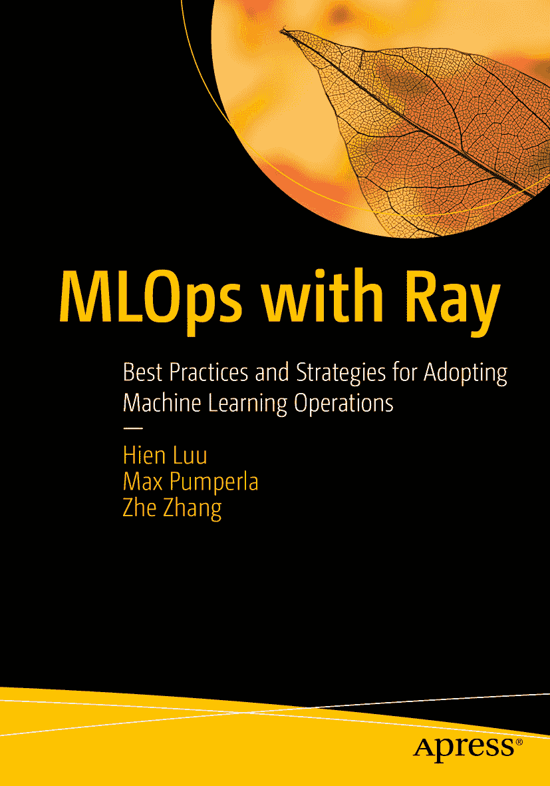

ISBN 979-8-8688-0375-8 e-ISBN 979-8-8688-0376-5 [`doi.org/10.1007/979-8-8688-0376-5`](https://doi.org/10.1007/979-8-8688-0376-5) © 编辑（如适用）及作者，根据与 APress Media, LLC（Springer Nature 旗下公司）的独家许可协议，2024 年所有权利保留。本作品受版权保护。所有权利均由出版商独家许可，涉及材料的全部或部分内容，特别是翻译、重印、插图复用、朗诵、广播、微缩胶片复制或任何其他物理形式的复制，以及信息存储与检索的传输、电子改编、计算机软件，或目前已知或未来开发的类似或不同方法。本出版物中使用通用描述性名称、注册商标、商标、服务标志等，即使未作明确声明，也不意味着这些名称不受相关保护性法律和法规的约束，因此可自由使用。出版商、作者和编辑假定本书中的建议和信息在出版之日是真实准确的。出版商、作者或编辑均不对本书所含材料或可能存在的任何错误或遗漏提供明示或暗示的担保。出版商对已出版地图中的管辖权主张和机构归属保持中立。

本 Apress 印记由注册公司 APress Media, LLC（Springer Nature 旗下公司）出版。

注册公司地址为：美国纽约州纽约市新广场 1 号，邮编 10004。

关于作者 关于技术审稿人

