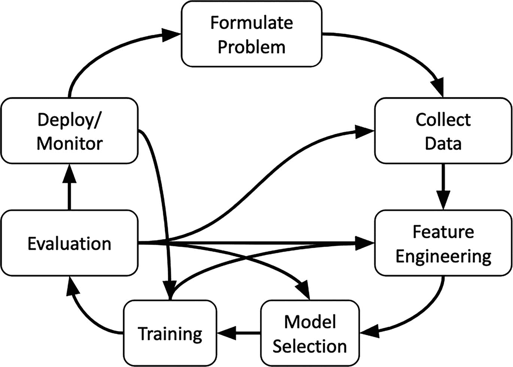
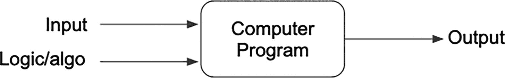
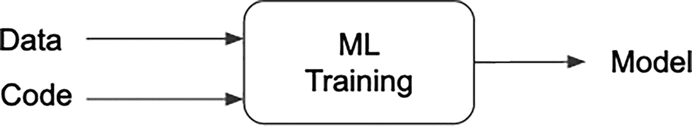
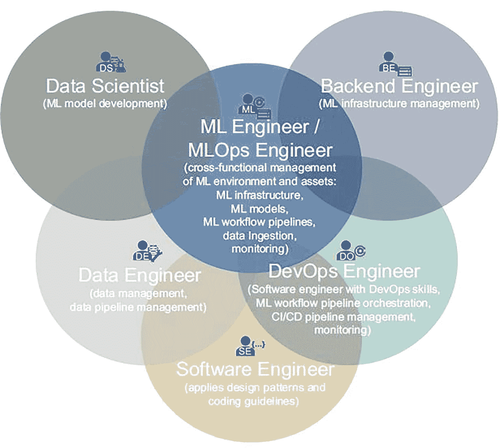
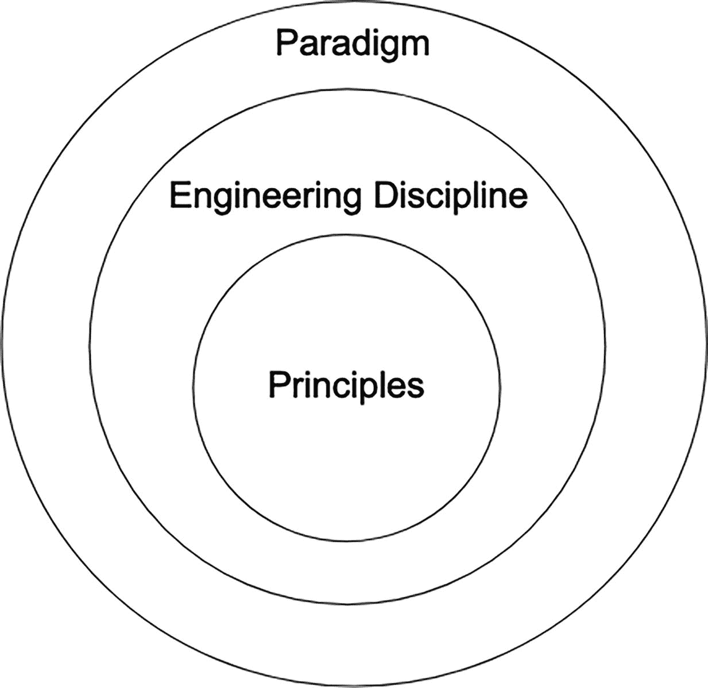
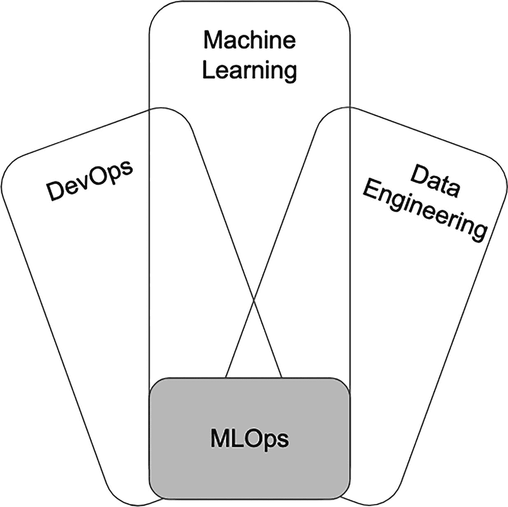
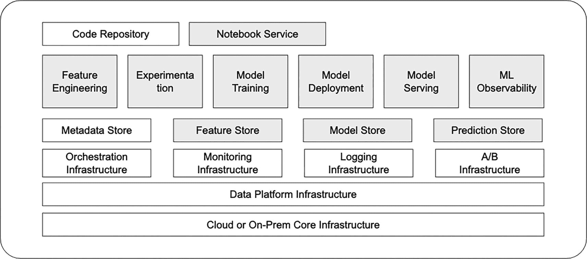
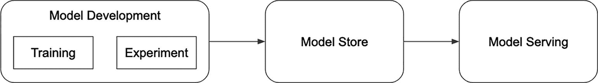
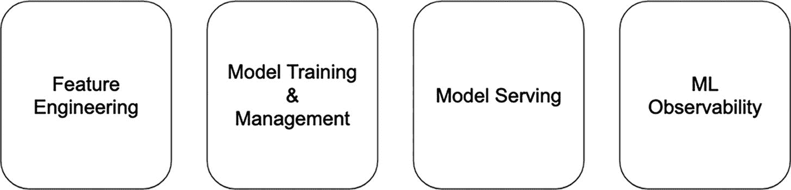

# 1. MLOps 简介

机器学习已被证明是一种从数据中学习和提取模式的强大工具。过去十年间，生成、存储和处理大量数据的能力，以及轻松获取计算资源的便利性，推动了机器学习领域的诸多进步，例如图像识别、语言翻译和大语言模型（如 BERT、DALLE、ChatGPT 等）。

机器学习终于走出了学术实验室，被商业界热情拥抱，用于解决现实世界的业务问题，并通过改善客户体验、降低成本、提高业务效率，最终增强竞争优势来变革行业。根据麦肯锡《2021 年人工智能现状》¹ 报告，调查结果表明，全球许多地区的众多公司中，人工智能/机器学习的采用率持续稳步上升。这一增长的原因之一在于人工智能对业务底线的影响。

人工智能/机器学习能否为各行各业的组织带来商业价值已不再是问题。如今，人工智能/机器学习领导团队更迫切的问题是：他们的组织如何最高效地将人工智能/机器学习集成到业务流程或产品中，以交付这种价值。为此，他们需要具备以迭代、一致、有效、安全且可预测的方式将机器学习投入运营的能力。

来自 Gartner² 和 VentureBeat³ 等多个来源的关于机器学习项目失败数量的数据表明，将机器学习投入运营是一项复杂的任务，需要一套标准化的流程和技术能力，以便高效、快速地构建、部署和运营机器学习模型。欢迎来到 MLOps！

## MLOps 概述

软件工程项目旨在为公司、组织或团队创造价值。只有当开发的软件制品成功部署到生产环境后，预期价值的实现才会开始。这个过程越早越好。全球各地的公司已采用 DevOps 作为方法论，通过最小化开发与运营之间的差距，并促进协作、沟通和知识共享，来可靠地开发和部署大规模软件到生产环境。DevOps 在业界被广泛采用，因为它通过强调自动化（持续集成、持续交付和持续部署）来帮助实现快速、频繁且可靠的软件发布。

类似地，机器学习项目旨在为公司、组织或团队增加特定价值。只有当机器学习制品（即机器学习模型和特征）部署到生产环境并得到适当监控后，机器学习项目的投资回报率才会开始实现。由于项目复杂性、数据质量和具体目标等因素，机器学习项目投资回报率的实现时间可能有所不同。组织可能在部署的早期阶段就开始看到初步回报，尤其是当机器学习模型解决了特定痛点（如减少客户订阅流失）时。完整的投资回报率通常是在模型成功集成到运营流程中，并在较长时间内持续交付可衡量的价值时才能实现。实现这一目标通常需要时间，因为模型可能需要优化、调整和持续监控以适应不断变化的条件。

机器学习项目与软件工程项目有何不同？机器学习项目的独特之处是什么？DevOps 方法论能帮助机器学习项目吗？让我们审视这些问题，以深入理解 MLOps 及其带来的好处。

**注意**
DevOps 已被许多开发软件的组织广泛采用，作为提高软件质量和可靠性，同时缩短软件工程计划上市时间的方法论。它既是解决从事软件开发的组织中社会和技术问题的范式转变，也是贯穿软件开发过程的持续自动化流程。
DevOps 的基石是一个持续的过程，包括持续开发、集成、部署和监控，旨在实现快速、频繁且可靠的软件发布。
DevOps 思维要求软件工程师不仅关心他们开发的内容，还要关心软件的部署和运营。

### 机器学习项目

与软件工程项目类似，机器学习项目也有其自身的开发生命周期。然而，由于机器学习模型训练过程具有科学性质，需要反复实验，并且高度依赖用于训练算法的数据质量，因此其生命周期是一个高度迭代的过程。因此，机器学习开发过程并非像标准软件工程开发生命周期那样是线性的，而是循环的，需要迭代、调优和改进，如图 1-1 所示。



*图 1-1 机器学习开发过程*

一个循环图，包含模型选择、训练与评估、部署或监控、问题定义、数据收集和特征开发。部署或监控反馈到训练，评估指导数据收集和特征工程，模型选择将数据发送至特征工程。

机器学习项目通常是为了帮助实现某些具有可衡量成果的业务或产品计划而启动的。作为机器学习项目的第一步，在按顺时针方向进行其他步骤之前，明确问题并设定清晰的目标和目的至关重要。如果模型评估步骤表明机器学习模型未达到预期水平，或者实验结果使数据科学家确信需要改变当前方法或继续微调当前方法，那么数据科学家需要回溯到之前的步骤（例如收集额外数据或改变特征生成方式），这并非异常，反而是预期且必要的。

成功的机器学习项目，其数据科学家能够尽可能快地推进整个开发生命周期，并根据需要多次经历开发循环，以便将先前实验的见解应用于微调其方法、所需数据，并最终产出最优的机器学习模型。最终目标是产出最优的机器学习模型，使其能够用新数据以满足业务目标或目的所需的准确度进行预测。

尽管机器学习开发生命周期是循环的且看似复杂，但它可以简化为五个阶段：

*   数据收集与准备
*   特征工程
*   模型训练
*   模型部署
*   模型监控

### 机器学习项目的输入与产物

在传统的软件工程项目中，软件工程师编写代码来开发逻辑或算法，以满足给定的规范，并根据输入产生输出，如图 1-2 所示。



*图 1-2 软件项目*

一个框图展示了输入数据和逻辑（或算法）流入计算机程序以生成输出的流程。

在机器学习项目中，数据科学家花费大量时间专注于两个主要活动：特征工程和模型开发。以下段落旨在简要描述这两项活动，更重要的是指出机器学习项目的输入和产物。

机器学习特征的数量和质量对机器学习模型的性能有巨大贡献。数据科学家通常花费大量时间收集和分析收集到的数据，然后编写代码将数据转换为机器学习特征，用于训练机器学习模型，如图 1-3 所示。



*图 1-3 机器学习项目中的模型训练*

一个框图展示了数据和代码被传输到机器学习训练以处理模型的流程。

一旦数据科学家对生成的机器学习特征感到相当满意，他们就会进入机器学习模型训练步骤，该步骤涉及编写代码，使用生成的特征、机器学习算法和一组调优参数来训练模型。此步骤通常需要探索和实验，以评估、微调并迭代机器学习模型，从而提升其性能。如果模型评估结果不理想，数据科学家可能需要回到特征工程步骤，收集更多或不同的数据集，或选择不同的机器学习算法等。

上述活动产生的主要机器学习产物如下：

*   用于生成特征的数据
*   从收集的数据中生成特征的逻辑
*   用于训练机器学习算法的代码和参数
*   生成的机器学习模型

通常，机器学习模型需要重新训练，原因包括出现新的业务需求、获得额外的数据源或机器学习库、模型性能开始下降等。因此，对上述列出的（如图 1-4 所示）机器学习产物进行版本控制或管理至关重要。


*图 1-4 机器学习产物*

一个公式：机器学习 = 数据 + 机器学习算法 + 超参数。

机器学习项目不同于传统的软件工程项目，带来了许多独特的挑战，可总结为以下几点：

*   训练机器学习模型需要历史数据，因此机器学习项目涉及更多与数据相关的活动，例如收集和标记数据，以及分析和可视化输入数据以更好地理解其统计特征。
*   模型开发是一个高度迭代的过程，需要探索和实验。
*   随着新数据的统计特征相对于历史数据的统计特征发生漂移或变化，机器学习模型的性能可能会随时间推移而下降。
*   机器学习项目通常需要数据科学家、数据工程师、机器学习工程师和领域专家之间进行更多协作，因为项目的成功往往取决于技术专长和领域知识的结合。

人们常说，MLOps 之于机器学习，就如同 DevOps 之于软件工程。MLOps 的主要目标是通过规定一套围绕技术和非技术要素的最佳实践，帮助全球各地的公司以可重复、一致且高效的方式加速其机器学习项目投入生产。

## MLOps：缺失的要素

随着全球越来越多的公司认识到人工智能/机器学习的强大力量，并分配预算投资于应用人工智能/机器学习以增加商业价值、提升竞争力等，他们理所当然地希望看到其在机器学习项目上的投资回报率。只有当机器学习模型部署到生产环境并集成到其产品或业务流程中时，投资回报才开始产生。最终，什么能有效帮助将机器学习模型高效、快速地投入生产？根据集体智慧和经验，机器学习从业者社区和行业已经找到了答案，那就是 MLOps。

在本节中，我们将审视机器学习项目运营化过程中的一些常见挑战和陷阱，然后从高层次讨论 MLOps 如何帮助应对这些挑战，以提高机器学习项目的成功率。

### 机器学习项目落地化挑战

根据高德纳和 NewVantage Partners 的多项调查显示，许多组织在从机器学习项目投资中获得回报方面并未达到预期效果，原因在于难以快速、高效且一致地将机器学习模型落地到生产环境中。NewVantage Partners 在 2020 年进行的一项调查^(⁴)指出，仅有约 15%的领先组织已将 AI 能力部署到任何规模的生产环境中。

可以公允地说，大多数组织现在都明白，将机器学习项目落地化充满挑战，并且这与传统软件项目的落地化截然不同。

本节将重点介绍机器学习项目中的几个常见挑战，并阐明这些挑战的成因。我们认为，这些挑战是导致机器学习项目失败的部分因素。关于人才匮乏或业务目标不清晰等挑战，则不在本书的讨论范围之内。

#### 应用机器学习

在现实世界的机器学习项目中，人们普遍理解，这些项目的核心是应用机器学习来实现数据驱动的决策和产品。

机器学习作为一门学科，本质上具有高度的实验性和迭代性，尤其是与典型的软件工程相比。

应用机器学习包括在数据集上训练模型，然后在同一数据集以及另一个独立数据集上评估其性能。模型的第一个版本很少能达到预期的性能，因此，这个过程可能会重复多次，每次迭代都可能使用不同的机器学习算法或架构、超参数设置以及特征工程技术。

在开始应用机器学习时，很难预先知道上述各部分的确切组合能够产生性能良好的机器学习模型。因此，探索、实验和迭代是找到最佳组合并快速剔除不良组合的必要环节。

与其他科学探索类似，机器学习的实验和迭代需要能够记录实验输入、方法、结果等信息。这将有助于并加速分析结果的过程，通过比较多次实验运行来确定下一步行动。

此外，机器学习仍是一个不断发展的领域，新技术、新方法和新的机器学习库层出不穷。因此，机器学习从业者必须对尝试这些新变化持开放态度，并利用它们来提升机器学习模型的性能。

这里的关键在于速度。如果机器学习从业者因缺乏能够轻松快速进行探索、实验和迭代的流程或工具而陷入困境，那么将机器学习模型投入生产可能无法实现，或者需要很长时间才能实现机器学习项目投资的回报。

#### 垃圾进，垃圾出

计算领域那句经典谚语“垃圾进，垃圾出”指的是有问题的输入数据会产生有问题的输出，这一点与机器学习尤其相关，因为模型训练过程高度依赖输入数据的质量。

机器学习模型训练是将带有标签的训练数据输入机器学习算法以学习其模式的过程。众所周知，机器学习模型的性能完全取决于数据的质量。一些知名的机器学习从业者最近开始倡导以数据为中心的 AI 方法，以进一步强调高质量训练数据的好处。有关此方法的更多详细信息，请参阅下面的注释。

除了数据质量之外，对机器学习模型性能有重大影响的其他数据相关方面还包括数据的新鲜度和数据统计特性的变化。

如果在这些数据相关方面缺乏数据基础设施、数据工程严谨性以及人员支持，那么将对机器学习模型的性能产生负面影响，最终会减缓将机器学习模型投入生产的进程。

**注意**

以模型为中心的 AI vs. 以数据为中心的 AI – 目标相同，但方法不同

以模型为中心的 AI 是一种通过调整超参数或更改模型架构或算法，直到达到预期指标来改进机器学习模型性能的方法和思维模式。这种方法传统上是业界一直在实践的。

以数据为中心的 AI 与以模型为中心的 AI 目标相同，但它采用不同的方法：保持超参数、模型架构和算法不变，同时应用基于错误分析的数据迭代来改进模型性能。根据以数据为中心的 AI 资源中心网站^(⁵)的定义，以数据为中心的 AI 是一门系统化地工程化构建 AI 系统所用数据的学科。这种方法由吴恩达在他的视频“与吴恩达聊 MLOps：从以模型为中心到以数据为中心的 AI” [视频](https://www.youtube.com/watch%253Fv%253D06-AZXmwHjo)^(⁶)中引入并倡导。

#### 起步之初

传统上，机器学习是从单个科学实验的角度来处理的，这些实验主要由数据科学家独立进行。数据科学家在机器学习领域知识渊博且训练有素，主要负责与模型训练相关的任务。

因此，数据科学家往往较少关注机器学习模型训练周边的领域，例如花时间自动化数据管道、专注于开发健壮且高质量的代码、自动化端到端的模型训练管道，以及将机器学习模型集成到生产环境中的数据驱动产品中。

企业级机器学习项目并非一次性实验和开发机器学习模型后就转向其他项目；它们要求这些与软件工程相关的活动实现自动化、版本控制、监控、可复现等。

如果数据科学家不转向更以软件工程为中心的思维模式，或者缺乏必要的工具、基础设施或流程来支持数据科学家完成这些与软件工程相关的活动，那么将会对贵组织机器学习落地化的进程产生负面影响。此外，还需要在组织层面进行文化转变，转向以产品为导向的思维模式。

#### 团队协作

将机器学习模型开发出来并整合到数据驱动的决策产品中，这一端到端的流程是一个复杂且跨学科的过程，涉及数据工程、机器学习、软件工程和开发运维等多个领域。毫无疑问，这是一项团队协作，因此需要明确职责与所有权，并要求跨团队协作，以确保这些产品稳定、保持最新，更重要的是，能够持续为业务创造价值。

典型的团队协作包含角色与职责的划分。既然将机器学习模型投入生产被定义为一项团队协作，那么我们就来梳理一下机器学习开发生命周期中各活动所涉及的一些典型角色与职责。

表 1-1 旨在列出机器学习开发活动的核心集合，并非详尽无遗。

表 1-1

机器学习开发活动分配

| 活动 | 角色 |

| --- | --- |

| 数据准备 | 数据工程师 |

| 特征工程 | 数据科学家 |

| 模型训练 | 数据科学家 |

| 模型部署 | 机器学习工程师 |

| 模型监控 | 机器学习工程师 |

一些企业可能会在机器学习运营化流程中纳入其他角色，例如业务利益相关者或数据治理官。

对于中大型企业而言，每个角色可能由一人或多人承担。而对于小型企业或初创公司，则可能由同一个人承担两个、多个甚至全部角色。

图 1-5 更详细地描绘了来自“机器学习运营（MLOps）：概述、定义与架构”^(⁷)论文中不同角色的交叉关系。



一个由六个相交圆组成的示意图展示了 MLOps 中的不同角色。位于中心的是机器学习工程师或 MLOps 工程师角色，该角色与其他五个角色相交，分别是数据科学家、后端工程师、数据工程师、DevOps 工程师和软件工程师。

**图 1-5**

MLOps 中不同角色交叉关系的详细描绘

要想在团队协作中成为一支获胜的队伍，需要拥有所有必要的人员、清晰的职责分工，以及围绕沟通与协调的明确规程。同样，企业要想成功地将机器学习运营化，就需要拥有足够且必要的人才，组建一支多学科团队来履行这些角色，并且需要建立标准流程、清晰的沟通协议以及所有权和职责的边界，以便所有相关团队都能达成共识、步调一致，按时完成预期的交付成果并进行恰当的交接。

#### 挑战总结

可以说，持续、高效且大规模地成功运营机器学习并非易事；然而，这是可行的，并且成果是值得的。

机器学习已被证明是一项颠覆性技术，能够帮助那些愿意投资的企业降低成本、提高运营效率并增加业务利润。

本节从以下三个关键维度总结了上述挑战，而 MLOps 旨在解决这些挑战，这将在“MLOps：承诺”部分进行描述：自动化、可复现性和监控。

##### 自动化

如上文“应用机器学习”部分所述，这是一个高度实验性和迭代性的过程。这意味着在应用机器学习的过程中，几乎所有活动（如果不是全部）都能从自动化中大大受益。手动流程存在诸多挑战，包括容易出错、耗时、不一致以及难以复现。

自动化能够提升速度，因为这些活动可以轻松且一致地重复执行，并使数据科学家能够更快地完成开发生命周期。

正如“垃圾进，垃圾出”部分所述，数据相关活动对机器学习模型的性能至关重要。数据相关活动的自动化，例如运行和监控数据管道以确保数据质量和新鲜度，最终将有助于实现最佳的机器学习模型性能。

##### 可复现性

复杂的机器学习项目通常需要多位数据科学家协作，讨论他们的假设并验证机器学习模型训练实验。为了有效做到这一点，他们需要能够轻松复现实验，这就要求先前实验中使用的工件能够随时可用和可访问。

数据科学家经常在现有机器学习模型的基础上进行迭代以创建新模型。导致新机器学习模型迭代的常见原因包括业务需求变化、新的训练数据源可用、客户行为改变等等。能够复现先前机器学习模型版本中已完成的大部分工作，将极大地加速新的迭代。

##### 监控

人们常说，将机器学习模型部署到生产环境只是成功了一半，而持续维护其性能则是另一半。这是因为生产环境中机器学习模型的性能可能会（并且经常）下降，这可能会对客户或企业产生负面影响。

这种性能下降可能由多种原因引起，例如用于预测的机器学习特征的质量问题、用户行为的变化、环境变化（例如新冠疫情）等等。因此，持续监控已部署机器学习模型的性能，并在性能低于某个阈值时向数据科学家发出警报至关重要。

同样严格的持续监控也应应用于为训练或生成预测时使用的特征而提供数据的数据管道。

通过主动监控数据、特征和机器学习模型的性能，数据科学家和机器学习工程师可以及早发现问题，并采取适当行动来长期维持模型的有效性。

### MLOps：承诺

现在，我们对机器学习项目的开发生命周期、输入和工件，以及运营化机器学习模型时的常见挑战有了高层次的理解，接下来让我们审视一下什么是 MLOps，以及它如何帮助解决“挑战总结”部分列出的三个维度上的挑战。

在互联网上快速搜索，会发现许多对 MLOps 及其定义略有不同的解释。然而，它们都趋向于一个共同的目标和一系列主题。

为了理解 MLOps 的本质，我们将像剥洋葱一样，层层剖析它所包含的内容。MLOps 包含三个基本层次：范式、工程学科和原则。每一层都为 MLOps 的最终目标做出贡献，并将被详细探讨。通过单独和整体地审视每一层，我们将全面理解支撑 MLOps 的原则和实践，以及它在实现高效、有效的机器学习全生命周期管理方面的重要性。MLOps 洋葱模型如图 1-6 所示。



# MLOps 的三个特征：范式、工程学科与原则

三个同心圆说明了 MLOps 的三个特征。最内层的圆象征着原则，第二层圆代表工程学科，最外层的圆表示范式。


## 范式

MLOps 代表了组织处理机器学习方式的一种范式转变。该范式认识到机器学习不仅仅是一项研究或实验活动，而是业务运营的关键组成部分，必须像其他技术系统一样，以同等程度的严谨和纪律进行管理。

那些在成功机器学习项目中收获成果方面处于领先地位的组织，正是拥抱了这种范式和思维模式，将机器学习模型和产物视为一流的软件组件。这些组织还采纳了运营化机器学习的思维模式，在 MLOps 原则的指导下，专注于可靠性、可扩展性和效率来设计、构建和管理机器学习系统。

MLOps 范式包含一系列最佳实践、概念和一种开发文化。这些方面将在“工程学科”和“原则”部分进行描述。

## 工程学科

随着全球众多组织将机器学习应用于业务问题的兴起，MLOps 作为一门新的工程学科应运而生。它结合了机器学习、数据工程和 DevOps 这三门现有学科的工程最佳实践和原则，如图 1-7 所示。



MLOps 工程学科涉及将工程原则和实践应用于机器学习模型的开发、部署、监控和维护。其主要目标是使组织能够以高效、高速、可扩展和可维护的方式将机器学习模型投入运营。换句话说，就是减少将机器学习模型从想法转化为生产环境并与软件系统集成的阻力，以最短的时间和尽可能小的风险实现。

### 数据工程

众所周知，数据是人工智能/机器学习的生命线，数据的数量和质量将决定机器学习模型能够达到的性能水平。

数据工程学科为 MLOps 学科带来了以下主要贡献：

*   为准备用于训练机器学习模型的数据奠定基础。

*   负责处理、存储和消费来自不同数据源、不同格式数据的框架和基础设施。

*   通过自动化、高效、经过测试和监控的数据管道，确保用于训练机器学习模型的数据符合质量标准和时效性要求。

### 机器学习

将机器学习应用于企业业务问题的核心在于机器学习技术的实践和应用。

机器学习学科为 MLOps 学科带来了以下主要贡献：

*   分析准备好的数据并从中提取洞察，以确定数据的统计特性，确保机器学习模型训练数据的表征性和公平性达到适当水平。

*   确定并选择最合适的机器学习算法和调优参数组合，以生成能够在新数据上表现良好的机器学习模型。

*   在将机器学习模型部署到生产环境之前，培养对模型性能的直觉，以便迭代和优化模型性能，满足业务成功指标。

### DevOps

MLOps 借鉴了广为人知且值得信赖的 DevOps 学科中的许多最佳实践。MLOps 中的产物比 DevOps 更多，这些额外的产物增加了复杂性和挑战，必须在 DevOps 的背景下进行相应处理。

DevOps 学科为 MLOps 学科带来了以下主要贡献：

*   促进协作、沟通和知识共享，以弥合开发与运维之间的差距。鉴于 MLOps 比 DevOps 更强调团队协作，这一贡献对于 MLOps 的成功极为适用且至关重要。

*   通过持续集成、持续交付和持续部署确保自动化，以推动快速、频繁且可靠的机器学习模型发布。这将有助于加速从想法到生产环境中机器学习模型的转化时间，并在必要时通过模型重新训练来维持其预期性能。

*   确保持续测试、质量保证、持续监控、日志记录和反馈循环。鉴于机器学习模型的性能在很大程度上取决于训练数据和用于预测的新数据，且数据不断变化，因此持续监控数据统计特性和模型性能是确保模型按预期运行、最小化影响用户体验或其他负面影响风险的关键。

数据工程、机器学习和 DevOps 这三门工程学科的最佳实践是一个很好的起点；然而，由于 MLOps 具有独特、高度迭代和实验性的特点，更强调团队协作，并且其产物包括数据、代码和模型，这带来了额外的挑战和管理需求，因此需要将上述列出的一些调整和补充内容纳入 MLOps。以下是其中几个值得注意的方面：

*   机器学习项目中的测试比测试传统软件系统更复杂。除了单元测试和集成测试，还需要数据验证、训练模型质量评估和模型验证。

*   部署机器学习模型涉及一个多步骤的管道，包括自动重新训练和部署模型，以及定期将特征部署到在线特征存储中。

*   由于模型性能自然存在下降趋势，因此必须对生产环境中的机器学习模型进行监控。这需要定期主动跟踪用于预测的数据的汇总统计数据和在线模型性能。

*   持续机器学习模型训练是机器学习系统独有的。这一额外的实践是指能够在数据、代码和机器学习模型发生任何变化时，自动重新训练模型并在有保障措施的情况下提供服务。

## 原则

在上面的“工程学科”部分，已经大量讨论了 MLOps 所基于的三门学科中的一些最佳实践。本节旨在将其中一些实践以及一些额外的内容编纂成一套原则，任何采用 MLOps 的组织都应考虑这些原则。

这些原则旨在指导组织内的 MLOps 实践。至于每项原则的严谨程度或关注重点，将根据该组织的人工智能战略、目标、用例和文化而有所不同。

### 自动化

自动化指的是尽可能消除人工流程和人为参与，并投资于流程和工具来执行机器学习开发生命周期中的关键步骤。这包括执行、构建、测试、训练、部署机器学习产物，例如数据、代码和机器学习模型。

一些机器学习开发活动需要按特定节奏重复运行，例如数据管道、特征生成管道、模型训练管道等。这些活动将从自动化中获益最多。

对自动化的需求会增加，当：

*   机器学习模型的数量达到手动管理变得不切实际且资源密集的程度时

*   团队成员（数据科学家、数据工程师、机器学习工程师）的规模达到手动协调和沟通变得更具挑战性的程度时，例如 10 人或更多

*   组织越来越依赖机器学习模型为业务带来的价值时

自动化为机器学习项目开发的参与者提供快速反馈，从而提高整体生产力和协作水平。

### 版本控制

机器学习项目的主要产物是数据、代码和机器学习模型。MLOps 的最佳实践是将这些产物视为一等公民，如同 DevOps 规范中的代码一样，使用版本控制系统进行管理。

与开发软件系统的最佳实践类似，机器学习模型的训练代码除了要进行版本控制外，还应经过代码审查流程，以确保机器学习模型的训练过程可审计且可复现。

在机器学习从业者社区中，有一个老生常谈的故事：由于原始机器学习模型的作者离职，且训练代码和元数据从未被检入版本控制系统，导致模型无法复现或重新训练。遵循这一最佳实践应能帮助解决此类问题。

对训练数据进行版本控制面临的挑战之一是其数据量庞大。

### 实验追踪

如前所述，机器学习开发是一项高度迭代和实验性的科学探索。为了支持机器学习的这一独特特性，使数据科学家能够快速实验、评估和比较结果，并与其他数据科学家协作，就需要一种简便的方法来追踪实验的元数据，例如使用的参数、性能结果指标、模型谱系、数据和代码。

其好处不仅包括可复现性，更重要的是可追溯性。此外，机器学习模型的探索和迭代既耗费金钱也耗费时间。因此，任何能够减少金钱和时间消耗的措施都将为组织带来效率提升。

### 可复现性

该原则指的是，在机器学习开发生命周期的主要步骤中（包括特征生成、机器学习模型训练与实验、以及机器学习模型部署），给定相同的输入，能够复现其结果的能力。

对于传统软件开发而言，使用版本控制通常就足以满足可复现性原则。但对于机器学习项目，则需要付出更多努力来追踪各种流水线、特征生成和机器学习模型训练代码、超参数，尤其是数据和机器学习模型的训练环境。

该原则带来的好处众多且至关重要，例如，当数据科学家离职或转投其他项目导致机器学习项目交接时，或者当因负面业务影响或监管要求而需要调试重要的生产问题时。

### 测试

可以合理地预期，在数据工程师、数据科学家、机器学习工程师等人群中，测试原则的实践所遇到的阻力应该最小。然而，由于机器学习项目具有动态特性以及多种类型的输入和产物，测试既更具挑战性，也更为关键。

在机器学习项目中进行有效测试需要多种类型的测试。以下部分将重点介绍两种重要的机器学习产物：数据和机器学习模型。

#### 数据相关测试

数据质量和统计属性都会直接影响机器学习模型在训练和预测阶段的性能。下面列出几种重要的测试类型。

*   测试空值、异常统计分布和特征相关性。

*   对于二分类或多分类机器学习任务，验证关于目标标签分布的假设。

*   对特征生成代码进行单元测试。

#### 模型相关测试

*   使用离线数据验证模型性能，确保其满足预期的性能指标（如准确率）以及运营指标（如推理延迟或模型大小）。

*   生成特征重要性，以深入了解每个特征对模型性能的影响。

*   执行模型冒烟测试，通过使用少量线上生产数据，将新模型或新版本的性能与简单的基线模型或当前生产环境中的模型进行比较。

*   对模型在公平性、偏见和包容性方面的性能进行测试。

### 持续机器学习训练、评估与部署

随着组织寻求扩大其 AI/ML 投资和机器学习项目规模，强烈建议投资于这一原则，通过使机器学习模型持续适应我们生活的动态世界，从而持续获得机器学习项目的投资回报率。

# 持续机器学习训练与评估

在机器学习从业者社区中，一个众所周知的事实是，模型性能会因多种原因随时间推移而下降。对于某些机器学习用例，例如电影推荐，其输入数据会因用户行为变化而快速变化，因此，通过持续的机器学习训练和评估来保持模型更新至关重要，这样才能使这些机器学习模型维持并提升性能。

要以高效、有效且安全的方式实践这一规范，需要以下支持：

*   能够监控、检测并在模型性能开始低于基于业务成功指标设定的某个可接受阈值时发出告警。

*   一个基于数据变化或性能下降而触发的自动化机器学习训练和评估流水线。

*   一个自动化的部署流程，能够以安全的方式提升和部署更新后的模型版本。

并非所有机器学习用例都需要持续的机器学习训练和评估。然而，那些确实需要的用例将极大地受益于这一原则，从而在长期内为机器学习项目投资带来丰厚的回报。

## 持续监控

> *生活中唯一不变的就是变化。*
> ——赫拉克利特，希腊哲学家

机器学习（`ML`）的另一个独特之处在于，`ML`模型需要对其性能进行持续监控，以便在性能低于某个可接受阈值，或开始产生对用户体验、商业价值或组织形象产生负面影响的错误预测时，防范风险。

该原则倡导对所有 `ML` 工件（包括数据、模型、代码、数据管道、`ML` 模型训练管道等）进行定期且主动的评估，以检测潜在错误。

在需要持续监控的众多领域中，与 `ML` 相关且最具挑战性的是模型漂移，因为这种漂移会随着时间的推移潜入 `ML` 模型，并对业务结果产生不利影响。模型漂移现象指的是，由于 `ML` 模型被训练预测的对象与输入训练数据之间的关系发生变化，模型的预测结果会随时间推移而发生偏移。下文将分享更多细节和示例以阐明这一点。

两种类型的模型漂移分别是概念漂移和数据漂移。

*   概念漂移
    *   用 `ML` 术语来说，它指的是模型输入与输出之间的函数关系与之前时期相比发生了变化。
    *   这种漂移的一个早期迹象是，当用于预测的输入特征的统计分布保持不变，但模型性能却在下降。
    *   关于这种漂移的一个有趣例子是，一个在 COVID-19 疫情初期之前训练的杂货商品需求预测模型。由于疫情期间对卫生纸和洗手液等商品的需求突然激增，该模型对这些商品需求的预测会变得越来越不准确。

*   数据漂移
    *   用 `ML` 术语来说，它指的是模型输入（输入训练数据或特征）的统计属性与之前时期相比发生了变化。
    *   这种漂移的一个早期迹象是，当模型性能下降与用于预测的输入特征的统计分布变化相关时。
    *   关于这种漂移的一个有趣例子是，一个在 COVID-19 疫情之前训练的出行时间预测模型。该模型在疫情期间无法有效预测出行时间，因为在高峰时段路上的车辆减少了。

除了监控模型有效性之外，还有其他与模型服务相关的运营指标也需要监控，例如：

*   模型服务延迟，这是在线 `ML` 用例的关键指标，用于指示模型服务系统的健康状况。
*   资源利用率，例如内存、`CPU`、`GPU` 的使用量。这些资源的过度使用表明系统存在不稳定性。
*   模型预测吞吐量。
*   错误率。

### 注意

#### `DataOps` 与 `ModelOps` 与 `AIOps`

有几个以 `Ops` 结尾的术语，其来源尚不明确。以下简要定义来自 `Gartner` 网站术语表部分^(⁸)。

`DataOps` 是一种协作式数据管理实践，专注于改善整个组织中数据生产者与消费者之间数据流的沟通、集成和自动化。

`ModelOps` 主要关注各种已投入运营的 `ML` 模型的治理和生命周期管理。

`AIOps` 结合了大数据和 `ML` 来自动化 `IT` 运营流程，包括事件关联、异常检测和因果判定。

## MLOps 规范技术栈

除了 `MLOps` 工程实践和原则之外，我们还需要底层技术栈和组件，以提供可扩展且高效的方式来自动化并扩展 `ML` 模型的开发、部署、管理和监控，以及 `ML` 模型与产品软件系统的集成。

本节将讨论 `MLOps` 规范技术栈，旨在为希望构建其 `MLOps` 基础设施以实现 `ML` 项目运营化的组织提供蓝图。该规范技术栈、其组件和核心能力将从工程（而非 `ML`）的角度，以通用且与技术无关的方式进行描述。

由各组织自行决定最适合其需求的开源和商业可行的技术及框架，以及最大化成功可能性的采用策略。大部分采用策略和技术细节将在后续章节中讨论。

### MLOps 蓝图

图 1-8 中的蓝图改编自 `AI` 基础设施联盟网站发布的“2022 年 `AI` 基础设施生态系统”^(⁹)报告。他们的蓝图提炼了 `MLOps` 的核心能力，而本蓝图则结合了最近出现的几个额外部分。`MLOps` 特有的能力由灰色方框表示。

```

```

一个框图包括代码仓库、笔记本服务、特征工程、实验、模型训练、部署、服务、`ML` 可观测性、编排、监控、日志记录以及 `A/B` 基础设施。最后，它还有一个数据平台和云或本地核心基础设施。

图 1-8

改编自 `AI` 基础设施联盟的 `MLOps` 蓝图 – [*https://ai-infrastructure.org/ai-infrastructure-ecosystem-report-of-2022/*](https://ai-infrastructure.org/ai-infrastructure-ecosystem-report-of-2022/)

眼光敏锐的读者会意识到 `MLOps` 技术栈庞大而复杂，并且对公司的底层基础设施有许多依赖。`MLOps` 技术栈严重依赖的一个特定基础设施是数据平台基础设施。如果没有存储、访问和处理数据的能力，那么在任何组织中成功实现 `ML` 项目的运营化几乎是不可能的——除非这些 `ML` 项目只是实验性的小项目。

`MLOps` 蓝图描绘了旨在支持上述 `ML` 开发生命周期和 `MLOps` 原则的核心能力。

### MLOps 组件

为了更深入地理解 `MLOps` 蓝图中各组件所代表的能力，以及每个灰色方框（组件）如何支持 `ML` 开发生命周期和 `MLOps` 原则，本节将提供关于每个组件的更多信息。

#### 特征工程

`ML` 开发生命周期中的首要步骤之一是特征工程，它涉及选择相关特征、创建新特征，以及对其进行缩放和转换，使其适用于 `ML` 算法。这一步对 `ML` 项目的成功至关重要，数据科学家通常会在上面花费大量时间。

为了加速这一步，将底层的复杂性和系统相关挑战抽象化会很有帮助，从而使数据科学家能够专注于创建特征的逻辑。换句话说，数据科学家应该能够定义生成特征的逻辑，而支持性基础设施则应负责以简单、可靠且可扩展的方式实现这一过程。

对于属于以下情况的组织，支持性基础设施可能不那么重要：

*   处于应用 `ML` 的早期阶段和实验阶段。
*   只有少数几个 `ML` 项目。
*   特征数量很少。

这种能力支持自动化原则，并且对于希望扩展 `ML` 项目数量的组织来说是必需的。

#### 特征存储

特征存储本质上是一个用于存储特征的集中式仓库，并提供特征管理功能，包括特征注册和特征发现，以便了解特征的来源、计算逻辑、质量和当前状态。这使得应用机器学习的多个团队能够实现特征复用与共享。

一个完整的特征存储需要为离线与在线两种使用场景提供存储和访问支持。在线场景更具挑战性，因为在线模型预测请求路径中需要低延迟访问。

对于处于机器学习应用早期阶段的公司，他们可以使用一个功能有限的简单特征存储（例如基于 `S3` 存储桶）来起步。

这一能力对于扩展人工智能项目、通过特征复用与共享实现高效运营至关重要。

该能力所支持的原则包括：持续版本控制、可复现性、机器学习训练、评估和部署。

#### 笔记本服务

在机器学习项目的早期阶段，数据科学家通常会花费大量时间进行探索和实验，以深入了解他们试图解决的问题或分析收集到的数据。他们可能会尝试不同的机器学习算法和超参数来建立基线模型。笔记本服务已成为数据科学家的热门工具，它提供了一个基于 `Web` 的界面，用于沉浸式工作。

一个集中式的笔记本服务，具备访问数据和模型训练计算资源等功能，可以极大地提高数据科学家的生产力。像 `JupyterLab` 这样的开源笔记本服务让数据科学家可以轻松启动本地实例，但集中式服务还能提供额外的好处，例如协作、版本控制以及与其他工具和服务的集成。

只有当组织开始扩展其机器学习项目并加大投入时，这一能力才会开始产生回报。

笔记本服务支持 `MLOps` 的几个关键原则，例如自动化、版本控制、实验跟踪和可复现性。通过为数据科学家提供一个集中式工作平台，笔记本服务有助于推广这些原则，并支持更高效、更有效的机器学习开发流程。

#### 模型训练

与特征工程能力类似，此组件的目标是让数据科学家能够轻松高效地训练他们的机器学习模型，无论这些模型在特征数量、模型架构和计算资源需求方面有多复杂。

为了实现这些目标，该组件应提供以下能力：

*   为数据科学家提供必要的抽象，使其能够以易于理解的方式简洁地编写模型训练步骤。
*   能够根据需求将模型训练到所需的计算资源上，例如 `CPU`、`GPU` 或 `TPU`。
*   持续机器学习训练。
*   提供遵循既定路径实现可复现性和一致性的便利。

以下部分将深入探讨上述各项能力的更具体细节。

##### 抽象

理解模型训练是一个交互式过程，数据科学家通常具备足够的能力和知识，能够选择合适的特征、机器学习模型算法和一组超参数，最终为手头的业务问题生成最优的机器学习模型。

他们需要一种抽象，能够用最少的代码行数来表达模型训练过程中需要完成的任务，以便：

*   分割样本并划分训练集

*   指定机器学习模型算法和超参数

*   评估和跟踪模型性能指标

*   访问必要的计算资源，以在最短时间内完成模型训练

这种抽象通常以`Python`编写的库的形式提供，它作为其他现有库的封装器，并用于访问公司的基础设施，例如日志记录或监控。

技术是不断发展的。这种抽象简化了升级依赖库到新版本、切换到功能更强的新库或访问新提供的基础设施时的迁移工作和痛苦。

### 计算资源

随着组织扩展其机器学习项目，毫无疑问，他们的应用场景会变得更加复杂，因此可能需要使用大量特征和越来越复杂的机器学习算法架构来进行模型训练。

能够按需访问大规模计算资源，使得训练大型复杂机器学习模型成为可能，或者将模型训练时间从几天缩短到几小时甚至几分钟，这将极大地加速迭代式模型训练过程，并最终缩短将机器学习模型投入生产所需的时间。

启动和管理昂贵的计算资源（无论是在云端还是本地）通常是一项工程任务。最好让数据科学家尽可能少地学习如何执行此操作。在启动、关闭和成本归属方面管理计算资源，最好由模型训练基础设施来完成。

### 持续训练

软件开发人员的一个有趣时刻是“在我的电脑上能运行”。类似地，如果一个机器学习模型是在数据科学家的笔记本电脑上训练的，组织不会希望将其部署到生产环境中，并让它成为批准或拒绝贷款申请等重要业务决策工作流的一部分。

理想情况下，任何投入生产的机器学习模型都应基于经过代码审查并检入版本控制系统的训练代码，通过系统化的方式进行训练。

这种系统化的方式通常被设计为持续集成和部署流水线中的一个步骤，并与版本控制系统集成。

这是为了确保训练出的机器学习模型是在可控且可追溯的方式下完成的，具有审计追踪和可追溯性，并且应该是相当可复现的。

### 一致性与可复现性

随着组织在机器学习上投入更多并承接更多项目，数据科学家的数量通常会增长，这导致协作增加，并且可能出现数据科学家接手其他已转岗或离职的数据科学家先前负责的项目的情况。在这些情况下，确保机器学习模型训练过程的一致性和可复现性至关重要。

如果模型训练代码以一致的方式编写，通过代码审查保证高质量，并且可以在版本控制系统中轻松访问以供他人查看或学习，这将极大地提升整个组织内数据科学家的协作效率和生产力。

开发模型训练代码的既定路径将使数据科学家能够非常轻松地复现先前训练的模型，以便迭代新版本或调试意外的生产问题。

最终，一致性和可复现性将提高数据科学家的生产力，并让他们保持头脑清醒。

模型训练基础设施在帮助组织扩展其机器学习投资和项目方面发挥着关键作用。

## 实验

实验是数据科学学科中的科学部分，也是机器学习模型训练过程中不可或缺的一环。实验旨在通过探索，找到模型架构、特征和调优参数的最佳组合，从而生成性能最优的模型以满足业务需求。这需要反复迭代并追踪所有实验产物，就像在大学化学课程中进行化学实验一样。

本组件并非关于如何执行实验，而是关于支持所有与实验相关的活动及其追踪。

该组件需要提供的基本能力包括：

*   提供一种简便的方式，将实验信息发送至集中式位置

*   以持久且可靠的方式存储实验信息

*   提供一种简便的方式，通过`API`或用户界面访问实验信息

*   提供一种直观的方式，用于比较两个或多个实验，以便数据科学家轻松理解哪些因素导致了变化

该组件支持的原则主要关乎可复现性。

## 模型存储

机器学习模型训练完成后，需要存储在一个中央仓库中。模型将从这里开始其生命周期，包括部署到各种环境，如预发布环境、测试环境和生产环境。一个中央模型存储库是所有已训练模型的单一可信来源，便于数据科学家及其他利益相关者进行访问、版本控制和协作。它还能使组织管理其模型的完整生命周期，追踪模型性能，并就部署哪些模型以及何时部署做出明智决策。

随着组织的机器学习产品组合不断增长，包含更多模型（通常约 20 个或更多），对中央模型存储库的需求将愈发明显，以克服模型管理和版本控制方面的挑战。

模型存储为机器学习项目带来以下好处：

*   有效管理机器学习模型及其生命周期

*   模型可追溯性与可复现性

*   模型治理：使组织能够建立管理模型整个生命周期的策略和流程，促进合规性，并降低与模型性能或行为相关的风险

*   安全性：为模型提供安全的存储和访问控制，防止未经授权的访问或篡改

模型存储充当着机器学习开发阶段与机器学习生产阶段之间的桥梁，如图 1-9 所示。



一个框图展示了模型开发模块内的训练和实验阶段。随后，模型开发数据被移至与模型服务模块相连的模型存储中。

图 1-9

模型存储

### 管理机器学习模型与生命周期

一旦机器学习模型经过正式训练并成为部署候选，它们就应被存储于模型存储库中并由其管理。作为中央模型仓库，它提供了对这些机器学习模型的可视性、可发现性、可审计性和管理性。

对于某些公司而言，模型生命周期很简单，只有少数几个阶段。而对于其他公司，由于法规遵从性要求，其公司政策规定了复杂的模型生命周期。拥有一个能够管理符合公司需求的已定义生命周期的模型存储，是确保一致性和满足合规性的关键。

### 模型可追溯性与可复现性

除了通过存储模型产物和元数据来简化机器学习模型向生产环境的过渡外，模型存储还有助于捕获关于部署信息的审计追踪，例如谁部署了模型、何时部署以及任何部署说明。

对于那些希望在模型审查、部署审批和部署方面拥有强治理和安全性的公司来说，可追溯性尤其有用且重要。

在使用模型存储进行模型注册以准备部署的过程中，应捕获并存储关于机器学习模型的元数据以及训练数据信息。如果认为有必要复现某个特定模型，那么所有相关信息都唾手可得。

该组件支持的原则是版本控制和可复现性。

## 模型部署

在 `DevOps` 领域，组织能够每天多次自动部署其软件。

类似地，在机器学习领域，模型部署是一个工作流，用于将训练好的机器学习模型（希望由模型存储管理）部署到生产环境，或回滚某个已部署的模型。

模型部署工作流通常与模型存储交互，以检索机器学习模型产物，将其打包成模型服务组件可消费的形式，并附带审计追踪更新模型生命周期状态。

模型部署工作流的第二部分是将模型产物移交给模型服务组件，并触发任何必要的更改，以使新部署的模型能够根据传入的请求开始执行预测。

图 1-10 描述了模型部署、模型存储和模型服务之间的交互。


一个水平流程图包含模型存储块，该块指向模型部署，随后是模型服务块。

图 1-10

模型部署

由于不同组织有不同的需求和策略，以及模型服务组件的架构差异，部署工作流在底层技术细节和步骤上存在许多变体。

对机器学习模型部署速度和频率有直接影响的关键部分是，部署工作流需要实现自动化且简单。

该组件支持的原则是自动化和持续部署。

## 模型服务

模型服务是理论付诸实践的关键环节，换言之，即使用经过训练的机器学习模型对生产数据或未见过的数据生成预测。根据机器学习模型所训练的特定用例，预测结果可以在离线（也称为批量）或在线模式下生成。以下注释将阐明批量预测与在线预测的区别，这两者通常与模型服务相辅相成。

**注释**

**批量预测与在线预测**

当在对话中提到“预测”一词时，常见的后续问题便是关于该预测的上下文。它是批量预测还是在线预测？

批量预测是以周期性或按需的方式，以批处理模式生成的，这意味着会同时生成数千或数百万个预测结果。这种方法非常适合待预测数据以批量形式提供的场景，例如基于历史数据进行预测，或模型输入是在一段时间内收集的情况。例如，一家电子商务公司可能会根据客户过去的购买历史生成客户推荐的批量预测，为每位客户生成一组推荐，用于指导营销活动。预测结果随后存储在`SQL`表或`S3`存储桶等存储系统中，之后可能会被传输到快速在线系统（如内存和分布式存储引擎）中，以供消费并服务于在线请求。许多在线推荐引擎都使用这种模式，例如 Netflix 电影推荐器。批量预测也称为*异步预测*。

在线预测是基于传入的按需请求生成的。每个请求通常会产生一到数千个预测结果，但通常不会达到数百万个。预测结果会立即返回给请求方。这就是在线预测也被称为*同步预测*的原因。

模型服务组件专为在线预测用例而设计，其主要职责是以在线服务的形式托管机器学习模型，该服务可能支持`HTTP/HTTPS`、`REST` 或 `gRPC` 等协议，然后根据传入的预测请求使用这些模型生成预测结果。本质上，模型服务为其他希望从托管的机器学习模型获取预测结果的服务暴露了一个服务端点。

模型服务将机器学习与微服务世界相结合，使远程服务能够以机器学习预测的形式利用机器学习能力。因此，模型服务组件的关键能力是典型微服务需求与机器学习模型需求的结合，例如：

*   低延迟、可扩展、高可靠

*   与机器学习框架无关，或支持常用框架

*   支持 `CPU`、`GPU`、`TPU` 或其他 `AI` 加速硬件

*   支持模型影子模式

*   与 `A/B` 实验平台集成

*   代表客户端支持在线特征获取

# MLOps 组件与支柱

*   支持预测请求的日志记录（特征、模型 ID/版本、预测结果等）

当组织开始将机器学习集成到其服务于在线客户请求的在线产品中时（例如推荐、搜索与排序、欺诈检测、语言翻译、自动补全等），模型服务组件是 MLOps 堆栈中最关键的组件之一。

该组件支持的原则是自动化和持续部署。

### 预测存储

预测存储是一个新兴的组件，与其他组件相比，受到的关注和讨论较少。它充当一个中央存储库，用于存储在线预测用例的预测日志。预测日志通常包含详细信息，例如用于生成预测的输入特征、生成预测的模型，以及其他元数据和操作指标。

这些信息对于数据科学家来说非常有价值，可用于：

*   调试机器学习模型的生产问题

*   评估影子模式下机器学习模型的性能

*   用作现有模型下一版本的训练数据

数据科学家需要能够以简单、高效且可扩展的方式访问、分析和处理这些预测日志。

该组件支持的原则是可复现性和持续监控。

注释

一家名为 Gantry 的初创公司的联合创始人 Josh Tobin 提倡一个名为“评估存储”的组件。根据他的“机器学习基础设施堆栈中缺失的一环”^(¹⁰)演讲，评估存储被定义为“一个用于存储和查询在线及离线真实值以及近似模型质量指标的中央位置。”

除了支持上述预测存储的功能外，评估存储还存储训练阶段的预测结果和评估阶段的机器学习模型指标，以使机器学习从业者能够更自信地部署机器学习模型，并更快地发现生产错误。

### 机器学习可观测性

一旦机器学习模型部署到生产环境并集成到组织的在线产品中，机器学习可观测性在防范负面影响方面发挥着重要作用。换句话说，就是检测并防止对机器学习模型旨在改善的业务结果产生负面影响。

更重要的是，它在确保团队在将机器学习模型部署到生产环境后不会盲目操作，并能够通过分析模型退化以及轻松对生产环境中与模型相关的问题进行根因分析，从而快速迭代和改进模型方面，发挥着至关重要的作用。

作为 MLOps 的一个组件，机器学习可观测性涵盖了多个关键方面，包括监控、可观测性和可解释性。这些方面对于确保机器学习系统按预期运行，以及帮助团队在问题出现时进行诊断和处理至关重要。

#### 监控

监控旨在通过跟踪、测量和记录系统操作指标以及与机器学习相关的指标（例如准确率、漂移、预测失败和错误等），来回答“出了什么问题”以及“何时出的问题”。

#### 可观测性

可观测性旨在为机器学习模型的行为和性能提供更多上下文或洞察，使团队能够在问题出现时快速识别和调试。例如，如果模型性能开始下降，机器学习团队应该能够轻松快速地确定根本原因，例如生产特征数据的变化、导致特征过时的特征数据管道故障、近期模型部署引入的错误，或者底层基础设施或环境的问题。

#### 可解释性

可解释性旨在帮助人类理解模型为何做出特定预测，或者哪些因素对这类预测贡献最大。这些信息对于业务团队或非数据科学团队建立对机器学习模型性能的信心、直观了解模型行为方式，以及在模型处于验证阶段或生产环境中时帮助发现潜在问题，都非常有用。

为了满足上述三个领域的需求，该组件需要提供的关键方面包括：

*   一种简便的方法来设置各种机器学习相关指标的监控，例如模型漂移和特征漂移、模型性能指标，以及用于触发告警的阈值，以便值班的机器学习工程师或数据科学家进行调查。

*   一种简便的方法来可视化各种模型性能指标，以了解当前状况并轻松分析指标，从而使数据科学家能够快速定位问题。

*   一种简便的方法来查看哪些特征对预测结果的影响较大。

*   一种简便的方法来分析每个机器学习模型的性能指标。

总之，借助机器学习可观测性，数据科学家将能够轻松快速地洞察模型性能问题，理解机器学习模型如何做出预测，并能够回答非数据科学团队关于其模型行为的问题。

注意

该组件在很大程度上依赖于预测存储的可用性，以便访问和计算预测日志数据上的各种聚合。

该组件支持的原则是自动化和持续监控原则。

## MLOps 支柱

图 1-8 中描绘了许多组件，其详细信息已在上一节中描述。通过稍微缩小视角，将这些组件逻辑上分组到更广泛的领域（我称之为支柱），有助于获得 MLOps 堆栈的鸟瞰图。这些支柱捕捉了 MLOps 堆栈的关键方面，因此可以轻松地与其他团队分享和解释，并在组织推进 MLOps 生产化的过程中跟踪其进展和成熟度。每个支柱都有足够的范围和影响力，并且边界划分合理。因此，很容易证明每个支柱都需要一个团队来开发和支持。

我倡导的四个支柱是特征工程、模型训练与管理、模型服务和机器学习可观测性，如图 1-11 所示。



四个模块代表机器学习的各个方面。从左到右：特征工程、模型训练与管理、模型服务和机器学习可观测性。

图 1-11

MLOps 支柱

### 特征工程

该支柱负责支持与特征生成、特征管理和特征存储相关的活动和流程所需的所有基础设施。

### 模型训练与管理

该支柱负责支持与模型训练、模型存储和模型生命周期管理相关的活动和流程所需的所有基础设施。

### 模型服务

该支柱负责支持与模型服务和预测存储相关的活动和流程所需的所有基础设施。

### 机器学习可观测性

该支柱负责支持与机器学习监控、可观测性和可解释性相关的活动和流程所需的所有基础设施。

注意

机器学习治理

机器学习治理包含一套旨在管理机器学习模型生命周期的策略、流程和控制措施，以解决与伦理、合规和风险管理相关的关切。MLOps 支柱更侧重于加速机器学习开发过程所需的基础设施。因此，本节不讨论机器学习治理主题。

## 总结

本章从高层次阐述了 MLOps 兴起的原因以及将机器学习项目投入运营所面临的一些挑战。它触及了机器学习项目的一些独特之处，以及它们与标准软件项目的不同之处，例如机器学习的迭代性和实验性。认识到这些差异是理解 MLOps 的第一步。

接着，本章强调了 MLOps 是一门工程学科，它融合了其他三个工程学科（DevOps、数据工程和机器学习）的最佳实践和技术。

然后，本章剖析了 MLOps 工程学科，并通过讨论三个主要层次（范式、工程学科和原则）来“剥开 MLOps 的洋葱”，以获得更深入的理解。值得重申的是，成功采用 MLOps 的第一步也是关键一步，是转变思维模式，将机器学习工件视为机器学习项目开发中的一等公民。然后，通过标准化和实践 MLOps 原则，组织将能够开始扩展其机器学习项目，并从其机器学习投资中获得更大收益。

在讨论了 MLOps 工程实践和原则之后，本章从工程角度（而非机器学习角度）描述了底层技术堆栈及其组件。这个规范堆栈旨在作为一个蓝图，提供一种可扩展且高效的方法来自动化和扩展机器学习模型的开发、部署、管理和监控。

最后，本章提出了一种将组件逻辑分组为支柱的方法，以便更容易理解 MLOps 格局的全貌以及每个支柱的范围和边界。

一旦组织理解了 MLOps 的最佳实践、学科和规范堆栈，它应该如何采用 MLOps 并将其集成到更大的生态系统中？应该遵循哪些策略和方法才能获得最大的成功机会？可能会出现哪些潜在挑战？第 2 章将讨论这些重要问题，并分享一些可能对希望采用 MLOps 或在采用过程中面临挑战的组织有所帮助的技巧。

脚注 1   2   3   4   5   6   7   8   9   10