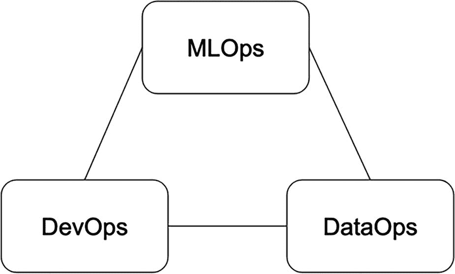
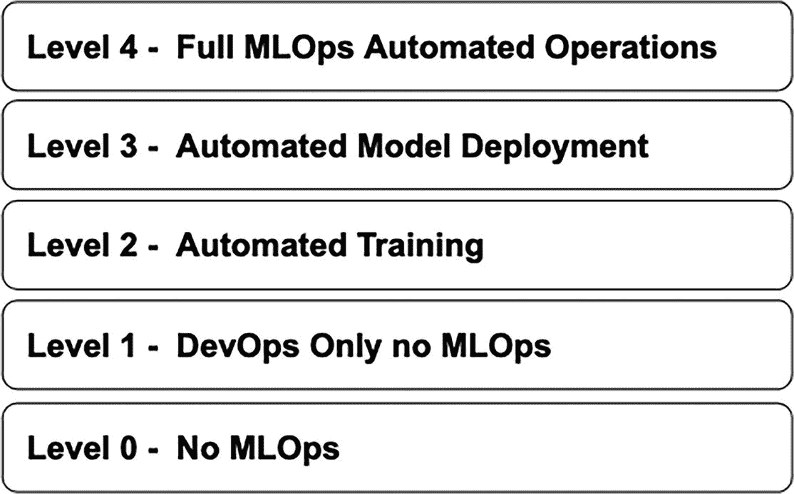
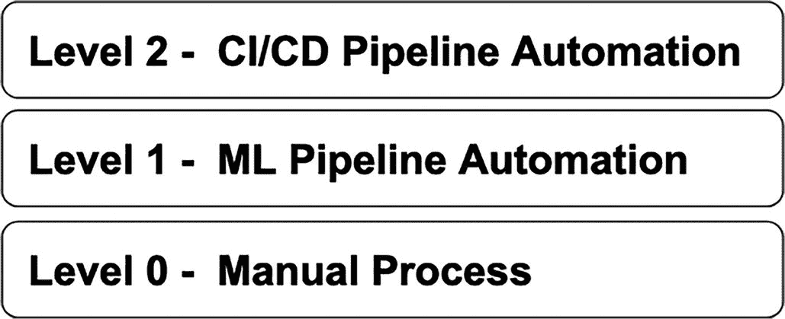
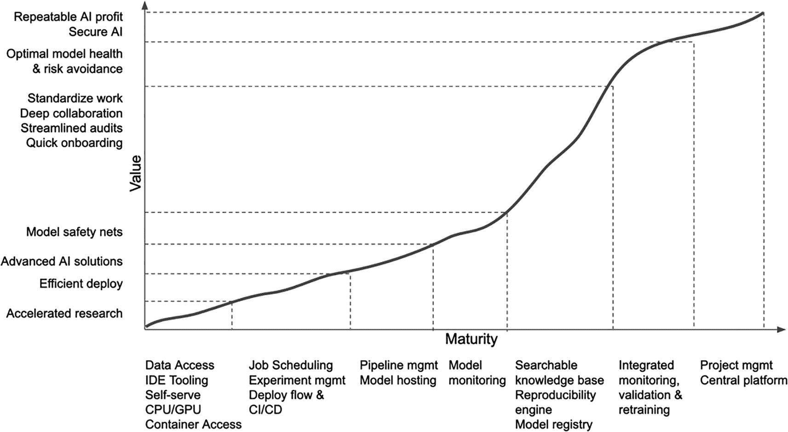
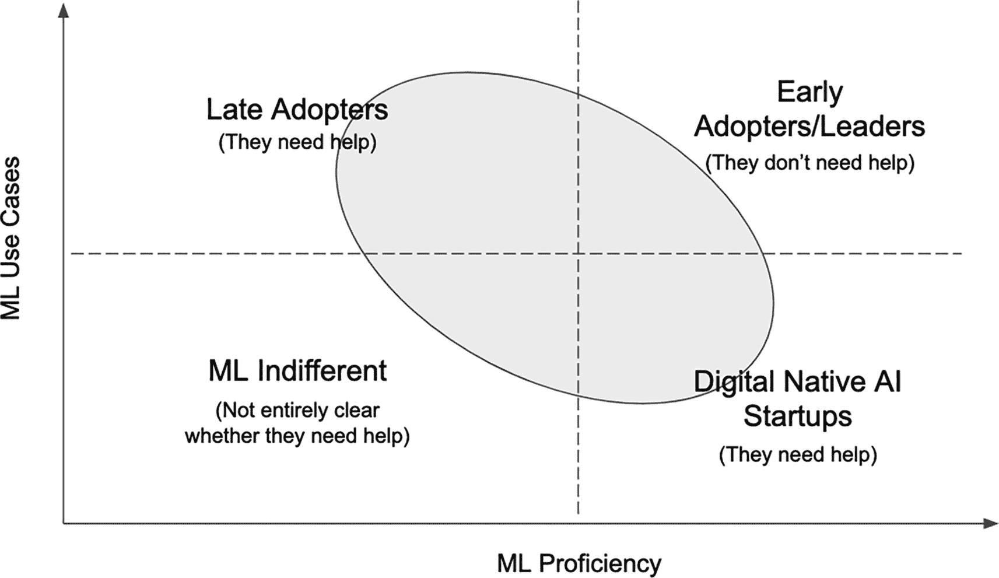
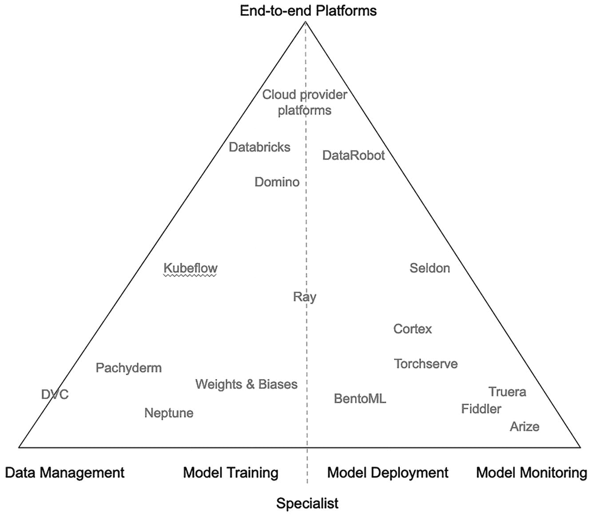
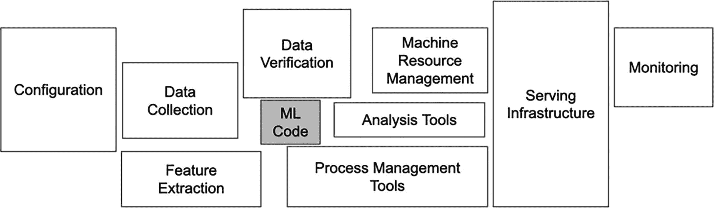
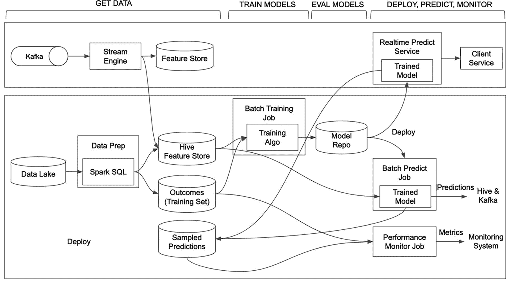
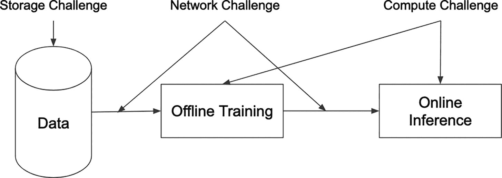

# 2. MLOps 采用策略与案例研究

毫无疑问，我们正处于 AI/ML 运营化的激动人心时代。根据 Gartner 一篇题为“IT 预算正在增长，资金流向何处”的文章^(¹¹)，AI/ML 位居技术列表之首，近半数 CIO 表示他们已采用 AI/ML 或计划在未来 12 个月内采用。O'Reilly 发布的《2020 年企业 AI 采用报告》^(¹²)证实了这些统计数据，并进一步指出 AI/ML 的采用已遍及多个行业，例如金融服务、教育、医疗、制造业、零售业等。

最大化 AI/ML 投资的投资回报率并缩短价值实现时间，是组织的关键目标。实现这些目标的一个关键因素是有效实施 MLOps。虽然扎实理解 MLOps 是一个良好的起点，但将这种理解转化为成功的实施可能颇具挑战性。

与任何技术采用类似，成功的 MLOps 采用需要一套系统的方法和策略来管理 MLOps 特有的细微差别，以及众多需要考虑的因素。

本章将首先概述高层策略，并强调组织为确保成功采用 MLOps 需要考虑的几个重要维度。之后，将提供几种将 MLOps 变为现实的方法，并分享每种方法的一些优缺点。

对于那些正在考虑采用或处于 AI/ML 采用早期阶段的组织，希望本章中的一些细节能有助于调整他们当前的采用方法，或使他们能够在坚实的基础上开启旅程。

许多大型且成功的公司都经历过构建其 MLOps 基础设施的历程，尤其是在互联网时代或之后不久诞生的公司。本章的最后部分将回顾几个成功的 MLOps 采用案例研究。

让我们开始这段旅程吧！

## 采用策略

根据《2022 年 AI 基础设施生态系统》^(¹³)报告，只有 26% 的受访者对他们当前的 AI/ML 基础设施状况感到非常满意。作为一个行业，似乎还有很大的改进空间。这一特定的调查结果说明，找出并构建适合组织特定需求的正确 AI/ML 基础设施是一项非常具有挑战性的任务。然而，同一项调查也指出了好消息，即大多数组织能够在两年或更短的时间内迅速从其 AI/ML 基础设施投资中获得回报。

采用 AI/ML 的组织将需要拥有 MLOps 基础设施，也称为 AI/ML 基础设施或 ML 平台。让我们快速回顾一下，MLOps 的目标是帮助组织持续、有效且高效地运营 ML，以便他们能够从 AI/ML 的力量中受益，从而提高竞争优势、增加收入或降低成本，更重要的是，从他们在 ML 项目上的投资中获得投资回报率。

与以往的技术进步类似，没有一种放之四海而皆准的技术采用策略能够满足每家公司的独特性和各种需求。此外，一个组织 MLOps 采用的成功标准很可能与另一个组织不同。

在决定构建其 MLOps 基础设施的方法之前，组织或领导团队应弄清楚这两个关键方面：

*   业务目标与 MLOps 基础设施目标的一致性
*   对特定 MLOps 需求的评估

### 目标一致性

业务目标与 MLOps 基础设施目标保持一致是显而易见的，但绝不能掉以轻心。重要的是要记住，MLOps 基础设施是实现最终目标的一种手段，即利用 AI/ML 的力量为业务目标增加价值，并从 ML 项目投资中获得投资回报率。

保持一致性的好处包括：

*   了解业务目标及其优先级将有助于确定构建 MLOps 基础设施的顺序，并识别哪些领域需要更多关注
*   由于每个人都对业务目标及其优先级达成一致，MLOps 基础设施采用的讨论将更加容易
*   在清晰理解业务目标投资回报率的基础上，为人才招聘和购买供应商解决方案争取资金将更容易证明其合理性

可以理解的是，由于各种因素，业务目标会随着时间的推移而演变，MLOps 基础设施目标也必须相应调整。如果 MLOps 基础设施目标未能跟上不断变化的业务需求，那么基础设施就有可能被视为成本中心，而非宝贵资产。

### MLOps 需求评估

第 1 章中描述的 MLOps 规范栈全面概述了典型 MLOps 基础设施所需的各种基本组件。虽然这个栈可以作为理解所涉及各种组件的有用蓝图，但仅仅按顺序实施每个组件可能不足以取得成功的结果。有几个关键维度必须仔细考虑。

组织在多个方面存在差异，包括其业务领域、规模、与 ML 项目相关或支持 ML 项目的技术的当前状态和成熟度、数据科学和 MLOps 基础设施方面的团队规模和人才，以及最重要的公司文化。这些因素影响着组织在 MLOps 基础设施和实施方面的独特需求和能力。

以下部分将深入探讨这些领域中的每一个，并强调它们可能如何影响构建 MLOps 基础设施的顺序、每个组件所需的重视程度以及其他考虑因素。

#### 用例

AI/ML 对企业来说是一个相当强大的工具，因为它具有多功能性，能够帮助解决许多与决策相关的业务问题。

组织需要处理的各种 ML 用例类型主要取决于其所在的业务领域，而用例数量则主要受公司规模和业务职能数量的影响。

表 2-1 包含跨几个业务领域的一组知名 ML 用例。

**表 2-1 业务领域及 ML 用例示例**

| 业务领域 | ML 用例 |
| --- | --- |
| 医疗 | 医疗诊断、患者监测 |
| 营销 | 个性化广告、情感分析 |
| 安全 | 面部识别、入侵检测 |
| 交通 | 路线优化、自动驾驶车辆 |
| 金融 | 贷款审批、欺诈检测、信用评分 |
| 电信 | 客户流失预测、定向营销、网络优化 |
| 能源 | 预测性维护、需求预测 |
| 社交媒体 | 个性化推荐、广告优化 |
| 零售 | 需求预测、价格优化 |

让我们挑选几个用例来讨论它们的特定需求，以及这些需求可能如何影响构建 MLOps 基础设施的方法。

##### 欺诈检测

首先要讨论的用例是金融业务领域的欺诈检测，这一点很容易理解，尤其是对于信用卡持有者而言。在理想情况下，金融机构希望能在欺诈活动发生之前就加以阻止，但这并非总是可行。退而求其次的最佳方案是在欺诈活动出现后迅速检测出来，以便减轻这些不良活动的影响，并将损失降到最低。

要实现这一目标，就需要具备在线/实时预测或推理的能力，并且很可能需要大规模进行。从 MLOps 基础设施的角度来看，它需要提供一个可扩展、低延迟且高可靠性的预测服务。这并不意味着 MLOps 技术栈的其他部分不重要，而是这个用例表明，在制定 MLOps 基础设施战略时，在线预测服务应被赋予更高的优先级。

##### 客户流失预测

另一个值得讨论的有趣用例是电信业务领域的客户流失预测，这是一个竞争激烈的市场。客户流失预测用例需要全面了解客户，包括他们的画像、倾向、活动等。这个机器学习用例通常需要来自多个数据源的客户数据，这意味着与数据相关的出错概率相当大。对于任何中型到大型的电信公司来说，很可能会有数十个机器学习模型。每周和每月的客户流失率会受到业务领导者的高度监控和追踪。

对于这个用例而言，能够轻松监控和调试模型性能下降是相当重要的。

从 MLOps 基础设施的角度来看，除了实现机器学习管道的自动化之外，它还需要提供相当全面的机器学习可观测性能力，使数据科学家和业务领域专家能够执行机器学习模型追踪，轻松可视化漂移以了解情况，并比较基线模型与生产环境中的模型性能。

##### 贷款审批与信用评分

在高度监管的行业，如医疗、金融和交通运输，遵守相关法规至关重要。这凸显了在这些行业中实施稳健的机器学习治理的重要性，这涉及到实施流程和机制，以确保机器学习系统是公平、透明且可问责的。

对于像贷款审批和信用评分这样的用例，任何针对受保护类别的偏见迹象都可能引发政府机构的调查。

MLOps 涉及以系统化和可重复的方式开发和部署机器学习模型，是机器学习治理的关键组成部分。

注意

机器学习治理

机器学习模型治理并非一项技术，而是一个借鉴了公司治理理念并针对机器学习模型进行定制的过程。其通用原则仍然适用，例如访问控制和活动追踪。

根据 DataRobot 的文章《什么是模型治理？》^(¹⁴)，机器学习模型治理是一个组织如何控制对模型及其结果的访问、实施策略以及追踪活动的整体流程。

MLOps 基础设施为满足机器学习模型治理所需提供的具体能力可能包括：对所有生产环境中的模型进行访问控制管理、追踪模型历史、监控模型及其预测等。

通过理解组织的核心机器学习用例及其优先级，然后从这些需求出发反向推导，所获得的洞察将有助于确定 MLOps 基础设施的哪些部分比其他部分更重要，以及构建 MLOps 标准技术栈的合理起点。

#### 技术

MLOps 基础设施只是构建高效机器学习开发生态系统这一拼图中的一块。另外两个重要的基础设施部分是 DevOps 和 DataOps。DevOps 基础设施是一套自动化和精简的工具与流程，用于促进协作式软件开发和部署，为高效的机器学习开发奠定基础。DataOps 基础设施通过自动化工具在整个数据生命周期中简化协作式数据管理，其中特征工程与机器学习工作流中的特征工程尤为相关。这三种基础设施之间的相互作用如图 2-1 所示。

一个展示相互作用的框图，包含 MLOps、DevOps 和 DataOps。它们以三角形模式连接。

图 2-1

MLOps、DevOps 和 DataOps 之间的相互作用

这里需要采取的行动是评估当前 DevOps 和 DataOps 的成熟度，突出 MLOps 对它们的依赖关系，并且如果识别出的差距对机器学习开发生命周期有可衡量的影响，则倡导改进领域。

另外两个对高效机器学习开发生态系统有重大影响的重要基础设施是计算基础设施和实验基础设施。

计算基础设施是那些希望扩展其机器学习项目的组织（在生成大量特征、训练大型复杂模型以及可扩展模型推理方面）的关键推动因素。它提供了针对机器学习工作流独特需求量身定制的若干具体能力。其可扩展性确保了动态资源分配，优化了性能和响应能力。GPU 加速支持更快的模型训练，特别是对于复杂的深度学习模型。容器化和编排工具支持机器学习模型的一致打包和部署，而并行处理则提高了超参数调优等任务的效率。计算基础设施有助于高效的模型服务和资源监控，从而实现成本效益和最佳资源利用率。

对于最终将集成到组织在线产品和服务中的机器学习模型，迭代这些模型的速度将导致它们更快地部署到生产环境中。在迭代机器学习模型以找出性能最佳的模型时，需要能够通过 A/B 测试在生产环境中进行实验、测试和验证模型性能。因此，能够快速简便地运行 A/B 测试并提供简单直观的实验结果分析的实验基础设施，对于 MLOps 基础设施以及整个机器学习项目投资成功至关重要。

这里需要采取的行动是评估这些支持性基础设施的成熟度，识别差距或机器学习开发速度的阻碍因素，并倡导改进它们。

#### 人员

成功的 MLOps 落地并非凭空发生。这是一项协作努力，涉及 MLOps 基础设施团队、内部客户、利益相关者和关键决策者。没有这种跨职能的协同作用，即使是最好的 MLOps 基础设施也不足以按期望的速度将机器学习模型投入生产。

对于较小的组织来说，从一个由数据工程、DevOps 和数据科学团队等不同团队成员组成的虚拟团队开始可能就足够了。然而，随着在生产环境中部署和扩展机器学习模型的需求增加，特别是为了将其集成到核心在线产品和服务中以交付业务价值，一个专门的 MLOps 团队可能变得必要。该团队应由能够为组织其他部分开发、维护和支持 MLOps 基础设施，并制定和执行标准与最佳实践的优秀人才组成。

识别并协调内部客户、利益相关者和关键决策者是成功落地 MLOps 的关键组成部分。第一步是清晰理解 MLOps 基础设施的客户和利益相关者是谁。下一步是与这些人建立持续的双向沟通，让他们参与 MLOps 基础设施战略和路线图，征求他们的反馈和需求，更重要的是，预测他们的需求。

#### 文化

可以公平地说，大多数组织，即使是那些非数字原生的组织，都对 AI/ML 能为业务带来的价值有相当好的理解。对于那些 AI/ML 项目面临巨大文化和组织障碍的组织来说，重要的是要有来自高层的积极计划来应对并降低这些障碍。

本节关于文化挑战的讨论是基于一个假设：采用 AI/ML 是组织的一项首要举措。

公司文化指的是指导公司员工和管理层如何互动，并帮助定义其身份的信念和行为。成功的 MLOps 落地需要将文化元素视为等式的一部分，尤其是在以下维度：风险容忍度、执行速度、决策流程和协作风格。

##### 风险容忍度

毫无疑问，在构建 MLOps 基础设施的过程中，会遇到需要承担风险的情况，例如评估和采用商业供应商解决方案、探索新的开源技术等等。

准确把握组织文化的风险容忍度水平（无论是保守型还是适度型）至关重要。这将影响控制风险所需付出的努力和时间，以及在风险评估和协调阶段向更广泛受众进行沟通的程度。

例如，一项相对较新的开源技术被发现并证明能有效提高模型训练速度。由于该技术相对较新，因此在处理某些场景时会存在未知风险。组织的风险容忍度水平将极大地影响该技术能否获得采用许可。MLOps 基础设施团队需要考虑投入适当的时间来审查该技术并说服他人。

##### 执行速度

组织的执行速度通常与其当前的生命周期阶段相关。处于早期生命周期阶段的小型组织通常需要快速执行，以完成其产品概念验证或实现产品-市场契合。

组织的执行速度将极大地影响 MLOps 基础设施的采用节奏，以及组织对 MLOps 基础设施需要多快才能向组织其他部分展示影响力的期望水平。对于一个快速发展的组织来说，重要的是 MLOps 基础设施团队需要优先考虑并以稳定的节奏展示渐进式进展，而不是追求完美。

最终，MLOps 基础设施团队需要以客户和利益相关者运作的节奏来运作，以便为组织的 AI/ML 目标做出贡献并让他们满意。

##### 决策流程

大多数成功的组织在做出重要决策时都拥有相当健康的决策流程，无论是咨询式还是协作式。

毫无疑问，在构建 MLOps 基础设施的过程中，将需要做出许多重要决策，例如技术和供应商解决方案的采用、模型部署流程、模型访问控制的严格程度等等。

了解组织的决策流程将帮助 MLOps 基础设施团队了解推动特定决策需要多少时间和精力，以及需要让哪些正确的决策者和影响者参与进来。

##### 协作风格

机器学习项目通常涉及多个利益相关者，包括数据工程师、数据科学家、机器学习工程师和 MLOps 基础设施团队。这些角色之间的有效协作对于成功采用 MLOps 至关重要。如果协作状态不佳，MLOps 基础设施团队应优先加强协作。这可能需要在主动协作工作上分配额外的时间和资源，例如建立清晰的沟通渠道、定义角色和职责，以及培养协作和信任的文化。

通过优先考虑健康的协作，MLOps 基础设施团队可以帮助确保所有利益相关者朝着共同目标努力，并确保 MLOps 采用过程顺利有效。

一项关于构建支持机器学习的软件的社会技术方面的大规模定性实证研究^(¹⁵) 指出了机器学习项目组织中导致问题的三个主要领域：管理层的领导力真空、组织孤岛以及组织内部的沟通。其中一些方面深受组织文化的影响；因此，MLOps 基础设施团队需要意识到这些挑战，并采取积极措施来克服或最小化它们。

#### 成熟度等级

与其他技术的采用类似，MLOps 的采用并非一蹴而就，而是一个持续改进的旅程，以满足组织不断变化的需求。这些组织正从在少数业务职能中探索和原型化 AI/ML 项目，发展到在众多业务职能中构建先进的 AI 解决方案。

MLOps 成熟度等级被用作跟踪 MLOps 基础设施进展和复杂程度的一种手段。它最适合作为一种评估工具，用于了解组织中 MLOps 基础设施的当前状态，明确下一步该做什么，以及距离高级成熟度等级还有多远。

在行业内，对于建立 MLOps 成熟度模型已达成共识；然而，对于成熟度等级的标准集却缺乏一致意见。两个广为人知且常被引用的成熟度模型分别来自 Google Cloud^(¹⁶) 和 Microsoft Azure^(¹⁷)，如图 2-2 和图 2-3 所示。关于这两个成熟度模型每个等级的具体细节，只需在互联网上快速搜索即可轻松找到。

一个 MLOps 成熟度模型的框图，从下到上包含 5 个等级。等级 0 提到无 MLOps。等级 1 提到仅有 DevOps，无 MLOps。等级 2 提到自动化训练。等级 3 提到自动化模型部署。等级 4 提到完全 MLOps 自动化运维。

图 2-3

来自 Microsoft Azure 的 MLOps 成熟度模型

一个 MLOps 成熟度模型的框图，包含 3 个等级。等级 0 提到手动流程。等级 1 提到 ML 流水线自动化。等级 2 提到 CI/CD 流水线自动化。

图 2-2

来自 Google Cloud 的 MLOps 成熟度模型

这两个成熟度模型的共同主题是倡导自动化，这直接加快了从模型开发到模型部署再到生产的速度，同时确保了适当的版本控制和可重复性。

采用某个特定的成熟度模型来遵循是好的；但是，不要让它困扰你，让你纠结于哪个才是正确的模型。决定一个组织应该处于哪个等级，以及如何快速从一个等级提升到另一个等级，需要充分理解其机器学习用例的具体需求，以及 MLOps 标准技术栈中各种底层支持基础设施和组件的成熟度。

可以公平地说，实现完全自动化或达到最高等级将使组织能够利用 AI/ML 的力量更快地创造商业价值，并最大化其 AI/ML 投资获得回报的机会。

Domino Data Lab 的首席数据科学家 Josh Poduska 并未专注于自动化等级，而是在他的博客文章“MLOps 成熟度的七个阶段”^(¹⁸)中，基于 MLOps 能力和商业价值提供了一个成熟度模型。读者可以在 Josh 的博客上获取关于每个成熟度等级及其相关价值的更多细节。

他博客的最后一部分建议每个组织评估自己的 MLOps 旅程，以了解自己在成熟度曲线上所处的位置，并制定计划向下一等级迈进。然后，它强调了超越价值拐点的关键在于，以数据科学为中心的方式将所有能力紧密集成。

一张价值与成熟度的折线图，曲线呈上升趋势并伴有波动。它将数据访问、IDE 工具、自助服务、CPU/GPU 和容器访问（左侧）与加速研究进行了比较，并将项目管理和中央平台（右侧）与可重复的 AI 利润进行了比较。

图 2-4

企业 MLOps 成熟度曲线。来源：改编自 Josh Poduska 的图片 ([`https://towardsdatascience.com/the-seven-stages-of-mlops-maturity-ccb029530f2`](https://towardsdatascience.com/the-seven-stages-of-mlops-maturity-ccb029530f2))

一个组织能够向更高成熟度等级推进得越远，其 MLOps 基础设施就越能帮助其数据科学团队最大化效率、生产力和产出，从而带来强大的 AI/ML 投资回报。

### MLOps 基础设施方案

当组织考虑采用技术或基础设施时，例如数据基础设施、IT 系统和 DevOps 基础设施，通常会考虑以下三种方案：自行构建、购买端到端解决方案、以及最佳组合方案。前两种方案涵盖了极端情况，最后一种则介于两者之间。这些方案同样适用于构建 MLOps 基础设施。

在讨论每种方案的优缺点之前，我们首先需要明确，在什么情况下组织最需要 MLOps 基础设施，并能从中获得最大收益。

在光谱的一端，有些组织刚刚通过小规模实验或原型项目涉足 AI/ML 领域，或者仅将 AI/ML 用于少数简单、非关键性的用例，例如分析少量客户数据以预测未来的购买模式。对于这些场景，组织可以轻松地使用笔记本电脑或云计算实例，配合 Jupyter notebook、Pandas、Python 等现成的开源软件，以及易于使用的 scikit-learn 或 Tensorflow Lite ML 库来完成这些 ML 项目。目前还没有必要投资构建 MLOps 基础设施。

在光谱的另一端，ML 用例数量超过几十个，或者存在复杂的需求，例如使用 PB 级的大规模训练数据进行训练，或者存在像 BERT 或 GPT 这样拥有数百万参数的大型复杂深度学习模型，或者对在线预测有严格要求，例如在个位数毫秒的低延迟下实现高 QPS。FAAMG^(¹⁹) 家族中的一些知名公司，以及特斯拉和 Waymo 等自动驾驶汽车公司，都有类似的需求。处于光谱右端的公司通常非常擅长将 ML 模型投入运营，因为它们是早期采用者，并且拥有财力和人才资源。这些公司很可能会投入资源和人才来构建自己的内部 MLOps 基础设施，其中包含开源工具、内部开发工具以及可能的一些供应商解决方案，以满足其特定的独特需求。

注意

在撰写本章时，OpenAI 的 ChatGPT 正主导着 AI/ML 的新闻周期。ChatGPT 代表 Chat Generative Pre-trained Transformer（聊天生成预训练变换器），由 OpenAI 于 2022 年 11 月创建并推出。通俗地说，它是一个相当智能的聊天机器人，经过训练和设计，能够进行自然的对话。

与 ChatGPT 的交互主要通过对话形式进行，并支持追问。用户提交各种问题，要求 ChatGPT 撰写简短报告、总结段落、为特定主题生成教案、编写代码开发网站、设计短途旅行计划或一系列观光景点，等等。

关于 ChatGPT 的更多详情，请访问 [`https://openai.com/blog/chatgpt`](https://openai.com/blog/chatgpt)。

有大量公司处于光谱的中间区域，它们可能会也可能不会构建自己的 MLOps 基础设施，这取决于它们在采用 ML 的旅程中所处的位置以及它们的 ML 熟练程度，而熟练程度是随着时间和经验积累的。在“合理规模的 ML 和 MLOps”博客中提到了“合理规模”^(²⁰) 一词来代表这类公司。图 2-5 中的椭圆形代表“合理规模”的公司，它们可能是 ML 熟练度较低但拥有合理数量 ML 用例的后期采用者，也可能是 ML 熟练度合理但 ML 用例数量较少的数字原生 AI 初创公司。

一个以 ML 用例为横轴、ML 熟练度为纵轴的图表包含四个象限，中心有一个倾斜的阴影椭圆。第一到第四象限分别代表早期采用者或领导者、后期采用者、对 ML 漠不关心者以及数字原生 AI 初创公司。

图 2-5

合理规模的公司。来源：改编自 Ciro Greco 的图片 ([*https://towardsdatascience.com/ml-and-mlops-at-a-reasonable-scale-31d2c0782d9c*](https://towardsdatascience.com/ml-and-mlops-at-a-reasonable-scale-31d2c0782d9c))

随着这些公司扩大 ML 投资和项目规模，并提升其 ML 熟练度，它们极有可能会考虑构建一个 MLOps 基础设施，其中包含来自云提供商、专业商业供应商解决方案以及开源社区的一定数量的工具。

组织需要考虑的方案不应是一次性事件；明智的组织通常会定期重新审视其决策，看看是否需要进行必要的调整。

在决定采用哪种方案时，一个重要的影响因素是 MLOps 领域的成熟度。该领域仍处于早期阶段，开源社区正在以极快的速度推出大量创新和新兴技术。在供应商解决方案方面，有相当多的选择可供挑选，并且它们也在以同样快的速度被开发、增强和演进。对于 MLOps 技术栈的某些部分，市场领导者已经相当明确，而对于其他部分，则有一系列潜在的选择。

以下各节将重点介绍一些重要说明，并为每种方案分享一些建议。这些内容既适用于刚刚开始采用 MLOps 的公司，也适用于那些已经处于采用过程中的公司。

#### 构建

此方法指从零开始构建完整的 MLOps 基础设施（MLOps 标准技术栈）。其复杂度相当高，需要投入大量的工程资源和人才。此外，长期维护和技术债务也需要作为评估与决策过程的一部分加以考量。

像谷歌、Netflix、Meta、优步、领英、特斯拉等高科技及 AI/ML 早期采用者，都是白手起家构建自有 MLOps 基础设施的公司，这主要是出于必要性以及其独特的需求和要求。

大约在五年或更早的早期阶段，MLOps 基础设施领域既没有现成的商业供应商解决方案，开源技术也极为有限。出于必要，它们不得不自行构建基础设施，并在过程中不断发明创新以满足自身需求。

这些公司大多拥有规模可观的 ML 用例，且业务横跨多个团队，因此投资构建集中式 MLOps 基础设施的理由更充分，也更具合理性。一次性构建、多团队复用，这种模式很容易被领导层理解。

另一个证明构建必要性的方面是其独特需求，其中之一便是由于拥有数亿计的庞大客户群，需要在大规模下运营。

近年来，其中一些公司已开始转变策略，利用成熟稳健的开源技术和商业产品来补充其基础设施，以获取新能力或降低维护成本。此类案例包括实验跟踪和 ML 可观测性。

根据 AI 基础设施报告的一项调查，^(²¹) 只有 18% 的公司内部构建了基础设施。可以合理预测，随着开源社区和 MLOps 商业供应商涌现出越来越多的创新，这一比例将随时间推移而下降。

对于处于“合理规模”范围内的公司，强烈建议避免采用此方法，除非它们有非常独特的要求或特殊需求，例如严格的治理或合规要求，或者 ML 已成为其竞争优势的核心组成部分，且其工程团队正变得更加先进和专业。

#### 购买

此方法指购买并采用单一、统一的端到端 MLOps 基础设施，以满足组织的所有需求。上述的构建方法处于频谱的一端，而此方法则处于相反的另一端。

根据某些组织的运营风格、其在 ML/AI 采用旅程中所处的阶段、用例数量等因素，此方法似乎颇具吸引力。然而，有几个重要方面需要留意。

此方法对于属于以下领域的组织来说，是一个值得考虑的好选择：

*   处于 ML/AI 旅程早期，正在试验或进行少量 ML/AI 概念验证。利用云供应商提供的端到端 MLOps 基础设施将大大加快其目标实现并提升 ML 熟练度。
*   团队规模小、带宽和资源有限的数字原生初创公司。利用云供应商的端到端 MLOps 基础设施能使它们专注于 ML 用例本身，而不会因构建基础设施而成为瓶颈。
*   其业务的核心竞争优势。对于房地产、零售、教育、建筑等行业的组织，MLOps 基础设施很可能不是其主要关注点，因此更多地依赖托管服务是合理的。

组织在决定采用端到端 MLOps 基础设施之前，需要考虑几个重要因素：MLOps 成熟度、广度与深度。

对于 MLOps 而言，目前仍处于早期阶段，创新层出不穷，新兴技术正以快速步伐被引入。根据 Gartner 2022 年数据科学机器学习技术成熟度曲线，MLOps 正处于“期望膨胀期的高峰”。

在撰写本文时，MLOps 正处于该技术成熟度曲线第二阶段的尾声。就端到端 MLOps 基础设施而言，目前还没有一个单一的解决方案或一体化平台能够满足 ML 开发生命周期（包括构建、训练、部署和监控 ML 模型）中的所有需求。

不过，尝试并不缺乏。几家知名的云供应商，如亚马逊 AWS、谷歌云和微软 Azure，正将自己定位为这种一体化平台的提供者，并随着时间的推移迅速扩展其平台的能力。毫无疑问，这些平台将随着时间的推移变得高度发达，并能够覆盖广泛的需求，供组织挑选。

在此之前，这些平台有在能力方面扩展其覆盖范围的趋势，但每个主要组件的具体功能则略显浅薄。换句话说，目前的重点是广度而非深度，这并非满足客户评估清单的糟糕策略。缺乏深度的例子包括高度可扩展的模型服务引擎以及最先进的监控、可解释性和可观测性。

不同类型的 ML 用例有略微不同的需求。例如，训练数据为视频、图像或声音的 ML 用例，与使用结构化数据的用例相比，在标注或注释等方面就有不同的需求。如果一个组织的大部分 ML 用例不属于结构化数据范畴，那么就需要仔细核查端到端 MLOps 基础设施能否很好地支持这些用例的需求。

在端到端 MLOps 基础设施领域出现明确的领导者，且 MLOps 成熟度在技术成熟度曲线上更进一步之前，最好不要期望存在一个完整、统一且端到端的 MLOps 基础设施，能够同时在广度和深度上满足所有用例。

#### 混合模式

这种模式是指为 MLOps 基础设施的某些部分购买解决方案，而其余部分则自行构建或利用开源解决方案。

随着处于合理规模领域的组织推进其 AI/ML 应用进程，其需求会因需要处理的 ML 用例类型、需要支持和扩展的 ML 用例数量以及 ML 专业能力的提升而随时间变化。混合模式为这些组织在构建 MLOps 基础设施时提供了最大的灵活性。然而，灵活性也伴随着额外的责任。

这种模式为组织提供的灵活性体现在模块化和自由度上。

对于 MLOps 基础设施中那些通用或在不同主要用例类型间变化不大的部分，组织可能希望依赖一两个供应商的解决方案。讨论中涉及的部分包括数据处理、管道编排、版本与溯源以及实验跟踪。将这些部分视为 MLOps 基础设施的核心是合理的。

对于其他部分，组织可以依赖供应商解决方案或开源解决方案。针对特定需求，选择那些在该领域处于领先地位并能满足这些需求的供应商解决方案是合理的。这些特定需求的例子包括合成数据生成、高度定制化的模型治理，以及 ML 可观测性和可解释性方面的高级能力。

另一方面，这种模式所提供的灵活性也要求投入一定精力将这些专业解决方案与核心部分进行集成。如果这些解决方案拥有清晰、文档完善的 API 和集成点，那么负担就可以减轻。

伴随灵活性而来的还有成本和支持这两个方面。毫无疑问，购买和集成多个解决方案会产生相关成本，这需要与其他两种模式进行权衡。成本的高低将取决于需要集成到核心部分的专业解决方案的数量及其复杂性。

第二个方面是关于支持。当涉及多个供应商解决方案时，就无法实现“一锤定音”的问责制，组织需要投入额外精力来管理费用开销。

由于组织有特定需求、偏好的基础设施运营风格、用例类型和数量、ML 专业能力等因素，构建 MLOps 基础设施无疑是一项具有挑战性的工作。在这三种模式中，提供模块化和灵活性的混合模式，可能是构建和发展 MLOps 基础设施以满足当前和未来需求的最有效方式。

在继续描述几个值得关注的 MLOps 基础设施案例研究之前，让我们总结一下本节的关键要点。

*   这一点可能显而易见，但很重要且值得重申。无论组织决定选择哪种方案，都强烈建议从充分理解并盘点当前及近期内各职能部门需要处理的 ML 用例开始。

*   确保将对当前 MLOps 成熟度水平的认知，以及未来会出现更好、更具创新性解决方案的理解，纳入您的 MLOps 基础设施决策过程。

*   将本节提到的建议视为经验法则，而非绝对真理。

让我们用 Better.com 前 CTO Erik Bernhardsson 关于“构建与购买”的一条相关推文来结束本节：“有趣的是，CTO 最重要的工作之一就是供应商/产品选择，而且由于工具/基础设施领域发展如此之快，这项工作的重要性每年都在迅速提升。”^(²²)

## MLOps 格局

毫无疑问，MLOps 格局在过去 7 年中经历了爆炸式增长。数十亿美元已投资于众多与 MLOps 相关的公司。^(²³) 商业供应商和开源社区涌现出大量创新。学术界也对 MLOps 产生了兴趣，并围绕它形成了一个研究系统与 ML 交叉领域的社区，进而催生了一个会议——MLSys^(²⁴)来推动这一领域的发展。

任何试图捕捉 MLOps 爆炸式增长的尝试都会很快过时，但了解其规模仍然有用。Chip Huyen 的博客文章“机器学习工具格局 v2”^(²⁵)提到，截至 2020 年 12 月，大约有 300 种 MLOps 工具，并提供了一个很好的可视化图表来探索各个类别。在 MLOps 的 ML 可观测性领域，有大量的创新。“MLOps 现状”网站收集了这些证据，并在 Airtable 中分享，^(²⁶) 显示大约有 50 家公司专注于该特定领域并提供解决方案。

总体而言，ML 从业者社区通过博客、书籍、会议等方式获得了更多教育，并通过利用一些共享的最佳实践变得更加精明，整体水平有了很大提升。

对于任何希望构建 MLOps 基础设施或评估其现有 MLOps 基础设施有效性的组织来说，对当前格局以及谁是其中的推动者和变革者有一个高层次的了解，都是有益的。

### 平台与工具

无论组织选择哪种方法，清晰理解端到端平台与专业工具之间的区别都是有益的。

*   专业工具旨在支持机器学习开发生命周期中的特定部分或子集。
    *   这些专业工具的例子包括用于监控和可观测性的 Arize，以及用于 ML 项目框架的 MLFlow 和 MetaFlow。

*   端到端平台旨在支持整个机器学习开发生命周期——包括特征开发、模型开发与训练、模型服务以及模型监控。本质上，端到端平台由一组设计为协同工作的专业工具集合而成。
    *   端到端平台的例子包括 AWS SageMaker、Google Vertex AI 和 Microsoft Azure。

在宏观层面，端到端平台和专业工具处于通用性与专业性的光谱之上，如图 2-6 所示。

一个端到端平台的三元图显示，端到端平台位于顶部角落，数据管理和模型监控位于底部角落，模型训练和模型部署位于底部。一条穿过中心的垂直虚线相交于“云提供商平台”和“Ray”这两个术语。

图 2-6

端到端平台与专业工具光谱。来源：改编自 Thoughtworks 的《评估 MLOps 平台指南》中的图片^(²⁷)

左下角的专业工具旨在支持特征开发和模型训练。右下角的专业工具旨在支持模型部署和监控。更靠近三角形顶部的工具，例如云提供商平台，则属于端到端平台。

一些专业工具最初只满足 ML 开发的一个领域，但随着时间的推移，其功能范围会扩展到支持相邻领域。换句话说，它们会专精于多个领域。

在平台方面，来自云供应商（如 AWS、Google Cloud 和 Microsoft Azure）的平台在能力方面似乎是领跑者；其他一些平台也紧随其后。了解各平台差异的一个极佳资源是 ThoughWorks 提供的 MLOps 平台比较矩阵^(²⁸)。

与 MLOps 技术浪潮之前的几次技术浪潮类似，随着这波浪潮进入炒作周期的后期阶段，无疑会出现整合，专业工具和平台领域都将涌现出明确的领导者。展望五年或十年后的景象，将令人无比兴奋。

## 案例研究

自 2010 年甚至更早以来，大多数大型互联网公司都已认识到机器学习/人工智能的强大力量，并投入巨资将其融入在线产品中，包括亚马逊、谷歌、Meta、Netflix、优步、领英、推特、特斯拉等。一些广为人知的在线产品示例包括流行 Netflix 电影流媒体平台和亚马逊电商市场背后的著名推荐引擎。

这些公司拥有庞大的客户群、海量的数据以及多样化的 ML 用例，这转化为大量的 ML 模型。他们需要一种方法来高效且大规模地运营这些 ML 模型，甚至在“MLOps”这个术语被创造出来之前，就已经投入巨资构建自己的 ML 基础设施。作为这项工作的一部分，他们并非出于选择，而是出于必要，才偶然踏入了 MLOps 领域。

MLOps 最早的模样在 2015 年谷歌的开创性论文《机器学习系统中的隐藏技术债务》^(²⁹)中有所描述，该论文强调 ML 代码只是现实世界 ML 系统中的一小部分，而周围的基础设施则庞大而复杂，如图 2-7 所示。

一个 ML 代码的框图包含配置、数据收集、特征提取、数据验证、分析工具、机器资源管理、流程管理工具、服务基础设施和监控。

图 2-7

ML 代码周围庞大而复杂的基础设施。来源：改编自《机器学习系统中的隐藏技术债务》论文中的图片

以下章节将展示两个成功且广为人知的 ML 平台：Uber Michaelangelo 和 Meta FBLearner。这两个平台旨在支持大规模 ML 运营，并由大型团队提供支持。此处的目标并非完全复制它们，而是借鉴其最佳实践并吸取其经验教训。

### Uber Michelangelo

Uber Michelangelo 是知名度最高、最广为人知的机器学习平台之一。其发展历程与演进过程在互联网上很容易找到。在 Uber 的网约车市场业务和 Uber Eats 外卖配送业务中，有许多重要的机器学习用例对其业务起着关键作用，例如派单、动态定价、需求预测、预计到达时间、餐厅准备时间、欺诈检测等等。在任何时间点，生产环境中的机器学习模型数量都数以千计。

在 Uber 历史的高速增长期（大约 2015 年左右），缺乏一种集中化的方式来开发和部署机器学习模型，这导致了：

*   **碎片化**：多个团队各自构建解决方案，导致大量重复劳动。
*   **缺乏杠杆效应和标准化**：各自为政的孤立机器学习系统不利于实现跨团队的杠杆效应。
*   **缺乏最佳实践**：导致在解决类似挑战上花费更多时间。机器学习模型缺乏可复现性，使得基于新数据迭代现有模型变得困难。
*   **规模受限**：简单的方法难以随数据量轻松扩展，且资源消耗效率低下。与大数据生态系统缺乏紧密集成。

大约在 2015 年，Uber 认识到上述挑战拖慢了业务发展，并开始大力投资应对，通过构建一个集中化的机器学习平台来帮助实现机器学习的生产化。这项庞大的工程包括建立一个由产品经理和工程团队组成的集中化团队，将 Uber Michelangelo 打造为 Uber 内部的一流产品。

根据 Michelangelo 团队前工程师 Achal Shah 的说法，他们为应对上述挑战并在 Uber 内部普及机器学习所采取的方法^(³⁰)如下：

*   构建并提供标准化的工作流程和工具，具备良好的开箱即用体验和灵活性。
*   提供一套标准化且高性能的机器学习算法实现。
*   提供可扩展的端到端机器学习工作流程，以满足各种大型机器学习用例。
*   通过易用性普及和加速机器学习。

在几年时间里，Michelangelo 团队通过一个全面且集中化的平台，成功实现了大部分目标，该平台涵盖了从数据准备到在线和离线预测及监控的端到端机器学习工作流程，如图 2-8 所示。在高层面上，Michelangelo 平台融合了开源和内部解决方案，并与 Uber 的数据计算基础设施紧密集成。

Michelangelo 系统的框架分为四个部分：获取数据、训练模型、评估模型，以及部署、预测和监控。上层部分包括流引擎、特征存储、实时预测服务和客户端服务。

图 2-8

Michelangelo 系统架构。来源：改编自《认识 Michelangelo：Uber 的机器学习平台》博客，网址为 [`www.uber.com/blog/michelangelo-machine-learning-platform/`](http://www.uber.com/blog/michelangelo-machine-learning-platform/)

Michelangelo 团队采用的关键原则之一是将机器学习开发视为类似于软件开发。这意味着将机器学习产物视为代码，例如特征管道、模型训练管道、模型开发和部署元数据等。这些产物遵循软件工程的最佳实践，包括版本控制、代码审查和严格测试。一个具体的例子是，在将机器学习模型部署到生产环境之前，先针对留出集评估其性能，以确保其性能与离线评估时的性能没有显著差异。

#### 关键要点与经验教训

从头开始构建一个机器学习平台，以支持 Uber 庞大的机器学习从业者社区中大量且多样化的用例，是一项巨大的投资，需要一个专门的团队来构建、迭代和支持。其收益也非常显著且影响深远，因为机器学习在其在线市场中扮演着关键角色，能够推动业务发展、改善客户体验并降低成本。

毫无疑问，其中一个关键要点是：工具和基础设施是推动机器学习开发过程高效率、高速度，并降低入门和实验门槛的关键因素。

在《Michelangelo - Uber 的机器学习》^(³¹) 演讲中，机器学习团队负责人 Jeremy Hermann 分享了他们在构建 Michelangelo 过程中学到的一些经验教训：

*   为了提高机器学习开发速度，让机器学习从业者使用他们想要或最熟悉的工具，并通过自动化或工具化减少复杂迭代工作流程中每一步的摩擦。
*   数据是机器学习的氧气。确保提供必要的工具和基础设施，使机器学习从业者能够轻松快速地访问、计算和分析数据。
*   让机器学习从业者能够端到端地拥有机器学习模型。
*   提供用于理解数据和模型的可视化工具，并通过在 UI 中隐藏细节来使部署过程快速简便。
*   像 Michelangelo 这样的机器学习平台是一个庞大而复杂的项目。拥有长期愿景是一回事，但基于用户反馈进行迭代开发将极大地增加成功的几率。

### Meta FBLearner

Meta（前身为 Facebook）是将机器学习应用于其 Facebook、Instagram、Messenger 和 WhatsApp 平台，为庞大用户群提供独特个性化体验的先驱之一。其多样化的应用场景包括：个性化信息流推送、过滤不当内容、搜索结果排序、每天超过 20 亿条故事的语言翻译（以便用户能用任何语言交流）^(³²)、广告推荐与投放、语音识别、内容理解等等。

Meta 构建自有机器学习基础设施的方法与大多数其他公司截然不同，这源于其庞大的运营规模以及极其多样化的应用场景。然而，其走向成熟机器学习基础设施的历程与其他公司并无太大差异。

有效的机器学习高度依赖数据，而 Meta 从其定期在平台上互动的庞大用户群中收集了海量数据。每天，数十亿条故事和数亿张上传图片会产生数拍字节^(³³)的数据。从基础设施的角度来看，他们认识到需要构建一个庞大的基础设施来高效地存储、移动和计算这些海量数据，以便其研究人员、数据科学家和工程师能够每天轻松快速地访问数据，从而训练机器学习模型。由于 Meta 运营所涉及的数据量和规模巨大，如图 2-9 所示，其挑战十分艰巨，需要大量的投资、人力以及独特创新的方法。

一张 AI 或 ML 系统的框图，显示了数据存储挑战、离线训练两侧的网络挑战，以及与离线训练和在线推理相关的计算挑战。

图 2-9

构建和扩展 AI/ML 系统的基础设施挑战。来源：改编自《Facebook 的机器学习：基础设施视角》^(³⁴)

除了在全球范围内设计和运营自己的数据中心外，他们还设计专门的硬件来支持各种与机器学习相关的工作负载，包括模型训练、模型评估、在线推理等。

在 Meta，构建机器学习基础设施的主要目标之一是普及机器学习，使得没有深厚机器学习背景的工程师也能快速迭代现有机器学习模型以提高其准确性，并能轻松、快速地将这些模型安全地部署到生产环境中。其背后的主要驱动力是，他们庞大的产品面可以从机器学习中受益，而工程师的数量远多于数据科学家的数量；换句话说，没有足够的数据科学家来满足应用机器学习的需求。

2014 年底，他们的机器学习基础设施之旅始于构建 FBLearner，旨在为公司内部构建、训练、部署和服务机器学习模型提供通用支持，如图 2-10 所示。其中，特征存储组件提供了一种简便的方式来存储和访问特征，流程组件提供了开发和训练机器学习模型的功能，而预测器组件则提供了大规模的在线预测能力。

一个水平箭头图包含三个组件，分别标记为 FBLearner 特征存储、FBLearner 流程和 FBLearner 预测器。箭头指向右侧。

图 2-10

FBLearner 组件。来源：改编自《Facebook 的机器学习：基础设施视角》²⁶

在 Meta，一套核心的、广泛适用于众多机器学习用例的机器学习工作流由一小群工作流作者开发。FBLearner Flow 平台正是基于此理念设计，旨在从根本上重新定义 Meta 的机器学习，并将 AI 和 ML 领域最先进的算法交到每一位 Meta 工程师手中。^(³⁵) 其目标是让重用和扩展这些工作流变得简单，能够轻松运行数千个并发的定制实验并管理机器学习实验。作为工作流管理系统，FBLearner Flow 平台包含三个核心组件：一个用于分布式工作流的创作和执行环境、一个用于启动和分析实验的实验管理 UI，以及一组预定义的机器学习管道，这些管道可作为在 Meta 训练最常用机器学习算法的起点。

为了实现这些目标，FBLearner Flow 团队采用了以下指导原则：可重用性、易用性和可扩展性。

可重用性原则通过提供可以以可重用方式组合的构建块来实现，这些构建块包括工作流、操作符和通道。每个工作流实例称为一个管道，它为特定的机器学习用例而创建，并由一组机器学习特定任务组成，例如训练和评估特定的机器学习模型。每个任务由可以链接在一起并可以并行执行的操作符来定义。操作符是执行的最小单元。每个管道通常需要一些输入来馈送到模型训练中，而管道的输出会持久化存储在某处，输入和输出则表示为通道。

生产力原则通过实验管理组件强大且灵活的 UI 来实现，该 UI 用于定制、启动和可视化机器学习管道。该组件被设计为以通用方式解释工作流定义以及输入和输出，并提供一个插件系统用于进一步定制，以满足不同团队的需求，并轻松集成 Meta 的内部系统。

全面性原则通过提供一致且严格的工作流验证以及一套支持各种机器学习库多样化需求的工具集来实现。

最终，FBLearner Flow 获得了广泛采用，超过 25%的 Meta 工程师使用它为 Meta 的庞大用户群提供个性化体验，并训练了超过一百万个模型。

#### 关键要点与经验教训

Meta 自 2014 年开始构建 FBLearner 平台的历程，已被证明是一种有效且可扩展的机器学习普及化方式。然而，这仅仅是个开始，还需要持续不断的努力和投入，来构建其余部分，以覆盖整个机器学习开发生命周期，并全面采纳 MLOps 最佳实践，从而提升应用机器学习的效率。

以下经验教训由 Meta 高级软件工程经理 Aditya Kalro 在 2020 年 Sam Charrington 于 TWIML 举办的“Facebook 机器学习的演进”^(³⁶)网络研讨会中分享。

*   借鉴软件开发的经验教训来对待机器学习开发。机器学习模型开发和生产化与软件开发有着相似的需求，例如顺畅高效的构建和发布流程，以便轻松地重新训练模型；当模型对众多产品的用户体验产生显著影响时，模型监控和调试就变得至关重要。

*   机器学习生命周期包含多个阶段，所有这些阶段都需要基础设施和工具来提升整个机器学习开发生命周期的速度和效率。最初，FBLearner 平台的特征存储组件仅提供存储和访问特征的支持，而特征工程开发则留给了工程师。对于处理非结构化数据（如图像分类和语音识别）的某些机器学习用例，它们可以极大地受益于标注数据，从而使机器学习算法能够学习模式并做出准确预测。有助于加速数据标注过程的基础设施或工具将加快机器学习开发生命周期。

## 总结

成功采用 MLOps 需要策略和深思熟虑的方法。本章首先提醒，MLOps 采用策略需要根据每个组织的独特性和不同需求进行定制。然后，它强调了组织需要弄清楚的两个非常关键的方面：

*   业务目标与 MLOps 基础设施目标之间的一致性

*   对特定 MLOps 需求的评估

一个组织的 MLOps 需求很可能与另一个组织截然不同。评估需求的一种方法是收集关于以下维度的详细信息：机器学习用例、MLOps 所依赖技术的当前状态和成熟度、组织中与数据科学和 MLOps 基础设施相关的当前规模和人才，以及最重要的——他们的文化。

一旦确定了 MLOps 需求，下一步就是确定实现 MLOps 的最合适方法。三种常见的方法是购买、构建和混合。鉴于 MLOps 领域有大量的商业供应商解决方案和开源创新，大多数组织可能倾向于采用购买或混合方法。然而，MLOps 格局正在快速发展演变，组织需要仔细评估商业供应商解决方案的成熟度，并清楚了解特定解决方案在端到端平台和专业工具谱系中的位置。

本章最后展示了两个成功且广为人知的机器学习平台：Uber Michaelangelo 和 Meta FBLearner。这两个平台旨在支持大规模机器学习运营化，并由大型团队构建和维护。它们的最佳实践和一些经验教训是组织在踏上 MLOps 采用之旅时值得考虑的有价值见解。

脚注 1   2   3   4   5   6   7   8   9   10   11   12   13   14   15   16   17   18   19   20   21   22   23   24   25   26

