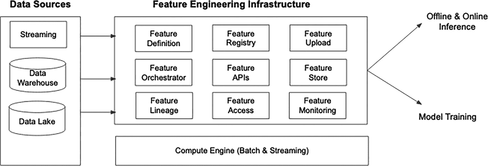
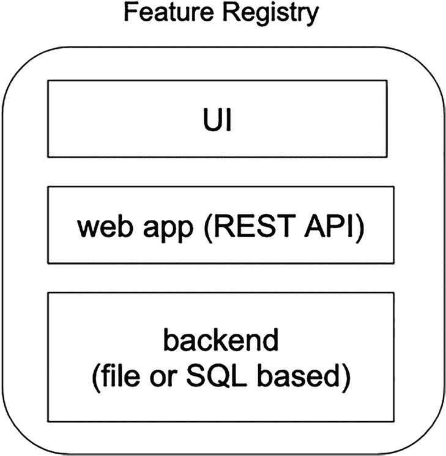
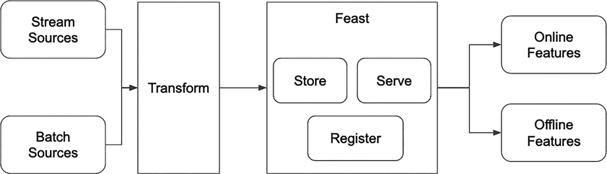
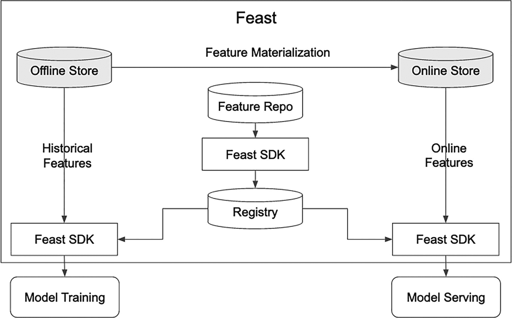
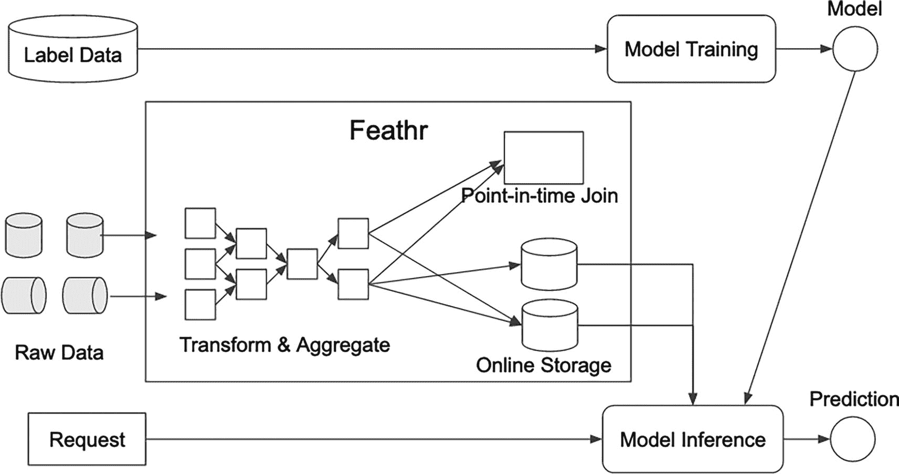
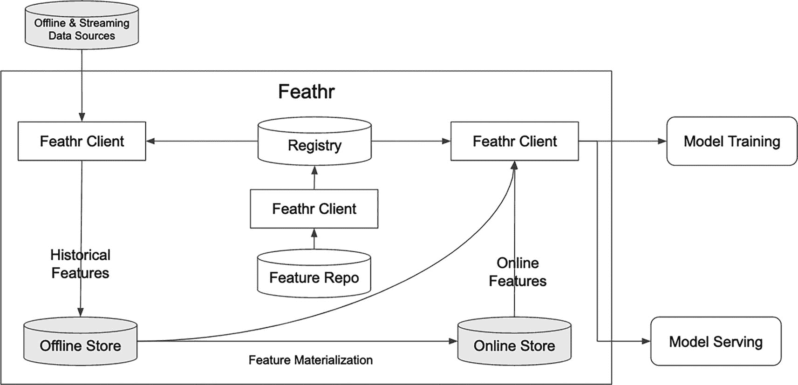
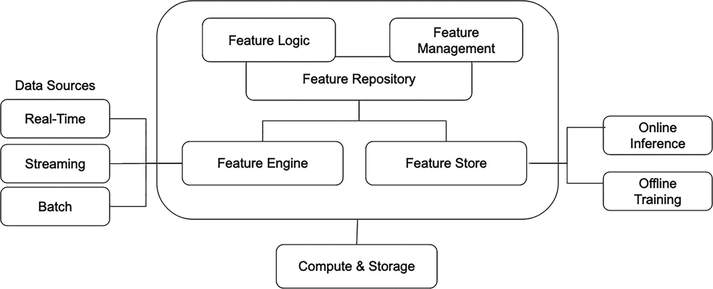

# 3. 特征工程基础设施

本章及后续与基础设施相关的章节旨在深入探讨 MLOps 栈的基础设施细节，即特征工程基础设施、模型训练基础设施和模型服务基础设施。对于这些章节，将采用以下结构。首先，将描述高级细节和优势。接着，将讨论高级架构及其子组件。最后，将重点介绍几个案例研究，包括自研、开源和商业供应商解决方案。

希望这些基础设施相关章节中的技术细节和讨论，能帮助 MLOps 领导者、技术负责人和 MLOps 工程师从高层和技术层面理解其中的复杂性和权衡，更重要的是，在构建其 MLOps 基础设施或评估来自开源社区或商业供应商的解决方案时，为他们的技术决策提供指导。此外，在相关情况下，还会指出一些潜在的组织相关挑战。

注意

本书中使用的术语“基础设施”与其他 MLOps 书籍或博客中使用的术语“平台”非常相似。这两个术语经常互换使用。对我来说，“基础设施”更侧重于技术方面，而平台则是一个更全面、更广泛的领域，由多个基础设施组件构成。这就是为什么本书使用 MLOps 平台（机器学习平台）来涵盖支持机器学习开发过程所需的全部基础设施。


## 概述

机器学习开发流程中首要且关键的步骤之一便是特征工程环节，数据科学家在此环节中筛选并转换原始数据，形成一组用于训练和构建机器学习模型的特征。特征的质量与合理组合会极大影响机器学习模型的准确性与性能。特征的创建与生成（尤其是在大规模场景下）高度依赖数据基础设施的成熟度，并面临诸多工程挑战。正因如此，当缺乏特征工程基础设施支持时，数据科学家往往会在特征开发环节投入大量时间。与机器学习开发中的大多数其他步骤类似，特征工程也是一个迭代过程，旨在根据实验中获得的新见解来优化或开发新特征。

在深入探讨特征工程基础设施的具体细节与能力之前，我们先从数据科学家的视角来理解特征工程流程及其需求。

特征工程流程可能因需用机器学习解决的具体问题而略有差异，但数据科学家通常遵循以下通用步骤：

*   **特征发现**：加速特征工程流程的一个快捷简便方法是复用现有特征（若这些特征可用且适用于当前用例）。随着一个组织内机器学习项目数量的增长，必然会涌现出一组基础特征，而这些特征通常对类似的机器学习用例很有帮助。

*   **探索性数据分析**：识别并探索数据，以挑选出潜在特征。这包括分析并可视化数据、识别模式，以及理解任何数据质量问题。

*   **特征转换**：从已识别的数据中，通过数学运算、统计度量（如均值、众数、方差）或各种特征工程技术（如独热编码、缩放与归一化、缺失值填充、降维或文本处理）对数据进行转换，从而生成特征。

*   **特征选择与验证**：从生成的各类特征中，识别出最相关、最有用的特征来训练机器学习模型，然后检查是否存在过拟合和欠拟合问题。

*   **特征服务**：此步骤在模型训练和在线推理中均不可或缺。
    *   对于在线机器学习用例，特征需要定期或实时刷新，并在推理时以低延迟可用。

> **注意**
>
> **数据 vs. 特征**
>
> 一个常见且合理的问题是：什么是特征，它们与数据有何不同？在机器学习语境中，特征是对象或实体的可测量属性或特性，可作为模型的输入信号，供模型从中学习模式。特征是通过称为特征工程的转换过程从数据中创建出来的。而“数据”是一个更通用的术语，指代所有信息。

从宏观层面看，特征工程基础设施使数据科学家能够快速、轻松地开发相关且高影响力的特征，而无需处理底层的工程复杂性，从而让他们能在最短时间内将模型投入生产。

MLOps 技术栈中的每一块基础设施都以各自的方式发挥着重要作用，助力将机器学习模型从想法快速推向生产。其中，特征工程基础设施之所以比其他组件更为重要，其独特之处在于它的产出——即特征——是机器学习项目的主要原料，并贯穿于机器学习开发流程的多个阶段（模型训练和模型推理）。因此，随着组织扩大其机器学习项目规模，正确构建这一组件至关重要。

为了使数据科学家能够主要专注于特征工程流程，该基础设施提供了所有必要的抽象、工具、自动化、存储等，使得大部分（即便不是全部）工程方面的内容都被抽象、隐藏并妥善处理。将“从各种数据源生成哪些特征”与“如何以一致、高效的方式，在大规模下并按特定节奏生成这些特征”这两个关注点分离开来，正是特征工程基础设施的核心目的。

### 优势

当一个组织扩大生产级机器学习用例的数量、有多个团队将机器学习应用于业务问题，或者在机器学习评审或讨论中频繁提及特征复用话题时，特征工程基础设施带来的优势将更加明显和放大。

在其他诸多优势中，以下是特征工程基础设施通常提供的几个常见优势：

*   **模型性能**
    *   对于在线机器学习用例，臭名昭著的“训练-服务偏差”问题可能导致模型性能显著下降，造成预测效果差、准确率降低，最终影响客户体验或削弱业务影响力。该基础设施提供了训练与推理之间的特征一致性。

*   **解锁在线机器学习用例**
    *   在线机器学习用例（如个性化推荐、欺诈检测等）要求特征在推理时能够以低延迟检索并近乎实时地保持新鲜度。特征工程基础设施能够可靠、高效地以低延迟提供特征服务，从而使组织能够在更多、更具影响力的用例中利用机器学习。

*   **生产力与效率**
    *   特征工程基础设施提供了必要的工具和基础设施来自动化特征工程流程，从而减少了创建、管理和维护特征所需的时间和精力。这解放了数据科学家，使他们能够专注于其他任务，如模型选择、调优和部署。

*   **协作**
    *   通过将特征定义视为代码，数据科学家和工程师可以轻松地在特征创建与生成上进行协作，共享最佳实践，并在不同模型和项目间复用特征集。

*   **治理**
    *   通过集中化的特征管理方式，特征工程基础设施提供了必要的机制来执行治理策略，例如数据隐私与安全、数据血缘以及组织的版本控制。

> **注意**
>
> **训练-服务偏差**
>
> 这个臭名昭著的问题通常出现在模型生产阶段，它会以意想不到的方式导致模型性能下降。关于此问题的一个清晰定义可以在《机器学习规则》资源中找到。^(³⁷) “偏差”部分指的是训练阶段与生产阶段之间的模型性能差异，造成这种差异的一个常见原因在于特征的计算或生成方式。通常，模型一旦投入生产，其性能预期应保持在同一水平或更优。


## 高层架构

一个良好的特征工程基础设施应能满足数据科学家日常特征工程流程中的大部分（若非全部）需求。满足这些需求所需的具体能力包括：发现现有特征、在必要时创建新特征、管理特征访问与生命周期、将原始数据编排转换为特征、监控特征的新鲜度与质量，并确保这些特征在推理时能够以低延迟可靠且一致地可用。

从工程角度来看，这一庞大的基础设施由以下子组件构成：

*   **特征目录**：作为特征元数据存储库，有助于特征发现及各类特征管理能力。
*   **特征工程框架**：提供执行特征转换与计算的简便方法。
*   **特征存储**：提供集中位置来持久化特征，用于模型训练与模型推理，并提供便捷的特征访问方式。
*   **特征洞察与质量**：提供关于特征使用情况及其质量的最新信息。
*   **特征上传服务**：仅将所需特征上传至在线特征存储。

图 3-1 从高层展示了特征工程基础设施的样貌。后续章节将深入探讨“特征工程基础设施”框内所列具体能力的更多细节。现在，我们先来了解几个图中未直接体现的重要主题。



一个水平流向图，包含数据源、特征工程基础设施、计算引擎、输出（离线与在线推理）以及模型训练。数据源包括流式数据、数据仓库和连接到特征工程基础设施的数据湖。

**图 3-1**
特征工程基础设施高层架构

创建特征最常见的数据源通常是公司集中式数据仓库和/或数据湖中存储和管理的数据。因此，拥有一个相当稳固的数据基础设施来维护这些数据源并使其保持高质量和最新状态至关重要。如果没有这一点或相应的访问权限，数据科学家将很难通过应用机器学习为组织创造价值，除非这些机器学习项目仍处于探索阶段，且仅需少量静态数据集。

来自流式数据源的数据使数据科学家能够利用关于客户行为的实时信号或最新数据，从而准确预测并快速适应变化的条件，例如在金融市场或实时监控系统中。支持实时特征所涉及的工程复杂性显著更高，是其他两种数据源的好几倍。在投入时间和资源支持这些特征之前，明智的做法是先理解它们所带来的附加价值。

一个良好的数据基础设施通常提供分布式且可扩展的计算引擎，这些引擎易于用于批处理和流式计算。特征计算与生成可以极大地受益于这些引擎的可用性。这再次表明，现代特征工程基础设施高度依赖于良好的数据基础设施，并且常被描述为面向机器学习的特定数据基础设施。

“特征工程基础设施”标题下的小方框代表了一种理想的基础设施，用于支持跨多个团队的大量机器学习用例。当只有少数几个机器学习用例时，数据科学家无需满足所有这些条件即可开始创建和生成特征。

> **注意**
> 特征存储 vs. 特征工程基础设施或特征平台
>
> 在特征工程基础设施（又称特征平台）的语境中，特征存储是其子组件之一，充当存储和提供已计算特征的集中位置。一个开源特征存储的例子是 Feast ([`https://feast.dev/`](https://feast.dev/))。
>
> 特征工程基础设施代表了一个更广泛、更全面的解决方案，它包含特征存储以及许多其他子组件，用于管理机器学习特征从生成到生产的完整生命周期。

以下章节将简要描述特征工程基础设施子组件的功能，并重点介绍来自业界和开源社区的一些常见方法。

### 特征规范与定义

在机器学习项目的初始阶段，数据科学家在使用 Pandas 或 Spark 等工具分析和可视化可能用作特征的数据后，通常会采用快速且非结构化的方式为其机器学习模型创建特征。作为将机器学习模型产品化的一部分，那些用于训练模型的特征需要以可重复且一致的方式生成和物化。这正是特征规范与定义发挥作用的地方。

它们为数据科学家或机器学习工程师提供了一种标准且一致的方式来定义特征、表达必要的转换以及指定编排细节。特征规范与定义可以大致归入一个更高级的概念——元数据。以下章节将详细讨论特征元数据以及用于表达它的各种常用格式。


#### 特征元数据

特征元数据旨在作为自包含的元数据，将特征工程步骤中所有必要信息表达出来，以便人类和机器理解和推理。它通常包含以下逻辑部分：特征元数据、转换元数据和规范元数据。第一部分涉及用于生成已定义特征的数据源以及存储计算所得特征值的物化目标等通用信息。第二部分涉及将原始数据从一种值转换为另一种值的逻辑，例如将时间戳转换为星期几、计算温度列的平均值等。最后一部分通常用于表达环境及编排相关的信息。

以下列表包含通常所需的常见元数据：

*   **数据源**：用于生成特征的数据源信息。当涉及连接操作时，可能存在多个数据源。可能的数据源包括数据仓库、数据湖或像 Kafka 这样的流式数据源。

*   **基本信息**：实体、名称、类型、转换、日期。
    *   实体是表示业务领域的逻辑概念，例如客户和商户。它作为一种分组机制，有助于将一组相关特征组织在同一实体下。
    *   每个特征通过唯一的名称进行标识。
    *   每个特征都有一个数据类型。
    *   转换逻辑。从简单或标准的数学转换到复杂的聚合操作。

*   **数据目标**：特征计算完成后，特征物化的位置。这可以是数据仓库中的表、数据湖中的某个路径，或 Kafka 中的某个主题。

*   **描述**：包含关于特征的高层级上下文信息。

*   **作者信息**：通常包括姓名和电子邮件。用于发送失败通知，或供他人了解联系谁以获取更多特征相关信息。

*   **规范中的可能信息**：
    *   用于运行转换逻辑的计算引擎。
    *   特征生成的频率，例如每小时、每天等。
    *   在线特征存储的新鲜度级别和上传频率。

上述信息列表并非详尽无遗。这些信息在各种内部、开源和供应商提供的特征工程解决方案中普遍得到支持。由于特定的用例、不断发展的技术以及个人偏好，这些解决方案之间的命名和语义可能略有差异。

来自内部解决方案的特征元数据，例如 Uber 的 Palette^(³⁸)、LinkedIn 的 Feathr^(³⁹)、AirBnb 的 Chronon 以及 DoorDash 的 Fabricator^(⁴⁰)，以及开源解决方案如 Feast^(⁴¹)，它们有很多共同点，但都使用了略有不同的术语和概念。

从机器学习开发生命周期中特征工程步骤的角度来看，需求非常相似。如果存在一个所有人都支持并从中受益的单一规范，那将是社区的一大胜利。

#### 特征元数据格式

特征工程基础设施团队有多种可供探索和考虑的选项。像往常一样，在多种选项中做决策时，牢记主要用户角色非常重要。随着时间的推移，流行的格式会脱颖而出，而不太好的格式在暴露其不足之处后会被淘汰。如果存在一种统一所有格式的单一格式，我们都可以简单地采用它，事情就会容易得多。惯例是使用 YAML 格式和自定义 Python API，每种方法都有其自身的优缺点。

YAML（YAML Ain’t Markup Language）是一种基于文本、人类可读的数据序列化语言，常用于配置文件，可以简洁地描述为一种用于数据的版本化语言。^(⁴²) 由于其易用性、多功能性、可移植性和灵活性，它已成为一种流行的格式。易用性的一个例子是，可以使用你喜欢的文本编辑器（如 Sublime、Visual Code 或 vi）编写 YAML 文件。数据科学家主要需要熟悉的是为特征元数据定义的 schema。该 schema 定义了文件的语法和结构，通常由特征工程基础设施的创建者定义，以指定特征元数据 YAML 文件的结构和允许的字段。

Python 是数据科学家最喜欢的编程语言之一，因此越来越多的最新特征工程解决方案采用这种方法来表达特征元数据也就不足为奇了。

虽然开始编写 YAML 文件非常容易，但与 Python 编辑器相比，当出现错误时，获得反馈并不那么直接和快速。Python 编辑器的代码补全功能有助于减少错误或快速查找已遗忘或不熟悉的选项。另一方面，运行和测试 Python 文件需要 Python 环境的可用性。鉴于 Python 编程语言是数据科学家日常使用的工具，这已不再是一个大的不便之处。

无论采用哪种特征元数据格式，主要目标都是将特征工程产物（通常由数据科学家或机器学习从业者编写）视为代码。这将有助于采用软件工程最佳实践，例如代码审查、可重现性、CI/CD 集成和其他自动化。这个简单但非常有益的概念是提高机器学习开发速度的步骤之一。

另一个需要强调的关键重要概念是，特征元数据在数据科学家的责任和底层基础设施的责任之间提供了清晰且具体的关注点分离。基础设施负责处理工程复杂性并隐藏底层实现，以便随着发现更优的方法或新的解决方案，它们可以轻松演进。


##### 基于 YAML 的特征规范与定义示例

部分内部解决方案采用 YAML 作为特征规范与定义格式，其中包括 Snap 和 DoorDash。清单 3-1 来自 Snap 的 Robusta 特征工程框架^(⁴³)，该框架旨在通过减少推荐系统信号提取过程中的摩擦，来简化和加速机器学习迭代。

```
name: my_feature_spec
query:
sql: > SELECT snap_view_spec > 1 as view_time_gt_1,
snap_id, hour_of_day(event_timestamp),
day_of_week(event_timestamp) = 'SUNDAY' as is_sunday
...
FROM
discovery_snap_view_data
WHERE
event_name =  'DISCOVERY_SNAP_VIEW'
features:
base_name = discover_snap_total_viewed_Counts
aggregation:
count: {condition_columns: [view_time_gt_1]}
group_by_selectors:
snap_id: DOCUMENT_ID
hour_of_day: HOUR_OF_DAY
primary_select: DOCUMENT_ID
window_to_ganularity:
six_hours: five_minutes
thirty_days: twelve_hours
清单 3-1
Snap 的 Robusta 特征聚合适配
```

其中一些值得关注的设计决策，体现了对灵活性的支持：

*   `query` 部分接受 SQL 语句作为转换逻辑。鉴于大多数数据科学家、机器学习工程师和数据工程师已熟悉 SQL，这应能让他们以最小的摩擦轻松上手。

*   独立的特征聚合部分允许对上述 `query` 字段定义的同一 SQL 语句应用不同的聚合键。

另一个基于 YAML 的特征元数据格式示例来自 DoorDash 的声明式实时特征工程框架 Riviera。^(⁴⁴) 该示例演示了如何从流式数据源计算实时特征，以生成一个店铺级别的特征，该特征使用长度为 30 分钟、滑动间隔为 1 分钟的滑动窗口，统计每个店铺的订单数量。

```
- type: kafka
kafka:
cluster: ${ENVIRONMENT}
topic: store_events
schema:
proto-class: "com.doordash.timeline_events.StoreEvent"
sinks:
- name: feature-store-${ENVIRONMENT}
redis-ttl: 1800
compute:
sql: >-
SELECT
store_id as st,
COUNT(*) as saf_sp_p30mi_order_count_avg
FROM store_events
WHERE has_order_confirmation_data
GROUP BY
HOP(_time, INTERVAL '1' MINUTES, INTERVAL '30' MINUTES),
store_id
清单 3-2
DoorDash 的实时特征聚合示例
source:
```

与上一个示例类似，特征转换逻辑通过 SQL 语句表达。SQL 已成为处理数据的通用语言，但随着发展，出现了多种 SQL 方言，某些计算引擎可能只支持特定方言。如果构建的是内部解决方案，这问题不大；但如果是商业解决方案，基于 API 的选项则更具前瞻性，能更好地支持众多客户用例。

##### 基于 Python 的特征规范与定义示例

Python 是数据科学的通用语言，因此绝大多数数据科学家都能熟练使用 Python。近期一些开源解决方案和商业供应商解决方案已采用 Python 来定义特征规范与定义。

2022 年出现的一个较新的特征工程开源解决方案是来自 LinkedIn 的 Feathr。它由 LinkedIn 开发，并在内部经过数年实战检验，为搜索、信息流和广告等众多机器学习用例提供支持。Feathr 既是一个定义特征的抽象层，也是一个用于计算、服务和访问特征的通用平台。^(⁴⁵) 清单 3-3 包含一个使用 Feathr Python API 定义特征的简短示例。

```
batch_source = HdfsSource(name="nycTaxiSource",
path="",
event_timestamp_column="lpep_dropoff_dt",
timestamp_format="yyyy-MM-dd HH:mm:ss")
f_trip_distance = Feature(
name="f_trip_distance", feature_type=FLOAT,
transform="trip_distance",
)
f_trip_time_duration = Feature(
name="f_trip_time_duration", feature_type=FLOAT,
transform="f_trip_time_duration",
)
features = [
f_trip_distance,f_trip_time_duration,
Feature(name="f_day_of_week", feature_type=INT32,
transform="dayofweek(lpep_dropoff_datetime)"),
]
request_anchor = FeatureAnchor(name="request_features",
source=INPUT_CONTEXT,
features=features)
清单 3-3
使用 Feathr Python API 定义一组特征的简单示例
```

上述示例展示了如何使用 `Feature` 类来定义特征信息，包括名称、类型和可选的转换逻辑。更多详情可参考此资源：[`https://feathr-ai.github.io/feathr/concepts/feature-definition.html`](https://feathr-ai.github.io/feathr/concepts/feature-definition.html)。

使用 Python API 的优势之一在于，能够以小型、可组合的单元定义特征，并在需要时将它们组合起来，形成复杂的特征管道。

另一个相当流行且被广泛采用的开源特征存储项目是 Feast。其特征定义方法与 Feathr 非常相似，都使用 Python 类抽象来定义特征；示例见清单 3-4。

```
driver = Entity(name="driver", join_keys=["driver_id"])
driver_stats_fv = FeatureView(
name="driver_activity",
entities=[driver],
schema=[
Field(name="trips_today", dtype=Int64),
Field(name="rating", dtype=Float32),
],
source=BigQuerySource(
table="feast-oss.demo_data.driver_activity"
)
)
清单 3-4
使用 Feast Python API 定义一组特征的简单示例
```

在 Feast 中，每个特征通过名为 `Field` 的类来定义，一组相关特征则逻辑上分组在 `FeatureView` 类的实例中。

以上示例旨在说明特征定义常用的两种格式。

特征格式只是实现目的的手段。特征规范与定义的最终目标是让数据科学家能够以一致且标准的方式，轻松快速地执行特征工程。无论选择哪种格式，我们都可以轻松地将特征规范与定义视为代码，从而受益于一些 DevOps 最佳实践，例如版本控制、代码审查和可复现性等。

特征规范与定义带来的另一个重要好处是，在离线与在线特征服务期间能够保持一致性，因为特征转换逻辑只需定义一次，并集中存放。

一旦特征规范与定义被定义并可用，接下来会发生什么？


### 特征注册表

当特征规格和定义经过代码审查并检入到像 GitHub 这样的版本控制系统后，已定义特征的详细信息和元数据会被编译并转换为内部格式，然后持久化存储到特征注册表中。

特征注册表充当组织或团队所有特征的中央目录。它带来的一个非常重要的好处是，能够让数据科学家和其他机器学习从业者搜索、发现新特征并就此进行协作。此外，它还能提供其他有用的功能，例如特征级别的谱系数据和访问控制。

间接地，它通过可发现性促进了特征复用。当数据科学家初次加入团队、开始新的机器学习项目或改进现有机器学习模型时，他们首先采取的行动之一就是了解生产环境中正在使用的可用特征。

从技术角度来看，特征注册表通常被设计成一个基于 Web 的应用程序，由以下组件构成：后端、Web 应用和用户界面（图 3-2）。后端充当存储特征规格和定义的仓库，通常基于 SQL 设计。Web 应用用于管理这些工件（artifacts）的增删改查（CRUD）操作，而用户界面则展示这些相同的工件，并促进管理和控制。



一张展示特征注册表内容的示意图，包含用户界面、Web 应用 REST API 以及基于文件或 SQL 的后端。

图 3-2

特征注册表组件

### 特征编排

特征规格和定义本质上捕捉了机器学习从业者的“做什么”意图，即需要从哪些数据源生成哪些特征，以及将原始数据转换为特征所需的指定转换逻辑。

在特征工程基础设施的底层，这些“做什么”的意图会被转换为“怎么做”，具体方式是将特征规格和定义翻译成一系列特征管道，然后按特定节奏进行调度和运行。此转换过程的输出是一系列以有向无环图（DAG）结构形式组织的任务，这些任务随后由特征编排器管理和执行。

从技术角度来看，特征编排主要是利用工作流和调度系统（例如 AirFlow、Dagster 等）来调度和执行以数据管道和特征特定任务的 DAG 形式表示的特征管道。

一旦特征管道完成，其输出或结果会被发布到特征存储中，这将在下一节讨论。

#### 关键考量

*   执行回填的需求相当普遍，例如添加几个新特征来迭代现有模型。在选择特征编排工具时，了解它对执行回填提供了多少支持是很有益的。

注意

在高层面上，回填是指追溯性地更新以填补数据集中的历史数据。这通常发生在对数据集进行增强时，因此需要将这些增强应用于现有的历史数据，以确保整个数据集的一致性和准确性。回填过程通常需要重新处理过去的数据。

### 特征存储

特征工程基础设施的关键组件之一是特征存储，它负责存储和提供用于模型训练和模型推理的特征，如图 3-1 右侧所示。

特征生成步骤的输出是一系列特征值。在机器学习项目的探索阶段，特征值的总大小可能很小，通常会在数据科学家的笔记本电脑上物化或持久化。在模型训练和生产化步骤中，特征值会被持久化到特征存储中。

在模型训练阶段，特征值是根据数月或数年的数据计算得出的，具体取决于用例的需求。离线特征存储正是为支持这种需求而设计的。

对于在线推理用例，在模型推理时需要特征值，这就是在线特征存储发挥作用的地方。

#### 离线特征存储

离线特征存储在模型训练和评估阶段扮演着关键角色，它通过提供一个集中、可扩展且高效的特征仓库，帮助数据科学家以高效的方式存储和提供大量计算出的特征，这些特征可以轻松地被多个机器学习模型访问和使用。

离线特征存储通常构建在数据仓库或数据湖之上，这些数据仓库或数据湖由分布式存储系统（如 S3、Snowflake、Redshift 或 BigQuery）支持。对于特征值量级达到数 TB 的机器学习用例，由于能够使用各种分布式计算引擎以分布式方式访问数据，数据湖是更优的选择。

对于需要大量特征进行训练的大型机器学习用例（例如推荐或个性化），此类能力和灵活性将有助于将训练时间从几天缩短到几小时。

##### 关键考量

*   利用现代数据基础设施的最佳实践和工具来构建离线特征存储，例如使用二进制数据格式、良好的数据分区策略和保留策略。

*   一个高效的离线特征存储通常与中央数据湖位于同一位置，以最大限度地减少数据传输，这直接转化为成本节约。

#### 在线特征存储

如今，越来越多的组织将机器学习集成到其在线产品或服务中，以执行在线推理，例如向客户推荐产品、提供定制的浏览体验或近乎实时地检测欺诈。所有这些机器学习用例都有一个共同需求，即以低延迟和高 QPS（每秒查询数）获取计算出的特征值的子集。

在线特征存储旨在通过将这些特征保存在分布式键值存储（如 Redis、Cassandra 或 DynamoDB）中来满足这些需求。

##### 关键考量

*   像 Redis 这样的内存键值存储在存储大量特征时可能成本高昂。在设计特征值的有效模式方面进行前期投入将节省成本并最大限度地减少迁移工作量。

*   注意更新在线特征存储的方式，以确保对需要在线推理期间低延迟特征检索的在线机器学习用例影响最小。

*   并非所有在线机器学习用例都需要个位数毫秒级的特征检索时间。对于可以容忍约 25 毫秒或更长特征检索时间的用例，基于磁盘的存储引擎是一种可行的解决方案，有助于提高成本效益。

### 特征上传

对于大量需要在线特征存储且特征量很大的机器学习用例，将需要构建或采用一个高效且智能的特征上传工具，将这些特征值上传到在线特征存储。

#### 关键考量

*   时间效率：考虑到特征值数量庞大，上传工具在设计时必须考虑并行性。

*   上传策略：某些特征集需要比其他特征集更频繁地刷新。上传工具的设计必须能够适应不同的刷新需求。

*   运维卓越性：对于某些在线预测用例，特征的新鲜度对模型性能有很大影响。一个设计良好的特征上传工具必须生成准确且详细的指标，以便检测和监控每个特征集的特征值新鲜度和上传状态。


### 特征服务

松耦合被视为一种良好的软件工程实践。特征服务组件通常被设计为一种服务，它对外暴露端点以从在线特征存储中获取特征，并隐藏底层存储解决方案。这样一来，当引入更高效、更快速的解决方案，或支持多种存储解决方案时，不会对在线特征消费者造成重大干扰。

这种方法的一些好处包括：

*   在特征服务时执行额外的特征计算或转换
*   更容易将在线特征存储演进或替换为成本效益更高或采用更新技术的方案，同时将对特征值消费者的干扰降至最低

### 监控

一旦模型投入运营，模型本身在下一次迭代之前不会发生变化。发生变化的是基于新数据（无论是每日还是每周）生成的特征。

特征工程过程中所需的监控大致可分为两个方面：特征质量和特征管道运维。

特征质量主要涉及特征分布偏移和特征值。

*   在模型训练阶段，模型是使用具有特定分布的训练特征集进行训练的。如果使用具有不同分布的相同特征集进行在线预测，那么模型性能将会下降。因此，在特征生成过程中监控特征分布偏移至关重要。
*   特征值通常由一个或多个上游数据源计算得出，这些数据源可能由一个或多个团队拥有。当有意或无意的数据相关变更导致特征质量问题（如缺失值、异常值或不一致）时，最终将直接影响模型性能。

特征管道运维主要涉及运维方面，与软件工程关系更密切。此领域所需的监控是确保特征管道的健康运行，包括它们是否成功完成、是否按时完成、资源使用效率等。

总体而言，监控在确保模型投入生产后持续按预期运行方面发挥着重要作用，它通过快速检测潜在的特征质量问题或特征运维问题并及早缓解来实现。数据科学家花在调试因特征导致的模型性能退化上的时间越少，他们就能有越多时间用于开发和试验现有或新模型。

## 自建与采购

如前所述，特征工程基础设施在整个 MLOps 基础设施中扮演着相当关键的角色，有助于将机器学习模型投入运营。对于希望大规模开展机器学习项目的组织来说，正确构建这一基础设施至关重要。一个经常出现的问题是：是自建还是采购。与其他技术采用决策类似，这并没有一个简单统一的答案。做出如此重要的决策需要考虑许多因素。以下部分将审视一些重要因素，并讨论其中的权衡。

### 重要因素

在投入精力做出自建与采购的决策之前，一个好的做法是清晰地调查并确定组织内的需求，并就预期获得的收益达成一致期望。根据需求的不同，收益可能略有差异，但采用特征工程基础设施带来的一些共同收益包括：

*   机器学习模型准确性：人们普遍认为，特征质量和新鲜度对模型投入生产后保持模型准确性有直接和积极的影响。此外，在离线和在线之间提供特征的一致方式将显著减少训练与服务偏差这一臭名昭著的挑战。
*   团队协作：MLOps 是一项团队运动，特征工程基础设施可以通过特征复用、将特征规范和定义视为代码等功能，促进并加强数据科学家、机器学习工程师和数据工程师之间的团队协作，这将使审查和迭代变得轻松快捷。
*   利用实时特征解锁在线机器学习用例：对于没有健全数据基础设施的组织来说，通过流处理生成和维护实时特征面临着许多挑战。一个好的特征工程基础设施将有助于克服这一挑战。

鉴于每个组织都有自己特定的需求、目标和视角，对一个组织特别重要的因素对另一个组织可能不那么重要。以下重要因素列表涵盖了各组织间相当普遍的因素，每个组织在将其作为采购决策的输入信号时，需要确定自己的重要性等级：

*   上市时间：从头构建特征工程基础设施需要时间、精力，当然还有工程资源，这已不是什么秘密。如果由于业务需求或某些业务相关原因，将机器学习模型投入生产的时间窗口很短，那么采用商业供应商解决方案是更可行的选择。
*   成本：与大多数其他软件项目一样，最大的成本之一是人力。如果机器学习被视为组织竞争优势或战略赌注的组成部分，那么成本因素可能是合理的；否则，购买预建的基础设施是一个很好的起点。
*   定制化与集成：每个组织都有自己的数据基础设施、CI/CD 计算基础设施和其他现有系统。当定制化程度相当高时，自建内部特征工程基础设施会更加无缝。
*   支持：无论是自建还是采购特征工程基础设施，维护、升级和用户支持都是基础设施领域的固有部分。当采用商业供应商解决方案时，组织只需为专门的支持和维护付费。否则，支持负担通常落在负责构建内部解决方案的团队身上。

### 自建

大多数在 2015 年之前成立的互联网公司都投入了自建特征工程平台，例如 LinkedIn、AirBnb、Twitter、Uber、Meta 等。对它们来说，这个决定相对简单，因为当时既没有开源解决方案也没有商业解决方案。

这些公司的一些共同点是：它们大规模运营，机器学习是其在线产品的重要组成部分，它们的机器学习用例主要是在线的并且从实时特征中受益匪浅，并且它们拥有相当健全的数据基础设施。

鉴于特征工程基础设施领域的创新和开源解决方案的可用性，如果一个组织决定自建解决方案，考虑采用“先采纳后构建”的策略是有益的。

在 MLOps 采用的当前阶段，很难证明从头构建特征工程基础设施的决策是合理的。一个更明智、更可接受的方法是“先采纳后构建”选项。这意味着采用一个可用的开源解决方案作为起点，并用内部解决方案进行补充，以满足特定需求或填补空白。

在撰写本文时，有几个成熟的可用开源解决方案，例如 Feathr、^(⁴⁶) Feast、^(⁴⁷) 和 Hopsworks。^(⁴⁸)


### 采购

在撰写本文时，至少有少数几家供应商解决方案可供考虑。这些解决方案由云服务提供商（如 AWS、Google Cloud）和供应商（如 Tecton 和 Databricks）共同提供。

鉴于供应商非常渴望合作，因此以最小的精力寻找和评估其解决方案的能力会相对容易和快速。应投入大量精力来评估哪些供应商解决方案以及如何最佳地满足组织在特征工程基础设施方面的需求。需要牢记的几个关键考虑因素包括：

*   **供应商锁定**：采用供应商解决方案时，常会引发一种不安情绪。缓解这种担忧的一种方法是选择那些构建在开源解决方案之上的供应商方案。

*   **渐进式方法**：以渐进方式采用供应商解决方案的灵活性，有助于在评估其成熟度和投资回报率的同时建立信心。在全身心投入某个供应商解决方案之前，最好先具备“伸出一两只脚试试水”的能力。

*   **成本**：清晰理解成本模型，无论是基于 API 调用次数、存储容量还是其他成本单位。除非初始金额相对较小，否则在签订合同前建立成本预测是一个良好的实践。

*   **支持**：评估不同级别的可用支持，并找出最适合您组织需求的那一种。例如，当出现紧急情况时，供应商的支持时间是否满足您组织的需求。

*   **合规性**：顶级供应商通常能够满足大多数（即使不是全部）企业的安全和隐私合规要求。务必进行双重检查，尤其是在与小型或初创公司合作时。

## 组织挑战

到目前为止，我们讨论的内容都围绕特征工程基础设施中的技术解决方案。根据一篇优秀的论文《构建机器学习软件中的社会技术反模式》^(⁴⁹)，存在一些现实的组织挑战，这些挑战会阻碍或降低机器学习开发生命周期中特征工程阶段的有效性和速度。

### 数据可用性

显而易见，数据是成功应用机器学习以实现业务目标的主要要素之一。如果应用机器学习所需的数据受到限制或仅部分可用，那么这将阻碍机器学习的有效性，并最终导致机器学习项目失败。

数据生产者和消费者的领导者必须共同坐下来，围绕组织的机器学习计划在高层级业务目标上达成一致，并共同找出方法，以可靠且高质量的方式持续将数据集中到某个中心位置。需要考虑的几个简单步骤：

*   **意识提升**：数据生产者和消费者很可能属于不同的组织，因此数据生产者可能不知道他们的数据是如何被使用的。数据消费者应主动提高对其数据重要性的认识。

*   **数据集中化**：随着机器学习项目数量的增加，就越需要制定集中的数据摄取策略，以便将组织内各种来源的数据可靠地移动到一个中心位置，例如数据湖或数据仓库。

### 数据治理

机器学习从业者普遍认为，生产环境中绝大多数表现不佳的机器学习模型实际上是数据相关问题的受害者，例如低质量、新鲜度不足、缺失值等。

随着越来越多的机器学习项目投入生产，通过优先考虑数据治理实践来防范风险至关重要，以确保用于训练和提供机器学习模型的数据具有高质量，并且问题能被及早发现并快速缓解。

数据治理是一个庞大的话题，包含许多组成部分。与机器学习领域特别相关的部分包括：

*   **数据质量**：建立良好的实践，在数据管道中自动化数据质量验证，并且仅在数据集通过验证后才发布。

*   **数据血缘**：通过了解用于生成特征的数据来源，有助于加快排查和缓解数据相关问题的时间，例如当数据模式发生更改或某列的值从文本更改为数字时。

*   **数据管理**：确保大多数（即使不是全部）关键数据集都有数据所有者。这将有助于通过知道该向谁求助来快速缓解问题。

## 案例研究

以上章节强调了拥有特征工程基础设施的好处，概述了其高层级架构，并讨论了各个组件的细节。本章最后将审视来自每个类别（内部构建、开源和商业供应商）的一个现有解决方案。这些解决方案中的每一个都需要一整本书来详细描述其功能。这里的目标是在高层级上评估它们的能力，并在过程中指出它们的优势领域和（如适用）存在的差距。

### 开源

在特征工程基础设施领域，真正开源的解决方案寥寥无几。其中一个活跃且相当流行的项目叫做 Feast（[`https://docs.feast.dev/`](https://docs.feast.dev/)）。Feast 这个名字来源于 **fea**ture **st**ore（特征存储）这两个单词的前几个字母。

#### 概述

在特征工程基础设施的背景下，Feast 实现了特征存储组件中的大部分功能。它被设计成一个“可定制的运营数据系统，可重用现有基础设施来管理机器学习特征并为实时模型提供服务。”^(⁵⁰)

Feast 旨在实现的三个关键目标是：

*   **训练和服务之间的特征一致性**：提供工具和抽象层来管理和访问离线存储和在线存储中的特征。
*   **避免数据泄露**：确保时间点正确的特征值在训练期间不会泄露给模型。
*   **将特征存储与数据基础设施解耦**：提供一个单一入口点，以抽象用于存储训练模型和服务模型特征的底层存储引擎。

图 3-3 描述了 Feast 在特征工程基础设施格局中所扮演的角色，该格局由 Feast 框中的三个组件组成。下面的架构师部分将讨论这些框的功能。



一个水平流程图以流和批处理源开始，然后是转换、Feast（包含存储、服务和注册）。它生成在线和离线特征作为输出。

图 3-3

Feast 特征存储 – 改编自 [`https://docs.feast.dev/`](https://docs.feast.dev/)

与大多数其他开源项目一样，Feast 由开源社区不断发展和改进。然而，在评估 Feast 时，需要注意某些关键方面：

*   Feast 假设在将特征交给它管理之前，特征转换已经完成。
*   Feast 提供围绕特征发现的基本功能，并具有插件架构，可与流行的数据目录解决方案（如 DataHub、Amundsen 等）集成。
*   特征仅支持表格数据，不适用于非结构化数据的机器学习用例。


#### 概念

在处理任何基础设施、工具或平台时，我们首先需要完成的任务之一就是学习和理解其核心概念，这些概念是平台为我们提供的抽象，用于定义、使用和交互。

Feast 中的概念按层级结构组织，共分为三层。最底层由数据源、字段和实体组成，具体描述如下：

*   **数据源**：指数据所在的底层存储系统。两种常见的数据源类型是批处理和流式。前者的例子包括 BigQuery、Snowflake 和 RedShift。后者的例子包括 Kafka 和 Kinesis。

*   **字段**：一个特征，通常被描述为单个可测量的属性。

*   **实体**：用于定义一组语义相关特征集合的容器。通常映射到特定用例的领域对象。

第二层只有一个概念，即特征视图。它代表源自某个数据源的一组逻辑特征，可能属于一个或多个实体。

第三层包含一个名为项目的概念，它代表一个或多个特征视图的顶级命名空间。

#### 架构

Feast 被设计为一个特征存储解决方案，它是特征工程基础设施的组件之一。其架构非常易于理解，由几个元素组成，如图 3-4 所示。



Feast 的流程图。离线存储对在线存储执行特征物化。在 Feast SDK 中，离线存储包含历史特征，在线存储包含在线特征。它们用于模型训练和服务。Feast SDK 存储在注册表中。

图 3-4

Feast 架构

Feast 架构中的关键组件之一是 Feast SDK，它为以下功能提供了抽象：

*   将用户提供的关于数据源、实体和特征的元数据转换为其内部表示形式，并存储在注册表中，该注册表可由多种存储引擎支持，例如 MySQL 或 Postgres 等。

*   通过将特征上传到在线存储来执行特征物化，这些特征可以来自离线存储，也可以从流式源（如 Kafka 或 Kinesis）推送而来。

*   从离线存储中检索具有时间点正确性的历史特征，用于模型训练。

*   在模型服务时检索在线特征。

上图中不太明显但值得指出的一点是 Feast 中的可插拔设计，用于物化数据、更新存储引擎、启动流式摄取作业以及从离线和在线存储中获取特征等操作。在尝试将 Feast 与组织的内部基础设施集成时，这种可扩展性机制将非常有用。

通过开箱即用和开源贡献，Feast 支持一些最流行和广泛采用的数据源、离线存储和在线存储。更多详情请参阅此资源：[`https://docs.feast.dev/roadmap`](https://docs.feast.dev/roadmap)。

表 3-1

支持的数据源、离线存储和在线存储

| 数据源 | 离线存储 | 在线存储 |
| --- | --- | --- |
| Snowflake, Redshift, BigQuery, Azure Synapse, SQL, Parquet, Hive, Postgres, Spark | Snowflake, Redshift, BigQuery, Azure Synapse + SQL, Postgres, Trino | Snowflake, DynamoDB, Redis, DataStore, Bigtable, SQLite, Azure Cache, Cassandra, Postgres |

#### 评估

凭借开源社区的贡献，Feast 将随着时间的推移不断演进为更完整的特征存储解决方案。以下是我根据观察得出的关于其优势和机遇的主观总结：

##### 优势

*   通过 Python API 和具有可插拔存储引擎的注册表，为特征定义提供了合理的基础和抽象。
*   内置对带时间戳的表格数据的支持，并能够通过时间点连接重现过去特定时间点的特征状态。
*   通过可扩展的批处理物化引擎，提供了从离线存储向在线存储上传特征的合理抽象。
*   Feast SDK 提供了获取特征检索的基本能力，用于模型训练和服务。
*   在 [`https://docs.feast.dev`](https://docs.feast.dev) 上有相当全面的文档，包括教程和操作指南。

##### 机遇

*   开箱即用的数据质量能力有限。不过，围绕数据质量监控有一项即将推出的计划，旨在帮助使用用户自定义的规则集来验证数据。
*   实时特征转换和摄取是一个复杂的问题，希望 Feast 能在这方面加强，为社区提供一个通用解决方案。

特征存储是那些希望将其机器学习模型（尤其是大规模模型）投入生产的组织的常见需求。Feast 有机会成为满足此需求的事实上的开源项目，类似于 Apache Spark 已成为分布式和可扩展数据计算的事实上的开源项目。探索和学习 Feast 的一个好资源是 [`https://feast.dev/`](https://feast.dev/)。

### 内部解决方案

关于来自众多公司（如 AirBnb、LinkedIn、Uber、Meta、Twitter 等）的内部特征存储或特征工程基础设施解决方案的演示和最佳实践分享并不少见。年度特征存储峰会^(⁵¹)是发现这些资源的好地方。由于设计、源代码和示例的可用性有限，详细研究和探索这些内部解决方案具有挑战性。然而，在 2022 年 4 月，LinkedIn 宣布在 Apache 2.0 许可证下开源其名为“Feathr：面向企业的可扩展、统一的数据与 AI 工程平台”^(⁵²)的特征存储解决方案，并且 Feathr 已加入 LF AI & Data 基金会。^(⁵³)

这对开源社区来说是一个非常令人兴奋的消息，因为 Feathr 旨在解决简化机器学习特征管理的常见需求，并且已在 LinkedIn 经过 6 年多的实战检验，应用于众多复杂的机器学习和实时 AI 应用，例如搜索、信息流和广告，其机器学习模型由数千个特征驱动，处理 PB 级的特征数据。

根据这篇博客^(⁵⁴)，Feathr 通过将添加和试验新特征的时间从数周缩短到数天，帮助提高了特征工程速度，并且已被证明比自定义特征处理管道的性能高出 50%。

以下章节将详细考察 Feathr 的能力和架构。


#### 概述

在 Feathr 创建之前，LinkedIn 的各团队需要利用数据基础设施团队提供的各种内部工具和库，自行构建和维护其特征管道。随着特征管道复杂度的增加，维护工作量也随之增加，这减少了这些团队专注于更高价值的机器学习相关任务的时间。由于缺乏标准化和集中化管理，特征复用并不容易；因此，在相似项目间复用特征颇具挑战性。

从最高层面来看，Feathr 提供了一个抽象层，用于标准化和简化机器学习工作流中的特征定义、转换、服务、存储和访问，如图 3-5 所示。接下来，我们将从特征工程中涉及的两个典型角色——生产者和消费者——的角度来讨论所提供的抽象。



Feathr 的水平流程图包括：标签数据经过训练成为模型；原始数据经过转换和聚合，用于时间点连接和在线存储；请求和在线存储最终用于模型推理和预测。

图 3-5

Feathr 特征存储解决方案——改编自架构概述^(⁵⁵)

##### 生产者

该角色主要负责通过以下方式定义、生成特征并将其插入特征存储：

*   使用 Feathr Python API，基于来自一个或多个数据源的原始数据集或预计算数据集，定义并注册一个或多个特征
*   利用各种内置的转换、聚合、时间窗口功能，丰富包括向量和张量在内的各种类型的特征值
*   通过派生特征支持，利用现有特征创建新特征

##### 消费者

顾名思义，该角色主要负责消费已注册的特征，用于模型训练或模型服务，并让 Feathr 处理底层逻辑以提供指定的特征。

*   使用特征名称和连接键计算并获取特征的历史值，并确保以时间点正确的方式完成。
*   在模型服务阶段，将特征物化到在线存储中，并在在线推理期间使其可用。

Feathr 提供的一些值得注意的高级特性：

*   **丰富的类型系统**：除了表格数据中的标准类型外，Feathr 还支持嵌入和张量。
*   **对复杂转换的丰富支持**：Feathr 拥有高性能的内置运算符，用于基于时间的聚合、滑动窗口连接，并且所有这些都保证了时间点正确性。
*   **可扩展的内置优化**：原生优化，如布隆过滤器、加盐连接和内置连接计划优化器。
*   **特征共享与复用**：内置特征注册表用于特征发现，并提供基于现有特征轻松创建派生特征的方法。

一个有趣的事实是，微软 Azure 团队通过添加必要的改进和支持来补充 Feathr 开源项目，确保其易于与 Azure 等云供应商集成。

#### 概念

上述抽象操作基于 Feathr 提供并允许其用户定义的一组核心概念。不同特征存储基础设施之间的核心和通用概念集非常相似；然而，由于创建者的个人视角和经验，概念名称往往有所不同。

与 Feast 中的概念类似，这些概念按层级结构组织，分为三个级别。

最低级别包括源、特征、派生特征和锚点，它们的元数据将由特征注册表管理。每个概念的简要描述如下：

*   **源**：表示从中提取特征的源数据。支持的源示例包括分布式文件系统（如 HDFS、S3、Azure Storage Blob）以及流式源（如 Kafka）。可以提供可选的预处理回调函数，对每一行执行转换。
*   **特征**：表示实体的一个可测量属性，通常具有唯一的名称、键、类型以及生成其特征值的转换逻辑。特征转换逻辑可以很简单，例如从一种类型转换为另一种类型，也可以像窗口聚合一样复杂。Feathr 提供了许多有用的内置转换，并支持自定义转换。
*   **派生特征**：一种通过在现有特征之上应用特定转换来构建新特征，从而促进特征复用的方式。
*   **锚点**：旨在将来自同一源的一个或多个特征组合在一起。

第二级别只有一个概念，称为特征查询。它专为特征消费者设计，用于探索、分析或模型训练等目的。此概念使特征消费者能够选择一组特征，从指定的数据集（在 Feathr 中称为观测数据）中检索其特征值。

第三级别包含一个名为项目的单一概念，它代表了用于管理一个或多个特征的顶级命名空间。这是管理属于特定机器学习用例、团队或组织的特征的一种方式。

#### 架构

作为一个特征存储，Feathr 的架构在组件数量、角色和数据流方面与 Feast 的架构非常相似，如图 3-6 所示。



流程图包含 Feathr 客户端的离线和流式数据源，以及离线存储中的历史特征。离线存储对在线存储执行特征物化。在线存储中存储了 Feathr 客户端的在线特征。这些特征用于模型训练和服务。

图 3-6

Feathr 架构——改编自 GitHub 上的 Feathr 文档^(⁵⁶)

然而，图 3-6 中并未明显体现几个重要的差异，值得指出。

Feathr 提供的一个关键且独特的特性是能够在特征访问或生成步骤（即特征物化）中大规模执行特征转换。这始于对在特征定义中捕获特征转换逻辑的一流支持，该逻辑随后可以被重现和版本控制，并且由于对特征计算方式有了更高的可见性，从而促进了特征复用。与此特性相辅相成的是高性能的内置运算符，用于执行各种复杂转换，如时间点连接、时间感知滑动窗口聚合等。如果没有这些，数据科学家将花费大量宝贵时间进行数据整理，并以最优方式执行复杂连接。毫无疑问，这一能力是 LinkedIn 的数据科学家能够在数小时内（过去需要数周）将特征投入生产的原因之一。

Feathr 团队做出的一个关键设计决策是利用 Spark 引擎作为执行特征生成和聚合的计算引擎，这帮助他们实现了灵活性和可扩展性的目标。

在灵活性方面，Feathr 可以支持大多数常见的数据源、离线存储和在线存储，尽管它稍微偏向 Azure。更多详情请参见表 3-2。

表 3-2

Feathr 支持的数据源、离线存储和在线存储^(⁵⁷)

| 数据源 | 离线存储 | 在线存储 |
| --- | --- | --- |
| Snowflake, Azure SQL DB, Azure SQL, AWS S3, Delta Lake | Snowflake, Azure SQL DB, Azure SQL, AWS S3, Azure Blob Storage, Azure ADLS Gen2, MySQL, SQL Server | Redis, Azure Cosmos DB |


#### 评估

尽管 Feathr 主要由 LinkedIn 开发并于 2022 年成为开源项目，但其能力和特性令人印象深刻。它满足所有标准特征存储需求，甚至更多。从成熟度角度来看，Feathr 已在 LinkedIn 经过 6 年以上的实战检验，并在生产环境中服务于数千个特征。

Azure 团队和 LinkedIn 团队一直紧密合作，以构建 Feathr 与 Azure 的原生集成。这意味着，随着 Azure 客户采用率的增加，它只会变得更好、更成熟。

##### 优势

*   一个功能完备的特征存储解决方案，包含特征定义、特征注册表、UI 以及用于特征生成、特征服务的 SDK，并同时支持离线与在线场景。
*   原生支持嵌入，并通过派生特征支持促进特征复用。
*   内置对特征转换的支持，拥有丰富的内置算子，并可通过 Spark SQL 的 UDF 或用户自定义函数进行扩展。
*   内置对时间点连接的支持，以防止特征泄露。
*   与 Spark 计算引擎原生集成，以实现可扩展的特征生成和连接优化。
*   通过 Microsoft Purview 集成，提供基于角色的特征注册表访问。
*   一个相当不错的特征管理 UI，包含特征血缘关系。
*   在 [`https://feathr-ai.github.io/feathr/`](https://docs.feast.dev) 上有相当全面的文档，包含教程和操作指南。

##### 待改进之处

*   没有明确的数据质量集成。
*   目前不支持特征监控；不过，这已在路线图中。

时间将证明 Feathr 的可行性以及社区采用情况。作为对开源承诺的体现，LinkedIn 和微软的领导层在 2022 年底共同表示支持 Feathr 作为新的沙盒项目加入 Linux 基金会 AI & Data 分会^(⁵⁸)。就 Feathr 提供的功能而言，与其他开源解决方案相比，它们相当广泛且令人印象深刻。

### 供应商解决方案

可以合理地说，2022 年是特征存储之年。特征工程基础设施领域的挑战和需求都已得到充分理解和认可；因此，看到众多供应商解决方案在 2022 年从云供应商和云原生供应商中涌现出来，并不令人意外。

值得注意的有 Vertex AI 特征存储、Sagemaker 特征存储、Databricks 特征存储和 Tecton 特征平台。可以合理地预期，这些解决方案中的大多数（如果不是全部）都能满足特征存储的常见需求：

*   通过特征元数据和注册表实现特征复用和发现。
*   支持离线与在线存储，以确保一致性并避免训练-服务偏差。
*   时间点特征检索。
*   特征血缘追踪。
*   特征监控。

在上述解决方案中，Tecton 的解决方案并未将自己定位为特征存储，而是特征平台，这最接近本章描述的特征工程基础设施。以下部分将详细介绍 Tecton 特征平台的具体情况。

#### 概述

Tecton 公司由一群曾帮助构建 Uber Michelangelo ML 平台的工程师创立，该平台在帮助 Uber 将生产环境中的模型扩展到数千个方面发挥了关键作用，支持了从实时定价、ETA 预测到欺诈检测等一系列有趣的共享出行和市场相关用例。Michelangelo ML 平台成功的一个重要贡献者是特征存储，它能够在生产环境中快速可靠地创建和提供特征。

最初的商业版特征存储产品于 2020 年推出，此后已发展并扩展为一个功能完备的特征平台，旨在编排特征的整个生命周期，从转换到在线服务，并具备企业级能力。

以下讨论并非旨在推荐 Tecton 产品，而是为了说明理想的特征工程基础设施应具备的各种能力和特性。

#### 概念

Tecton 特征平台中的大多数概念及其层级结构与其他特征存储中的概念非常相似，这并不令人意外。

最底层由数据源、实体、特征视图和特征表组成。以下是每个概念的简要描述：

*   **数据源**：表示读取原始数据的数据源。有两种类型：批处理和流式。批处理数据源的示例包括 S3 上的文件、Hive 中的表、AWS Redshift 中的查询或表，或 Snowflake 中的查询或表。支持的流式数据源包括 Kafka 和 Kinesis。
*   **实体**：通常表示一个领域对象，具有一个或多个主键和一组相关特征。示例包括客户、产品和订单。
*   **特征视图**：一个核心抽象，用于将一个或多个相关特征定义为已注册数据源或其他特征视图上的视图。特征规范和元数据在 Python 中指定。在此处指定有关物化的配置，例如编排以及离线或在线目标。
*   **特征表**：支持将预转换的特征摄取到 Tecton 中。

第二层只有一个概念，称为特征服务。它旨在供特征消费者使用，用于诸如在模型训练或离线预测期间批量查找特征值，或在线预测期间对单个特征集进行低延迟请求等目的。一个特征服务引用来自一个或多个特征视图的一组特征。顾名思义，特征服务在一个实际服务背后提供了一组能力，包括：

*   一个用于在预测时获取特征值的 REST 端点。
*   一个非常简单的一行方法调用，用于根据提供的时间戳和标签快速构建训练数据。
*   通过记录这些信息用于审计、分析和训练数据集生成，持续监控在线请求和特征向量响应的能力。

一个好的实践是为每个部署到生产环境的模型配对一个特征服务，该服务为模型提供特征。

第三层包含一个称为工作区的单一概念，它代表了用于管理第一层和第二层各种概念的顶级命名空间。所有与特征定义、物化、特征访问等相关的操作都需要从选择要使用的工作区开始。这类似于在处理表、表模式和相关数据之前选择数据库的概念。


#### 架构

根据 Tecton 文档网站所述，^(⁵⁹) 其特征平台是一个完全托管的特征平台，用于编排特征的完整生命周期，从转换到在线服务，并提供企业级 SLA。特征平台与特征存储的一个显著区别在于，它能够编排现有数据基础设施，以持续转换、存储和服务于运营机器学习应用的数据。从高层来看，其架构如图 3-7 所示，与之前提到的解决方案并无太大差异。



一个水平流程图显示了连接到特征引擎的实时、流式和批量数据源。特征存储包含在线推理和离线训练。特征逻辑、管理和仓库构成了特征引擎和存储，用于计算并保存到存储中。

**图 3-7**

Tecton 特征平台架构。改编自 Tecton 概念文档中的图片^(⁶⁰)

Tecton 特征平台的设计初衷并非取代现有数据基础设施，而是通过连接成熟的批量和流式数据源、利用业界认可的计算引擎以及支持普遍采用的存储基础设施，使其能够服务于运营机器学习应用。

Tecton 特征平台的主要组件包括特征仓库、特征引擎和特征存储。以下要点简要介绍了它们的功能：

*   **特征仓库**：特征生产者使用 Python 文件中的 Python 声明式接口来定义特征规范和元数据。除了名称、描述和转换逻辑等标准细节外，特征生产者还可以指定特征计算频率的配置。特征定义完成后，即可在集中式仓库中供其他人发现和重用。

*   **特征引擎**：负责编排特征管道，以物化计算出的特征值，然后将其发布到特征存储。此外，它还负责与底层计算引擎交互，以执行指定的特征转换逻辑。

*   **特征存储**：负责管理离线存储和在线存储，并通过 SDK 提供的抽象和 API 来服务特征。对于在线特征服务，所有请求都通过一个特征服务进行。

架构图中不明显的一个重要功能是监控能力。Tecton 特征平台开箱即用地提供了数据质量和运营监控。前者涉及跟踪传入数据的分布和质量。后者则涉及监控特征陈旧度、存储健康与效率以及特征管道的健康状态。监控能力在确保和维护 ML 模型部署到生产环境后持续保持性能方面起着关键作用。

在数据源和数据接收方面，Tecton 特征平台支持大多数常见的数据源、离线存储和在线存储。更多详情请参见表 3-3。

**表 3-3**

Tecton 特征平台支持的数据源、离线存储和在线存储

| 数据源 | 离线存储 | 在线存储 |
| --- | --- | --- |
| Hive, S3, Snowflake Databricks, Redshift, Kinesis, Kafka | Hive, Glue, S3, Redshift | Redis, DynamoDB |

#### 评估

鉴于它是一个企业级商业供应商解决方案，因此对 Tecton 特征平台在特征工程基础设施方面提供比 Feast 和 Feathr 更全面功能集的期望更高。它所提供的功能是其他案例研究功能的超集；因此，下面的优势和机会部分仅会指出显著之处，而不会重复显而易见的内容。

##### 优势

*   通过配置编排特征管道的能力，简化了将编排或工作流系统作为独立基础设施进行创建和管理的需求。
*   提供的数据分布、数据质量和运营方面的监控，对于大规模生产化 ML 以及防止模型性能开始下降或出现意外数据相关问题时的风险至关重要。
*   在特征定义之外定义转换逻辑，并使其在 UI 中可被发现的能力，促进了可重用性。当多个团队处理相似的 ML 用例且存在相当数量的特征重叠时，这一点非常有价值。

##### 机会

*   特征名称隐式地从特征转换函数名称派生而来，因此一开始并不明显。将特征名称提升为一等特征元数据将有助于特征共享和重用。

## 总结

ML 从业者社区众所周知，数据科学家在 ML 开发过程的特征工程步骤上花费了大量时间。特征工程基础设施旨在不仅减少生成特征所需的时间，而且增加应用 ML 的团队之间的协作和最佳实践。其好处显而易见，对于组织来说，尤其是在扩展 ML 投资时，正确实施这一点至关重要，特别是对于在线 ML 用例。

这是一个复杂的基础设施组件，并且对其他基础设施（如数据、存储和计算）有大量依赖。该基础设施的核心组件包括：

*   特征规范与定义
*   特征注册表
*   特征管道编排
*   特征存储
*   特征服务
*   特征监控

在可能的解决方案方面，本章考察了来自每种来源（开源、自研和商业供应商）的一个解决方案。提供了它们的优势、机会和评估。自研与购买的决策从来都不容易，最终决策涉及许多影响因素。希望提供的高层评估能作为一个有用的起点。

脚注 1   2   3   4   5   6   7   8   9   10   11   12   13   14   15   16   17   18   19   20   21   22   23   24


