# 4. 模型训练基础设施

在机器学习开发流程中，特征工程之后的阶段被称为模型训练。这一关键阶段涉及从众多算法中选择并确定一个机器学习算法，然后使用选定的特征对其进行训练。其目标是训练机器学习算法学习这些特征中的模式，使其能够对新且未见过的数据做出合理的准确预测。模型训练流程包含几个关键步骤：机器学习算法选择、模型训练、超参数调优和模型评估。在典型的机器学习项目中，需要多次迭代这些步骤，才能获得一个高性能且泛化能力强的模型，以满足指定的性能指标和业务需求。

算法选择涉及为手头的特定任务（无论是回归任务还是分类任务）选择机器学习算法。这一步常被描述为既是艺术也是科学。艺术部分体现在尝试理解手头业务问题的细微差别、机器学习任务以及可用数据特征，然后判断哪些机器学习算法可能最适合。要在此步骤中有效发挥作用，需要多年的经验来培养良好的直觉和创造力。科学部分则植根于系统化和数据驱动的方法。这包括利用统计分析来分析可用数据、识别潜在偏差，并评估模型性能，从而为下一次实验缩小潜在的调整范围。总之，艺术部分是利用直觉和经验进行有根据的猜测，而科学部分则进行系统化的实验、分析，并遵循既定的最佳实践。

超参数调优步骤涉及确定调整算法的哪些内部参数以提升模型性能。类似于进行化学实验，它需要使用不同的参数值运行多个实验，并在每次实验后根据机器学习项目开始时定义的一组指标评估模型性能。此步骤的目标是找到一组最佳的超参数，使模型在特定机器学习任务上表现最佳。

注意
模型参数与超参数
在模型训练和调优的背景下，模型参数和超参数是两个重要概念，它们服务于不同的目的。
模型参数是机器学习算法在训练过程中学习到的。它们不是数据科学家提供或决定的。模型参数的例子包括机器学习算法在训练期间调整的系数和权重，以最小化实际目标值与预测输出之间的差异。
超参数是数据科学家在训练过程开始前设置的调优旋钮，用于影响机器学习算法的学习方式或速度。超参数的例子包括学习率、批量大小、隐藏层数量等。

从高层次来看，模型评估阶段旨在评估训练后模型的性能和泛化能力。为实现这些目标，首先根据特定任务选择合适的评估指标，然后在算法训练步骤中收集这些指标，最后评估模型对未见数据的泛化程度。常见的指标包括准确率、精确率、召回率、`F1` 分数、均方误差（`MSE`）以及受试者工作特征曲线下面积（`AUC-ROC`）。

模型训练阶段的最终目标是生成一个符合业务需求的、泛化能力强且性能高的模型。这种符合可能体现在提升客户体验、增加某些业务指标或降低运营成本上。为了成功支持这些目标，需要大量的基础设施来简化并加速迭代，并支持各种软件工程需求，例如计算资源和编排，以及针对具有大量特征的复杂深度学习模型的分布式模型训练。

## 概述

模型训练基础设施是整个机器学习基础设施中第二个且至关重要的支柱。其主要目标是为与训练机器学习模型相关的所有活动提供一系列资源、工具和基础设施。这包括集成开发环境、实验跟踪、用于大规模模型训练和离线评估的计算资源、可视化工具等。

模型训练阶段中的每一步都是独特的，并且有其自身独特的要求。因此，为支持这些步骤而设计的基础设施由多种多样的组件组成。这些组件必须以连贯且集成的方式连接起来，确保提供令人愉悦且无缝的体验，从而促进快速迭代和实验。此外，在支持大规模机器学习项目时需要特别关注。

以下是模型训练基础设施提供的常见优势：
*   **效率**

    *   如上所述，模型训练过程涉及多个步骤。简化此过程以提高效率和时间效益，将使数据科学家能够将更多时间投入到机器学习特定任务上，例如模型调优和实验。

*   **协作**

    *   中高复杂度的机器学习项目通常需要多名数据科学家之间的协作。通过方便地访问共享资源、版本控制的模型工件和其他协作工具，可以促进和支持这种协作。这可以带来更好的机器学习模型，并为企业改善成果。

*   **实验管理**

    *   提升模型性能的关键步骤之一是尝试不同的模型超参数组合。提供实验管理和跟踪工具，以便轻松地组织、跟踪、分析和复现实验。这可以加速比较不同模型性能并识别最有效方法的过程。

*   **可扩展性**

    *   复杂的机器学习用例通常利用深度学习技术从海量数据中学习。这需要以分布式方式训练模型并利用强大的硬件。模型训练基础设施的可扩展性能够实现更快的训练和实验，进而有助于发现增强业务成果的新方法。

以下各节将深入探讨模型训练基础设施架构的细节。这将包括探索各个组件之间的相互联系，以及对每个组件具体细节的见解。

## 高层架构

一个高效的模型训练基础设施应提供一套统一的工具集，既能满足多样化步骤的需求，又能适应模型训练阶段机器学习工作负载的扩展要求。对于刚起步采用机器学习的公司而言，其模型训练基础设施可能无需像那些多年来大规模深度应用机器学习的公司那样复杂。

幸运的是，过去几年中，开源社区和 `MLOps` 供应商提供的工具与基础设施已稳步成熟。因此，企业现在可以灵活地组合并定制所需解决方案，以满足特定需求。

从工程角度来看，模型训练基础设施包含以下组件：
*   **模型开发环境**：为数据科学家提供易用且交互式的模型开发环境，使其能够快速开发机器学习模型。
*   **实验跟踪**：帮助记录和管理数据科学家在运行各种模型开发实验时产生的元数据。数据科学家随后可轻松可视化实验结果，或跨实验进行比较，以更好地理解模型性能。
*   **模型训练**：提供管理模型训练流水线的设施，以促进可复现性，并支持按需或定期访问计算资源来训练机器学习模型。
*   **模型存储**：作为集中式仓库，管理模型元数据、产物及模型生命周期。

图 4-1 展示了高层组件及其交互关系。输入是存储在特征存储中的特征，输出是已训练好的、可用于离线或在线推理的模型。中间方框包含了支持模型训练过程主要方面的工具、框架和基础设施。

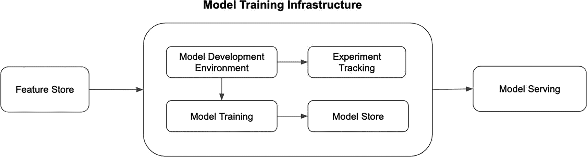

一张标题为“模型训练基础设施”的流程图。流程依次经过：特征存储、模型开发环境、实验跟踪、模型训练、模型存储和模型服务。

图 4-1
模型训练基础设施高层架构

与特征工程基础设施不同，目前尚无现成的端到端供应商解决方案可直接采用。不过，上述每个组件都有相应的开源或供应商解决方案。我们将在案例研究部分探讨其中一些选项。

接下来的章节将简要概述每个组件的独特功能，同时重点介绍业界和开源社区的常见做法。

### 模型开发环境

在模型开发与探索阶段，一个高度交互、协作且灵活的开发环境是数据科学家不可或缺的工具。该环境应提供快速反馈和可视化能力，使他们能够快速进行数据分析、可视化结果、迭代开发机器学习模型，并与同行交流发现。

机器学习社区中事实上的标准且广受欢迎的开发环境是 `Jupyter` 基于 Web 的交互式开发环境。根据其网站^(⁶¹)介绍，`Jupyter` 是一个开源软件，其品牌定位为“跨所有编程语言进行交互式计算的自由软件、开放标准及 Web 服务”。

其最新的笔记本界面称为 `JupyterLab`，它提供了一个灵活且强大的用户界面，集成了代码、文档、数据、丰富的可视化内容、图表图形以及交互控件。只需几条命令，即可轻松在本地机器上安装并运行 `JupyterLab`。

对于希望为数据科学家提供分布式共享 `Jupyter Notebook` 环境（无需在本地机器上安装软件）的团队或公司，可以利用该笔记本的多用户版本——`JupyterHub`。该项目在设计时充分考虑了灵活性，使团队和公司能够控制对资源和环境的访问，或自定义机器学习工作流程，并使用自己选择的工具和库。

#### 数据访问

模型开发与探索中的几个关键步骤是数据分析和可视化。为此，数据科学家需要能够访问集中管理的数据仓库（通常称为数据仓库或数据湖），其中包含多种数据集（部分可能数据量庞大），以及一些在不同机器学习项目中开发并使用的共享特征。因此，开发环境应提供对数据仓库的便捷且安全的访问。若缺乏这种访问，模型开发与探索将受到阻碍且进展缓慢。

#### 计算资源访问

一旦数据科学家能够访问所需的数据集或可用特征，他们便会开始分析并评估这些数据是否适合当前的机器学习任务。为了执行中到大规模的数据分析，他们需要访问超出笔记本电脑能力的计算资源，以便在短时间内完成数据密集型处理任务。

这正是分布式数据计算引擎发挥作用的地方。此类引擎的示例包括 `Apache Spark`、`Dask` 和 `Ray`。

注意
`Spark` vs. `Dask` vs. `Ray`
这三者都是广泛用于多样化数据处理需求的流行分布式计算框架。`Spark` 最为成熟，拥有庞大的生态系统，它通过多种语言（如 `Java`、`Scala` 和 `Python`）的高级 API，为大规模数据处理提供了强大的统一平台。`Dask` 擅长并行计算，并能与流行的 `Python` 库无缝集成，非常适合可扩展的复杂数据计算。而 `Ray` 则是一个计算框架，旨在实现 `Python` 和 `AI` 工作负载的高效分布式执行，其编程模型简单且支持自动并行化。
最终，选择哪个框架取决于任务的具体需求：`Spark` 适用于通用大数据处理，`Dask` 适用于以 `Python` 为中心的并行计算，`Ray` 适用于分布式和机器学习工作负载。

与上一节类似，开发环境应提供便捷的方式访问所需计算资源，以执行大规模数据分析。随着计算资源访问的频率和规模不断增加，建议投资于成本归属和成本管理能力，例如在集群闲置或一段时间不活动后自动关闭它们。

#### 模型开发体验

在训练大型神经网络或基于树的模型时，数据科学家希望了解模型训练过程并获取洞察，以便通过观察每次迭代中更新的关键指标（如损失和准确率）来更好地掌握进度。通过了解模型的学习效果，数据科学家可以在学习方向出现偏差（无论是由于过拟合还是收敛问题）时提前停止模型训练，从而避免浪费宝贵的数小时时间。

一些对改善模型开发体验极具价值的特定工具包括来自 `TensorFlow` 项目的 `TensorBoard`，以及用于理解模型可解释性的模型无关方法，例如 `LIME`、`SHAP` 和 `ICE` 图。

`TensorBoard` 是由 Google 开发的开源机器学习项目 `TensorFlow` 提供的一款广受欢迎且功能强大的机器学习实验可视化工具。现在，许多流行的机器学习库都提供了与 `TensorBoard` 的集成，例如 `Pytorch`、`XGBoost`、`Ray Train`、`HuggingFace` 等。

注意：模型可解释性

这指的是理解和解释机器学习模型如何做出预测的能力。通过提供对影响预测因素的洞察，模型可解释性有助于在实际应用中调试、优化和维护模型。

根据 `TensorBoard` 文档，以下是它提供的一些关键功能：

*   实时跟踪和可视化指标，例如损失、准确率、精确率和召回率。这对于了解模型的学习情况非常有用。
*   模型图可视化显示模型计算图的图形。这对于理解架构和数据流非常有用。
*   直方图和分布可视化显示模型中权重和偏差的分布。这对于理解过拟合等问题非常有用。
*   嵌入可视化可以将高维数据投影到低维空间。这对于理解数据点之间的关系非常有用。
*   分析器是一种性能分析工具，用于帮助分析模型的性能，以识别潜在的瓶颈。

像 `TensorBoard` 及其同类工具将显著改善机器学习开发的体验。因此，数据科学家在模型开发和实验方面的效率将更高。图 4-2 展示了训练和验证步骤中准确率和损失指标的可视化效果。

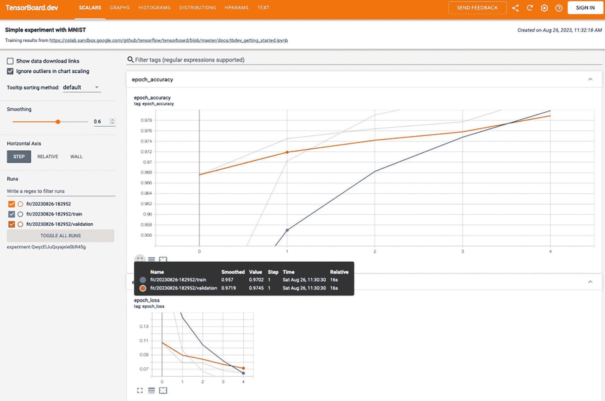

一个标题为 tensor board dot dev 的标签页截图。左侧窗格中勾选了“在图表缩放中忽略异常值”选项。右侧，一条标题为“周期准确率”的折线图绘制了两条上升的曲线。

图 4-2：几个指标示例的 `TensorBoard` 可视化

#### 可重现性

`MLOps` 的主要原则之一是可重现性。一旦模型开发和探索阶段尘埃落定，下一个合乎逻辑的步骤就是对模型训练代码进行版本控制。这服务于以下目的：

*   `可追溯性`：版本控制确保对脚本所做的更改可以被追溯。当其他数据科学家想要重现模型时，这非常有用。
*   `调试与故障排除`：当模型部署到生产环境后出现意外问题时，版本控制允许数据科学家回滚到已知的正常工作状态，或识别导致问题的更改。
*   `协作`：在某些情况下，可能有多个数据科学家在同一个模型上工作。版本控制使他们能够同时修改同一个脚本，并轻松合并更改或解决任何代码冲突。

开发环境应提供与 `GitHub` 等版本控制系统的无缝集成。这种集成使数据科学家能够轻松且自信地进行协作，因为他们知道自己的模型训练脚本得到了跟踪、组织并记录良好。因此，这将带来更有效的模型开发和实验。

### 实验追踪

机器学习模型的开发是一个需要反复实验的迭代过程。数据科学家通过调整不同的配置、测试各种算法以及选择不同的特征来系统地探索搜索空间。这个过程有助于创建不仅准确，而且稳健、公平且可解释的模型。这些活动统称为实验追踪，它带来了以下好处：

*   `可复现性`：使用相同的代码、数据和参数复现实验结果的能力，对于公司或数据科学家团队验证结果和诊断问题至关重要。
*   `协作`：追踪实验使数据科学家能够轻松地相互分享见解，并就改进模型性能或克服挑战的潜在想法进行协作。
*   `超参数优化`：除了追踪不同的超参数和配置组合外，实验追踪还能更容易地识别出哪些设置能带来最佳的模型性能。
*   `决策制定`：通过分析过去的实验来理解趋势、模式和失败原因，这些见解能指导数据科学家在未来做出更好的选择。

过去，数据科学家通常使用电子表格来追踪实验输入和实验结果。然而，这种方法既繁琐、容易出错、不可扩展，而且难以有效地分析和比较多个实验的结果。

随着 `MLOps` 学科逐渐成熟，开源社区和供应商都认识到需要一个强大的实验追踪解决方案。在深入探讨具体解决方案之前，我们先概述一下与实验追踪相关的常见需求：

*   `元数据管理`：能够追踪与每个实验相关的各种元数据（例如，作者、环境、依赖项）。
*   `数据管理`：能够高效地存储实验过程中产生的大量结构化和非结构化数据。这包括输入数据、模型输出、指标和各种工件。
*   `可扩展性`：随着实验数量的增加，管理和追踪它们会变得更加耗费资源。
*   `分析与可视化`：对多个实验中的各种指标进行有效的分析和丰富的可视化，将有助于数据科学家为其实验过程的下一步做出明智的决策。

在撰写本文时，已有众多实验追踪解决方案（来自开源社区和供应商）可供我们选择。所有这些解决方案都提供了一种通过 `Python` 库将实验追踪轻松集成到模型训练代码中的方法，其中一些还支持自动记录指标、参数、模型以及谱系信息，而无需显式的日志记录语句。一个广受欢迎且被广泛采用的开源实验追踪解决方案是 `MLflow`，它被定位为管理机器学习生命周期的平台，包括实验、可复现性、部署和中央模型注册中心。该平台包含四个组件：

*   `追踪`：通过 `API` 和 `UI` 记录、查询和可视化实验。
*   `项目`：一种打包数据科学代码的格式，以便在任何平台上复现运行。
*   `模型`：一种打包机器学习模型的标准格式，可用于各种下游工具，例如部署。
*   `模型注册中心`：用于存储、注释、发现和管理模型生命周期的中央仓库。

图 4-3 展示了 `MLFlow` 2.7.1 版本的实验主页。表格格式显示了一个实验列表及其关联的元数据。在这里，您可以通过点击第一列中相应的复选框，然后点击“比较”按钮，轻松比较两个或多个实验的结果。

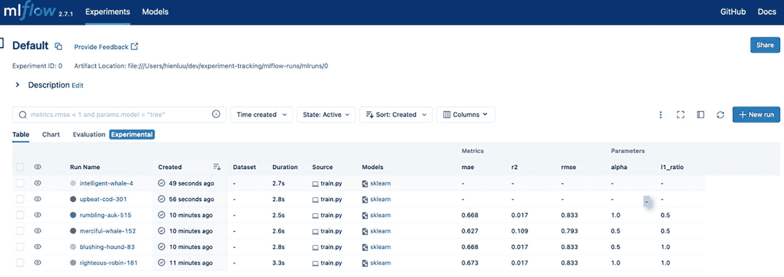

一个实验选项卡的截图。从选项栏中选择了表格选项。底部是一个包含十一列六行的表格。列标题如下：运行名称、创建时间、数据集、持续时间、来源、模型、MAE、R2、RMSE、Alpha 和 L1 比率。

图 4-3：`MLFlow` 实验追踪

要查看实验的详细信息，如其元数据、参数、指标和工件，请点击“运行名称”列下的实验名称，您将看到类似图 4-4 的内容。

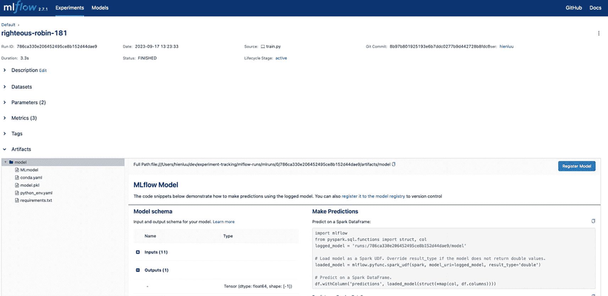

一个实验选项卡的截图。在左侧窗格的“工件”下选择了“模型”选项。右侧，在“`MLflow` 模型”下，有一段七行代码，标题为“进行预测”，以及一个名为“模型架构”的“名称”和“类型”选项。

图 4-4：`MLFlow` 实验详情

考虑到当今各种实验追踪解决方案的成熟度，采用一个开源解决方案或选择一个供应商解决方案都是非常合理的。这些解决方案已经取得了显著的发展，提供了丰富的功能，并且通常能与流行的机器学习库集成。通过利用这些成熟的解决方案，组织可以从既定的最佳实践、持续的支持以及来自开源或用户社区的丰富资源中受益。

大多数可用的解决方案都提供了相当可比的功能集来满足实验追踪的需求，包括记录实验信息和元数据的能力，一种简单直观的可视化实验指标并在多个实验间进行比较的方法，一种组织和搜索实验及元数据的方式，以及与各种流行机器学习库的无缝集成。

这篇实验追踪对比博客提供了截至 2021 年 12 月对 15 种流行实验追踪和管理工具的全面且有价值的见解。它既包括供应商解决方案，也包括开源解决方案。大多数供应商解决方案是托管在您首选云提供商上的托管解决方案，并且它们确实提供了免费层级以便于评估和探索。

#### 高层架构

就典型实验追踪解决方案的高层架构而言，如图 4-5 所示，它包含以下关键组件：

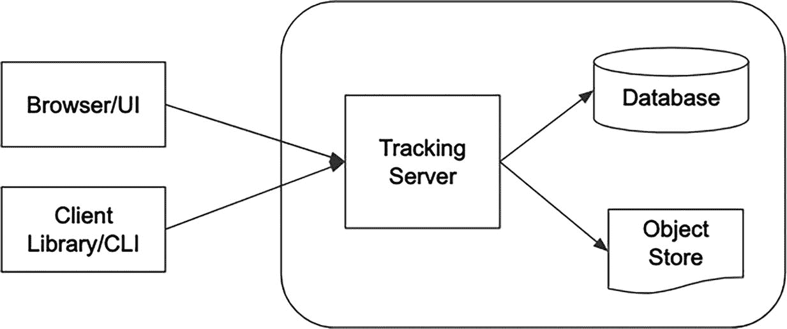

追踪系统架构的流程图。浏览器/UI、客户端库/CLI 指向追踪服务器。追踪服务器指向数据库和对象存储。

图 4-5：实验追踪系统架构

*   `追踪服务器`：该服务器处理来自用户界面或客户端库的请求。它是管理实验数据和用户交互的中心枢纽。
*   `关系型数据库`：追踪服务器与关系型数据库（如 `PostgresQL`）交互，以存储和检索实验追踪数据及元数据。这两类数据的示例包括关于实验、运行、参数、指标和其他相关数据的信息。
*   `对象存储`：追踪服务器与对象存储（如 `AWS S3` 或 `Google Cloud Storage`）交互，以存储和检索实验工件。这些工件包括模型二进制文件、图像以及在实验过程中生成的其他文件。

毫无疑问，实验追踪组件是模型训练基础设施的基本组成部分。从基础设施的角度来看，在模型训练开发阶段无缝集成实验追踪至关重要。

### 模型训练流水线


当模型探索和实验活动（通常是临时性的）进行到数据科学家已开发出满足目标性能指标的模型时，下一步就是将端到端的模型训练步骤打包成一个模型训练流水线，以生成机器学习模型。该流水线作为一个工作流，连接一系列相互关联的任务，例如数据预处理、模型训练函数、模型评估、模型部署等。模型训练流水线使数据科学家能够轻松且更频繁地将模型部署到生产环境中。

遵循软件工程最佳实践，模型训练流水线被视为代码，并由同行评审以确保遵循编码最佳实践，例如文档编写、模块化代码以提高可理解性和可维护性，以及版本控制。

模型训练流水线提供的一些优势包括：

*   **效率**：流水线将步骤序列编码化，使得自动化重复性任务变得容易，从而节省时间并减少人工干预。
*   **模块化**：以明确定义的方式构建步骤序列，使得在不中断流程的情况下进行更改成为可能。
*   **一致性**：一旦流水线中的步骤被编码化，就能确保它们保持一致，并使得从开发环境过渡到生产环境变得容易。
*   **实验便捷性**：定义良好且结构清晰的流水线使得运行实验和比较实验结果变得非常容易。这有助于增加模型训练的迭代次数，从而可能产生更好的模型。
*   **效率**：数据科学家通常会多次运行流水线，每次只对其中一个或两个步骤进行微小更改；可以重用上一次训练运行中未更改步骤的输出，以加快整体模型训练时间。这种情况的一个典型例子是，当更改仅应用于超参数设置时，可以重用上一次训练中的数据预处理步骤。

### 编排

机器学习流水线旨在表达需要发生的各种机器学习任务或步骤及其顺序，无论是顺序执行还是并行执行。构建和运维这些流水线对数据科学家来说可能非常耗时。这时，一个现代化的、对机器学习友好且数据驱动的编排系统应运而生，它通过使流水线的开发、调度、监控和管理变得简单，来帮助加速提升机器学习模型性能。

幸运的是，在过去的几年里，编排解决方案的成熟度大幅提升，以满足现代数据和机器学习工作负载的严苛需求，无论是在数据量、数据流水线复杂性还是机器学习模型训练的规模方面。此外，可选方案的数量也从寥寥数个显著增加到十几个。例如，这篇 MLOps 博客^(⁶⁵) 包含了一个相当详细的对比矩阵，涵盖了十三个编排工具在各个重要维度上的比较。该博客列出的大多数选项都是开源项目，而其中前景广阔且功能丰富的则是商业开源项目，这代表了公司和开源社区双赢的模式。

机器学习流水线通常包含两种类型的步骤：数据处理步骤和机器学习步骤。每种步骤类型都有其特定的需求，在理想情况下，我们希望采用一个能够满足所有这些需求的编排工具。

数据处理步骤的一些特定需求包括：

*   **多数据源和数据接收端**：特征工程步骤可能需要从各种数据源读取数据，然后输出结果将被持久化到常用的数据接收端之一。能够从各种数据源以多种数据格式读取数据非常重要。
*   **数据处理引擎**：特征计算通常由像 `Spark` 或 `Snowflake` 这样的数据处理引擎执行。能够与各种数据处理引擎交互并利用它们至关重要。
*   **数据作为一等公民**：数据集或表有其自身的特定属性，例如模式、所有权、数据质量检查、分区和服务水平协议。一个将这些属性视为一等公民的编排器将使数据科学家非常容易上手。

机器学习步骤的一些特定需求包括：

*   **库版本灵活性**：每个模型训练脚本可能使用不同的库集或同一库的不同版本。支持库版本管理是机器学习流水线的必要条件。
*   **计算资源管理**：大型机器学习模型通常需要使用 GPU 进行训练以加快训练速度。对多样化计算资源分配的内置支持将大大简化机器学习流水线的开发。
*   **实验跟踪**：与实验跟踪工具的原生集成，用于跟踪和记录训练实验，以及与更广泛的 MLOps 工具（如模型注册表）的集成，对模型训练流水线来说将极具价值。

众多现代编排工具的一个共同主题是与 Kubernetes 的原生集成，这为它们带来了诸多好处，例如隔离性、可扩展性和可靠性。

*   **隔离性**：每个机器学习流水线都在其独立的 Kubernetes Pod 中运行，这使得每个流水线可以自由使用自己的库和版本，并有助于防止库版本冲突。
*   **可扩展性**：Kubernetes 被广泛使用并经过实战检验，能够管理大型资源集群以支持机器学习流水线的工作负载需求。
*   **可靠性**：Kubernetes 提供了许多有助于确保机器学习流水线可靠性的功能，例如自动重启和自我修复。

**注意**

**Kubernetes 概述**

Kubernetes 是一个被广泛采用的开源容器编排平台。如今，大多数现代容器化应用程序都部署在 Kubernetes 集群上。Kubernetes 有助于自动化容器化应用程序的部署、扩展和管理。机器学习流水线就是容器化应用程序的一个例子。

#### 编排编程风格

在机器学习管道的语境中，数据科学家是负责构建或组装这些管道的角色。由于背景、个人兴趣等因素，他们选择的管道开发风格可能各不相同。然而，一个公认的事实是，Python 编程语言是大多数数据科学家的命脉。它被广泛用于各种数据科学任务，包括数据清洗、数据分析、模型训练和评估。此外，还有一个非常健全的、用 Python 编写的数据科学库生态系统。因此，如果风格更 Pythonic，数据科学家会感到更得心应手。

通常，编排工具提供两种构建工作流的常见方式，这与机器学习管道相同。第一种方法是在 YAML 文件中表达工作流结构，包括步骤、顺序和依赖关系。图 4-6 展示了 Argo 工作流的 YAML 格式 hello-world 示例^(⁶⁶)。第二种表达工作流结构的方式是在包含实际步骤逻辑的 Python 代码函数中添加工作流特定的装饰器。图 4-7 展示了来自 Flyte 编排工具的另一个 hello-world^(⁶⁷) 示例。

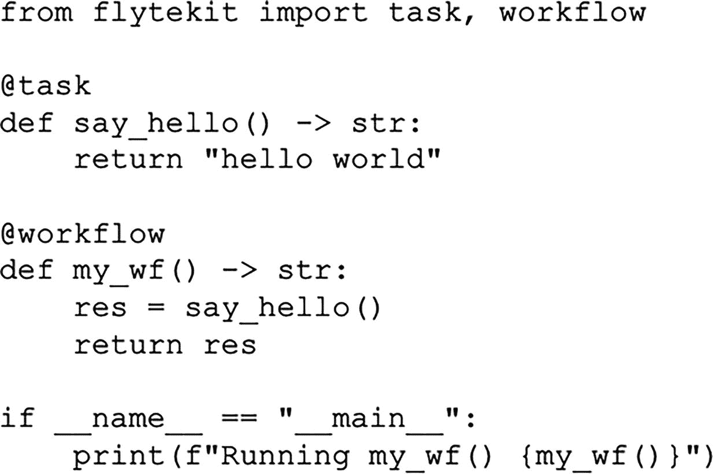

*一个十行 Python 代码脚本，用于执行向控制台打印 hello world 的简单工作流。*

**图 4-7**

**在 Python 文件中使用装饰器的工作流**

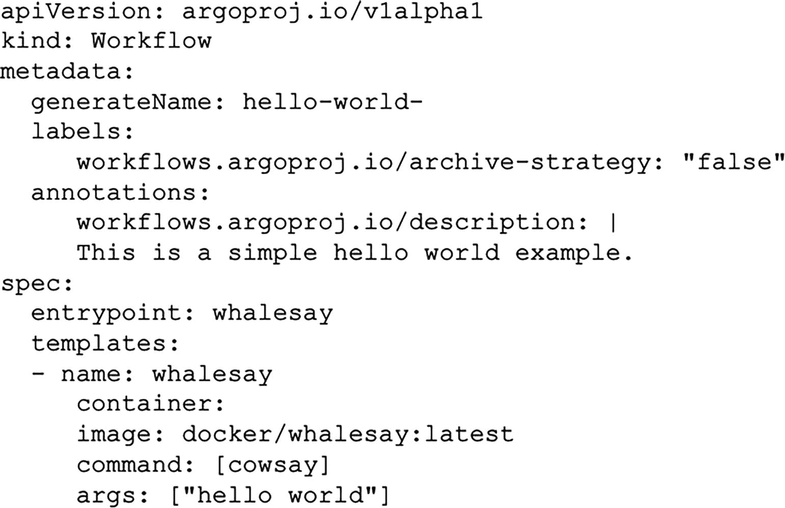

*一个 YAML 代码片段，表示一个 Argo 工作流，用于在容器内使用 cowsay 命令执行打印 hello world 的简单任务。*

**图 4-6**

**YAML 文件中的工作流**

上述两种表达工作流结构的风格截然不同，不仅体现在格式上，更重要的是，在思维模型和对数据科学家的友好程度上。将工作流结构的表达与实际逻辑结合在一个 Python 文件中，在构建机器学习管道时，可能会更受数据科学家的欢迎。

我们有大量设计精良且成熟的开源编排工具可供选择，包括 Argo、Dagster、Flyte、Metaflow、Prefect 等。采用其中一种工具来驱动机器学习管道的过程，可以通过建立一套评估标准而大大受益。需要考虑的几个因素包括：确保强大的隔离性以防止库冲突，评估对大型复杂管道的 Kubernetes 支持，以及优先考虑对数据科学家的友好性。

### 持续模型训练

机器学习模型由数据、算法和代码组成，如图 4-8 所示。在这三个组成部分中，数据变化最为迅速，尤其是在消费互联网市场。如果生产环境中已部署的模型没有根据现实世界变化导致的更新或变化的数据进行重新训练，模型预测将逐渐无法反映新的现实。因此，与预期性能相比，其性能将会下降。

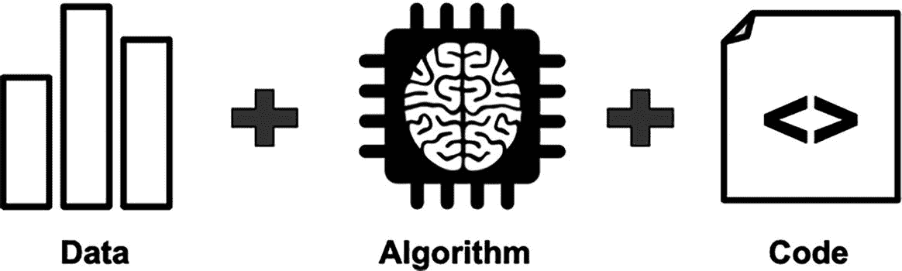

*核心组成训练图表。它包含数据加算法加代码。*

**图 4-8**

**机器学习模型的核心组成**

数据变化的一种类型被称为“数据漂移”。当用于模型预测的生产数据的统计属性（如分布）发生变化或偏离用于训练模型的基线数据时，就会发生数据漂移。

在 COVID-19 疫情期间，客户行为发生了快速而剧烈的变化，导致了数据漂移。以下是一些有趣且易于理解的例子：

*   在线购物：疫情期间，人们在线购物的方式发生了变化，这影响了用于预测购物行为的数据。
*   航空旅行：疫情导致航空旅行大幅减少，这影响了用于预测航班预订和客流量的数据。

要在模型部署到生产环境后保持其性能，需要能够以简单、自动化和安全的方式重新训练和重新部署它们。从学术意义上讲，这是一个合理的愿望，但在现实中，必须与相关的成本（包括金钱成本以及获取整理和标记数据、验证新模型或处理与新重新训练模型相关问题的耗时）进行权衡。

随着机器学习深度融入公司的核心业务工作流和在线产品，并持续在客户体验和收入增长等领域展现其价值，维护和改进这些模型性能的需求对企业变得越来越重要。实现这一目标的有效方法之一是持续模型训练，这也是 Google Cloud 的 MLOps 指南中 MLOps 第 1 级的主要关注点。^(⁶⁸)

为了有效地进行持续模型训练，强烈建议找到一种方法将其无缝集成到标准的机器学习开发工作流中，并制定一个满足公司特定需求和用例的持续模型训练实施策略。关于策略，需要考虑三个方面：^(⁶⁹)

*   **何时**：这指的是在什么条件下应触发机器学习管道来重新训练模型。
*   **什么**：这指的是决定用于重新训练模型的合适数据量，包括现有数据和新数据。
*   **如何**：这指的是更全面的评估，即是否也需要调整任何超参数，或迭代新模型版本，作为使用新数据进行模型重新训练工作的一部分。


# 模型训练基础设施

在这三个方面中，模型训练基础设施有更多见解并能直接提供支持的是第一个方面。最后两个方面通常由模型所有者决定，因为他们最了解特定的机器学习用例、模型架构以及模型演进的当前状态。

关于何时最佳地触发机器学习管道来重新训练模型，三种常见的方法是定期重新训练、基于模型性能和数据变化。

*   **周期性重新训练**：这是一种基于时间或 `cron` 表达式的简单直接的方法。它既易于理解，也易于实现。当训练频率与数据变化模式一致时，此方法效果最佳。如果两者不匹配，那么模型重新训练可能在时间和计算资源上都是不必要且浪费的。

*   **模型性能**：此方法依赖于模型性能下降的经验证据。它更适用于能够快速获取真实标签的机器学习场景，例如广告点击率预测。然而，它不太适用于获取真实标签需要较长时间的场景，例如贷款审批预测。

*   **数据可用性或变化**：这是一种主动提升模型性能的方法，当新数据可用或数据分布发生变化时，对模型进行重新训练。此方法非常适用于无法快速获取真实标签的场景。

对于某些用例，触发机器学习流水线进行模型重新训练的最佳方法可能是上述方法的组合。

一个现代编排工具可以轻松地基于周期性重新训练或数据可用性来处理持续的模型训练。然而，对于其他两种方法（模型性能和数据变化），模型训练基础设施需要提供机制来跟踪和监控它们。然后，当这些指标低于或超过配置的阈值时，触发模型训练流水线重新训练模型。

## 大规模模型训练

当你的机器学习项目中出现以下一个或多个需求时，模型训练会变得特别具有挑战性：

*   数据集容量超过了单台计算机的存储能力。这在以下领域的机器学习用例中经常出现：自然语言处理、计算机视觉和机器翻译。

*   模型过于复杂，其参数数量超过了单台计算机的内存容量。这在具有多层和大量参数的深度神经网络模型中很常见，例如 `GPT-3` 或 `BERT` 模型。

*   在大型数据集上的训练时间可能极其漫长。

深度神经网络社区中存在一种对使用大型数据集训练大型复杂模型的执念。这种执念背后的一个重要原因是，研究表明，深度神经网络模型在大型数据集上训练时能够达到最先进的性能。^(⁷⁰) 这对于机器翻译或计算机视觉相关任务尤其如此。图 `4-9`^(⁷¹) 展示了深度学习模型优于传统机器学习模型，并且这些神经网络模型训练所用的数据越多，其性能就越好。

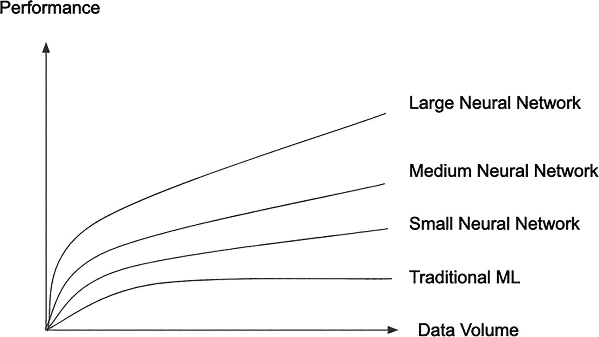
一张性能与数据量的折线图。大型神经网络、中型神经网络和小型神经网络的曲线呈上升趋势。传统机器学习的曲线先上升，然后趋于平稳。

图 `4-9`

深度神经网络模型性能对比

对于大多数企业和实际的机器学习项目而言，上述三个需求中的最后一个最为常见。数据科学家依赖于在模型开发过程中快速迭代的能力，以生成高性能模型。为了应对这一挑战，模型训练基础设施应提供工具和计算资源，使数据科学家能够利用分布式模型训练。

### 分布式模型训练

分布式模型训练主要适用于深度学习，它结合了分布式系统原理和机器学习技术，通过将训练工作负载分布到集群中的多台机器上，并确保模型训练具有容错性和可扩展性，从而在配备 GPU 的机器集群上训练模型。分布式模型训练的主要目标是加速训练过程，并促进训练那些过于庞大或复杂而无法在单台计算机上训练的模型。

分布式模型训练的两种主要方法是数据并行和模型并行。这些方法的复杂性超出了本书的范围，以下是这些方法的简化解释。

在数据并行中，训练数据被分割成更小的批次并分布到不同的机器上，每台机器在自己的数据批次上训练模型，如图 `4-10` 所示。然后将结果合并以生成一个单一的模型。这种方法适用于大多数深度神经网络模型架构，这也是它被广泛采用的原因。

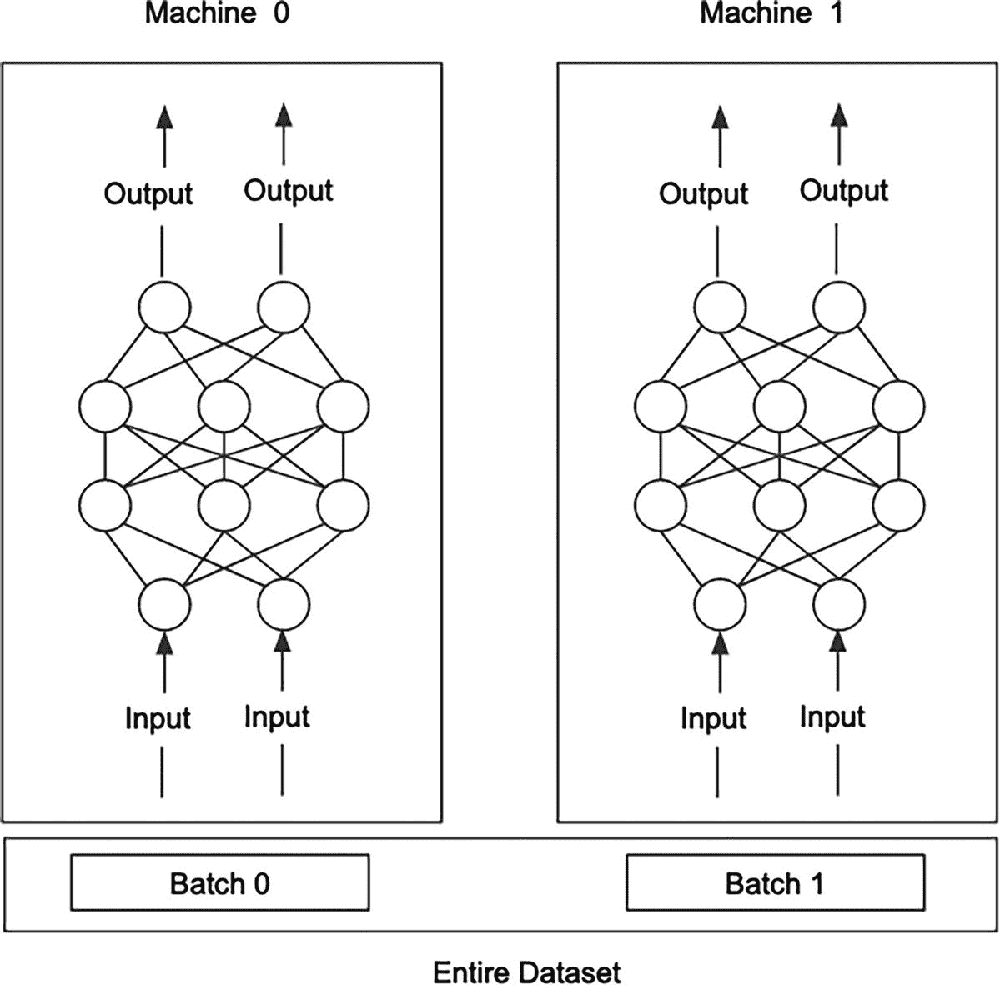
一个分为两部分的流程图，标题为“数据并行训练的整个数据集”。左侧流程为：批次 0、输入、节点网络、输出、机器 0。右侧流程为：批次 1、输入、节点网络、输出、机器 1。

图 `4-10`

数据并行

在模型并行中，大型模型被分割成更小的部分并分布到不同的机器上，每台机器使用相同的完整训练数据训练自己负责的模型部分，如图 `4-11` 所示。当深度神经网络模型架构的某些部分可以独立并行计算时，这种方法效果最佳。

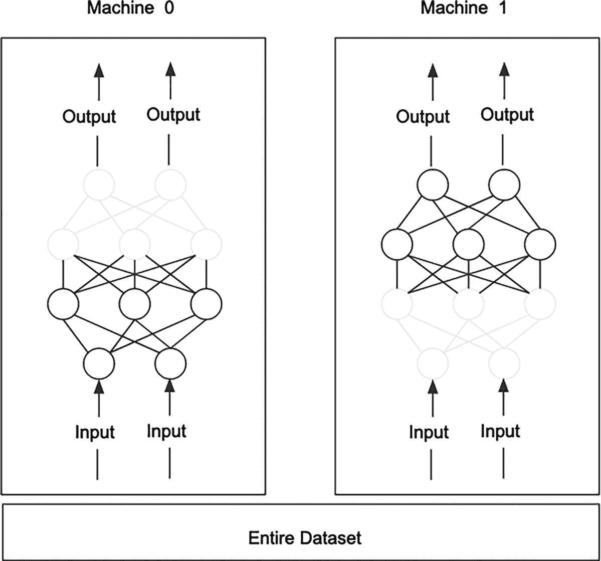
一个模型并行的流程图。流程从整个数据集开始，最终到达机器 0 和机器 1。

图 `4-11`

模型并行

幸运的是，大多数流行的深度学习库，如 `TensorFlow` 和 `PyTorch`，都内置了对分布式训练的支持。

从模型训练基础设施的角度来看，它应该提供集群管理功能，能够以自助且高效的方式启动和拆除集群。这正是 `Kubernetes` 发挥作用的地方。现代模型训练基础设施现在依赖 `Kubernetes` 来配置和编排模型训练工作负载，确保提供适当的计算资源，包括节点、CPU 和 GPU 的数量。此外，`Kubernetes` 为不同的模型训练任务提供了清晰的隔离，使每个任务都能自由使用所需的库或特定库版本来满足其需求，例如探索某个分布式学习库中的新特性。

为了帮助加速模型探索和开发步骤，集群应配置常用的深度学习库和工具，以帮助数据科学家了解模型训练的进展以及集群的使用效率。

来自 `Lyft` 机器学习平台团队的 `LyftLearn` 架构^(⁷²) 对其模型训练基础设施进行了全面概述。它概述了基本组件及其交互，为那些构建自己模型训练基础设施的人提供了宝贵的蓝图。虽然高层视图可能看起来很简单，但重要的是不要低估将这种架构变为现实所需的复杂性和工作量。有句名言说得好：“细节是魔鬼”，在这种情况下确实如此。

## 模型注册表

模型训练步骤的输出是机器学习模型及其相关元数据。随着时间的推移，随着更多机器学习项目的开展和更多数据科学家的加入，模型的数量将会增长。当模型数量增加时，手动追踪和发现它们，并以临时的手动方式管理其生命周期，会变得日益具有挑战性、耗时且容易出错。这时，采用模型注册表就成为了一个明智的选择。在金融服务、医疗保健和保险等高度监管的行业中，模型注册表有助于模型治理和验证，以确保遵循正确的模型部署流程，并具备详细的审计和追踪功能。

从高层来看，模型注册表是 MLOps 的关键组成部分，它为发布机器学习模型和管理其生命周期提供了一个结构化的、受控的环境。其作用类似于软件开发中的 `Artifactory` 或 `Docker Hub`。此外，它在机器学习开发生命周期的模型开发和运营化阶段之间扮演着重要的桥梁作用^(⁷³)，如图 `4-12` 所示。

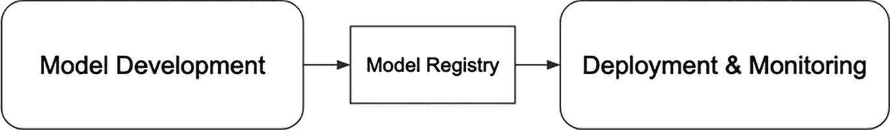
一个将模型注册表作为训练桥梁的流程图。流程如下：模型开发、模型注册表、部署与监控。

图 `4-12`

模型注册表作为桥梁

在深入探讨模型注册表的技术细节之前，我们先讨论一下它能为公司内部的整个机器学习社区带来的好处。请注意，当应用机器学习的规模达到某个关键阈值时，例如超过两个机器学习团队或模型数量超过十个，这些好处将带来巨大的回报。

*   **文档与发现**：通过将适当的元数据和模型产物存储在集中式存储库中，数据科学家、机器学习工程师和其他人员可以轻松发现公司内其团队或其他团队开发的各种模型的状态和生命周期。如果他们感兴趣，可以轻松地了解这些模型是如何训练的，以及由谁训练的。

*   **协作**：参与管理模型生命周期或调试模型相关问题的各个团队，当他们都能在集中位置访问关于各种模型的相同信息时，可以轻松地进行协作。

*   **部署**：模型注册表充当了模型开发过程中的机器学习实验与运营化之间的桥梁，运营化可能是运营团队而非数据科学家的职责。只有发布到模型注册表的模型才会被测试、验证并部署到生产环境，而不是数据科学家笔记本电脑上的某个随机模型。

*   **生命周期管理**：某些模型注册表提供预定义或可配置的模型部署阶段。让模型注册表管理模型部署生命周期，可以使所有团队更容易追踪特定模型的当前阶段。

*   **模型治理**：这个话题对于处于高度监管行业的公司可能更为重要。模型访问控制、部署权限、审计报告和模型谱系是负责任的人工智能治理最佳实践的重要方面。

**注意**

### 模型注册表、模型存储、模型仓库

作为一个 MLOps 行业，我们非常擅长为概念和想法创造术语，有时由于定义重叠和缺乏监管，这会导致混淆。快速上网搜索会发现，这些术语通常看起来密切相关，有时甚至同义。虽然可能存在细微差别，但更重要的是专注于理解在 MLOps 背景下，与管理机器学习模型、其元数据及其生命周期相关的角色、好处和高级技术细节。

与实验追踪解决方案的成熟度类似，基于开源和供应商的模型注册表解决方案都已达到相当成熟的水平。我们现在有广泛的选择可供挑选。考虑到这些模型注册表解决方案的当前状态，以及您的组织是否需要这样一个系统，强烈建议采用一个现成的解决方案，而不是内部构建，除非现有解决方案都无法满足非常具体的要求。

`MLFlow` 有一个名为“模型注册表”的组件。模型注册后，它们会显示在“已注册模型”表中，如图 `4-13` 所示。

模型版本详情屏幕将显示模型元数据和关联的实验运行，图 `4-13` 是其外观示例。

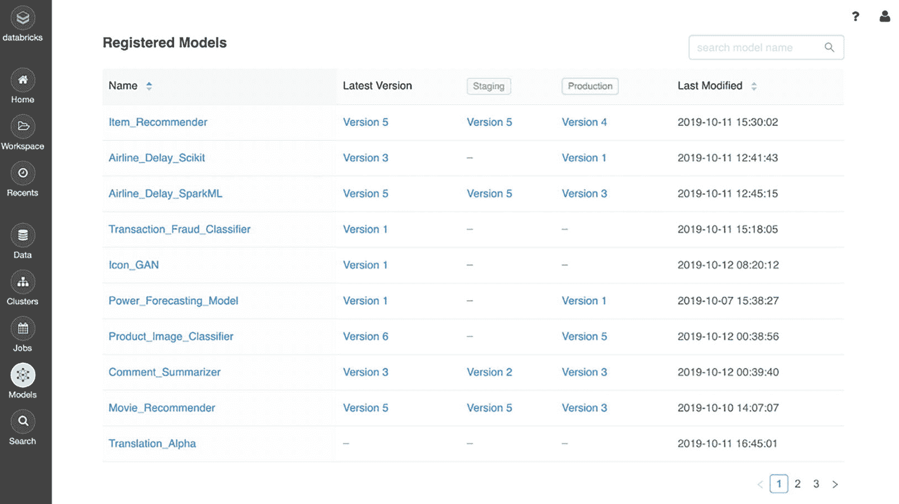

# 模型注册表与模型训练基础设施

一个标签页的截图。从左窗格中选择模型选项。右侧是一个标题为“已注册模型”的表格，包含五列十行。列标题如下：名称、最新版本、预发布、生产环境和最后修改时间。

图 4-13

MLFlow 已注册模型

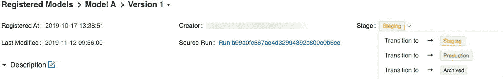

版本 1 属性的截图。它列出了注册日期、最后更新日期、创建者、来源运行、阶段和描述。

图 4-14

已注册模型的元数据和实验

这篇与模型注册表相关的博客^(⁷⁴)不仅分享了最佳的模型注册表工具及其比较方式，还概述了评估标准，以帮助读者决定最适合他们的工具。

### 高层架构

虽然模型注册表架构中的一些内部组件与实验追踪架构中的组件非常相似，但有几个关键部分值得关注：

*   `下游服务集成`：提供一种可扩展且简便的方式，供下游服务通过 `API` 集成消费或下载机器学习模型。

*   `状态转换`：记录并管理模型部署生命周期从开发、预发布、生产到归档的状态转换。

*   `访问控制`：管理访问控制，并附带详细的审计日志，以满足合规和治理要求。

*   `实验追踪集成`：出于谱系目的，将生成特定模型版本的实验信息作为已发布模型元数据的一部分包含在内非常重要。

图 4-15 描绘了模型注册表的高层架构。除了处理来自各种客户端的 `HTTP` 或 `gRPC` 协议请求，并与各种后端存储交互以处理结构化元数据和模型的标准服务外，内部可能需要复杂的访问控制管理逻辑，并可能与内部 `LDAP` 系统集成以进行身份验证和角色管理。此外，它可能需要复杂的逻辑，通过预定义或可配置的生命周期来精确追踪和转换模型。

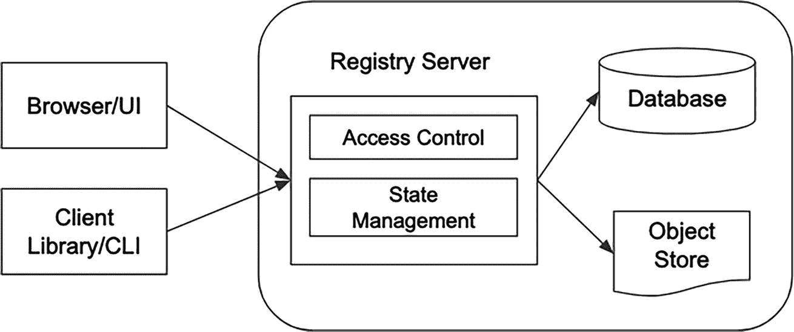

模型注册表运行的流程图如下：浏览器/UI 和客户端库/CLI 指向注册表服务器下的访问控制和状态管理。注册表服务器指向数据库和对象存储。

图 4-15

模型注册表高层架构

模型注册表是模型训练基础设施的重要组成部分，充当机器学习开发生命周期中模型开发与运营化阶段之间的桥梁。

## 案例研究

模型训练基础设施在赋能数据科学家和机器学习工程师方面扮演着关键角色，它能够加速模型开发与探索阶段，同时推广围绕协作、可重复性和自动化的最佳实践。模型训练基础设施所需的复杂程度取决于多种因素，包括活跃的机器学习用例数量、数据科学家的人数、机器学习模型的规模和复杂度，以及机器学习在产品开发中的整合程度。

对于初创公司或刚踏上机器学习应用之旅的组织而言，将大部分（即便不是全部）模型训练基础设施需求依托于云服务商解决方案是相当明智的选择。另一种方案是结合云服务商解决方案、内部解决方案以及精选供应商解决方案的优势。

对于拥有众多机器学习用例、相当数量的数据科学家，且机器学习已成为产品开发核心组成部分的中型组织而言，重点则更多地放在可扩展性、可伸缩性、效率以及自助服务上。这需要通过提供抽象层和胶水代码，将来自内部、供应商和开源社区的众多解决方案无缝整合成一套内聚的组件。

### 内部方案

这方面的一个典型案例是 Instacart 的机器学习平台 Griffin。该平台为满足业务增长（这转化为越来越多的机器学习应用）而迅速发展。他们的重点是帮助“机器学习工程师快速迭代机器学习模型，轻松管理产品发布，并密切跟踪其生产应用。”^(⁷⁵) 基于此，他们着手构建模型训练基础设施，主要考虑了以下几点：

*   `可伸缩性`：平台必须能够容纳数千个机器学习应用。

*   `可扩展性`：必须具有灵活性和可扩展性，以支持机器学习开发过程中的各种机器学习工具及其他必要的外围系统。

*   `通用性`：平台应提供统一的工作流和一致的用户体验，同时抽象掉与第三方解决方案的广泛集成。

图 4-16 描绘了 Griffin 系统架构的简化版本，并主要关注与模型训练基础设施相关的组件。

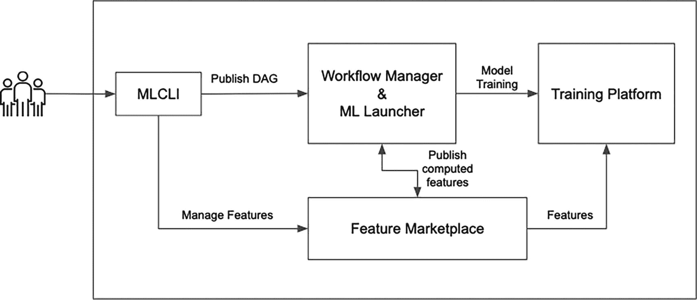

Griffin 系统架构流程图。流程依次经过：用户、ML CLI、发布 DAG、管理特征、工作流管理器和 ML 启动器、发布计算特征、特征市场、模型训练、特征以及训练平台。

`图 4-16`

根据其工程博客改编的 Griffin 系统架构

`MLCLI` 是机器学习工程师与 Griffin 机器学习平台交互以开发其机器学习应用和管理模型生命周期的主要接口。在高层面上，它通过从基础模板生成机器学习工作流代码，提供了一种简单的入门方式。然后，机器学习工程师可以自定义生成的代码以满足其需求，最后以流水线的形式提交代码来训练他们的机器学习模型。

在机器学习流水线调度和编排方面，Griffin 使用 `Airflow` 作为编排器。机器学习流水线以声明方式用 `YAML` 格式定义。这种抽象隐藏了使用 `Airflow` 的底层复杂性，使机器学习工程师能够专注于定义其机器学习流水线任务。

为了适应机器学习框架的多样性，例如 `Tensorflow`、`Pytorch`、`scikit-learn` 等，Griffin 提供了一个与框架无关的训练平台，该平台标准化了包管理、元数据管理和代码管理。为了训练模型，机器学习工程师首先选择适合其用例的训练框架，然后提供模型训练逻辑和超参数。模型训练平台的底层机制负责配置所需的计算资源并启动模型训练任务。

为了支持模型训练过程中的实验和指标跟踪，使用了 `MLflow` 来管理和存储这些信息，并用于管理模型，充当模型注册表。

2023 年初，Instacart 的机器学习平台面临着对分布式机器学习技术日益增长的需求，以支持业务增长和机器学习产品。因此，他们扩展了 Griffin，使其能够高效处理 `CPU` 和 `GPU` 上的分布式机器学习工作负载，并通过机器学习库支持多样化的机器学习范式，旨在支持以下目标^(⁷⁶)：

*   能够以高效的资源利用率训练数千个中小型模型

*   能够有效且高效地使用大型数据集训练深度学习模型

*   能够以可伸缩的方式对海量数据执行批量推理

`Ray`^(⁷⁷) 是一个开源统一计算框架，可轻松扩展 `AI` 和 `Python` 工作负载，被选为其分布式机器学习训练平台的基础计算框架。图 4-17 描绘了高层级的分布式模型训练架构，以及在交互式和自动化模型开发过程中的流程。需要强调的主要方面是，支持这两种流程的是相同的后端组件，这些组件由运行在弹性 `Kubernetes` 上的 Griffin 工作流控制平面和 Ray 集群组成。

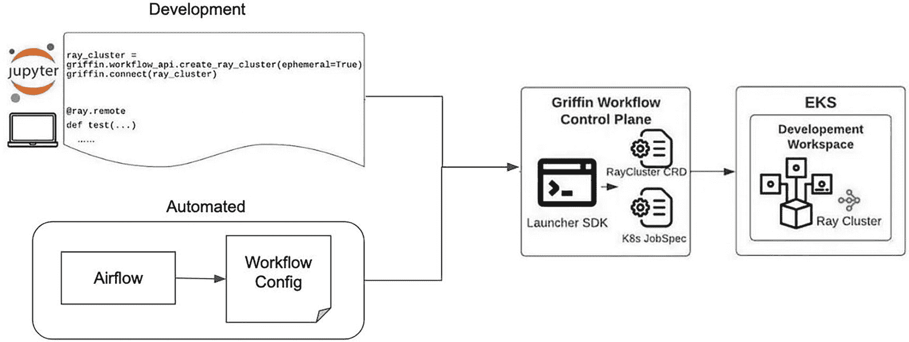

内部方案训练基础设施流程图。流程从开发和自动化开始，到 `EKS` 下的开发工作区结束。

`图 4-17`

Griffin 工作流控制平面和 Ray 集群如何在交互式和自动化模型训练中使用的改编图¹⁷

### 开源方案

MLOps 生态系统中最受欢迎且被广泛采用的开源项目之一是 `MLflow`，它通常被描述为一个用于管理端到端机器学习生命周期的开源平台。它由 `Databricks` 团队于 2018 年中创建，一年后的 2019 年中发布了 1.0 版本。^(⁷⁸) 在过去的几年里，`MLflow` 在功能方面稳步成熟，其采用率也急剧增加，月下载量超过一千万次。^(⁷⁹) 在撰写本文时，`MLflow` 2.7 版本包含了一些与 `LLM` 相关的功能，尽管它们仍处于实验阶段。

以下部分将概述 `MLflow`、其主要功能集以及高层级架构。

#### MLflow 概述

根据 `MLflow` 官网所述，^(⁸⁰)“`MLflow` 是一个多功能、可扩展的开源平台，用于管理机器学习生命周期中的工作流和产物。它与许多流行的 `ML` 库有内置集成，但也可以与任何库、算法或部署工具一起使用。它被设计为可扩展的，因此你可以编写插件来支持新的工作流、库和工具。”

上述描述相当准确，尽管内容密集，乍看之下，`MLflow` 中的一些重要方面可能并不显而易见。

自诞生以来，`MLflow` 一直秉持模块化和开放接口的设计理念，以无缝集成到模型开发工作流中。它提供了命令行界面、`REST API` 和用户界面，以便轻松集成模型开发阶段的各个步骤，包括实验跟踪、模型打包、模型部署等。

从官网下载 `MLflow` 后，只需使用几条命令就能在本地机器上轻松启动并运行它。对于跨多个团队的生产环境使用，则需要投入更多精力来配置 `MLflow` 以使用持久化存储，其中一些细节将在下文介绍。

#### MLflow 功能集

`MLflow` 2.7 版本提供了五个生产就绪组件（见图 4-18）和两个实验性组件。采用 `MLflow` 并非一个“全有或全无”的决定；相反，你可以完全自由地选择从哪些组件开始使用。

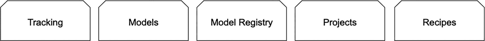

MLflow 的五个生产就绪组件。这些组件如下：跟踪、模型、模型注册表、项目、配方。

图 4-18

MLflow 的五个生产就绪组件

其中两个值得注意的组件是跟踪和模型注册表，数据科学家和机器学习工程师最常使用并与它们交互。其他三个组件主要侧重于提供最佳实践，以帮助打包机器学习项目、模型，并定义一致的机器学习工作流。在模型训练基础设施的背景下，跟踪和模型注册表组件尤其相关，下文将讨论它们的功能。

## MLflow 跟踪

这个组件通常是用户在评估是否采用 MLflow 时首先探索的。它的主要重点是满足模型探索和开发阶段的实验和元数据跟踪需求。这使得数据科学家能够摆脱使用传统、手动且容易出错的方法，例如电子表格或类似方法。

MLflow 跟踪的核心概念称为“运行”，可以分组到实验下。每次运行可以简单到执行一段机器学习代码，也可以复杂到使用一组超参数进行端到端的模型训练运行。在这些运行期间，我们可以使用 API 记录各种参数，包括代码版本、指标、输出文件或任何其他有用的产物。

一旦数据科学家完成了多次运行以试验各种超参数组合或不同的特征集，他们就会使用提供的跟踪 UI 来可视化、搜索和比较同一实验中的运行。如有必要，他们还可以下载运行结果。图 4-19 展示了跟踪 UI 的一个示例。

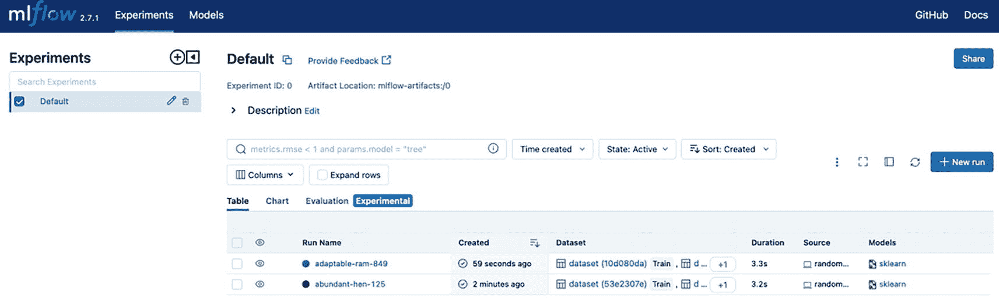

一个实验选项卡的截图。从左侧窗格中选择了“默认”选项。右侧是一个包含六列两行的表格。列标题如下：运行名称、创建时间、数据集、持续时间、来源、模型。

图 4-19

表格形式的 MLflow 跟踪 UI

MLflow 跟踪组件中最令人兴奋的功能之一是自动日志记录。此功能使数据科学家能够记录指标、参数和模型，而无需在模型训练代码中散布日志语句。换句话说，不需要显式的日志语句。开箱即用，此自动日志记录功能支持常用的机器学习库，例如 `Scikit-learn`、`Keras`、`Pytorch`、`XGBoost`、`LightGBM` 等。清单 4-1 展示了来自 MLflow 官网的一个简短的 `scikit-learn` 自动日志记录示例。

```python
import mlflow
from sklearn.model_selection import train_test_split
from sklearn.datasets import load_diabetes
from sklearn.ensemble import RandomForestRegressor
mlflow.autolog()
db = load_diabetes()
X_train, X_test, y_train, y_test = train_test_split(db.data, db.target)
# Create and train models.
rf = RandomForestRegressor(n_estimators=100, max_depth=6, max_features=3)
rf.fit(X_train, y_train)
# Use the model to make predictions on the test dataset.
predictions = rf.predict(X_test)
autolog_run = mlflow.last_active_run()
```
清单 4-1
一个简短的 scikit-learn 自动日志记录示例

图 4-20 中的跟踪 UI 展示了上述代码在具有不同 `n_estimators` 和 `max_depth` 参数组合的两次运行之间的比较。

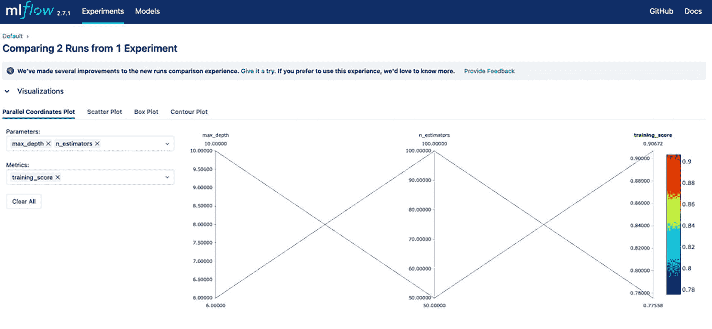

一个实验选项卡的截图。从左侧窗格中选择了“平行坐标图”选项。右侧有两个折线图。左侧图表有一条递减线和一条递增线，分别对应 0.9 和 0.78。右侧图表有一条递减线和一条递增线，分别对应 0.78 和 0.9。

图 4-20

MLflow 跟踪 UI 比较了两次使用不同参数（`n_estimators` 和 `max_depth`）的训练得分

## MLflow 模型注册表

MLflow 模型注册表旨在帮助数据科学家和机器学习工程师通过集中存储模型及其相关元数据，来协同管理模型的生命周期。这些元数据包括生成该模型的 `MLflow` 实验和运行、版本、注释以及状态转换等详细信息。与此组件的所有交互均通过提供的 API 和用户界面进行。

与此组件交互的第一步是使用前述方法之一注册模型。注册后的模型会被分配一个唯一名称，并包含上述各种元数据。`MLflow` 运行详情页面提供了一个“已注册模型”按钮，方便通过用户界面进行模型注册，如图 4-21 所示。

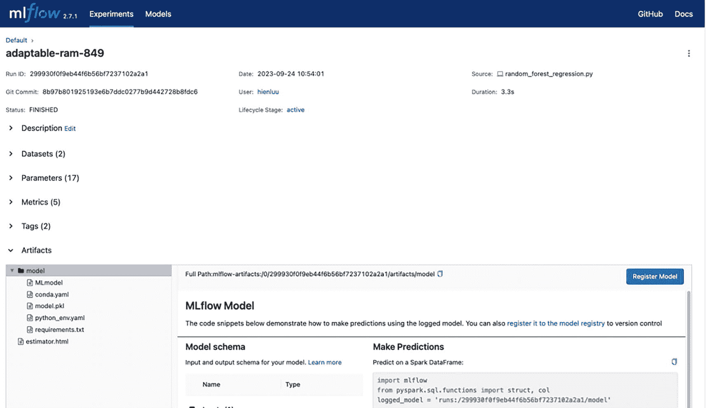

一个实验选项卡的截图。在左侧窗格的工件下选择了模型选项。右侧，在 `MLflow` 模型下，有一个三行代码，标题为“进行预测”，以及一个标题为“模型架构”的名称和类型选项。

图 4-21

使用 MLflow 运行详情用户界面注册模型

数据科学家通常会训练同一模型的多个版本，每个版本使用略有不同的超参数组合。在 `MLflow` 模型注册表中，一个已注册模型可以拥有多个版本，如图 4-22 所示，该图展示了这一场景的示例。

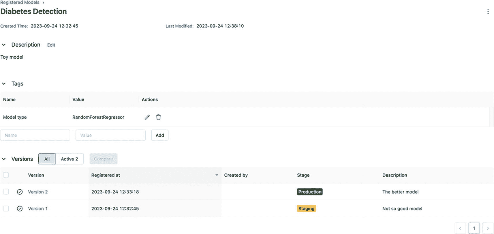

一个糖尿病检测选项卡的截图。在版本下选择了“全部”选项。版本下方有一个包含五列两行的表格。列标题如下：版本、注册时间、创建者、阶段和描述。

图 4-22

在 MLflow 已注册模型用户界面中显示的一个拥有两个版本的已注册模型

在模型阶段方面，`MLflow` 为常见用例提供了预定义阶段，例如“预发布”、“生产”和“归档”。在任何给定时间，每个不同的模型版本只能被分配一个阶段，这意味着同一模型的两个版本不能处于同一阶段。定义自定义阶段的能力是当前 `MLflow` GitHub 上开放的功能请求之一。^(⁸¹)

## MLflow 高层架构

从高层来看，`MLflow` 系统的逻辑架构（如下图 4-23 所示）是一个标准的三层架构，包含三个部分：`MLflow` 客户端、跟踪服务器和后端存储。

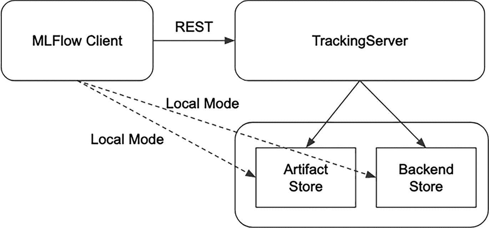

`MLflow` 系统中组件的流程图。流程经过 `MLflow` 客户端、REST、本地模式、跟踪服务器、工件存储和后端存储。

图 4-23

MLflow 系统逻辑架构中的三个主要组件

`MLflow` 客户端使用 `MLflow` 库通过 `REST` HTTP 协议与跟踪服务器进行交互。`MLflow` 客户端可以是一个模型训练脚本，也可以是一个与跟踪服务器交互以查询、更新或插入运行信息或模型注册相关操作的应用程序。

跟踪服务器充当一个 `REST` 服务，根据配置类型对后端存储以及可能的工件存储执行操作。当在本地模式下使用 `MLflow` 时，`MLflow` 客户端将直接与本地工件存储和后端存储交互。

`MLflow` 在后端存储中记录实验和运行的元数据、参数、指标及其他详细信息。后端存储支持两种存储类型：文件存储或数据库支持的存储。文件存储主要用于单人使用或探索阶段。对于生产环境，建议设置一个 `MySQL` 或 `Postgres` 的实例来持久化数据。工件存储用于存储工件输出，例如模型、图像和其他非结构化数据。对于生产环境，建议使用诸如 `AWS S3`、`Azure Blob Storage` 或 `Google Cloud Storage` 等分布式存储服务。

`MLflow` 跟踪组件提供了多种不同的选项来记录运行和工件，以满足从单个用户到大型组织的需求。这些选项在其文档中有详细描述。^(⁸²)

## 摘要

模型训练基础设施是机器学习基础设施中第二个且重要的支柱。在这里，进行着开发、探索、训练、实验和验证机器学习模型的复杂过程。一个成功的机器学习项目的关键要素，是数据科学家能够快速探索、实验和训练模型。他们需要一套必要的工具来支持多样化的活动，包括交互式开发环境、实验跟踪、模型训练、模型生命周期管理等。

模型训练基础设施的复杂程度由几个因素驱动：机器学习用例的数量、数据科学家的数量、模型的复杂性、用于训练模型的相关数据量，以及期望的 MLOps 成熟度水平。不过，至少它应该提供以下组件：

*   交互式开发环境，例如 `Jupyter notebooks`

*   实验与元数据跟踪

*   模型训练

*   模型流水线编排

*   模型注册表

近年来，在 MLOps 工具领域涌现了许多创新，既有来自开源社区的，也有来自供应商的。目前，组织对于上述组件有许多可用的选择。虽然“自建与购买”的讨论比以前更简单了，但针对特定解决方案的决策过程仍然是一项复杂的任务。对于有兴趣探索开源解决方案的组织来说，`MLFlow` 应被视为满足其实验跟踪和模型注册表需求的一个选项。

无论规模大小，拥有少量机器学习用例的组织应考虑从利用供应商管理的解决方案开始。当机器学习用例数量超过十个，并且机器学习成为其产品开发中不可或缺的一部分时，那么投资构建一个抽象层来整合来自开源、供应商和内部开发的解决方案可能就变得有意义了。这种方法确保了数据科学家获得一致的体验，使底层基础设施能够适应未来发展，并促进未来的效率提升。

一旦上述基础设施组件可用并投入运行，达到 MLOps 第 2 级^(⁸³) 就变得更容易实现。这个成熟度水平是那些致力于充分利用机器学习全部潜力的组织的目标水平。在此成熟度水平下，组织可以通过建立 ML 流水线，以最少的人工干预自动重新训练和部署新模型，从而有效应对数据或业务环境的快速变化。

脚注 1   2   3   4   5   6   7   8   9   10   11   12   13   14   15   16   17   18   19   20   21   22   23