# 5. 模型服务基础设施

在机器学习社区中，有一句常见的说法：ML 项目的投资回报率始于模型投入生产之时。这句话提醒我们，只有当训练好的模型被部署并在生产环境中积极使用时，ML 项目的真正价值才能得以实现。模型服务基础设施在将 ML 模型投入生产运营，以及将 ML 项目整合到组织的运营中（例如预测客户流失、检测欺诈活动、个性化客户体验、提高产品和服务质量等）方面，扮演着至关重要的角色。

与 ML 平台内的其他基础设施相比，模型服务基础设施庞大且复杂。它需要大量的软件工程知识，并且面临众多挑战，尤其是在大规模执行实时推理，以及支持组织内多个团队不断部署和实验的大量 ML 模型时。

注意

模型推理与模型预测

模型推理和模型预测是两个紧密相关的概念，经常互换使用；然而，它们的含义略有不同。

模型推理的概念是关于使用训练好的 ML 模型对模型未曾见过的新数据进行预测或决策的过程。

模型预测的概念指的是模型生成的输出或决策，它可以是概率分数、分类标签等。生成的预测基于输入和输出数据之间学习到的关系。

简而言之，模型推理是关于使用模型基于新数据进行预测的更广泛过程，而模型预测指的是模型生成的输出。

模型服务基础设施提供了必要的基础设施，以便使用经过训练和验证的模型对新的、未见过的数据进行模型推理，从而做出预测，无论是分类还是回归。这是机器学习开发过程中的关键点，在此处，训练好的模型被部署到生产环境中以执行模型推理。

有两种标准的模型推理范式：离线推理和在线推理，每种范式满足不同的模型推理需求。离线推理用于使用一批数据以批处理模式生成模型的预测。在线推理通常用于在线或实时生成模型的预测，特别是在 ML 模型用于为用户提供个性化和相关体验的用例中，例如推荐电影、检测欺诈活动、估算食物送达时间等等。在这些情况下，模型推理是处理用户交互不可或缺的一部分，因此，必须以低延迟和高可靠性来执行。

在本章中，我们将首先讨论支持上述两种推理范式的模型服务基础设施的高层架构。然后，我们将探讨构建一个可扩展、可靠且高效的系统以支持大规模在线推理和大量多样化 ML 模型的各种设计决策。在本章的最后部分，我们将重点介绍几个适合在其上构建模型服务基础设施的著名开源项目，并讨论一些来自大型公司的内部解决方案以供学习。


## 概述

模型服务基础设施是将机器学习模型快速、轻松投入生产的关键推动因素。从模型上线到最终实现模型推理的过程包含多个步骤，包括模型部署、模型准备、模型服务、模型监控和模型退役。以下是每个步骤的概要说明：

*   **模型部署**
    *   此步骤涉及将训练好的模型与必要的运行时配置和元数据正确打包，将其传输到模型注册中心，并触发用于实际部署的持续交付（CD）管道。

*   **模型准备**
    *   此步骤涉及从模型注册中心将模型部署包加载到模型服务中。

*   **模型服务**
    *   此步骤涉及通过准备必要的特征并将其提供给相应的机器学习模型以执行预测，从而响应客户端的模型推理请求。

*   **模型监控**
    *   此步骤涉及确保对机器学习模型性能指标和模型服务运维指标进行适当记录，以便进行故障排除和性能优化。

*   **模型退役**
    *   此步骤涉及停止对已退役模型的模型服务请求，并在模型注册中心归档模型部署包。

需要注意的是，上述描述旨在概括一般性细节；所涉及的具体方面和细微差别将根据模型类型、服务基础设施以及组织的策略和流程而有所不同。

对于小型初创公司或仅有少量简单机器学习用例的组织而言，在模型服务基础设施的大部分（若非全部）需求上，利用云提供商解决方案可能更为合理。

对于其他组织，在决定逐步投资使用开源、自研或供应商解决方案的组合来构建其模型服务基础设施时，以下是一些需要考虑的要点：

*   **规模化**：当机器学习用例数量增长并达到两位数时
*   **实时推理**：当大多数机器学习用例需要实时推理时
*   **广泛性**：当机器学习成为其产品供应的关键部分时
*   **商业价值**：当机器学习对其业务产生重大影响时

一旦模型服务基础设施就位，它将随着时间的推移带来复合效益。

以下是模型服务基础设施提供的常见效益：

*   **缩短上线时间**
    *   模型服务基础设施提供了模型部署和模型推理所需的通用基础设施和工具。这有助于团队快速、轻松地将机器学习模型部署到生产环境。

*   **易于集成**
    *   模型服务基础设施通常提供 API 和客户端库，使产品工程师团队或其他团队能够轻松地将模型推理请求集成到他们的应用程序、微服务或系统中。

*   **可扩展性**
    *   一个设计良好的、运行在 Kubernetes 上的无状态模型服务基础设施可以轻松地进行水平扩展，以处理大量的推理工作负载。这使得团队在将机器学习模型部署到生产环境时，几乎无需担心容量限制问题。

*   **可靠性与可用性**
    *   模型服务基础设施通常设计为通过负载均衡和冗余等机制提供高可靠性和高可用性，以支持需要机器学习模型预测来做决策或提供服务的关键应用程序。

下一节将深入探讨模型服务基础设施中的各个组件、扩展挑战、各种工程设计决策以及最佳实践。这些讨论将特别适用于在模型推理中要求可扩展性、可靠性和低延迟的用例。

## 高层架构

一个有效的模型服务基础设施必须提供一组组件和最佳实践，以确保实现上述效益。

与大多数系统架构一样，没有一种完美的架构能够满足所有不同的需求。在一家公司运行良好的架构未必适用于另一家公司。这是因为系统的架构深受各种考虑因素和权衡取舍的影响，而这些因素又源于特定的系统需求及其运行环境。

在设计典型模型服务基础设施的架构时，需要考虑几个常见的因素，包括灵活性、模型发布方式、效率、延迟、可扩展性和可靠性。

*   **灵活性**
    *   这指的是在模型服务基础设施内支持对模型预测进行预处理和后处理。这种支持意味着在模型服务基础设施内运行用户提供的代码，这可能会打开一个充满挑战的潘多拉魔盒，包括性能问题、运维复杂性和依赖冲突。

*   **模型发布方式**
    *   将新模型或现有模型的第二版及后续版本部署到生产环境通常需要设置防护措施，以最大限度地减少意外或令人惊讶的问题。两种常见的模型发布方式是影子部署和金丝雀部署。

*   **效率**
    *   在支持大量机器学习用例和模型时，计算资源、内存和网络带宽方面的效率将变得非常重要。这些效率将直接影响总体运营成本。效率方面的考虑将影响关于为每个模型暴露一个端点还是为所有一个或多个模型暴露一个通用端点的决策。

*   **延迟**
    *   对模型推理延迟影响较大的常见因素包括模型大小、模型复杂度以及生成预测所需的特征数量。像广告定向或电子商务个性化推荐这样的用例需要较低的模型推理延迟。要满足低于 100 毫秒的低延迟要求，需要结合多种技术。

*   **可扩展性与可靠性**
    *   这些考虑因素是成功构建模型服务基础设施的关键，因为它们直接影响生产环境中机器学习模型的性能和可用性。确保模型服务基础设施能够无缝扩展以轻松适应增加的工作负载，同时保持高可用性，确保可靠的模型预测以交付业务价值，这一点至关重要。

> **注意**
>
> 影子部署与金丝雀模型部署
>
> 影子部署通常用于在不影响现有生产模型的情况下评估新模型在生产环境中的性能和表现。这通常通过让影子模型生成预测，但不将这些预测暴露给用户来实现。
>
> 金丝雀模型部署用于在将新模型的预测暴露给所有用户之前，先在小范围内了解其性能表现。这种方法可以最大限度地减少当新模型出现意外问题时的影响范围。
>
> 影子部署和金丝雀模型部署都是以最小风险将机器学习模型部署到生产环境中的宝贵技术。选择最有效的技术取决于所部署的模型以及团队的具体需求。

这些考虑因素可以被视为一个频谱，就像调节扬声器的音量一样。我们可以灵活地选择最符合我们特定需求和要求的级别或设置。值得注意的是，随着我们在该频谱上向右侧或最大级别靠近，架构往往会变得更加复杂，需要额外的资源，并可能增加实现的复杂性和时间。


从工程角度来看，一个典型的模型服务基础设施仅由少数核心组件构成，如图 5-1 所示。然而，为了完成响应模型推理请求的端到端流程，它需要与许多其他组件和基础设施进行交互。此外，当大规模运行并支持众多机器学习模型及其变体时，运维和管理这些模型绝非易事。

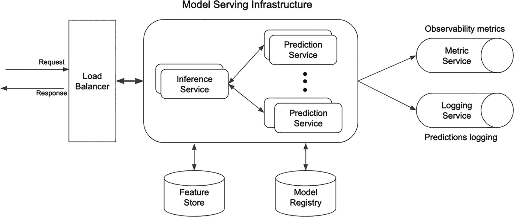

一张从左到右展示三个步骤的高层架构流程图。1. 请求和响应连接到负载均衡器。2. 模型服务基础设施包含推理和预测服务。3. 可观测性指标包含指标和日志服务。

图 5-1

模型服务基础设施高层架构

在深入探讨模型服务基础设施核心组件的细节之前，我们先来讨论一下图 5-1 中周边组件和基础设施的支持作用。

### 特征存储

对于同时拥有离线和在线机器学习用例的组织来说，通常会将特征存储在两个地方：离线特征存储和在线特征存储。在主要面向在线机器学习用例的模型服务基础设施中，推理过程会从在线特征存储中检索特征。这意味着在线特征存储必须提供亚秒级响应时间的低延迟访问。这也是公司选择使用键值数据库或 NoSQL 数据库（如 Apache Cassandra、Redis 和 Amazon DynamoDB）来存储和提供特征的原因之一。

为确保特征的新鲜度，每日或每小时生成的特征会以高效可靠的方式上传到在线特征存储。

### 模型注册表

在模型服务基础设施中，模型注册表扮演着重要角色，它为准备部署到生产环境的模型提供机器学习模型制品和模型配置，如图 5-2 所示。

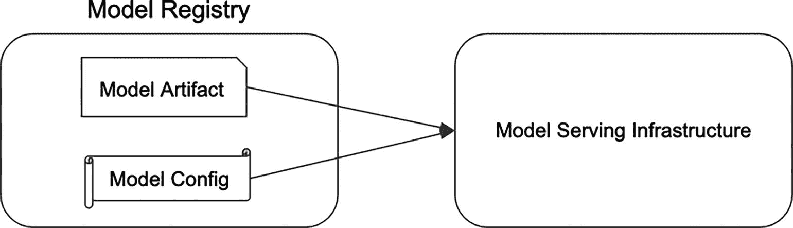

一张从左到右展示模型注册表的流程图，包含连接到模型服务基础设施的模型制品和模型配置。

图 5-2

模型注册表提供模型制品和模型配置

模型制品代表以二进制格式存储的已训练机器学习模型。相关的模型配置包含必要的元数据和部署配置。标准的模型元数据包括唯一的模型标识符、模型输入特征及其类型、模型类型等。同样，标准的部署配置指定了模型部署选项，包括诸如发布策略、流量百分比、日志配置等方面。

作为模型部署过程的一部分，模型服务基础设施会收到关于已准备好用于生产环境的模型的通知。

### 指标服务

大规模有效管理和运维模型服务基础设施需要洞察各种运维指标。这些指标包括延迟、CPU 和内存使用率、网络带宽、请求速率、错误率等。

与其他复杂的微服务类似，模型服务基础设施依赖于指标服务的全面支持。这种支持包括指标聚合、指标存储、指标可视化等。

获取从这些重要运维指标中得出的洞察，可以加速问题排查，并确保模型服务基础设施保持可扩展性和可靠性，满足业务对模型推理的需求。

### 日志服务

记录模型预测是模型推理过程中非常关键的一环，不应事后才考虑。它在机器学习和 MLOps 领域有多种用途，而不仅仅是审计。

每条模型预测日志条目通常包含基本信息，例如模型标识符、输入特征值、预测结果、预测置信度、时间戳、请求 ID、用户 ID、环境，以及任何可能对调试或审计有用的额外上下文。

这些预测日志不仅用于了解使用了哪些模型和特征来生成预测。它们还提供了几个重要的好处：

*   **模型性能监控**
    *   实时监控模型性能是快速识别模型性能下降的关键。预测日志记录使我们能够将预测与实际结果进行比较，或检测模型预测分布的变化。

*   **模型评估**
    *   模型评估和性能评估需要各种模型指标，例如准确率、精确率、召回率、F1 分数等。计算这些指标所需的数据来自预测日志语句中的信息。

*   **可解释性**
    *   对于某些机器学习用例，理解模型为何做出特定预测至关重要。记录预测及其附加上下文将有助于实现可解释性。

*   **法规遵从**
    *   在金融、医疗等受监管行业中，出于监管目的，可能需要保留模型预测记录以符合数据隐私和特定行业法规的要求。

*   **特征与模型改进**
    *   分析生产环境中的特征和模型性能，有助于指导数据科学家就模型重新训练和优化未来模型版本的性能做出明智的决策。

从工程角度来看，预测日志通常发送给基础设施组织提供的日志服务。机器学习社区与 MLOps 基础设施团队之间一个常见的摩擦点在于，就保留日志条目数量的最佳平衡点达成一致，因为成本与日志量直接相关。

一旦日志条目持久化到数据仓库或数据湖中，就会计算和聚合各种指标，以便机器学习社区更容易地通过仪表板解决方案或纯 SQL 进行消费和分析。

### 推理服务

推理服务负责以可扩展、可靠、高效且低延迟的方式，为一个或多个客户端提供推理请求服务。它通过一个称为服务端点的契约向客户端提供服务，该契约定义了传入请求和返回响应的结构和格式。关于服务端点的更多细节将在下文讨论。

该服务通常采用微服务架构模式进行设计，并部署在名为 Kubernetes 的可扩展容器编排平台上。根据需求（如请求速率、延迟、模型复杂度、特征量等），该服务的设计可以简单到单个 REST 服务器，也可以复杂到在 Kubernetes 基础设施上运行数百个节点。

现代推理服务通常提供一组通用功能，包括服务端点、推理请求批处理、特征获取、模型预测、预测日志记录等。下文将讨论其中一些重要的功能。


#### 服务端点

推理服务的一个关键设计决策涉及确定服务端点，也称为服务 API。该端点在客户端和服务之间建立契约。微服务领域提供了许多关于服务端点设计的最佳实践。在设计推理服务端点时，我们应考虑在适用的情况下采用这些实践。

设计服务端点时的一个考量涉及其通用性。当处理的模型数量少于几个时，这个因素不太重要，但在支持从 20 个到数百个不断增长的模型数量时，它就变得至关重要。一个推荐的、面向未来的最佳实践是设计一个单一的通用服务端点，能够处理所有模型的推理。这种方法不仅简化了服务客户端的集成工作，还加快了端到端的模型部署流程。然而，它也有一个权衡——推理请求和响应的负载必须足够通用，以适应各种模型的不同需求，包括特征的数量、类型、结构，以及它们是必需还是可选的。

另一个设计考量是关于服务端点的通信协议。对于低吞吐量的推理请求率（每秒低于数千个请求），这个考量不太重要，但当请求率很高（每秒数十万到数百万个请求）且延迟要求低于 500 毫秒时，它就变得至关重要。

#### 推理请求批处理

在简单的世界里，客户端发送一个推理请求，服务器接收请求，执行推理，然后返回带有预测结果的推理响应。一切都很美好。

在现实世界中，复杂的机器学习用例，如电商推荐、拼车、外卖等，这些平台每天有数百万用户使用。这意味着每小时要执行数十亿次推理。优化推理延迟和吞吐量的一种方法是通过请求批处理。

两种常见的请求批处理策略是客户端批处理和服务器端批处理。在客户端批处理策略中，每个客户端将多个推理请求打包，并通过单个网络请求发送到推理服务器，而不是逐个发送。这在客户端频繁发送大量推理请求的情况下非常有用，因为它需要数十到数百个预测来处理单个用户交互。在服务器端批处理策略中，服务器在客户端不知情的情况下对多个推理请求进行批处理。这意味着跨多个客户端的多个请求被批处理。这在有许多客户端，且每个客户端发送的请求相对较少的情况下特别有用。

在设计支持客户端批处理的推理请求负载时，它必须提供一种灵活的方式，让客户端能够表达带或不带批处理的推理请求。

#### 模型加载与卸载

与软件类似，机器学习模型拥有多个版本是很常见的。新模型创建的频率可能有所不同。创建模型多个版本的因素有很多，包括在获得对问题的更多见解后改进模型、为适应变化的数据或业务规则而改进模型、为满足监管合规性变化而改进模型等等。随着推理服务需要支持的模型数量不断增加，每天很可能会有多个模型部署。

从高层次来看，模型加载是将新模型加载到服务中以执行预测的过程。它是模型部署过程的关键部分。有几种常见的模型加载方法：批量加载、按需加载和混合加载：

*   **批量加载**
    *   这种方法在服务启动时一次性加载所有分配的模型。这意味着每当有模型部署时，服务都需要重新部署或重启。在本节列出的方法中，这是最简单的一种。当模型数量相对较少且不频繁变化时，这种方法适用。

*   **按需加载**
    *   这种方法动态加载新的或更新的模型。这需要某种轮询技术来了解是否有新的或更新的模型可供加载。当模型数量很大或模型频繁变化时，这种方法适用。

*   **混合加载**
    *   这种方法结合了第一种方法的简单性和第二种方法的复杂性。当存在频繁变化和不频繁变化的模型混合时，这种方法适用。

模型加载可能看起来像是一种辅助能力；然而，如果设计得当，它可以极大地帮助以无缝的方式将模型引入生产环境。

模型卸载通常在特定模型达到其生命周期终点并需要被淘汰时执行。根据所采用的模型加载方法，模型卸载会相应地进行。

#### 特征获取

特征获取是模型推理过程中的重要步骤之一，如果设计不当，会显著增加模型推理延迟。

在模型预测期间，训练好的机器学习模型接收输入特征，应用学习到的模式，并生成预测。在在线推理的上下文中，处理特征获取有三种选择：

1.  客户端将所有需要的输入特征发送给推理服务。

2.  推理服务从一个或多个特征存储中获取所有需要的输入特征。

3.  客户端提供所需输入特征的一个子集，推理服务获取剩余的特征。

第三种选择是一种混合方法，在某些情况下非常有用，例如当少量需要的输入特征是基于用户行为实时计算出来的。此外，在推理服务端进行特征获取为缓存相关机器学习用例中常用的特征提供了机会。

#### 模型预测

一旦输入特征和模型就绪，推理过程中的下一步就是生成预测。这需要将特征输入到已加载的机器学习模型中，以便其产生预测。

作为一种良好实践，生成预测的逻辑通常被抽象并实现为可重用的库。该库可以有效地用于多种场景，例如在线预测、批量预测等。

一个设计考量是实际的预测生成是在推理服务内部本地执行，还是在远程的独立服务（通常称为预测服务）中执行。如果首选本地执行，那么直接对预测库进行进程内调用就足够了。相反，如果选择远程执行，推理服务将向预测服务发起远程调用，这将在下面讨论。


#### 预测日志记录

预测日志记录是指在模型推理过程中，记录并存储机器学习模型所做预测的相关信息。这些信息包括输入特征及其值、预测值、置信度分数、模型 ID、模型版本、特征获取延迟、预测延迟、时间戳等。这些信息对于理解和监控模型性能、调试和排查预期行为、理解影响预测的因素、满足监管与合规要求、创建用于改进训练数据的反馈循环等，都具有极其重要的价值。

基于上述原因，数据科学家通常希望始终记录所有预测，这是合乎逻辑的。当预测日志条目数量较少时，这很容易实现。但当预测量很大，每天有数十亿条预测日志条目时，这可能会使日志记录基础设施不堪重负，成本也会成为一个考量因素。

支持将指定日志记录比例作为模型部署元数据的一部分，是模型推理服务的最佳实践。这一选项使参与模型服务的所有利益相关者能够轻松调整日志记录量，从而在模型整个生命周期中对预测日志的需求与防止日志记录预算失控之间取得平衡。

#### 预测服务

预测服务负责使用提供的输入特征集执行模型预测，并返回预测结果。该服务通常被打包成容器，并部署必要的库（包括支持机器学习模型的正确版本）。然后，它确保这些库成功加载到内存中，以便在预测时可用。

在设计一个能够支持组织中各种机器学习用例的预测服务时，有几个重要的考量因素，包括机器学习框架、成本效益、预测后处理等。

##### 机器学习框架

基于树的模型和深度学习模型是两类广泛应用于各种场景的机器学习算法，包括欺诈检测、邮件情感分析和个性化推荐。用于训练这些模型类型的流行机器学习库包括：

*   基于树的模型：Scikit-learn、XGBoost 和 LightGBM
*   深度学习模型：TensorFlow 和 Pytorch

预测服务的设计复杂性受组织希望为其机器学习社区提供的灵活程度影响。一方面，机器学习社区可以完全自由地选择使用哪个机器学习库来训练模型。另一方面，机器学习社区被限制在预定义的机器学习库集合中。每种方法都有其优缺点。从工程角度来看，第二种方法通常更易于维护和支持。

##### 成本效益

当支持成百上千个机器学习模型时，成本效益变得非常重要。其中一个影响因素是计算资源利用效率，即确保分配的 CPU 或 GPU 在大部分时间内得到充分利用。

图 5-3 描述了预测服务上模型分配的两种方法。当模型数量较少时，“每个预测服务容器一个模型”的方法具有几个优点。首先，它提供了完全的隔离，确保行为异常的模型不会影响其他模型。其次，它简化了对多种不同机器学习框架和版本的支持。例如，一个模型使用 Pytorch 1.x 库版本，而另一个模型使用 Pytorch 2.x 库版本。这种方法的一个缺点是，由于预测请求量低，用于进行预测的计算资源可能无法得到有效利用，导致 CPU 空闲。

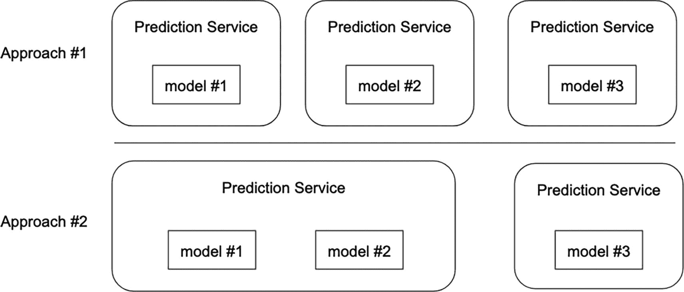

一个模型图展示了分配方法。方法一包含预测服务模型 1 到 3。方法二包含两个预测服务段。第一个段包含模型一和模型二，第二个段包含模型三。

图 5-3
模型分配方法

在单个预测服务容器中托管多个模型的方法有助于提高计算资源利用率。然而，它带来了潜在的“邻居噪声”问题。当一个模型（可能由于高预测请求量或模型复杂性）占用大量 CPU，而其他模型缺乏 CPU 资源时，就会发生这种情况。此外，如果这些模型依赖于具有特定版本的各种库，管理库依赖关系及其版本冲突将是一个挑战。

在拥有成百上千个模型的组织中，通常采用混合方案。这种方法平衡了前述两种方法的优点，同时减轻了它们各自的缺点。然而，实施和维护这种混合方案需要更大的团队和更多的努力。拥有数千个模型的组织之一是 Salesforce；^(⁸⁴) 由于对数据隐私的严格要求，他们为其数千个客户中的每一个都训练了一个模型。

##### 预测预处理与后处理

预测预处理涉及对输入特征进行转换，以确保它们具有适合机器学习模型进行更准确预测的格式或值。此预处理步骤通常旨在提高模型预测的准确性、可靠性和泛化能力。以下是通常需要预测预处理的机器学习用例：

*   **图像识别**：提供的图像数据可能需要调整大小、归一化，使模型更容易准确地识别或分类对象。
*   **自然语言处理**：原始文本通常会经历一些必要的预处理步骤，例如分词、词干提取等，以确保文本表示的一致性。这将有助于提高模型做出准确预测的能力。
*   **欺诈检测**：数值和类别数据的组合通常需要转换，例如填充缺失值或将类别变量编码为数值。通过将输入特征值转换为标准化格式，模型可以更有效地识别可能表明欺诈活动或高风险特征的模式和异常。

预测后处理通常用于进一步细化、解释或转换预测结果，使其对目标应用有用。以下是通常需要预测后处理的几种场景：

*   **阈值设定**：在典型的分类任务中，预测结果通常代表置信度分数。一个常见的后处理步骤是设置阈值以确定最终的分类标签。
*   **集成学习**：在集成学习技术中，来自多个模型的预测结果被组合起来以提高整体准确性。预测后处理涉及投票、加权平均等技术，将各个预测结果合并为单个输出。

以通用方式支持预测预处理、后处理或两者兼有，需要在推理服务中执行由机器学习模型所有者提供的自定义逻辑。从软件工程的角度来看，这种灵活性带来了复杂性和可维护性方面的挑战，可能会增加诊断错误预测或识别延迟相关问题的难度。


### 预测步骤的设计选择

在推理过程中，一个关键步骤是预测步骤，它负责根据输入数据生成实际预测。该步骤可能计算量很大，尤其是在处理复杂的机器学习模型时。在设计模型服务基础设施架构时，必须做出的一个关键决策是：将模型预测步骤嵌入到推理服务内部，还是将其放在一个独立的服务中。此决策应基于对系统特定需求和约束的仔细考量，以及每种方法所涉及的权衡。需要考虑的因素包括预测步骤的复杂性、系统的可扩展性和性能要求，以及对灵活性和模块化的需求。我们来讨论每种方法的优缺点。

#### 嵌入式预测步骤

在最简单的情况下，图 5-4 展示了这种设计选择的样子。在软件设计中，我们大多数时候遵循的一个常见且推荐的经验法则是保持简单或从简单开始。我们来分析一下这种方法的优缺点。

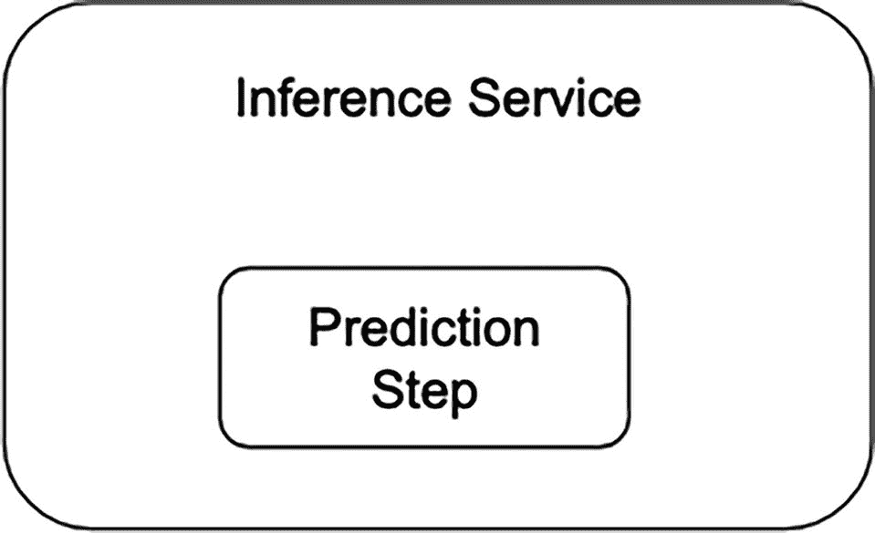

一个表示推理服务的模型图。它包含矩形框内的一个预测步骤。

图 5-4

预测步骤位于推理服务内部

优点如下：

*   **简单高效**：这种方法很容易理解，它简化了架构，因为减少了组件的总数。当预测步骤位于同一个推理进程内时，由于交互开销最小化，可以带来性能提升和延迟降低。
*   **可控性**：通常，控制同一进程内的步骤比控制远程步骤容易得多。除了能更高效地将数据传输到预测步骤，以及对预测过程进行细粒度控制外，推理进程处理错误条件也更容易，并且有更多优化性能的选择。
*   **部署简单**：管理单个服务的部署显然比管理两个服务简单。我们需要担心的工件、协调和兼容性问题更少。这对于部署资源有限的小团队尤其有利。

缺点如下：

*   **可扩展性限制**：模型预测步骤往往计算成本高昂，或者由于模型大小而需要大量内存。在这种情况下，独立服务可以与推理服务分开扩展，从而实现更高效的资源使用和分配。
*   **可重用性有限**：如果预测没有进行适当的抽象，可能会限制其在其他场景（如批量预测）中的可重用性。

#### 远程预测步骤

远程预测步骤方法主张由一个独立的服务全权负责模型预测，如图 5-5 所示。在分布式系统设计中，关注点分离是一项设计原则，涉及将系统划分为处理特定职责的不同组件。将预测步骤设计为一项服务遵循了上述设计原则。同时，我们不要忘记“没有免费的午餐”^(⁸⁵) 这个概念。我们来分析一下这种方法的优缺点。

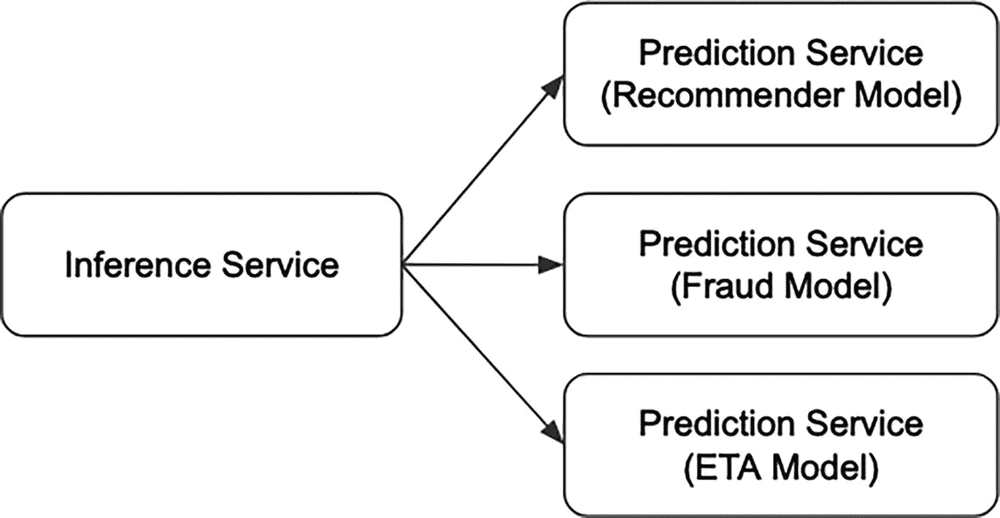

一个推理服务的流程图，包含三个预测服务，分别名为推荐模型、欺诈模型和 ETA 模型。

图 5-5

预测步骤位于预测服务中

优点如下：

*   **可扩展性灵活**：独立的预测服务对于计算量大的模型，或者预测量波动或突发的场景特别有利，因为我们可以独立地扩展此服务。
*   **改进的模块化**：这一优势直接源于关注点分离原则。模块化能极大受益的两个重要方面是独立开发和更易于测试。

缺点如下：

*   **复杂性增加**：普遍认为，系统的过度复杂性会随着组件的增加而增加。引入独立的预测服务会增加模型服务架构的整体复杂性。具体来说，这可能会导致部署、维护和服务间通信方面的额外开销。
*   **性能开销**：带有大量负载的远程调用可能会在推理过程中引入额外的延迟。对于延迟敏感的应用，这个缺点可能是致命的，除非采取了诸如缓存之类的缓解措施。

总之，是将模型预测嵌入推理服务内部，还是使用独立的预测服务，这一设计决策取决于众多因素、特定用例需求和约束。对于需要高可扩展性、模块化、多样且大型的机器学习模型，以及预测流量波动的场景，独立的预测服务能更好地支持这些需求。对于机器学习模型数量少、预测流量低、偏好简单性且团队规模小的场景，将预测嵌入推理服务内部是一个合理的起始设计决策。

对于一个全新的模型服务基础设施来说，从将预测嵌入推理服务内部的方法开始，然后在可扩展性、可靠性以及大型复杂模型的需求变得重要时，再演进到第二种方法，这是非常合理的。事实上，Reddit^(⁸⁶) 的模型服务基础设施正是按照这个顺序演进的，我们将在案例研究部分更详细地讨论这一点。


## 离线推理

到目前为止，大部分讨论主要围绕支持在线推理需求所需的基础设施。一个缺乏离线推理能力的模型服务基础设施是不完整的，因为离线推理在最大化机器学习模型的投资回报率方面扮演着重要角色。某些机器学习用例需要离线推理，这就要求基础设施能够以标准化、可扩展且高效的方式生成离线推理结果。在本节中，我们将首先讨论几个这样的用例，然后再深入探讨技术架构。

离线推理，也称为批量推理，是指定期从一批输入数据中生成大量预测结果的过程。这与在线推理形成对比，后者是在接收到单个数据点时即时生成预测。离线推理过程可以临时手动触发，也可以由工作流调度系统编排，根据时间或新数据可用性定期生成预测。生成的预测结果通常存储在数据仓库或数据湖中，供进一步分析或其他业务流程使用。在某些用例中，这些生成的预测结果会被传输到键值数据库中供使用。

需要离线推理的机器学习用例示例包括：

*   **客户流失预测**：订阅式服务提供商，例如电信公司和 Netflix，使用机器学习来预测其客户群（可能达数百万或数亿）中的客户流失情况。离线推理用于生成客户流失预测，从而制定留住客户的策略。

*   **能源消耗预测**：能源公司使用机器学习来预测能源消耗模式。离线推理用于根据历史数据、以往的消费模式和天气状况生成对未来能源需求的预测。

*   **营销活动优化**：营销团队不断寻求优化营销活动以提高其效果的方法，从而提升业务价值。离线推理用于利用历史客户行为和营销活动表现数据来预测活动效果。

*   **卫星图像分析**：各个政府部门和企业都有兴趣识别土地利用变化、监测森林砍伐和跟踪作物生长情况。离线推理用于分析大量卫星图像以识别变化。

这些用例凸显了不同行业的不同机器学习用例对离线推理的需求。此外，在预测生成过程中，处理代表历史数据的大型输入数据批次至关重要。

一个健壮的离线推理基础设施应能够从大型数据集中高效地生成大量预测，并且可以临时或按计划触发。为满足这些要求，此类基础设施的核心组件包括工作流调度系统和分布式处理引擎。图 5-6 描绘了离线推理基础设施的高层设计，其中实现高吞吐量的关键组件是分布式处理引擎。

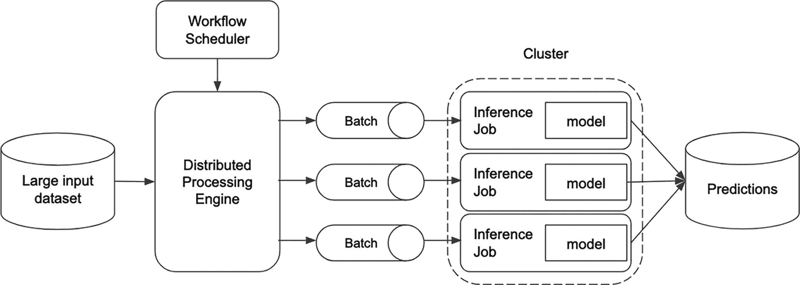

一个高层推理结构的流程图，包含大型输入数据集、分布式处理引擎、三个批次、推理作业集群、模型以及预测结果。

图 5-6

高层离线推理架构

像 Apache Spark 或 Ray 这样的分布式处理引擎，是将离线推理工作负载分布到拥有强大计算资源的节点集群上的绝佳选择。这种方法可以加速预测生成并确保高吞吐量。

与往常一样，扩展离线推理规模会带来许多有趣的挑战。这篇博客^(⁸⁷) 概述了一些关键挑战，并对三种不同的离线图像分类推理解决方案进行了比较分析。

## 案例研究

模型服务基础设施是实现机器学习项目投资回报率的关键推动因素。模型服务基础设施所需的复杂程度由几个因素驱动，例如当前和未来模型的数量、在线和离线推理用例的比例、模型推理请求的数量及其延迟要求，以及模型的复杂性。

对于初创公司或刚开始应用机器学习的组织来说，以简单和最小投入的方式构建其第一个版本的模型服务基础设施是合理的。最初，模型部署可能没有完全自动化。此外，应尽可能利用开源社区和其云服务商的各种组件。

对于拥有越来越多模型的中型组织来说，可扩展性、可靠性和效率变得越来越重要；那么，明智的做法是投入大量资金和精力，以适当的复杂程度构建其模型服务基础设施，以满足可扩展性、可靠性、自动化程度等重要需求，使得模型部署和服务像微服务部署一样简单。为实现这些要求，可以考虑利用云服务提供商、MLOps 供应商、开源项目以及内部技术的解决方案。

接下来的“内部构建”部分将重点介绍两家公司构建和发展其模型服务基础设施的案例研究，以及一些经验教训。

接下来的“开源方案”部分将深入探讨一些流行的开源解决方案，这些方案在构建新的模型服务基础设施或改进现有基础设施时值得考虑。

### 内部构建

对于那些机器学习深度嵌入其产品、拥有庞大用户群且运营时间超过五年的公司来说，他们很可能会开发自己的内部模型基础设施，以满足其特定的功能性和非功能性需求。本节将重点介绍两个案例研究：一个来自拼车公司 Lyft，另一个来自社交新闻和论坛公司 Reddit。


#### LyftLearn 模型服务

在 Lyft 的拼车平台上，机器学习模型每天要做出数亿次实时决策。这些基于机器学习的决策包括定价优化、拼车分配优化、预计到达时间预测、欺诈检测等。

上述机器学习用例需要大规模的在线推理。为了支持这些需求并克服传统模型服务基础设施的限制，Lyft 的机器学习平台团队通过 LyftLearn Serving 对其进行了现代化改造。^(⁸⁸)

LyftLearn Serving 是一种具有明确主张的模型服务基础设施，旨在实现稳健、高性能、去中心化，并满足图 5-7 中列出的要求。

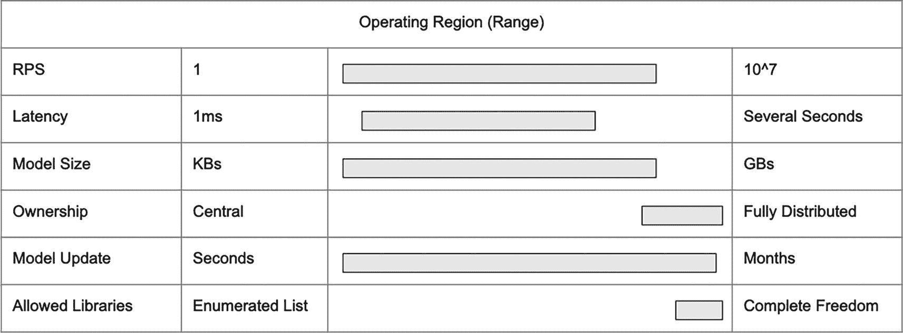

一个表格显示了运行区域范围。它由六行四列组成。行内容依次为：RPS、延迟、模型大小、所有权、模型更新和允许的库。

图 5-7

改编自：LyftLearn Serving 要求。条形宽度代表大致范围

在 LyftLearn Serving 的众多关键设计决策中，有两个特别值得详细审视和学习：服务库和分布式所有权。

LyftLearn Serving 的核心是一个库，它提供了模型部署和服务基础设施通常所需的基本能力。该库包含模型加载与卸载、模型版本管理、模型影子测试、推理请求处理、模型监控、模型日志记录等逻辑。其模块化方法使其能够无缝集成到微服务架构中。此外，该库为模型加载和推理提供了抽象层，使得可以通过实现此抽象层轻松注入自定义代码，以满足特定用例的需求。这种灵活性使 LyftLearn Serving 库能够有效满足 Lyft 各个团队多样化的独特需求。在机器学习库方面，只要框架有 Python 接口，LyftLearn Serving 就不会对其施加任何限制。图 5-8 描述了高级推理请求流程，并展示了自定义代码在该流程中的执行位置。

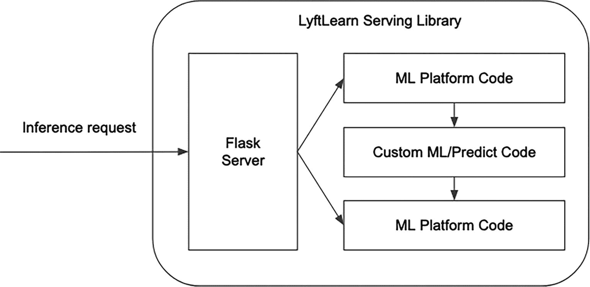

LyftLearn Serving 库的流程图。推理请求连接到 Flask 服务器。ML 平台、自定义 ML 和 ML 平台代码。

图 5-8

改编自：LyftLearn Serving 推理请求

LyftLearn Serving 的一个核心设计考量是赋能一种去中心化的方法来部署和服务机器学习模型。这种去中心化方法为 Lyft 的每个团队提供了必要的隔离性，使其能够按自己的节奏运作，并灵活地使用针对其独特需求定制的特定机器学习库和版本。由于 LyftLearn Serving 本质上是一组库而非服务，因此每个团队隔离的模型服务可以轻松地集成它们。本质上，通过一组库来部署和服务模型，是实现机器学习模型部署和服务去中心化方法的关键推动因素。

LyftLearn Serving 选择的具体隔离机制是在 GitHub 仓库级别，这有助于定义清晰的所有权和边界。这意味着 Lyft 的每个团队都创建自己的仓库，并且每个仓库都会引入必要的 LyftLearn Serving 库。

总之，LyftLearn Serving 的两个关键设计原则是：将模型服务作为库，以及分布式所有权的模型服务。这两个原则协同工作，以最大化灵活性并促进隔离，使 Lyft 的各个团队能够就他们的机器学习库需求做出独立决策，并按照自己的节奏满足模型服务需求。

#### Reddit 的模型服务架构演进

作为一个社交新闻聚合和讨论平台，Reddit 的机器学习用例包括个性化信息流、广告定向、搜索与发现、异常检测等。

Lyft 和 Reddit 的模型服务基础设施演进历程有许多相似之处。在机器学习用例数量少、规模不大的时候，它们的初始版本是足够的。然而，随着多年来 Reddit 上机器学习应用的扩展，包括更大的用户群、平台上更广泛的机器学习用例范围，以及处理日益复杂模型的不断壮大的机器学习社区，其初始模型服务基础设施的局限性变得明显，包括性能、可扩展性、可维护性和可靠性。尽管它们的演进历程和目标相似，但方法和设计选择却不同。

根据他们关于名为 Gazette 的新模型服务架构的博客^(⁸⁹)，他们现代化模型服务基础设施的主要目标是：

*   提高系统的可扩展性、可靠性和可观测性
*   部署更复杂的模型
*   拥有更好优化模型性能的能力和灵活性
*   改善开发者体验

第一个主要的架构变更涉及将处理推理请求、特征提取和模型预测的责任拆分为两个独立的服务，如图 5-9 所示。这种分离有效地将两种不同的工作负载（I/O 密集型 和 计算密集型）划分到不同的服务中，使它们能够独立扩展，以实现上述目标，特别是可扩展性和可靠性。

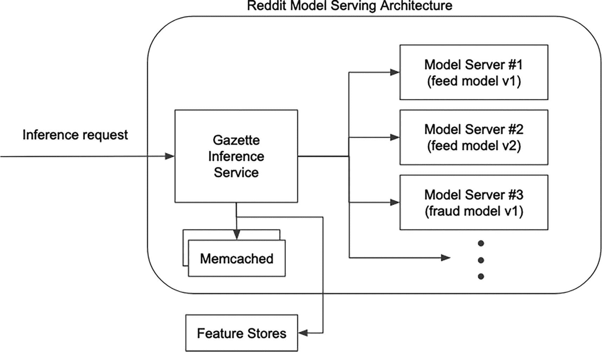

Reddit 模型服务架构的流程图，包含推理请求、Gazette 推理服务、特征存储、模型服务器 1 到 3。

图 5-9

改编自：Gazette 推理服务和模型服务器的架构。箭头代表请求流

第一个服务称为 Gazette 推理服务，使用他们的 Golang Web 服务框架，负责处理来自各种客户端的机器学习推理请求。该服务有一个单一的通用端点，所有客户端都向其发送请求，并附带各种元数据，例如模型名称和版本。一旦收到请求，该服务会从特征存储中获取任何必要的特征，然后将实际的预测请求路由到第二个服务。这个新服务具有更好的整体性能，因为它是用 Go 编程语言编写的，后者在处理并发方面要好得多。

第二个服务称为模型服务器服务，基于 Python，它封装了一个指定的机器学习模型。模型服务器服务的每个实例都使用 Docker 进行容器化，并且可以根据模型复杂性和预期预测量进行配置和定制，以满足特定需求，例如机器学习库类型和版本、计算资源、自动缩放参数。由于每个模型都是隔离部署的，这有助于实现可靠性目标，并且模型对其他模型的意外崩溃具有更强的容错能力。

总之，Reddit 重新设计的模型服务架构的核心在于将关注点分离到两个独立的服务中：Gazette 推理服务，负责处理推理请求和特征提取；以及模型服务器服务，专门负责处理模型预测。这一个关键性的架构变更有效地解决了其初始模型服务基础设施的局限性，并实现了其现代化改造的主要目标。这为 Reddit 未来在用户群增长以及实施日益复杂的机器学习用例方面铺平了道路。


### 开源

近年来，MLOps 开源社区在提供模型服务开源项目方面取得了显著进展。本节无法涵盖所有这些进展。因此，本节将重点介绍几个流行的示例，即 BentoML、Seldon Core 和 Ray Serve。此选择并不意味着其他解决方案在设计或能力上有所欠缺。通过了解这些流行解决方案的优势和设计选择，您将能够更好地评估能够满足您公司特定机器学习用例和基础设施需求的解决方案。

以下使用了一小组标准来帮助缩小需要重点介绍的开源模型服务解决方案的范围：

*   **多样化的机器学习框架支持**：机器学习领域相当广泛且发展迅速。多样化的机器学习框架支持将使机器学习建模人员拥有自由度和灵活性，以利用和探索最佳的机器学习技术，最终推动业务影响。

*   **友好的本地部署和测试支持**：随着机器学习应用的增加，每个组织内的机器学习社区也会发展壮大。快速的机器学习部署速度是加速机器学习模型投入生产的关键因素；因此，机器学习项目的投资回报率将更快实现。

*   **可扩展且灵活的部署支持**：机器学习领域已在商业世界获得广泛认可和应用。随着应用的持续增长，可扩展且灵活的部署支持将在加速机器学习项目投资回报率方面发挥关键作用。

这些开源解决方案正在快速发展，因此请务必查看其更新后的网站以了解其最新功能。

#### BentoML

根据文档，^(⁹⁰) BentoML 是一个统一的 AI 应用框架，用于构建可靠、可扩展且经济高效的 AI 应用。它提供了一套全面的工具包，用于简化模型服务、应用打包和生产部署。

BentoML 是一个以 Python 为中心的框架，全面支持保存和加载从各种流行机器学习框架（包括 TensorFlow、Pytorch、LightGBM、XGBoost 等）训练的模型。此外，它还提供了一个简单灵活的集成点，用于在定义推理服务端点时定义预测预处理和后处理的自定义逻辑。

使用 BentoML 部署机器学习模型的典型流程包括：

*   将训练好的模型保存到 BentoML 模型存储中。

*   创建 BentoML 服务：在 Python 文件中定义每个服务的定义。服务定义包括模型加载、运行器设置、推理服务端点以及模型推理期间的任何自定义逻辑（例如预测预处理和后处理）的步骤。

*   构建 Bento：Bento 作为 BentoML 生态系统中的标准化分发单元。每个 Bento 包含基本组件，包括源代码、模型、数据文件以及服务运行所需的依赖项。这些组件使用 YAML 格式在文件中配置。BentoML 提供了用于构建 Bento 的命令行工具，并自动为其标记唯一版本。

*   构建 Bento 后，可以在本地测试或将其推送到生产环境，包括 BentoCloud 或任何兼容 Docker 的环境，例如 Kubernetes、Swarm、Amazon ECS、Google Cloud Run 等。

在友好的本地部署、测试和调试方面，BentoML 提供了多个命令行工具，用于在本地快速启动每个 Bento 中定义的服务。之后，可以使用 HTTP 或 gRPC 协议将示例请求发送到服务端点，以验证服务和模型。

Service API 和 Runner 概念的结合是 BentoML 支持可扩展模型服务的方式。BentoML Service 充当处理推理请求和返回响应的接口。从逻辑上讲，它封装了两个主要组件：Service API 和 Runner。在运行时，BentoML Services 启动两个组件，称为 API 服务器和 Runner，如图 5-10 所示。这些组件中的每一个都可以在计算资源类型和实例数量方面独立配置扩展。

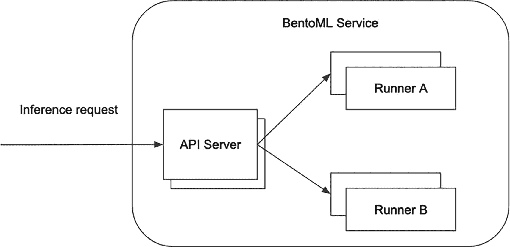

Bento M L 服务流程图，包含推理请求、连接到运行器 a 和 b 的 A P I 服务器。

图 5-10

改编自：BentoML 服务架构

每个 BentoML 服务可以有一个或多个 Service API，每个 API 代表一个可以远程调用的端点。每个 Service API 定义包括输入和输出的规范，以及一个回调函数。回调函数旨在包含模型推理逻辑，其中可能包括特征获取、预处理和后处理以及模型预测调用等逻辑。

在高层面上，Runner 被设计为用于执行预测的远程 Python 工作进程，并且可以与 API 服务器独立扩展。每个 BentoML 服务可以配置为启动一组 Runner 工作进程，以满足预期的推理请求量，并且对这些工作进程的调用将相应地分布在这些 Runner 之间。开箱即用，BentoML 提供了一组为每个受支持的机器学习框架实现的预构建 Runner。对于需要定制以满足特定要求的高级用例，BentoML 允许我们创建和使用自己的 Runner 类。


Runner 中内置的一项功能称为自适应批处理，旨在帮助在模型预测生成期间实现高吞吐量。这被视为服务端自适应批处理，与客户端批处理相比具有优势，因为推理请求的客户端无需在其侧集成任何批处理逻辑。

自适应批处理有两个主要概念^(⁹¹)：批处理窗口和批处理大小。

*   **批处理窗口**：在释放一批预测请求进行处理之前，用于组装该批次的最大等待时间。这在预测请求量较低时很有帮助。

*   **批处理大小**：在释放一批预测请求进行处理之前，该批次中包含的最大预测请求数量。这在预测请求量较高时很有用。

为了说明使用 BentoML 部署机器学习模型的简便性，以下部分提供了各种代码片段，用于将机器学习模型保存到 BentoML 模型存储、创建服务、构建 Bento、在本地部署 Bento 以及测试服务端点。这些代码片段摘自 BentoML GitHub 仓库中的 `linear_regression`^(⁹²) 示例。

清单 5-1 中的代码片段展示了如何将训练好的机器学习模型保存到 BentoML 模型存储。默认情况下，模型存储位于用户主目录下的 `bentoml` 目录中。可以使用 `BENTOML_HOME` 变量来更改模型的存储位置。

```
from sklearn import linear_model
import bentoml
reg = linear_model.LinearRegression()
reg.fit([[0, 0], [1, 1], [2, 2]], [0, 1, 2])
bento_model = bentoml.sklearn.save_model("linear_reg", reg)
print(f"Model saved: {bento_model}")
清单 5-1
将训练好的机器学习模型保存到 BentoML 模型存储
```

下一步是在 Python 文件中定义一个 BentoML 服务，以处理推理请求并执行引用。清单 5-2 展示了一个示例。

```
import bentoml
from bentoml.io import NumpyNdarray
reg_runner =
bentoml.sklearn.get("linear_reg:latest").to_runner()
svc =
bentoml.Service("linear_regression",runners=[reg_runner])
input_spec = NumpyNdarray(dtype="int", shape=(-1, 2))
@svc.api(input=input_spec, output=NumpyNdarray())
async def predict(input_arr):
return await reg_runner.predict.async_run(input_arr)
清单 5-2
service.py – 定义一个简单的 BentoML 服务
```

上述代码片段创建了一个 Runner 实例，并附加了一个从模型存储加载的模型。之后，使用名称 `linear_regression` 和一个 runner 初始化了一个 BentoML 服务。最后一步是通过定义一个回调函数并使用 `@svc.api` 装饰器对其进行装饰来设置一个端点。默认情况下，函数名会成为端点 URL，可以使用 `route` 选项轻松自定义。

为了在本地启动一个 BentoML 服务进行简单测试，我们可以使用 `"bentoml service"` 命令行，输出结果类似于清单 5-3 所示。

```
% bentoml serve service.py:svc
2023-11-25T07:40:04-0800 [INFO] [cli] Environ for worker 0: set CPU thread count to 8
2023-11-25T07:40:04-0800 [INFO] [cli] Prometheus metrics for HTTP BentoServer from "service.py:svc" can be accessed at http://localhost:3000/metrics.
2023-11-25T07:40:10-0800 [INFO] [cli] Starting production HTTP BentoServer from "service.py:svc" listening on http://0.0.0.0:3000 (Press CTRL+C to quit)
清单 5-3
启动本地服务的输出
```

一旦 BentoML 服务 `linear_regression` 运行并在端口 3000 上监听，我们就可以使用 curl 命令向 `predict` 端点发送一个简单的推理请求。命令和输出的示例如清单 5-4 所示。

```
% curl -X POST -H "content-type: application/json" --data "[[5, 3]]" http://127.0.0.1:3000/predict
[3.9999999999999996]  # 响应
清单 5-4
一个推理请求及其响应
```

要为服务 `linear_regression` 构建一个 Bento，第一步是在 `bentofile.yaml` 文件中定义必要组件的配置，然后运行 `bentoml build` 命令来实际构建 Bento。这些步骤留给读者作为练习。

为了便于说明，上述示例是一个简单的例子。BentoML 的入门非常简单。有关 BentoML 的高级用法，请务必探索其文档网站 [`https://docs.bentoml.com/`](https://docs.bentoml.com/) 上的“高级指南”和“最佳实践”部分。

#### Seldon Core

从最高层面来看，Seldon Core^(⁹³) 是一个有主见、灵活、全面且成熟的开源平台，用于在 Kubernetes 之上大规模地打包、部署、监控和管理机器学习模型。

它在 Kubernetes 原生方面是有主见的。Seldon Core 旨在与 Kubernetes 无缝协作，并利用其可扩展性和灵活性来部署模型。鉴于 Kubernetes 已成为大规模管理容器化工作负载和服务的事实上的容器和编排平台，这未必是一个糟糕的决定。

它之所以全面，是因为它提供了高级模型服务能力，包括推理图、高级指标、请求日志记录、解释器、异常值检测、A/B 测试、金丝雀发布等。

Seldon Core 将机器学习模型作为微服务部署到生产环境中，这些微服务可以处理 REST 或 gRPC 请求。它与框架无关，并内置了对常用机器学习框架的支持，例如 TensorFlow、PyTorch、XGBoost、LightGBM、Scikit-Learn 等。

在使用 Seldon Core 并充分利用其功能方面，熟悉以下主要概念至关重要：模型、服务器、流水线和实验。图 5-11 说明了这些概念及其对应的具体能力。^(⁹⁴) 以下各节将从左侧开始，简要介绍每个概念的细节。

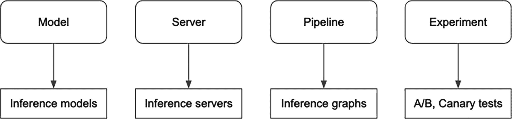

一个映射到具体能力的流程图。1. 模型映射到推理模型。2. 服务器映射到推理服务器。3. 流水线映射到推理图。4. 实验映射到 A/B 金丝雀测试。

图 5-11

改编：将概念映射到具体能力

模型提供了 Seldon 的原子构建块。模型的示例包括机器学习模型、漂移检测器、异常值检测器、特征转换等。一旦模型以 YAML 格式定义，我们就可以使用提供的命令行工具将它们加载到 Seldon Core 集群上，并开始进行推理请求。清单 5-5 展示了一个 Scikit-Learn 鸢尾花分类模型的简单示例，清单 5-6 展示了加载模型并进行推理调用的命令。对于 Seldon Core Kubernetes 部署，命令会略有不同，主要使用 `kubectl` 命令。

```
# 将模型加载到 Seldon Core 平台
seldon model load -f ./models/sklearn-iris.yaml
# 检查状态
seldon model status iris -w ModelAvailable | jq -M .
# 进行 REST 推理调用
seldon model infer iris \
'{"inputs": [{"name": "predict", "shape": [1, 4], "datatype": "FP32", "data": [[1, 2, 3, 4]]}]}'
清单 5-6
加载并进行推理调用的命令行
```

```
apiVersion: mlops.seldon.io/v1alpha1
kind: Model
metadata:
name: iris
spec:
storageUri: "gs://seldon-models/scv2/samples/mlserver_1.3.5/iris-sklearn"
requirements:
- sklearn
memory: 100Ki
清单 5-5
sklearn-iris.yaml 中 Scikit-Learn 机器学习模型的模型定义
```


一旦定义了少量模型，我们就可以利用流水线（Pipelines）功能将它们连接成数据转换流，也称为推理图。此功能使我们能够形成复杂的计算图，以表示模型推理过程中的结构和操作流程。流水线是优化和加速复杂机器学习推理需求执行的强大工具，尤其是在需要实时性能和可扩展性的生产环境中。除了将一个模型的输出链接到另一个模型的输入之外，流水线还支持将多个模型的输出组合作为另一个模型的输入，以及条件流。有关各种高级流水线功能的更多详细信息，请参阅其文档，网址为 [`https://docs.seldon.io/projects/seldon-core/en/v2/contents/pipelines/index.html`](https://docs.seldon.io/projects/seldon-core/en/v2/contents/pipelines/index.html)。

作为软件部署的一部分，金丝雀测试是 DevOps 中的一种良好实践。类似的技术在将机器学习模型部署到生产环境时也非常适用。Seldon Core 中的实验（Experiment）可以支持模型与流水线之间的流量拆分以及流量镜像。清单 5-7 展示了一个在 `iris` 和 `iris2` 两个模型之间进行 50% 流量拆分的简单示例。

```
apiVersion: mlops.seldon.io/v1alpha1
kind: Experiment
metadata:
  name: experiment-sample
spec:
  default: iris
  candidates:
  - name: iris
    weight: 50
  - name: iris2
    weight: 50
清单 5-7
在两个模型之间平均分配流量的实验
```

使用镜像支持，以影子模式测试模型同样简单。请参阅清单 5-8，这是一个在影子模式下以 100% 流量测试名为 `iris2` 的模型的简单示例。

```
apiVersion: mlops.seldon.io/v1alpha1
kind: Experiment
metadata:
  name: sklearn-mirror
spec:
  default: iris
  candidates:
  - name: iris
    weight: 100
  mirror:
    name: iris2
    percent: 100
清单 5-8
镜像流量以在影子模式下测试 iris2 的实验
```

Seldon Core 拥有一个复杂的架构，^(⁹⁵) 如图 5-12 所示，旨在支持上述全套功能，并支持大规模模型服务。其核心组件可以通过 Docker Compose 在本地运行，也可以部署到 Kubernetes 集群上。

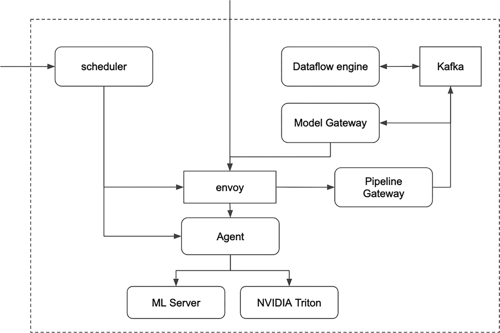

Seldon 架构流程图，包含调度器、Envoy、代理、ML 服务器、NVIDIA Triton、流水线网关、模型网关、Kafka 和数据流引擎。

图 5-12

改编自：Seldon Core V2 架构

调度器组件接收来自各种客户端（例如编排系统、Kubernetes 或其他外部服务）的请求，以管理机器学习模型的部署和扩缩容。

Envoy 组件接收来自各种客户端（例如外部服务、API 网关或编排系统）的请求，以将流量引导至已部署的模型进行预测。

每个组件的核心职责描述如下：

*   **调度器**：充当与 Seldon Core 平台交互的主要入口点。它管理模型、流水线、实验等的加载和卸载。

*   **Envoy**：充当代理，用于负载均衡和路由传入的预测请求。

*   **代理**：管理与推理服务器（ML Server 和 NVIDIA Triton）的交互，包括推理请求路由、模型加载和卸载等。

*   **数据流引擎、模型网关、流水线网关、Kafka**：协同工作以执行流水线并管理步骤之间的数据流。

*   **ML Server、NVIDIA Triton**：用于机器学习模型的推理服务器。

Seldon Core 将实际的模型推理工作负载委托给 Seldon MLServer 或 NVIDIA Triton。在结束本节之前，让我们重点介绍 Seldon ML Server 中的几个显著特性。

MLServer 是一个开源的 Python 推理服务器，它使得通过 REST 和 gRPC 接口提供机器学习模型服务变得非常容易。与 BentoML 服务类似，它通过将并行推理工作负载卸载到在独立进程中运行的工作线程池来支持并行推理。需要指出的两个显著特性是推理运行时和多模型服务。

ML Server 在设计时考虑了可插拔推理运行时的概念。这些运行时充当 MLServer 与机器学习框架之间的桥梁。为了与包括 XGBoost、LightGBM 等在内的常见机器学习框架集合无缝集成，MLServer 提供了一组内置的预配置运行时。这使得用户能够快速部署在这些机器学习框架中保存的模型，而无需引入不必要的依赖项。此外，此功能还提供了在需要时与自定义运行时集成的灵活性。有趣的是，目前没有针对 TensorFlow 和 PyTorch 机器学习框架的内置推理运行时。要了解最新的内置推理运行时列表，请访问此资源：[`https://mlserver.readthedocs.io/en/latest/runtimes/index.html`](https://mlserver.readthedocs.io/en/latest/runtimes/index.html)。

MLServer 内置的多模型服务支持使得单个 MLServer 实例能够服务于多个模型及其各自的版本。对于拥有大量且不断增长的模型的组织来说，此功能通过最大化计算利用率同时保持最小的基础设施占用，从而促进成本节约。图 5-13 直观地对比了两种模型服务方法，突出了多模型服务的优势。右侧的多模型服务选项显示，我们可以使用优化技术将多个模型高效地放置在单个部署实例上，从而最大化资源利用率，并因此减少内存、CPU 或 GPU 方面的总体所需资源。

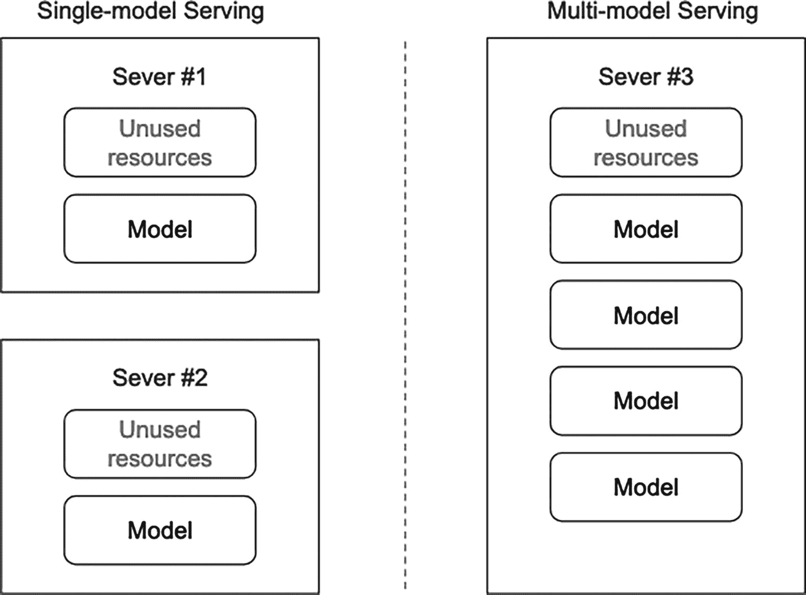

一个模型图描绘了单模型与多模型服务。单模型包含未使用的资源以及服务器 1 和服务器 2 的模型。多模型包含未使用的资源和四个模型。

图 5-13

单模型服务与多模型服务

然而，仔细考虑哪些模型应该共享同一台服务器以避免潜在的“吵闹邻居”问题非常重要，其中一个模型的资源需求（例如内存或 CPU）可能会对其他模型的性能产生负面影响。

Seldon Core 是一个令人印象深刻的模型服务平台，拥有全面的功能集来支持企业级的模型服务需求。它专为拥有大量模型服务工作负载，并且使用多样化机器学习框架训练的机器学习模型数量不断增长的中大型组织而设计。Seldon Core 旨在与 Kubernetes 紧密协作，以利用其可扩展性和编排能力。


#### Ray Serve

Ray Serve 是一个基于 Ray 构建的开源、灵活、高效且可扩展的模型服务库。Ray 是一个用于扩展 AI 和 Python 应用程序的开源统一框架。第 7 章将深入介绍 Ray，包括核心概念、API 抽象、架构等。

Ray Serve 提供了一个简单的 Python 接口用于服务 ML 模型，并能够通过利用 Ray Core 库提供的分布式计算框架以及简单而强大的抽象原语，支持显著的推理工作负载。

与 BentoML 和 Seldon Core 类似，Ray Serve 与 ML 框架无关，专注于提供一个通用的、可扩展的模型服务层。由于它构建在 Ray 之上，这意味着 Ray Serve 可以在任何 Ray 能运行的地方运行，包括你的笔记本电脑、Kubernetes、云供应商等。

Ray Serve 提供以下三个主要价值主张：

*   提供了一种 Python 原生方式来构建端到端的分布式模型服务应用程序，并能够快速迭代，从本地测试到生产部署。
*   为多模型推理提供了一流支持。
*   提供了灵活的扩展和资源分配。

在深入探讨每个价值主张之前，我们先讨论 Ray Serve 中的几个核心概念：部署和应用程序。

部署本质上是一个可部署的模型服务单元，可以包含任何用 Python 编写的逻辑，包括业务逻辑、模型加载和推理逻辑、特征获取逻辑以及推理预处理和后处理。要定义一个部署，需要使用 `@serve.deployment` 装饰器装饰一个 Python 类定义。在运行时，该类的一个或多个副本会在 Ray Serve 集群中独立的进程中启动。进程的数量可以手动扩展、缩减或自动扩展，以匹配传入的请求负载。

一个应用程序由一个或多个部署组成，并作为 Ray Serve 集群中的升级单元。通常，应用程序中的一组部署协同工作，以满足模型服务应用程序的需求，例如图像处理或音频转录。

##### Python 原生模型服务应用程序

Ray Serve 为以 Python 为中心的方式开发模型服务应用程序提供了无与伦比的灵活性。一个 Python 类可以作为你表达模型服务逻辑的画布，范围从简单的代码片段到跨越数千行代码的复杂工作流。这种灵活性也带来了相应的责任，即处理以特定格式加载模型以及如何与不同的 ML 框架协同工作。

将 Python 类转变为 Ray Serve 应用程序所需的全部操作就是添加一个简单而强大的装饰器 `@serve.deployment`，然后 Ray Serve 将负责创建该 Python 类的多个副本，并将其部署到 Ray Serve 集群中。在幕后，Ray Serve 应用程序由一个集中式控制器管理，该控制器负责创建和管理 Ray Serve 应用程序，例如故障检测和恢复。

清单 5-9 是一个非常简单的 Ray Serve 应用程序，改编自 Ray GitHub 上的一个示例。^(⁹⁶) 在此示例中，构造函数从 Hugging Face 模型中心加载了“情感分析”模型。`__call__` 方法将被调用来处理传入的请求，并且它期望一个名为“text”的查询参数。

```
import requests
from starlette.requests import Request
from typing import Dict
from transformers import pipeline
from ray import serve
# 1: 将预训练模型封装在 Serve 部署中。
@serve.deployment
class SentimentAnalysisDeployment:
def __init__(self):
self._model = pipeline("sentiment-analysis")
def __call__(self, request: Request) -> Dict:
return self._model(request.query_params["text"])[0]
# bind() API 实例化此类的副本
sentiment_app = SentimentAnalysisDeployment.bind()
清单 5-9
一个在影子模式下镜像流量以测试 iris2 的实验
```

Ray Serve 提供了两种不同的方式来启动部署。第一种方式是通过调用 `serve.run` Python API，第二种方式是使用 `serve run` CLI 命令（请确保先安装 Ray Serve）。清单 5-10 显示了运行 CLI 的结果，假设上述代码位于名为 `transformer.py` 的文件中。

```
% serve run transformer:sentiment_app
# 启动 transformer:sentiment_app 部署的输出
2023-11-26 17:42:48,480    INFO scripts.py:501 -- Running import path: 'transformer:sentiment_app'.
2023-11-26 17:42:54,892    INFO worker.py:1664 -- Started a local Ray instance. View the dashboard at 127.0.0.1:8265
(ProxyActor pid=29381) INFO 2023-11-26 17:43:00,183 proxy 127.0.0.1 proxy.py:1072 - Proxy actor dd1aa8088598b2d9635fdfdb01000000 starting on node 64a62a755106ef22993a76e3737bd5cd5218e82444a602f6a88b4580.
(ProxyActor pid=29381) INFO 2023-11-26 17:43:00,194 proxy 127.0.0.1 proxy.py:1257 - Starting HTTP server on node: 64a62a755106ef22993a76e3737bd5cd5218e82444a602f6a88b4580 listening on port 8000
(ProxyActor pid=29381) INFO:     Started server process [29381]
(ServeController pid=29380) INFO 2023-11-26 17:43:00,356 controller 29380 deployment_state.py:1379 - Deploying new version of deployment SentimentAnalysisDeployment in application 'default'.
(ServeController pid=29380) INFO 2023-11-26 17:43:00,459 controller 29380 deployment_state.py:1668 - Adding 1 replica to deployment SentimentAnalysisDeployment in application 'default'.
清单 5-10
使用 CLI 启动部署并显示输出。
```

一旦部署启动并运行，我们现在就可以通过向 `http://localhost:8000/` 端点发送 REST 调用来开始发送推理请求。清单 5-11 显示了几个 REST 调用及其响应。

```
% curl -G "http://localhost:8000/" --data-urlencode "text=the world is falling"
{"label": "NEGATIVE", "score": 0.9988685846328735}
% curl -G "http://localhost:8000/" --data-urlencode "text=today is a beautiful day"
{"label": "POSITIVE", "score": 0.9998778104782104}
% curl -G "http://localhost:8000/" --data-urlencode "text=tomorrow is Monday"
{"label": "POSITIVE", "score": 0.9901313781738281}
% curl -G "http://localhost:8000/" --data-urlencode "text=tomorrow is Monday and I have to work"
{"label": "POSITIVE", "score": 0.9546266794204712}
% curl -G "http://localhost:8000/" --data-urlencode "text=tomorrow is Monday and I have to work again"
{"label": "NEGATIVE", "score": 0.9834485650062561}
清单 5-11
通过 REST 调用发送推理请求
```


##### 灵活的扩缩容与资源分配

机器学习模型推理是一项计算密集型任务。请确保为模型服务应用分配充足的资源，使其能够处理预期的推理工作负载。

Ray Serve 提供了两个调节旋钮，用于扩缩部署规模并使用合适的计算资源（如 CPU 或 GPU）。这些旋钮可以在 `@serve.deployment` 装饰器中通过以下参数指定：`num_replicas` 和 `ray_actor_options`。清单 5-12 展示了一个配置示例，为 `sentiment_app` 设置了 3 个副本和 2 个 GPU。

```
@serve.deployment(
num_replicas=3, ray_actor_options={"num_gpus":2})
class SentimentAnalysisDeployment:
def __init__(self):
self._model = pipeline("sentiment-analysis")
def __call__(self, request: Request) -> Dict:
return self._model(request.query_params["text"])[0]
清单 5-12
使用多个副本和 GPU 进行部署扩缩容
```

上述扩缩容示例采用的是手动扩缩容方式。我们可以利用自动扩缩容功能，通过自动增加副本数量来应对流量高峰。Ray Serve 包含一个自动扩缩器组件，它会监控请求队列大小，并利用这些信息来调整所需的副本数量。自动扩缩容配置可以通过 `@serve.deployment` 装饰器中的 `autoscaling_config` 参数来指定。有关完整的选项列表，请访问 AutoscalingConfig 文档页面：[`https://docs.ray.io/en/latest/serve/api/doc/ray.serve.config.AutoscalingConfig.html`](https://docs.ray.io/en/latest/serve/api/doc/ray.serve.config.AutoscalingConfig.html)。

##### 多模型推理

复杂的机器学习模型服务应用通常需要多个模型协同工作，以实现特定的应用目标。复杂机器学习模型服务应用的示例包括音频转录、计算机视觉、文本摘要等。让我们以一个假设的音频转录应用为例，该应用包含三个步骤，如图 5-14 所示：音频预处理、语音转文本，以及准确性和一致性的校对。每个步骤将使用不同的模型，每个模型对计算资源（如 GPU）有不同的需求，并且每个步骤都需要独立地进行自动扩缩容。

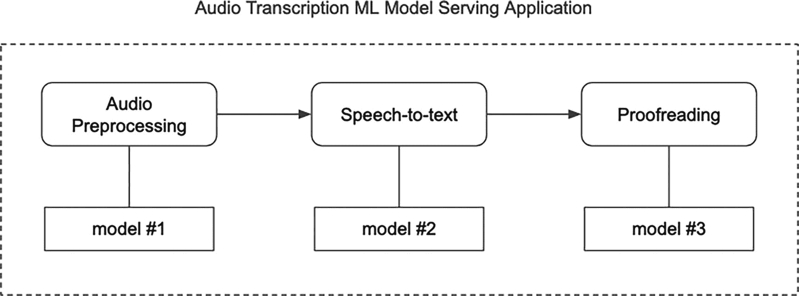

一个自动转录机器学习模型服务应用的流程图，包含自动预处理模型 1、语音转文本模型和校对模型 3。

图 5-14

多步骤音频转录机器学习模型服务应用

Ray Serve 提供了一种简单而优雅的方法，通过在部署之间传递部署引用来组合多个部署。上面的示例展示了一种流水线模式，其中一个部署的输出作为下一个部署的输入。除了流水线模式，这篇博客^(⁹⁷)还描述了其他三种模式，并展示了如何使用 Ray Serve 实现它们。

清单 5-13 展示了一段代码片段，它以流水线方式连接了三个部署，反映了图 5-14 中假设的音频转录应用的步骤。

```
%@serve.deployment
class AudioPreprocessing:
@serve.deployment
class SpeechToText:
@serve.deployment
class ProofReading:
audio_app = AudioPreprocessing.bind()
speech_to_text_app = SpeechToText.bind(audio_app)
proof_reading_app = ProofReading.bind(speech_to_text_app)
清单 5-13
设置部署流水线的代码骨架
```

Ray Service 中的多模型推理功能是一个极其强大的工具，它不仅简化了生产环境中的机器学习流水线，还有助于降低成本。在 Samara 公司引入 Ray Server 后，他们发现公司每年的机器学习推理总成本降低了约 50%。^(⁹⁸)

这里还值得提及其他两个值得注意的 Ray Serve 功能：模型复用和动态请求批处理。它们的详细信息可以在 [`https://docs.ray.io/en/latest/serve`](https://docs.ray.io/en/latest/serve) 找到。

## 总结

模型服务基础设施是机器学习基础设施的关键支柱之一，它通过促进模型在生产环境中的推理，使组织能够从各种有影响力的机器学习产品（如广告定向、个性化推荐、欺诈检测等）中实现机器学习项目的投资回报。与特征工程和模型训练基础设施相比，它更加庞大和复杂，并且可能需要大量的软件工程专业知识来支持具有多样化计算资源需求的大规模实时推理用例。

模型服务基础设施的复杂程度由几个因素决定，包括当前和预期的模型数量、在线和离线推理用例的比例、模型推理请求的数量及其延迟要求，以及模型本身的复杂性。一个完善的模型服务基础设施需要与以下组件和基础设施无缝集成：

*   **模型注册中心**：从中加载机器学习模型
*   **特征存储**：从中检索特征
*   **日志基础设施**：向其发送预测日志
*   **指标基础设施**：向其发送运维指标

在过去几年中，开源社区涌现了许多可行的模型服务解决方案，例如 BentoML、Seldon Core、Ray Serve 等。总的来说，这些解决方案具有以下共同点：

*   它们提供了抽象来满足模型服务需求，用户只需专注于服务逻辑。
*   它们提供了一条简单的路径，可以将模型服务基础设施部署到广泛采用的 Kubernetes 平台上。
*   它们支持常用的功能，如自适应批处理、推理图（也称为模型组合）等。
*   它们提供了分配所需计算资源的方法。
*   它们提供了将预测日志和指标发送到常用日志和指标基础设施的集成路径。

对于实时推理机器学习用例数量较少的组织来说，使用供应商管理的模型服务解决方案是一个可行的选择。当用例数量达到一定阈值（例如二十个或更多），并且可扩展性和严格的延迟要求成为主要讨论焦点时，则应考虑在某个开源解决方案或其等效的基于云的版本之上，构建内部的模型服务基础设施。

脚注 1   2   3   4   5   6   7   8   9   10   11   12   13   14   15


