# 6. 机器学习可观测性基础设施

恭喜！经过数周或数月的训练，你的模型终于完成并部署到生产环境，集成到了你的推荐系统中。A/B 测试结果显示，它对业务指标产生了显著且积极的影响。然而，你的同事提醒你，工作尚未完成。你的模型需要持续监控，以确保其性能保持最佳。换句话说，你的模型才刚刚踏上运营之旅的起点。

众所周知，机器学习模型一旦部署到生产环境，其性能会随时间推移而下降。因此，需要持续监控和观察它们的性能，以检测问题并防止负面后果，例如业务影响或用户体验下降。这种现象背后有多种原因。其核心在于，无论是训练好的模型还是生产环境中的模型，都依赖于数据。众所周知，世界并非一成不变；社会和文化规范会随着时间演变。有时还会出现突然而剧烈的变化，例如最近的新冠疫情，就对全球人民的行为产生了深远影响。基于疫情前数据训练的模型难以适应“新常态”，导致准确性和可靠性下降。例如，Lyft 的预计到达时间（ETA）模型高估了乘车时间，^(⁹⁹) 这导致使用 ETA 作为输入的模型出现连锁反应，性能不佳。

在模型性能逐渐退化之上，另一个增加复杂性的因素是静默故障现象。与触发显式警告或“页面未找到”等错误的传统软件错误不同，模型可能在性能逐渐恶化时看似运行正常。这种退化可能达到预测不准确的程度，却不会发出明确的警告或错误来指示存在问题。因此，可能需要数周时间，业务指标的影响才会变得明显。因此，与任何复杂系统一样，有必要持续检查、维护和更新模型，以确保任何由机器学习驱动的系统的长期成功和可靠性。

本质上，“部署后就不管”的机器学习模型并非明智之举。组织应投资于机器学习可观测性，以降低业务风险，例如声誉受损、客户满意度下降和收入损失。虽然这会增加额外的工程成本，但从长远来看，这项投资会带来回报，特别是对于那些机器学习已深入并广泛嵌入其产品组合的组织而言。

机器学习可观测性涵盖了用于监控、测量和理解机器学习系统的工具、实践和流程，包括机器学习模型以及整个机器学习管道的性能、特征质量、行为和健康状况。

通常，“机器学习监控”与“机器学习可观测性”这两个短语可以互换使用。虽然它们密切相关，对于管理和维护生产环境中的模型至关重要，但它们的范围与功能有所不同。机器学习监控侧重于通过收集和监控关键指标（如准确率、精确率、召回率、数据漂移、模型漂移及其他相关指标）来跟踪机器学习模型的性能。它主要解决“是什么”的问题，并作为一种被动措施来检测与模型性能或行为相关的问题。机器学习可观测性则采用更广泛的方法，超越机器学习监控，以理解和洞察整个机器学习系统和工作流程，包括模型、数据、训练、管道和部署环境。它旨在回答“为什么”和“如何”的问题，提供系统行为、性能和潜在问题的整体视图，以促进故障排除和根因分析，并使模型所有者能够就模型改进和优化做出明智的决策。

简而言之，机器学习监控是机器学习可观测性策略的一个子集。如图 6-1 所示的冰山图像，常被用来描述机器学习监控和机器学习可观测性。冰山的可见部分或顶端代表机器学习监控。隐藏在水面下的巨大冰山部分则代表了所有盲点——数据问题、配置问题、偏差、部署环境、数据漂移和概念漂移。机器学习可观测性旨在揭示整座冰山，而不仅仅是可见的顶端。

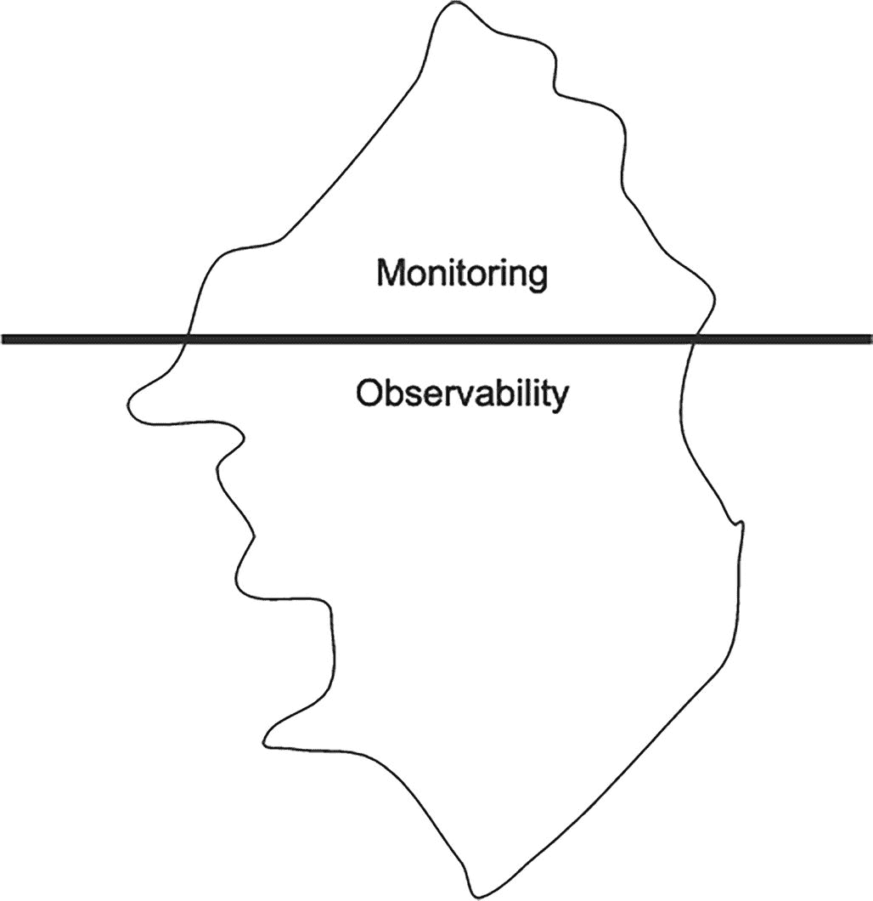

一个不规则封闭结构的示意图，有一条水平线将其分为两部分。顶部区域标记为“监控”。底部区域标记为“可观测性”。

图 6-1

用冰山隐喻来描述机器学习监控和机器学习可观测性

注意

监控与可观测性

从理解系统行为的角度来看，监控和可观测性是相关但不同的概念。正如论文《迈向大规模可观测性数据管理》^(¹⁰⁰) 中所描述的，监控指的是收集指标和测量值来跟踪系统健康状况和性能，例如正常运行时间、延迟、错误等。它本质上关注的是系统内部“正在发生什么”。可观测性则在此基础上扩展，通过提供关于整个系统运行状态的上下文洞察，来促进对隐藏问题的主动故障排除。有效的可观测性需要从管理单个指标转向管理它们之间的关系，以更深入地理解系统的内部动态、交互和隐藏的复杂性，并能够识别根因。这需要跨组件追踪流程，将指标与日志进行聚合和关联，并进行更全面、更整体的分析。

机器学习可观测性基础设施如同一个警惕的眼睛，在机器学习开发生命周期的每个阶段（从特征生成到预测）提供对模型性能的深入洞察，赋能主动解决问题和持续改进。

接下来的章节将深入探讨该基础设施的架构。之后，案例研究部分将重点介绍一些内部解决方案以及开源解决方案。


## 概述

作为机器学习基础设施的关键组成部分之一，ML 可观测性是监控、故障排除和改进 ML 模型性能的支柱。它提供了对整个 ML 开发生命周期（从特征生成、模型训练和部署、模型预测等）的端到端可见性。它包括一系列工具、实践和技术，用于深入了解特征、模型和 ML 系统的行为与性能。这使得团队能够在问题影响业务关键绩效指标之前，主动且快速地发现并缓解 ML 生命周期中出现的问题。这种主动方法得益于以下优势：

*   **早期检测**：及早识别并解决模型性能下降、偏差、数据与概念漂移等问题。
*   **根因分析**：深入探究模型行为的根本原因，从输入数据到模型部署，理解其做出特定预测的原因。
*   **增强协作**：在利益相关者、数据科学家和 ML 工程师之间建立对模型健康状况和预测结果的共同理解，弥合不同团队之间的鸿沟。
*   **持续改进**：通过持续监控模型与可操作洞察的紧密反馈循环，推动模型的持续改进。

通过释放这些优势，ML 可观测性成为生产环境中值得信赖且可靠的 ML 模型的基石。

本节将介绍 ML 可观测性基础设施的高级架构，并深入探讨其基本组件和功能。理解这些技术细节对于使用开源技术构建内部解决方案、评估供应商解决方案或采用混合方法都极具价值。

其核心是，ML 可观测性基础设施需要提供针对模型性能、漂移、数据和可解释性的监控、告警和分析能力，如图 6-2 所示。

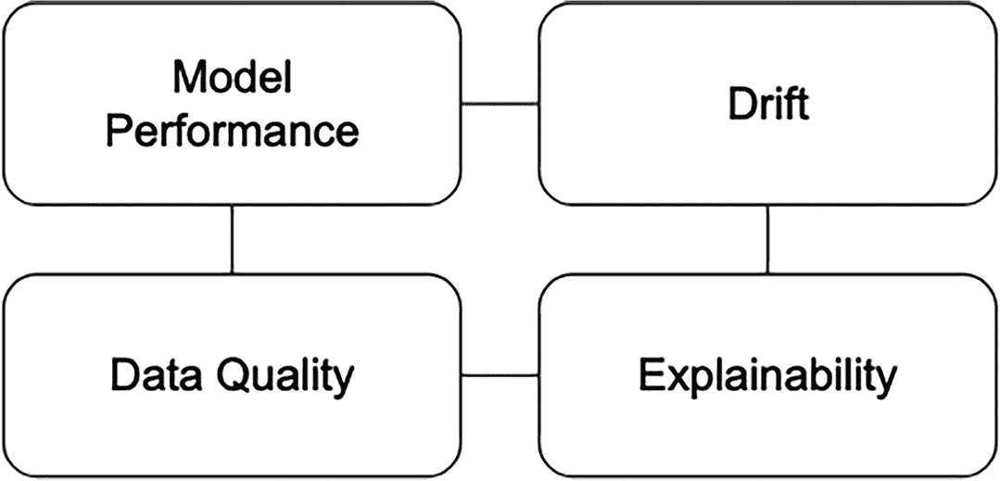

一个循环图按顺时针方向列出了以下四个领域：1. 模型性能。2. 漂移。3. 可解释性。4. 数据质量。

**图 6-2**
ML 可观测性中分析与监控的四个领域

### 模型性能

理解模型性能的一种常见方法是测量和检查一组关键指标，包括准确率、精确率、召回率等。性能分析确保模型性能相较于其训练时或最初部署到生产环境时没有显著下降。ML 可观测性基础设施必须密切跟踪与既定基线的关键指标对比，并在性能低于可接受阈值时触发告警。

> **注意**
> 模型性能——公平性、偏差与完整性
>
> 监控模型性能对于确保机器学习中的公平性、解决偏差以及维护模型完整性至关重要。通过定期评估模型在不同人口统计群体和边缘案例上的表现，有助于识别可能出现的任何差异或问题。此外，模型性能监控有助于检测随时间推移可能出现的任何异常或故障，从而允许及时干预和维护，以保持模型的完整性和可靠性。

### 漂移

ML 中的漂移概念源于统计学学科。从高层次来看，它指的是数据统计属性随时间的变化。测量、跟踪和监控模型输入、输出和实际值的漂移非常重要。导致漂移的因素有很多，包括模型变得陈旧、不良特征流入、对抗性输入等。模型性能可能因漂移而随时间下降。ML 可观测性基础设施必须提供测量、分析和监控漂移的方法，以帮助保护模型免受性能下降的影响，并使模型所有者能够理解和缓解漂移。

### 数据质量

“垃圾进，垃圾出”这句话完美地概括了模型性能如何直接依赖于输入数据的质量，无论是在训练阶段还是预测阶段。我们都知道现实并非一成不变，数据也反映了这一点。与模型性能相关的一组常见数据质量问题包括基数变化、数据缺失、数据类型不匹配、超出范围等。因此，任何健壮的 ML 可观测性基础设施都必须在模型开发生命周期中主动检测和跟踪这些数据质量问题。

### 可解释性

可解释性是一种有助于阐明模型决策的工具。它使我们能够追溯预测背后的推理过程，通过特征重要性或归因特征揭示关键特征及其对结果的影响。生成可解释性指标的两种流行方法是 SHAP 和 LIME。将可解释性与 ML 可观测性基础设施中提到的其他功能集成在一起，对于诊断根本原因和深入了解模型如何进行预测来说，价值不可估量。

> **注意**
> 特征漂移 vs. 模型漂移
>
> 特征漂移指的是 ML 模型中输入特征统计属性的变化。具体来说，这指的是特征特征，例如平均值、标准差、范围以及与基线的偏移。特征漂移的可能原因包括数据模式的季节性变化、数据收集方法的改变、经济危机等外部因素、人口结构变化等。
>
> 模型漂移，也称为概念漂移，指的是模型性能随时间推移而恶化，而特征分布保持不变。这种恶化是由于输入特征与模型试图预测的结果之间的关系发生了变化。模型漂移的可能原因包括由于新技术、经济状况、监管变化等导致的用户行为随时间变化。与特征漂移类似，模型漂移会损害模型的准确性和可靠性。模型漂移的一个例子是，一个部署用于社交媒体监控的情感分析模型，随着用户使用的语言和表达方式随时间演变，遇到了模型漂移，导致模型在捕捉当前情感方面的准确性下降。


## 高层架构

一个有效且稳健的机器学习可观测性架构应包含一组组件，以提供上述能力。高层架构如图 6-3 所示，其中可观测性存储作为核心组件，用于存储模型相关数据，并访问为机器学习可观测性目的而聚合和转换的指标。各种模型相关数据来自特征工程、模型训练和模型预测，这些原始且细粒度的数据将被聚合和转换，用于监控告警、模型性能分析和模型可解释性。

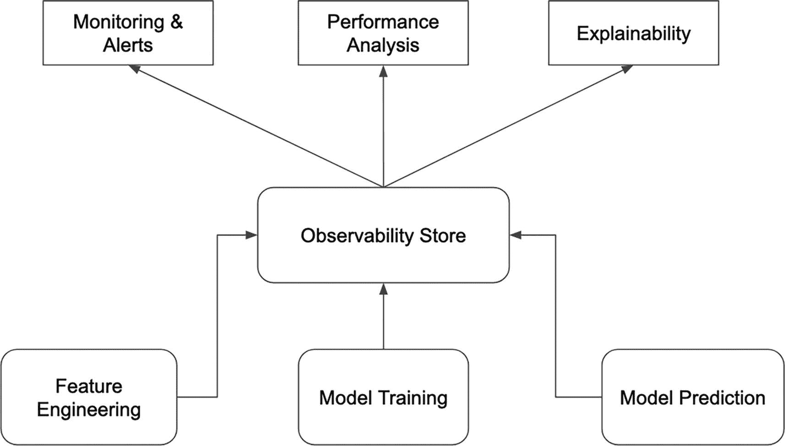

一个自下而上的流程图。特征工程、模型训练和模型预测连接到可观测性存储。可观测性存储分为监控与告警、性能分析和可解释性。

图 6-3

机器学习可观测性基础设施高层架构

与标准的微服务可观测性类似，机器学习可观测性也必须包含系统可观测性的三大支柱：日志、指标和链路追踪。^(¹⁰¹) 遥测数据将在与模型推理服务交互时，提供关于周边系统的额外上下文。此上下文对于机器学习性能追踪非常有价值，这是一种追踪或定位模型性能问题根源，并将其映射回底层数据或系统问题的实践。通过利用丰富的遥测数据，机器学习性能追踪能够清晰理解整个推理请求的生命周期，识别性能下降或错误发生的位置和原因，无论这些问题源于数据问题、基础设施故障还是输入模式的变化。

### 可观测性存储

与特征存储和模型存储不同，后两者各自为特定目的保存一种特定类型的信息，而可观测性存储旨在保存机器学习开发过程各阶段产生的多种类型的模型相关数据，包括特征工程、模型训练、模型评估和模型预测。这种数据的多样性使得可观测性存储独特且有价值，并能满足机器学习可观测性的需求：快速发现模型性能问题并缩短问题解决时间。

以下各节简要概述了在机器学习开发生命周期的这三个阶段中，应将哪些数据记录到可观测性存储中。

#### 特征工程

新鲜且高质量的数据驱动模型性能。由真实世界数据驱动的生产模型会因特征过时或不准确而遭受次优结果。为主动应对此问题，应将数据质量分析和特征分布计算作为特征生成管道的最后一步集成进来。这些洞察应被导入可观测性存储，以便快速诊断由数据质量或特征漂移引起的模型性能问题。

#### 模型训练

在模型训练任务结束时，无论是预生产模型训练还是持续的模型训练，至关重要的是将数据分布、整体及分片的模型性能指标记录到可观测性存储中。捕获这些信息并将其建立为基线，将有助于在未来出现问题时进行精确的性能追踪。

#### 模型预测

在推理过程中，当生产模型用于进行预测时，会产生大量有价值的数据，这些数据有助于监控和诊断模型性能。这些数据应被记录到可观测性存储中。示例包括输入特征、实际预测结果、生产模型名称和版本等。此外，运营指标（如预测延迟、任何错误、推理请求客户端等）丰富了这些数据，为主动故障排除和性能追踪提供了全局视图。

#### 可观测性存储实现

可观测性存储这一概念受 Josh Tobin^(¹⁰²) 的评估存储（evaluation store）理念启发。它更进一步，将所有相关的机器学习可观测性数据集中捕获到一个中心位置，以满足监控告警、漂移检测、性能分析与追踪以及可解释性的需求。目前尚无公开可用的可观测性存储实现。对于机器学习可观测性供应商而言，他们必须拥有一个根据其产品功能定制并体现差异化的变体实现。

在考虑提出可观测性存储的可能实现时，我们首先应充分理解所存储、访问和展示的数据与指标，然后从那里反向推导，提出一个可行的技术设计方案。

核心数据实体是模型。每个模型都关联着一组来自训练、评估和生产的性能指标。此外，每个模型还关联着一组用于训练、评估和执行预测的特征。还会有关于预测请求客户端、监控和告警阈值等的元数据。

用于理解和监控模型性能的一个关键数据是**真实值（ground truth）**，即实际的正确答案。将预测结果与真实值进行比较，使我们能够真正评估模型的性能水平。在某些用例中，例如广告定向或外卖预计到达时间（ETA），预测做出后不久即可获得真实值。然而，对于其他用例，如预测欺诈活动或疾病进展，真实值可能会有显著延迟，甚至长达数月。

访问模式通常集中于在指定的时间窗口内，分析特定数据切片（队列）上的模型性能指标或进行漂移检测。根据具体用例，此分析可以聚焦于特征或模型本身。对于某些场景，例如评估外卖 ETA 的准确性，能够近乎实时地分析模型性能和检测漂移至关重要。访问模式的具体示例可通过以下例子说明：

*   模型 A 的所有特征在过去 1 小时内的平均漂移是多少？
*   模型 B 的预测结果在过去 24 小时内的平均漂移是多少？
*   针对加利福尼亚州的 ETA 预测模型在过去 4 小时内的准确率是多少？

除了上述核心能力之外，对于拥有大量用例和高流量的组织，其实现必须能够支持大量模型、指标和预测，同时不牺牲上述各种访问模式的延迟。

可观测性存储的高层实现如图 6-4 所示，它提倡使用在线分析处理（OLAP）系统和元数据存储。存储在数据湖中的数据、指标、预测和真实值，通过分布式数据处理系统（如 Spark）进行组织、聚合和转换，然后持续摄入到 OLAP 系统和可观测性存储的元数据中。

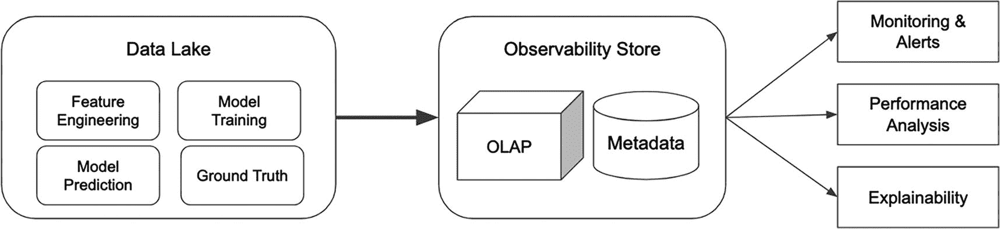

一个三步流程图如下：1. 包含特征工程、模型训练、真实值和模型预测的数据湖。2. 包含 OLAP 和元数据的可观测性存储。3. 监控与告警、性能分析和可解释性。

图 6-4

可观测性存储的高层实现


一旦机器学习可观测性数据以星型模式结构组织起来，OLAP 系统便能在低延迟分析操作中表现出色，例如上卷、下钻、切片、切块、透视等，这些操作非常适用于性能分析、漂移检测和性能追踪。OLAP 系统可以轻松与数据可视化工具和告警系统集成，从而提供全面的机器学习可观测性解决方案。

注意

开源 OLAP 系统

开源 OLAP 系统，例如 Apache Pinot、Apache Druid、ClickHouse 等，正日益流行，并被 Uber、Netflix、Cisco、LinkedIn 等众多大公司广泛采用。它们能够以极快的速度支持大规模、复杂的分析工作负载，使其成为临时分析、实时分析、BI 报告和业务指标仪表盘等应用的理想选择。

几乎所有这类 OLAP 系统都支持实时数据摄取，这为广泛的实时数据驱动用例提供了动力。这些用例包括欺诈检测与监控、业务指标监控、性能监控以及出行数据分析。这一能力为跨行业的各种应用场景打开了大门。

## 案例研究

在机器学习可观测性领域，一个有趣的观察是，专注于机器学习可观测性的商业供应商解决方案在过去几年中已经显著成熟，并且它们的解决方案可以轻松地与内部或云供应商的机器学习基础设施集成。此外，近年来涌现出许多开源解决方案，以帮助满足机器学习可观测性的各种需求。

以下部分将重点介绍来自内部和开源社区的几个案例研究。

### Lyft：模型监控

2020 年初，Lyft 的机器学习平台团队开发了一个强大的机器学习监控系统，用于识别和防止模型退化。该系统旨在最大限度地减少对 Lyft 乘客、司机以及财务业绩的负面影响。

Lyft 机器学习平台团队在其博客中^(¹⁰³)概述了他们开发的模型监控方法，以及机器学习从业者为有效监控其模型所需的文化转变。这些领域提供了宝贵的学习经验和实践见解，这些内容超越了典型的机器学习可观测性供应商文档。因此，以下部分将重点介绍这两个关键方面，以更深入地理解如何实施和维护有效的模型监控实践。

认识到更复杂、高价值的功能需要更长的实施时间，他们的模型监控系统实施遵循了两阶段策略。首先，他们优先考虑那些能够快速接入模型并捕获最明显模型问题的监控技术。然后，他们将重点转向构建更强大的离线监控技术，以进行更深入的分析和主动的问题识别。

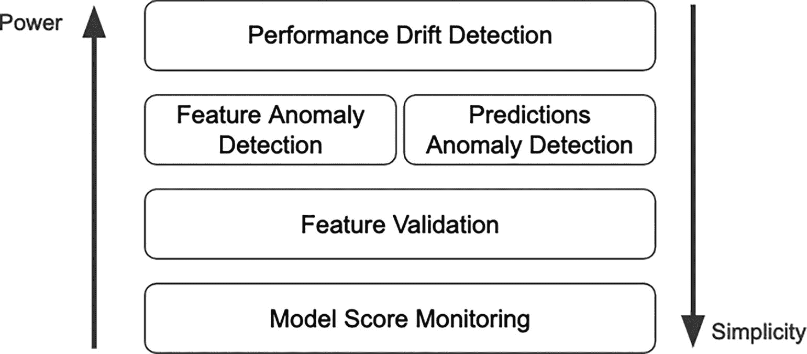

一个从上到下列出以下内容的图表。1. 性能漂移检测。2. 特征和预测异常检测。3. 特征验证。4. 模型分数监控。能力从下到上递增。简易性从上到下递减。

图 6-5

改编自模型监控技术谱系⁵

#### 第一阶段

在此阶段，他们专注于模型分数监控和特征验证。对于模型分数监控，他们的系统提供了一种简单且可配置的基于时间序列的告警，针对落在特定值范围内的平均模型预测分数。凭借这种方法的灵活性，每个模型所有者可以轻松为其模型设置适当的告警阈值。对于特征验证，他们的系统提供了一组开箱即用的常用特征验证，例如类型检查、值范围、缺失值、集合成员和必需特征。高级和自定义特征验证通过模型所有者提供的自定义逻辑得到支持。组合的特征验证逻辑会针对每个预测请求的特征执行。此特征验证基于期望概念，他们利用了 Great Expectations 开源库，这将在下一节中介绍。

虽然 Great Expectations 验证器在处理大型数据集方面表现出色，但其开销阻碍了它们在在线预测场景中的有效性，在这些场景中，亚毫秒级响应时间的单特征集验证至关重要。为了解决这个问题，他们构建了一个轻量级验证版本，利用异步执行来最大限度地减少对模型预测速度的延迟影响。

#### 第二阶段

在此阶段，他们着手处理高价值功能，即特征和预测的异常检测，以及模型性能漂移检测。

为了检测特征值和模型预测的异常，一个离线的每日流程会计算和分析记录的特征值和模型预测的统计偏差，如图 6-6 所示。该系统不会触发告警，而是在生成的报告中标记关键潜在模型性能信号中的统计显著偏差，供模型所有者审查，这些信号包括调用量、模型预测均值、特征值均值和特征空值百分比。

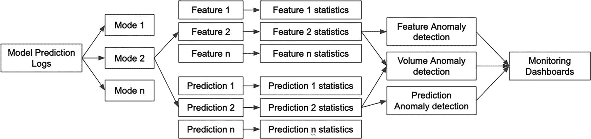

一个水平树状图。模型预测日志被分类为从 1 到 n 的模式。模式 2 被分类为 n 个特征和预测。每个特征和预测都有相应的统计数据。第二个统计数据具有特征、数量和预测异常检测。

图 6-6

改编自异常检测系统组件⁵

他们的自动统计检查方法无需模型所有者进行任何接入工作。

与异常检测方法类似，他们的性能漂移检测方法也是离线并按计划进行的。漂移检测通过将模型预测与真实值进行比较来完成。由于每个模型的真实值不同，模型所有者需要提供以下三项信息：

*   用于检索真实值的 SQL 查询
*   用于计算性能指标的后处理逻辑
*   针对这些指标的一组验证

这种漂移检测在检测复杂模型性能问题方面非常有效。然而，这是一个高接触度的过程，并且适用于真实值可用且可靠的用例。

#### 推动采用的文化转变

他们的博客指出的一个经验教训是关于推动采用其机器学习监控方法所需的文化变革。

除非将其融入模型开发流程，否则生产环境中模型的运维问题通常不是模型所有者最关心的事情。为了推动其机器学习监控产品的采用，Lyft 的机器学习平台团队采用了多管齐下的方法：

*   他们投入了大量精力，使接入过程尽可能顺畅。
*   他们投入时间，通过内部研讨会以及与产品团队合作，向其内部客户推销和培训监控产品。
*   一旦有了健康的自然采用率，他们便强制要求所有模型未来都必须进行监控。

与其他组织类似，他们认识到构建机器学习监控是一项防御性投资，并且很难优先考虑这项投资，而将其他对营收或利润有更清晰影响的项目置于其后。通常情况下，需要发生一次具有财务后果的显著生产事故，才能揭示监控系统的真正价值。


### 开源

近年来，涌现出大量与机器学习可观测性相关的开源项目。本节重点介绍的三个开源项目涵盖了机器学习可观测性基础设施的广泛需求。它们涵盖的范围从数据和特征生成相关的数据验证，到记录和捕获预测结果的关键统计属性，最后再到从验证到生产环境中评估、测试和监控机器学习模型。

#### Great Expectations

高质量的数据是机器学习的生命线。数据和特征的测试与验证对于机器学习开发生命周期中的许多步骤至关重要，包括数据摄取、特征工程、模型推理等。图 6-7 突出了需要进行数据验证和测试的步骤。这确保了模型能够做出准确的预测，并使组织能够从其成功的机器学习项目中获得投资回报。

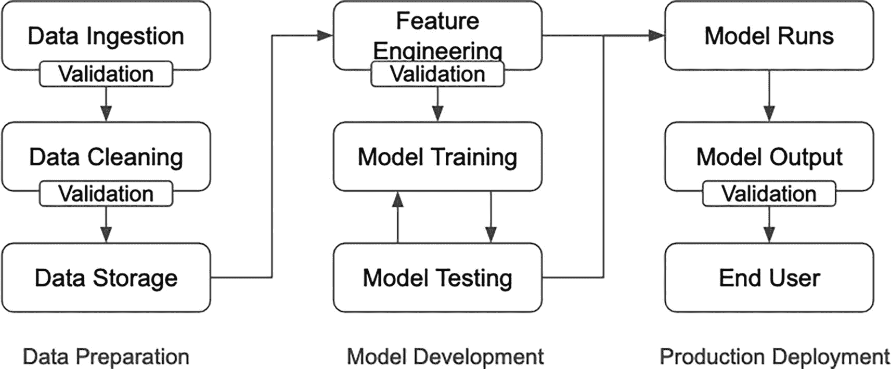

一个三阶段流程示意图。1. 数据准备：数据调查、清洗和存储。2. 模型开发：特征工程、模型训练和模型测试。3. 生产部署：模型运行、模型输出和最终用户。验证在每个阶段的各个步骤中进行。

图 6-7

改编自 Great Expectations 如何融入 MLOps？^((104))

Great Expectations 是一个 Python 开源项目，旨在作为一个数据验证和文档框架。其创建者认为数据质量问题不应阻碍创新，他们的理念围绕着通过主动的数据验证和文档来解决这些问题。换句话说，他们主张构建“内嵌”数据质量的数据管道，而不是事后“附加”。

Great Expectations 框架的核心概念称为“Expectation”（期望），它旨在允许用户以声明式的方式清晰、简单地定义他们对数据的期望，使其一目了然，易于阅读和理解。本质上，每个 Expectation 都以人类可读的方式声明了数据的预期状态，对技术人员和非技术人员都有意义。

注意

用户反馈

对于某些机器学习应用，用户反馈是一种可用于改进模型性能的验证形式。上述步骤旨在突出将模型投入生产所涉及的常见验证和测试步骤。

Great Expectations 框架作为一个 Python 库提供，包含大量内置的 Expectation 类型，从简单的表行计数和值缺失，到复杂的值分布、均值和标准差。该框架在设计时考虑了灵活性和可扩展性，使其用户社区能够在出现独特需求时轻松创建自定义的 Expectation 类型。要探索完整且最新的 Expectations 列表，请访问 [`https://greatexpectations.io/expectations/`](https://greatexpectations.io/expectations/)。

代码片段，列表 6-1，展示了使用表级和列级 Expectation 的几个示例。

```
# import and setting up data to perform validation
import great_expectations as gx
validator = gx.read_csv("")
# table-level Expectations
validator.expect_table_row_count_to_be_between(min_value=100, max_value=300)
# column-level Expectations
validator.expect_column_values_not_to_be_null("salary")
validator.expect_column_values_not_to_be_unique("id")
validator.expect_column_max_to_be_between("age", min_value="100", max_value="120")
validator.expect_column_mean_to_be_between("age", 20,40)
# validator.get_expectation_suite()
列表 6-1
表级和列级期望的示例
```

还有更多有用且强大的 Expectations 可用于各种数据验证需求。

在 MLOps 管道的背景下，Great Expectations Python 库可以轻松集成到这些管道中，以在机器学习开发生命周期的不同步骤执行各种数据验证。验证结果可以转化为人类可读的报告，这些报告可以方便地离线审查或与各种数据利益相关者共享。图 6-8 展示了这样一个报告的示例，其中包含对 passenger_count 和 pickup_datetime 这两个列进行的两次简单且成功的验证。

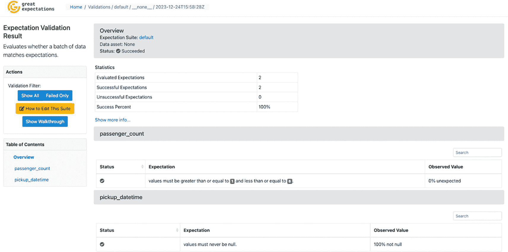

一个显示期望验证结果的网页截图。左侧显示了一系列操作和目录。右侧列出了概览数据、统计信息、乘客数量和上车数据时间的详细信息。

图 6-8

一个人类可读格式的验证报告示例


#### whylogs

研究表明，高质量的数据能提升模型性能。然而，现实世界中的数据不断变化，如果不对模型进行持续监控和更新，就可能导致模型性能下降。能够轻松快速地检测和监控底层数据分布的变化，对于在生产环境中维持模型性能至关重要。

whylogs 是一个开源库，用于生成各种数据类型（包括表格数据、文本、音频、图像等）的统计摘要。该库不采用数据采样技术，而是使用数据画像技术，即使在大量日志数据中也能准确表示罕见事件和异常值。生成的统计摘要称为 whylogs 画像，以标准格式捕获，用于表示一段时间内的数据快照。它们提供了关键统计信息的全面概览，例如值分布、不同值计数、分位数、频繁项等。此外，whylogs 画像还允许通过用户定义的指标和元数据进行自定义。

whylogs 画像使得监控数据质量、追踪数据集随时间的变化以及进行可视化变得非常容易。这三种用途支持多种机器学习可观测性场景，包括特征漂移或概念漂移检测、性能退化分析、模型输入或数据管道质量验证等。

whylogs 画像在设计上明确区分了生成画像的过程和基于画像采取行动的过程，从而在数据分析或告警方面实现了灵活性和可扩展性。这些画像设计得高效、可定制且可合并，使其适用于各种有严格要求的场景，例如特征和机器学习管道。

*   **高效**：whylogs 画像体积非常紧凑，并能高效地描述其所代表的数据集。所有统计信息均以流式方式收集，只需对数据进行单次遍历，且内存开销极低。这使得 whylogs 画像能够随列数线性扩展，而非随数据量扩展。

*   **可定制**：whylogs 画像提供易于配置和自定义的统计信息，例如针对不同数据类型和用例的自定义追踪器。这种灵活性对于适应多样化的指标至关重要，并支持追踪文本和图像等复杂数据类型。

*   **可合并**：whylogs 画像可以以分布式方式生成，然后在后续步骤中合并在一起，形成代表其组成画像聚合结果的新画像。

注意

数据采样 vs. 数据画像

在微服务世界中，日志记录已成为理解和监控复杂系统健康状况的标准实践。在数据领域，数据日志记录旨在实现理解和监控数据的类似目的。数据日志记录有两种方法：采样和画像。

采样是两者中较为简单的方法，通过随机或程序化方式从较大的数据流中选择数据样本并存储以供后续分析。这种简单方法易于实现；然而，在捕获整个数据集的重要统计属性方面存在缺点，例如会遗漏罕见事件和异常值，并且无法准确估计最小值/最大值或唯一值的数量。

画像方法则涉及数据画像^(¹⁰⁵)（也称为数据素描或统计指纹识别），以捕获给定数据集的人类可解释的统计画像，从而提供对数据的洞察。画像通过利用一系列高效的流式算法来生成可扩展、轻量级的数据集统计画像。捕获的数据画像能够准确表示罕见事件和异常值，并且直方图、均值、标准差等统计属性易于解释。

清单 6-2 中的代码片段展示了在 Python 中生成 whylogs 画像有多么简单，假设 whylogs Python 包已安装。

```
# 导入并设置数据以执行验证
import whylogs as why
import pandas as pd
df = pd.read_csv("")
# 生成画像
data_profile = why.log(df)
# 以 Pandas DataFrame 格式检查画像
data_profile_view = data_profile.view()
data_profile_df = data_profile_view.to_pandas()
清单 6-2
使用 whylogs Python API 生成 whylogs 画像的示例
```

默认情况下，生成的 whylogs 画像的行数将等于被记录数据集中的列数。被记录数据集中每列的标准生成指标存储在生成的 whylogs 画像每行的列中。标准指标分为以下几类：计数、基数、分布、类型。有关生成指标的更多详细信息，请参阅此文档页面：[`https://whylogs.readthedocs.io/en/latest/examples/basic/Inspecting_Profiles.html`](https://whylogs.readthedocs.io/en/latest/examples/basic/Inspecting_Profiles.html)。

为了可视化生成的 whylogs 画像的摘要和漂移报告，我们将使用提供的 `NotebookProfileVisualizer` 类。请参阅清单 6-3，了解使用此类为泰坦尼克号数据集显示这些报告的示例。

```
# 导入并设置数据以执行验证
import whylogs as why
import pandas as pd
titanic_df = pd.read_csv("titanic.csv")
# 为了生成漂移摘要，根据 Survived 值将 titanic_df 分成两部分
# titanic 画像
titanic_profile = why.log(titantic_df)
profile = titanic_profile.profile()
prof_view = profile.view()
# 参考 whylogs 画像
cond_reference = (titanic_df['Survived']==0)
titanic_reference = titanic_df.loc[cond_reference]
# 删除 Survived 和 Name 列
titanic_reference = titanic_reference.drop(["Survived","Name"],  axis=1)
ref_result = why.log(pandas=titanic_reference)
ref_prof_view = ref_result.view()
# 目标 whylogs 画像
cond_target = (titanic_df['Survived']==1)
titanic_target = titanic_df.loc[cond_target]
# 删除 Survived 和 Name 列
titanic_target = titanic_target.drop(["Survived","Name"],  axis=1)
target_result = why.log(pandas=titanic_target)
target_prof_view = target_result.view()
# 实例化 NotebookProfileVisualizer 以生成报告
from whylogs.viz import NotebookProfileVisualizer
visualization = NotebookProfileVisualizer()
visualization.set_profiles(target_profile_view=target_prof_view, reference_profile_view=ref_prof_view)
# 生成漂移报告
visualization.summary_drift_report()
清单 6-3
使用 whylogs Python API 生成漂移报告的示例
```

图 6-9 展示了从两个 whylogs 画像生成的漂移报告。这是一个示例，旨在通过视觉检查分布来说明分布偏移。

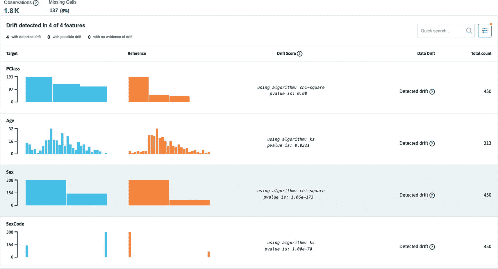

一个显示报告的网页截图。顶部信息显示，在 4 个特征中的 4 个检测到漂移。4 个观察到漂移，0 个可能存在漂移，0 个无漂移证据。数据以 5 列显示，标签分别为目标、参考、漂移分数、数据漂移和总计数。

图 6-9


来自泰坦尼克号数据集生成的两个 whylogs 配置文件的漂移报告示例

为了更直观地观察单个特征的分布情况，我们可以使用直方图（针对数值特征）或分布图（针对分类特征）来叠加两个分布。清单 6-4 展示了如何实现这一点的代码片段，图 6-10 展示了这两个图表。

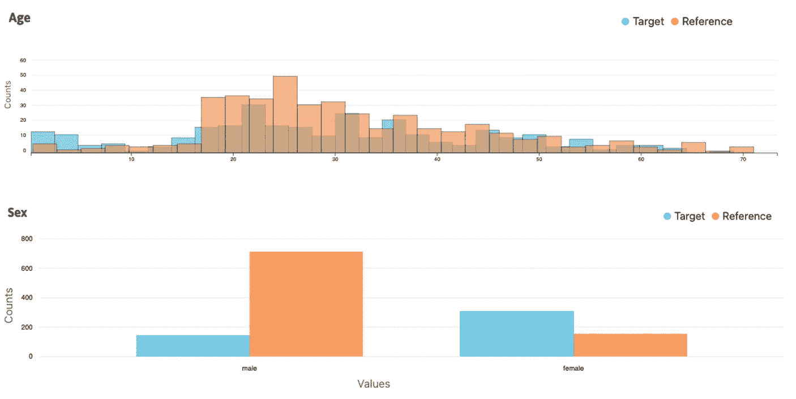

两张双柱状图的截图。上方，一张多柱状图描绘了关于年龄的目标和参考计数的图表。下方，一张多柱状图描绘了关于性别的目标和参考计数的图表。

图 6-10

特征“年龄”和“性别”的直方图与分布图

```
# 接清单 6-3
# 在双直方图中叠加数值特征“年龄”的两个分布
visualization.double_histogram(feature_name="Age")
# 绘制分类特征“性别”的分布图
visualization.distribution_chart(feature_name="Sex")
# 生成名为“年龄”的特征统计信息
visualization2 = NotebookProfileVisualizer()
visualization2.set_profiles(target_profile_view=prof_view, reference_profile_view=None)
visualization2.feature_statistics(feature_name="Age")
清单 6-4
使用 whylogs Python API 在直方图和分布图中叠加两个分布
```

上述两个图表直观地表明，参考和目标 whylogs 配置文件中特征“年龄”和“性别”的分布存在显著差异。

生成一个或多个特征的统计信息非常简单。清单 6-5 展示了如何仅用几行代码实现这一点，结果如图 6-11 所示。

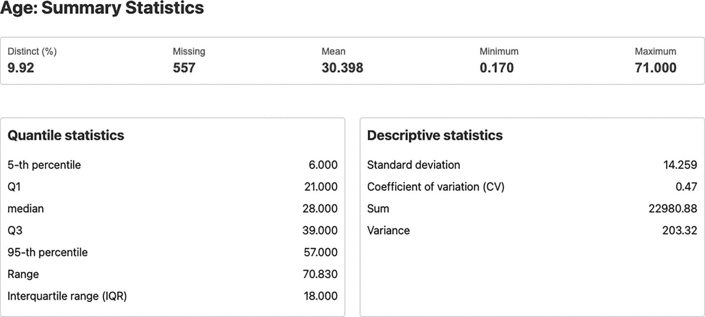

一张显示年龄特征汇总统计信息的截图。它显示了以下详细信息：不同值百分比、缺失值、均值、最小值和最大值。分位数统计和描述性统计的详细信息也列在下方。

图 6-11

名为“年龄”的特征的各种统计属性

```
# 接清单 6-4
# 生成名为“年龄”的特征统计信息
visualization2 = NotebookProfileVisualizer()
visualization2.set_profiles(target_profile_view=prof_view, reference_profile_view=None)
visualization2.feature_statistics(feature_name="Age")
清单 6-5
使用 whylogs Python API 生成特征统计信息
```

#### Evidently

Evidently 是一个开源的 Python 库，旨在帮助在整个模型生命周期（从验证到生产）中评估、测试和监控数据及机器学习模型。它包含以下概念：指标、报告、测试和测试套件。

指标是 Evidently 的核心组件，旨在评估数据或模型质量的特定方面，例如数据缺失值的数量、统计属性等。有许多与数据质量、完整性、漂移和模型性能相关的内置指标。

报告是评估数据或机器学习模型质量的不同指标的组合。报告输出可以通过交互式图表可视化，也可以生成为 JSON 格式或 Python 字典。报告通常通过其交互式可视化用于调试、探索性分析和临时分析。

在 Evidently 中，测试本质上是一个带有条件的指标，用于验证对数据或模型的期望，无论是关于数据结构还是模型性能。多个测试可以组织成一个测试套件并一起评估。测试和测试套件适用于自动化对数据质量和模型性能的期望，以确保它们不被违反。

Evidently 的核心组件是指标、报告、测试和测试套件，它们共同涵盖了广泛的使用场景，从临时分析、自动化管道测试到持续监控。

开箱即用，Evidently Python 库提供了许多常用的指标和测试。这些即用型组件被称为预设，可简化常见场景下的数据和模型评估与测试。可在网页 [`https://docs.evidentlyai.com/presets/all-presets`](https://docs.evidentlyai.com/presets/all-presets) 上找到可用预设的完整列表及其详细描述。

清单 6-6 展示了使用 Evidently Python API 生成数据漂移报告以及泰坦尼克号数据集中“年龄”列统计属性的代码片段。

```
# 设置必要的导入语句
import pandas as pd
from evidently.report import Report
from evidently.metric_preset import DataDriftPreset
from evidently.metrics import DatasetSummaryMetric, ColumnSummaryMetric, ColumnQuantileMetric
# 读取泰坦尼克号数据集
titantic_df = pd.read_csv("../data/Titanic.csv")
# 删除“Unnamed: 0”列
titantic_df = titantic_df.drop("Unnamed: 0", axis=1)
# 按目标值分离
cond_reference = (titantic_df['Survived']==0)
titanic_reference = titantic_df.loc[cond_reference]
cond_target = (titantic_df['Survived']==1)
titanic_target = titantic_df.loc[cond_target]
# 删除两个不必要的列
titanic_reference = titanic_reference.drop(["Survived","Name"],  axis=1)
titanic_target = titanic_target.drop(["Survived","Name"],  axis=1)
# 设置并运行 DataDriftPreset 报告
report = Report(metrics=[
DataDriftPreset(),
])
report.run(reference_data=titanic_reference, current_data=titanic_target)
report.show(mode='inline')
# 为“年龄”列生成数据汇总指标
report2 = Report(metrics=[
DatasetSummaryMetric(),
ColumnSummaryMetric(column_name='Age'),
ColumnQuantileMetric(column_name='Age', quantile=0.25),
])
report2.run(current_data=titantic_df, reference_data=None)
report2.show(mode='inline')
清单 6-6
使用 Evidently Python API 生成并可视化漂移报告
```

图 6-12 包含了列“年龄”、“乘客等级”、“性别代码”和“性别”的漂移报告，类似于图 6-9 中的报告。图 6-13 显示了名为“年龄”的特征的生成统计属性。

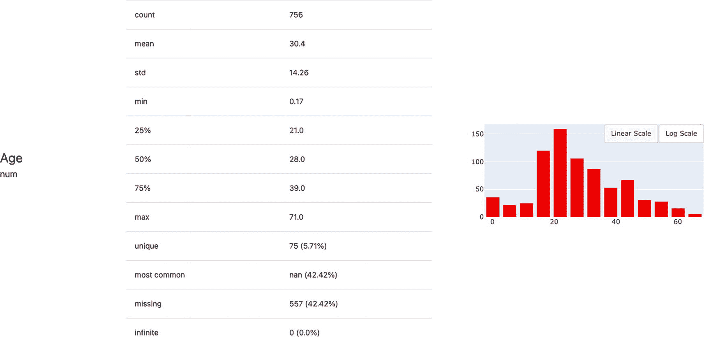


一张截图展示了特征“年龄”的计数、均值、标准差、最小值、25%、50%、75%、最大值、唯一值、最常见值、缺失值和无穷大值。右侧展示了一个绘制线性比例的条形图。

图 6-13

名为“年龄”的特征的各种统计属性

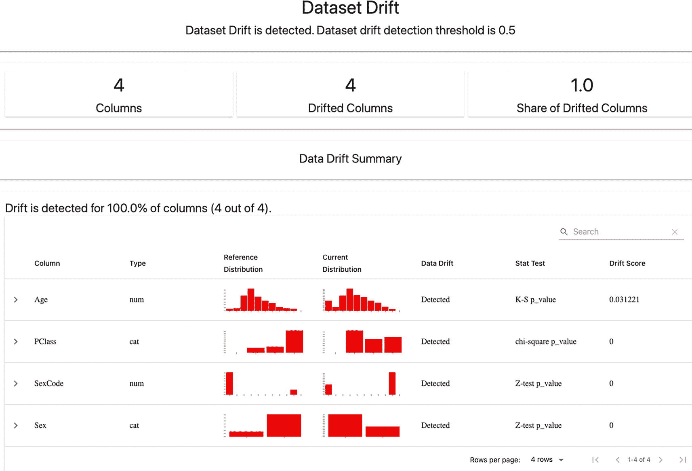

一张显示标题为“数据集漂移”报告的截图。其中列出了列数、漂移列数以及漂移列占比。数据漂移摘要以 7 列形式列出，分别为：列、类型、参考分布、当前分布、数据漂移、统计检验和漂移分数。

图 6-12

针对年龄、乘客等级、性别代码和性别特征生成的漂移报告

报告和测试套件的输出在生成后可以进行审查和交互式可视化。为了持续监控数据质量和模型性能，我们需要一个系统，能够定期收集并生成数据和模型性能报告，并将其集中存储，以便以仪表盘风格展示结果。Evidently ML 监控组件正是为这些场景设计的，适用于批量预测和实时预测，如图 6-14 所示。

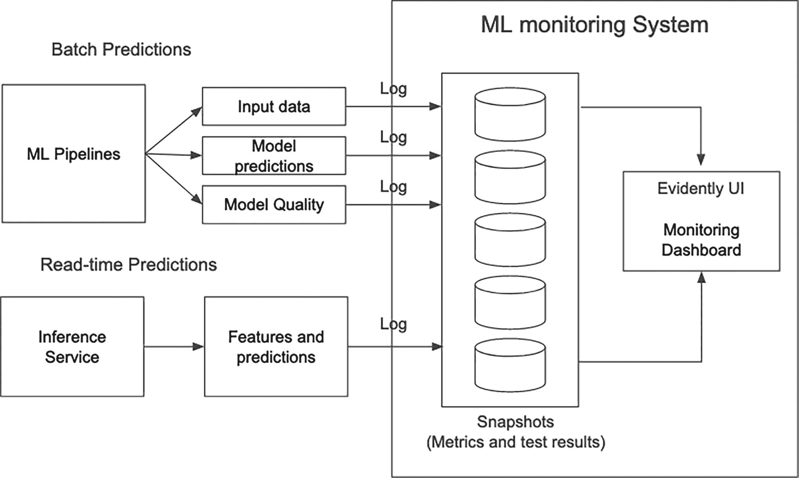

一张架构图。在批量预测中，来自输入数据、模型预测和模型质量的日志被传递到 ML 监控系统。在实时预测中，日志从推理服务和特征预测传递到监控系统。

图 6-14

改编自：Evidently ML 监控系统 – [`https://docs.evidentlyai.com/user-guide/monitoring/monitoring_overview`](https://docs.evidentlyai.com/user-guide/monitoring/monitoring_overview)

上述 ML 监控系统包含三个主要组件：日志记录、快照存储和监控仪表盘。

*   **日志记录**：使用 Evidently Python 库定期捕获数据或 ML 模型质量的摘要，并以 JSON 快照形式生成。
*   **快照存储**：以仪表盘服务可访问的方式集中存储和组织捕获的 JSON 快照。
*   **监控仪表盘**：使用 Evidently 监控服务解析快照，并在交互式图表中可视化捕获的指标或测试结果。

Evidently ML 监控组件为那些希望利用 ML 可观测性开源解决方案逐步构建其 ML 可观测性基础设施的组织提供了一个基本蓝图。该组件仍在开发和完善中。有关最新的详细信息和进展，请访问其文档页面：[`https://docs.evidentlyai.com/user-guide/monitoring/monitoring_overview`](https://docs.evidentlyai.com/user-guide/monitoring/monitoring_overview)。

本节重点介绍的三个开源解决方案的一个关键且共同的特点是，它们都被归类为供应商支持的开源软件。每个方案都由一家商业公司支持，提供路线图、稳定性和客户支持等优势，并且通常附带一个具有额外功能的基于云的商业版本。

## 总结

ML 可观测性在确保 ML 模型部署到生产环境后性能保持在预期水平方面发挥着关键作用。模型性能下降可能因数据漂移或模型漂移等各种原因随时间逐渐发生。这些下降可能对业务产生显著的负面影响，影响范围从货币价值到用户体验和公司声誉。

ML 可观测性基础设施是 ML 基础设施的关键支柱。它旨在检测、监控、告警和诊断模型性能问题。该基础设施的核心组件是可观测性存储。它旨在捕获 ML 开发过程各阶段（包括特征工程、模型训练、模型评估和模型预测）产生的各种模型相关数据。这些多样化的数据使得可观测性存储独特且有价值，并能满足 ML 可观测性的需求：快速发现模型性能问题并缩短解决这些问题的时间。ML 可观测性基础设施所需的其他组件包括数据和指标摄取与计算、告警与通知以及交互式可视化。如图 6-15 所示的 AI/ML 解决方案监控金字塔^(¹⁰⁶)，说明了最终支持 ML 可观测性所需的多种监控类型。

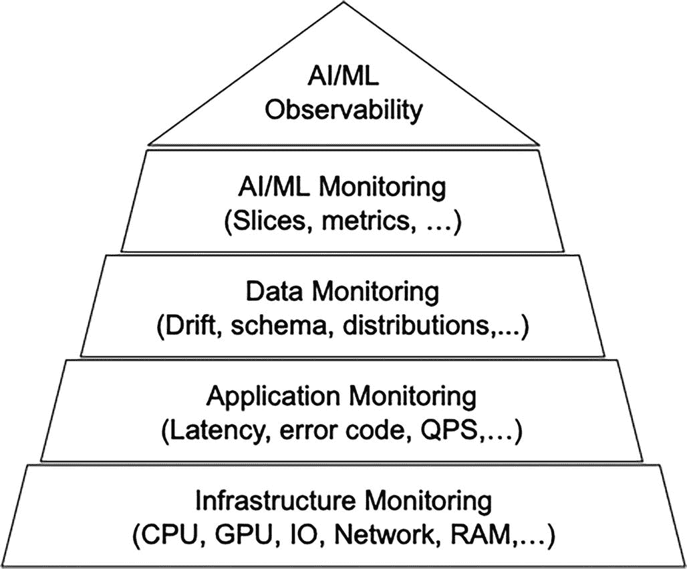

一个金字塔图，从上到下分为 5 个部分，分别标注为：AI/ML 可观测性、AI/ML 监控、数据监控、应用监控和基础设施监控。

图 6-15

AI/ML 解决方案监控金字塔

ML 可观测性需要支持的主要部分包括特征验证、模型预测监控、特征和预测异常检测以及数据和模型漂移检测。诸如 Great Expectations、whylogs 和 Evidently 等开源解决方案可供组织利用并整合到其 ML 可观测性基础设施中，以解决其中一些关键方面。

三年前，组织别无选择，只能从零开始构建自己的 ML 可观测性基础设施。如今，大约有二十多家公司提供其供应商解决方案。^(¹⁰⁷) 这些解决方案已经成熟，变得更加复杂，并且在某种程度上已经商品化。与这些供应商解决方案的集成也变得越来越简单。除非组织有非常特殊的 ML 可观测性需求，或者其运营规模超出了这些供应商解决方案的支持能力，否则将供应商解决方案评估作为“构建与购买”策略的一部分是明智之举。

脚注 1   2   3   4   5   6   7   8   9


