# 7. Ray 核心

正如前几章所讨论的，MLOps 在当今的人工智能领域正变得至关重要。MLOps 的一个核心挑战是管理与机器学习相关的**计算**，包括从外部存储加载数据、执行必要的最终转换、训练机器学习模型、调整超参数以及生成推理结果。

许多开始机器学习之旅的公司，通常最初会使用单台机器来执行这些计算任务。例如，AWS EC2 上的一个 `p4d.24xlarge` 实例拥有 8 块 NVIDIA A100 GPU，每块 GPU 配备 40 GB 显存——这真是一台强大的数值计算机器！

然而，使用“一台强大的 GPU 机器”这种方法存在几个严重的局限性，几乎所有公司最终都会在 MLOps 中需要分布式计算。

第一个挑战是**数据**。深度学习算法在训练过程中对数据“如饥似渴”，因为随着数据量和复杂性的增长，单台机器的局限性变得显而易见。在撰写本章时，最强大的 GPU 芯片是 NVIDIA A100，拥有 40Gb 或 80Gb 的 GPU 内存（GRAM）和 400 Gbps 的网络带宽。一旦数据量达到 TB 级别，在单台机器上加载和处理数据很快就变得不可行。

第二个因素是**价格**（以及最强大 GPU 实例的可用性）。我们再次以 NVIDIA GPU 为例。在 EC2 上（Azure 和 GCP 也得出了相同的结论），租用一块非常强大的 GPU（如 A100）的成本，与租用几块性能稍弱的 GPU（如 A10G）相比，要昂贵得多。更重要的是，即使有人愿意支付高昂的价格，也很难预订到最强大的 GPU，如图 7-1 所示。

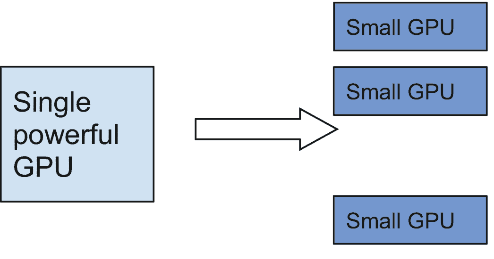

一个流程图展示了一块强大的 GPU 被拆分为三块较小的 GPU。

图 7-1

Ray 允许使用一组小型 GPU 节点，而不是一块强大的 GPU

这时，Ray（[`https://docs.ray.io`](https://docs.ray.io/en/latest/ray-overview/index.html)/）应运而生，它提供了**在异构硬件上轻松实现灵活分布式计算的途径**。Ray 是一个分布式计算框架，支持在集群上可扩展地执行计算机程序。Ray 于 2016 年在加州大学伯克利分校创建，作为一个开源软件项目，旨在支持高级机器学习项目（包括实时机器学习）。在过去几年中，该项目已成为增长最快的开源分布式计算框架之一。

本章首先介绍“Ray 核心”，这是一个用于扩展 Python 程序的通用框架。^(¹⁰⁸) 在下一章中，我们将介绍我们的 Ray AI 库套件（每个库都支持特定的工作负载，例如模型训练）。图 7-2 展示了不同的 Ray 组件，包括 Ray 核心和 Ray AI 库。

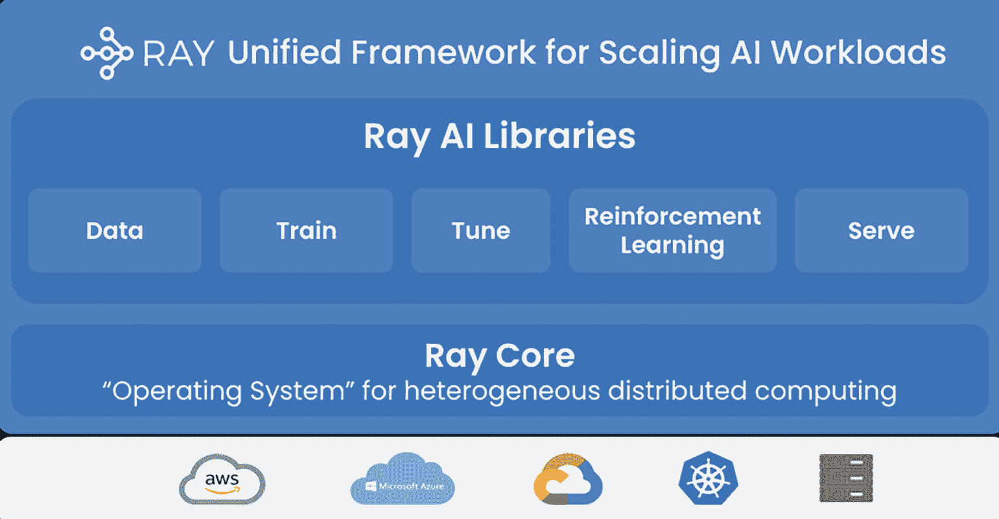

一个框架从上到下包括以下内容：1. Ray AI 库包括数据、训练、调优、强化学习和服务。2. Ray 核心包括用于异构分布式计算的操作系统。

图 7-2

Ray 核心和 Ray 库

## Ray 核心简介

基本上，Ray 核心提供了**在集群规模上的异步/并发程序执行**。

大多数开发者都熟悉某种形式的异步（或并发）编程。例如 Java 的 `Future` 和 Python 的 `multiprocessing`。这些原语是现代计算的基础——允许程序同时执行多个任务并高效利用可用资源。从同时处理多个请求的 Web 服务器到执行并行代码的多核处理器，并发对于构建能够处理复杂工作负载的高性能应用程序至关重要。

然而，现有的并发编程范式**仅限于单台计算机**。Ray 项目的核心动机是将并发编程的概念和功能提升到一个新的水平，允许计算跨越多个机器和异构计算设备。

Ray 核心旨在成为一个通用的分布式计算框架。因此，它被设计用来处理所有分布式计算问题，例如通信、容错、资源分配等（以便将这些关注点对开发者进行抽象）。本书的范围无法涵盖 Ray 核心的所有方面。本章的其余部分将涵盖在 MLOps 背景下与 Ray 最相关的信息。

### 基本概念

以下是开发者为开发和运行 Ray 程序需要理解的基本应用概念：

*   **任务**：一个远程函数调用。这是一个在不同于调用者的进程中执行的单个函数调用，并且可能在不同的机器上执行。任务可以是无状态的（一个 `@ray.remote` 函数）或有状态的（一个 `@ray.remote` 类的方法——参见下面的*执行器*）。任务与调用者异步执行：`.remote()` 调用会立即返回一个或多个 `ObjectRef`（未来对象），可用于检索返回值。

*   **对象**：一个应用值。这些是由任务/执行器返回的值，或者通过 `ray.put` 创建的值。对象是**不可变的**：一旦创建就不能修改。工作者可以使用 `ObjectRef` 来引用一个对象。

*   **执行器**：一个有状态的工作者进程（一个 `@ray.remote` 类的实例）。执行器任务必须通过一个*句柄*提交，或者通过一个指向特定执行器实例的 Python 引用来提交，并且可以在执行期间修改执行器的内部状态。

*   **驱动器**：程序根，或“主”程序。这是运行 `ray.init()` 的代码。

*   [作业](https://docs.ray.io/en/latest/cluster/running-applications/job-submission/index.html)：源自（递归地）同一个驱动器的任务、对象和执行器的集合，以及它们的运行时环境。驱动器和作业之间存在 1:1 的映射关系。


### API 基础

在本节中，我们首先对 Ray Core API 进行最基本的介绍，并展示如何在 Python 代码中使用它们。表 7-1 对最基本的 Ray API 进行了概念性介绍。本节其余部分将提供更多细节。

表 7-1

基本 Ray API（Python 版）

| API | 功能 |
| --- | --- |
| `ray.init` | 初始化“Ray 上下文”，并确保当前进程已连接到 Ray 集群。可参考 [SparkContext](https://spark.apache.org/docs/3.2.0/api/java/org/apache/spark/SparkContext.html) |
| `@ray.remote` | 装饰 Python 函数和类，使其成为可在集群上执行的 Ray 任务（Task）和参与者（Actor） |
| `.remote` | 后缀，用于*触发*远程函数调用和类实例化的*异步*执行 |
| `ray.put(x)` | 将 Python 对象 `x` 放入 Ray 对象存储中，并确保该对象可被其他 Ray 任务和参与者访问 |
| `ray.get(y)` | 阻塞调用，等待 Python 对象被*解析*。如果 `y` 涉及函数调用，`ray.get` 将阻塞，直到该函数本身以及所有其他必需的函数调用执行完毕。相反，如果 `y` 之前已存储在 Ray 对象存储中，`ray.get` 将阻塞，直到从 Ray 对象存储中检索到该 Python 对象。 |

以下是一些说明基本 API 的示例。我们将首先展示一个扩展 Python 函数的示例——函数是*无状态*计算的基本单元（根据输入生成输出，无需维护和更新任何可能改变输出的内部状态）。

在下面的示例中，第一部分是在单线程上运行的普通 Python 代码。它定义了一个计算文件中行数的函数。然后程序的主部分在两个单独的文件上调用该函数，并计算这两个文件的总行数。第二部分说明了如何使用 Ray 并行化此程序。

```
# 未使用 Ray 的普通 Python 代码
def count_lines(file):
// 计算文件中的行数，记为 n
return n
a = count_lines(file_1)
b = count_lines(file_2)
c = a + b
# 使用 Ray 并行化上述代码
import ray
@ray.remote
def count_lines(file):
// 计算文件中的行数，记为 n
return n
a = count_lines.remote(file_1)
b = count_lines.remote(file_2)
c = ray.get(a) + ray.get(b)
```

图 7-3 说明了 Ray 如何实现异步计算。

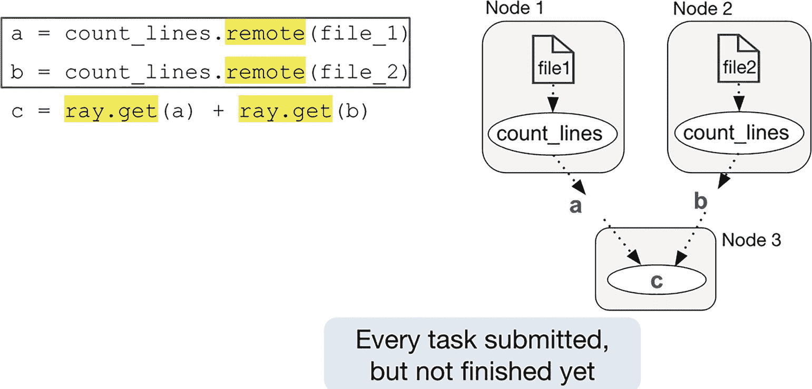

3 行代码和一张说明过程的图表。1，a = count lines dot remote file 1。2，b = count lines dot remote file 2。3，c = ray dot get a + ray dot get b。关键词 remote 和 ray dot get 被高亮显示。图表下方的文字为：每个任务都已提交，但尚未完成。

图 7-3

Ray 实现异步计算

基本上，当调用 `a = count_lines.remote(file_1)` 时，实际的计算任务被*提交*（受 Ray 调度控制）。只有当调用 `c = ray.get(a) + ray.get(b)`（尤其是 `ray.get` 部分）时，才能保证这些计算任务完成——这再次类似于 Java `Future` 中的 [`get`](https://docs.oracle.com/javase/8/docs/api/java/util/concurrent/Future.html%2523get--) 调用。如图 7-4 所示。

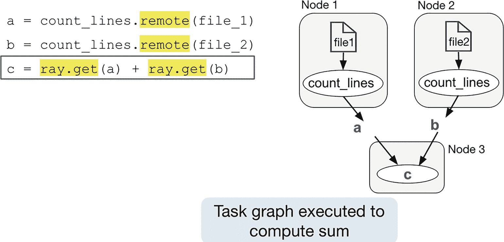

3 行代码和一张说明过程的图表。1，a = count lines dot remote file 1。2，b = count lines dot remote file 2。3，c = ray dot get a + ray dot get b。关键词 remote 和 ray dot get 被高亮显示。图表下方的文字为：执行任务图以计算总和。

图 7-4

执行的任务图

上面的例子足够简单。但在机器学习（以及 MLOps）中，*有状态*计算也常常很重要——例如，维护 Python 类中的一个*属性*，该属性可以被初始化和更新，并随后用于在成员函数中生成输出。

例如，在进行模型推理时，我们希望下载一次模型，然后用它来处理每一条输入数据。在进行模型训练时，每个训练器跨多个训练迭代或批次保留信息（如模型的当前参数、梯度或其他相关变量）通常是有益的。

下面是一个使用 Ray Actor 执行有状态计算的简单示例。

```
import ray
@ray.remote
class Counter:
def __init__(self):
self.i = 0
def get(self):
return self.i
def incr(self, value):
self.i += value
# 创建一个 Counter actor。
c = Counter.remote()
# 向 actor 提交调用。这些调用在远程 actor 进程上异步执行，但按提交顺序执行。
for _ in range(10):
c.incr.remote(1)
# 检索最终的 actor 状态。
print(ray.get(c.get.remote()))
# -> 10
```

在这个例子中，*状态*是一个简单的整数 `i`。就像普通的 Python 类一样，每次调用 `c.incr` 时，内部状态 `i` 都会增加 1。

我们可以轻松地扩展这个例子，将大型机器学习模型作为状态存储。在当前大语言模型和生成式 AI 时代，这类预训练的大型模型变得非常流行和普遍。以下示例展示了如何同时托管三个 GPT-2 模型副本（在三个 Ray Actor 中），并并行地从这些副本生成响应（可能利用多个配备 GPU 芯片的服务器/虚拟机）。

```
import ray
import random
# 定义一个 Actor（使用一个 CPU 和一个 GPU），根据 GPT-2 模型从提示生成响应
@ray.remote(num_cpus=1, num_gpus=1)
class Model:
def __init__(self):
# 下载超过 700MB 的 GPT-2 模型
from transformers import pipeline
self.model = pipeline("text-generation", model="gpt2")
def respond(self, prompt: str) -> str:
return(self.model(prompt, max_length=20, num_return_sequences=5))
# 创建 3 个模型副本
models = [Model.remote() for _ in range(3)]
# 一长串提示
prompts = ["给我讲个笑话", "给我唱首摇篮曲", "旧金山最好的餐厅", "你好", "最好的电影", "彼得潘最好的朋友"]
# 将这些提示提交给 3 个副本（3 个副本将并行执行 GPT-2 计算）
futures = []
for p in prompts:
i = random.randint(0, 2)
futures.append(models[i].respond.remote(p))
# 最后，等待所有响应生成完毕
print(ray.get(futures))
```


### 架构基础

作为一个集群计算框架，Ray 的架构与 Apache Hadoop、Apache Spark、Kubernetes 等早期框架有许多相似之处。建议感兴趣的读者阅读 Ray 的架构白皮书 [`https://bit.ly/ray-arch`](https://bit.ly/ray-arch)。在本节中，我们将介绍在 MLOps 中使用 Ray 时最相关的方面。图 7-5 是 Ray 集群主要组件的简化示意图。

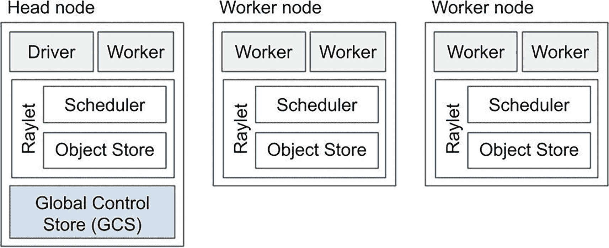

一个头节点和两个工作节点的三种框架。头节点包含一个驱动器、一个工作器、一个带有调度器和对象存储的 raylet，以及 GCS。每个工作节点包含两个工作器和一个带有调度器和对象存储的 raylet。

图 7-5

一个 Ray 集群

从根本上说，当 **Ray 集群启动** 在多个“节点”（例如，物理服务器、云虚拟机、Kubernetes 容器）上时。每个节点上会启动一个 `raylet` 进程。每个 `raylet` 是一个长期运行的“守护”进程，其生命周期通常与集群本身相同。它类似于 Apache Hadoop 中的 [`NodeManager`](https://hadoop.apache.org/docs/stable/hadoop-yarn/hadoop-yarn-site/NodeManager.html) 概念，或者 Kubernetes 生态系统中“边车”的使用方式。`raylet` 的主要职责有三方面：

*   管理 **工作进程**，包括将任务调度到工作进程（见下文）。
*   管理节点上的资源，包括内存和依赖项（例如，此节点应安装哪些 Python 包）。
*   特别地，它管理物理计算机中的部分内存。集群中所有 `raylet` 管理的内存共同构成了 Ray 对象存储，这是一个集群范围内的内存存储，为所有 Ray 对象提供全局命名空间。

每个 Ray 节点也有多个 **工作进程**。每个工作进程是一个 Python 进程，用于执行任务或运行专用的 Ray Actor：

*   **任务**：当 Ray 集群启动时，默认情况下，每个节点上每个 CPU 会启动一个工作进程。例如，对于一个由 8 个节点组成的 Ray 集群，每个节点有 32 个 CPU，总共将启动 256 个工作进程。这些工作进程将像进程池一样用于执行任务。
*   **Actor**：Ray Actor 也在工作进程中执行，但它在运行时被实例化（例如，在上面的例子中调用 `c = Counter.remote()` 时）。它的所有方法将在同一个进程上运行，使用定义 Actor 时指定的相同资源。与任务不同，运行 Ray Actor 的 Python 进程不会被重用，并且会在 Actor 被删除时终止。一个重要的原因是 Ray Actor 支持有状态计算，其状态应在生命周期结束时被清理。

对于熟悉 Apache Spark 的读者来说，Ray 集群中的 *节点* 类似于 [Spark 集群](https://spark.apache.org/docs/latest/cluster-overview.html) 中的“工作节点”。在节点内部，Ray **工作进程** 在执行 **任务** 方面类似于 Spark 执行器。但 Ray **工作进程** 也可以执行有状态的 **Actor**，这在 Apache Spark 中是不支持的。

在所有 Ray 节点中，有一个节点被指定为 **头节点**。**头节点** 最重要的职责是管理 **全局控制服务** (GCS)。**头节点**/**GCS** 负责管理某些重要的全局元数据（例如，Actor 的位置）。更多细节可以在 [`https://bit.ly/ray-arch`](https://bit.ly/ray-arch) 找到。

然后，有了一个正在运行的 Ray 集群，开发者可以发送代码（通常是 Python）在其上运行。任何 Ray 应用程序的起点是 *驱动器* 进程（它在其中一个 Ray 节点上启动）。

驱动器进程的职责直接映射到 Ray 提供的基本 API（请参考 API 基础部分）。驱动器进程中的 Python 代码可以创建以下内容之一：

*   **任务**：当一个 Python *函数* 被 `@ray.remote` 装饰并通过 `remote` 调用时，它就变成了一个 *任务*，这是 Ray 中无状态计算的基本单元。
*   **Actor**：当一个 Python *类* 被 `@ray.remote` 装饰并通过 `remote` 初始化时，它就变成了一个 *Actor*，这是 Ray 中有状态计算的基本单元（类的属性代表 Actor 状态）。
*   **对象**：在 Ray 中，一个对象指以下任一情况：
    *   Ray 任务/Actor 中函数调用的返回值
    *   通过 `ray.put()` 产生的（可稍后使用的）引用

所有 Ray 对象都存储在 Ray 对象存储中。

从根本上说，Ray 的架构旨在支持灵活高效的异步计算。两个主要概念是所有权和依赖关系。我们使用下图来说明这两个概念如何通过 Python 代码 ➤ 逻辑任务图 ➤ 物理执行图的转换在 Ray 中实现。

所有权是 Ray 以去中心化方式管理元数据的概念。这个概念意味着应用程序中的每个 **对象**（参见上面的对象定义）将由一个 **工作进程** 管理。这个工作器（作为“所有者”）负责确保执行创建该值的任务，并促进将 **对象** 的引用解析为其底层值。在下面的例子中，运行 **任务** `a` 的 **工作进程** 拥有 **任务** `b`（因为 `b` 是由 `a` 启动的）。因此，该 **工作进程** 负责确保 **任务** `b` 完成并获取返回值。

依赖关系是一个更简单的概念。在异步计算中，它意味着一个 **任务** 的完成 *依赖于* 其他几个 **任务** 或 **对象** 的完成或解析。在下面的例子中，**任务** `a` 在对象 `x` 被解析（`a` 获取到值）之前无法完成。如图 7-6 所示。

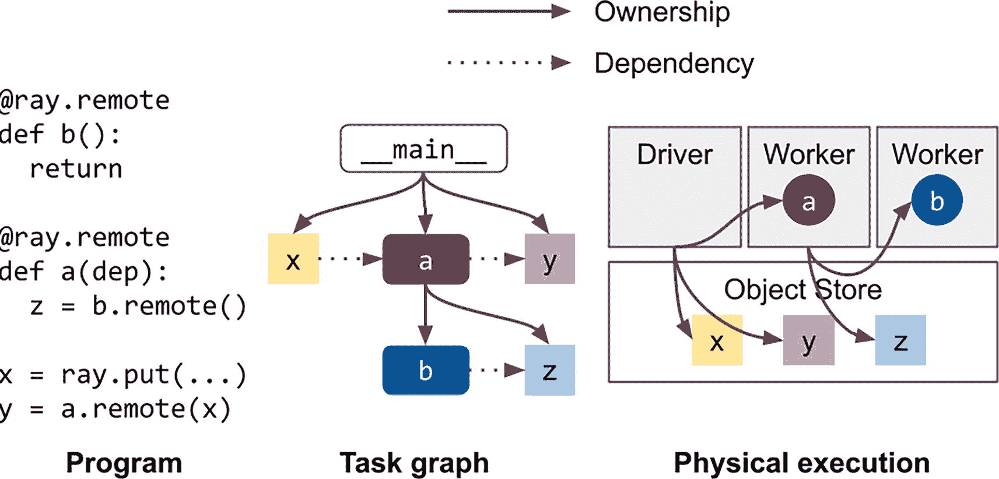

一个示意图说明了程序、任务图和物理执行之间的所有权和依赖关系连接。在任务图中，所有权链接用于连接主进程与工作器和对象。依赖关系链接用于对象存储 x、y 和 z。

图 7-6

Ray 中的所有权和依赖关系


### 调度

调度是任何分布式系统的关键方面，对于 Ray 而言尤其如此，因为 Ray 的目标是成为构建分布式应用的统一框架。特别是，Ray 的调度机制专为计算和数据密集型工作负载而设计。在本节中，我们将探讨 Ray 调度器的内部工作原理，以及它如何在分布式环境中实现高效的任务调度。我们将研究 Ray 采用的不同调度策略，以及如何定制这些策略以满足不同应用的特定需求。

要理解调度在 Ray 中如何工作，以及它对 MLOps 的影响，我们首先来看一个**任务**和一个**执行器**的生命周期。

当一个进程（无论是驱动程序还是另一个任务/执行器）调用一个使用 `@ray.remote` 装饰的 Python 函数时，任务的**生命周期**就开始了。发起调用的进程成为该任务的*所有者*。所有者负责与 Raylet 协商，为任务获取必要的资源。例如，如果一个任务使用 `@ray.remote(num_cpus=2)` 装饰，所有者需要将此资源请求发送给一个或多个 Raylet，并最终找到一个至少有 2 个 CPU 可用的**工作进程**。此时，这个**工作进程**被视为*租用*给该所有者——并且与工作进程位于同一节点上的 Raylet 会记住此租用信息。然后，所有者直接与租用的工作进程协作，传输必要的信息（例如，函数的参数）以启动任务。如图 7-7 所示。

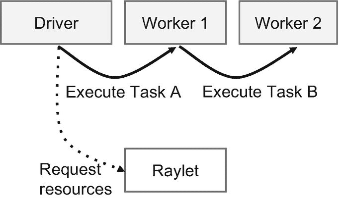

一个流程图。任务 A 在驱动程序和工作者 1 之间执行。任务 B 从工作者 1 执行到工作者 2。驱动程序通过一条标有“请求资源”的虚线箭头连接到 Raylet。

图 7-7

任务的**生命周期**

执行器的生命周期与任务的**生命周期**有很大不同——最大的区别在于全局控制服务（GCS）的参与。在当前的 Ray 架构中，GCS 维护每个执行器的元数据。因此，每个执行器的创建总是通过 GCS 进行。例如，当驱动程序进程调用 `c = Counter.remote()` 时，驱动程序首先在 GCS 中*注册*该执行器。然后，与创建任务时的所有者进程不同，GCS 负责向 Raylet 请求资源，并实际创建执行器。如图 7-8 所示。

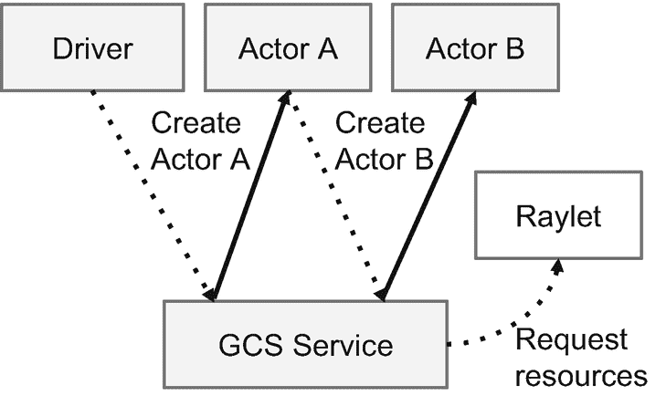

一个流程图。在执行器 A 的创建过程中，驱动程序连接到 GCS 服务，然后连接到执行器 A。在执行器 B 的创建过程中，执行器 A 连接到 GCS 服务，然后连接到执行器 B。GCS 服务通过一条标有“请求资源”的虚线箭头连接到 Raylet。

图 7-8

执行器的**生命周期**

有了上述背景信息，现在让我们了解 Ray 的调度策略（这在运行机器学习工作负载时非常重要）。

本质上，调度就是以最有效的方式将任务/执行器的资源需求与 Ray 节点的可用资源进行匹配。第一个基本步骤是以一致的方式表示和定义资源。在 Ray 中，每个*资源*都是一个键值对——例如，`"GPU": 2.0`。当 Ray 集群启动时，默认情况下，每个 Ray 节点上的*资源*被设置为从底层操作系统检测到的数量。^(¹⁰⁹) 例如，如果你在笔记本电脑上执行 `ray start --head`（这会启动一个单节点 Ray 集群），然后执行 `ray status`，你将看到类似以下内容：

```
Resources

Usage:
0.0/10.0 CPU
0B/13.20GiB memory
0B/2.00GiB object_store_memory
```

随后，当创建任务/执行器时，它们的资源需求来自装饰器——例如，`@ray.remote(num_cpus=2)`。一个重要的注意事项是，资源请求在 Ray 中是*逻辑上的*。在当前实现中，Ray 不强制执行物理资源限制。

在寻找任务/执行器的最佳位置时，除了确保目标节点能够满足资源需求外，还有其他几个重要的考虑因素。第一个考虑因素是数据局部性。Ray 通常用于数据密集型工作负载，例如模型训练前的数据预处理。因此，将任务创建在所需数据（例如，任务的参数）存储的同一节点上非常重要。

考虑以下示例，其中定义并执行了两个 Python 函数（Ray 任务）。第一个任务 `read_array_from_file` 读取一个输入文件并返回一个 ndarray。正如我们在架构部分讨论的那样，这个返回值存储在 Ray 对象存储中。第二个任务 `double_array` 将返回的 ndarray 作为输入，并生成一个新 ndarray，其中每个值都加倍。当调度 `double_array` 任务时，Ray 会尝试将其放置在物理存储了 `read_array_from_file` 返回值的同一节点上。

```
import ray
@ray.remote
def read_array_from_file(file):
// 将文件读入 ndarray
return arr
@ray.remote
def double_array(arr):
return arr * 2
arr = read_array_from_file.remote(file1)
doubled_arr = ray.get(double_array.remote(arr))
print(doubled_arr)
```

另一个调度考虑因素是*打包*与*分散*之间的平衡。这通常是集群计算中的一个经典话题，甚至超出了 Ray 的范畴。从高层次来看，打包是指在*尽可能少的节点上*满足提交的任务/执行器的资源需求。其主要好处是提高资源利用率，并允许缩减集群规模，从而降低成本。*分散*是指以轮询方式将任务/执行器放置在所有可用节点上——这有助于负载均衡。

最后，Ray 调度中的一个高级选项是*放置组*。放置组允许 Ray 用户以事务方式跨多个节点预留一组资源。这在某些机器学习场景中非常有用，因为如果没有最低限度的资源集（称为“群体调度”场景），就无法取得进展。我们在此不深入探讨这种高级方案的更多细节，感兴趣的读者应参考 [`https://bit.ly/ray-arch`](https://bit.ly/ray-arch)。


### 容错

Ray 是一个复杂的分布式系统，这意味着故障的发生是常态而非例外。通常，故障可以分为两类：(1) Ray 层面故障和 (2) 应用层面故障。让我们从软件抽象或契约的角度来理解这两类故障。

现在读者已经熟悉了 Ray API 和架构中的基本概念，我们可以再次审视 `count_lines` 示例来理解这两类故障。如下图所示（以简化方式呈现），如果节点 1 上的 Raylet 崩溃（例如，被操作系统因意外原因杀死），这属于 Ray 层面故障。相反，如果文件 file1 对于 Python 函数 `count_lines` 来说过大，导致内存溢出（OOM）错误，这则属于应用层面故障。

这里有另一种直观的理解方式。Ray 负责将 Python 函数和类*横向扩展*到由多台计算机组成的集群；因此，横向扩展部分发生的任何错误都被视为 Ray 层面故障。而在 Python 函数或类^(¹¹⁰)（即 Ray 试图横向扩展的对象）内部发生的任何错误，则被视为应用层面故障。图 7-9 是一个简单的示意图，用于说明这个框架。

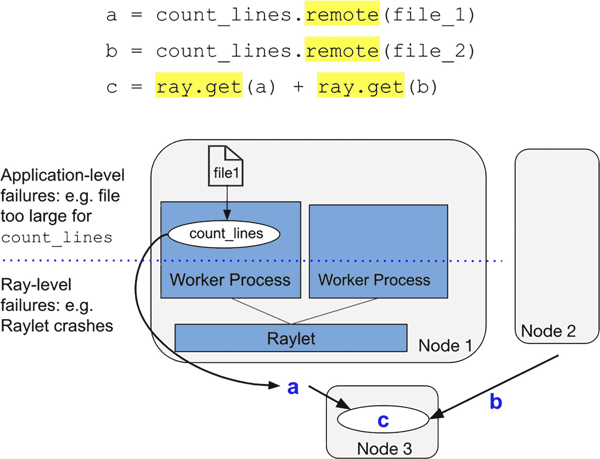

三行代码和一个示意图说明了这个过程。1, a = count lines dot remote file 1。2, b = count lines dot remote file 2。3, c = ray dot get a + ray dot get b。关键词 remote 和 ray dot get 被高亮显示。图中标明了应用层面故障和 Ray 层面故障。

**图 7-9**
Ray 层面故障与应用层面故障

对于 Ray 层面故障：Ray 的通用方法是依赖重试和重建来自动从这些故障中恢复。Ray 以类似的方式为任务、执行器和对象提供容错能力，但细节有所不同，如表 7-2 所述。

**表 7-2**
Ray 任务、执行器和对象的容错策略

|  | 容错策略 |
| --- | --- |
| 任务 | 默认情况下，一个失败的 Ray 任务将重试 3 次。这可以通过 `@ray.remote (max_retries=x)` 进行自定义。 |
| 执行器 | 默认情况下，一个失败的 Ray 执行器不会重启。但这可以通过 `@ray.remote (max_retries=y)` 进行自定义。 |
| 对象 | Ray 会尝试通过重新执行必要的任务来重建丢失的对象。这被称为“基于血缘的重建”。 |

对于应用层面故障，最佳实践是从应用代码中捕获并处理错误代码（这是应用开发者的责任）。

另一个需要理解的重要容错概念是*命运共享*。一旦所有者进程失败，一个 Ray 任务/执行器/对象将始终被视为失败（并将被垃圾回收）。在下面的例子中，如果运行任务 `a` 的工作进程失败，那么任务 `b` 和对象 `z` 将被视为失败并被垃圾回收。图 7-10 包含一个简单的示例来演示命运共享的概念。

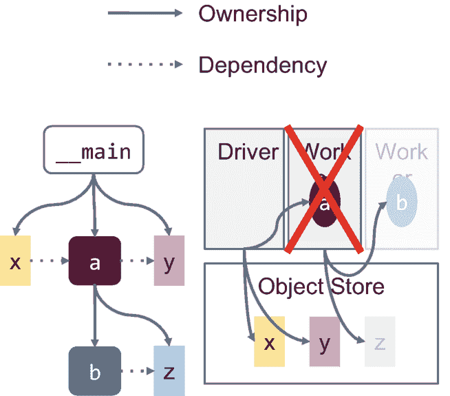

一个任务图和一个执行图，其中的链接表示所有权和依赖关系。执行图包含一个驱动器、两个工作进程 a 和 b，以及一个包含 x、y 和 z 的对象存储。工作进程 A 上标有一个 X 标记。

**图 7-10**
工作进程失败时的命运共享

## KubeRay

Kubernetes 已成为 MLOps 的标准部署框架，因为它能够在分布式环境中管理和编排复杂的容器化工作负载。随着机器学习模型和流水线变得越来越复杂，它们的部署也变得越来越复杂，需要集成多种工具（有时使用不同的编程语言，如 Python 和 Java）。Kubernetes 为管理容器化应用提供了一个统一的平台，具备自动扩缩容、负载均衡和容错能力。

KubeRay 项目 ([`https://ray-project.github.io/kuberay/`](https://ray-project.github.io/kuberay/)) 是在 Kubernetes 上部署和管理 Ray 集群的标准方式。

遵循 Kubernetes 的基本原则，KubeRay 基本上将关键的 Ray 组件打包到“Pod”中。详情请参阅架构部分。

KubeRay 的一个核心组件是“KubeRay Operator”。该 Operator 负责启动和维护其他 Ray Pod 的生命周期——头节点 Pod、工作节点 Pod 以及自动扩缩器 Pod（负责增加或减少集群规模）。特别是，对于在线服务/场景（目前越来越流行），KubeRay Operator 负责确保 Ray 头节点 Pod 的高可用性。图 7-11 是 KubeRay 架构的简单说明。

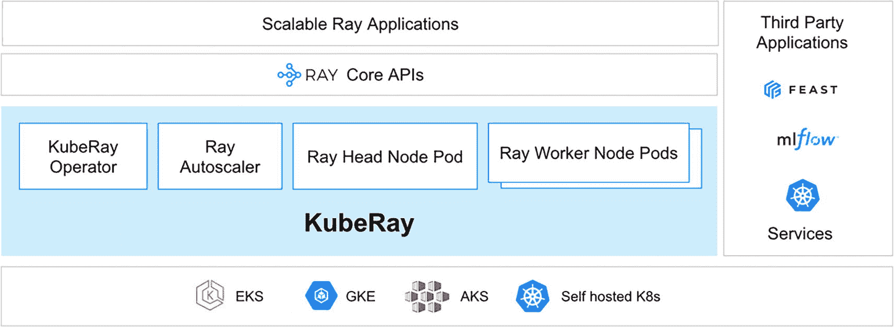

一个架构图，包含以下内容：可扩展的 Ray 应用、Ray Core API、KubeRay 和第三方应用。KubeRay 包括一个 Operator、自动扩缩器、Ray 头节点 Pod 和 Ray 工作节点 Pod。第三方应用包括 FEAST、服务和 M I flow。

**图 7-11**
KubeRay 架构

## 总结

总而言之，在当今（以 Python 为主导的）MLOps 生态系统中，Ray Core 是一个领先的框架，用于跨多个 CPU/GPU 服务器（以及其他硬件加速器）扩展计算。

如果不使用 Ray，ML 和 MLOps 开发者将无法满足两个相互冲突的需求：(1) 快速迭代 ML 模型，以及 (2) 每次迭代都需要使用大量资源（CPU、GPU、内存）来设置计算基础设施。Ray Core 通过本章解释的架构创新（例如，在集群中调度 Python 函数和类），赋予了开发者“超能力”，使其能够大规模地快速迭代。为了向开发者提供这种简便性，Ray Core 处理了分布式计算的复杂性，包括容错、资源管理、调度等。

在最近的两三年里，Ray 已被业界领先的 MLOps 团队广泛采用，包括 Uber、DoorDash 和 Netflix。


一组标志排列成两行。第一行：Open A I、Air b n b、uber、spotify、cohere 和 Instacart。第二行：Doordash、Netflix、samsara、LinkedIn、Niantic 和 Pinterest。

我们预计，未来对 LLM 和生成式 AI 的强劲需求只会导致对可扩展 ML 计算需求的快速增长。

