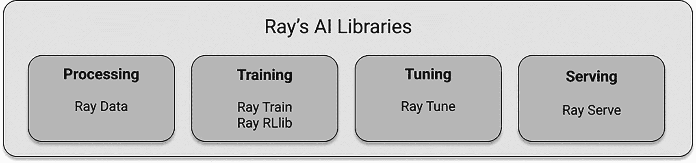
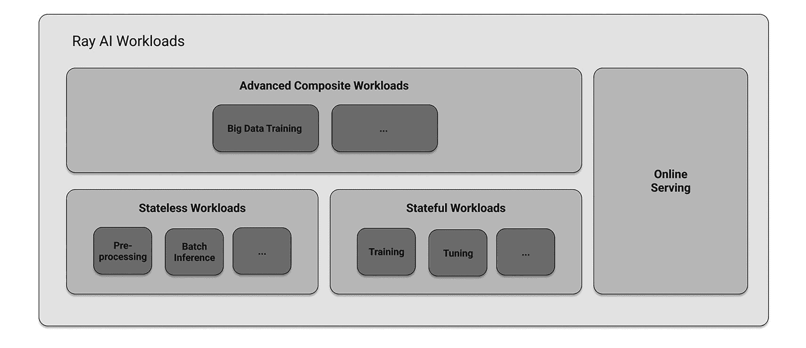
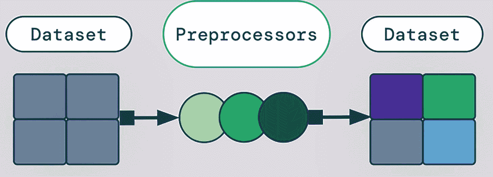
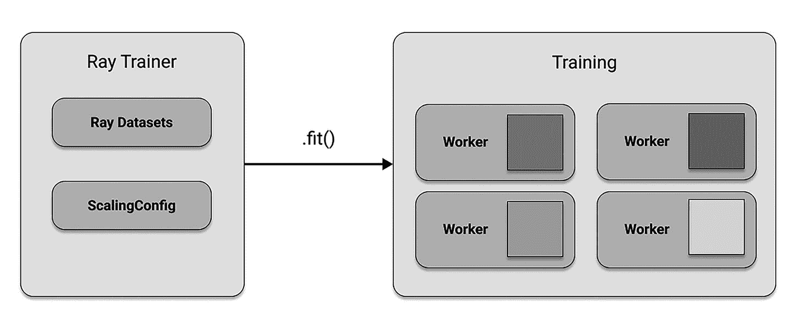
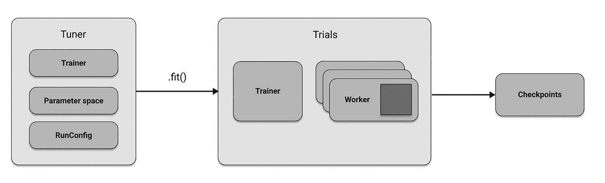
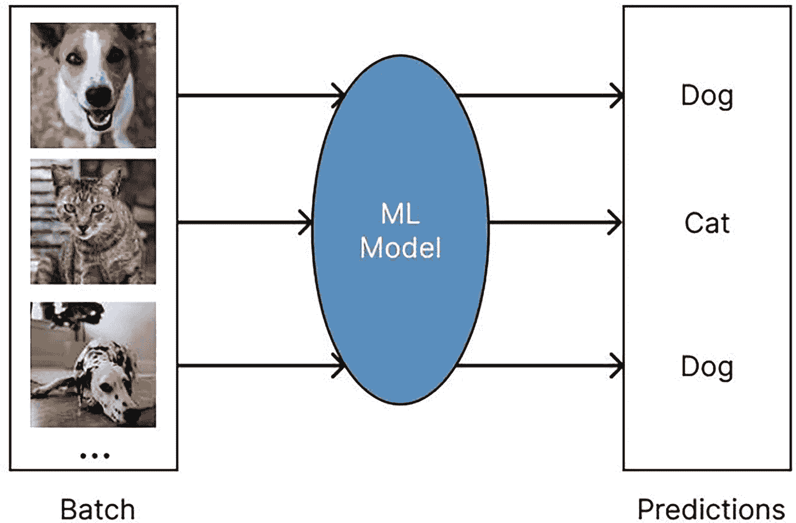
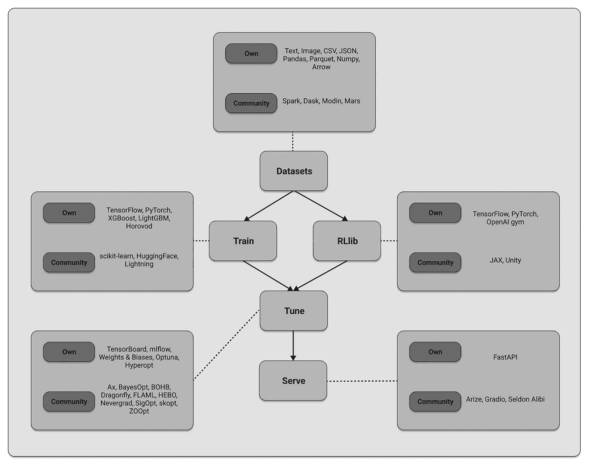
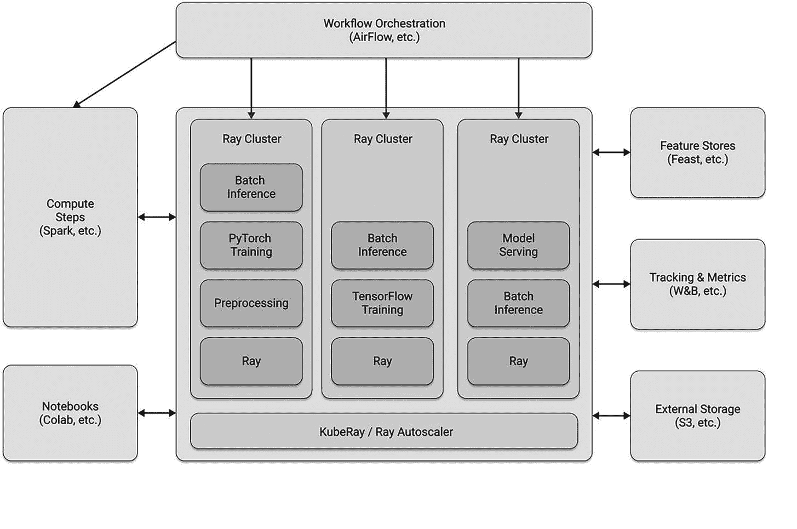

# 8. Ray AI 库简介

## 概述

在上一章中，您学习了 Ray Core，以及如何使用它来构建分布式应用。本章将向您介绍 Ray 人工智能（AI）库的主要概念，以及如何利用它们来创建和部署典型的 ML 工作流。我们将通过构建一个应用来演示如何使用这些库，该应用将微调一个大型语言模型（LLM），将其部署用于在线推理，并将其用于离线批量推理。我们还将解释何时以及为何应该使用 Ray 的 AI 库，并提供 Ray AI 生态系统的简要概述。最后，我们将深入探讨 Ray 与其他系统之间的联系。


## 什么是 Ray 的 AI 库？

Ray 的 AI 库是一套工具集，可在常见的机器学习工作流中高效协同使用。你可以将它们视为一个综合性工具包，旨在通过为模型训练和访问自定义数据源等任务提供各种第三方集成，来支持你的机器学习工作负载。这些库抽象了底层的复杂性，并提供了直观的 API。以下是可用的库：

*   **Ray Data** 用于数据摄取和处理：要有效使用机器学习，你必须以机器学习模型能够理解的方式准备数据。这个过程涉及选择和转换将输入模型的数据。这可能是一项具有挑战性的任务，因此拥有可靠的工具来协助处理会很有帮助。Ray Data 帮助你以可扩展的方式加载、转换和使用数据。该库也是你执行诸如对已训练模型进行批量数据预测等任务的选择。

*   **Ray Train** 和 **Ray RLlib** 用于模型训练：对于机器学习，有必要在先前处理过的数据上训练你的算法。这涉及为手头的任务选择合适的算法。拥有多样化的算法可供选择也很有益。对于监督训练，你可以使用 Ray Train；如果你想运行强化学习实验，RLlib 是你的自然选择。

*   **Ray Tune** 用于超参数调优：在训练机器学习模型的过程中，可以微调某些参数以提升其性能。除了这些模型参数之外，还有一些超参数可以在训练开始前进行调整。这些超参数的适当调整会显著影响最终机器学习模型的有效性。像 Ray Tune 这样的工具可以帮助你优化这些超参数。

*   **Ray Serve** 用于模型服务：为了提供对已训练模型的访问，必须对其进行部署。服务模型涉及通过各种方式（例如使用 HTTP 服务器）使其可用。Ray Serve 专为机器学习模型的可扩展部署而构建。

这个列表并非详尽无遗，构建机器学习应用时还有更多需要考虑的因素，但这四个步骤（加载和处理数据、模型训练、超参数调优以及模型服务）对于机器学习项目的成功至关重要。如前所述，Ray 为这个过程的每一步都提供了解决方案，并且需要强调的是，所有这些库在设计上都是分布式的，作为 Ray 生态系统的一部分。

重要的是，上述四个步骤通常不是孤立运行的，而是作为通用数据科学流程的一部分。显然，让所有组件顺畅地协同工作是有益的。Ray 的 AI 库在设计时就考虑到了这一点，为实验提供了通用的运行时和 API，并具备按需扩展工作负载的能力。这意味着所有讨论的库都具有足够的互操作性，既可用于原型设计，也可用于生产环境（其中可扩展性和可靠性至关重要）。图 8-1 简要总结了所有 AI 库及其覆盖的用例。



Ray AI 库的设计。它包括处理、训练、调优，然后是服务。

图 8-1

Ray 的 AI 库，旨在大规模处理你的机器学习用例

## 为何以及何时使用 Ray 进行机器学习？

在过去几年中，使用 Ray 运行机器学习工作负载经历了持续的发展。最初，用于强化学习工作负载的 Ray RLlib 和用于超参数优化的 Ray Tune 是在 Ray Core 之上创建的。随后，引入了其他组件，例如用于机器学习模型训练的 Ray Train、用于服务已训练模型的 Ray Serve，以及最近用于数据处理的 Ray Data。这些库的创建是机器学习社区积极讨论和反馈的结果。

Ray AI 库既服务于数据科学家，也服务于机器学习工程师。数据科学家可以利用它们来构建和扩展端到端实验，以及处理诸如预处理、训练、调优、评分或服务机器学习模型等单个任务。机器学习工程师可以灵活地使用 Ray AI 库构建自定义的机器学习平台，或者简单地单独利用它们来与其生态系统中的其他库集成。此外，Ray 允许用户降级并直接使用更底层的 Ray Core API 以获得更大的灵活性。Ray 作为一个 Python 原生工具，具有强大的 GPU 支持和适用于复杂机器学习工作负载的有状态原语（Ray actors），因此是为机器学习工作负载提供更高级别库的自然选择。

Ray 允许你从在笔记本电脑上进行实验平滑过渡到在集群上运行生产工作流。通常，数据科学团队会将他们的机器学习代码移交给生产团队，由于需要进行代码修改或重写，这可能会成本高昂且耗时。Ray 通过为你处理可扩展性、可靠性和健壮性问题，简化了这一过渡。

通过选择 Ray 的 AI 库，你可以避免处理多个分布式系统及其带来的复杂胶水代码的挑战。当使用众多组件时，团队经常面临集成很快过时的问题，维护它们的负担也变得不堪重负。这些问题可能导致迁移疲劳，即团队因预期进行系统变更的复杂性而犹豫是否接受新想法。

### 使用 Ray 运行的 AI 工作负载

接下来，让我们从我们已经讨论过的各个 Ray AI 库的更以工作负载为中心的角度来讨论这一点。Ray 专门设计用于处理 AI 项目中的常见任务，这些任务可以分为以下几类：

*   **无状态计算**：像预处理数据或对一批数据进行模型预测这样的任务被认为是无状态的。这些工作负载可以独立并行计算，Ray 任务用于处理它们。许多大数据处理工具都属于这一类。

*   **有状态计算**：另一方面，像模型训练和超参数调优这样的任务涉及在训练过程中更新模型状态。Ray actors 用于处理为此类操作分发有状态工作者的复杂性。

*   **复合工作负载**：AI 工作负载通常涉及无状态和有状态计算的组合。例如，处理特征然后训练模型。Ray 旨在通过有效管理无状态和有状态两个方面，高效地处理这些高级复合工作负载，即所谓的大数据训练。

*   **在线服务**：Ray 还擅长一个或多个模型的可扩展在线服务。在 Ray 生态系统中，从前三种工作负载类型到服务的过渡是无缝的。

这些类型的工作负载可以用于各种场景。例如，你可以使用 Ray 来替换和扩展现有流水线中的单个组件。此外，你还可以选择使用 Ray 创建自己的端到端机器学习应用。而且，正如我们稍后将讨论的，你甚至可以在 Ray AI 库的帮助下构建自己的 AI 平台。图 8-2 简要总结了 Ray 为之构建的 AI 工作负载。



Ray AI 工作负载的结构。Ray AI 工作负载包括高级复合工作负载，其次是无状态工作负载，然后是在线服务。

图 8-2

Ray 旨在处理广泛的 AI 工作负载


## Ray AI 库简介

Ray 为其 AI 库设定的设计理念是，让您能够处理复杂的机器学习工作负载，理想情况下，只需使用单个 Python 脚本和 Ray 中的单个分布式系统即可。在深入探讨一个展示所有库实际应用的更复杂示例之前，让我们先单独简要了解一下核心抽象概念，从数据摄取和处理开始。

### 数据集与预处理器

在 Ray 中，加载和处理数据的标准方式是使用来自 Ray Data 库的所谓 Ray 数据集。为了准备机器学习实验的输入数据，会使用 `Preprocessor` 类的实现。这些预处理器将您的数据转换为特征。通过操作数据集并利用 Ray 生态系统，这些预处理器能够高效地扩展预处理步骤。

在训练期间，您将预处理器“拟合”到指定的训练数据上，随后该预处理器可用于训练和服务目的。Ray Data 包含许多内置的预处理器，涵盖了广泛的用例。但是，如果您需要某个特定的预处理器而它并未提供，那么根据您的需求定义自定义预处理器也非常简单。图 8-3 示意性地展示了预处理器如何作用于数据集并输出转换后的数据集。



一张图表展示了 Ray 数据集上的预处理器。它包括数据集、预处理器，然后是数据集。

图 8-3

在 Ray 数据集上使用预处理器会输出转换后的数据集

代码清单 8-1 为您提供了一个简单示例，演示如何从内存数据创建数据集，并通过在名为 `MinMaxScaler` 的专用预处理器上使用 `fit_transform` 将其缩放到 `[0, 1]` 范围。我们将在后面讨论加载更大的数据集和更实际的处理。请注意，代码清单 8-1 以及本章中的所有其他代码片段都假设您已安装 Ray 2.7.0 版本，例如，通过 `pip install "ray[data,train,tune,serve]==2.7.0"` 安装。

```
import ray
from ray.data.preprocessors import MinMaxScaler
ds = ray.data.range(10)
preprocessor = MinMaxScaler(["id"])
ds_transformed = preprocessor.fit_transform(ds)
print(ds_transformed.take())
代码清单 8-1
在 Python 中创建 Ray Data 数据集并使用预处理器进行缩放
```

下表总结了 Ray Data 中最常用的预处理器及其类型（表 8-1）。其中列出的一些预处理器我们将在后面的章节中再次看到。

表 8-1

常见的 Ray Data 预处理器及其类型

| 预处理器类型 | Ray Data 预处理器 |
| --- | --- |
| 特征缩放器 | MaxAbsScaler, MinMaxScaler, Normalizer, PowerTransformer, RobustScaler, StandardScaler |
| 通用预处理器 | Concatenator, Preprocessor, SimpleImputer |
| 分类编码器 | Categorizer, LabelEncoder, OneHotEncoder, MultiHotEncoder, OrdinalEndcoder |

### 训练器

一旦您定义了 Ray 数据集，就可以继续使用 Ray Train 来指定一个训练器。训练器负责在您的数据上运行机器学习算法。它为 TensorFlow、PyTorch 或 HuggingFace 等训练框架提供了一致的接口。在下一节的示例中，我们将重点介绍 HuggingFace Transformers，但需要注意的是，其他框架集成使用 Ray Train API 的方式是相同的。

本质上，Ray 训练器在数据集上提供可扩展的机器学习训练。此外，它们被设计为与 Ray Tune 良好集成以进行超参数优化，我们将在下一节讨论这一点。图 8-4 向您展示了训练器的工作原理。除了提供数据集之外，您还需要在调用训练器的 `fit` 方法之前提供一个 `ScalingConfig`，这将为您创建分布式训练过程。



训练器工作的结构。Ray 训练器域由 Ray 数据集和缩放配置组成，它们与训练域相连。训练域由四个工作节点组成。

图 8-4

实例化并调用训练器以在您的数据上运行分布式训练

在下面的代码示例中，我们使用 Ray 的 XGBoost 集成，并定义一个 `XGBoostTrainer` 来在合成的表格数据上训练一个简单模型。对于这种特定类型的训练器，我们还需要定义一个 `label_column`。我们还通过向 代码清单 8-2 中 `XGBoostTrainer` 构造函数的 `params` 参数传递一个字典，来确保指定了学习 `objective`。请注意，`datasets` 参数必须包含一个 `"train"` 键，但您也可以额外传入像 `"validation"`、`"test"` 或自定义数据集这样的键。

```
import ray
from ray.train.xgboost import XGBoostTrainer
from ray.train import ScalingConfig
train_dataset = ray.data.from_items(
[{"x": x, "y": 2 * x} for x in range(0, 32, 3)]
)
trainer = XGBoostTrainer(
label_column="y",
params={"objective": "reg:squarederror"},
scaling_config=ScalingConfig(num_workers=2),
datasets={"train": train_dataset},
)
result = trainer.fit()
代码清单 8-2
使用 Ray Train 运行 XGBoost 模型训练
```


### 调优器与检查点

Ray 中的调优器利用 Ray Tune 提供可扩展的超参数调优。它们能与训练器无缝协作，同时也支持您可能拥有的任何训练函数。当您运行训练器或调优器时，它们会生成特定于框架的检查点。这些检查点可用于为各种 Ray 库（如 Tune、Train 或 Serve）加载模型。您可以通过访问训练器或调优器上 `.fit()` 调用的结果来获取检查点，正如我们将在下一个代码示例中看到的那样。

检查点非常有用，因为它们充当了 Ray 的原生模型交换格式。它们允许您在后续阶段轻松检索训练好的模型，而无需担心用于存储和加载模型的自定义方法。图 8-5 展示了调优器如何与训练器交互以生成检查点。



该图从调优器域开始，包含训练器、参数空间和运行配置，然后是试验，最后以检查点结束。

图 8-5

Ray 调优器在一组工作节点上调整 Ray 训练器的超参数，同时也会为您生成检查点

为了说明如何在 Python 中运行调优器，为简单起见，我们再次使用 XGBoostTrainer，但这次在参数中使用稍微复杂一些的设置，并使用更大的数据集进行操作。除了训练器实例之外，我们在清单 8-3 中的调优器还接受一个 `param_space` 参数来告知调优器要调整哪些超参数，以及一个 `run_config` 参数来告知调优器如何调整训练实验。

```
from sklearn.datasets import load_breast_cancer
from ray import tune
from ray.data import from_pandas
from ray.train import RunConfig, ScalingConfig
from ray.train.xgboost import XGBoostTrainer
from ray.tune.tuner import Tuner
def get_dataset():
data_raw = load_breast_cancer(as_frame=True)
dataset_df = data_raw["data"]
dataset_df["target"] = data_raw["target"]
dataset = from_pandas(dataset_df)
return dataset
trainer = XGBoostTrainer(
label_column="target",
params={},
datasets={"train": get_dataset()},
)
param_space = {
"scaling_config": ScalingConfig(
num_workers=tune.grid_search([2, 4]),
resources_per_worker={
"CPU": tune.grid_search([1, 2]),
},
),
"params": {
"objective": "binary:logistic",
"tree_method": "approx",
"eval_metric": ["logloss", "error"],
"eta": tune.loguniform(1e-4, 1e-1),
"subsample": tune.uniform(0.5, 1.0),
"max_depth": tune.randint(1, 9),
},
}
tuner = Tuner(trainable=trainer, param_space=param_space,
run_config=RunConfig(name="my_tune_run"))
# 运行调优任务并获取检查点
result = tuner.fit()
checkpoint = result.checkpoint
清单 8-3
使用调优器在 XGBoost 模型上运行超参数优化
```

### 运行批量预测

批量推理是指对一组输入数据生成模型预测。该模型通常是一个复杂的机器学习模型，例如神经网络，但也可能只是一个简单的 Python 函数。在批量推理（也称为离线推理）中，您的模型会按需对大批量数据运行。这与在线推理形成对比，在线推理中，模型会在数据点可用时立即对其进行预测。

在 Ray 中运行批量推理概念上很简单，需要三个步骤。首先，加载数据并应用所需的任何预处理。然后，定义您的模型以及将模型应用于数据的转换。最后，只需使用 Ray Data 的 `map_batches` 将转换应用于您的数据。图 8-6 示意性地说明了此过程。



该图从数据批次开始，然后映射到一个机器学习模型，最后以预测结束。

图 8-6

在批量推理中，数据批次被映射到模型上以按需获取预测

让我们通过从 HuggingFace 加载一个简单的 GPT-2 模型，在清单 8-4 中用它定义一个预测器类，来快速说明此过程。我们创建合成文本数据，并使用 Ray Data 的 `from_numpy` 辅助函数将其加载到 Ray 数据集中。最后，我们使用 `map_batches` 来获取预测。请注意我们如何使用所谓的 `ActorPoolStrategy` 将此批量推理任务扩展到任意多的资源。

```
from typing import Dict
import numpy as np
import ray
# 步骤 1：从内存中的 Numpy 数组创建 Ray 数据集。
ds = ray.data.from_numpy(np.asarray(["Complete this", "for me"]))
# 步骤 2：定义用于推理的预测器类。
class HuggingFacePredictor:
def __init__(self):
from transformers import pipeline
# 初始化一个预训练的 GPT2 Huggingface 管道。
self.model = pipeline("text-generation", model="gpt2")
# 对一批数据进行推理的逻辑。
def __call__(self, batch: Dict[str, np.ndarray]):
# 从输入批次获取预测。
predictions = self.model(
list(batch["data"]), max_length=20, num_return_sequences=1
)
batch["output"] = [
sequences[0]["generated_text"] for sequences in predictions
]
return batch
# 使用 2 个并行 actor 进行推理。每个 actor 对数据的不同分区进行预测。
scale = ray.data.ActorPoolStrategy(size=2)
# 步骤 3：将预测器映射到数据集上以获取预测。
predictions = ds.map_batches(HuggingFacePredictor, compute=scale)
# 步骤 4：显示一个预测输出。
predictions.show(limit=1)
清单 8-4
在 HuggingFace Transformer 模型上运行简单的批量预测任务
```

### 在线服务部署

您无需“离线”使用批量预测并直接与相关模型交互，而是可以利用 Ray Serve 部署一个可以通过 HTTP/S 查询的推理服务。使用 Ray Serve 提供模型服务的核心抽象是 `Deployment`。

为了演示 `Deployment` 的实际应用，让我们在清单 8-5 中使用一个来自 HuggingFace 的简单模型（该模型将英语翻译成法语），并使用 Ray Serve 的 `@serve.deployment` 装饰器使其成为一个 `Deployment`。

```
# 文件名：serve_quickstart.py
from starlette.requests import Request
import ray
from ray import serve
from transformers import pipeline
@serve.deployment(num_replicas=2, ray_actor_options={"num_cpus": 0.2, "num_gpus": 0})
class Translator:
def __init__(self):
# 加载模型
self.model = pipeline("translation_en_to_fr", model="t5-small")
def translate(self, text: str) -> str:
# 运行推理
model_output = self.model(text)
# 后处理输出，仅返回翻译文本
translation = model_output[0]["translation_text"]
return translation
async def __call__(self, http_request: Request) -> str:
english_text: str = await http_request.json()
return self.translate(english_text)
translator_app = Translator.bind()
清单 8-5
使用 HuggingFace 翻译模型运行 Ray Serve 应用程序
```

您可以通过调用命令 `serve run serve_quickstart:translator_app` 来运行此示例，该命令会将模型托管在 `http://127.0.0.1:8000/` 上。要测试模型，只需在另一个终端窗口中执行清单 8-6 中的 Python 脚本即可。

```
import requests
english_text = "Hello world!"
response = requests.post("http://127.0.0.1:8000/", json=english_text)
french_text = response.text
print(french_text)
清单 8-6
从我们部署的翻译模型获取翻译
```

至此，我们完成了对 Ray AI 库的快速概览。接下来，让我们深入一个更复杂的示例，向您展示 Data、Train、Tune 和 Serve 如何协同工作，以解决一个高度相关的用例。


## 使用 Ray 训练和部署大型语言模型的示例

在这个扩展示例中，我们将展示如何使用 Ray 微调一个名为 GPT-J-6B 的语言模型。GPT-J 是一个在 Pile 数据集^(¹¹¹)上训练的语言模型，其概念源自 OpenAI 的 GPT-2 模型。该模型有多种变体，但这个特定版本因其拥有 60 亿个参数而得名。有关 GPT-J 的更多信息，请参阅 HuggingFace 文档。^(¹¹²) 我们将使用 Ray 及其 HuggingFace Transformers 集成，并结合 HuggingFace Hub 中的预训练模型，但可以轻松调整此示例以使用类似模型。

请注意，此示例并非旨在您的笔记本电脑上本地运行。相反，我们试图传达一个微调和部署中型语言模型的真实场景，并在此过程中为您提供一些实际的成本和运行时考量。需要说明的是，如果您拥有一台配备现代 GPU 的优质工作站，适当修改本示例中的扩展配置将允许您直接运行此示例，但所需时间可能会比我们在此指出的长得多。

为了给您一个概览，我们将按照以下具体步骤开发此示例：

*   我们讨论如何启动一个安装了所有所需 Python 库的 Ray 集群。

*   我们加载一个相对较小的数据集来微调我们的 GPT-J-6B 模型。

*   我们定义转换此数据集所需的自定义预处理器。

*   我们在一个规模可观的计算机集群上扩展模型的微调。示例的这一部分基于此 Ray 示例，^(¹¹³) 您可以参考该示例以获取更深入的信息。

*   然后，我们检查是否从训练好的模型中获得了有用的预测。

*   接着，我们在测试集上运行离线批处理。您可以在 Ray 文档中了解更多关于这方面的信息。^(¹¹⁴)

*   最后，我们部署模型以从端点获取预测，您也可以通过阅读此示例了解更多信息。^(¹¹⁵)

我们预测，随着公司尝试开发针对其用例和数据可用性进行专门化的大型语言模型，此类工作流程将变得越来越普遍，因此理解此类流程的构成是值得的。深入讨论此示例也将使我们有机会比以前更全面地讨论 Ray 及其所有库。

### 启动 Ray 集群并管理依赖项

首先，要运行此示例，您必须确保清单 8-7 中显示的所有依赖项都已安装在 Ray 集群的所有节点上。

```
pip install "ray[data,train,tune,serve]==2.7.0" "accelerate==0.18.0"
pip install "transformers>=4.26.0" "torch>=1.12.0"
pip install "datasets" "evaluate" "deepspeed==0.8.3"
清单 8-7
为本章安装 Ray 和其他依赖项
```

传播依赖项的正确方法是定义一个所谓的运行时环境，^(¹¹⁶) 但我们将跳过此步骤，并假设清单 8-7 中的 Python 包可用于您的所有 Ray 集群节点。启动本地 Ray 集群只需一个命令，如上一章所述，并在清单 8-8 中展示。运行此示例的推荐方法是使用 Anyscale，^(¹¹⁷) 它提供了无缝的 Ray 即服务。

```
import ray
ray.init()
清单 8-8
启动本地 Ray 集群
```

### 加载数据集并进行预处理

我们将在“`tiny_shakespeare`”数据集^(¹¹⁸)上微调我们的 GPT-J-6B 模型，该数据集包含来自莎士比亚各种戏剧的 40,000 行文本。我们的目标是让这个在当代英语上训练过的模型，在生成莎士比亚风格的文本方面表现更好。首先，让我们使用 HuggingFace Datasets 库加载清单 8-9 中的数据集。

```
from datasets import load_dataset
hf_dataset = load_dataset("tiny_shakespeare")
清单 8-9
使用 HuggingFace Datasets 加载莎士比亚文本语料库
```

我们将使用 Ray 的 Data 库进行分布式预处理和数据摄取。通过使用清单 8-10 中的 `from_huggingface` 函数，我们可以轻松地将从 HuggingFace 获得的数据集转换为 Ray Data。

```
import ray.data
ray_datasets = {
"train": ray.data.from_huggingface(current_dataset["train"]),
"validation": ray.data.from_huggingface(current_dataset["validation"])
}
清单 8-10
一行代码将 HuggingFace 数据集转换为 Ray 数据集
```

请注意，我们将此数据集拆分为 `train` 和 `validation` 两个拆分。在每个拆分中，数据表示为单个字符串，因此我们需要进行一些预处理以使其可用于训练。为了继续，让我们先在清单 8-11 中定义两个辅助函数，即：

*   `split_text`：这将把单个字符串拆分为单独的行，删除空行和以 ':' 结尾的角色名称（例如 `ROMEO:`）。
*   `tokenize`：这将使用与模型关联的 HuggingFace Tokenizer 对行进行分词，通过适当的填充和截断确保每个条目具有相同的长度（`512`）。这是训练所必需的。

```
from transformers import AutoTokenizer
def split_text(batch: pd.DataFrame) -> pd.DataFrame:
text = list(batch["text"])
flat_text = "".join(text)
split_text = [
x.strip()
for x in flat_text.split("\n")
if x.strip() and not x.strip()[-1] == ":"
]
return pd.DataFrame(split_text, columns=["text"])
def tokenize(batch: pd.DataFrame) -> dict:
tokenizer = AutoTokenizer.from_pretrained(model_name, use_fast=False)
tokenizer.pad_token = tokenizer.eos_token
ret = tokenizer(
list(batch["text"]),
truncation=True,
max_length=512,
padding="max_length",
return_tensors="np",
)
ret["labels"] = ret["input_ids"].copy()
return dict(ret)
清单 8-11
定义两个预处理辅助函数
```

接下来，我们将在清单 8-12 中使用 Ray Data 的 `map_batches` API 来应用这两个预处理器，我们通过指定相应的 `batch_format` 为 `pandas` 来定义它们处理 Pandas 数据框数据。

```
processed_datasets = {
key: ds.map_batches(split_text, batch_format="pandas").map_batches(tokenize, batch_format="pandas")
for key, ds in ray_datasets.items()
}
清单 8-12
使用 map_batches 转换我们的数据集
```


### 微调语言模型

现在，我们可以配置 Ray 的 `TorchTrainer` 来对 GPT-J-6B 模型执行分布式微调。为此，我们需要指定一个 `trainer_init_per_worker` 函数，该函数会创建一个 HuggingFace Transformers `Trainer`。这个 `Trainer` 将由 Ray 在底层使用 PyTorch Distributed^(¹²⁰) 的分布式数据并行^(¹¹⁹)（DDP）进行分发。这意味着每个工作进程都拥有模型的独立副本，但处理不同的数据。在每个步骤结束时，所有工作进程将同步模型更新。

GPT-J-6B 是一个相对较大的模型，无法在显存低于 16 GB 的 GPU 上运行。为了解决这个问题，我们可以使用 DeepSpeed，^(¹²¹) 这是一个用于优化训练过程的库，允许我们卸载和分区训练状态，从而降低总体显存使用量。此外，DeepSpeed ZeRO-3^(¹²²) 允许我们加载大型模型而不会耗尽内存。

HuggingFace Transformers 与 Ray 的集成（`TransformersTrainer`）使您能够轻松配置和使用 DDP 与 DeepSpeed。您只需在 `TrainingArguments` 对象中指定一个 `deepspeed` 配置参数即可。^(¹²³)

清单 8-13 中用于定义 `Trainer` 的代码乍看之下可能长得吓人，但仔细看，你会发现我们定义 `trainer_init_per_worker` 的方式相对简单：

*   我们首先定义一些训练超参数，例如 `batch_size`。
*   然后，我们设置一个 DeepSpeed 配置，这部分占用了大量篇幅。首次阅读时可以跳过此部分。
*   接下来，我们设置 `TrainingArguments`，稍后将其传入我们的 Trainer。
*   然后，我们从 HuggingFace 加载 GPT-J 模型，以及用于预处理的 tokenizer。
*   最后，我们构建并返回 `Trainer` 对象。

```
import evaluate
import torch
from transformers import (
Trainer,
TrainingArguments,
GPTJForCausalLM,
AutoTokenizer,
default_data_collator,
)
from transformers.utils.logging import disable_progress_bar, enable_progress_bar
from ray import train
from ray.train.huggingface.transformers import (
prepare_trainer,
RayTrainReportCallback
)
def trainer_init_per_worker(
train_dataset, eval_dataset=None,
**config):
os.environ["OMP_NUM_THREADS"] = str(
train.get_context().get_trial_resources().bundles[-1].get("CPU", 1)
)
# 启用 tf32 以获得更好的性能
torch.backends.cuda.matmul.allow_tf32 = True
batch_size = config.get("batch_size", 4)
epochs = config.get("epochs", 2)
warmup_steps = config.get("warmup_steps", 0)
learning_rate = config.get("learning_rate", 0.00002)
weight_decay = config.get("weight_decay", 0.01)
steps_per_epoch = config.get("steps_per_epoch")
# 步骤 2：定义 deepspeed 配置
deepspeed = {
"fp16": {
"enabled": "auto",
"initial_scale_power": 8,
},
"bf16": {"enabled": "auto"},
"optimizer": {
"type": "AdamW",
"params": {
"lr": "auto",
"betas": "auto",
"eps": "auto",
},
},
"zero_optimization": {
"stage": 3,
"offload_optimizer": {
"device": "cpu",
"pin_memory": True,
},
"offload_param": {
"device": "cpu",
"pin_memory": True,
},
"overlap_comm": True,
"contiguous_gradients": True,
"reduce_bucket_size": "auto",
"stage3_prefetch_bucket_size": "auto",
"stage3_param_persistence_threshold": "auto",
"gather_16bit_weights_on_model_save": True,
"round_robin_gradients": True,
},
"gradient_accumulation_steps": "auto",
"gradient_clipping": "auto",
"steps_per_print": 10,
"train_batch_size": "auto",
"train_micro_batch_size_per_gpu": "auto",
"wall_clock_breakdown": False,
}
# 步骤 3：设置训练参数
training_args = TrainingArguments(
"output",
logging_steps=1,
save_strategy="steps",
save_steps=steps_per_epoch,
max_steps=steps_per_epoch * epochs,
learning_rate=learning_rate,
weight_decay=weight_decay,
warmup_steps=warmup_steps,
label_names=["input_ids", "attention_mask"],
push_to_hub=False,
report_to="none",
disable_tqdm=True,  # 精简输出
fp16=True,
gradient_checkpointing=True,
deepspeed=deepspeed,
)
disable_progress_bar()
# 步骤 4：加载模型和预处理器
tokenizer = AutoTokenizer.from_pretrained(model_name)
tokenizer.pad_token = tokenizer.eos_token
print("正在加载模型")
model = GPTJForCausalLM.from_pretrained(
model_name, use_cache=False
)
model.resize_token_embeddings(len(tokenizer))
print("模型加载完成")
enable_progress_bar()
metric = evaluate.load("accuracy")
train_ds = train.get_dataset_shard("train")
eval_ds = train.get_dataset_shard("validation")
train_ds_iterable = train_ds.iter_torch_batches(
batch_size=batch_size
)
eval_ds_iterable = eval_ds.iter_torch_batches(
batch_size=batch_size
)
def compute_metrics(eval_pred):
logits, labels = eval_pred
predictions = np.argmax(logits, axis=-1)
return metric.compute(
predictions=predictions, references=labels
)
# 步骤 5：创建并训练一个 Trainer
trainer = Trainer(
model=model,
args=training_args,
train_dataset=train_ds_iterable,
eval_dataset=eval_ds_iterable,
compute_metrics=compute_metrics,
tokenizer=tokenizer,
data_collator=default_data_collator,
)
# 添加回调以向 Ray Train 报告检查点
trainer.add_callback(RayTrainReportCallback())
trainer = prepare_trainer(trainer)
trainer.train()
清单 8-13
使用 DeepSpeed 配置定义 HuggingFace Transformers Trainer
```

完成 `trainer_init_per_worker` 后，我们现在可以在清单 8-14 中实例化 Ray 的 `TorchTrainer`。我们设置了 `scaling_config` 来控制工作进程数量和资源使用，以及用于训练和评估的 `datasets`。我们还传入了之前定义的 `splitter` 和 `tokenizer` 预处理器，它们被包装在一个 `Chain` 中作为参数。这些链式预处理器将包含在返回的 `Checkpoint` 中，这意味着在推理期间也会应用它们。然后，我们调用 `TorchTrainer.fit` 方法开始使用 Ray 进行训练。之后，我们将 `Result` 对象保存到一个变量中，以便访问指标和检查点。最后，我们使用返回的 `Result` 对象来访问指标和与最后一次迭代关联的 Ray `Checkpoint`。

```
from ray.train.torch import TorchTrainer
from ray.train import RunConfig, ScalingConfig
batch_size = 16
train_ds_size = processed_datasets["train"].count()
steps_per_epoch = train_ds_size // (batch_size * num_workers)
trainer = TorchTrainer(
train_loop_per_worker=train_func,
train_loop_config={
"epochs": 1,
"batch_size": batch_size,  # 每个设备
"steps_per_epoch": steps_per_epoch
},
scaling_config=ScalingConfig(
num_workers=num_workers,
use_gpu=use_gpu,
resources_per_worker={"GPU": 1, "CPU": cpus_per_worker},
),
datasets=processed_datasets,
run_config=RunConfig(storage_path=storage_path),
)
trainer.fit()
checkpoint = results.checkpoint
checkpoint
清单 8-14
使用 Ray 启动训练过程
```


#### 训练运行时注意事项

由于我们采用数据并行策略，每个工作节点处理其专属的数据分片。在 `TrainingArguments` 中设置的批次大小是**每个设备**的批次大小。通过改变训练使用的工作节点数量，我们可以调整有效批次大小，从而控制完成训练所需的时间。有效批次大小的计算公式如下：

```
每个设备的批次大小 * 工作节点数 * 梯度累积步数
```

这意味着我们可以通过增加工作节点来扩展有效批次大小，从而缩短完成训练的时间。

*   虽然由于通信开销，训练加速并非线性，但在实践中通常接近线性。

*   我们处理后的莎士比亚数据集共有 1348 个样本，并将每个设备的批次大小设置为 16。这意味着在 AWS 上使用 16 个 g4dn.4xlarge 工作节点时，^(¹²⁴) 有效批次大小为 256。这相当于每个 epoch 需要 85 步。包括初始化在内，使用此配置运行一个 epoch 大约需要 2440 秒。

*   如果使用总共 32 个 g4dn.4xlarge 节点，有效批次大小为 512，相当于每个 epoch 需要 43 步，每个 epoch 的运行时间约为 1280 秒。

*   如果你在本地使用单个 GPU 运行此示例，有效批次大小将相应减小，训练速度也会按比例降低。

#### 根据提示生成文本

我们可以使用训练好的模型从微调后的模型生成预测。在代码清单 8-15 中，我们使用 HuggingFace Transformers 的 `pipeline`^(¹²⁵) 从微调后的模型生成预测。我们设置 `device_map="auto"`，以便模型自动放置在正确的设备上，并将 `task` 设置为 `"text-generation"`。

```
from transformers import pipeline, AutoTokenizer, GPTJForCausalLM
model = GPTJForCausalLM.from_pretrained("/local/checkpoint")
tokenizer = AutoTokenizer.from_pretrained("/local/checkpoint")
pipe = pipeline(
model=model,
tokenizer=tokenizer,
task="text-generation",
torch_dtype=torch.float16,
device_map="auto",
)
# 根据提示生成文本！
for sentence in pipe(["Romeo and Juliet", "Romeo", "Juliet"], do_sample=True, min_length=20):
print(sentence)
代码清单 8-15
从检查点获取预测
```

### 为 GPT-J 模型运行批量推理

现在，我们不讨论在小样本数据集上获取预测，而是讨论如何在可能更大的 Ray 数据集上进行批量预测。使用 Ray，你可以通过三个步骤执行批量推理：

1.  加载一个 Ray Data 数据集，并应用所需的任何预处理。这将把你的数据分布到集群中。

2.  在一个类中定义你的模型，并定义一个转换函数，将你的模型应用于数据批次（默认格式为 `Dict[str, np.ndarray]`）。

3.  使用 Ray Data 的 `ds.map_batches()` 方法对数据运行推理。在此步骤中，你还可以定义批处理作业如何在集群中分布。

让我们从定义一个简单的数据集开始，该数据集由文本提示组成，用于输入到 LLM，如代码清单 8-16 所示。

```
import ray.data
import pandas as pd
prompt = (
"In a shocking finding, scientists discovered a herd of",
"unicorns living in a remote, previously unexplored valley"
)
ds = ray.data.from_pandas(
pd.DataFrame([prompt] * 10, columns=["prompt"])
)
代码清单 8-16
将玩具数据集加载到 Ray Data 中以进行批量预测
```

出于本示例的目的，我们将使用一个非常小的玩具数据集，该数据集由提示的多个副本组成。Ray Data 可以轻松处理更大的数据集。此外，我们将使用之前使用过的相同 GPT-J-6B 模型。最简单的方法是使用带有可调用类的 `map_batches`，如代码清单 8-17 所示，它代表一个用户定义函数 (UDF)。这将使我们能够通过仅初始化一次模型，然后向其提供多个数据批次来节省时间。我们只需要一个类来初始化我们的模型，并具有一个 `__call__` 方法来对数据批次进行预测。

```
model_id = "EleutherAI/gpt-j-6B"
revision = "float16"  # 使用 float16 权重以适配 16GB GPU
class PredictCallable:
def __init__(self, model_id: str, revision: str = None):
from transformers import AutoModelForCausalLM, AutoTokenizer
import torch
self.model = AutoModelForCausalLM.from_pretrained(
model_id,
revision=revision,
torch_dtype=torch.float16,
low_cpu_mem_usage=True,
device_map="auto",  # 自动利用 Actor 可用的所有 GPU
)
self.tokenizer = AutoTokenizer.from_pretrained(model_id)
def __call__(self, batch: pd.DataFrame) -> pd.DataFrame:
tokenized = self.tokenizer(
list(batch["prompt"]), return_tensors="pt"
)
input_ids = tokenized.input_ids.to(self.model.device)
attention_mask = tokenized.attention_mask.to(self.model.device)
gen_tokens = self.model.generate(
input_ids=input_ids,
attention_mask=attention_mask,
do_sample=True,
temperature=0.9,
max_length=100,
pad_token_id=self.tokenizer.eos_token_id,
)
return pd.DataFrame(
self.tokenizer.batch_decode(gen_tokens), columns=["responses"]
)
代码清单 8-17
为批量预测定义可调用类 UDF
```

剩下的就是在代码清单 8-18 中对数据集运行 `map_batches` 方法。我们指定为每个将运行我们可调用类的 Ray Actor 使用一个 GPU。

另请注意，我们在映射批次之前将数据集重新分区为 100 个分区。这是为了确保有足够的并行任务来利用所有 GPU。100 是一个任意数字。只要它大于集群中可用的 GPU 数量，你可以选择任何其他数字。

```
predictions = (
ds
.repartition(100)
.map_batches(
PredictCallable,
batch_size=4,
fn_constructor_kwargs=dict(
model_id=model_id, revision=revision
),
batch_format="pandas",
compute=ray.data.ActorPoolStrategy(),
num_gpus=1,
)
)
predictions.take_all()
代码清单 8-18
通过对数据集应用 map_batches 获取批量预测
```

`map_batches` 完成后，我们可以使用 `take_all()` 查看生成的文本。值得注意的是，我们这里没有使用 `Predictor`。这是因为 Predictor 主要用于与 `Checkpoint` 一起使用，而本示例中我们没有使用检查点。


### 运行在线模型服务

我们想在这个扩展的 LLM 示例中演示的 Ray 的最后一个方面是如何服务像 GPT-J-6B 这样的模型。为此，在代码清单 8-19 中，我们需要定义一个可调用的类，它将作为 Ray Serve 部署（`serve.deployment`）来运行。在运行时，一个部署由多个副本组成，这些副本是在独立的 Ray Actor 中启动的类或函数的单独实例。副本的数量可以根据传入的请求负载进行扩展或缩减。

我们通过相应地设置`num_gpus`来确保部署使用一个 GPU。我们在`__init__`中加载模型，这样只需初始化一次模型，然后就可以用它来处理多个请求，从而节省时间。

```
import pandas as pd
from ray import serve
from starlette.requests import Request
@serve.deployment(ray_actor_options={"num_gpus": 1})
class PredictDeployment:
def __init__(self, model_id: str, revision: str = None):
from transformers import AutoModelForCausalLM, AutoTokenizer
import torch
self.model = AutoModelForCausalLM.from_pretrained(
model_id,
revision=revision,
torch_dtype=torch.float16,
low_cpu_mem_usage=True,
device_map="auto",  # 自动利用 Actor 可用的所有 GPU
)
self.tokenizer = AutoTokenizer.from_pretrained(model_id)
def generate(self, text: str) -> pd.DataFrame:
input_ids = self.tokenizer(text, return_tensors="pt").input_ids.to(
self.model.device
)
gen_tokens = self.model.generate(
input_ids,
do_sample=True,
temperature=0.9,
max_length=100,
)
return pd.DataFrame(
self.tokenizer.batch_decode(gen_tokens), columns=["responses"]
)
async def __call__(self, http_request: Request) -> str:
json_request: str = await http_request.json()
prompts = []
for prompt in json_request:
text = prompt["text"]
if isinstance(text, list):
prompts.extend(text)
else:
prompts.append(text)
return self.generate(prompts)
代码清单 8-19
在 Python 类上使用 serve.deployment 装饰器定义一个 Serve 部署
```

现在，我们可以将部署与我们的参数进行`bind`绑定，并使用`ray.serve.run`来启动它。要在 Jupyter notebook 之外运行此脚本，推荐的方法是使用`serve run` CLI 命令。在这种情况下，你需要从代码清单 8-20 中移除`serve.run(deployment)`这一行，然后通过在命令行中调用`serve run <filename>:deployment`来启动部署。

```
deployment = PredictDeployment.bind(
model_id=model_id, revision=revision
)
serve.run(deployment)
代码清单 8-20
通过绑定并运行来启动一个 Ray Serve 部署
```

让我们尝试向代码清单 8-21 中的部署提交一个请求。我们将使用与批量推理部分代码清单 8-16 中相同的`prompt`，并向`localhost:8000`发送一个 POST 请求。该部署将生成一个响应并返回它。

```
import requests
# 重用之前的相同提示词
sample_input = {"text": prompt}
output = requests.post(
"http://localhost:8000/", json=[sample_input]
).json()
print(output)
代码清单 8-21
在 Python 中从我们的 Serve 部署获取预测
```

至此，我们关于使用 Ray 进行微调和推理的扩展 LLM 示例就结束了。需要强调的是，在整个示例中，我们一直使用单个 Python 脚本和 Ray 中的单个分布式系统来处理所有繁重的工作。值得注意的是，你可以将这个脚本扩展到大型集群，利用 CPU 进行预处理，利用 GPU 进行训练。你可以通过调整脚本中的缩放配置参数和类似选项，轻松地单独配置部署。值得指出的是，这种灵活性并非标准配置。在实践中，数据科学家常常发现他们需要为不同的任务使用多个框架。例如，他们可能使用一个框架进行数据加载和处理，另一个用于训练，再另一个用于服务训练好的模型。

## Ray 集成概览

接下来，我们将探讨 Ray 可用的广泛集成。我们将从 Ray 的角度来讨论这个生态系统，以便在典型 AI 工作流的背景下更好地理解它。由于这里无法提供具体的代码示例，我们会在必要时为你指出其他资源。

按照我们之前介绍 Ray AI 库的顺序，让我们在表 8-2 中快速总结一下 Ray Data 支持的最常见数据格式。请注意，关于使用 Ray Data 加载数据，还有更多内容，例如读写数据库或云存储解决方案。你可以从 Ray 文档中了解更多关于这个主题的信息。^(¹²⁶)

表 8-2

Ray Data 支持的数据格式和第三方集成

| 集成 | 类型 | 描述 |
| --- | --- | --- |
| 文本、二进制、图像、CSV、JSON | 基本数据格式 | Ray Data 支持加载和存储许多常见数据类型 |
| NumPy、Pandas、Arrow、Parquet | 高级数据格式 | Ray Data 支持与 Pandas 等标准机器学习数据结构库，同时也支持 Parquet 等多种其他格式 |
| Spark、Dask、Mars、Modin | 高级第三方集成 | Ray 通过社区赞助的集成与许多数据处理框架集成 |

接下来，让我们在表 8-3 中简要列出专门用于模型训练的两个 Ray 库（即 Ray Train 和 RLlib）最常见的集成。

表 8-3

Ray Train 和 RLlib 的可用集成

| 集成 | 类型 |
| --- | --- |
| TensorFlow、PyTorch、XGBoost、LightGBM、Horovod、Keras | Ray 团队维护的 Train 集成 |
| Scikit-learn、HuggingFace、Lightning | 社区维护的 Train 集成 |
| TensorFlow、PyTorch、OpenAI gym | Ray 团队维护的 RLlib 集成 |
| JAX、Unity | 社区维护的 RLlib 集成 |

Ray Tune 可用的集成大致分为两类，即 HPO 库和实验跟踪工具，如表 8-4 所示。

表 8-4

Ray Tune 生态系统中可用的集成

| 集成 | 类型 |
| --- | --- |
| Optuna、Hyperopt、Ax、BayesOpt、BOHB、Dragonfly、FLAML、HEBO、Nevergrad、SigOpt、skopt、ZOOpt | HPO 库集成 |
| TensorBoard、MLflow、Weights & Biases、CometML | 日志记录和实验跟踪集成 |

最后，让我们快速总结一下 Ray Serve 可用的集成，这些集成分为模型服务框架和可观测性框架的集成（表 8-5）。

表 8-5

Ray Serve 可用的集成

| 集成 | 类型 |
| --- | --- |
| FastAPI、Flask、Streamlit、Gradio | 服务框架和应用程序 |
| Arize、Seldon Alibi、WhyLabs | 可解释性和可观测性 |

让我们用一个简洁的图表来总结本章中提到的所有集成。在图 8-7 中，我们列出了当前 Ray 中所有可用的集成。



该图展示了 Ray AI 库。它包括数据集、Train 和 RLlib，然后是 Tune，最后是 Serve。

图 8-7

Ray AI 库及其集成生态系统


### Ray 与相关系统的比较

现在您已经对 Ray 及其库有了更深入的了解，本节将适时地比较 Ray 与同类系统所提供的功能。Ray 的生态系统是多方面的，可以从不同角度审视，并用于不同目的。这意味着 Ray 的许多方面都可以与市场上其他工具进行比较。我们还将讨论如何将 Ray 集成到现有机器学习平台的复杂工作流中。

我们之前尚未将 Ray 与其他系统进行直接比较。鉴于 Ray 的灵活性及其众多组件，它可以与更广泛的机器学习生态系统中的不同类型工具进行比较。让我们首先将 Ray 与更明显的候选者进行比较，特别是基于 Python 的集群计算框架。

### 分布式 Python 框架

在提供全面 Python 支持且不绑定特定云平台的分布式计算框架中，主要的竞争者是 Dask、Spark 和 Ray。尽管这些框架在技术和性能上存在一些取决于具体场景的差异，但根据您打算运行的工作负载类型进行比较是最有用的。表 8-6 概述了最常见工作负载类型的比较。

表 8-6

分布式 Python 工作负载

| 工作负载类型 | Dask | Spark | Ray |
| --- | --- | --- | --- |
| 深度学习 | 支持，非一等公民 | 支持，非一等公民 | 一等公民支持 |
| 结构化数据处理 | 一等公民支持 | 一等公民支持 | 支持，非一等公民 |
| 底层并行 | 使用任务的一等公民支持 | 无 | 使用任务和 Actor 的一等公民支持 |

### Ray AI 库与更广泛的 ML 生态系统

Ray 主要专注于 AI 计算，特别是通过 Ray Train 提供分布式训练能力。然而，它并不旨在覆盖 AI 工作负载的每个方面。相反，Ray 与 ML 实验的跟踪和监控工具以及数据存储解决方案集成，而不是提供自己的原生解决方案。

另一方面，在某些特定类别的工具中，Ray 可以被视为一种替代方案。例如，存在像 TorchX 或 TFX 这样的框架特定工具包，它们与其各自的框架紧密集成。相比之下，Ray 是框架无关的，避免了供应商锁定，并提供了类似的工具。

同样值得一提的是 Ray 与特定云服务的比较。一些主要的云服务提供全面的工具包，用于在 Python 中处理 ML 工作负载。一个显著的例子是 AWS SageMaker，它提供了一个与 AWS 生态系统良好集成的全能型软件包。Ray 的目标不是取代像 SageMaker 这样的工具。相反，它为训练、评估和服务等计算密集型组件提供了替代方案。

Ray 也可以作为 KubeFlow 或 Flyte 等 ML 工作流框架的可行替代方案。与许多基于容器的解决方案不同，Ray 提供了易于使用的 Python API 和对分布式数据的原生支持。

在某些情况下，使用 Ray 可能不是一个直接的决定，它可以在 ML 生态系统中被视为或用作替代方案和补充组件。例如，作为开源系统，Ray 可以在像 SageMaker 这样的托管 ML 平台中使用，或者您可以使用它们构建自己的 ML 平台。此外，虽然 Ray 可能并不总是直接与像 Spark 或 Dask 这样的专用大数据处理系统竞争，但 Ray Datasets 通常可以满足您的处理需求。

正如我们之前提到的，Ray 的设计理念围绕在单个脚本中表达 ML 工作负载，并将其作为统一的分布式系统在 Ray 上执行。由于 Ray 自动处理集群上的任务放置和执行，通常不需要显式的编排或与其他分布式系统的复杂集成。然而，需要注意的是，这种理念应该灵活地解释。有时，多个系统是必要的，或者任务需要被划分到不同的阶段。在这种情况下，像 Argo 或 AirFlow 这样的专用工作流编排工具在与 Ray 结合使用时非常有价值。例如，您可能会选择将 Ray 作为 Lightning MLOps^(¹²⁷) 框架中的一个步骤。

### 如何将 Ray 集成到您的 ML 平台

要构建您自己的 ML 平台并将 Ray 与其他生态系统组件集成，您系统的核心将包含一组 Ray 集群，每个集群处理不同的任务。例如，一个集群可以处理预处理、训练 PyTorch 模型和运行推理，而另一个集群可以专注于批量推理和模型服务。为了满足您的扩展需求，您可以利用 Ray Autoscaler 并使用 KubeRay 将整个系统部署在 Kubernetes 上。此外，您可以根据需要添加其他组件来增强这个核心系统，例如：

*   包含其他计算步骤，例如用于数据密集型预处理任务的 Spark。
*   使用工作流编排器（如 AirFlow、Oozie 或 SageMaker Pipelines）来调度和创建您的 Ray 集群，以及运行 Ray 应用和服务。每个 Ray 应用都可以是更大编排工作流的一部分，与 Spark ETL 作业等其他组件连接。
*   创建用于交互式使用的 Ray 集群，配合 Jupyter notebook，这些 notebook 可以托管在 Google Colab 或 Databricks Notebooks 等平台上。
*   与特征存储（如 Feast 或 Tecton）集成，因为 Ray Train、Datasets 和 Serve 提供了与这些工具的集成。
*   通过将 Ray Train 和 Tune 与 MLflow 和 Weights & Biases 等平台集成，利用实验跟踪和指标存储。
*   从外部存储解决方案（如 S3）存储和检索数据及模型，如图所示。

通过将 Ray 与这些附加组件结合，您可以构建一个满足特定需求的全面 ML 平台，如图 8-8 所示。



一张图示展示了包含 Ray 的 ML 平台。它包括工作流编排、计算步骤、notebook，然后是 KubeRay 或 Ray Autoscaler。

图 8-8

使用 Ray 构建 ML 平台


### 本章小结

在本章中，我们探讨了如何为 AI 工作流构建各种 Ray 高级库。你已深入理解了关键概念，这些概念使你能够构建从实验到生产的可扩展机器学习项目。我们重点介绍了使用 Ray Datasets 进行无状态计算（如特征预处理），并演示了 Ray Train 和 Tune 如何处理有状态计算（如模型训练）。Ray 擅长在复杂的 AI 工作负载中无缝结合这些类型的计算，并将其扩展到大型集群。使用 Ray Serve 可以轻松部署你的 Ray 机器学习项目。

我们还向你介绍了 Ray 的生态系统，使你能够在你当前使用或计划未来使用的工具旁边运行自己的实验。此外，我们还讨论了 Ray 的局限性，并将其与各种相关系统进行了比较。我们探讨了如何利用 Ray 与其他工具相结合来增强或构建你自己的机器学习平台。

掌握了这些知识，你已具备充分条件来开展自己的 Ray 实验，并利用最适合你需求的工具。你可以灵活地将 Ray 与其他工具集成，并根据需要扩展你的机器学习能力。

脚注 1   2   3   4   5   6   7   8   9   10   11   12   13   14   15   16   17

