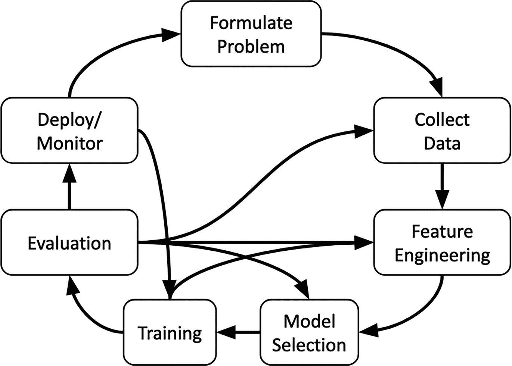
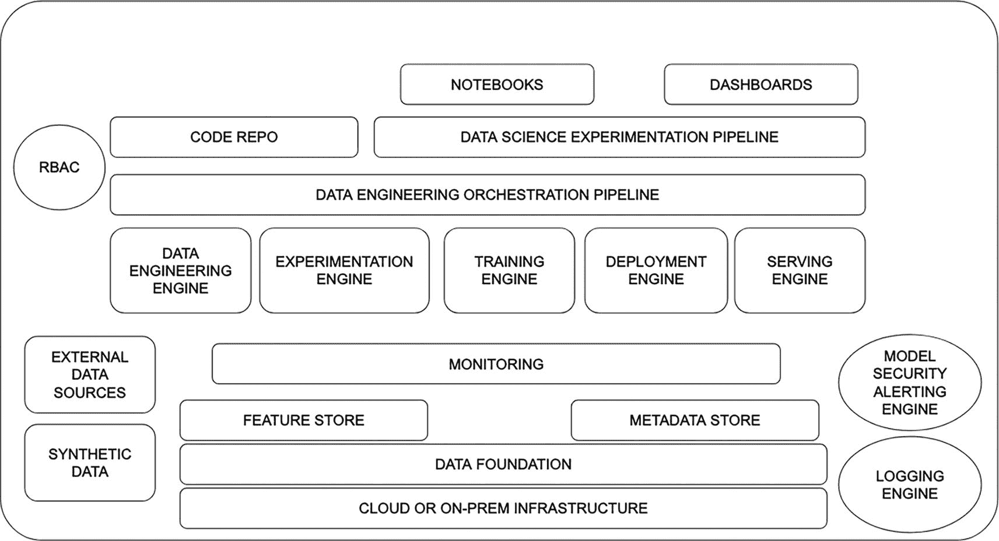
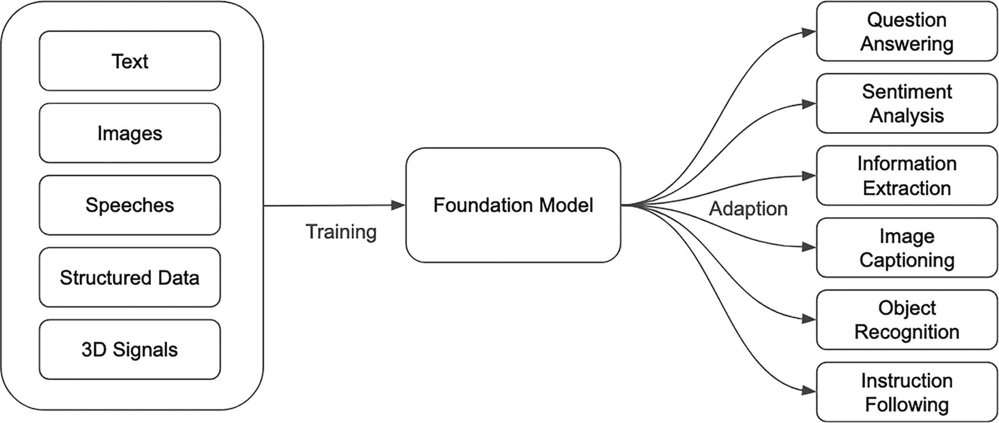
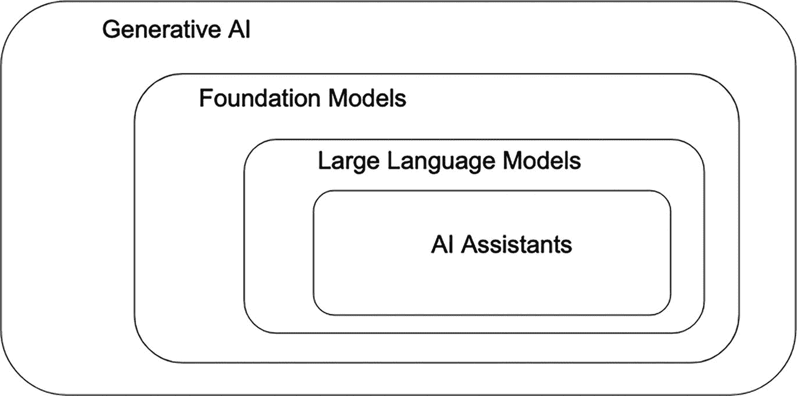
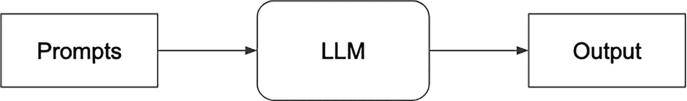
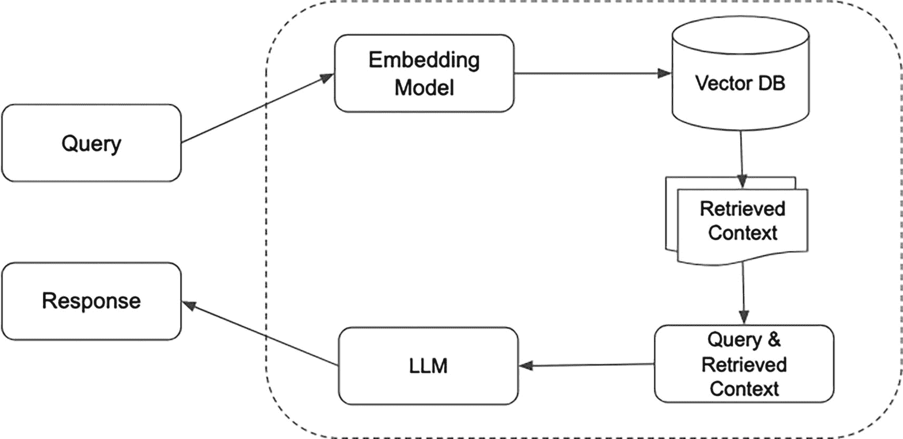
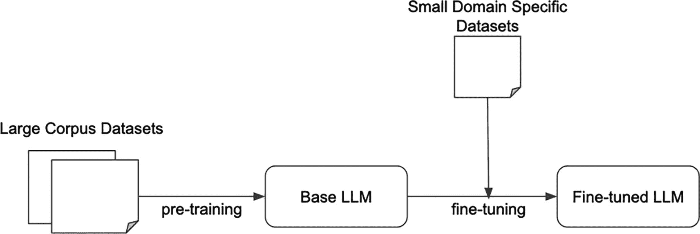
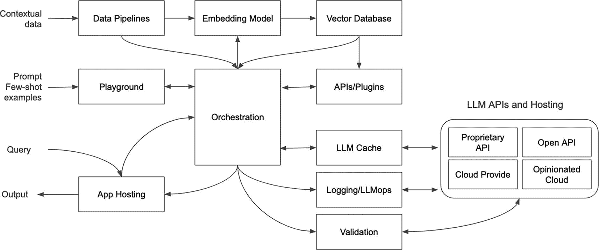
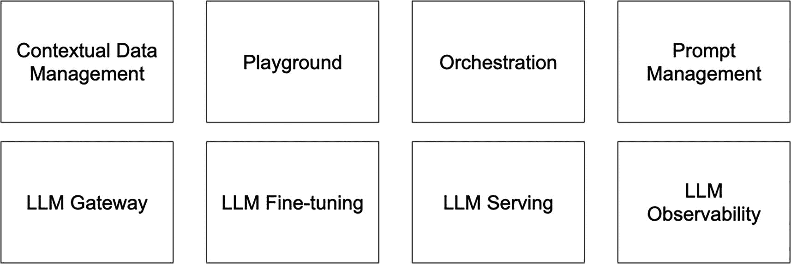

# 9. MLOps 的未来

随着 AI/ML 日趋成熟，企业越来越依赖它们来获得竞争优势，例如提升客户体验和推动增长，一个强大的 MLOps 基础设施变得至关重要。正如数据基础设施对于数据驱动型公司管理和分析数据不可或缺一样，MLOps 已转变为大规模有效开发、部署、管理和监控生产环境中 AI/ML 模型的关键支柱。

## MLOps 格局

尽管 AI/ML 在改造企业方面潜力巨大，但公司需要仔细考虑挑战，并投资于必要的基础设施以释放其全部潜力。随着公司将 AI/ML 战略付诸实施，它们将越来越依赖 MLOps 或 ML 基础设施来将 AI/ML 模型投入运营，并有效且高效地扩展其 AI/ML 计划。

MLOps 的格局现在比以往任何时候都更加清晰和明朗，它已坚定地超越了炒作周期，并受益于大型语言模型的出现。这种融合激发了乐观情绪，预示着 MLOps 将在企业中发挥更关键作用的未来。

### 机器学习开发生命周期

人们普遍认为，机器学习开发不同于传统软件开发，这主要是由于机器学习的性质以及被称为数据的额外关键组件。数据是机器学习开发中的重要输入元素，它在模型版本控制和可重复性方面给流程带来了显著的复杂性。机器学习开发包含一系列阶段，如图 9-1 所示。虽然它遵循一种独特的模式，但本质上是一个迭代过程，需要大量的实验才能产生高性能模型。

一张图表展示了迭代过程。它包括定义问题、收集数据、特征工程、模型选择、训练、评估，最后以部署或监控结束。

图 9-1 机器学习开发，一个迭代过程

机器学习开发通常被描述为一项团队运动，由多个角色组成，包括数据工程师、数据科学家、机器学习工程师、业务利益相关者、MLOps 工程师等。因此，这些角色之间的有效协作、沟通和协调对于机器学习开发的成功至关重要。

近年来，机器学习社区在更深入地理解机器学习开发所涉及的复杂性和挑战方面取得了重大进展。这是由多种因素共同推动的，包括研究进展、实际经验以及知识和资源的共享。现在有丰富的资源可供各级机器学习开发者使用，从初学者到专家。这些资源包括博客、书籍、会议和课程，所有这些都提供了宝贵的见解和知识，帮助开发者提高技能并跟上该领域的最新发展。

### 机器学习基础设施架构

机器学习基础设施是一个动态且不断发展的组件组合。同时，没有任何单一工具能够完美地满足机器学习开发各个阶段的所有需求。对于正在扩大其机器学习投资和计划规模的组织来说，投资其机器学习基础设施已成为必要。好消息是，那些进行了此类投资的组织发现，在短时间内收益就超过了成本。

作为一个机器学习社区，经过几年在企业环境中应用机器学习的经验积累，最佳实践和机器学习系统的规范栈已经出现。例如，AI 基础设施联盟的这份蓝图中捕获了一组机器学习基础设施能力^(¹²⁸)，如图 9-2 所示。其目的是帮助公司加快构建或整合其机器学习基础设施的进程，并避免常见的陷阱。

一个机器学习开发的过程图。它包括包含特征存储和元数据存储的云基础设施，其次是数据工程编排管道、笔记本和仪表板。

图 9-2 机器学习开发，一个迭代过程

上述蓝图作为参考指南，概述了构建强大机器学习基础设施所需的基本能力。虽然理想的布局是一个有价值的起点，但每家公司的独特需求和运营特点都会影响其具体实施。团队规模及其经验、开发方法和流程、以及偏好的技术栈等因素将决定所选择的工具、部署技术、监控策略和严格程度等。公司应有权根据自身具体情况定制该蓝图。

### MLOps 成熟度模型

借鉴软件成熟度模型，MLOps 正在建立自己的框架，用于评估组织在实现高效、可靠和高质量的机器学习运营方面的实践与进展。这一新兴模型主要由拥有丰富机器学习经验的云服务商推动，旨在阐明 MLOps 的原则与实践，为企业构建和运营成功的 MLOps 环境提供路线图。

虽然一个通用的 MLOps 成熟度模型正在形成，但采用现有模型之一能带来明显的好处。这些模型为企业提供了宝贵的衡量标准，用以评估其 MLOps 基础设施的当前状态和进展，并识别潜在的改进领域。通过优先持续优化其 MLOps 原则与实践，企业将在多个方面受益：精简的机器学习开发周期、更快的模型部署、增强的模型可复现性、更少的模型相关事件，并最终提升业务价值。

谷歌和微软都推出了 MLOps 成熟度模型，以评估和指导组织迈向高效可靠的 MLOps。微软于 2020 年发布的 MLOps 成熟度模型^(¹²⁹)定义了五个技术能力等级：

*   第 0 级 – 无 MLOps：无自动化，纯人工流程

*   第 1 级 – 有 DevOps 但无 MLOps：将 DevOps 实践应用于机器学习开发，例如特征工程和模型训练流水线

*   第 2 级 – 自动化训练：机器学习训练流水线的自动化

*   第 3 级 – 自动化模型开发：模型部署到生产环境的自动化

*   第 4 级 – 全 MLOps 自动化运营：整个生命周期的端到端自动化，包括持续的模型重新训练和部署

谷歌同样于 2020 年发布的 MLOps 成熟度模型^(¹³⁰)则采用更精简的方法，包含三个成熟度等级：

*   第 0 级 – 人工流程：机器学习模型的人工开发和部署

*   第 1 级 – 机器学习流水线自动化：通过自动化流水线进行持续的模型训练

*   第 2 级 – CI/CD 流水线自动化：通过强大的 CI/CD 系统在生产环境中实现快速可靠的模型更新

尽管等级数量不同，但这两个成熟度模型都共同关注自动化作为 MLOps 成熟度的关键驱动力。自动化机器学习开发步骤，如特征生成、模型开发、训练、测试、部署和监控，能够构建可靠、可重复、可扩展且可复现的流水线，从而显著提升模型开发速度。这反过来又使组织能够释放其机器学习计划的巨大潜力。

### MLOps 解决方案格局

在过去五年中，来自开源社区和供应商领域的 MLOps 解决方案层出不穷。这一格局已变得非常广阔且持续演进。AI 基础设施格局图中收录了超过 60 家公司。^(¹³¹) 虽然丰富的选择为企业提供了多样化的选项，但在试图确定具体方案或决定从何处开始决策过程时，也可能导致困惑和耗时。

企业倾向于尽可能避免供应商锁定，但同时，他们可能没有足够的人才和资源来走 DIY 路线。大多数公司正从内部、开源和供应商解决方案中选择最佳组合方案。

## AI/ML 格局

AI/ML 的格局正在转变。曾经主要关注研发，现在焦点正转向将这些模型大规模投入运营。随着 AI/ML 日益成为主流，它们对业务的影响不可否认。毫不意外，AI/ML 的采用率在过去几年稳步增长，并在可预见的未来将继续增长。越来越多的公司正超越试点项目，在多个部门大规模部署 AI/ML。这表明公司对其价值和提供投资回报率的能力更有信心。根据 Databricks 发布的首份《2023 年数据与 AI 现状》报告，对其庞大客户群的调查发现，在生产环境中部署更多模型的年同比增长率达到 411%。^(¹³²)

深度学习和自然语言处理的进步为跨行业应用开辟了新的可能性，从交通运输、医疗保健到金融和娱乐等等。在交通运输领域，由深度学习算法驱动的自动驾驶汽车正以越来越高的精度在城市街道上行驶，有望带来更安全、更高效的通勤。在金融领域，自然语言处理（NLP）正在辅助金融分析，从市场数据中提取洞察并生成明智的投资建议。

对于企业而言，AI/ML 改变其业务的潜力令人兴奋。然而，在将这项强大技术整合到公司时，存在几个关键顾虑：

*   **可解释性与可理解性**：深度学习模型往往是黑盒，很难理解它们是如何得出预测的。无法解释复杂模型的内部逻辑，在处理消费者相关信息等敏感数据时，会引发对偏见和公平性的担忧。

*   **数据安全与隐私**：保护客户和敏感数据免遭滥用，对于建立客户信任至关重要。公司需要强大的数据和 AI 安全措施，并确保其 AI/ML 应用符合各种法规和隐私法律。

*   **人才短缺**：实施 AI/ML 项目并在生产环境中管理它们需要一套独特的技能，而这类技能目前需求旺盛。人才短缺给企业寻找合格人员带来了挑战，这可能会减缓采用速度。

*   **成本与投资回报率**：实施 AI/ML 项目通常需要在基础设施、人才招聘和持续维护方面进行大量财务投资。这些项目的投资回报率可能不会立即显现，组织需要兼顾短期收益和长期战略优势。

### 生成式 AI

AI/ML 的下一个前沿是生成式 AI，它指的是旨在创造或生成新数据或内容的 AI 系统，而非像传统 AI 那样分析现有数据以发现模式。它可以生成的内容类型包括复杂的文本、图像、视频、音频、代码等，其水平可模仿人类能力。这开启了一个全新的可能性世界，从设计创新的产品和材料，到打造个性化体验，甚至生成艺术和代码，或创作音乐。

生成式 AI 有潜力改变工作的结构，并对跨行业和业务职能的生产力产生巨大影响。麦肯锡全球研究院估计，在所分析的 63 个用例中，生成式 AI 每年可为全球企业价值增加相当于 2.6 万亿至 4.4 万亿美元的产值。^(¹³³) 他们估计生成式 AI 将提高生产力的用例范围广泛且多样，包括提供客户支持互动、为营销销售生成创意内容、以及根据自然语言提示起草软件代码等等。

#### 基础模型

上述强大且多样化的生成能力，其背后是基础模型在提供动力。这一术语由斯坦福大学的研究人员提出，用以定义一种新型的机器学习模型类别。^(¹³⁴) 这些模型基于深度神经网络，通常以自监督方式在海量非结构化数据集上进行训练，这些数据往往来源于互联网，包括书籍、文章、网站及其他公开媒体。斯坦福的研究人员将基础模型视为一种范式转变：不同于以往一个模型仅服务于单一任务，基础模型能够适应多种截然不同的任务，如图 9-3 所示。这种适应性使基础模型普遍成为功能强大且用途广泛的工具，如同瑞士军刀一般。

一张示意图展示了基础模型。流程始于文本、图像、语音、结构化数据、3D 信号，接着是训练、基础模型，最后是适配。

图 9-3

一个使用多种模态数据训练，并能适配广泛任务的基础模型^(¹³⁵)

#### 大型语言模型 (LLM)

`大型语言模型 (LLM)` 是一种基础模型，它在大量文本数据上进行训练，主要专注于自然语言理解和文本生成。其名称中的“大型”不仅指代庞大的训练数据集，也指其神经网络规模（拥有数十亿参数）以及训练这些模型所需的巨大计算能力。这些最先进的语言模型采用一种名为 `Transformer` 的特定神经网络架构进行训练，能够展现出卓越的语言能力，包括文本生成、翻译、摘要、问答等。`Transformer` 架构由谷歌那篇开创性论文《注意力就是一切》提出，对自然语言处理领域产生了变革性的影响。`Transformer` 架构的一个关键概念是自注意力机制。这使得 `LLM` 能够理解词语之间的关系，并获得高效解析语言的复杂能力。

尽管 `LLM` 已展现出类似人类的能力，例如生成具有特定风格和语气的高度流畅且连贯的文本、将文本从一种语言翻译成另一种语言、以简洁明了的方式总结大量文本，但从最基础的层面来看，`LLM` 是关于人类生成文本的庞大公共语料库中标记统计分布的生成式数学模型。^(¹³⁶) 它们从该分布中采样的能力使其成为强大的下一个标记生成器，能够根据学到的语言模式生成连贯且上下文相关的文本。

生成式预训练 `Transformer (GPT)` 模型是 `LLM` 的一个特定类别。术语 `GPT` 通常指代由 `OpenAI` 专门开发的一系列 `LLM`，这些模型的底层架构就是 `Transformer` 架构。截至撰写本文时，最新版本的 `GPT` 模型 `GPT-4` 于 2023 年 3 月发布。`GPT-4` 是一个大型多模态模型，能够处理图像和文本输入，并生成文本输出。它使用来自互联网的公开数据以及从第三方提供商获得许可的数据进行训练。在博客文章“GPT-4”中，他们盛赞 `GPT-4` 虽然在许多现实场景中能力不及人类，但在各种专业和学术基准测试中展现出了人类水平的性能。^(¹³⁷)

#### AI 助手

`ChatGPT` 是 `GPT` 的一个专门化应用，针对基于对话的任务进行了微调，使其成为聊天机器人、虚拟助手和其他交互式应用的宝贵工具。它旨在通过保持对话上下文来提供与当前对话一致的回复，从而实现更连贯且上下文相关的交互。

自 2022 年推出以来，`ChatGPT` 长期享有先发优势。因此，`ChatGPT` 的替代品出现也就不足为奇了。其中值得注意的有 `Google` 的 `Bard`、`Microsoft` 的 `Bing AI Chat` 以及 `Anthropic` 的 `Claude 2`。在不久的将来，很可能会出现更多替代品。

`GitHub Copilot` 和 `Amazon CodeWhisperer` 是编码助手，它们专门利用 `LLM` 的能力服务于软件开发。它们旨在通过集成开发环境中提供实时代码建议和推荐，来帮助开发人员并提高他们的生产力。

在图像生成方面，一些流行的助手包括 `Stable Diffusion`、`DALL-E 3` 和 `Midjourney`。

通过图 9-4 中的示意图，可以很好地理解生成式 `AI`、基础模型、大型语言模型和 `AI` 助手之间的关系。

一张 `AI` 拓扑图。生成式 `AI` 包含基础模型、大型语言模型，以及 `AI` 助手。

图 9-4

`AI` 拓扑结构及各组成部分如何相互关联

#### 负责任的 AI

据 `OpenAI` 首席执行官 `Sam Altman` 在接受《时代》杂志采访时评估，`AI` 将成为这个时代最强大、最具变革性的技术。^(¹³⁸) 与此同时，这项强大且具有变革性的技术远非完美，存在一些风险和局限性。其中包括幻觉、错误信息、偏见和安全风险：

*   **幻觉**：生成式 `AI` 模型可能生成不基于任何事实数据的不正确信息。换句话说，它们会捏造事实或将不准确的信息当作真理呈现。这是一个持续研究和开发的领域。在构建生成式 `AI` 应用时，稳健的评估和持续的监控是组织应投入的众多最佳实践中的两项。

*   **错误信息**：生成式 `AI` 模型可被轻易快速地用于生成具有说服力且蓄意的错误信息，以欺骗或误导他人。错误信息的例子包括虚假名人广告、捏造的政治演讲等。错误信息对世界各国构成深远威胁。有人主张采用协作方法，将生成式 `AI` 的进步与监管策略和媒体素养教育相结合，以应对这一广泛的社会问题。^(¹³⁹)

*   **偏见**：生成式 `AI` 模型在可能包含社会偏见的大型数据集上进行训练，因此它们有可能强化和再现偏见。解决偏见问题的方法示例包括：精心策划数据以确保训练数据的多样性和代表性、持续的偏见检测与评估、为这些模型的使用建立明确的伦理准则等。

*   **安全风险**：提示注入风险是指注入恶意提示以操纵模型生成非预期或有害的响应。另一种安全风险是越狱，这是一种绕过生成式 `AI` 模型内部安全防护的技术。这些风险凸显了需要采取强有力的安全措施来防范潜在的漏洞利用。

令人鼓舞的是，全球领先的大型 `AI` 公司和各国政府正在合作制定生成式 `AI` 模型的安全测试计划。这将有助于就这些模型的能力和潜在风险建立共识。在伦敦举行的 2023 年 `AI` 安全峰会上，`AI` 安全研究所^(¹⁴⁰) 成立，并受到了众多世界领导人和主要 `AI` 公司负责人的热烈欢迎和大力支持。

#### 通用人工智能（AGI）

自 2023 年 3 月 `GPT-4` 发布以来，关于 `AGI` 这一术语的讨论或提及显著增加。大约 20 年前，`Shane Legg` 在与一位研究员同事讨论他们合著的 `AI` 论文集时，重新引入了“通用人工智能”这一短语，用以模糊地描述 `AI` 系统尚未具备的通用性^(¹⁴¹)。

`AGI` 是 `AI` 研究领域最具争议的话题之一，而这个问题很大程度上源于大多数 `AI` 专家对 `AGI` 都有自己的定义。

2023 年 11 月，一组 `Google Deepmind` 的研究人员在一篇论文中提出了一个用于分类 `AGI` 概念能力和行为的框架^(¹⁴²)。他们希望这个框架能提供一种通用语言，用于比较模型、评估风险，并衡量在通往 `AGI` 道路上的进展。该框架包含一套清晰且可操作的 `AGI` 定义原则，并引入了 `AGI` 本体论的六个层级，类似于自动驾驶的等级。

## LLMOps 的兴起

`LLM` 的出现催生了一类被称为 `GenAI` 应用的新应用。随着组织探索这片广阔 `AI` 前沿领域的潜力，它们面临着将这类以 `LLM` 为核心的新应用投入运营的挑战。

`LLM` 功能强大且用途广泛，但同时也带来了大规模使用、管理和部署方面的挑战。这些挑战主要源于其复杂性、庞大的规模，以及基于文本的输入和输出。因此，一门旨在应对这些复杂性的新学科应运而生，即 `LLMOps`（语言模型运维）。

`LLMOps` 与 `MLOps` 在根本上相似，它专注于将 `GenAI` 应用生命周期投入运营的工具、原则和最佳实践。它特别关注与闭源或开源 `LLM` 进行交互的 `LLM` 应用。此外，其总体目标与 `MLOps` 一致：加速 `LLM` 应用的开发和部署速度。

### LLM 应用原型

要理解 `LLMOps` 的构成和固有挑战，首先必须了解 `LLM` 应用的多样化原型。这些原型并非互斥，而是层层递进的。这意味着每个原型都可以集成到更复杂的原型中。

#### 提示工程应用原型

这种 `LLM` 应用原型是三者中最简单的。在高层面上，该应用原型只是向 `LLM` 发送指令（称为提示词），以生成所需内容，如图 9-5 所示。运用各种策略和技巧来设计最合适的提示词，以从 `LLM` 获得最佳结果的艺术，被称为提示工程。流行的供应商提供的 `LLM` 示例包括 `OpenAI` 的 `GPT-4`、`Google` 的 `Gemini`、`Anthropic` 的 `Claude 2`、`Cohere` 的 `Coral` 等。

一个流程示意图，从提示词开始，接着是 `LLM`，最后以输出结束。

图 9-5

提示工程应用原型

该应用原型利用精心设计的提示词来执行各种自然语言处理（`NLP`）任务。示例包括文本摘要、信息提取、文本分类、代码生成等。

从 `LLMOps` 的角度来看，将此类应用投入运营的主要关注点集中在提示词的开发和管理上。这包括提示词的开发与测试、版本控制、日志记录、监控以及全面测试。

#### 检索增强生成（RAG）应用原型

`RAG`（检索增强生成）已成为构建 `LLM` 应用最流行的方法之一。它将 `LLM` 的生成能力与外部知识源的事实准确性相结合，以生成信息更丰富、更可靠的输出。

LLM 常常存在事实不一致和缺乏上下文的问题。它们主要依赖内部统计模型，这可能导致输出富有创意但可能不准确。RAG 方法通过注入事实依据和外部数据来帮助弥补这一差距。本质上，这是一种用现实世界知识为 LLM 提供“增强”的方式。

RAG 方法之所以流行，是因为研究^(¹⁴³)发现它是解决上述差距的有效方法。这对于需要企业防火墙后、可能频繁变化的特定领域信息的 LLM 应用至关重要。这对于需要整合公司专有数据的企业级基于 RAG 的 LLM 应用尤其相关。

广泛适用的 RAG 方法特别适合需要高精度和特定领域信息的 LLM 应用，包括问答系统、文档摘要系统、内容创作、聊天机器人、法律研究系统等。

在高层面上，基于 RAG 的应用架构包括将领域数据转换为向量嵌入、将其及关联元数据加载到向量数据库、查询向量数据库并将找到的上下文与提示词结合后发送给 LLM 等组件。图 9-6 仅描绘了内容生成阶段的流程。

一个基于 RAG 的内容生成流程图，从查询和响应开始，接着是嵌入模型，然后是 LLM。之后是检索到的上下文，并重复该过程。

图 9-6

基于 RAG 的内容生成流程

从 LLMOps 的角度来看，将基于 RAG 的应用投入运营的主要关注点集中在以下几个主要部分：

*   自动化管道，以可靠高效的方式对数据进行分块、生成嵌入并将其上传到向量数据库

*   将可扩展、可靠、高性能的向量数据库投入生产并进行监控

*   对来自向量数据库的检索结果进行日志记录和监控

#### 微调应用模式

尽管基于海量文本数据集训练的大语言模型（LLM）具备广泛的语言理解与生成能力，但在应用于特定领域任务时，其性能往往难以达到可接受的水平。LLM 微调方法已成为将通用模型转化为专业模型、释放其在特定领域任务中卓越潜力的重要工具。随着 2023 年下半年 Llama 2、Mistral、Dolly、Falcon 等小型但高效的 LLM 的普及，这种方法的受欢迎程度显著提升。

随着 LLM 微调方法日趋成熟且易于使用，如今构建面向特定任务、具备企业级性能的 LLM 应用已变得愈发可行，同时还能保留其通用语言能力。

LLM 微调过程涉及获取预训练的 LLM 模型（无论是供应商提供还是开源的），并在较小的领域特定数据集上对其进行进一步训练。如图 9-7 所示，这一过程通过用特定上下文中的专业知识增强其现有知识，从而优化模型能力。因此，它能显著提升这些特定任务的准确性和性能。但需注意，LLM 微调并不会从根本上改变模型的底层能力，只是针对目标任务进行增强。

流程图从大规模语料数据集开始，经过基础 LLM，最终得到微调后的 LLM。

图 9-7

LLM 微调的高层流程

LLM 微调虽然强大，但计算成本高昂，需要多块 GPU 和大量内存。幸运的是，机器学习社区已开发出多种优化技术来加速训练并缓解内存限制。其中，参数高效微调（PEFT）家族中的低秩适配（LoRA）^(¹⁴⁴)技术因其能有效减少微调过程中需要更新的参数数量而脱颖而出。

从 LLMOps 的角度来看，将微调应用投入运营的主要关注点集中在以下几个核心部分：

*   一个标准化、可配置且可重复的 LLM 微调工作流

*   工作流用户只需提供必要输入并指定少量配置值，例如：

    *   用于微调基础 LLM 的小型领域特定数据集

    *   一个或多个待微调的基础 LLM 模型

    *   用于评估微调后 LLM 的验证数据集

    *   GPU 数量和内存大小

    *   微调超参数，如学习率、训练轮数

    *   微调技术及其各自的配置值

*   配置具备充足计算和内存资源的计算集群，并安装适用于分布式并行训练的相应库

*   记录训练时间、计算与内存使用效率，以及指定的输入和配置值

*   一个 LLM 服务栈，用于托管和提供开源或供应商提供的微调 LLM

##### 模型训练 vs. LLM 微调

虽然模型训练过程与 LLM 微调过程确实存在相似之处，但仍有几个关键区别值得注意：

*   **内存需求**：由于 LLM 规模庞大，微调通常需要显著更多的硬件内存，这可能导致内存和 GPU 使用成本上升。

*   **计算成本**：LLM 微调计算密集，可能需要使用强大的 GPU，而获取和维护这些 GPU 的成本高昂。

*   **GPU 短缺**：LLM 微调和服务对 GPU 的需求日益增长，导致 GPU 供应短缺，进一步加剧了成本问题，并增加了获取 GPU 的等待时间。

#### 组合应用模式

随着 LLM 技术和最佳实践的成熟，以及组织在构建 LLM 应用方面积累更深入的理解和经验，将上述两种或多种模式相结合将成为设计复杂 LLM 应用的标准做法，从而最大化 LLM 潜力并增加商业价值。这需要一个全面的 LLMOps 栈，我们将在下一部分进行探讨。

### LLMOps 技术栈

尽管 LLMOps 领域仍处于早期阶段并持续完善中，但上文概述的应用原型为构建强大且全面的 LLMOps 技术栈的组成与核心组件提供了宝贵见解。

在投资公司 Andreessen Horowitz 于 2023 年发表的博客文章《LLM 应用的新兴架构》^(¹⁴⁵)中，他们为新兴的 LLM 应用技术栈提出了一个相当全面的参考架构，如图 9-8 所示。

该图展示了 LLM 应用技术栈。其流程包括：上下文数据，随后是嵌入模型、向量数据库、LLM 缓存、验证、编排，最后输出结果。

图 9-8

来自 A16Z 的新兴 LLM 应用技术栈¹⁷

尽管该博客主要关注 LLM 应用技术栈，但它也隐含地强调了支持典型 LLM 应用工作流的 LLMOps 技术栈的关键要素。这包括数据预处理与嵌入生成、提示词构建与外部知识检索，以及提示词执行与 LLM 推理。

像 LinkedIn 和 Uber 这样的行业领导者，作为 MLOps 领域的先驱，正在为生成式 AI 平台铺平道路。他们正在扩展其现有的 MLOps 平台，以处理 LLM 应用的独特需求。在 2023 年 7 月的 @Scale 大会上，Min Cai 在介绍 Uber 的“Michelangelo ML 平台：过去、现在与未来”^(¹⁴⁶)时，透露了将添加到其平台中的一些 LLM 相关功能，例如 API 网关、提示词工程工具包、幻觉检测器等。

鉴于 LLM 领域发展迅速，大多数提出的 LLM 技术栈在创建后不久就需要进行修订。图 9-9 中概述的蓝图列出了面向企业的 LLM 技术栈的核心组件。下面，我们从可操作化的角度深入探讨每个组件，并提供简要描述。通过详细审视每个组件，我们可以更深入地理解在企业环境中成功操作化 LLM 应用的复杂性。

LLM 技术栈蓝图。它包括：上下文数据管理、实验场、编排、提示词管理、LLM 可观测性、LLM 服务、LLM 微调以及 LLM 网关。

图 9-9

LLM 技术栈蓝图

*   **上下文数据管理**：基于 RAG 的 LLM 应用将严重依赖此组件的支持。自动化并编排嵌入生成与摄取管道至关重要。此外，为嵌入存储和语义搜索精心选择生产就绪且可扩展的向量数据库，对于基于 RAG 的 LLM 应用的总体架构至关重要。

*   **实验场**：对于组织而言，培养 LLM 实验和探索的精神至关重要。实验场是一个用于测试和试验各种 LLM 的交互式环境。它是教育、推进 LLM 开发与理解的有价值工具。LLM 可能为组织业务增加的价值，取决于他们对这项技术的知识和直觉。

*   **编排**：复杂的 LLM 应用通常会结合多种能力，包括来自不同来源的知识检索与增强、提示词链、提示词执行、状态管理等。编排器扮演着指挥者的角色，提供一个统一的框架和抽象层，从而简化 LLM 应用的开发。

*   **提示词管理**：提示词是与 LLM 交互的主要手段，它们在决定模型响应质量方面起着关键作用。有效的提示词管理对于确保提示词经过精心设计、充分测试、适当版本控制和记录至关重要。这需要一个全面的流程和生产就绪的技术来有效管理提示词。

*   **LLM 网关**：为了避免供应商锁定并利用多个 LLM 的独特能力，LLM 应用通常需要与多个模型交互。LLM 网关通过充当中央访问点，在促进这一点上发挥着关键作用。除了单纯的访问之外，它还提供重要的功能，如日志记录、审计、负载均衡、速率限制和节流，确保与 LLM 的交互得到有效且高效的管理。LLM 网关使组织能够构建灵活且可扩展的 LLM 应用，从而利用最优秀的 LLM。

*   **LLM 微调**：定制化通常是企业 LLM 应用成功的关键。通过微调使 LLM 适应特定任务将成为常见做法。然而，这个计算密集型过程可能既昂贵又耗时，需要反复试验。为了支持大规模 LLM 的有效且高效的微调，组织需要访问强大的基础设施和工具，以简化流程并降低相关成本。这包括能够处理微调计算需求的硬件和软件系统，以及指导流程和优化结果的专家支持。

## LLMOps

### LLM 服务

`LLM` 服务通常与 `LLM` 微调相辅相成，因为它涉及托管、部署和服务微调后的模型。`LLM` 服务基础设施在实现这些模型的有效部署和管理方面发挥着关键作用。它在推理过程中整合了各种优化技术，包括加速响应时间、提高吞吐量和最大化计算效率。这确保了微调后的 `LLM` 能够在实际的 `LLM` 应用中得到有效利用，并提供所需的性能和能力。

### LLM 可观测性

这包括两个关键方面：`LLM` 评估和 `LLM` 监控。由于评估基于文本的输出质量具有复杂性，评估 `LLM` 可能具有挑战性。它需要强大的基础设施和严格的评估技术，以确保模型的响应在准确性、公平性和鲁棒性方面达到高标准。`LLM` 监控是一个持续的过程，用于监控模型随时间推移的性能，以确保它们满足预期的性能标准。这包括监控提供给模型的提示词、它们的响应以及各种操作指标。

组织内部正在开发的特定 `LLM` 用例和 `LLM` 应用类型，将指导决策过程，以确定 `LLM` 技术栈中每个组件所需的复杂程度。例如，一家专注于为特定用例开发单一、高度定制化 `LLM` 应用的公司，可能需要更复杂的 `LLM` 微调组件；而一家正在开发一系列范围更广的 `LLM` 应用的公司，则可能优先考虑更强大的 `LLM` 服务基础设施。了解组织的具体需求和优先级，对于就如何分配资源以及构建可扩展、灵活且有效的 `LLM` 技术栈做出明智决策至关重要。

`LLMOps` 仍然是一个相对新兴的学科。随着 `LLM` 和 `LLM` 应用在行业中变得越来越普遍，预计它将继续发展和演变。

## 摘要

随着人工智能/机器学习（AI/ML）日趋成熟并持续为全球各类组织带来商业价值，`MLOps` 的未来前景光明且令人振奋。`MLOps` 已成为一项被广泛接受的学科，有助于加快机器学习开发速度，并以更可靠、可重复的方式将模型更快地投入生产。借助开源社区和供应商提供的 `MLOps` 工具、框架和解决方案，企业在构建或搭建机器学习基础设施时，如今拥有了比以往更多的选择。

随着组织进入 `MLOps` 采用的后期阶段，采用 `MLOps` 成熟度等级框架来评估并持续改进其机器学习运营至关重要。这将使机器学习模型的部署更加高效、有效，最终加速从机器学习计划中获得投资回报。

随着生成式 AI 的到来，AI/ML 领域正在迅速扩展。这一动态领域涉及运用尖端的深度学习技术，利用来自书籍、互联网及其他来源的海量内容来训练大型语言模型（`LLM`）。这些模型能够生成文本、图像、代码和音乐等新内容，颠覆了多个领域的内容创作方式。这项激动人心的技术有潜力极大地加速创新并提高各行各业的效率。然而，在兴奋之余，这项技术也带来了关于潜在滥用、操纵和虚假信息的伦理考量与挑战。

各组织正在探索利用 `LLM` 能力的方法，并积极学习如何构建和运营 `LLM` 应用。几种常见的 `LLM` 应用原型已经出现。管理和运用 `LLM` 需要新的基础设施和专业知识。`LLMOps`，即一套专为 `LLM` 量身定制的实践和工具，是一个新兴领域，对于构建和运营 `LLM` 应用至关重要。机器学习社区和 `MLOps` 供应商正在积极开发蓝图和技术栈，以帮助组织应对这些复杂任务带来的挑战。

# 脚注

1, 2, 3, 4, 5, 6, 7, 8, 9, 10, 11, 12, 13, 14, 15, 16, 17, 18, 19

# 索引

# A
采纳策略 AI/ML 基础设施
对齐
业务领域
流失预测
文化要素
协作
决策过程
维度
执行速度
风险承受水平
`DevOps`/`DataOps`
欺诈检测
基础设施格局
贷款审批与信用评分
成熟度等级
Meta `FBLearner`
`MLOps` 基础设施
模型治理
在线产品
组织
平台/专业工具
团队成员
技术或基础设施
Uber `Michelangelo`
庞大而复杂的基础设施
应用程序编程接口 (`APIs`)
计算函数
`GPU` 芯片
`Python` 代码
`Ray`
异步计算
任务图执行
通用人工智能 (`AGI`)
人工智能 (`AI`)
采纳策略
`AGI` 概念
助手
基础模型
生成式 `AI`
关键问题
格局
大型语言模型 (`LLMs`)
风险与局限性
异步预测

# B
批量预测 vs. 在线预测

# C
金丝雀模型部署
聊天生成预训练转换器 (`ChatGPT`)

# D
开发与运维 (`DevOps`)
`DataOps`/`MLOps`
软件工程项目
分布式数据并行 (`DDP`)

# E, F
弹性 `Kubernetes` (`EKS`)
工程基础设施
回填流程
优势
构建 *vs.* 购买决策
优势
构建流程
考量因素
零散方法
组件
数据科学家
数据 *vs.* 特征
开发流程
特征
流程
高层架构
存储 *vs.* 平台
流式数据源
子组件
自研 (`Feathr`)
架构
能力与特性
概念
消费者
数据源/离线/在线存储
特征存储解决方案
值得注意的复杂之处
众多公司
机会
生产者
优势
元数据
定义
描述/接收端
自研解决方案
逻辑部分
源/基本信息
`YAML` 格式
监控
开源解决方案
抽象
架构
方面
评估
概念
数据源/离线/在线存储
`Feast`
特征存储
特性
自研
目标
机会
优势
供应商/原生供应商
编排
组织挑战
可用性
意识
集中化
数据治理
注册表组件
服务组件
规范/定义
存储/服务特征
离线特征存储
在线特征存储
产品/服务
推荐/个性化
技术细节
训练-服务偏差
上传工具
供应商解决方案架构
评估
能力
组件
概念
数据源、离线与在线存储
需求
`Tecton` 特征平台
转换函数
工作空间
预计到达时间 (`ETAs`)
模型

# G
生成式预训练转换器 (`GPT`) 模型
全局控制服务 (`GCS`)

# H
超参数优化 (`HPO`)

# I, J, K
基础设施方法
`ChatGPT` 基础设施方法
优势
构建流程
购买
混合方法
成熟度
规模合理的公司
需求
工程
混合方法
案例研究
成本与支持
自研/利用方案
供应商/开源解决方案
含义
集成 (`Ray`)
更广泛的 `ML` 生态系统
比较 `Ray`
数据格式
分布式 `Python` 工作负载
生态系统 `ML` 平台
`Ray Train` 和 `RLlib Serve`
调优
生态系统

# L
格局
`AI`/`ML` 格局
开发生命周期
基础设施架构
迭代过程
`LLMOps`
软件成熟度模型
解决方案
大型语言模型 (`LLM`)
批量推理
具体步骤
数据集/预处理
加载
微调
`DeepSpeed` 配置
`GPT-J-6B` 模型
`HuggingFace Transformers`
文本生成
训练过程
训练运行时考量
`GPT-J-6B` 模型
辅助函数
在线模型服务
`Pile` 数据集
`ray` 集群/依赖项
服务部署
用户自定义函数 (`UDF`)
大型语言模型运维 (`LLMOps`)
应用
原型
应用栈
蓝图
上下文数据管理
微调方法
高层流程
模型训练过程
可观测性
编排
游乐场
促进工程
提示管理
检索增强生成
服务/微调
大型语言模型 (`LLMs`)
人工智能 (`AI`)
低秩适配 (`LoRA`)

# M
机器学习 (`ML`) 格局
机器学习工程师 (`MLEs`)
机器学习 (`ML`)
机器学习运维 (`MLOps`)
采纳
自动化
规范栈
蓝图
组件
部署工作流
实验
特征工程
模型存储
模型训练
笔记本服务
可观测性
预测存储
服务模型
存储特征
挑战
数据工程
学科
`DataOps` vs. `ModelOps` vs. `AIOps`
数据科学家
定义
开发生命周期
开发流程
`DevOps`
工程学科
基础层
垃圾进，垃圾出
基础设施
输入/工件
活动
工件
特征
模型训练
软件项目
传统项目
交叉点
格局
机器学习
以模型为中心/以数据为中心的 `AI`
模型存储
优势
开发/生产阶段
生命周期
可追溯性/可复现性
模型训练过程
抽象
计算资源
一致性/可复现性
持续集成
监控
可观测性
可解释性
监控
可观测性
范式
支柱
定义
工程
治理
可观测性
服务
训练/管理
原则
自动化
概念漂移
持续监控
数据漂移
数据质量/统计属性
实验跟踪
模型性能
运维指标
可复现性
测试
训练/评估/部署
版本控制系统
`Ray Core`
真实项目
角色/职责
软件工程项目
训练
Meta `FBLearner` (Facebook)
构建/扩展 `AI`/`ML` 系统
组件
全面性原则
开发生命周期
机器学习
预测器组件
生产力原则
可复现性原则
独特/个性化体验
以模型为中心的 `AI` *vs.* 以数据为中心的 `AI`
监控
模型
告警/分析能力
组件
Lyft
Lyft `ML` 平台
异常检测
方法
方法
多管齐下的方法
第一阶段
技术
可观测性
性能

# N
自然语言处理 (`NLP`)

# O
可观测性基础设施
告警/分析能力
优势
业务风险
概念漂移
数据质量问题
漂移
概念
`evidently`
组件
漂移报告
日志记录/快照存储
监控仪表盘
指标/报告/测试/测试套件
监控系统
统计属性
可解释性
`great_expectations`
高层架构
组件
特征存储/模型存储
`Lyft` 监控
开源项目
性能
主动方法
存储模型
访问模式
开发流程
高层实现
实现
`OLAP` 系统
生产模型
训练/持续模型
表级/列级期望
验证报告
警告/错误
`whylogs`
数据类型
漂移报告
直方图和分布图
直方图/分布图
`NotebookProfileVisualizer` 类
`Python` 包
采样 *vs.* 分析
场景
统计属性
在线分析处理 (`OLAP`) 系统
开源软件 (`OSS`) 项目

# P, Q
参数高效微调 (`PEFT`)
平台
`Python` 编程语言
`Ray Core APIs`
`PyTorch` 分布式

# R
`Ray Core`
`AI` 库
`APIs` (`Python`)
应用
概念
架构
集群
Driver 进程
头节点/GCS
所有权/依赖
raylet 进程
任务/actor
工作进程
异步/并发程序
计算概念
数据/价格
容错
内存溢出 (`OOM`) 错误
策略
`Ray` 级别和应用级别故障
工作进程故障
`GPU` 节点
`Kubernetes` (`KubeRay`)
`Ray Serve`
需求
调度
`Ray` 的 `AI` 库
批量推理
组件
简洁总结
核心抽象
数据集/预处理器
处理单个任务
`HuggingFace` 转换器模型
超参数优化
超参数调优
集成
库
在线服务部署
强化学习 (`RL`)
训练器
训练/部署
调优器/检查点
以工作负载为中心的视角
`XGBoost` 模型训练
`Ray` 的人工智能 (`AI`) 库
检索增强生成 (`RAG`)

# S
服务模型基础设施
优势
`BentoML`
模型
自适应批处理
`bentoml` 服务
流程
推理
请求/响应
预处理/后处理
服务架构
`service.py` 源代码
共性
组件
考量
高层架构
组件
效率
灵活性
推理服务
延迟
日志记录
模型预测
指标
服务
模型工件/模型配置
模型推出方法
可扩展性/可靠性
影子与金丝雀
模型存储
特性
高层描述
推理范式
推理服务
批处理
批量加载
定义
处理
特征获取
混合加载
加载/卸载模型
模型预测
按需加载
服务端点
推理 *vs.* 预测
自研 `Gazette`
推理请求
`LyftLearn Serving`
Reddit 的需求
离线推理
开源解决方案
`BentoML`
模型
社区
`Ray Serve`
`Seldon Core`
预测生成
优势/劣势
成本效益
嵌入式进程
日志记录
模型分配方法
预处理/后处理
远程步骤方法
服务步骤设计
基于树/深度学习的模型
`Ray Serve` 部署/应用
多步骤
音频转录
`Python` 原生模型
`REST`
规模部署/资源分配
`transformer.py`
价值主张
`Seldon Core`
金丝雀测试
命令行
核心职责
推理图
`Kubernetes` 原生
映射概念
`MLServer`/`NVIDIA Triton`
模型定义
影子模式
单模型 vs. 多模型
`V2` 架构
影子模型部署
同步预测

# T
训练基础设施
算法选择
优势
组件
开发环境
数据分析/可视化
开发体验
特性
`JupyterLab`
模型可解释性
可复现性
资源访问
`Spark` *vs.* `Dask` *vs.* `Ray`
`Tensorboard` 可视化
实验跟踪
优势
比较博客
组件
细节
高层架构
`MLflow`
需求
系统架构
高层架构
组件
开发环境
实验跟踪
自研
适配考量
框架
`Griffin`
系统架构
`MLCLI` 接口
目标
`MLflow`
高层架构
模型注册表
概述
参数
生产就绪组件
简短
`scikit-learn`
自动日志记录
系统逻辑架构
表格格式
跟踪
模型
模型评估阶段
模型参数 *vs.* 超参数
模型注册表
桥接组件
细节
屏幕
高层架构
成熟度等级
元数据/实验存储/仓库
技术方面
开源项目
流水线
优势
持续
核心
组成
数据可用性/变更
探索/实验
`Kubernetes`
模型性能
众多优势
编排
编程风格
编排解决方案
周期性重训练
`Python` 文件
`YAML` 文件
规模数据
数据处理
数据并行
深度神经网络模型
分布式模型
`LyftLearn`
架构
需求
初创公司/组织

# U, V, W, X
Uber `Michelangelo`
方法
优势
历史
原则
系统架构

# Y, Z
`YAML` 不是标记语言 (`YAML`)
优势/劣势
聚合
适配
清晰/简洁的分离
设计决策
`Python`
实时特征
规范与定义