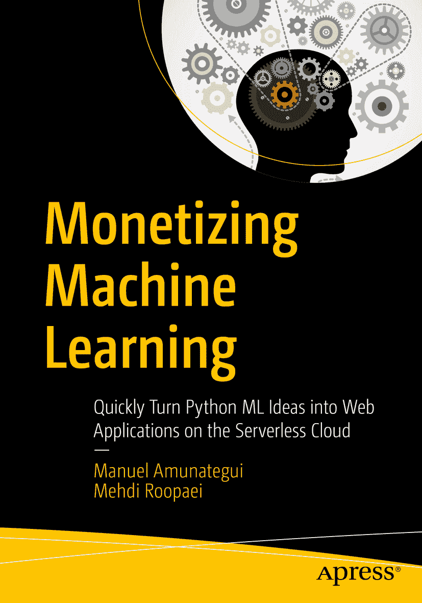
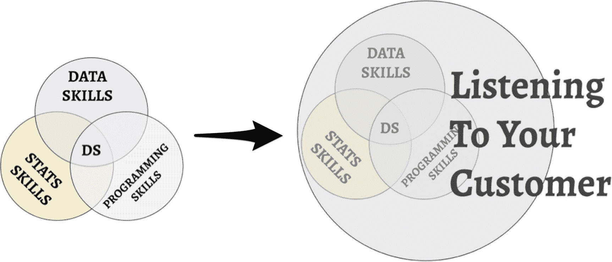
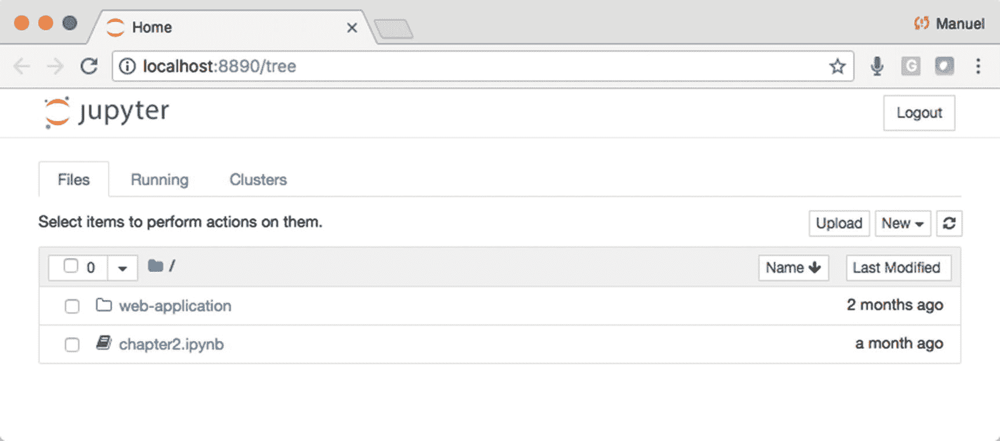

<!--
# 地标

1.  封面
2.  目录
3.  正文

ISBN 978-1-4842-3872-1 电子书 ISBN 978-1-4842-3873-8 [`doi.org/10.1007/978-1-4842-3873-8`](https://doi.org/10.1007/978-1-4842-3873-8) 美国国会图书馆控制号：2018956745 © Manuel Amunategui, Mehdi Roopaei 2018 本作品受版权保护。出版商保留所有权利，无论是全部还是部分材料，特别是翻译、重印、重用插图、朗诵、广播、微缩胶片复制或任何其他物理形式的复制权，以及信息存储与检索、电子改编、计算机软件或现在已知或未来开发的类似或不同方法的传输权。本书中可能出现商标名称、标识和图片。我们仅在编辑风格下使用商标名称、标识和图片，以维护商标所有者的利益，无意侵犯商标权，因此不会在每次出现时都使用商标符号。本出版物中使用的商品名称、商标、服务标志及类似术语，即使未明确标识，也不应被视为对其是否受专有权利保护的表达。尽管本书中的建议和信息在出版时被认为是真实准确的，但作者、编辑和出版商均不对可能存在的任何错误或遗漏承担法律责任。出版商对本书所含内容不作任何明示或暗示的保证。本书通过 Springer Science+Business Media New York 在全球图书贸易中发行，地址：233 Spring Street, 6th Floor, New York, NY 10013。电话：1-800-SPRINGER，传真：(201) 348-4505，电子邮件：orders-ny@springer-sbm.com，或访问 www.springeronline.com。Apress Media, LLC 是一家加利福尼亚有限责任公司，其唯一成员（所有者）是 Springer Science + Business Media Finance Inc (SSBM Finance Inc)。SSBM Finance Inc 是一家特拉华州公司。
-->

# 引言

几十年前，当我还是个学习编程的孩子时，我有一本用于 Apple II 的 ASCII 游戏书（书名我记不清了），每章开头都有一张完成版游戏的图片。在一本除了计算机代码之外别无他物的书中，这既是诱饵，也是动力。那是在 GitHub 和互联网出现之前的年代。仿佛就在昨天，我仍记得那种兴奋感：飞速浏览代码，逐行抄写，修正拼写错误，擦干眼泪，只为玩到游戏。如今，很多事情都变了，但尽管代码可以下载，我们仍然在每章开头放一张最终产品的截图，这样你也能感受到学习这些概念时的动力和兴奋。

## 低门槛与快速上市

本书将引导你完成多个项目，探索不同的 Python 机器学习理念，以及将其转化为 Web 应用的不同方法。每章结尾都会有一个无服务器 Web 应用，任何有互联网连接的人都可以访问。这些项目基于经典且流行的 Python 数据科学问题，难度会随着你的学习进度而增加。我们将研究并设计一个建模解决方案，然后将该方法中一个有趣的方面扩展成一个交互性强、引人入胜的 Web 应用。

成为一名数据科学家是一份很棒的工作，但在学习成为数据科学家的过程中，教材存在一个令人困扰的空白。数据科学不仅仅是统计学和建模；它关乎满足人类需求和解决实际问题。很少有教材能涵盖全局。似乎每当你开始谈论全局时，就必须签署保密协议（NDA）。这是一个至关重要的学习领域，如果你和我一样，你需要理解自己为什么要做某件事，才能把它做好。这些并不是困难的话题，尤其是当你使用合适的工具来处理它们时。

我们不会把重点放在“**成为一名数据科学家**”这个最终目标上；关于这个主题的书已经很多了。相反，我们将专注于如何快速、简单地将机器学习产品推向市场，并且始终将用户/客户放在心上！这正是这个行业教育大纲中所缺失的。如果你先构建产品，然后再与客户沟通，你的流程就会有缺陷，你的解决方案也会偏离目标。我重新绘制了德鲁·康威的数据科学维恩图，将客户置于最高优先级（图 1）。



图 1

经典的数据科学维恩图与我的更新版本并列

^(¹) 我和 Mehdi 在本书的内容上付出了巨大努力。我们花时间精心构思这些概念，确保它们对我们的读者（即我们的客户——始终将客户放在心上）具有实用价值。我负责编写材料，Mehdi 负责编辑。就所涵盖的范围和技术而言，这是一本雄心勃勃的书。为了专注于从材料中获得最快速的实用价值，我们不得不做出选择和取舍。工具在不断变化。当你阅读本书时，书中的某些内容可能已经过时，但这没关系（你可以访问 GitHub 仓库获取更新）。在这里，一切都在不断变化，但事物总是向着更好的方向变化！因此，学习新技巧通常意味着学习更好、更快、更强大的做事方法。本书不仅会教你如何构建 Web 应用，还会为你指明正确的方向，以深化你在特定兴趣领域的知识。

如果这是一门课程，我会让你签署一份“**竞争协议**”：没错，与竞业禁止协议相反。我希望你通读本书，理解这些工具，然后复制它们，并将它们变成你自己的。这些旨在成为模板，帮助你快速搭建平台，从而专注于更重要的事情，为你的客户和朋友构建有影响力的工具。当你理解了这一点，就是你毕业的日子，你将获得被称为“**数据科学专业人士**”的所有权利和特权。

## 什么是无服务器云？

云服务提供商在改进 Web 托管解决方案和降低成本方面付出了巨大努力。最近出现的“**无服务器**”选项，抽象了大部分配置过程，在本书涵盖的四家云提供商中有三家提供此选项。这意味着你可以在完全托管的平台上启动并运行你的项目，自动进行负载均衡、吞吐量扩展、快速部署等，而无需选择、配置或担心任何这些问题。你可以自行决定对这些架构和监控选项的参与程度。你可以选择自己控制什么，以及将什么委托给提供商。有一点是肯定的：网站将根据流量自动调整，并提供无与伦比的正常运行时间。

这使我们能够专注于重要的事情，而不会被实现目标所需的繁琐事务和支持所拖累。这些所谓的“**繁琐事务**”至关重要，必须认真对待。这就是为什么我们考察了四家信誉良好的云提供商，它们能让我们安心，从而完全专注于我们的 Web 应用，而不必担心网站崩溃或提供商倒闭。让我们专注于重要的事情，开始工作吧！

## Web 应用开发的关键路径

许多机器学习模型都停留在原始的编码状态：难以理解，也无法轻松地邀请他人从中获益。这些模型注定会被遗忘。即便是那些成功摆脱集成开发环境束缚的模型，当它们被简化为静态图表或晦涩的建模分数时，也无法充分发挥其潜力。本书旨在通过将机器学习模型扩展为通用 Web 应用的流程进行分解，来避免这一陷阱。每一章都遵循以下三个关键步骤：

1.  **以正确的方式建模**。我们从终点出发，先理解用户希望看到什么，并在最终目标和用户体验上投入时间和思考。我们确保采用合适的建模方法，以便快速且毫无意外地达到 Web 应用状态（图 2）。

    

    图 2

    在构建之前，务必确认你的想法有受众（来源：Lucas Amunategui）

2.  **设计与开发本地 Web 应用**。此步骤需要利用各种 Web 前端技术，以提供所需的交互性和动态效果，从而突出模型的洞察力并维持用户的兴趣。此阶段的最终产品与下一阶段的产品并无区别，唯一的区别在于它托管在你的本地机器上，而非云端。

3.  **部署到流行且可靠的无服务器云提供商**。每个提供商都有独特的要求、优势和劣势，需要理解并加以应对。这是最终阶段，世界将得以欣赏并从你的工作中学习。

我们从处理提供智能交互的简单方法开始，例如利用模型的系数或保存训练好的模型，然后转向复杂的方法，例如使用数据库来跟踪用户参与度，或依赖开源预训练模型进行图像识别。一个关于股票市场预测的虚构案例研究将在第一部分开始，并在后续部分中再次探讨。新的功能会不断添加，直到它最终演变成一个带有付费墙的复杂仪表板，为付费订阅用户提供定制化的智能服务。

通过专注于经典的数据科学问题，并结合流行的开源技术，如 Python、Flask、Ajax、Bootstrap、JavaScript 和 HTML，你会发现这些内容似曾相识；即使不熟悉，你的学习曲线也会大大降低。我们专注于使用简单的工具和简单的技术，以可靠且快速地将机器学习想法推向现实世界。这些工具和方法会在每一章中反复出现，所以如果某些方面一开始不清楚，不用担心；继续前进，事情会变得越来越清晰。

我们还会在每一章中轮换云提供商，因此你将接触到最流行的提供商。这将为你未来项目选择哪个提供商提供丰富的见解。我建议通读所有章节，因为每一章都会展示不同的做事方式，突出提供商的优势，并展示快速完成工作的独特技巧和窍门。

## 关于你，读者

本书面向那些希望将统计模型、机器学习流程、数据驱动项目或任何独立的 Python 脚本，扩展为任何拥有 Web 浏览器的人都能访问的交互式仪表板的读者。互联网是最强大的媒介，其准入门槛极低`—`任何人都可以访问它，而本书正是为那些希望利用这一优势的人而编写。

本书假定你具备 Python 和编程经验。你应该拥有一个可正常运行的代码编辑器和解释器。你应该能够测试和排查问题、安装 Python 库，并熟悉诸如 NumPy、Pandas 和 Scikit-learn 等流行包。本书不涵盖这些基本概念的介绍。此处提供的代码仅使用 Python 3.x，并未在更低版本上进行测试。此外，具备 Web 脚本语言的基础知识也会很有帮助。

本书面向那些有创业精神、希望在不花费太多成本的情况下将想法发布到 Web 上的人，没有 IT 人员的小公司，希望获得曝光和真实世界训练的学生，以及任何准备将工作提升到新水平的数据科学专业人士。

## 如何使用本书

每一章都以最终 Web 应用的图片及其功能描述开始。这种方法有多个目的：

*   它作为一种激励因素，诱使你投入工作。

*   它直观地解释了项目将要涉及的内容。

*   更重要的是，它教导了在着手任何项目时，对最终目标有一个清晰的、以客户为中心的理解是多么关键。

本书仅展示源代码的要点，但完整版本附在相应的代码仓库中。这包括在涉及数据探索时的 Jupyter notebook，以及用于 Web 应用的压缩文件夹。

这里提供的实践项目简单、清晰，并且可以作为模板来快速启动许多其他类型的应用。无论你是想了解如何围绕数值或分类预测、文本分析、创建强大且交互式的演示文稿、提供对受限数据的访问，还是利用 Web 插件来接受订阅付款和捐赠来创建 Web 应用，本书都将帮助你快速将项目交到全世界用户手中。

### 注意

如需报告编辑错误/漏洞，请反馈至 [`www.apress.com/9781484238721`](http://www.apress.com/9781484238721)。

## 行业工具与杂项技巧

以下简要介绍一些工具，它们将帮助我们快速、简单且美观地将机器学习想法转化为 Web 应用。这并非旨在成为一份全面或完整的清单，只是对所用不同技术的初步了解，以及如果你想了解更多（我希望你会）可以遵循的指引。

### Jupyter Notebooks

本书仅展示代码片段，因此你需要下载并运行每章的 Jupyter notebook，以便亲自运行并尝试各种功能和不同参数。如果你不熟悉 Jupyter notebook，它是一种基于网页的交互式 Python 解释器，非常适合构建、调整和发布任何使用 Python 脚本的内容。它连接到一个功能完整的 Python 内核（请确保是 Python 3.x 版本），并且可以像其他解释器一样加载和运行库与脚本。要安装 Jupyter notebook，请遵循官方文档：[`http://jupyter.readthedocs.io/en/latest/install.html`](http://jupyter.readthedocs.io/en/latest/install.html)。

有多种安装方式，包括使用“ **pip3** ”命令；如果此方法对你无效，请查阅官方文档了解其他安装方式（列表 1）。

```
sudo pip3 install jupyter
列表 1
安装 Jupyter
```

使用 Jupyter notebook 既简单又强大。你只需将 notebook 下载到本地机器（文件扩展名为 *.ipynb），打开命令/终端 shell 窗口，导航到该文件夹，然后运行“ **notebook** ”命令即可（列表 2）。

```
jupyter notebook
列表 2
运行 Notebook（查看官方文档了解启动 notebook 的其他方式）
```

此命令将打开一个网页，显示启动该命令所在文件夹的内容（图 3）。你可以通过点击文件列表上方的文件夹图标来向下导航文件夹结构。



图 3

Jupyter notebook 起始页

要打开一个 Jupyter notebook，只需点击任何扩展名为“*. **ipynb** ”的文件即可开始使用！如果你想创建一个全新的 notebook，请点击仪表盘右侧刷新按钮旁边的“ **new** ”按钮。

### 注意

有关更多信息、Jupyter notebook 的问题以及如何连接内核，请参阅：[`http://jupyter-notebook-beginner-guide.readthedocs.io/en/latest/execute.html`](http://jupyter-notebook-beginner-guide.readthedocs.io/en/latest/execute.html)。

### Flask

Flask 是一个轻量级但非常强大的服务器端 Web 框架。它是本书中所有应用程序背后的核心。它也是我们 Python 数据生成函数与网页之间的粘合剂。这是我热爱使用 Flask 的原因之一，因为它允许我们在不脱离 Python 语言的情况下，将独立的 Python 脚本链接到服务器端 Web 框架；这使得对象之间的数据传递变得容易得多！

Flask 提供了发布网页所需的最基本功能。如果你需要额外的支持，比如数据库、表单控件等，你将需要安装额外的库，这就是为什么它被称为轻量级微框架。这也正是它易于使用的原因，因为你只需学习少数几个额外技巧；其他一切都使用我们已经熟悉且久经考验的 Python 库。

不幸的是，我们只能在 Python 中工作一段时间，最终你将需要涉足前端 Web 脚本。但别为此烦恼；网上有大量优秀的示例（Stackoverflow.com、w3schools.com）以及外观惊艳的 GetBootstrap.com 模板，可以让你尽快上手。

### 注意

有关 Flask 的更多信息，请查看 Flask 官方文档：[`http://flask.pocoo.org/`](http://flask.pocoo.org/)。

### HTML

HTML，即超文本标记语言，无需过多介绍。就 Web 技术而言，这是最基本的标准。它已经存在多年，用于创建几乎所有现存的网页和 Web 应用程序。

对于那些想复习此主题的人，网上有海量的免费资料。我推荐 [w3schools.​com](http://w3schools.com) 上的任何内容。他们的资料组织良好、全面且通常是交互式的。

### CSS

层叠样式表（CSS）让大多数网站看起来很棒！我们在这里使用两种类型的 CSS 文件：加载在大多数网页“< **HEAD** >”部分的 CSS 链接（最常见），以及如列表 3 代码片段中所示的自定义 CSS。

```
.btn-circle.btn-xl {
width: 70px;
height: 70px;
padding: 10px 2px;
border-radius: 35px;
font-size: 17px;
line-height: 1.33;
}

列表 3
自定义 CSS 脚本块
```

托管在外部服务器上的 CSS 文件无法自定义，但通常是最优秀的。但有时你只需要自定义页面上的某个功能，这时你可以创建一个本地 CSS 文件或直接在 HTML 页面中添加一个样式标签。然后通过“ **class** ”参数将其应用于特定的标签或区域（列表 4）。

```
Spring
列表 4
将 CSS 标签应用于 HTML 标签
```

CSS 非常详细地定义了大小、颜色、字体以及所有你能想到的外观样式。它还允许你通过 Web 门户统一你的外观和感觉。你只需创建一次，就可以让所有页面调用它来继承该特定样式。

### 注意

有关 CSS 的更多信息和培训，请查看 w3schools.com。

### Jinja2

Jinja2 用于生成标记和 HTML 代码，并与 Flask 变量紧密配合。它由 Armin Ronacher 创建，被广泛用于直接在 HTML 模板中处理 Flask 生成的数据和 if/then 逻辑。

在这个 HTML 模板示例中，一个名为“ **previous_slider_value** ”的 Flask 生成值通过 Jinja2 被注入到滑块的“ **value** ”参数中。注意双花括号的使用（列表 5）。

```
列表 5
Jinja2 将数据传递给 HTML 输入控件
```

### 注意

有关 Jinja2 的更多信息，请查看文档：[`http://jinja.pocoo.org/docs/2.10/`](http://jinja.pocoo.org/docs/2.10/)。

### JavaScript

JavaScript 本身是一种真正的编程语言。它可以为你的任何前端控件添加极其强大的行为。JavaScript 为网页带来了高度的交互性，我们将在每一章中充分利用它。

这里有一个有趣的示例，我们捕获 HTML 滑块控件的鼠标释放事件，以将表单提交给 Flask 服务器。其思路是，每当用户更改滑块值时，Flask 需要使用新的滑块值进行一些服务器端处理，并重新生成网页（列表 6）。

```
slider1.onmouseup = function ()
{
document.getElementById("submit_params").submit();
}
列表 6
JavaScript 捕获滑块的“ onmouseup ”事件
```

### 注意

有关 JavaScript 的更多信息和培训，请查看 w3schools.com。

### jQuery

jQuery 是一个定制的 JavaScript 库，用于简化复杂前端和行为事件的处理，并确保不同浏览器版本之间的兼容性。

jQuery 将简化诸如按钮、下拉菜单的动态行为，甚至 Ajax（本书许多项目中大量使用的一项关键技术）等操作。

### 注意

有关 jQuery 的更多信息，请查看 JQuery.com 上的官方文档。

### Ajax

Ajax 是一项出色的前端脚本技术，可以为网页添加动态的服务器端行为。它允许在不重建或重新加载整个页面的情况下发送和接收数据，这与表单提交的方式不同。它常见的一个应用场景是地图网页，例如谷歌地图，它允许拖拽和滑动地图，而无需在每次移动后重新加载整个页面。

### 注意

有关 Ajax 的更多信息与培训，请查看 [w3schools.​com](http://w3schools.com) 。

### Bootstrap

Bootstrap 是一个用于前端网页工作的非常强大、近乎神奇的工具。根据 BuiltWith Trends 的数据，全球近 13% 的网站都在使用它。^(²) 它包含了适用于大多数网页标签和控件的各种美观样式和行为。只需将你的网页链接到最新的 Bootstrap，CSS 就能让任何枯燥的 HTML 页面瞬间拥有专业的外观！

如果你查看本书中的任何 HTML 文件，首先会注意到页面顶部被“ **LINK** ”和“ **SCRIPT** ”标签包裹的链接。这些代表了构建网页时的一种巨大捷径（列表 7 ）。

```
列表 7
用于继承 Bootstrap CSS 样式的链接标签
```

本书中的所有 HTML 文件（以及你将来可能创建的任何网页）都将使用这些链接来下载预制的 Bootstrap 和 JavaScript 脚本，并自动继承互联网上普遍存在的精美字体、颜色、样式和行为。这让你能够以最小的努力，立即继承一流的视觉效果和行为。

### 注意

有关 Bootstrap 的更多信息与培训，请查看 GetBootstrap.com 上的官方文档。

## 网页插件

网页插件有一个巨大的优势：它们将大量的硬件、数据和/或安全管理推给其他人，最好是该领域的专业人士。没有必要重新发明轮子、浪费宝贵的时间或引入安全风险。让别人来处理这些，专注于你擅长的事情；这正是本书的核心所在！

不幸的是，我们只有精力探讨其中的一部分，但这里列出了一些我过去使用过或从他人那里听到好评的优秀插件（此外还有数百个可能同样优秀的插件——请寻找那些为小企业提供良好条款，并允许在投入前通过演示或测试账户进行尝试的插件）。

### 会员平台

有几个平台值得注意。

**Memberful (** [`www.memberful.com`](http://www.memberful.com) **)**

Memberful 是我们在本书中将使用和实现的插件。我个人非常喜欢 Memberful.com，并认为对于任何寻求简单方法来管理网站付费专区的人来说，这是一个绝佳选择。它通过 [Stripe.​com](http://stripe.com) 提供信用卡支付，具备用户管理功能，并且与你的 Web 应用程序紧密集成。

**Patreon (** [`www.patreon.com`](http://www.patreon.com) **)**

Patreon 是一个面向艺术家和内容创作者的会员平台和插件。

**Wild Apricot (** [`www.wildapricot.com`](http://www.wildapricot.com) **)**

Wild Apricot 是一个面向小型和非营利组织的会员平台。

**Subhub (** [`www.subhub.com`](http://www.subhub.com) **)**

Subhub 是一个专为企业家、专家和组织设计的会员平台。

**Membergate (** [`www.membergate.com`](http://www.membergate.com) **)**

Membergate 是一个用于企业通讯、新闻简报、协会和受限访问站点的平台。

### 支付平台

有几个可用的平台。

**Paypal Donations** ( [`www.paypal.com/us/webapps/mpp/donation`](http://www.paypal.com/us/webapps/mpp/donation) )

我过去使用过 Paypal 插件，对其安装和使用的简便性感到非常满意。你只需要一个状态良好的 Paypal 账户，剩下的就轻而易举了。

Paypal Express ( [`www.paypal.com/us/webapps/mpp/express-checkout`](http://www.paypal.com/us/webapps/mpp/express-checkout) )

Paypal Express 仍然是 Paypal，但专为快速便捷的结账而设计。

**Stripe** ( [`http://stripe.com/`](http://stripe.com/) )

Stripe 是一种支付选项，能让网站轻松接受在线信用卡支付。它是 Memberful.com 背后的支付引擎，我们将在本书的最后一章中看到它。

### 分析工具

构建你自己的网络使用追踪器需要在每个页面上编写大量 Flask 自定义代码，还需要一个数据库来保存这些交互数据，以及一个分析引擎来解读数据。工作量巨大！相反，使用 Google Analytics，我们只需在每个页面的顶部添加一段 JavaScript 代码片段。它提供免费的基本分析功能，足以满足我们的需求。

### 留言板

我过去曾使用 [`https://disqus.com`](http://disqus.com) 为静态网站添加留言板。它能在你的网站上直接创建出外观专业的留言板，同时所有管理都在别处进行。

### 邮件列表

我使用 formspree.io 很多年了，非常喜欢它！将它添加到任何静态网页，并配上文本框和提交按钮都非常简单。用户可以在你的网页上输入他们的电子邮件地址，[`https://formspress.io`](http://formspress.io) 会将提交的信息通过邮件发送给你。如果你托管的是静态网站，或者不想处理自己管理数据库的麻烦，这是一个很好的选择。

## Git

Git 是一个出色的版本控制工具；它允许你将代码的创建、更改、更新以及任何删除操作都存储在一个仓库中。它与 GitHub 紧密集成，这对于代码保护和协作至关重要。它也与市面上大多数云服务提供商集成。在某些章节中我们会用到它，在其他章节则不会。如果你最终要处理大型应用程序或与他人协作，我强烈建议你开始使用它。

大多数云服务提供商都支持像 GitHub、BitBucket 等在线代码仓库。这些在线仓库与 Git 协同工作，因此学习基础知识会让你占据很大优势。在 Microsoft Azure 上部署 Web 应用程序的过程与 Git 紧密集成，所以请查看这个基础入门指南，或者上网查找一些优秀的教程，例如 try.github.io ^(³) ：

*   **git init** : 创建一个本地仓库

*   **git clone** [**https://github.com/**](https://github.com/) … 将一个 GitHub 仓库克隆到你的本地驱动器

*   **git status** : 列出已更改并等待提交和推送到仓库的文件

*   **git add .** : 添加所有文件（注意点号）

*   **git add ‘*.txt’** : 添加所有文本文件

*   **git commit** : 提交等待中的文件

*   **git log** : 查看提交历史

*   **git push (或 git push azure master)** : 将分支推送到远程主分支

*   **git pull** : 将远程更改拉取到本地仓库

*   **git reset *** : 撤销 git 操作

*   **git rm --cached <file>** : 停止跟踪某个文件

## 虚拟环境

使用虚拟环境有许多优点：

*   创建一个没有安装任何 Python 库的环境

*   精确了解你的应用程序运行所需的 Python 库

*   保护你计算机系统的其余部分免受在此环境中安装的任何 Python 库的影响

*   鼓励进行实验

要启动一个虚拟环境，请使用“ **venv** ”命令。如果你的计算机上尚未安装，建议你进行安装（它可以通过常见的安装工具如 pip、conda、brew 等获取）。有关为你的操作系统安装虚拟环境的更多信息，请参阅“ **venv - 创建虚拟环境** ”用户指南：[`https://docs.python.org/3/library/venv.html`](https://docs.python.org/3/library/venv.html) 。

打开一个命令窗口，并在命令行上调用 Python 3 的“ **venv** ”函数来创建一个沙盒区域（列表 8 和 9 ）。

```
$ python3 -m venv some_name
列表 8
创建 Python 虚拟环境
```

```
$ source some_name/bin/activate
列表 9
激活环境
```

完成后，你可以使用列表 10 中的命令停用你的虚拟环境。

```
$ deactivate
列表 10
停用虚拟环境
```

## 创建“requirements.txt”文件

大多数云提供商使用“ **requirements.txt** ”文件来列出托管 Web 应用程序所需的任何 Python 库。在大多数情况下，它与 Web 文件打包在一起，并发送到其“ **serverless** ”目标进行设置。

你可以创建自己的“ **requirements.txt** ”文件，并将其放在与你的主 Flask Python 脚本相同的文件夹中。让我们看看如何使用虚拟环境来创建一个完整的“ **requirements.txt** ”文件。使用虚拟环境时，你正在创建一个没有任何 Python 库的安全沙箱。这允许你只安装所需的内容，并运行“ **pip freeze** ”命令来获取库和当前版本号的快照。请注意，如果你已经知道所需的库、依赖项和版本号，则无需执行此操作。事实上，你也可以直接使用本书附带的“ **requirements.txt** ”文件。

### 步骤 1

通过创建一个 Python 虚拟环境来从一张白纸开始，如列表 11 所示。

```
$ python3 -m venv some_env_name
$ source some_env_name/bin/activate
列表 11
启动虚拟环境
```

### 步骤 2

使用“ **pip3** ”安装运行本地 Web 应用程序所需的库，如列表 12 所示。

```
$ pip3 install flask
$ pip3 install pandas
$ pip3 install sklearn
列表 12
安装一些库作为示例
```

### 步骤 3

冻结环境并将所有已安装的 Python 库（包括版本号）通过管道输出到“ **requirements.txt** ”文件中，如列表 13 所示。

```
$ pip3 freeze > requirements.txt
列表 13
安装所需的库
```

### 步骤 4

最后，停用你的虚拟环境，如列表 14 所示。

```
$ deactivate
列表 14
退出 venv
```

大功告成：你刚刚创建了一个“ **requirements.txt** ”文件。通过调用“ **vi** ”（按 Escape 键和 q 键退出）来查看其内容。你的“ **requirements.txt** ”文件的内容可能看起来非常不同，这没关系（列表 15 ）。

```
输入:
$ vi requirements.txt
输出:
click==6.7
Flask==0.12.2
itsdangerous==0.24
Jinja2==2.10
MarkupSafe==1.0
numpy==1.14.2
scikit-learn
scipy
python-dateutil==2.7.2
pytz==2018.4
six==1.11.0
Werkzeug==0.14.1
Pillow>=1.0
matplotlib
gunicorn>=19.7.1
wtforms>=2.1
列表 15
检查“ requirements.txt ”文件的内容
```

在 requirements.txt 文件中，你可以使用“ **==** ”符号来指定特定版本（列表 16 ）

```
Flask==0.12.2
列表 16
精确指定
```

你也可以指定一个版本大于等于，或小于等于（列表 17 ）

```
Flask >= 0.12
列表 17
方向性指定
```

或者你可以简单地声明安装程序可以找到的最新版本（列表 18 ）

```
Flask
列表 18
使用可用的最新版本
```

## 结论

这只是对本书所用工具的简要介绍。请以此作为起点，进一步探索并深化你在特别感兴趣的领域的知识。

致谢

向朋友、家人、编辑以及所有以各种方式帮助实现这个项目的人们 `—` 表示衷心的感谢！没有你们的帮助，这本书永远不会面世。

### 关于作者和技术审阅者

### 关于作者

### 关于技术审阅者

脚注 1   2   3

