# 1. 无服务器技术简介

我们将创建一个非常简单的 Flask Web 应用程序（图 1-1），在接下来的四个部分中，当我们探索来自 Amazon AWS、Google Cloud、Microsoft Azure 和 Python Anywhere 的基于云的服务时，我们将重复使用它。


图 1-1

`Flask`

在涉足云端之前，最好先在本地机器上运行一个你网站的本地版本。

**注意**：通过访问 [`www.apress.com/9781484238721`](http://www.apress.com/9781484238721) 并点击源代码按钮，下载第 1 章的文件。打开 Jupyter notebook `chapter1.ipynb` 以跟随本章内容。

## 一个简单的本地 Flask 应用程序

本节中的代码非常简单，你可以从头开始编写，也可以使用 `simple-local-flask-application` 文件夹中的文件。

### 步骤 1：基本的“Hello World!”示例

让我们直接从 Flask 官方帮助文档中创建一个非常简单的 Flask 脚本（列表 1-1）。

```python
from flask import Flask
app = Flask(__name__)
@app.route("/")
def hello():
    return "Hello World!"
```

列表 1-1：简单的 Flask 脚本

就是这样！虽然这做不了太多事情，但它代表了让 Flask 网站启动并运行所需的最基本内容；这是一个真正的 Web 应用程序。将脚本保存为 `main.py`，放在你本地机器上的任何位置（你可以随意命名）。

### 步骤 2：启动虚拟环境

使用虚拟环境将你的开发工作与机器上的其他部分隔离开来总是一个好主意（这在构建 `req.txt` 文件时也很有用——请参阅引言中的“创建 `req.txt` 文件”部分）。让我们启动一个虚拟环境（列表 1-2）。

```bash
$ python3 -m venv simple_flask
$ source simple_flask/bin/activate
```

列表 1-2：启动虚拟环境

### 步骤 3：安装 Flask

安装 Flask。这假设你可以运行 `pip3` 来安装库；否则，请使用你通常用于 Python 3.x 的任何安装工具，或查看 Flask 官方文档。^(⁴) 参见列表 1-3。

```bash
$ pip3 install Flask
```

列表 1-3：安装 Flask

### 第 4 步：运行 Web 应用程序

打开命令/终端窗口，在 Mac 或 Windows 上输入以下命令（列表 1-4 和 1-5）。

```bash
$ export FLASK_APP=main.py
$ flask run
```

列表 1-4：在 Mac 上

```bash
$ export FLASK_APP= main.py
$ python -m flask run
```

列表 1-5：在 Windows 上

### 第 5 步：在浏览器中查看

您应该在命令窗口中看到以下消息，其中提供了一个本地 `HTTP` 地址供您访问。复制该地址并粘贴到浏览器的地址栏中（列表 1-6）。

```
manuel$ export FLASK_APP=main.py
manuel$ flask run
* Serving Flask app "main.py"
* Environment: production
WARNING: Do not use the development server in a production environment.
Use a production WSGI server instead.
* Debug mode: off
* Running on http://127.0.0.1:5000/ (Press CTRL+C to quit)
```

列表 1-6：Flask 应用程序在本地机器上成功运行

然后打开浏览器，复制/粘贴（或输入）列出的本地地址（图 1-2）。

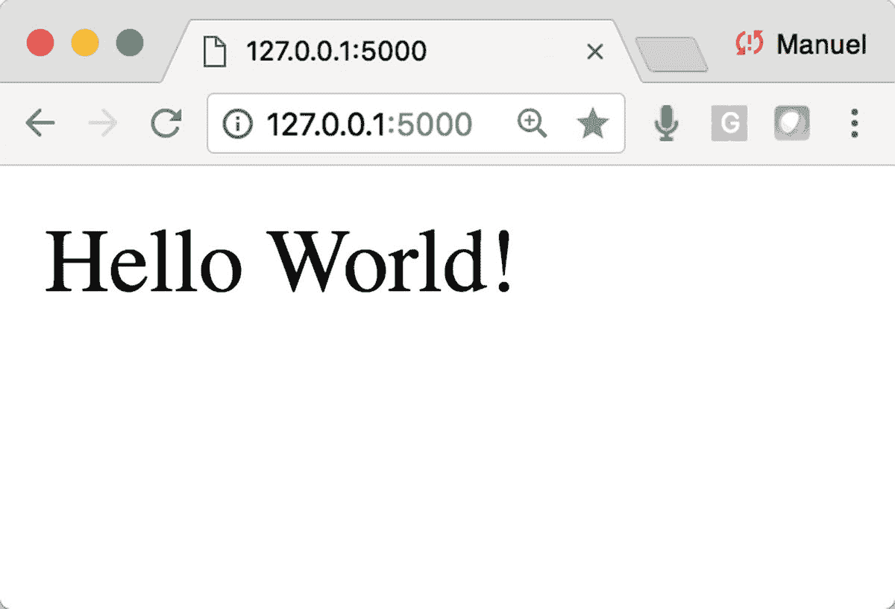
图 1-2：本地 Flask 应用程序按预期运行

### 第 6 步：更快捷的方式

就是这样，一个真正的服务器生成的网页。还有一种更简单的方法可以让您的 Flask 应用在本地启动并运行，只需在您的 `main.py` 脚本末尾添加以下两行代码。这仅在本地模式下有效，但允许脚本本身运行实例化的 Flask 应用程序，并允许您跳过导出步骤（列表 1-7）。

```python
if __name__ == '__main__':
    app.run(debug=True)
```

列表 1-7：在本地模式下自动启动 Flask 脚本

保存修改后的 `main.py` 脚本，它应该看起来像列表 1-8。

```python
from flask import Flask
app = Flask(__name__)
@app.route("/")
def hello():
    return "Hello World!"
if __name__=='__main__':
    app.run(debug=True)
```

列表 1-8：完整的 Flask 脚本

回到指向修改后脚本的命令/终端窗口，输入更短的版本（列表 1-9）。

```bash
$ python3 main.py
```

列表 1-9：启动本地 Flask 脚本的更简单命令

### 第 7 步：全部关闭

要停止 Web 应用程序提供“Hello World!”页面，请在终端窗口中按下 `ctrl-c`。

我们在脚本的最后一行将 `debug` 标志设置为 true。这将把脚本的任何 Flask 错误直接打印到浏览器中。这是快速开发和调试脚本的一个很棒的功能，但请记住在将其迁移到云端之前将其设置为 false。

最后，终止您的虚拟环境（列表 1-10）。

```bash
$ deactivate
```

列表 1-10：关闭虚拟环境

## 介绍 Microsoft Azure 上的无服务器托管

Azure 云为 Web 应用程序提供了一个易于使用、无服务器且完全托管的平台，具有从存储到数据库、监控和分析等大量可自定义选项（图 1-3）。


图 1-3：Microsoft Azure

让我们看看如何在 Microsoft Azure 的无服务器 Web 应用程序上运行我们的基本 Flask 应用程序。在这里，我们将尽可能简化步骤，因为我们将在后续章节中更深入地探讨这个提供商。

**注意**：通过访问 [`www.apress.com/9781484238721`](http://www.apress.com/9781484238721) 并点击源代码按钮，下载第 1 章的文件，然后打开 `serverless-hosting-on-microsoft-azure` 文件夹。

### 第 1 步：获取 Microsoft Azure 帐户

您需要一个 Microsoft Azure 帐户，在撰写本文时，Microsoft 为所有服务提供便捷的 200 美元 30 天试用期和 12 个月的访问权限。有关更多信息，请参阅：[`https://azure.microsoft.com/en-us/free/`](https://azure.microsoft.com/en-us/free/)。

### 第 2 步：下载源文件

将本章的文件下载到您的本地机器上，并导航到名为 `serverless-hosting-on-microsoft-azure` 的文件夹。您的本地文件夹结构应如下所示（注意 Flask 脚本 `main.py` 的名称，这是 Azure 上的默认名称；列表 1-11）。

```
serverless-hosting-on-microsoft-azure/
├── main.py
├── ptvs_virtualenv_proxy.py
├── requirements.txt
└── web.3.4.config
```

列表 1-11：在 Azure 上运行 Web 应用程序所需的所有文件

#### 支持文件

`requirements.txt` 文件保存了 Web 应用程序所需的 Python 库名称，并在应用程序部署期间由无服务器云使用。您可以创建自己的 `requirements.txt` 并将其与 Flask 脚本 `main.py` 放在同一个文件夹中。在这种情况下，它只包含一个库和一个版本要求（列表 1-12）。

```
Flask>=0.12
```

列表 1-12：我们 Web 应用程序的所有文件

“`web.3.4.config`”是 Web 服务器的配置文件。我们将使用 Python 3.4 版本并采用默认设置。如果您决定进一步探索这个云提供商，那么一定要打开它并查看内部。

### 步骤 3：安装 Git

对于这个项目，您需要在本地机器上安装 Git（您可以在 [`www.git-scm.com/downloads`](https://www.git-scm.com/downloads) 找到安装二进制文件）。如前所述，Git 是一个源代码版本控制工具，我们将把一个完全准备好的 Git 包推送到 Microsoft Azure（请参阅引言部分关于 Git 的简要介绍）。在大多数章节中，我们会创建一个虚拟环境来运行以下步骤，但由于这已经是一个大项目，我们将保持简单并跳过它。

打开您的终端/命令行窗口，将其指向本章的“`serverless-hosting-on-microsoft-azure`”文件夹，并初始化一个 Git 会话（列表 1-13）。

```
$ git init
列表 1-13
初始化 Git 会话
```

接下来，从“`serverless-hosting-on-microsoft-azure`”文件夹中添加所有 Web 应用程序文件，并检查其状态（列表 1-14 和图 1-4）。

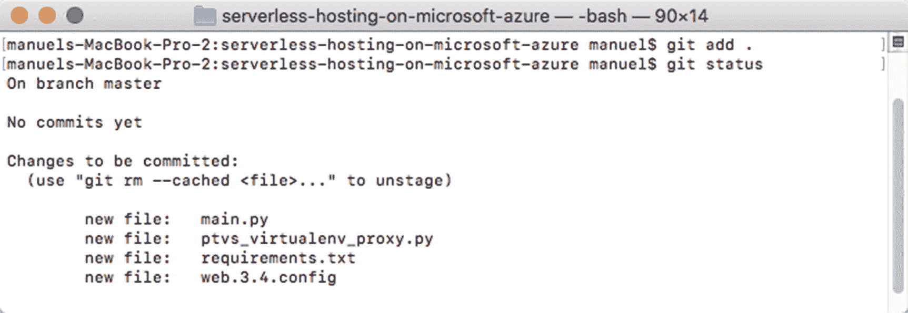

图 1-4

显示准备提交的 Web 应用程序文件

```
$ git add .
$ git status
列表 1-14
将文件夹中的所有文件添加到 Git 并检查状态
```

执行本地 Git 提交并添加一个有意义的注释，以便将来需要回顾过去的操作时使用（列表 1-15）。

```
$ git commit -am "Intro to Cloud Azure commit"
列表 1-15
将文件提交到 Git
```

所有需要的文件都在本地仓库中。有关 Git 部署到 Azure 应用服务的更多信息，请访问 [`https://docs.microsoft.com/en-us/azure/app-service/app-service-deploy-local-git`](https://docs.microsoft.com/en-us/azure/app-service/app-service-deploy-local-git) 。

### 步骤 4：打开 Azure Cloud Shell

登录你的 Microsoft Azure 仪表板，然后点击插入符号下划线（图 1-5）打开 Azure Cloud Shell。

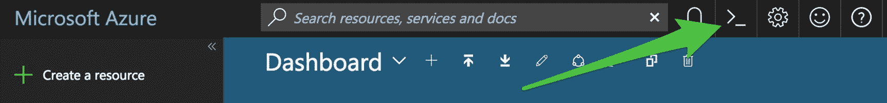

图 1-5

启动 Azure Cloud Shell

系统会提示你创建一个 Linux 或 PowerShell 窗口。选择 Linux，因为其命令与你本地终端窗口中的命令类似（图 1-6）。

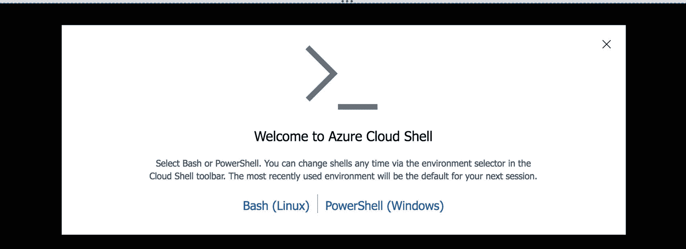

图 1-6

在 Bash (Linux) 或 PowerShell (Windows) 之间选择；选择你熟悉的 Linux

系统还会提示你创建存储，这是托管应用程序所必需的（图 1-7）。如果这是你第一次操作，你可能会在下拉菜单中看到“免费试用”选项。无论如何，选择它并创建存储。

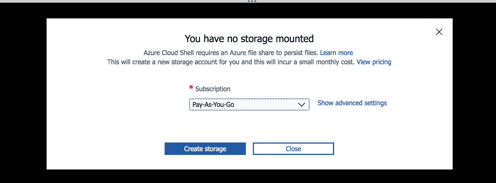

图 1-7

你需要创建一个存储库

### 步骤 5：创建部署用户

你现在应该已经进入了 Azure Cloud Shell。此用户将拥有 FTP 和本地 Git 使用的适当权限。这里我将用户名设置为“`flaskuser11`”，密码设置为“`flask123`”；请自行设定用户名并记住它，因为稍后你会用到（列表 1-16）。

```
$ az webapp deployment user set --user-name > --password flask123
列表 1-16
创建用户
```

该命令以及大多数后续命令的响应应类似于以下屏幕截图。请仔细检查是否有任何错误或问题，并相应地进行修复（列表 1-17）。

```
manuel@Azure:~$ az webapp deployment user set --user-name flaskuser11 --password flask123
{
"id": null,
"kind": null,
"name": "web",
"publishingPassword": null,
"publishingPasswordHash": null,
"publishingPasswordHashSalt": null,
"publishingUserName": "flaskuser11",
"type": "Microsoft.Web/publishingUsers/web",
"userName": null
}
列表 1-17
Azure“`webapp`”命令的响应格式
```

你输出的 JSON 应该充满 null 值；如果你看到“`conflict`”，说明你的“`user-name`”不唯一；如果你看到“`bad request`”，说明你的密码不符合要求（密码应至少包含八个字符，并由字母、数字或符号混合组成）。

### 步骤 6：创建资源组

这里我们为靠近你的位置创建一个资源组——在我的例子中是“West US”（有关位置，请参阅 [`https://azure.microsoft.com/en-us/regions/`](https://azure.microsoft.com/en-us/regions/) 或使用命令“`az appservice list-locations --sku FREE`”——参见列表 1-18）。

```
输入:
$ az group create --name myResourceGroup --location "West US"
输出:
manuel@Azure:~$ az group create --name myResourceGroup --location "West US"
{
"id": "/subscriptions/1e9ea6de-d6b9-44a5-b319-68b0ab52c2bc/resourceGroups/myResourceGroup",
"location": "westus",
"managedBy": null,
"name": "myResourceGroup",
"properties": {
"provisioningState": "Succeeded"
},
"tags": null
}
列表 1-18
创建资源组及响应
```

### 步骤 7：创建 Azure 服务计划

创建你的 Azure 服务计划。将名称设置为“`myAppServicePlan`”（你可以随意命名；列表 1-19）。

```
输入:
$ az appservice plan create --name myAppServicePlan --resource-group myResourceGroup --sku FREE
截断的输出:
manuel@Azure:~$ az appservice plan create --name myAppServicePlan --resource-group myResourceGroup --sku FREE
{
"adminSiteName": null,
"appServicePlanName": "myAppServicePlan",
"geoRegion": "West US",
"hostingEnvironmentProfile": null,
"id": "/subscriptions/1e9ea6de-d6b9-44a5-b319-68b0ab52c2bc/resourceGroups/myResourceGroup/providers/Microsoft.Web/serverfarms/myAppServicePlan",
"isSpot": false,
"kind": "app",
"location": "West US",
"maximumNumberOfWorkers": 1,
"name": "myAppServicePlan",
"numberOfSites": 0,
"perSiteScaling": false,
"provisioningState": "Succeeded"
...
列表 1-19
创建服务计划及成功响应
```

### 步骤 8：创建 Web 应用

# 创建和部署 Flask Web 应用至 Microsoft Azure

接下来，创建一个 Web 应用，并将名称参数设置为你应用程序的名称（必须唯一）。我将我的应用命名为“`AmunateguiIntroWebApp`”，并告知 Web 应用代码将通过本地 Git 部署（列表 1-20）。

```
$ az webapp create --resource-group myResourceGroup --plan myAppServicePlan --name > --runtime "python|3.4" --deployment-local-git
列表 1-20
创建 Web 应用（将此替换为你的应用名称）
```

检查`az web app create`命令返回的长响应字符串，并复制“Local git is configured with url of…”后面的链接，或者从`deploymentLocalGitUrl`值中复制——两者相同，选择最容易获取的那个。当你将 Flask 文件推送到 Azure 时，你将需要这个链接（列表 1-21）。

```
Local git is configured with the URL 'https://flaskuser11@amunateguiintrowebapp.scm.azurewebsites.net/AmunateguiIntroWebApp.git'
{
"availabilityState": "Normal",
"clientAffinityEnabled": true,
"clientCertEnabled": false,
"cloningInfo": null,
"containerSize": 0,
"dailyMemoryTimeQuota": 0,
"defaultHostName": "amunateguiintrowebapp.azurewebsites.net",
"deploymentLocalGitUrl": "https://flaskuser11@amunateguiintrowebapp.scm.azurewebsites.net/AmunateguiIntroWebApp.git",
...
列表 1-21
复制你的 Git URL；稍后你会用到
```

提取你的 Azure 项目的本地 Git 配置 URL（列表 1-22 和 1-23）。

```
https://>@>.scm.azurewebsites.net/>.git
列表 1-23
你的 URL 将类似于以下格式
```

```
https://flaskuser11@amunateguiintrowebapp.scm.azurewebsites.net/AmunateguiIntroWebApp.git
列表 1-22
我的案例中提取的 Git URL
```

## 检查你的网站占位符

如果一切正常，你应该能够访问占位符网站。将“`<<REPLACE-WITH-YOUR-APP-NAME>>`”替换为你在`az webapp create`步骤中创建的应用程序名称，并将其输入到你的浏览器中（列表 1-24 和图 1-8）。

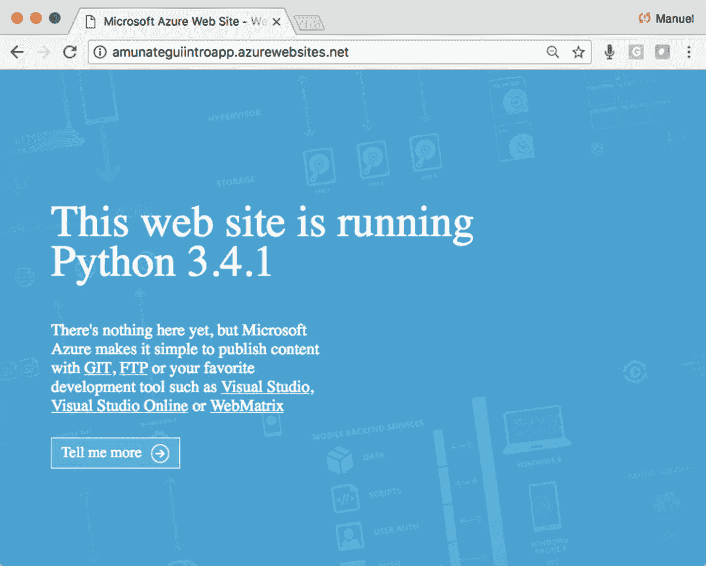
*图 1-8 确认你的网站占位符已创建并正在运行*

```
http://>.azurewebsites.net
列表 1-24
检查你的 Web 占位符
```

如果这不起作用，你需要重新检查每一步，确保没有遗漏任何步骤，或者没有返回需要处理的错误。

### 步骤 9：推送 Web 应用程序

现在，回到你本地计算机上的本地终端/命令窗口，确保指向正确的目录，并且我们之前创建的 Git 会话已初始化。将我们之前保存的 URL（包含你的 GIT 仓库位置）附加到`add azure`命令中（列表 1-25）。

```
$ git remote add azure https://flaskuser11@amunateguiintrowebapp.scm.azurewebsites.net/AmunateguiIntroWebApp.git
列表 1-25
最终代码推送到 Azure
```

它可能会提示你输入密码；请确保使用你在`az webapp deployment user`步骤中创建的密码（在我的例子中是`flask123`；列表 1-26）。

```
$ git push azure master
列表 1-26
最终代码推送到 Azure
```

### 步骤 10：在浏览器中查看

大功告成！您可以返回占位浏览器页面并点击刷新（或打开新浏览器页面，输入 `http://<<REPLACE-WITH-YOUR-APP-NAME>>.azurewebsites.net`），应该就能看到“`Hello World！`”；如图 1-9 所示。

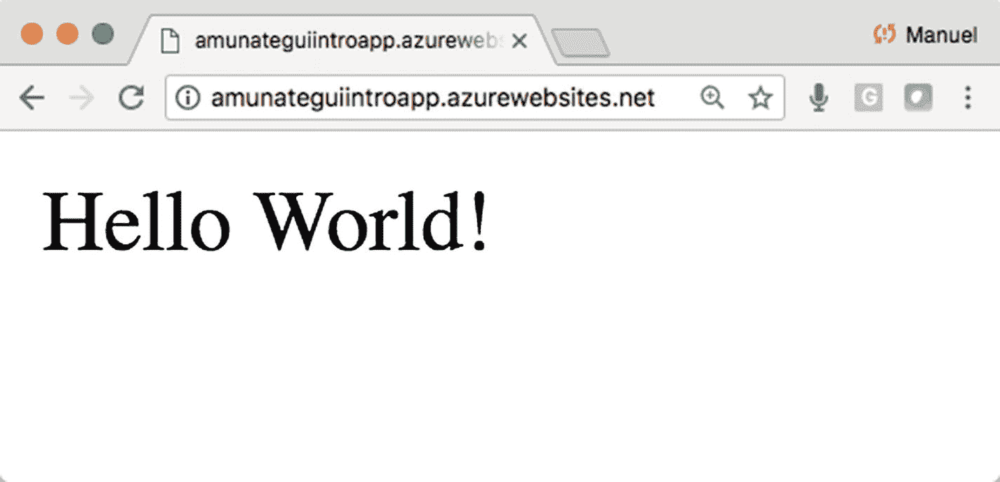
*图 1-9 Flask 应用成功在 Amazon Azure 上运行*

如果您没有看到“`Hello World！`”页面，可以直接在命令窗口中访问日志尾部——只需将名称替换为网站名称（本例中为`amunateguiintroapp`），并将资源组替换为您的资源组（本例中为`myResourceGroup`）；参见清单 1-27。

```
$ az webapp log tail --resource-group myResourceGroup --name amunateguiintroapp
清单 1-27
最终代码推送到 Azure
```

### 步骤 11：别忘了删除您的 Web 应用！

如果您不再使用 Web 应用，请务必将其删除。否则，计费会持续运行，消耗积分或产生费用。删除所有内容最简单的方法是登录 Azure 仪表板，在搜索栏中输入“所有资源”，然后删除您创建的所有内容（图 1-10）。

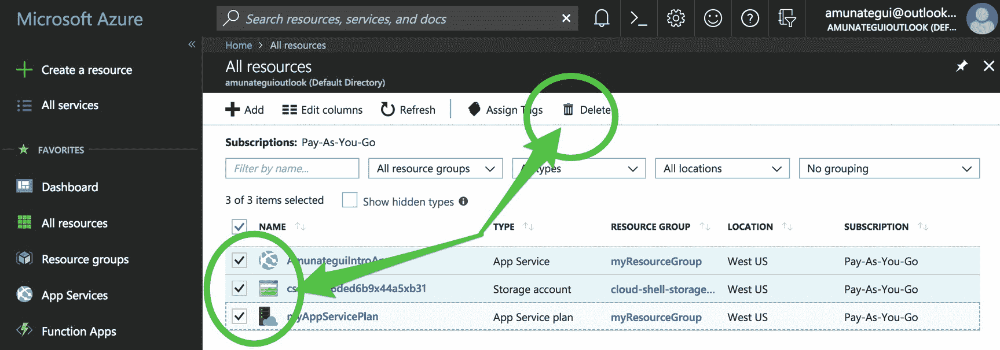
*图 1-10 删除应用以避免产生额外费用*

## 结论与补充信息

Microsoft Azure 是一个功能强大的云服务提供商，提供众多服务。它可以运行简单的 Flask 应用并快速部署。若要加载更复杂的库，您需要 Python wheels 的支持（[`https://pythonwheels.com/`](https://pythonwheels.com/)）。

更多信息，请参阅 Microsoft Azure 文档中一篇题为“在 Azure 中创建 Python Web 应用”的精彩文章，本节内容即基于该文章：[`https://docs.microsoft.com/en-us/azure/app-service/app-service-web-get-started-python`](https://docs.microsoft.com/en-us/azure/app-service/app-service-web-get-started-python)。

# 在 Google Cloud 上引入无服务器托管

Google Cloud 是一个用于构建、管理和部署 Web 应用的强大平台。它与 TensorFlow 及其分布式图机制无缝集成（图 1-11）。


*图 1-11 Google Cloud*

让我们看看如何在 Google Cloud 的无服务器 App Engine 上运行基本的 Flask 应用。我们将尽可能简化步骤，后续章节会深入介绍该服务提供商。

## 注意

通过访问 [`www.apress.com/9781484238721`](http://www.apress.com/9781484238721) 并点击源代码按钮，下载第 1 章的文件，然后打开“`serverless-hosting-on-google-cloud`”文件夹。

### 步骤 1：获取 Google Cloud 账户

在撰写本文时，Google 提供便捷的 12 个月、300 美元免费试用额度，助您入门。更多信息，请参见 [`https://console.cloud.google.com/start`](https://console.cloud.google.com/start)。

您可以选择两种 App Engine：“标准环境”简单但可定制性较低，“灵活环境”则几乎可以处理您投入的任何内容。本节我们将使用简单的“标准环境”。

### 步骤 2：下载源文件

将本章文件下载到本地机器，并导航至名为“`serverless-hosting-on-google-cloud`”的文件夹（清单 1-28）。

### Google Cloud 上 Web 应用所需的所有文件

```
serverless-hosting-on-google-cloud/
├── app.yaml
├── appengine_config.py
├── main.py
└── requirements.txt
清单 1-28
Google Cloud 上 Web 应用所需的所有文件
```

`app.yaml`声明了控制 Flask Python 应用（本例中为`main`）的位置，以及静态文件和模板文件夹的位置（清单 1-29）。

```
runtime: python27
api_version: 1
threadsafe: true
handlers:
- url: /static
static_dir: static
- url: /.*
script: main.app
- url: /favicon.ico
static_files: static/images/favicon.ico
upload: static/images/favicon.ico
libraries:
- name: ssl
version: latest
清单 1-29
查看 app.yaml
```

`appengine_config.py`指向 lib 文件夹，用于在部署期间存放额外的 Python 库（清单 1-30）。

```
from google.appengine.ext import vendor

# 添加安装在“lib”文件夹中的任何库
vendor.add('lib')
清单 1-30
查看“appengine_config.py”
```

`requirements.txt`包含要安装并添加到 lib 文件夹的 Python 库名称及版本（清单 1-31）。

```
Flask>=0.12
清单 1-31
“requirements.txt”的内容
```

`main.py`是 Flask 操作的核心，包含所有 Python 代码以及每个 HTML 页面的指令（清单 1-32）。

```
from flask import Flask
app = Flask(__name__)
@app.route("/")
def hello():
return "Hello World!"
清单 1-32
“main.py”的内容
```

### 第 3 步：打开 Google Cloud Shell

登录您的 Google Cloud 实例，选择您希望 App Engine 所在的项目（如果没有项目，请参阅“创建和管理项目”：[`https://cloud.google.com/resource-manager/docs/creating-managing-projects`](https://cloud.google.com/resource-manager/docs/creating-managing-projects)）。点击右上角的插入符号按钮启动云 Shell 命令行工具。这将在 GCP 仪表板的下半部分打开一个熟悉的命令行窗口（图 1-12）。

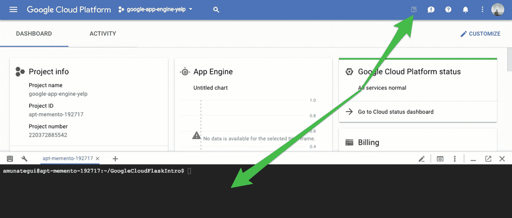

图 1-12

启动 Google Cloud Shell

在 GCP 仪表板的终端部分，创建一个名为`GoogleCloudFlaskIntro`的新文件夹（清单 1-33）。

```
$ mkdir GoogleCloudFlaskIntro
$ cd GoogleCloudFlaskIntro
清单 1-33
在 GCP 中创建目录
```

### 第 4 步：将 Flask 文件上传至 Google Cloud

有多种方法可供选择：你可以逐个上传文件、克隆 GitHub 仓库，或者将它们压缩成一个归档文件后一次性上传。我们将采用后者。因此，请仅将以下四个文件：`app.yaml`、`appengine_config.py`、`main.py`和`requirements.txt`压缩成一个归档文件（图 1-13）。

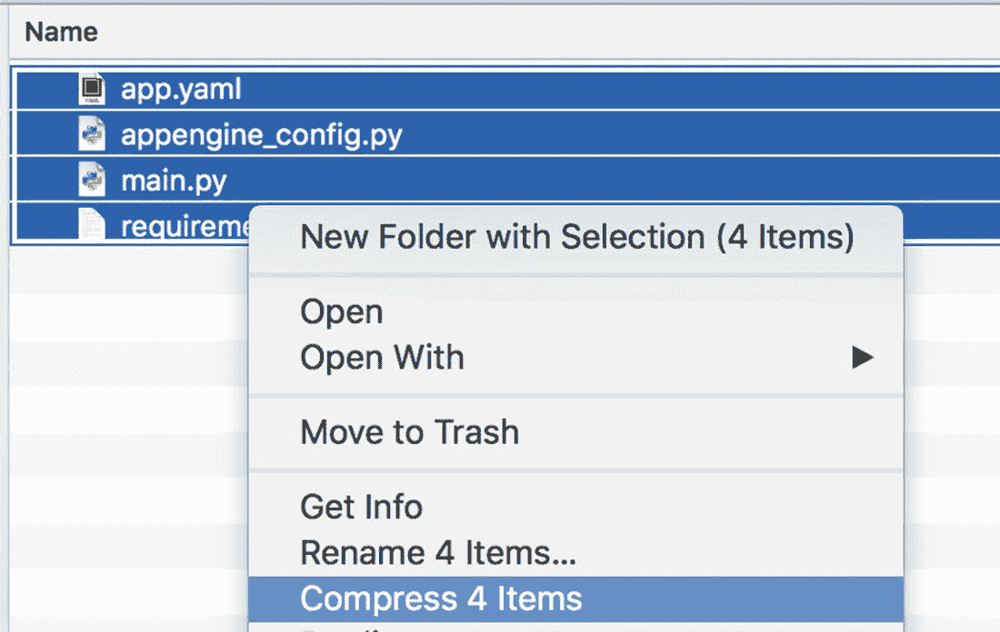

图 1-13

压缩 Web 应用程序文件以便上传至 Google Cloud

使用`上传文件`选项进行上传（该选项位于 Shell 窗口右上角三个垂直点下方，见图 1-14）。

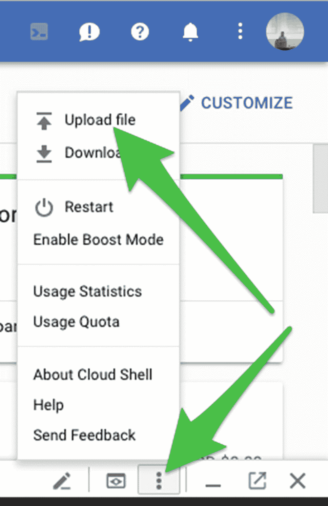

图 1-14

通过 Google Cloud Shell 上传文件

它会将文件（本例中名为`Archive.zip`）上传到根目录，因此你需要将其移动到`GoogleCloudFlaskIntro`文件夹中并解压（列表 1-34）。

```
$ mv ../Archive.zip Archive.zip
$ unzip Archive.zip
列表 1-34
移动并解压 Web 应用程序文件
```

运行`pip install -t lib`命令，安装`requirements.txt`文件中的所有库（列表 1-35）。这将创建必要的`lib`文件夹，其中包含所有需要的 Python 库（如果不使用`sudo`获取 root 权限，可能会收到一些警告，但请勿滥用权限！）。

```
$ sudo pip3 install -t lib -r requirements.txt
列表 1-35
用必要的 Python 库填充 lib 目录
```

此时，如果你运行`ls`命令，云中的文件夹目录应如下所示（列表 1-36）。

```
输入：
$ ls
输出：
$ appengine_config.py app.yaml Archive.zip lib main.py requirements.txt
列表 1-36
检查 GCP 上“GoogleCloudFlaskIntro”文件夹的内容
```

### 第 5 步：在 Google Cloud 上部署你的 Web 应用程序

我们现在准备部署`Hello World`站点。在仪表板 Shell 窗口的`GoogleCloudFlaskIntro`文件夹下，调用`gcloud app deploy`命令。系统会要求你确认是否确实要部署到`—`，我们输入`Y`确认（列表 1-37）。

```
输入：
$ gcloud app deploy app.yaml
截断输出：
...
文件上传完成。
正在更新服务 [default]...完成。
正在为服务 [default] 设置流量分配...完成。
已将服务 [default] 部署到 [https://apt-memento-192717.appspot.com]
列表 1-37
部署 Web 应用程序
```

```
要在 Web 浏览器中查看你的应用程序，请运行：
$ gcloud app browse
```

如果一切顺利，你可以调用便捷的`gcloud app browse`命令来获取完整的 URL（列表 1-38）。

```
输入：
$ gcloud app browse
输出：
未检测到您的浏览器。请访问此链接查看您的应用：
https://apt-memento-192717.appspot.com
列表 1-38
获取 Web 应用程序的 URL 地址
```

点击 Google Cloud Shell 中的链接，或将其粘贴到浏览器中（图 1-15）。

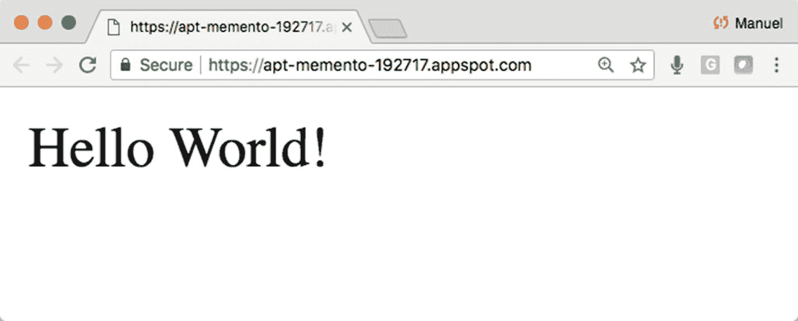

图 1-15

Flask 应用程序成功在 Google Cloud 上运行

### 第 6 步：别忘了删除你的 Web 应用程序！

如果你不再使用 Web 应用程序，请务必将其删除。否则，计费会持续运行并产生费用。如果这是你唯一的应用程序，你不能直接将其完全删除（你需要有一个默认应用程序），相反，你应该将流量重定向到一个空白应用程序。

在 Google Cloud Shell 中，输入 Linux 文本编辑器`vi`（列表 1-39）。

```
$ vi app.yaml
列表 1-39
编辑“app.yaml”文件
```

这将打开一个小型命令行编辑器；然后按`i`键插入或编辑文件（列表 1-40 和 1-41）。

```
script: main.app
列表 1-40
向下滚动并替换“main.app”
```

```
script: blank.app
列表 1-41
替换为“blank.app”
```

你的`app.yaml`文件现在应该将其`url`处理程序指向`blank.app`。这将阻止 GCP 提供任何服务，因为`blank.app`不存在，从而停止产生费用（列表 1-42）。

# 在 Google Cloud Platform 上部署无服务器 Web 应用程序


```yaml
runtime: python27
api_version: 1
threadsafe: true
handlers:
- url: /static
static_dir: static
- url: /.*
script: blank.app
- url: /favicon.ico
static_files: static/images/favicon.ico
upload: static/images/favicon.ico
libraries:
- name: ssl
version: latest
```
列表 1-42
将 Yaml 文件指向一个空白脚本

按 Escape 键退出插入模式，然后输入“`wq`”保存并退出。然后重新部署你的 Web 应用程序（列表 1-43）。

```bash
$ gcloud app deploy app.yaml
```
列表 1-43
重新部署空白 Web 应用程序

在 App Engine 完成传播后，URL 应显示错误信息，而不是“`Hello World`”（图 1-16）。

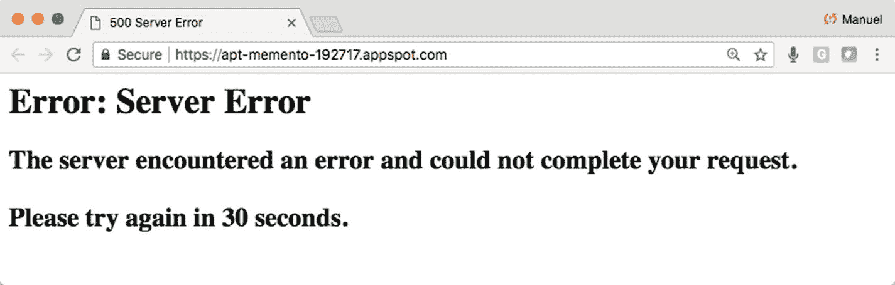

图 1-16
错误信息确认你的站点已下线

## 结论与补充信息

GCP 提供了许多功能，并且与其他 Google 产品（例如其出色的 Cloud API，位于 [`https://cloud.google.com/apis/`](https://cloud.google.com/apis/) ）以及 TensorFlow 紧密集成。如果你需要使用更强大的 Python 库，可以从标准 App Engine 切换到 Flexible 环境。

如需更多信息，请参阅 Google Cloud Docs 上题为“`Quickstart for Python App Engine Standard Environment`”的便捷文章，网址为：[`https://cloud.google.com/appengine/docs/standard/python/quickstart`](https://cloud.google.com/appengine/docs/standard/python/quickstart)

顺便提一下，如果你的 Google Cloud App Engine 遇到任何问题，可以使用以下命令访问日志（列表 1-44）。

```bash
$ gcloud app logs tail -s default
```
列表 1-44
查看部署日志

## 在 Amazon AWS 上介绍无服务器托管

AWS Elastic Beanstalk 是一个简单而强大的 Web 应用程序部署平台。它配备了所有便利功能，如扩展、负载均衡、监控等。它仅对使用的资源收费（图 1-17）。


图 1-17
Amazon Web Services

让我们看看如何在 Amazon 的 AWS Elastic Beanstalk 上运行我们的基本 Flask 应用程序。我们将尽可能简化步骤，因为在后续章节中我们会更深入地研究这个提供商。

### 注意

通过访问 [`www.apress.com/9781484238721`](http://www.apress.com/9781484238721) 并点击源代码按钮，下载第 1 章的文件，然后打开“`serverless-hosting-on-amazon-aws`”文件夹。

### 第 1 步：在 Amazon AWS 上获取账户

Amazon AWS 提供“`AWS Free Tier`”账户，允许你免费试用其部分服务。有关创建账户的更多信息，请访问：[`https://aws.amazon.com/free/`](https://aws.amazon.com/free/) 。

### 第 2 步：下载源文件

将本章的文件下载到本地机器，并导航到名为“`serverless-hosting-on-amazon-aws`”的文件夹。文件夹结构应如列表 1-45 所示。

```
serverless-hosting-on-amazon-aws/
├── application.py
└── requirements.txt
```
列表 1-45
AWS Elastic Beanstalk 上 Web 应用程序所需的所有文件

### 步骤 3：为 Elastic Beanstalk 创建访问账户

登录 AWS 管理控制台，进入“身份与访问管理 (IAM)”控制台。快速进入的方法是在登录页面的 AWS 服务搜索框中直接输入“`IAM`”。在导航部分选择“`用户`”，然后点击“`添加用户`”按钮（图 1-18）。

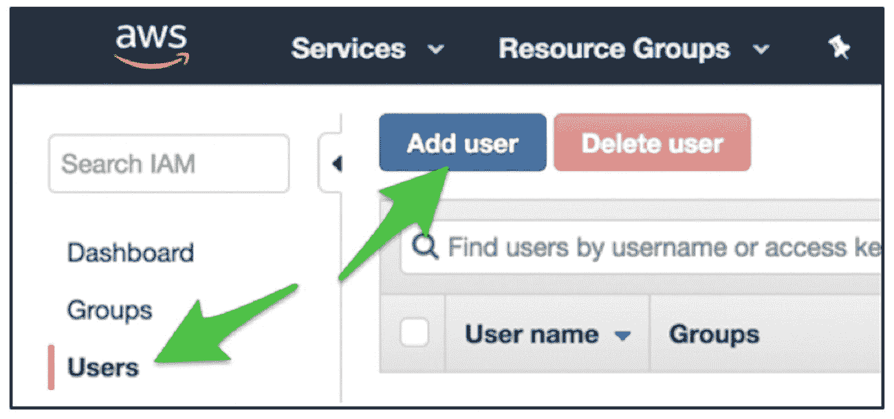

图 1-18
通过访问管理控制台添加用户

选择一个用户名——这里我们输入“`ebuser`”，并勾选“`访问类型：编程访问`”（图 1-19）。

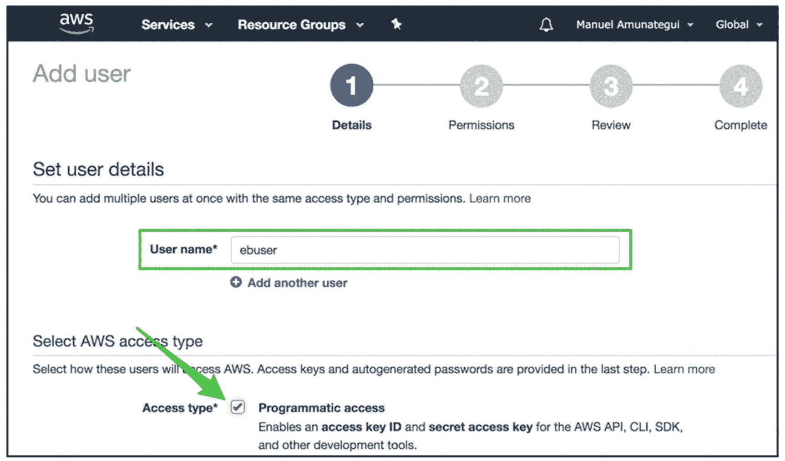

图 1-19
为“`ebuser`”添加正确的访问权限

点击蓝色的“`下一步：权限`”按钮。这将带你进入“`设置权限`”页面；点击“`将用户添加到组`”这个大菜单按钮，然后点击“`创建组`”。创建一个组名，此处为“`ebadmins`”，并为其分配策略名称“`WSElasticBeanstalkFullAccess`”。然后点击“`创建组`”按钮完成组的创建（图 1-20）。

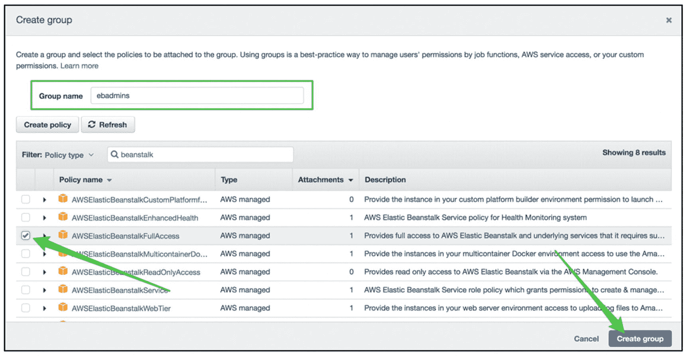

图 1-20
创建具有“`WSElasticBeanstalkFullAccess`”访问权限的组

点击蓝色的“`下一步：审核`”按钮，在接下来的页面上，点击蓝色的“`创建用户`”按钮（图 1-21）。

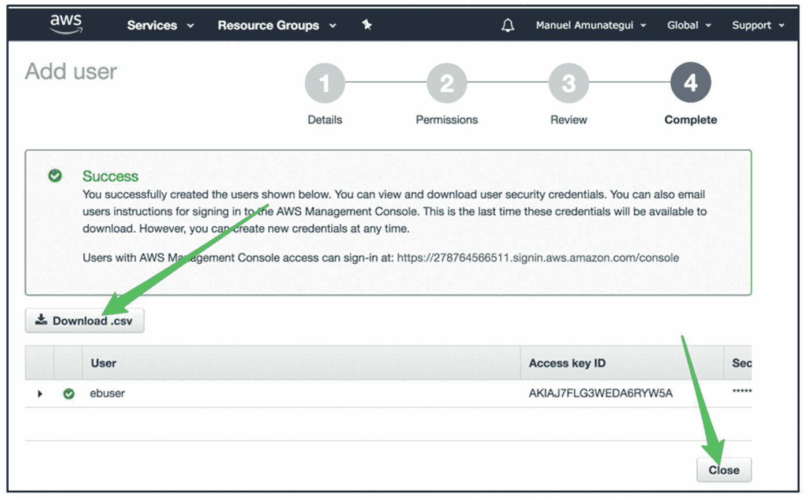

图 1-21
成功创建用户后下载访问密钥

一旦看到“`成功`”消息，就意味着你已成功创建了“`ebuser`”账户。确保通过点击“`下载 .csv`”按钮将“`.csv`”文件下载到本地机器。此文件很重要，因为它包含你的密钥和秘密代码。将其存储在本地机器上一个已知的位置，因为你将需要这些信息来上传 Web 应用程序代码，并通过安全外壳 (SSH) 连接到你的 EB（本节中我们不需要 SSH，但在后续章节中会用到）。

### 步骤 4：安装 Elastic Beanstalk (EB)

首先创建一个虚拟环境来隔离安装。这不是强制性的，但它有助于通过将此环境与机器上的其他环境分开，来保持整洁有序（如果尚未安装，请参阅前面名为“`虚拟环境`”的部分）；参见代码清单 1-46。

```bash
$ python3 -m venv amazon_aws_intro
$ source amazon_aws_intro/bin/activate
```
代码清单 1-46
启动虚拟环境

安装“`awsebcli`”库，以便与 AWS 上的 EB 服务进行交互和管理（代码清单 1-47 和 1-48）。

```bash
$ pip3 install awscli –-user
$ pip3 install awsebcli --user
```
代码清单 1-48
适用于 Windows（如果提示“`user`”参数错误，请尝试不带该参数）

```bash
$ pip3 install awscli
$ pip3 install awsebcli
```
代码清单 1-47
适用于 Mac 和 Linux 用户

### 步骤 5：EB 命令行界面

现在是时候初始化 Elastic Bean 界面了（代码清单 1-49）。

```bash
$ eb init -i
```
代码清单 1-49
启动 Elastic Beanstalk 命令行界面

这会询问你一系列问题，你可以接受大部分默认设置。在“`输入应用程序名称`”下，输入“`AWSBeanstalkIntroduction`”（图 1-22）。

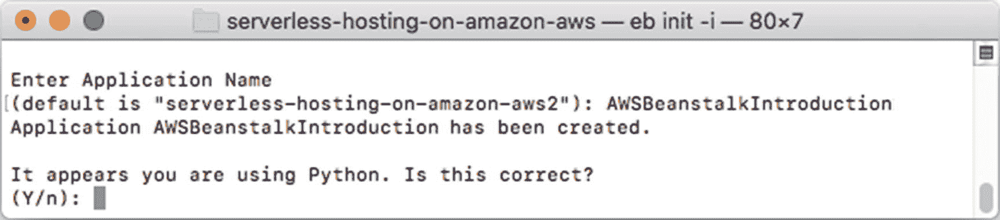

图 1-22
创建一个新的 EB 应用程序

如果这是你第一次在计算机上运行 AWS，它会要求你提供凭证。打开创建用户时下载到机器上的“`credentials.csv`”文件，并输入所需的两个字段（图 1-23）。


# 在云上部署 Flask 应用

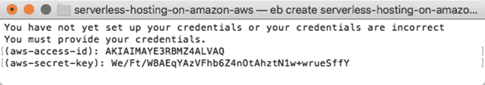
图 1-23：输入你的凭证

使用 Python 默认设置（需要是 `3.x` 版本）；忽略警告。对 SSH 选择“是”（图 1-24）。


图 1-24：开启 SSH 设置

创建一个新的密钥对或选择一个现有的，然后继续使用默认设置。如果你创建了一个新的密钥对，它将被保存在一个文件夹中，并告知你位置（图 1-25）。

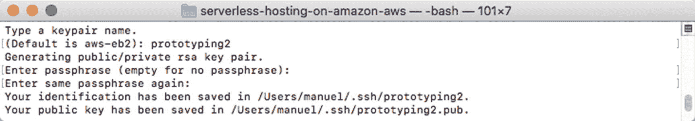
图 1-25：创建或重用 RSA 密钥对

接下来，你需要创建你的 EB（名称必须唯一）。此命令会自动压缩文件夹中的数据并将其上传到 AWS 云（代码清单 1-50 和 1-51）。这可能需要几分钟，请耐心等待。

```
$ eb create AWSBeanstalkIntroduction
```
代码清单 1-50：创建你的 EB 并上传到 AWS

```
$ eb create >>
```
代码清单 1-51：本例中的 EB

### 步骤 6：试运行

这需要几分钟时间，如果一切顺利，你应该会收到一条成功消息。然后，你可以直接使用 `eb open` 命令来实时查看 Web 应用程序（代码清单 1-52）。

```
$ eb open AWSBeanstalkIntroduction
```
代码清单 1-52：启动你的 Web 应用程序

第一次运行应用程序可能需要一点时间，甚至可能超时。如果超时，请再运行一次 `eb open`（图 1-26）。

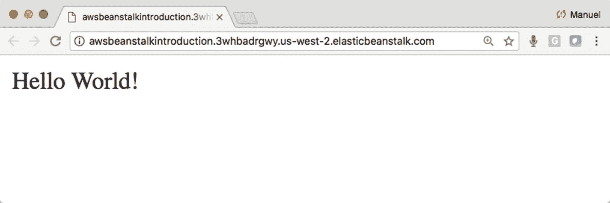
图 1-26：Flask 应用程序在 Amazon AWS 上成功运行

如果事情进展不顺利，请检查日志以查找任何错误消息（代码清单 1-53）。

```
$ eb logs
```
代码清单 1-53：出现问题时访问日志

### 步骤 7：别忘了关闭它！

最后，我们需要终止 Beanstalk 实例，以免产生额外费用。这是一个重要的提醒：大多数云服务都不是免费的。系统会要求你输入环境名称；在我的例子中是 `AWSBeanstalkIntroduction`（代码清单 1-54）。

```
$ eb terminate AWSBeanstalkIntroduction
$ deactivate
```
代码清单 1-54：别忘了终止你的 EB 并停用你的虚拟环境

这需要几分钟时间，但会使网站下线。最好在你的 AWS 仪表板上仔细检查所有服务是否确实已关闭。这很容易做到：只需登录你的 AWS 账户 [https://aws.amazon.com/](https://aws.amazon.com/) ，并确保你的 EC2 和 Elastic Beanstalk 账户没有你未计划使用的任何活动服务（图 1-27）。如果你发现某个实例在你每次“终止”它之后似乎又复活了，请检查 EC2 下的“负载均衡器”，先终止它们，然后再终止实例。

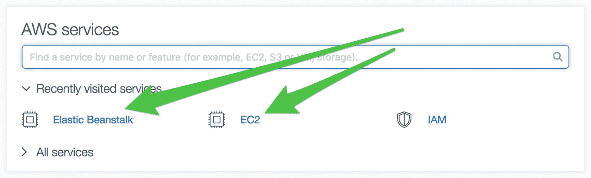
图 1-27：检查 Amazon AWS 仪表板，确保没有不需要的服务仍在运行

### 结论与补充信息

毫无疑问，AWS 是云服务领域的领导者。它可能不是最简单或最便宜的，但它几乎可以满足你提出的任何要求。

有关更多信息，请参阅 Amazon AWS 文档中题为“将 Flask 应用程序部署到 AWS Elastic Beanstalk”的便捷文章，网址为 [https://docs.aws.amazon.com/elasticbeanstalk/latest/dg/create-deploy-python-flask.html](https://docs.aws.amazon.com/elasticbeanstalk/latest/dg/create-deploy-python-flask.html) 。

# 在 PythonAnywhere 上托管简介

PythonAnywhere 是在互联网上快速原型化你的 Python 交互式想法和模型的绝佳方式。它专为 Python 相关的一切而集成和设计！它并非传统意义上的无服务器，但它是一个专用的 Python 框架，注册无需信用卡，并且可以快速构建概念验证（图 1-28）。


图 1-28：PythonAnywhere

事实胜于雄辩；本项目无需编写任何代码，因为当你启动一个实例时，PythonAnywhere 默认已经提供了一个 `Hello World` 示例。

### 步骤 1：在 PythonAnywhere 上获取账户

在 [PythonAnywhere.com](http://pythonanywhere.com) 上注册一个免费账户并登录（你需要确认你的电子邮件地址）。

### 步骤 2：设置 Flask Web 框架

让我们使用 Flask Web 服务平台在 PythonAnywhere 上创建一个 Web 服务器。这非常简单。在 `Web` 选项卡下，点击蓝色的 `Add a new web app` 按钮。然后一直接受默认设置，直到进入“选择 Python Web 框架”页面，点击 `Flask`，然后选择最新的 Python 框架（图 1-29）。

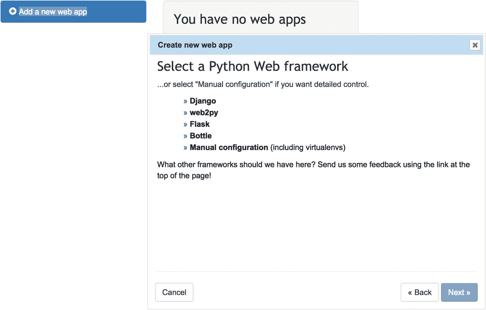
图 1-29：在 PythonAnywhere 上添加新的 Web 应用

你将进入配置登录页面，点击绿色的 `Reload your account.pythonanywhere.com` 按钮，然后测试你的新 URL（图 1-30）。

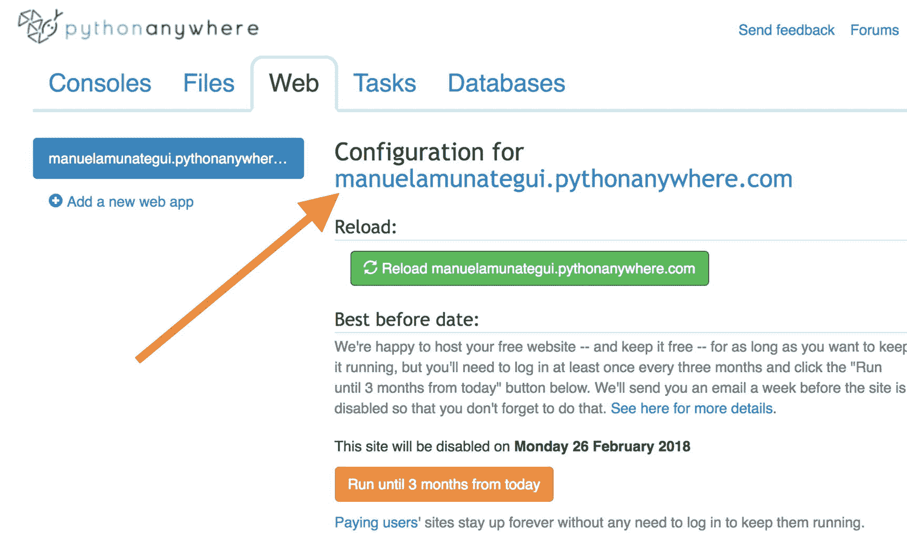
图 1-30：在 Web 选项卡下访问网站配置

你应该会看到一个简单但真实的网页，上面直接显示着 `Hello from Flask!` 消息（图 1-31）。

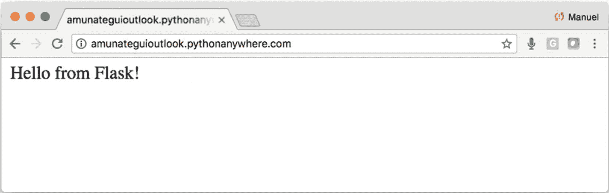
图 1-31：Flask 应用在 PythonAnywhere 上成功运行

### 结论与附加信息

PythonAnywhere 可能不是一个 100% 的无服务器云提供商，但它提供免费的基本托管服务。它是最易于使用的，并且可以直接从其在线仪表板运行。这在旅行时是一个很好的选择。

如需获取丰富的帮助文档和分步指南，请参阅 [https://help.pythonanywhere.com/pages/](https://help.pythonanywhere.com/pages/) 。

# 总结

如果你读到了这里，做得很好！我们已经介绍了一个使用 Flask 的非常简单的独立 Web 应用，并将其部署到了四个云提供商上。请注意，将 Web 应用上传到每个云提供商的方法可能会有所不同，因为他们会不时地在这里或那里进行一些更改。密切关注文档至关重要。

是时候卷起袖子，开始处理一些更有趣、更复杂的 Web 应用了！

脚注 1