# 2. 在 Azure 上使用回归系数的客户端智能

让我们构建一个交互式 Web 应用，使用 Microsoft Azure 上的回归系数来理解自行车租赁需求。

对于我们的第一个项目，我们将使用回归建模来模拟来自 Capital Bikeshare 系统的自行车共享数据集，并了解温度、风和时间等变量如何影响美国中大西洋地区的自行车租赁（图 2-1）。

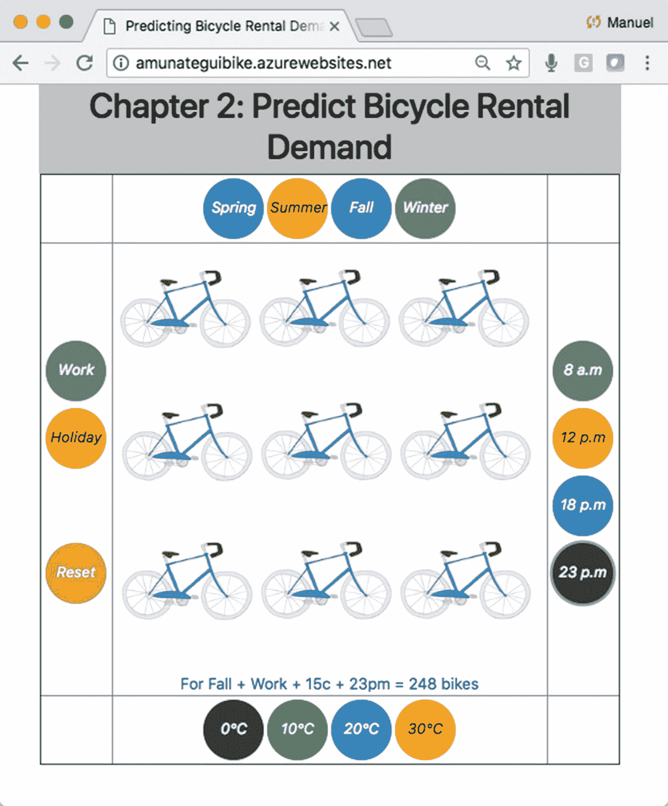

图 2-1

本章的最终 Web 应用

该数据由加州大学欧文分校的 UCI 机器学习库慷慨提供（ [`https://archive.ics.uci.edu/ml/datasets/bike+sharing+dataset`](https://archive.ics.uci.edu/ml/datasets/bike+sharing+dataset) ）。

### 注意

通过访问 [`www.apress.com/9781484238721`](http://www.apress.com/9781484238721) 并点击源代码按钮，下载第 2 章的文件。打开 Jupyter notebook “**chapter2.ipynb**” 以跟随本章内容。

## 使用回归系数理解自行车租赁需求

我们将构建一种简单且视觉直观的方式来与不同的环境因素进行交互，并观察它们如何影响自行车租赁。这对于用户来说是一种很好的方式，可以确认他们对什么因素会促使人们骑自行车或不骑自行车的直观假设，并且在某些情况下，也会让他们感到惊讶（比如看到冬季的骑行者比夏季多`——`但我让你自己去发现这一点）。

这个 Web 应用背后的“**大脑**”是一个线性回归模型。它能够找到结果变量与历史数据之间的线性关系。我们将利用这一能力，让它学习不同环境因素下随时间变化的自行车租赁需求，并看看它是否能帮助我们预测未来的需求。

每当你将一个 Python 模型扩展到 Web 时，在添加构建 Web 应用所需的额外层之前，先在本地解决所有问题和错误至关重要。在将任何内容迁移到云端之前，先解决所有简单的问题！遵循这条建议将为你省去很多麻烦。

## 探索自行车共享数据集

自行车共享非常流行，尽管它仍然新颖且处于实验阶段。骑行者可以使用手机在线注册、下载手机应用、定位自行车并租用一辆。这种模式创建了一个完整的生态系统，任何人都无需当面交谈或会面即可开始享受这项服务。根据人工智能与决策支持实验室的 Hadi Fanaee-T（摘自 UCI 机器学习库数据集信息的附注）：

> *与公共汽车或地铁等其他交通服务不同，这些系统会明确记录行程的持续时间、出发和到达位置。这一特性将*[*一个*]*自行车共享系统转变为一个虚拟传感器网络，可用于感知城市中的移动性。因此，预计城市中的大多数*[*重要*]*事件都可以通过监测这些数据来检测到。*^(⁵)

下载内容包含两个数据集：“**hour.csv**”和“**day.csv**”。特征详情见表 2.1。^(⁶)

表 2-1

自行车共享数据图例

| 特征名称 | 描述 |
| --- | --- |
| **instant** | 记录索引 |
| **dteday** | 日期 |
| **season** | 季节 (1: 春季, 2: 夏季, 3: 秋季, 4: 冬季) |
| **yr** | 年份 (0: 2011, 1:2012) |
| **mnth** | 月份 (1 到 12) |
| **hr** | 小时 (0 到 23) |
| **holiday** | 是否为节假日 |
| **weekday** | 星期几 |
| **workingday** | 如果当天既不是周末也不是节假日则为 1，否则为 0。 |
| **weathersit** | 1. 晴朗，少云，局部多云 2. 薄雾 + 多云，薄雾 + 碎云，薄雾 + 少云，薄雾 3. 小雪，小雨 + 雷暴 + 疏云，小雨 + 疏云 4. 大雨 + 冰雹 + 雷暴 + 薄雾，雪 + 雾 |
| **temp** | 归一化摄氏温度。值通过 (t-t_min)/(t_max-t_min) 计算得出，t_min = -8, t_max = +39（仅限小时尺度）。 |
| **atemp** | 归一化体感摄氏温度。值通过 (t-t_min)/(t_max-t_min) 计算得出，t_min = -16, t_max = +50（仅限小时尺度）。 |
| **hum** | 归一化湿度。值除以 100（最大值）。 |
| **windspeed** | 归一化风速。值除以 67（最大值）。 |
| **casual** | 临时用户数量 |
| **registered** | 注册用户数量 |
| **cnt** | 包括临时用户和注册用户在内的总租赁自行车数量 |

### 从 UCI 机器学习库下载数据

该数据集可以直接使用 Python 从 UCI 的存储库下载，或手动访问：[`https://archive.ics.uci.edu/ml/datasets/bike+sharing+dataset`](https://archive.ics.uci.edu/ml/datasets/bike+sharing+dataset) 进行下载。下载内容包含以下三个文件：

*   day.csv
*   hour.csv
*   Readme.txt

每日自行车租赁数据集包含 731 行，每小时数据集包含 17,379 条记录。

### 使用 Jupyter Notebook

每个章节都对应一个 Jupyter notebook。让我们先了解一些基础知识，以便开始使用本章的 notebook。下载源文件，打开一个终端窗口，并导航到该文件夹。在该文件夹中，你应该能找到两个文件和一个文件夹（图 2-2）。

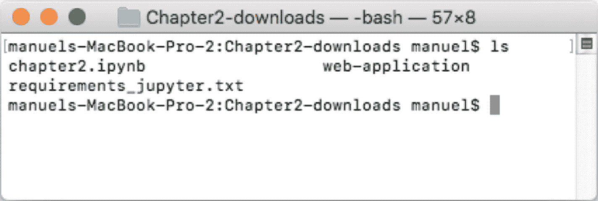

图 2-2

终端窗口

“**requirements_jupyter.txt**” 文件包含了运行本章 Jupyter notebook 所需的 Python 库。你可以通过运行 “**pip3**” 命令快速安装它们（列表 2-1）。

```
$ pip3 install -r requirements_jupyter.txt
列表 2-1
安装运行 Notebook 所需的文件
```

名为 “**chapter2.ipynb**” 的文件是本章实际的 Jupyter notebook。启动 notebook 有多种方法，其中一种常用方法是使用 “**jupyter notebook**” 命令（列表 2-2）。如果此方法对你无效，请参考官方 Jupyter 文档。

```
$ jupyter notebook
列表 2-2
启动本章的 Jupyter notebook
```

这将打开一个浏览器窗口，其中包含一个文件浏览器仪表板，指向启动该命令的同一文件夹。继续点击 “**chapter2.ipynb**” 链接（图 2-3）。

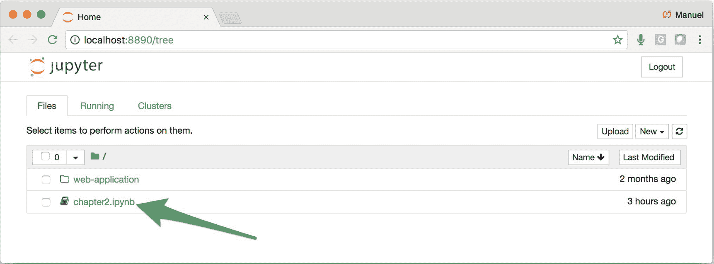

图 2-3

Jupyter 的文件浏览器，显示本章的 notebook 链接

这将打开一个新标签页以及相应的 notebook，其中包含跟随本章内容所需的所有探索性代码。本书中的所有代码均假定使用 Python 3.x；如果你使用其他版本，可能需要对代码的某些部分进行调整。打开 notebook 后，你就可以开始操作了。高亮第一个代码框，然后点击播放按钮运行该部分代码（图 2-4）。如果看到错误，请在继续之前解决它们，因为每个代码片段都建立在前一个代码片段之上（错误可能与 Python 版本兼容性问题或需要安装的缺失库有关）。

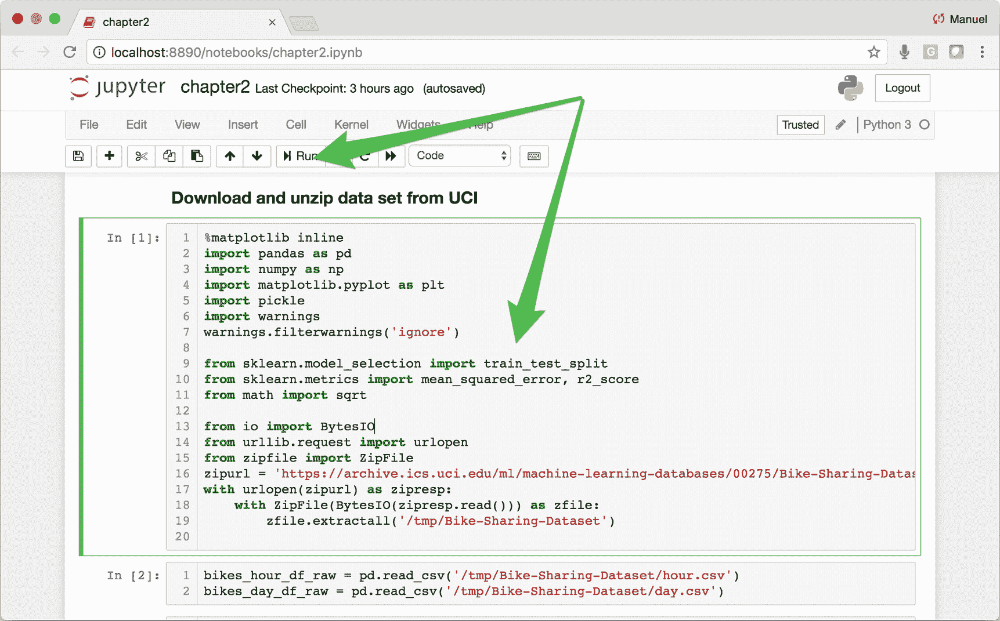

图 2-4

Jupyter notebook，代码已高亮并准备运行

本章对应的 Jupyter notebook 展示了一种直接使用 Python 下载和解压数据的方法（如果遇到防火墙问题，请手动下载）。

### 探索数据

Python Pandas 的 “**head()**” 函数可以让我们快速查看数据的前几行，如列表 2-3 和图 2-5 所示。

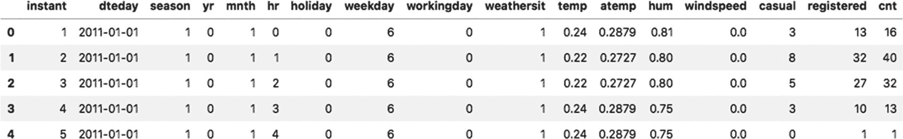

图 2-5

bike_df.head() 的输出

```
bikes_hour_df_raw.head()
列表 2-3
数据集的前几行
```

使用 “**head()**” 函数，我们了解到数据中包含日期、整数和浮点数。我们还看到一些冗余特征，例如日期（dteday）已经通过 “**season**”、“**yr**”、“**mnth**”、“**hr**” 等进行了分类。因此，“**dteday**” 特征很容易被舍弃（不过为了探索需要，我们会暂时保留它）。其他一些特征似乎也是冗余的，例如 “**temp**” 和 “**atemp**”，可能需要进一步检查。我们还删除了 “**casual**” 和 “**registered**” 特征，因为这些特征无助于我们从单个用户的角度来建模需求，而这正是我们 Web 应用的目标。这些特征可能会成为根据季节、天气等预测注册量的有趣结果变量。但由于它们不符合我们当前的需求范围，我们将删除它们。

我们只保留真正需要的特征，因为这样可以消除杂乱，为我们实现数据科学和 Web 应用目标提供额外的清晰度和理解（列表 2-4）。

```
bikes_hour_df = bikes_hour_df_raw.drop(['casual', 'registered'], axis=1)
列表 2-4
移除对我们目标无用的特征
```

Pandas 的 “**info()**” 函数也是查看数据中包含的数据类型、数量和空值计数的绝佳方法（列表 2-5）。

```
输入:
bikes_hour_df.info()
输出:
RangeIndex: 17379 entries, 0 to 17378
Data columns (total 15 columns):
instant       17379 non-null int64
dteday        17379 non-null object
season        17379 non-null int64
yr            17379 non-null int64
mnth          17379 non-null int64
hr            17379 non-null int64
holiday       17379 non-null int64
weekday       17379 non-null int64
workingday    17379 non-null int64
weathersit    17379 non-null int64
temp          17379 non-null float64
atemp         17379 non-null float64
hum           17379 non-null float64
windspeed     17379 non-null float64
cnt           17379 non-null int64
列表 2-5
获取特征信息
```

使用 “**info()**” 函数，我们看到当前存储在内存中的所有数据要么是浮点数，要么是整数，并且没有空值。如果我们确实发现了空值、日期数据类型或文本数据类型，则需要在进入建模之前处理它们。现有的大多数模型都需要数值数据，而我们正好拥有这些数据，所以目前看来情况不错。

## 深入观察我们的结果变量

让我们看看将用于训练模型的结果变量 “**cnt**”，即总租赁自行车数量。Pandas 的 “**describe()**” 函数是理解定量数据的另一个常用工具。让我们将其应用于我们的结果变量（也称为模型的标签），如列表 2-6 所示。

```
输入:
bikes_hour_df['cnt'].describe()
输出:
count    17379.000000
mean       189.463088
std        181.387599
min          1.000000
25%         40.000000
50%        142.000000
75%        281.000000
max        977.000000
Name: cnt, dtype: float64
列表 2-6
自行车租赁数量 “cnt” 特征的数值摘要
```

我们看到特征 “**cnt**” 的范围介于最小值 1 和最大值 977 之间。这意味着每个记录的小时内，最少有 1 次自行车租赁，最多有 977 次自行车租赁。我们还看到平均租赁次数为 189.5。

我们确认正在处理一个连续数值变量，线性回归（或类似线性回归的模型）是训练和预测自行车租赁数量的正确选择。让我们绘制这个特征以更好地理解数据（列表 2-7 和图 2-6）。

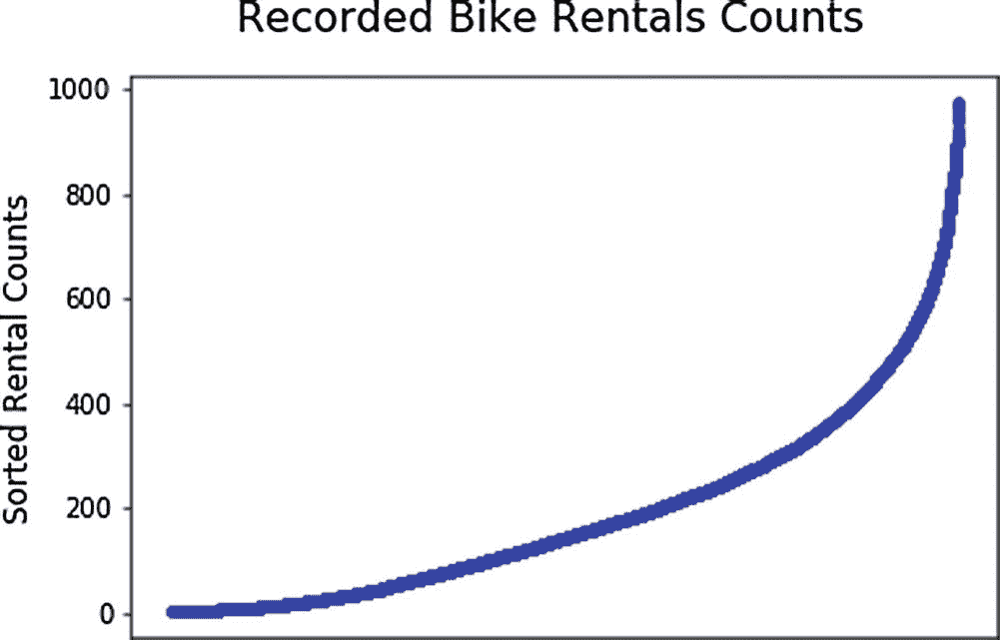

图 2-6

排序后的自行车租赁数量显示，大多数租赁发生在 0 到 400 的范围内；高于此值的数值要么是罕见情况，要么是异常值

```
fig,ax = plt.subplots(1)
ax.plot(sorted(bikes_hour_df['cnt']), color="blue")
ax.set_xlabel("行索引", fontsize=12)
ax.set_ylabel("排序后的租赁数量", fontsize=12)
ax.set_ylabel("排序后的租赁数量", fontsize=12)
fig.suptitle('结果变量 - cnt - 租赁数量')
plt.show()
列表 2-7
自行车租赁数量 “cnt” 特征的数值摘要
```

## 数值特征与租赁数量

让我们为所有浮点数据类型创建散点图。我们将它们与租赁数量进行对比绘制，以可视化潜在的关系（图 2-7 和 2-8）。

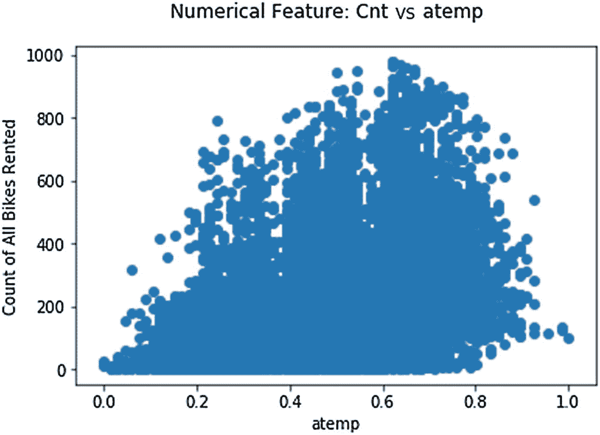

图 2-8

所有自行车租赁数量与“**atemp**”特征的关系

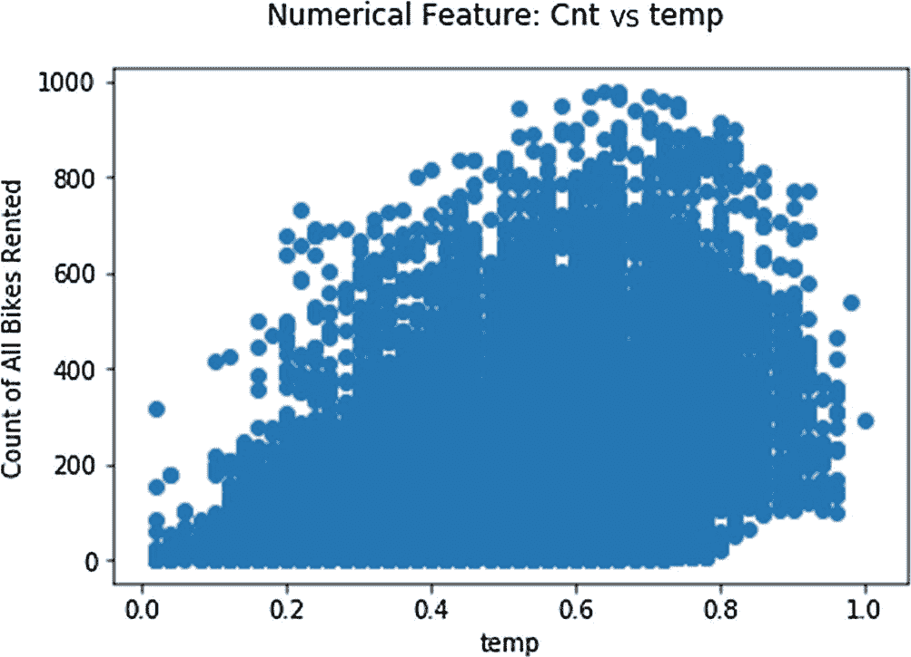

图 2-7

所有自行车租赁数量与“**temp**”特征的关系

我们可以看到，自行车租赁数量与温度之间存在一定的线性关系；天气越暖和，租出的自行车就越多。我们还注意到，这两个特征——“**temp**”和“**atemp**”——具有相似的分布，可能存在冗余甚至多重共线性。为了保持简洁，我们将删除“**atemp**”特征（图 2-9 和 2-10）。

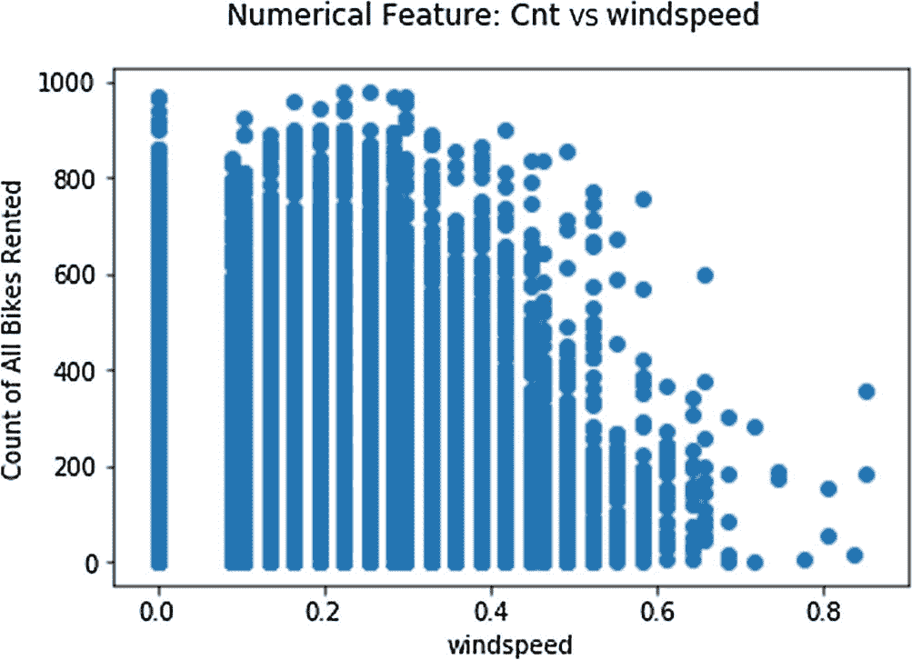

图 2-10

所有自行车租赁数量与“**windspeed**”特征的关系

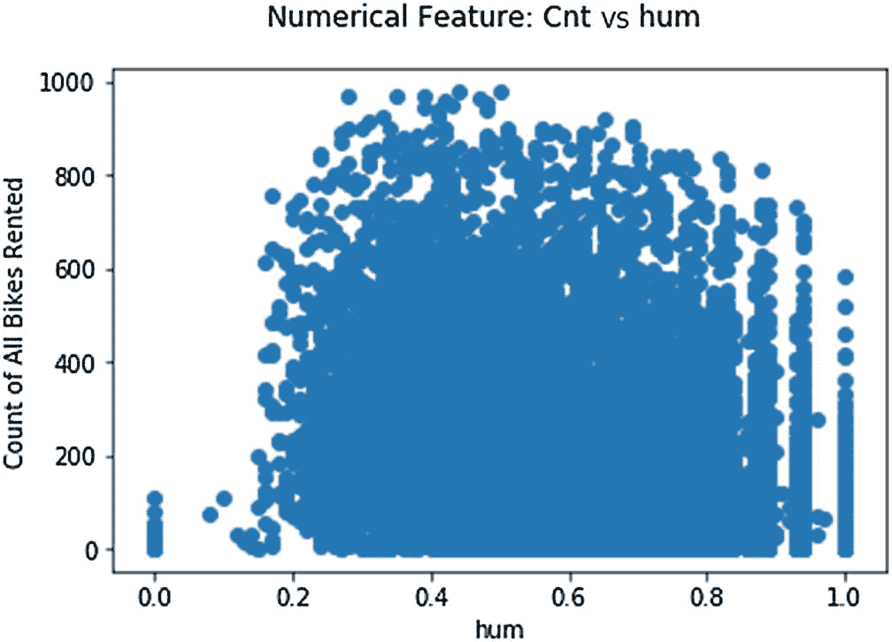

图 2-9

所有自行车租赁数量与“**hum**”特征的关系

“**hum**”特征（即湿度）看起来像一个大团块，尽管边缘确实显示出一些稀疏性。“**windspeed**”特征则显示出与租赁数量的反比线性关系；风力过大似乎不利于自行车租赁。

## 让我们看看分类特征

在这个数据集中，除了自行车租赁数量“**cnt**”之外，整数数据都是分类特征。通过直方图（分布图；图 2-11）查看分类数据时，会发现许多有趣的线索。

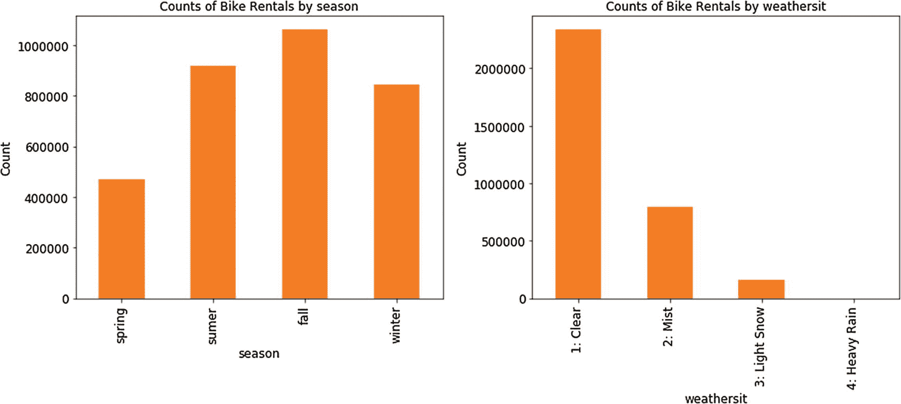

图 2-11

按“**season**”和“**weathersit**”划分的自行车租赁数量

“**weathersit**”特征显示，人们在天气好的时候会租更多的自行车；而“**season**”特征显示，秋季是租赁自行车的最佳季节。

最后，“**hr**”特征（即租赁小时）清晰地显示出，上班通勤高峰时段和下午骑行是非常受欢迎的自行车租赁时间，而凌晨 4 点是最不受欢迎的骑行时间（图 2-12）。

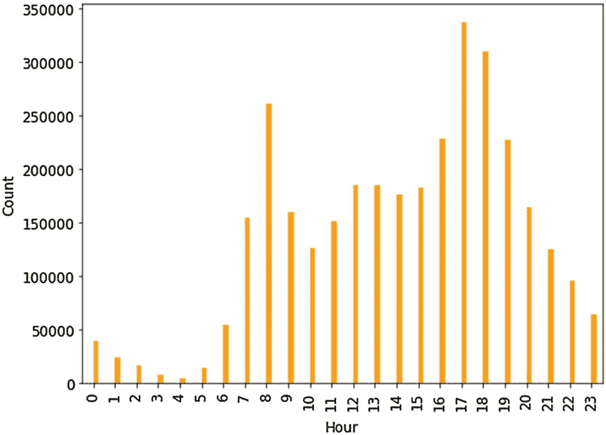

图 2-12

按小时统计的自行车总租赁数量

尽管通过目测图表我们可以学到很多东西，但要就保留哪些特征和删除哪些特征得出决定性结论，还需要进行更全面、更系统的测试。

## 为建模准备数据

在大多数数据科学项目中，都有一个数据整理阶段，在此阶段对数据进行评估和清洗，使其达到“**模型就绪**”的状态。在本例中，我们已经删除了一些无用的特征，没有需要处理的空值，并且我们不必担心相关性或多重共线性，因为我们最终模型只打算使用四个简单的特征。

### 回归建模

在统计分析中，回归模型试图预测变量之间的关系。它会分析自变量如何与因变量相关联。拟合后的模型可用于预测新的因变量。

### 简单线性回归

线性回归可能是最简单的建模算法。它试图解释一个因变量与一个或多个自变量之间的关系。参见图 2-13 中的基本回归方程。

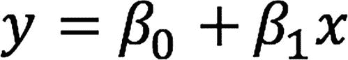

图 2-13

基本线性回归方程

在方程中，y = 估计的因变量得分，β0 = 常数，β_1 = 回归系数，x = 自变量的得分。

### 一个简单模型

让我们从一个简单的多元线性回归模型开始，我们将所有变量输入，并得到一个基础的均方根误差（RMSE）。RMSE 以与结果变量（也称为 y 标签）相同的单位来表示误差，因此很容易看出模型在学习/预测自行车租赁方面的表现如何，而误差则成为一种置信区间形式。我们希望获得尽可能低的 RMSE 分数，因此目标是不断调整数据和模型，直到分数不再下降。本章中的所有建模工作都将基于 Python 的 scikit-learn/sklearn 库。^(⁷) 这是一个出色的库，应该能够满足大多数 Python 用户的建模需求。

尽管我们只打算运行一个简单的线性回归，但我们将利用 sklearn 库中的三个函数：“**train_test_split**”用于从原始数据中创建两个随机数据集，并将特征与结果分开；“**linear_model**”用于运行我们的模型；以及“**mean_squared_error**”用于评估模型的学习效果（代码清单 2-8）。

```

# 设置结果变量
outcome = 'cnt'

# 创建特征列表
features = [feat for feat in list(bike_df_model_ready) if feat not in [outcome, 'instant']]

# 将数据拆分为训练集和测试集
from sklearn.model_selection import train_test_split
X_train, X_test, y_train, y_test = train_test_split(bike_df_model_ready[features],
bike_df_model_ready[['cnt']], test_size=0.3, random_state=42)
代码清单 2-8
将数据集拆分为训练集和测试集的代码片段
```

“**train_test_split()**”函数将使用一个种子将数据拆分为两个随机数据集。无论何时测试不同的方法，并希望确保始终使用相同的拆分以进行公平比较，设置“**random_state**”种子参数都是一个好主意。“**test_size**”参数设置测试集的大小。这里我们将其设置为 0.3，即 30%，因此它将随机化数据，并将 70% 的数据分配给训练集，30% 分配给测试集（代码清单 2-9）。

```
from sklearn import linear_model
model_lr = linear_model.LinearRegression()

# 在训练集上训练模型
model_lr.fit(X_train, y_train)
代码清单 2-9
线性回归代码
```

我们声明一个“**LinearRegression()**”模型，然后调用“**fit()**”函数，使用训练数据和训练标签来训练模型。模型“**model_lr**”现在已训练完毕，可以用于预测（代码清单 2-10）。

```
输入：
predictions = model_lr.predict(X_test)
from sklearn.metrics import mean_squared_error
print("均方根误差: %.2f" % sqrt(mean_squared_error(y_test, predictions)))
输出：
均方根误差: 143.08
代码清单 2-10
预测并获取 RMSE 分数
```

最后，我们使用预留用于测试的 30% 的数据调用“**predict()**”函数，并将预测的标签输入“**mean_squared_error()**”函数，以获取均方根误差分数。我们得到的 RMSE 为 **143.08**，并将其作为我们的基础基准分数。这是我们在当前种子拆分（我们在 train_test_split 函数上应用的种子，以确保每次都能得到相同的拆分）以及到目前为止选择的所有特征下得到的结果。解释该分数的一种方式是，由于它与我们的结果变量处于同一量级，我们的模型预测偏差了 143 辆自行车。考虑到每小时平均自行车租赁需求约为 190 辆，我们的模型比简单地选取自行车租赁的总体平均值表现更好。但让我们看看是否能够改进这一点。

## 特征工程实验

让我们尝试几种不同的技术，包括多项式、非线性建模和利用时间序列，看看是否能获得更好的分数。

### 使用多项式进行建模

对一系列数值应用多项式变换，可以在线性回归中实现更好的分离效果。在 Python 的“**sklearn**”库中，这非常容易实现（代码清单 2-11）。

```
from sklearn.preprocessing import PolynomialFeatures
poly = PolynomialFeatures(2)
X_train = poly.fit_transform(X_train)
X_test = poly.fit_transform(X_test)
代码清单 2-11
创建多项式特征
```

现在，我们将所有特征转换为二次多项式（代码清单 2-12）。

```
输入：
print("将 PolynomialFeatures 设置为 2 次时的均方根误差: %.2f" % sqrt(mean_squared_error(y_test, predictions)))
输出：
将 PolynomialFeatures 设置为 2 次时的均方根误差: 122.96
代码清单 2-12
二次多项式
```

现在，将所有特征转换为三次多项式（代码清单 2-13）。

```
输入：
print("将 PolynomialFeatures 设置为 3 次时的均方根误差: %.2f" % sqrt(mean_squared_error(y_test, predictions)))
输出：
将 PolynomialFeatures 设置为 3 次时的均方根误差: 111.65
代码清单 2-13
三次多项式
```

现在，将所有特征转换为四次多项式（代码清单 2-14）。

```
输入：
print("将 PolynomialFeatures 设置为 4 次时的均方根误差: %.2f" % sqrt(mean_squared_error(y_test, predictions)))
输出：
将 PolynomialFeatures 设置为 4 次时的均方根误差: 114.84
代码清单 2-14
四次多项式
```

如您所见，使用 sklearn 的“**PolynomialFeatures()**”函数对数据集应用多项式变换极其简单。使用二次和三次多项式时，评分确实有所提升，但超过这个次数后评分会下降。

### 从分类数据创建虚拟特征

另一种值得尝试的方法是对分类数据进行虚拟化处理。这意味着为每个类别创建单独的列。以特征“**weathersit**”为例：它不是一个连续变量，而是一个任意类别。如果直接将其输入模型，模型会将其视为线性数值数据，但这在这种情况下并不合理；将“**雾与云**”加 1 并不等于“**雪**”。通过创建四个新列：“**晴**”、“**雾**”、“**雪**”和“**雨**”，并为每个列分配一个二进制的真/假值，模型在处理“**weathersit**”时效果会更好。

使用 Pandas 的“**get_dummies()**”函数可以轻松实现这一点。我们将代码抽象成一个函数，以便更容易地创建我们的 Web 应用程序（代码清单 2-15）。

```
def prepare_data_for_model(raw_dataframe,
target_columns,
drop_first = False,
make_na_col = True):

# 对所有分类字段进行虚拟化处理
dataframe_dummy = pd.get_dummies(raw_dataframe, columns=target_columns, drop_first=drop_first,
dummy_na=make_na_col)
return (dataframe_dummy)
代码清单 2-15
抽象代码以创建虚拟数据
```

这会将每个类别拆分到其自己的列中。在下面的代码片段中，我们要求对以下三列进行“**虚拟化**”处理：“**season**”、“**weekday**”和“**weathersit**”（代码清单 2-16）。

```
bike_df_model_ready = prepare_data_for_model(bike_df_model_ready,
target_columns = ['season', 'weekday', 'weathersit'], drop_first = True)
代码清单 2-16
对分类列进行虚拟化处理
```

将该函数应用于数据集后，每个天气类别现在都位于单独的列中（减去第一列，该列是冗余的——如果它不是“**weathershit_2**”、“**weathershit_3**”或“**weathershit_4**”，那么我们可以推断它是“**weathershit_1**”；代码清单 2-17 和图 2-14）。

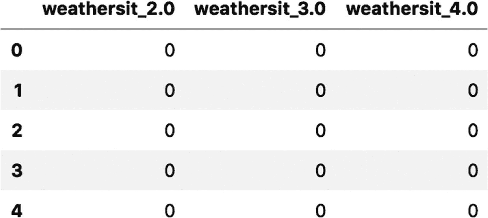

图 2-14

查看特征“**weathersit**”的虚拟化列

```
bike_df_model_ready[['weathersit_2.0', 'weathersit_3.0', 'weathersit_4.0']].head()
代码清单 2-17
查看虚拟化后的天气字段
```

那么，从分类数据中创建虚拟变量是否有助于模型呢？（代码清单 2-18）

```
输入：
print("均方根误差: %.2f" % sqrt(mean_squared_error(y_test, predictions)))
输出：
均方根误差: 139.40
代码清单 2-18
对分类数据进行虚拟化处理后的均方根误差
```

这个结果并不令人印象深刻，而且肯定不足以证明所有这些额外工作是值得的。让我们继续尝试其他技术。

### 尝试非线性模型

作为最后的建模实验，让我们将虚拟化后的数据输入到 sklearn 的“**Gradient Boosting Regressor**”模型中。在 sklearn 包中从一个模型切换到另一个模型非常简单，我们只需要在内存中加载相应的模型并更改两行代码即可（代码清单 2-19）。

```
输入：
from sklearn.ensemble import GradientBoostingRegressor
model_gbr = GradientBoostingRegressor()
model_gbr.fit(X_train, np.ravel(y_train))
predictions = model_gbr.predict(X_test)
print("均方根误差: %.2f" % sqrt(mean_squared_error(y_test, predictions)))
输出：
均方根误差: 68.13
代码清单 2-19
使用 GBM 模型
```

哇，这是我们迄今为止看到的最低 RMSE 分数；我们将错误率降低了一半！

### 更复杂的特征工程——利用时间序列

这是最后一个特征工程实验，其思路源自微软的数据科学家。^(⁸) 该数据集是自行车租赁随时间变化的台账，因此它是一个时间序列数据集。每当你的数据集记录了随时间变化的事件时，你都应将其作为附加特征纳入考量。例如，一小时前发生的事件可能比一年前发生的事件更重要。时间还可以捕捉趋势、不断变化的需求和认知等。我们要创建能够捕捉所有这些随时间演变要素的特征！

对于每一行数据，我们将添加两个新特征：前一小时的自行车租赁总数，以及两小时前的自行车租赁总数。其直觉是，如果我们想了解当前的自行车租赁热度，可以从观察一小时前的情况入手。如果一小时前租赁量很大，那么现在很可能也不错。这个时间要素可以看作是繁荣或萧条时期、好或坏天气等的代理变量。

为了按日期和小时计算自行车总数，我们使用 Pandas 极其强大的“**groupby()**”函数。我们提取“**dteday**”、“**hr**”和“**cnt**”三个字段，并按日期和小时对计数进行分组（清单 2-20 和图 2-15）。

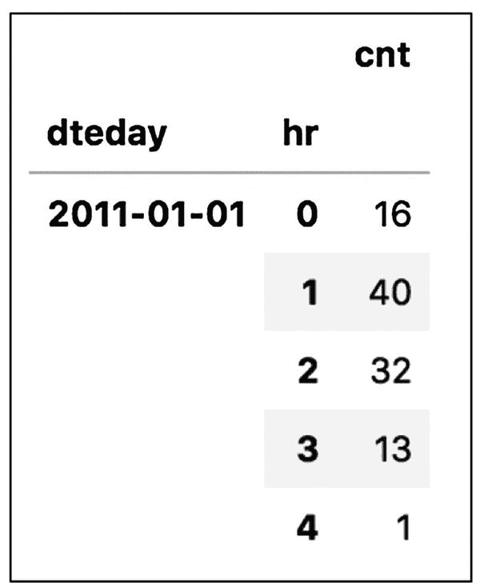

图 2-15

移动日期以创建新的回溯特征

```
bikes_hour_df_shift = bikes_hour_df[['dteday','hr','cnt']].groupby(['dteday','hr']).sum()
bikes_hour_df_shift.head()
清单 2-20
查看前一时期的租赁计数
```

此函数按小时和日期统计计数。接下来，我们创建两个新特征，一个向前移动 1 行，另一个移动 2 行，从而为当前行提供过去一小时和过去两小时的自行车租赁总数。最后，我们使用 Pandas 的“**merge()**”命令将所有内容添加回主数据框（清单 2-21）。

```

# 前几小时
bikes_hour_df_shift = bikes_hour_df[['dteday','hr','cnt']].groupby(['dteday','hr']).sum().reset_index()
bikes_hour_df_shift.sort_values(['dteday','hr'])

# 将最后两小时的计数向前移动，以便新计数能考虑过去两小时的情况
bikes_hour_df_shift['sum_hr_shift_1'] = bikes_hour_df_shift.cnt.shift(+1)
bikes_hour_df_shift['sum_hr_shift_2'] = bikes_hour_df_shift.cnt.shift(+2)

# 将日期和小时计数合并回 bike_df_model_ready
bike_df_model_ready =  pd.merge(bikes_hour_df, bikes_hour_df_shift[['dteday', 'hr', 'sum_hr_shift_1', 'sum_hr_shift_2']], how="inner", on = ['dteday', 'hr'])
清单 2-21
时间偏移操作
```

在分割这些新数据并将其输入梯度提升模型（GBM）进行回归（使用 sklearn 的 GradientBoostingRegressor）后，我们计算测试数据集上的 RMSE 分数（清单 2-22）。

```
输入：
from sklearn.ensemble import GradientBoostingRegressor
model_gbr = GradientBoostingRegressor()
model_gbr.fit(X_train, np.ravel(y_train))
predictions = model_gbr.predict(X_test)
print("均方根误差: %.2f" % sqrt(mean_squared_error(y_test, predictions)))
输出：
均方根误差: 44.43
清单 2-22
时间偏移的 RMSE
```

哇，太棒了，RMSE 为 44.43，甚至更好了！！！

## 简约模型

不幸的是，事情并不总是关乎最佳分数。在这里，我们需要一个简单的模型，以便使用回归方程进行预测。这并非复杂模型或过度工程化特征所能轻易实现的。GBM 不是线性模型，也无法为我们提供一个轻便的回归方程。此外，我们之前创建的时间偏移需要知道预测前两个小时的租赁总数，而我们的网站访问者无法从中受益，因为我们无法获取实时数据。

当你的目标是创建 Web 应用程序时，这是一个重要的教训：如果最准确的预测来自复杂的建模技术，那么它通常很难很好地转化为生产流水线。

### 从简单模型中提取回归系数——无需服务器端计算即可轻松预测需求

线性回归模型并非最强大的模型，它本身也不以此自居，但它可以将相当复杂的数据提炼成极其简单清晰的线性表示。正是这种简单的表示将为我们的应用程序提供动力。

回归建模的一个强大产物是学习到的模型系数。这在 Web 应用程序的上下文中更为强大，因为我们可以仅依赖这些系数和一个简单的回归方程来估计未来的自行车租赁需求。这有可能使应用程序完全在客户端前端做出复杂决策——轻量、快速且实用！

为了最终得到一组简洁的系数和一个简单的回归方程，我们首先需要训练和测试一个回归模型。只有当我们对分数、使用的特征以及预测质量感到满意时，我们才提取系数。我们还将把输入模型的特征精简到必要且具有说明性的程度。以下是构建 Web 应用程序的教训之一：我们必须平衡最佳建模分数与生产现实。如果你构建了一个非凡的模型，但没有人能操作它，或者它无法在生产中及时运行，那它就是失败的。

为了 Web 应用程序的简洁性，我们将保持简单，仅使用四个特征：“**season**”、“**hr**”、“**holiday**”和“**temp**”。这些特征用户能够理解，易于获取，并且由于只有四个特征，我们的模型将运行得很快。让我们首先单独对这些特征进行建模，并检查它们的 R 平方分数。

### R 平方

R 平方是一种统计度量，用于衡量数据与拟合回归线的接近程度。它也被称为决定系数，或在多元回归中称为多重决定系数。R 平方的定义相当直接：它是由线性模型解释的响应变量变异性的百分比（列表 2-23）。

```
R-squared = Expected variation / Total variation
列表 2-23
R 平方公式
```

决定系数可以看作一个百分比。它让你了解有多少数据点落在回归方程所形成直线的结果范围内。系数越高，落在直线内的点就越多。如果系数为 0.80，那么 80% 的点应该落在回归线内。

我们希望看到 R 平方尽可能接近 1（或 100%），且没有负数。使用 sklearn 的“**r2_score**”函数可以轻松计算（列表 2-24）。

```
输入：
from sklearn.metrics import r2_score
for feat in features:
model_lr = linear_model.LinearRegression()
model_lr.fit(X_train[[feat]], y_train)
predictions = model_lr.predict(X_test[[feat]])
print('R² for %s is %f' % (feat, r2_score(y_test, predictions)))
输出：
R² for hr is 0.160161
R² for season is 0.034888
R² for holiday is -0.001098
R² for temp is 0.154656
列表 2-24
各特征的 R 平方得分
```

每个 R 平方都是正数，我们看到“**hr**”和“**temp**”比“**season**”和“**holiday**”解释了更多的方差。请记住，我们是在单独查看每个特征；一个很好的后续步骤（此处未涉及）是计算所有特征一起的 R 平方得分（或使用调整后的 R 平方来处理多个特征）。

如前所述，我们还将对“**season**”变量进行“**虚拟化**”。如果我们在包含“**虚拟化**”变量的所有特征上重新运行 R 平方计算循环，我们会得到以下得分（列表 2-25）。

```
R² for hr is 0.156594
R² for holiday is 0.001258
R² for temp is 0.154471
R² for season_1 is 0.053717
R² for season_2 is 0.003657
R² for season_3 is 0.016976
R² for season_4 is 0.001111
列表 2-25
虚拟化特征上的 R 平方得分
```

所有值都是正数，因此我们可以在最终的 Web 应用程序中使用这组特征。

### 使用提取的系数预测新数据

现在我们有了模型的系数，我们可以使用回归方程预测新的租赁数量。回归方程是我们回归模型中最优拟合线的方程。该公式很常见，可以在大多数涉及统计学的书籍中看到（图 2-16）。

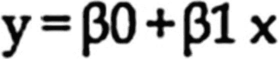

图 2-16

回归方程

“**y**”是因变量，或者说是我们试图预测的值，在我们的例子中，是自行车租赁的数量，a 是截距，“**β**”是直线的斜率，“**x**”是自变量。在多元线性回归的情况下，你只需添加更多的自变量。

一个重要的注意事项是，这个公式及其系数代表了模型中使用的数据可能产生的最小误差。因此，当我们向其中注入新数据时，我们实际上无法同时更改所有自变量。这是一个需要记住的重点，尽管我们将允许用户调整各种环境设置来影响自行车租赁的数量，但我们也会提供一个“**重置**”按钮，将所有变量重置回其原始平均值。

在我们运行最终模型后，我们需要提取截距和系数。使用 sklearn 的“**linear_model**”函数很容易做到这一点，只需调用“**intercept_**”和“**coef_**”参数即可获取它们（列表 2-26 和 2-27，以及图 2-17）。

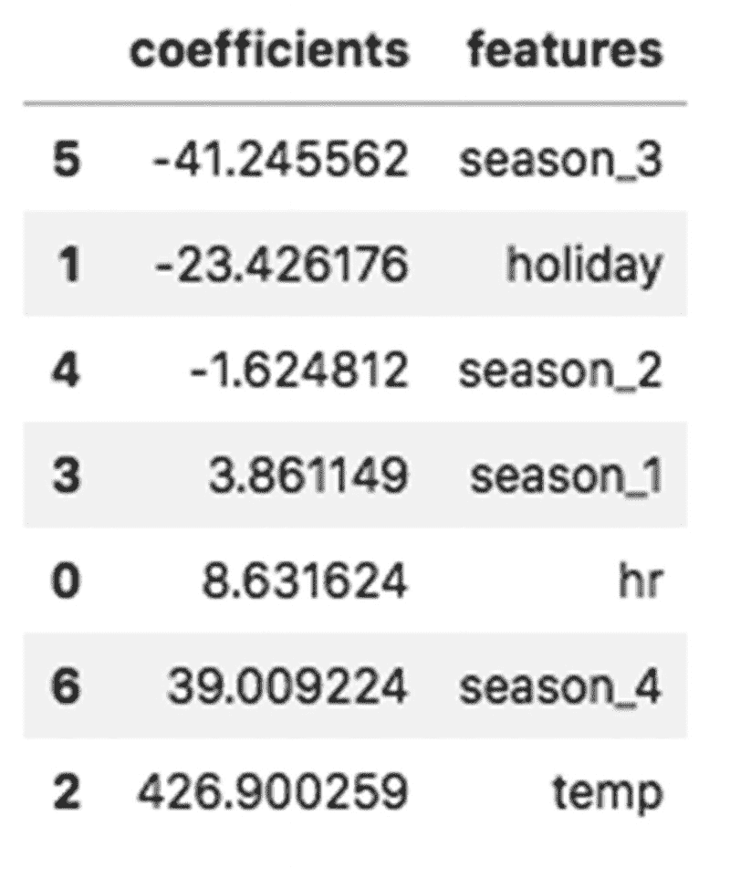

图 2-17

查看线性回归模型的系数

```
feature_coefficients = pd.DataFrame({'coefficients':model_lr.coef_[0],
'features':X_train.columns.values})
feature_coefficients.sort_values('coefficients')
列表 2-27
获取系数
```

```
输入：
from sklearn import linear_model
model_lr = linear_model.LinearRegression()
model_lr.fit(X_train, y_train)
print('Intercept: %f' % model_lr.intercept_)
输出：
Intercept: -121.029547
列表 2-26
获取截距
```

然后，我们可以将这些常量分配给我们的 Web 应用程序，以便它能够预测自行车租赁需求（列表 2-28）。

```
INTERCEPT = -121.029547
COEF_HOLIDAY = -23.426176   # 当天是否为节假日
COEF_HOUR = 8.631624        # 小时 (0 到 23)
COEF_SEASON_1 = 3.861149    # 1: 春季
COEF_SEASON_2 = -1.624812   # 2: 夏季
COEF_SEASON_3 = -41.245562  # 3: 秋季
COEF_SEASON_4 = 39.009224   # 4: 冬季
COEF_TEMP = 426.900259      # 归一化温度，摄氏度 -8 到 +39
列表 2-28
从提取的系数创建常量
```

我们还需要获取历史平均值来构建我们的回归方程。如果值是分类的，那么我们选择最高的平均值并将其设为 1，其他设为 0（就像我们对节假日和季节所做的那样）（列表 2-29）。

```
MEAN_HOLIDAY = 0   # 当天是否为节假日
MEAN_HOUR = 11.6   # 小时 (0 到 23)
MEAN_SEASON_1 = 0  # 1: 春季
MEAN_SEASON_2 = 0  # 2: 夏季
MEAN_SEASON_3 = 1  # 3: 秋季
MEAN_SEASON_4 = 0  # 4: 冬季
MEAN_TEMP = 0.4967 # 归一化温度，摄氏度 -8 到 +39
列表 2-29
设置特征均值

```

我们现在拥有了预测新租赁数量所需的一切。让我们看看在上午 9 点，所有其他值保持在其平均值附近时，我们会得到多少租赁量（列表 2-30）。

```
输入：
rental_counts = INTERCEPT + (MEAN_HOLIDAY * COEF_HOLIDAY) \
+ (9 * COEF_HOUR) \
+ (MEAN_SEASON_1 * COEF_SEASON_1)  + (MEAN_SEASON_2 * COEF_SEASON_2) \
+ (MEAN_SEASON_3 * COEF_SEASON_3)  + (MEAN_SEASON_4 * COEF_SEASON_4) \
+ (MEAN_TEMP * COEF_TEMP)
print('Estimated bike rental count for selected parameters: %i' % int(rental_counts))
输出：
Estimated bike rental count for selected parameters: 171
列表 2-30
让我们使用提取的系数进行预测
```

结果是上午 9 点租出了 171 辆自行车（你的结果可能略有不同）。我们将允许用户一次更改多个特征，但请记住，对原始方程值进行过多更改可能会降低模型性能。

## 设计一个有趣且交互式的 Web 应用程序来展示自行车租赁需求

现在到了有趣的部分，让我们设计我们的 Web 应用程序。我们始终需要牢记最终目标——我们想与他人分享什么，以及他人想看什么？

我们将设计一个交互式 Web 应用程序，允许用户自定义环境变量（时间、节假日、温度和季节），并获得自行车租赁数量的可视化反馈。

这个应用程序需要在视觉上引人注目，以吸引用户并让他们在操作时保持兴趣。这意味着需要在信息传达、用户界面、视觉效果和交互控件上投入与数据收集和建模同样多的思考。

## 为提升可读性与可扩展性而抽象化代码

与我的大多数 Web 应用程序一样，我尝试将代码抽象成逻辑模块。一个模块负责收集用户数据，另一个模块（即“**大脑**”）则负责构建回归方程、运行它并返回自行车租赁预测。将代码组织在逻辑单元中，将极大地简化你在构建和调试 Web 应用程序时的工作。这使你能够对每个模块进行单元测试，以确保一切正常运行，或者在出现问题时通过排除法来定位问题。

就本章的 Web 应用程序而言，大部分“**大脑**”将直接驻留在主 HTML 页面中。Flask 是一个 Web 服务框架，主要用于检索、分析和返回定制化内容。在本章中，我们只需要回归方程来预测自行车租赁需求，因此实际上并不需要在用户和 Web 服务器之间进行大量来回交互（这也是本书中唯一这样做的章节；在其他所有章节中，“大脑”将明确驻留在服务器端，而非客户端的网页上）。

## 构建本地 Flask 应用程序

在将代码部署到云端之前，先在本地运行测试非常重要；这既能避免让你头疼，也能节省时间。首先，让我们在本地机器上执行一个简单的 Flask 练习。如果你从未在本地运行过 Flask 应用程序，你需要使用“**pip3 install**”或你的操作系统和 Python 版本支持的任何工具来安装以下 Python 库。

*   Flask

安装好 Flask 后，打开一个文本编辑器，输入以下代码，并将其保存为“**hello.py**”（清单 2-31）。

```
from flask import Flask
app = Flask(__name__)
@app.route('/')
def hello_world():
return 'Hello, World!'
清单 2-31
简单的 Flask 脚本
```

然后打开一个终端/命令窗口，在 Mac 或 Windows 上输入以下命令（清单 2-32 和 2-33）。

```
$ export FLASK_APP= main.py
$ python -m flask run
清单 2-33
在 Windows 上
```

```
$ export FLASK_APP=main.py
$ flask run
清单 2-32
在 Mac 上
```

你应该会看到类似图 2-18 的内容。

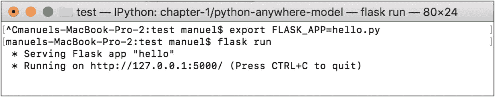

图 2-18

显示 Flask 应用程序本地 URL 的终端/命令窗口

然后，将 URL “`http://127.0.0.1:5000/`”（或终端窗口中显示的任何地址）复制到浏览器中，你应该就能看到 Web 应用程序出现了。更多示例和技巧可以在官方 Flask 快速入门指南中找到：“ [`http://flask.pocoo.org/docs/0.12/quickstart`](http://flask.pocoo.org/docs/0.12/quickstart) ”。

那么，刚才发生了什么？如果你对 Web 服务框架不熟悉，这可能看起来有点令人生畏（请记住，Flask 是目前最简单的框架之一）。让我们逐步分解这个过程。

在前面的“**Hello world**”示例中，一切都发生在假设的 Web 服务器端（实际上就是你的本地机器）。它的工作是处理命令，并将可消费的 HTML 内容返回给发出请求的客户端网页。

首先，我们将 Flask 库加载到内存中（清单 2-34）。

```
from flask import Flask
清单 2-34
导入 Flask
```

然后，我们实例化 Flask 会话（清单 2-35）。

```
app = Flask(__name__)
清单 2-35
实例化 Flask
```

最后，我们创建一个函数来执行某些操作，并用路由参数对其进行装饰，以便它知道将处理来自 Web 客户端的哪些命令。在本例中，‘/’ 仅表示根页面或根“**index.html**”页面会话（清单 2-36）。

```
@app.route('/')
def hello_world():
return 'Hello, World!'
清单 2-36
处理来自根 URL 流量的 Flask 函数
```

显然，函数很少会如此简单；它很可能会调用数据库或表述性状态转移（REST）API 调用来收集定制信息，并通过 HTML 模板将其发送回客户端的网页。整个过程允许创建智能的、定制化的数据，然后将其封装到一个外观精美的网页中。无论从哪个角度看，它看起来都像一个手工制作的页面，尽管它是由 Flask 动态创建的。我们将在本书中全程使用 Flask，如果你能坚持学完每一章，你将对这个工具有深刻的理解。

最后一段代码仅在本地模式（即从本地机器运行）下使用，它运行 Web 服务器代码，并在本例中打开调试标志（清单 2-37）。

```
if __name__=='__main__':
app.run(debug=True)
清单 2-37
在本地自动运行 Flask 应用程序
```

### 在本地下载并运行共享单车 GitHub 代码

如果你还没有下载本章的文件，请下载它们并导航到“ **web-application** ”文件夹。你的文件夹应该看起来像清单 2-38。

```
web-application
├── appengine_config.py
├── main.py
├── requirements.txt
├── app.yaml
├── static
└── images
├── bike_zero.png
├── bike_one.png
├── bike_four.png
├── bike_nine.png
└── bike_sixteen.png
└── templates
└── index.html
清单 2-38
Web 应用程序文件
```

下载并解压所有内容后，打开一个命令行窗口，将驱动器切换到“**web-application**”文件夹，并通过运行“**pip install -r**”命令来安装所有必需的 Python 库（清单 2-39）。

```
$ pip3 install -r requirements.txt
清单 2-39
安装依赖项
```

然后，运行你在“**Hello World**”实验中运行过的相同命令（运行“**python3 main.py**”也可以达到同样的效果；图 2-19）。

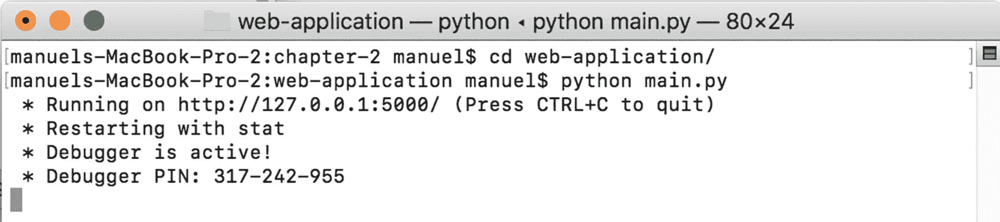

图 2-19

在本章的 Web 应用程序上启动本地 Web 服务器

它应该看起来像图 2-20 中的屏幕截图。

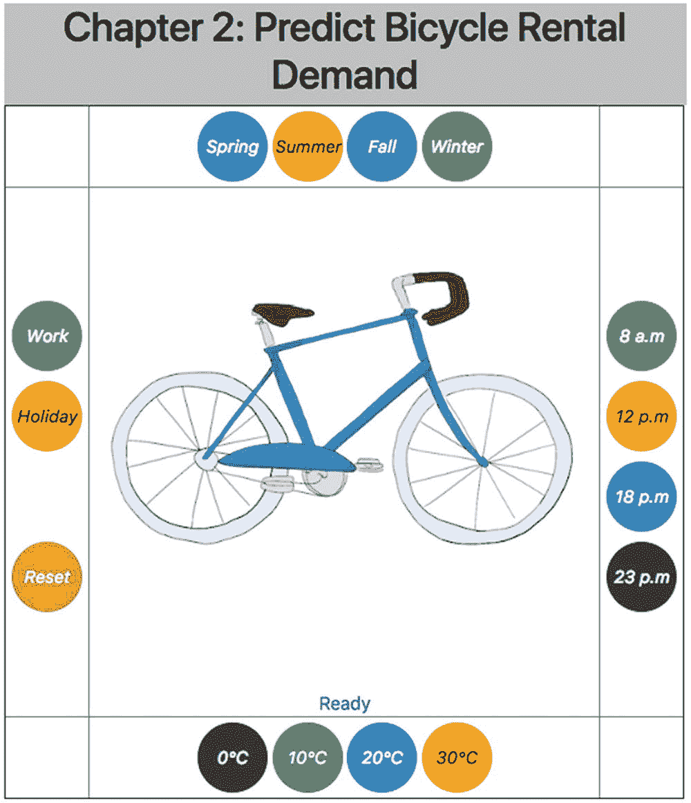

图 2-20

本章 Flask Web 应用程序的本地渲染效果

### 调试技巧

如果你没有看到截图，说明你的系统存在问题，或者缺少某个文件或库。与这个领域的任何工作一样，调试是其中很重要的一部分。你可以通过两种简单的方法来解决问题。如果这是一个 Flask 问题，并且你的浏览器看起来像图 2-21，请执行以下步骤。

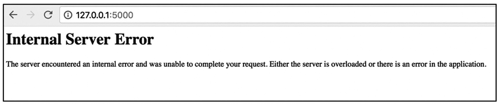

图 2-21

本地网站错误

在“**main.py**”脚本中（通常位于文件末尾）将 Flask 调试标志设置为 True。这仅在本地运行应用程序时有效（列表 2-40）。

```
if __name__=='__main__':
app.run(debug=True)
列表 2-40
Web 应用程序文件
```

如果问题与 Flask 相关，调试器会捕获它并在浏览器中显示，同时会返回一条更有帮助的消息，如图 2-22 所示。

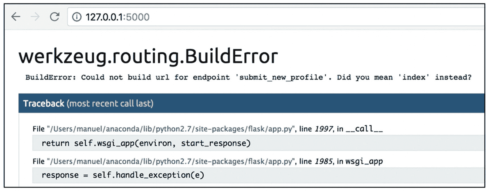

图 2-22

Web 浏览器中的 Flask 错误日志

无论调试标志如何，你还会在终端/命令窗口中看到 Flask 错误消息，如图 2-23 所示。

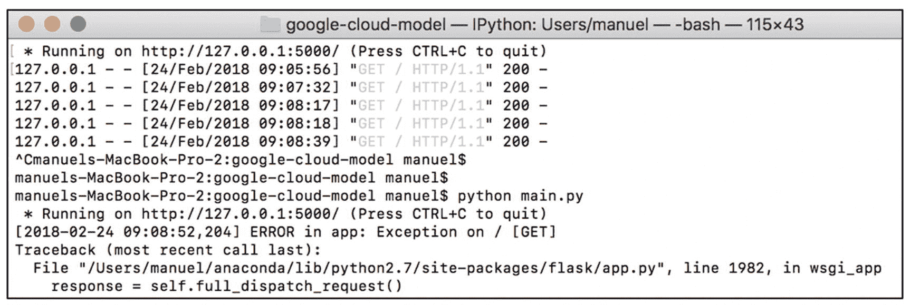

图 2-23

终端/命令窗口中的 Flask 错误日志

修复所有 Flask 问题后，你可能仍然有一些前端错误需要处理。大多数浏览器都会提供一些调试工具。图 2-24 展示了如何在 Chrome 中启动并运行 JavaScript 调试器（你应该能够轻松地在使用的任何浏览器品牌中找到等效工具）。

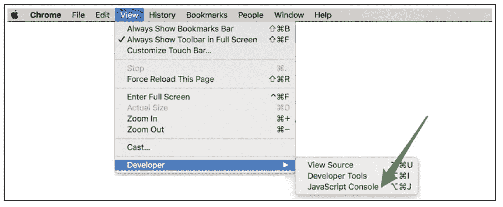

图 2-24

在 Google Chrome 中访问 JavaScript 控制台

这将在网页右侧打开一个漂亮的小型调试中心，列出所有错误或警告。检查一下总是一个好主意，以防出现警告消息。同样，在不同的浏览器品牌和格式（如计算机、手机和平板电脑）中测试你的 Web 应用程序也是如此（图 2-25）。

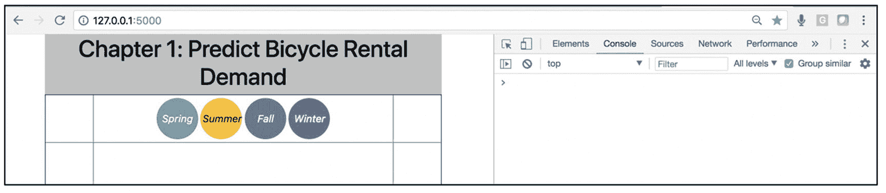

图 2-25

Google Chrome 中的 JavaScript 控制台运行中

## Microsoft Azure——首次挂载 Web 应用程序

我们已经准备好将模型导出到 Azure。你需要一个 Microsoft Azure 帐户，在撰写本文时，Microsoft 提供方便的 200 美元信用额度和所有服务的 30 天试用期以及 12 个月的访问权限。有关更多信息，请参阅 [`https://azure.microsoft.com/en-us/free/`](https://azure.microsoft.com/en-us/free/) 。

## Git——获取 Git 中的所有项目

对于此项目，你需要在本地机器上安装 Git（你可以在 [`https://www.git-scm.com/downloads`](https://www.git-scm.com/downloads) 找到安装二进制文件）。如前所述，Git 是一个源代码版本控制工具，它是一个完全准备好的 Git 包，我们将把它推送到 Microsoft Azure（请参阅引言部分中关于 Git 的简要介绍）。

打开你的终端/命令行窗口，并将其指向本章的“**web-application**”文件夹（列表 2-41）。

```
$ git init
列表 2-41
代码输入
```

在整个过程中运行几次“**git status**”是一个好主意，以确保你正在跟踪正确的文件（列表 2-42）。

```
输入:
$ git status
输出:
未跟踪的文件:
  (使用 "git add <文件>..." 以包含在要提交的内容中)
    main.py
    ptvs_virtualenv_proxy.py
    requirements.txt
    static/
    templates/
    web.3.4.config
列表 2-42
运行 “git status”
```

从“**web-application**”文件夹中添加所有 Web 应用程序文件，并再次检查“**git status**”（列表 2-43）。

```
输入:
$ git add .
$ git status
输出:
要提交的变更:
  (使用 "git rm --cached <文件>..." 以取消暂存)
    新文件:   main.py
    新文件:   ptvs_virtualenv_proxy.py
    新文件:   requirements.txt
    新文件:   static/images/bike_four.png
    新文件:   static/images/bike_nine.png
    新文件:   static/images/bike_one.png
    新文件:   static/images/bike_sixteen.png
    新文件:   static/images/bike_zero.png
    新文件:   templates/index.html
    新文件:   web.3.4.config
列表 2-43
将 Web 应用程序文件添加到 Git

```

执行本地 Git 提交并添加一个有意义的注释，以备将来需要回顾过去的操作（列表 2-44 和图 2-26）。

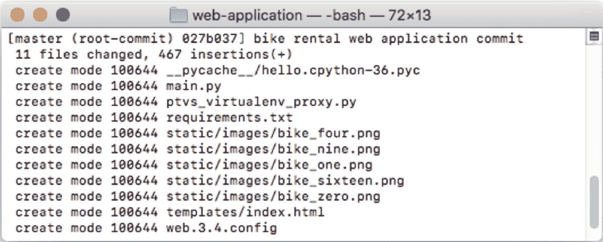

图 2-26

已提交的数据，准备上传到 Azure

```
$ git commit -am "bike rental web application commit"
列表 2-44
Git 提交
```

有关将 Git 部署到 Azure 应用服务的更多信息，请参阅 [`https://docs.microsoft.com/en-us/azure/app-service/app-service-deploy-local-git`](https://docs.microsoft.com/en-us/azure/app-service/app-service-deploy-local-git) 。

## azure-cli 命令行界面工具

我们将依赖“**azure-cli**”工具来启动和运行，因为它是启动和控制 Web 实例的便捷方式（有关设置的更多信息，请参阅官方文档 [`https://docs.microsoft.com/en-us/cli/azure/get-started-with-azure-cli`](https://docs.microsoft.com/en-us/cli/azure/get-started-with-azure-cli) ）。

对于 Mac：

```
$ brew update && brew install azure-cli
```

对于所有其他操作系统，请参阅官方文档：[`https://docs.microsoft.com/en-us/cli/azure/install-azure-cli`](https://docs.microsoft.com/en-us/cli/azure/install-azure-cli) 。

### 步骤 1：登录

安装“**azure-cli**”命令行工具后（如果本地命令行工具出现问题，也可以直接使用 Azure Cloud Shell），创建一个“**az**”会话（列表 2-45）。

```
输入:
az login
输出:
要登录，请使用 Web 浏览器打开页面 https://microsoft.com/devicelogin 并输入代码 BTJMDCR34 进行身份验证。
列表 2-45
从 azure-cli 登录 Azure
```

按照说明操作，将浏览器指向给定的 URL 地址，并相应地输入代码（图 2-27）。


图 2-27

验证会话

如果一切顺利（即你拥有一个状态良好的 Azure 帐户），它将自动将 azure-cli 终端连接到云服务器。此外，一旦你获得授权，就可以安全地关闭浏览器窗口。确保你的命令行工具指向本章的“**web-application**”文件夹。

### 步骤 2：为你的部署用户创建凭据

该用户将拥有 FTP 和本地 Git 使用的适当权限。这里我将用户名设置为“**flaskuser11**”，密码设置为“**flask123**”。你只需执行此操作一次，然后就可以重复使用同一个帐户。如果它给你带来麻烦，只需创建一个不同的用户名（或者在用户名末尾添加一个数字并像我一样不断增加它（列表 2-46））。

```
$ az webapp deployment user set --user-name > --password flask123
列表 2-46
创建用户
```

当你逐步执行每个“**azure-cli**”步骤时，你将收到 JSON 回复以确认你的设置。对于“**az webapp deployment**”，大多数应该具有空值且没有错误消息。如果你收到错误消息，则说明存在需要解决的权限问题（“**conflict**”表示该名称已被占用，请尝试其他名称；“**bad requests**”表示密码太弱）。

### 步骤 3：创建资源组

这将是你的逻辑容器。在此处，你需要输入离你位置最近的区域（参见 [`https://azure.microsoft.com/en-us/regions/`](https://azure.microsoft.com/en-us/regions/) ）。即使你身处地球另一端，在本示例中使用“**美国西部**”也无关紧要，但在生产环境中，为了获得最佳性能，你希望服务器尽可能靠近你的观众，这就会产生差异（列表 2-47）。

```
$ az group create --name myResourceGroup --location "West US"
列表 2-47
创建资源组及响应
```

### 步骤 4：创建 Azure 应用服务计划

在此，我将名称设置为“**myAppServicePlan**”，并选择一个免费实例（sku；列表 2-48）。

```
$ az appservice plan create --name myAppServicePlan --resource-group myResourceGroup --sku FREE
列表 2-48
创建服务计划及成功响应
```

### 步骤 5：创建 Web 应用

你的“**webapp**”名称必须是唯一的，并确保你的“**resource-group**”和“**plan**”名称与你在前面步骤中设置的一致。在本例中，我使用“**amunateguibike**”（列表 2-49）。

```
$ az webapp create --resource-group myResourceGroup --plan myAppServicePlan --name amunateguibike --runtime "python|3.4" --deployment-local-git
列表 2-49
创建 Web 应用
```

有关支持的运行时的完整列表，请参见列表 2-50。

```
$ az webapp list-runtimes
列表 2-50
支持的运行时列表
```

“**az webapp create**”的输出将包含一条重要信息，你将在后续步骤中用到。请查找“ **deploymentLocalGitUrl** ”这一行（图 2-28）。

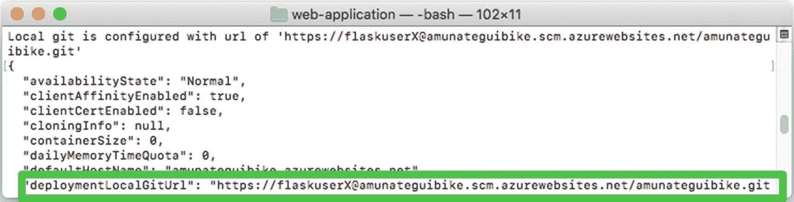

图 2-28

来自“ **deploymentLocalGitUrl** ”的 Git URL 截断输出

有关提取 Azure 项目实例的本地 Git 配置 URL，请参见列表 2-51 和 2-52。

```
https://>@>.scm.azurewebsites.net/>.git
列表 2-52
你的 URL 将类似如下所示
```

```
https://flaskuser11@amunateguibike.scm.azurewebsites.net/amunateguibike.git
列表 2-51
我的案例中提取的 Git URL
```

### 步骤 6：将 Git 代码推送到 Azure

将我们之前保存的 URL 与你的 GIT 仓库位置附加到“**add azure**”命令中（列表 2-53）。

```

# 如果 git remote 已存在，请运行 'git remote remove azure'
$ git remote add azure https://flaskuser11@amunateguibike.scm.azurewebsites.net/amunateguibike.git
列表 2-53
最终代码推送到 Azure
```

系统可能会提示你输入密码；请确保使用你在“**az webapp deployment user**”步骤中创建的密码（在我的案例中是“**flask123**”；列表 2-54）。

```
$ git push azure master
列表 2-54
最终代码推送到 Azure
```

就是这样！你可以返回占位符浏览器页面并点击刷新，或者打开一个新的浏览器页面并输入 [`http://amunateguibike.azurewebsites.net`](http://amunateguibike.azurewebsites.net)

（或者在你的情况下是 `http://<<替换为你的应用名称>>.azurewebsites.net`），你应该会看到“**预测自行车租赁需求**”（图 2-29）。

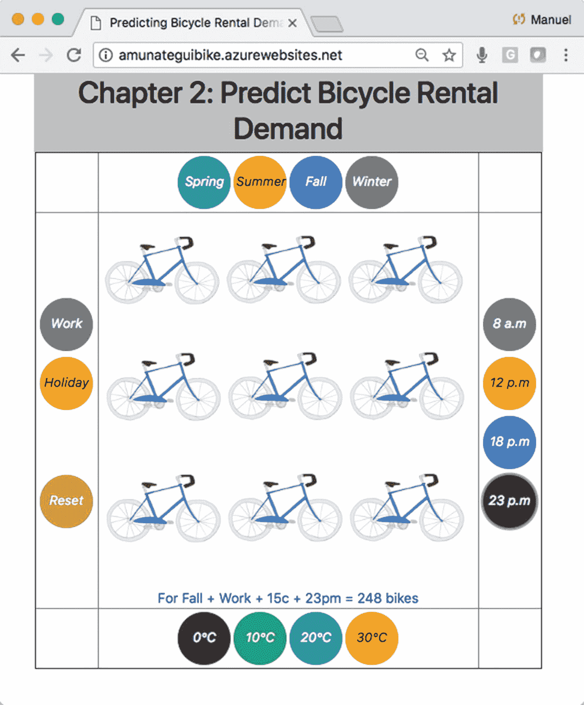

图 2-29

享受你辛勤工作的成果`—`“**预测自行车租赁需求**”Web 应用！

另一方面，如果 azure-cli 返回错误消息，你将需要处理它们（请参阅故障排除部分）。任何时候你更新代码并希望重新部署时，发送一个“**push**”命令（列表 2-55）。

```
$ git commit -am "updated output"
$ git push azure master
列表 2-55
更新代码
```

你也可以直接在 Azure 的 Web 仪表板上管理你的应用程序。登录 Azure 并转到应用服务（图 2-30）。

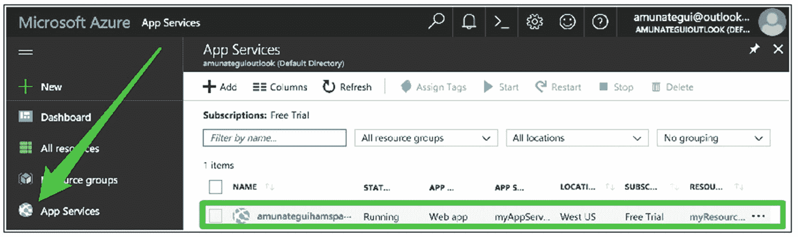

图 2-30

Microsoft Azure 仪表板

### 重要清理！

这是一个关键步骤；你绝不应该在云中留下不需要的应用程序在运行，因为这会产生费用（或者如果你使用的是试用计划，则会消耗你的免费额度）。如果你不再需要它，请将其关闭（列表 2-56 和图 2-31）。

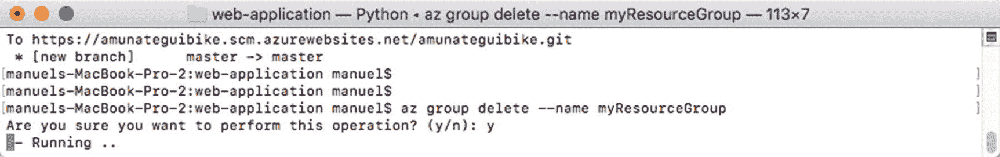

图 2-31

从 Azure 云中删除 Web 应用

```
$ az group delete --name myResourceGroup
列表 2-56
完成后别忘了删除你的 Azure 实例！
```

或者使用 Azure 的 Web 仪表板在“**应用服务**”下将其删除。

### 故障排除

调试 Web 应用错误可能会变得复杂。一种方法是通过 Azure 仪表板打开日志记录（图 2-32）。

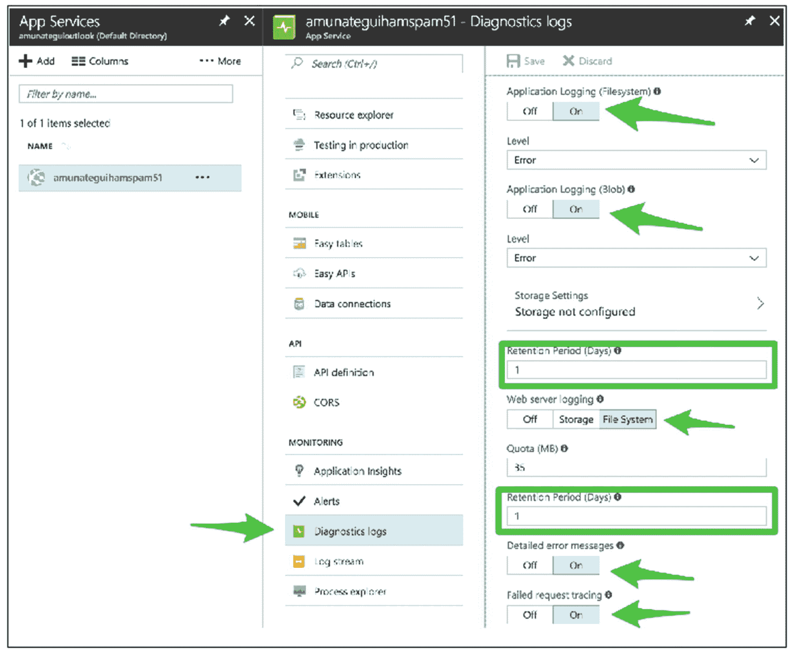

图 2-32

打开 Azure 的诊断日志

然后打开日志流以开始捕获活动（图 2-33）。

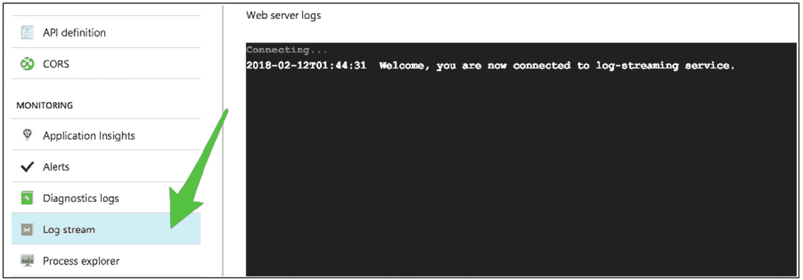

图 2-33

捕获日志信息

你还可以使用 Azure 仪表板内置的便捷控制台工具检查你的文件结构（图 2-34）。

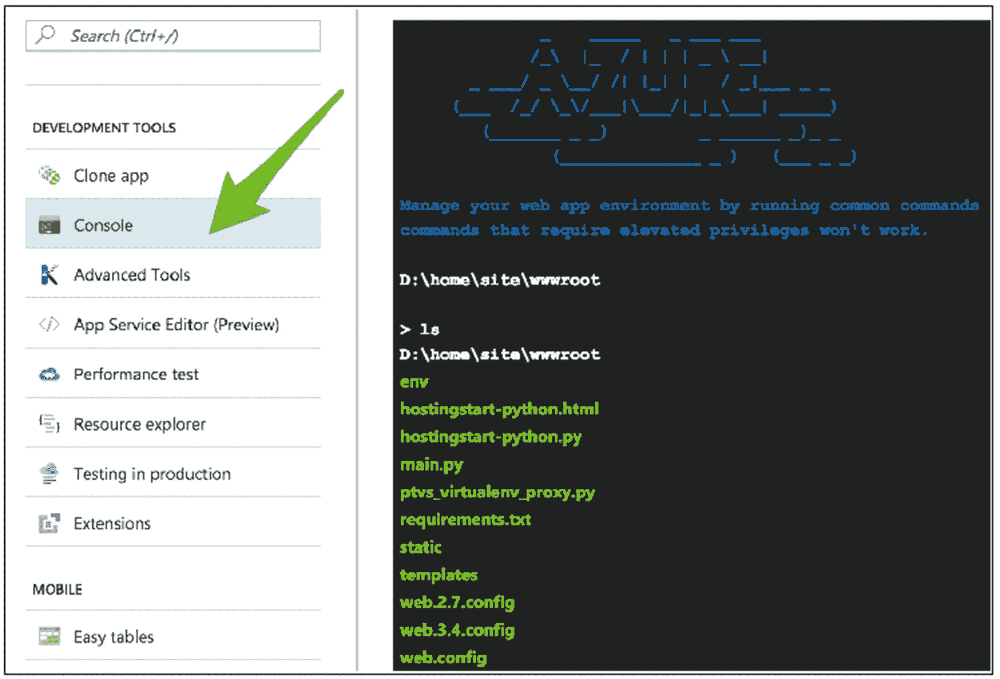

图 2-34

Azure 内置命令行工具

你甚至可以通过使用安装命令来检查你的“**requirement.txt**”文件是否有效（列表 2-57）。

```
> env\scripts\pip install -r requirements.txt
列表 2-57
在 Azure 控制台中运行命令
```

### 步骤回顾

1.  将你的终端/命令窗口指向包含本章 Web 应用文件的正确目录（并确认它可以在本地运行）。

    ```
    $ cd chapter-2/web-application
    ```

1.  Git 提交所有文件。

    ```
    $ git init
    $ git add .
    $ git commit -am "bike rental commit"
    ```

1.  登录 Azure 命令行界面并验证会话。

    ```
    $ az login
    ```

1.  准备 Azure Web 应用。

    ```
    $ az webapp deployment user set --user-name flaskuser11 --password flask123
    $ az group create --name myResourceGroup --location "West US"
    $ az appservice plan create --name myAppServicePlan --resource-group myResourceGroup --sku FREE
    $ az webapp create --resource-group myResourceGroup --plan myAppServicePlan --name amunateguibike --runtime "python|3.4" --deployment-local-git
    ```

1.  将 Web 应用推送到 Azure 云。

    ```
    $ git remote add azure https://flaskuser11@amunateguibike.scm.azurewebsites.net/amunateguibike.git
    $ git push azure master
    ```

1.  在浏览器窗口中打开 URL 并享受吧！

    ```
    http://>.azurewebsites.net
    ```

1.  终止实例！

    ```
    $ az group delete --name myResourceGroup
    ```

## 这里发生了什么？—— 我们 Web 应用中使用的脚本和技术概览

让我们快速浏览一下我们 Web 应用的代码。有两个重要文件：“**main.py**”，它是 Web 服务的控制脚本；以及模板文件“**index.html**”，它是我们 Web 应用的门面。由于大部分处理直接发生在“**index.html**”中，我们将把大部分时间花在那里，查看运行此 Web 应用的 HTML 和 JavaScript。

### main.py

通常情况下，这是整个应用的后台核心。它可以完成独立 Python 脚本所能做的几乎所有事情，并且还能为网页生成内容。在本章中，除了将平均特征值以及模型的截距和系数传递给模板之外，这里并没有太多其他操作。在本书中，我们将同时使用“**main.py**”和“**application.py**”。为控制 Python Web 服务的文件命名没有绝对的对错之分——唯一的例外是一些保留字。如果你选择自定义名称，则需要更新 YAML 文件和/或 Web 服务器网关接口配置文件。此外，一些云服务提供商默认使用不同的应用程序名称；Google Cloud 默认使用“**main**”，而 Azure 默认使用“**application**”。但无论哪种情况，都可以进行自定义和更改。

“**main.py**”在这里做的一件有趣的事情是传输截距、系数和平均值的起始值。

装饰器 **“@app.route**” 会将所有访问根 URL 或文件名为“**index.html**”的流量路由到相应函数。然后，它只需将所有默认值传递给“**index.html**”模板（清单 2-58）。

```
@app.route("/", methods=['POST', 'GET'])
def index():

# on load set form with defaults
return render_template('index.html',
mean_holiday = MEAN_HOLIDAY,
mean_hour = MEAN_HOUR,
mean_sesaon1 = MEAN_SEASON_1,
mean_sesaon2 = MEAN_SEASON_2,
mean_sesaon3 = MEAN_SEASON_3,
mean_sesaon4 = MEAN_SEASON_4,
mean_temp = MEAN_TEMP,
model_intercept = INTERCEPT,
model_holiday = COEF_HOLIDAY,
model_hour = COEF_HOUR,
model_season1 = COEF_SEASON_1,
model_season2 = COEF_SEASON_2,
model_season3 = COEF_SEASON_3,
model_season4 = COEF_SEASON_4,
model_temp = COEF_TEMP)
清单 2-58
路由到“index.html”
```

Flask 使用一种名为“**Jinja2**”的技术，将这些变量直接注入到 HTML 模板表单中。如果你查看 return 语句，它会调用 Flask 的“**render_template**”函数，并将预期的变量传递给“**index.html**”。

模板要接收这些变量，只需使用双花括号命令即可。要查看所有这些内容，请参考 Web 应用程序“**index.htm**”的完整脚本（清单 2-59）。

```
var HOLIDAY = {{mean_holiday}}   // 当天是否为节假日
var HOUR = {{mean_hour}}         // 小时 (0 到 23)
var HOUR = {{mean_hour}}         // 小时 (0 到 23)
var SEASON_1 = {{mean_sesaon1}}  // 1:春季
var SEASON_2 ={{mean_sesaon2}}   // 2:夏季
var SEASON_3 = {{mean_sesaon3}}  // 3:秋季
var SEASON_4 = {{mean_sesaon4}}  // 4:冬季
var TEMP = {{mean_temp}}         // 标准温度，单位为摄氏度 -8 到 +39
var INTERCEPT = {{model_intercept}}
var COEF_HOLIDAY = {{model_holiday}}  // 当天是否为节假日
var COEF_HOUR = {{model_hour}}        // 小时 (0 到 23)
var COEF_SEASON_1 = {{model_season1}} // 1:春季
var COEF_SEASON_2 = {{model_season2}} // 2:夏季
var COEF_SEASON_3 = {{model_season3}} // 3:秋季
var COEF_SEASON_4 = {{model_season4}} // 4:冬季
var COEF_TEMP = {{model_temp}}      // 标准温度，单位为摄氏度 -8 到 +39
...
清单 2-59
使用 Jinja2 将 Python 变量设置到 JavaScript 中
```

### /static/ 文件夹

静态文件夹，顾名思义，存放静态的、不变的文件。这里用于存储我们 Web 应用程序的图像、文件和其他可共享数据。

### /templates/index.html 文件夹和脚本

templates 文件夹存放我们 Web 应用程序所需的所有模板。在后续章节中，通常会有两个 HTML 文件，一个“**index.html**”和一个响应 HTML 文件。最好将这些文件分开，而不是试图将所有内容塞进一个带有复杂“**if then**”分支的单个 HTML 文件中。

本章的大部分操作都发生在“**index.html**”内部，因此让我们深入了解一下。在你的编辑器中打开完整的“**index.html**”文件以便跟随学习。如前所述，本章的“**大脑**”不是 Flask，而是“**index.html**”前端页面——并且几乎全部位于页面末尾的 JavaScript 代码片段中。JavaScript 为网页带来了极佳的交互性。

就这个 Web 应用程序而言，它会监听按钮点击事件，并通过使用所选特征运行回归方程来重新计算自行车租赁需求。这还没完；一旦获得新的需求估计值，它会权衡该数字并决定显示哪张自行车图片拼贴画——如果估计值很小，则返回一辆自行车；如果很大，则返回全部十六辆。

首先，用户点击一个特征按钮，使用该特定特征获取新的自行车租赁估计值（清单 2-60）。

```
Spring
清单 2-60
使用 HTML “” 事件调用预测
```

“**`<button>`**”标签内的“**onclick(**)”函数会将 Id“**season_spring**”发送给主 JavaScript 函数“**calculateBikeDemand()**”。这告诉该函数，用户希望使用如清单 2-61 所示的季节变量设置来重新计算回归方程。

```
function calculateBikeDemand(elem) {
// 将新值应用于存储的变量
...
// 重新计算回归方程
rental_counts = INTERCEPT + (HOLIDAY * COEF_HOLIDAY)
+ (HOUR * COEF_HOUR)
+ (SEASON_1 * COEF_SEASON_1)  + (SEASON_2 * COEF_SEASON_2)
+ (SEASON_3 * COEF_SEASON_3)  + (SEASON_4 * COEF_SEASON_4)
+ (TEMP * COEF_TEMP)if (rental_counts < 0)
// 确定要显示的图片
if (rental_counts < 0) {
bike_out = 'static/images/bike_sixteen.png'
if (rental_counts < 0) {
bike_out = 'static/images/bike_zero.png'
} else if (rental_counts < 100) {
bike_out = 'static/images/bike_one.png'
} else if (rental_counts < 200) {
bike_out = 'static/images/bike_four.png'
} else if (rental_counts < 300) {
bike_out = 'static/images/bike_nine.png'}
// 构建一个包含用户所选变量和新的自行车租赁估计值的可读字符串
output = '对于 ' + season + ' + ' + holiday + ' + ' + temp + ' + ' + hour + '，需求 = ' + Math.round(rental_counts) + ' 辆自行车';
// 将新值和图片源直接注入到 HTML 标签中
document.getElementById("query").innerHTML = output;
document.getElementById('bike_out').src = bike_out
}
清单 2-61
“calculateBikeDemand()”建模 JavaScript 函数
```

## 结论

这就是我们的第一个项目！虽然这是一个简单的项目，Web 客户端和 Web 服务器之间的交互不多，但它符合真正 Web 应用程序的定义。在本章中，我们介绍了通过使用 Flask 和 Web 控件将独立脚本扩展为交互式 Web 应用程序的概念。我们还看到了 Python 和 Python 库与 Flask Web 框架通信是多么容易，使得向 Web 计算的跨越几乎无缝衔接。

整个过程始于规划我们的 Web 应用程序应该是什么样子，以及什么内容能引起观众的兴趣。这一步再怎么强调也不为过：如果没有人感兴趣，那就没有必要费心去构建它。我们常常一开始就建模，然后试图改造它，使其适应一个 Web 应用程序的故事。

然后，我们探索了来自 Capital Bikeshare System 的自行车共享数据集，^(⁹) 尝试了不同的建模方法来预测环境因素下的租赁需求，并选择了最终的特征和模型系数用于我们的 Web 应用程序。

我们运行了 Flask 应用程序的本地版本，并最终将其部署到 Microsoft Azure 云上。如果你按照这个顺序执行这些步骤，应该不会有什么问题。始终从设计 Web 应用程序的故事开始，尽可能在本地构建和运行它，然后再部署到云端。

## 其他资源

如果你想了解更多关于 Flask 的信息，请上网搜索，这方面的资料非常丰富。

更多信息请参考：

*   **Flask**：访问官方门户网站： [`http://flask.pocoo.org/`](http://flask.pocoo.org/)

*   **CSS**：请参阅 w3schools 网站上的优秀教程（涵盖 CSS 及其他所有与 Web 相关的内容）： [`www.w3schools.com/css/`](http://www.w3schools.com/css/)

*   **Bootstrap**：请访问门户网站： [`https://getbootstrap.com/`](https://getbootstrap.com/)

*   **JQuery**：请查看其门户网站： [`https://jquery.com/`](https://jquery.com/)

*   **YAML**：请查看其精简门户网站： [`http://yaml.org/`](http://yaml.org/)

*   **Jinja2**：请参阅官方文档： [`http://jinja.pocoo.org/docs/`](http://jinja.pocoo.org/docs/)

脚注 1   2   3   4   5

