# 3. 在 GCP 上使用逻辑回归实现实时智能

让我们通过在 Google Cloud 上构建一个交互式乘客档案生成器，来了解泰坦尼克号沉船事故中哪些人幸存了下来。

在本章中，我们将重新审视全球建模教科书和教育博客所钟爱的经典且戏剧性的泰坦尼克号数据集。我们将分析乘客名单，并试图理解为什么有些人在这场悲剧事故中幸存，而另一些人却没有。我们将探索数据集，为建模做好准备，并将其扩展为一个交互式 Web 应用程序，允许用户创建一个虚构的乘客，调整参数，并可视化该乘客在航行中的表现（图 3-1）。

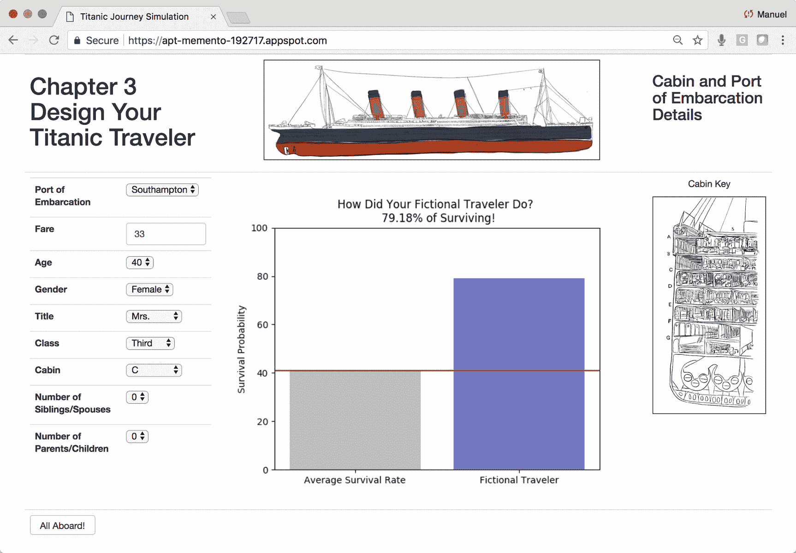

图 3-1

本章的最终 Web 应用程序

范德比尔特大学生物统计系^(¹⁰)慷慨地托管了该数据（以及许多其他有趣的数据集），可以通过 Pandas Python 库直接调用并方便地下载。

### 注意

通过访问 [`www.apress.com/9781484238721`](http://www.apress.com/9781484238721) 并点击源代码按钮，下载第 3 章的配套文件。打开 Jupyter notebook “**chapter3.ipynb**” 以跟随本章内容进行学习。

## 规划我们的 Web 应用程序

我们的第一步是充分构思泰坦尼克号概念，并使其作为 Web 应用程序在我们的本地机器上运行。

我们应用程序的核心是来自“**sklearn Python 库**”^(¹¹)的一个简单逻辑回归模型。在通过移除无预测能力的特征、为分类数据创建虚拟列、以及对文本字段应用基本的自然语言处理来准备数据之后，我们训练模型以识别那些幸存者和遇难者周围的常见模式。

我们通过遵循标准建模流程（将数据分成两部分，一部分用于训练模型，另一部分用于验证模型）来验证模型的准确性。一旦我们对模型的能力感到满意，我们就用它来预测一个虚构乘客的生存概率。这个概率是一个介于 0 和 1 之间的数字，代表了该虚构乘客从沉船事故中生还的机会——数值越接近 1，生存的机会就越大。

最后，我们将抽象并概括整个过程，使其在我们的 Web 应用程序的构造函数中运行。这意味着数据摄取、准备和建模的整个过程仅在模型部署期间（以及每当 Web 服务器重启时）发生一次。这确保了当用户想要与 Web 应用程序交互时，由于训练好的模型已经加载到内存中，应用程序能够快速给出预测结果。不过我们有点操之过急了；让我们先完成项目的本地版本。

## 数据整理

由于这是一个经典的数据科学练习，也是一次有据可查的著名事件，我们已知（或凭直觉判断）哪些特征对于理解谁在航行中幸存下来具有分析价值（更多信息请参阅范德比尔特大学生物统计学资料^(¹²)）。请继续操作，将本章所需的文件下载到一个名为“**chapter-3**”的文件夹中。打开 Jupyter notebook 以便同步操作。让我们先查看数据提供方给出的数据图例（表 3-1）。

表 3-1

数据集图例

| 特征 | 描述 |
| --- | --- |
| pclass | 船票等级，包含 3 个级别 |
| sex | 性别 |
| age | 年龄 |
| sibsp | 船上兄弟姐妹/配偶人数 |
| parch | 船上父母/子女人数 |
| fare | 乘客票价 |
| cabi | 客舱编号 |
| embarked | 登船港口 |
| name | 乘客姓名 |

初步探索数据可以通过编程方式使用 Pandas 的“**head()**”函数完成，该函数会返回前五行数据（代码清单 3-1 和图 3-2）。你也可以使用“**tail()**”函数查看后五行数据。

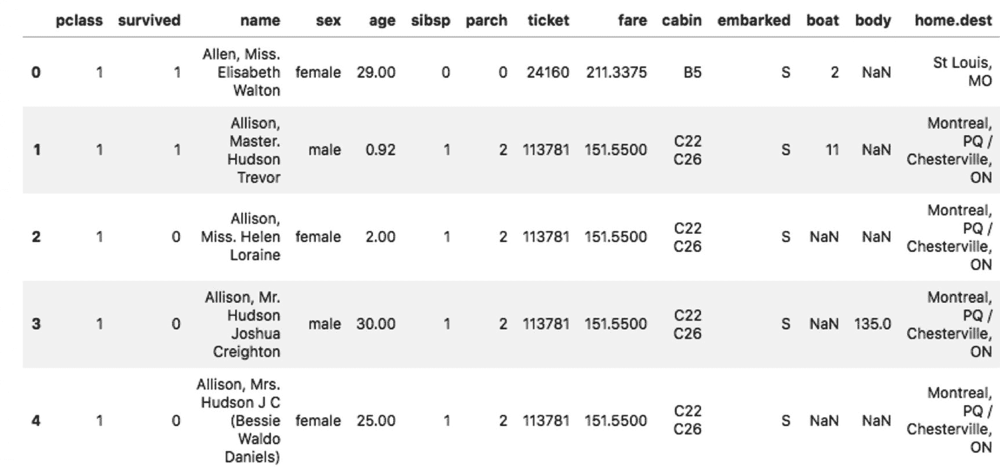

图 3-2

原始数据的前五行

```
titanic_df.head()
代码清单 3-1
快速查看前五行数据
```

该数据确实符合范德比尔特大学生物统计学资料的数据图例。你应该会注意到“**body**”列中存在缺失值，“**name**”和“**home.dest**”列中有大量文本数据，以及“**cabin**”列中存在一些混合内容。

“**info()**”、“**describe()**”和“**isnull()**”函数也是快速探索数据的关键。强烈建议在遇到新数据集或进行任何数据转换工作后运行这些函数。

Pandas 的“**info()**”函数会告诉你数据集中包含的数据类型和非空计数（代码清单 3-2）。

```
输入：
titanic_df.info()
输出：

RangeIndex: 1309 entries, 0 to 1308
Data columns (total 1 columns):
pclass       1309 non-null int64
survived     1309 non-null int64
name         1309 non-null object
sex          1309 non-null object
age          1046 non-null float64
sibsp        1309 non-null int64
parch        1309 non-null int64
ticket       1309 non-null object
fare         1308 non-null float64
cabin        295 non-null object
embarked     1307 non-null object
boat         486 non-null object
body         121 non-null float64
home.dest    745 non-null object
dtypes: float64(3), int64(4), object(7)
memory usage: 143.2+ KB
代码清单 3-2
快速查看特征数据类型
```

从“**info()**”函数输出中标记为“**non-null object**”的数据可以被视为基于文本的数据，我们需要弄清楚它是什么类型的文本。这有点像一门主观的艺术，因为处理方式多种多样（稍后会详细介绍）。

Pandas 的“**describe()**”函数会给出所有定量字段的汇总统计。我们立刻就能看到，“**survived**”特征的均值为 0.38。这意味着只有 38% 的乘客幸存，并且由于我们将使用该特征作为训练模型的结果标签，因此数据集偏向于未幸存者（即大多数乘客未能在航行中幸存；代码清单 3-3 和图 3-3）。

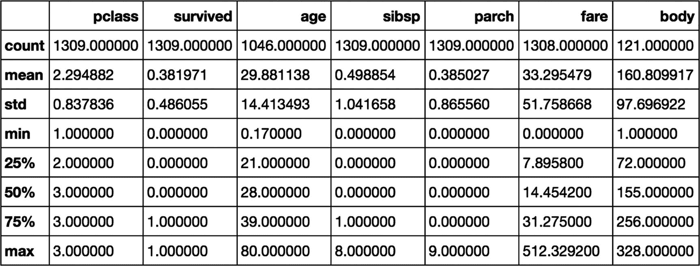

图 3-3

泰坦尼克号数据框的描述性输出

```
titanic_df.describe()
代码清单 3-3
定量数据汇总
```

“**isnull()**”函数可以封装到一个计数器中，以找出我们正在处理的缺失值数量。关于插补方法以及如何在建模场景中最佳处理缺失数据，已有专著论述。在这里，我们将删除一些特征，并对其他特征进行插补（代码清单 3-4 和图 3-4）。

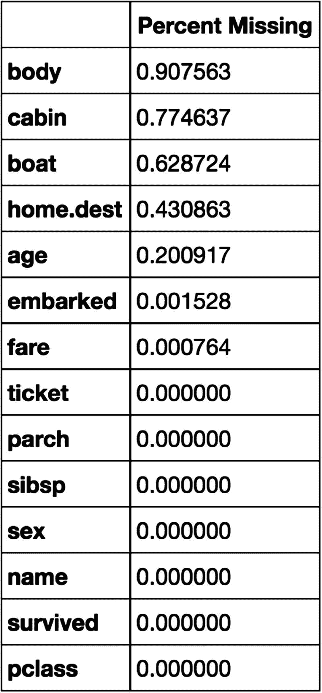

图 3-4

泰坦尼克号数据框中每个特征的缺失数据百分比

```
titanic_missing_count = titanic_df.isnull().sum().sort_values(ascending=False)
pd.DataFrame({'Percent Missing':titanic_missing_count/len(titanic_df)})
代码清单 3-4
分析缺失数据
```

分析函数输出后，我们了解到数据包含数值型、分类型和基于文本的特征。数据集总共包含 1,309 行。我们还看到，特征“**body**”中 90% 的条目是缺失的；这使得它成为一个容易删除的特征。还有其他一些特征我们将忽略，因为它们要么难以处理，要么对建模幸存率帮助不大（例如乘客的姓氏）。

### 处理分类数据

处理分类数据是一个重要课题，其中某些方面具有主观性，而另一些则不然。一个实用的经验法则是，找出特定文本列中有多少值是唯一或重复的。检查频率是一个不错的起点。让我们结合 Pandas 的“**groupby()**”和“**count()**”函数，对“**cabin**”特征进行调用。这将告诉我们这些值是否在乘客之间共享，从而判断应将其视为类别还是自由格式的文本条目（见代码清单 3-5 和图 3-5）。

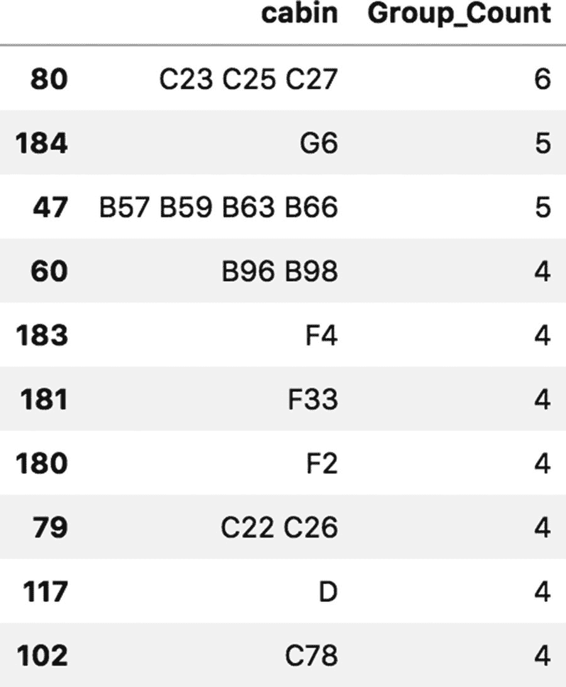

图 3-5

舱位信息是拼接在一起的，将其解耦会更有益处

```
titanic_feature_count = titanic_df.groupby('cabin')['cabin'].count().reset_index(name = "Group_Count")
titanic_feature_count.sort_values('Group_Count', ascending=False).head(20)
代码清单 3-5
统计“cabin”特征中的重复值
```

结果输出证实这些值是类别，因为它们经常重复（这符合直觉：每个舱位可能有多名乘客）。让我们对另一个基于文本的列——“**name**”特征进行同样的实验（我们已经知道会看到多少重复值；见代码清单 3-6 和图 3-6）。

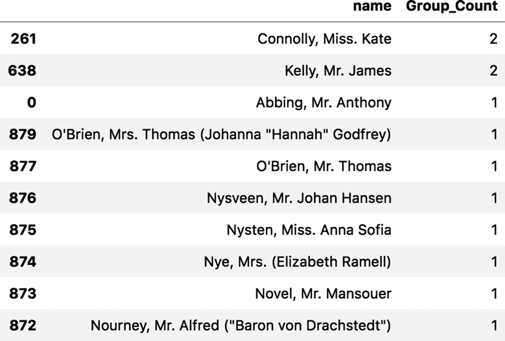

图 3-6

名字重复的次数有多少？

```
titanic_feature_count = titanic_df.groupby('name')['name'].count().reset_index(name = "Group_Count")
titanic_feature_count.sort_values('Group_Count', ascending=False).head(10)
代码清单 3-6
统计“name”特征中的重复值
```

正如直觉所料，大多数名字都是唯一的。这既不是一个适合被视为分类的列，通常也不是一个适合建模的列（你需要重复的数据来发现模式，而唯一的文本条目在其原始状态下无法达到此目的）。

分类数据既可能出现在整数数据类型中，也可能出现在文本数据类型中；因此，单独考虑每个特征并确定最佳建模方式非常重要。例如，特征“**sex**”是分类且二元的，因此该数据的分数对我们没有帮助。我们会将其更改为一个名为“**isFemale**”的单列。如前所示，特征“**cabin**”确实存在重复，但我们可以通过一些处理使其重复得更多（见代码清单 3-7）。

```
输入:
titanic_df['cabin'].head()
输出:
0         B5
1    C22 C26
2    C22 C26
3    C22 C26
4    C22 C26
名称: cabin, 数据类型: object
代码清单 3-7
舱位特征的“Head()”方法
```

通过提取该特征的一个样本，我们注意到数据中的一个共性：每个数字前面都有一个代表船舶甲板层级的字母（图 3-7）。


图 3-7

泰坦尼克号剖面图，标注了舱位层级（插图由 Lucas Amunategui 提供）

因此，利用这些数据的一种方法是取第一个字母并去掉数字。这为我们提供了一个有趣的特征：乘客所在的楼层，以及该楼层与顶层甲板救生艇之间的距离是否与生存率有关？也许存在这种关系，你可以通过我们即将构建的应用程序来找出答案（见代码清单 3-8）。

```
输入:
titanic_df['cabin'] = titanic_df['cabin'].replace(np.NaN, 'U')
titanic_df['cabin'] = [ln[0] for ln in titanic_df['cabin'].values]
titanic_df['cabin'] = titanic_df['cabin'].replace('U', 'Unknown')
titanic_df['cabin'].head()
输出:
0    B
1    C
2    C
3    C
4    C
名称: cabin, 数据类型: object
代码清单 3-8
仅使用每个舱位名称的第一个字符
```

接下来，我们像之前一样执行“**groupby()**”和“**count()**”来统计频率（见代码清单 3-9 和图 3-8）。

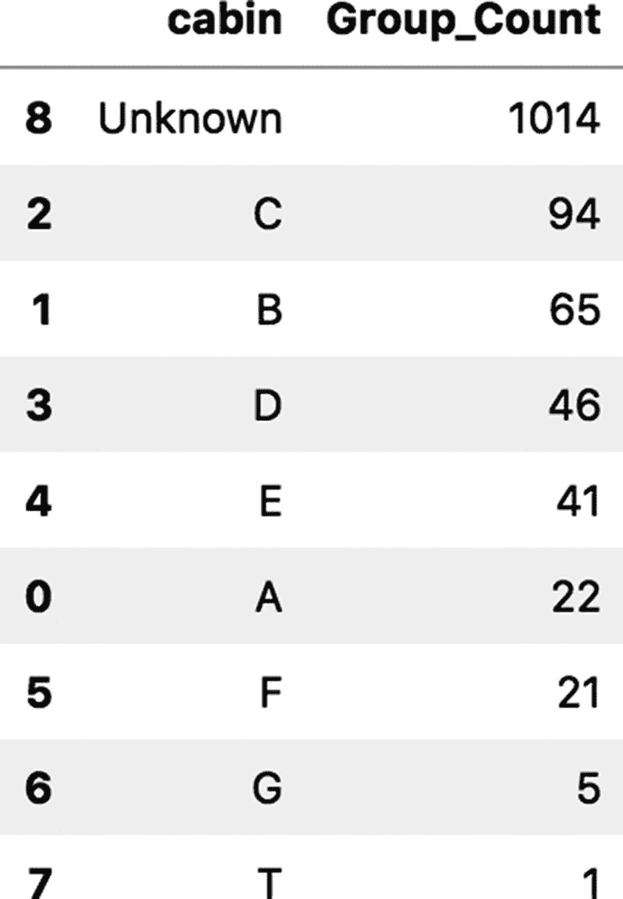

图 3-8

我们新的“**cabin**”特征的总计数

```
titanic_feature_count = titanic_df.groupby('cabin')['cabin'].count().reset_index(name = "Group_Count")
titanic_feature_count.sort_values('Group_Count', ascending=False).head(10)
代码清单 3-9
统计每个舱位首字母分组
```

哇，重复次数比之前观察到的多得多。这应该比其原始格式作为特征更有用。我们将对乘客的“**name**”特征进行同样的处理，只提取头衔：“**Mrs.**”或“**Mr.**”等，并丢弃其他部分（更多细节请参阅 Jupyter notebook）。

这并不是说原始的、自由格式的文本（非重复类型）对建模没有用处。恰恰相反，世界上大多数数据都是非结构化的，并且潜力巨大——想想医生的笔记或商店评论！这些数据可以建模，但需要更高级的方法，例如自然语言处理、奇异值分解、词向量化等。我们将在本书的后续章节中看到其中一些技术。

### 从分类数据创建虚拟特征

一旦我们识别出分类特征并完成了需要转换的特征转换，我们仍然需要将它们转换为数值形式，以便模型能够使用它们。Pandas 库中一个很棒的函数是“**get_dummies()**”。它会将每个类别分解到其自己的列中。

以下是使用“**get_dummies()**”函数及其输出的示例（见代码清单 3-10 和图 3-9）。


图 3-9

舱位特征转换为二进制数据（虚拟化）

```
pd.get_dummies(titanic_df['cabin'], columns=['cabin'], drop_first=False).head(10)
代码清单 3-10
从“cabin”特征创建虚拟变量
```

它接受一个特征，将每个唯一值分解到一个单独的列中，并删除原始列。请记住，并非所有非连续数值都应制成虚拟字段。想想美国的邮政编码；如果你将它们虚拟化，将会为数据集增加额外的 43,000 个极其稀疏的特征——这通常不是一个好主意。对于邮政编码，更好的方法可能是更大的分类分组，例如在城镇或州级别进行建模。

## 建模

在我们的第二个项目中保持简单，将使我们能够专注于全局，并平等地投入到构建 Web 应用程序的每个环节。我们将使用来自“**sklearn**”库的逻辑回归模型。如果你还记得上一章，我们使用了线性回归，它试图预测一个连续变量。而逻辑回归则试图预测一个二元结果，例如真或假、高兴或悲伤等。这两种都是极其常见的模型，但你需要根据试图建模和预测的结果变量类型来选择正确的模型。

### 训练/测试集划分

我们利用 sklearn 中的“**train_test_split()**”函数，通过指定随机种子将数据划分为两个随机数据集。在测试不同方法时，设置“**random_state**”参数是个好习惯，这能确保始终使用相同的划分方式，以便进行公平比较。“**test_size**”参数用于设置测试集的划分比例。此处我们将其设为 0.5，即 50%，因此函数会随机打乱数据并将其对半分为训练集和测试集。我们将使用训练部分来建模，用测试部分来评估模型的表现。该函数使用起来非常简便（见代码清单 3-11 和图 3-10）。

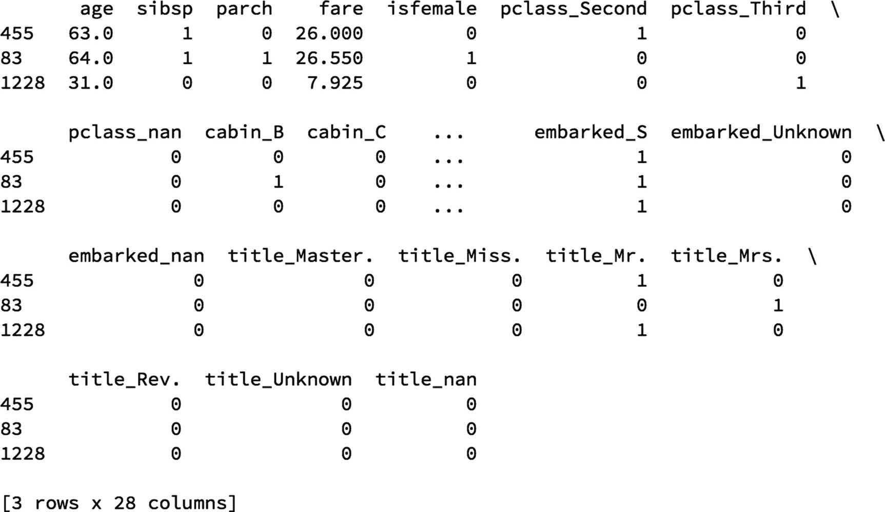

图 3-10

泰坦尼克号数据框的训练集划分，已准备好进行建模

```
from sklearn.model_selection import train_test_split
features = [feat forfeat in list(titanic_ready_df) if feat != 'survived']
X_train, X_test, y_train, y_test = train_test_split(titanic_ready_df[features],
titanic_ready_df[['survived']], test_size=0.5, random_state=42)
print(X_train.head(3))
代码清单 3-11
将数据划分为训练集和测试集
```

该函数将结果变量分别存入“**y_train**”和“**y_test**”；模型将只能访问“**y_train**”（见代码清单 3-12）。

```
输入:
print(y_train.head(3))
输出:
survived
455          0
83           1
1228         1
代码清单 3-12
训练数据集中的前几个结果值
```

### 逻辑回归

现在需要决定使用哪种模型并进行设置。由于我们要预测的是一个二元结果——乘客是否在航行中幸存——逻辑回归是一个不错且轻量级的选择，非常适合网络应用。始终牢记最终目标是个好习惯（见代码清单 3-13）。

```
from sklearn.linear_model import LogisticRegression
lr_model = LogisticRegression()

# ravel() 只是创建一个扁平化的数组
lr_model.fit(X_train, y_train.values.ravel())
代码清单 3-13
Sklearn 的逻辑回归模型
```

数据相当直观，幸存模式的规律众所周知，并且大多数建模算法都能清晰地识别出来。Sklearn 的逻辑回归模型让我们可以非常方便地查看模型生成的系数，从而帮助我们解读哪些特征对泰坦尼克号之旅的幸存预测最为重要（见代码清单 3-14）。

```
coefs = pd.DataFrame({'Feature':features, 'Coef':lr_model.coef_[0]})
coefs.sort_values('Coef', ascending=False)
代码清单 3-14
提取模型系数
```

图 3-11 展示了在预测幸存率时正向影响最大和负向影响最大的特征。显然，在这次特定的航行中，身为女性且富有比身为男性且贫穷要幸运得多（完整的系数列表请参见笔记本）。

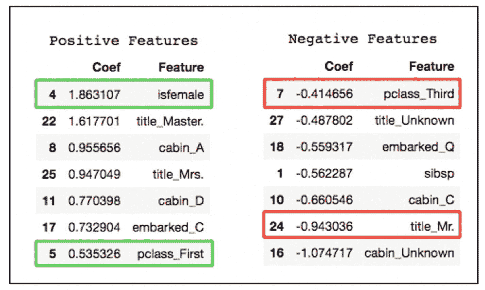

图 3-11

正向影响最大和负向影响最大的特征

### 预测幸存率

一旦我们训练好模型，就可以使用之前预留的测试数据部分来验证其准确性（使用前面提到的“**train_test_split()**”函数）。这些数据绝不能在训练阶段使用！因此，它能保证对模型进行一次全新的评估，并提供一种客观的方式来获取性能评分（见代码清单 3-15）。

```
输入:
y_pred = lr_model.predict(X_test)
print('Accuracy of logistic regression classifier on test set: {:.2f}%'
.format(lr_modl.score(X_test, y_test)*100))
输出:
Accuracy of logistic regression classifier on test set: 79.35%
代码清单 3-15
使用测试数据集进行预测
```

使用验证数据集时，该模型在预测谁能在航行中幸存方面达到了近 80% 的准确率。考虑到我们使用的是简单模型和小型数据集，这个分数并不算差。

Python 脚本的工作已接近尾声；我们只需要确保能够使用虚构数据进行预测。这是一个重要的步骤，因为我们希望用户能够提供自己的数据，并通过训练好的模型运行。好的，那么让我们尝试预测一位 50 岁、乘坐三等舱的男性乘客（见代码清单 3-16）。

```
x_predict_pclass = 'Third'
x_predict_is_female=0
x_predict_age=50
x_predict_sibsp=3
x_predict_parch = 0
x_predict_fare = 200
x_predict_cabin = 'A'
x_predict_embarked = 'Q'
x_predict_title = 'Mr.'
代码清单 3-16
通过创建虚构乘客来设置自定义预测
```

如果你熟悉这个数据集和历史事件，就会知道我们这位虚构乘客的结局不会太好。在模型运行之后，我们使用一个简单的对比图表来展示结果，该图表显示了我们虚构乘客旁边的平均幸存率。身为男性且乘坐三等舱是一个糟糕的组合（图 3-12）。


图 3-12

平均幸存率与我们的虚构乘客对比

## 抽象化一切，为云端做准备

既然我们已经确认模型可以工作，能够创建虚构乘客并预测他们的幸存概率，那么我们可以将代码打包成两个函数，用于我们的网络应用。保持代码的整洁有序，将减少从独立脚本项目迁移到云端环境过程中的复杂性和调试难题。

### 函数 startup( )

我们创建一个“**startup()**”函数，该函数负责将数据加载到内存中，执行所有特征工程，创建虚拟列，并训练模型。此函数仅在网络服务器启动或重启时被调用一次。尽可能多地将工作预加载到内存中，将为与网络应用交互的用户提供更快、响应更灵敏的体验。

### 函数 submit_new_profile( )

第二个函数名为“**submit_new_profile()**”。该函数处理新的虚构乘客档案，将数据格式化为与真实训练数据相同的形状，创建所需的虚拟列，并让模型预测并输出幸存概率。

就是这样；我们所需的大部分核心处理工作将由这两个函数完成。其余所有代码用于网络服务器和 HTML 页面之间的通信、显示结果以及使整个应用看起来更专业。但我们有点操之过急了；现在让我们先更深入地了解 Flask。

使用 Flask 的一个绝佳理由是，它允许我们在不离开 Python 语言的情况下，将独立的 Python 脚本函数与服务器端的网络控件连接起来。这使得在模型和网络之间传递数据变得容易得多！

## 与 HTML 表单的交互

除了 Flask，一个关键的前端网络技术是“**HTML 表单**”。^(¹³) 尽管这是基础内容，但它是用户与我们的应用之间的关键纽带。HTML 表单允许用户与网页上的信息进行交互，然后点击提交按钮，将自定义数据发送回 Flask 网络服务器（见代码清单 3-17）。

```
...

{{selected_embarked}}
瑟堡
皇后镇

...
提交

代码清单 3-17
与用户交互
```

## 创建动态图像

这里我们使用一项重要技术，将 Python 中即时创建的图像转换为字符串，以便 HTML 解释器能够动态接收并理解这些图像。这是通过“**base64**”Python 模块实现的：

> *该模块提供 RFC 3548 中指定的数据编码和解码功能。该标准定义了 Base16、Base32 和 Base64 算法，用于将任意二进制字符串编码和解码为文本字符串，这些文本字符串可以安全地通过电子邮件发送、用作 URL 的一部分，或作为 HTTP POST 请求的一部分包含在内。该编码算法与 uuencode 程序不同。* ^((14))

在以下简化的代码片段中，我们使用“**matplotlib.pyplot**”库在 Python 中创建了一个图像（清单 3-18）。

```
import matplotlib.pyplot as plt
fig = plt.figure()
plt.bar(y_pos, performance, align="center", color = colors, alpha=0.5)
img = io.BytesIO()
plt.savefig(img, format="png")
img.seek(0)
plot_url = base64.b64encode(img.getvalue()).decode()
清单 3-18
创建动态图像
```

然后，可以使用 Flask Jinja2 模板符号将变量“**plot_url**”注入到 HTML 代码中，如下所示（清单 3-19）。

```
model_plot = Markup(''.format(plot_url))
...
{{model_plot}}
清单 3-19
将动态图像从 Flask 绘制到 Jinja2
```

如果你查看 HTML 源代码输出，你会看到 HTML 图像标签由一长串字符组成（在显示的图像中大幅截断）。解释器将知道如何将其转换为图像（图 3-13）。

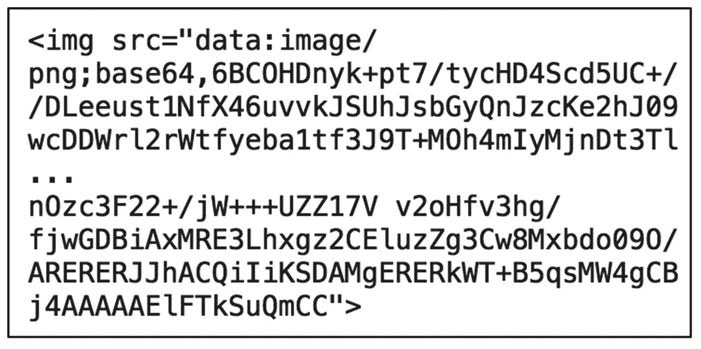

图 3-13

图像转换为字符串

## 下载泰坦尼克号代码

让我们下载第 3 章的文件，如果尚未下载，请将它们保存到本地机器上。下载完成后，打开一个命令行窗口，并将驱动器切换到“**web-application**”文件夹。文件夹结构应如清单 3-20 所示。

```
web-application/
├── main.py
├── static/
└── images/
├── small_cabin_location.png
└── small_titanic.jpg
├── templates/
└── index.html
├── titanic3.csv
├── requirements.txt
├── app.yaml
└── appengine_config.py
清单 3-20
Web 应用程序文件
```

下载并解压所有内容后，打开一个命令行窗口，将驱动器切换到“**web-application**”文件夹，并通过运行“**pip install -r**”命令安装所有必需的 Python 库（清单 3-21）。

```
$ pip3 install -r requirements.txt
清单 3-21
安装依赖项
```

与之前的本地 Flask 应用程序一样，运行“**Python3 main.py**”命令。它应该类似于以下图 3-14 中的屏幕截图。

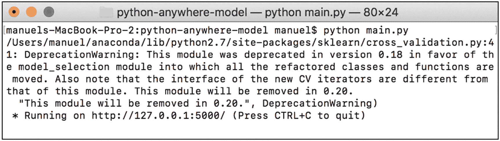

图 3-14

命令/终端窗口输出，显示本地 Flask 网页的 URL 地址

然后，将 URL“**http://127.0.0.1:5000/**”（或终端窗口中显示的任何地址）复制到浏览器中，你应该会看到泰坦尼克号 Web 应用程序出现。如果没有出现，请在你喜欢的代码编辑器中打开“**main.py**”（我在 Mac 上喜欢用 sublime，在 Windows 上喜欢用 notepad++），并将最后一行的布尔标志切换为“**True**”。重新运行它，并解决日志记录器报告的任何问题。

查看 Web 应用程序的本地版本，如图 3-15 所示。

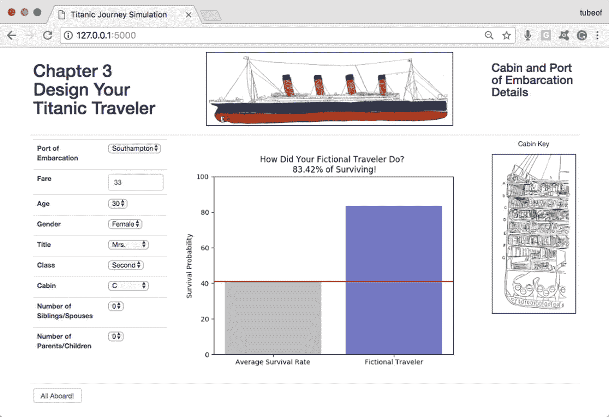

图 3-15

我们 Web 应用程序的本地版本

## Google Cloud Flexible App Engine

现在，这是另一个有趣的部分，将我们的应用程序部署到无服务器云中，让全世界都能看到！在介绍章节中，我们了解了标准 App Engine，这次我们将不得不使用 Flexible App Engine 来运行更复杂的 Python 库。

### Google App Engine

Google App Engine 是无服务器的，因此你无需考虑 Web 应用程序背后的任何硬件。你无需知道应用程序运行在什么操作系统下，它会自动扩展，Google 会处理安全补丁，并且你只需为你消耗的资源付费。

你可以选择两种类型的 App Engine：一种非常简单但可定制性较差，另一种则不然。我们在第 1 章中使用了标准环境；这里由于某些 Python 库的需求，我们需要使用 Flexible 环境（图 3-16）。

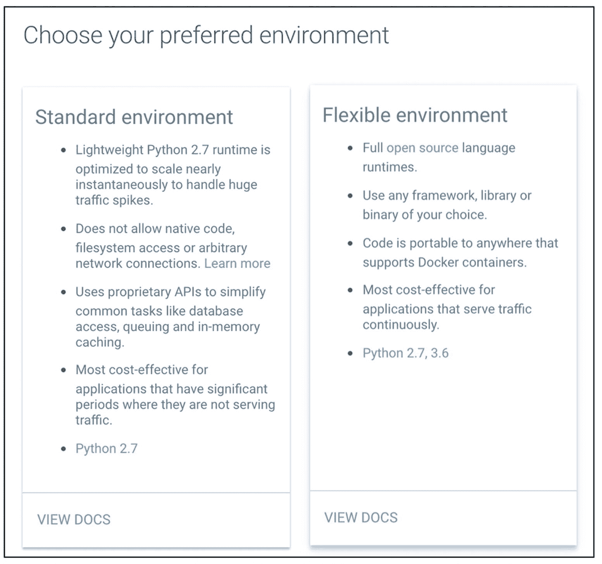

图 3-16

App Engine 标准环境与 Flexible 环境之间的差异（在你阅读本文时可能已发生变化）

## 在 Google App Engine 上部署

有多种方法可以在 Google App Engine 上部署 Web 应用程序。在本章中，我们将使用仪表板本身内置的 shell 终端。这适用于快速任务；对于较长时间的任务，你需要从本地计算机打开一个终端会话，并使用适当的身份验证启动与 Google Cloud 账户的连接。其他方法包括将 GitHub（或 BitBucket）直接链接到你的 Google Cloud 账户，直接从本地机器使用终端会话，以及仪表板中还有一个实验性的代码编辑器（参见 [`https://cloudplatform.googleblog.com/2016/10/introducing-Google-Cloud-Shels-new-code-editor.html`](https://cloudplatform.googleblog.com/2016/10/introducing-Google-Cloud-Shels-new-code-editor.html) ）。

如果你还没有 Google Cloud 账户，可以访问 Google Cloud 入门页面（ [`https://console.cloud.google.com/getting-started`](https://console.cloud.google.com/getting-started) ）并设置一个。在撰写本文时，Google 提供 12 个月和 300 美元的信用额度供你入门（图 3-17）。


图 3-17

Google Cloud Platform 特别优惠

### 步骤 1：启动 Google Cloud Shell

登录你的 Google Cloud 实例，并创建或选择你想要 App Engine 所在的项目。通过点击右上角的插入符号按钮启动云 shell 命令行工具。这将在 GCP 仪表板的下半部分打开一个熟悉的命令行窗口（图 3-18）。


图 3-18

访问 Google Cloud shell

### 步骤 2：压缩并上传所有文件到云端

有多种方法可以继续：你可以逐个上传文件，克隆一个 GitHub 仓库，或者将它们压缩成一个归档文件并上传 zip 文件。我们将采用后一种方法。因此，将“**web-application**”文件夹中的 11 个文件压缩（图 3-19）。

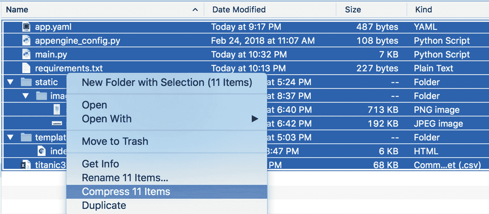

图 3-19

压缩 Web 应用程序文件以上传到 Google Cloud

使用“**Upload file**”选项上传它（该选项位于 shell 窗口右上角的三个垂直点下；图 3-20）。

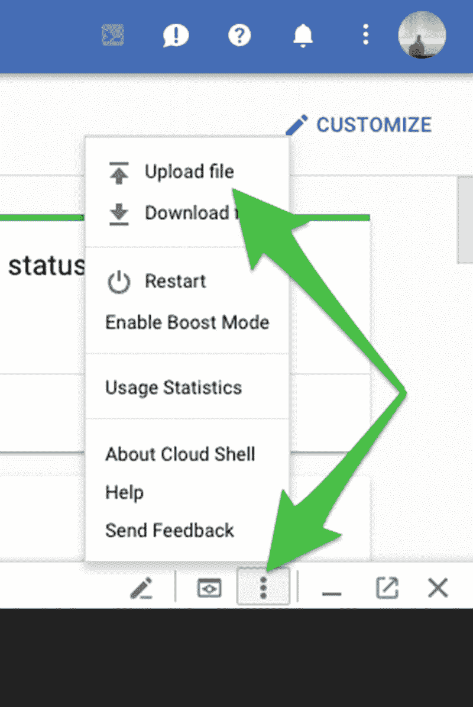

图 3-20

通过 Google Cloud shell 上传文件

### 步骤 3：在 Google Cloud 上创建工作目录并解压文件

文件成功上传后，创建一个名为“**chapter-3**”的新目录，然后将压缩文件移入其中并解压（清单 3-22）。

```
$ mkdir chapter-3
$ cd chapter-3/
$ mv ../Archive.zip Archive.zip
$ unzip Archive.zip
清单 3-22
准备 GCP 目录以进行部署
```

### 步骤 4：创建 Lib 文件夹

我们快完成了。如果你查看 `requirements.txt` 文件，会看到运行应用程序所需的一个或多个 Python 库。当你构建自己的应用程序时，需要在此处列出所有必需的库；然后运行脚本将这些库实际安装到 `lib` 文件夹中。请注意，Google App Engine 的标准环境仅支持最少的库集；对于更复杂的需求，你需要使用灵活环境（这是因为它需要更接近 Python 解释器）。因此，运行以下命令将所有需要的额外库安装到 `lib` 文件夹中。当你部署 Web 应用程序时，`lib` 文件夹将随所需的库一起传输（清单 3-23）。

```
$ pip install -t lib -r requirements.txt
清单 3-23
将所有必需的 Python 库加载到“lib”文件夹中
```

### 步骤 5：部署 Web 应用程序

最后，使用部署命令将其部署到全球。系统会提示一个确认屏幕以继续操作（清单 3-24）。

```
$ gcloud app deploy app.yaml
清单 3-24
将 Web 应用程序部署到云端
```

就是这样！请坐好，让无服务器工具部署我们的网站。这是灵活版 App Engine，因此完全部署可能需要长达 20 分钟。一旦完成所有设置，它会提供一个可点击的链接，直接跳转到已部署的 Web 应用程序，或者你也可以使用“**browse**”命令访问（清单 3-25）。

```
$ gcloud app browse
清单 3-25
获取我们 Web 应用程序的位置 URL
```

享受你的劳动成果吧，并务必通过设计不同的乘客来试验这个 Web 应用程序（图 3-21）。

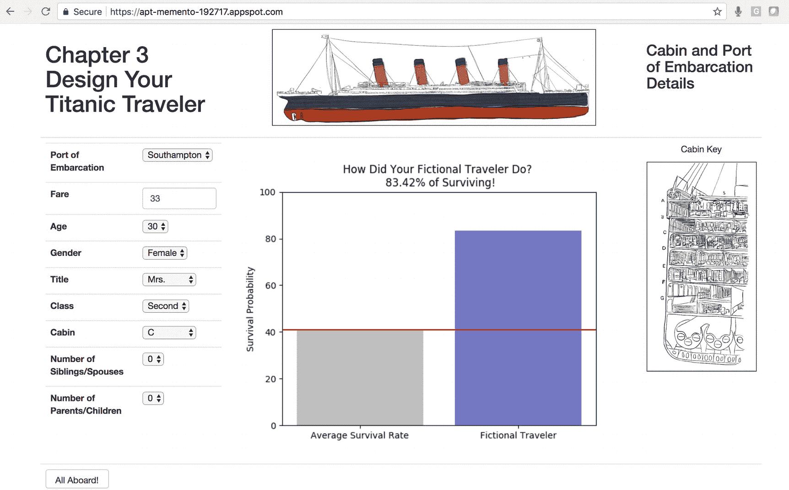

图 3-21

我们在 Google Cloud 上的 Web 应用程序

## 故障排除

有时你可能会遇到问题，此时 Google Cloud 日志将是你最好的帮手。你可以直接在 Google Cloud 仪表板中或通过日志 URL 轻松访问它们（清单 3-26）。

```
https://console.cloud.google.com/logs
清单 3-26
GCP 日志页面

```

或者，你可以通过在 Cloud Shell 中调用“**app logs tail**”命令来流式传输日志尾部（清单 3-27）。

```
$ gcloud app logs tail -s default
清单 3-27
跟踪部署日志
```

## 收尾工作

最后一件事：在完成我们的 Web 应用程序之前，别忘了停止或删除你的 App Engine Cloud 实例。即使你使用的是免费额度，计时器仍在运行，没有必要浪费金钱或额度。

灵活版 App Engine 与标准版略有不同，因为灵活版的成本更高。因此，如果你不使用它，停止它是很重要的。此外，所有这些都可以通过 Google Cloud 仪表板方便地完成。

导航到 App Engine，然后选择“版本”。点击你的活动版本并停止它（图 3-22）。如果你有多个版本，可以删除旧版本；你无法删除默认版本，但停止它应该就足够了（如果你真的不想留下任何痕迹，只需删除整个项目）。

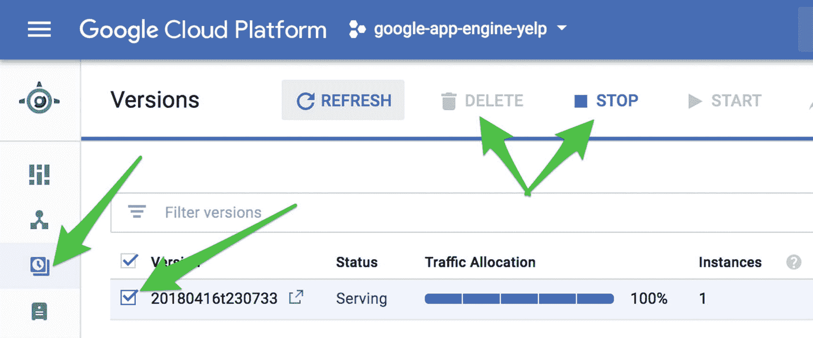

图 3-22

停止和/或删除你的 App Engine 版本

## 代码解析

让我们简要看一下代码中一些值得注意的部分。

### main.py

“**main.py**”文件与我们本章处理的 Jupyter notebook 略有不同。在运行 Web 应用程序时，最好不要过度依赖处理能力。这就是为什么我们摒弃了所有 Pandas 代码，转而使用 NumPy 数组（清单 3-28）。

```
from numpy import genfromtxt
titanic_array = genfromtxt('titanic3.csv', delimiter=',')
清单 3-28
从 CSV 文件创建矩阵数组
```

例如，当用户设计新的乘客档案时，这些值会按正确顺序添加到列表中，并直接输入到逻辑回归模型中。这些字段没有被虚拟化，而是从一开始就以虚拟状态创建（基本上，我们是手动进行虚拟化；清单 3-29）。

```
if (selected_cabin=='B'):
cabin_B = 1
if (selected_cabin=='C'):
cabin_C = 1
if (selected_cabin=='D'):
cabin_D = 1
if (selected_cabin=='E'):
cabin_E = 1
if (selected_cabin=='F'):
cabin_F = 1
if (selected_cabin=='G'):
cabin_G = 1
if (selected_cabin=='T'):
cabin_T = 1
if (selected_cabin=='Unknown'):
cabin_Unknown = 1
user_designe_passenger = [[age, sibsp, parch, fare, isfemale, pclass_Second, pclass_Third, pclass_nan, cabin_B, cabin_C, cabin_D, cabin_E, cabin_F, cabin_G, cabin_T, cabin_Unknown, cabin_nan, embarked_Q, embarked_S, embarked_Unknown, embarked_nan, title_Master, title_Miss, title_Mr, title_Mrs, title_Rev, title_Unknown, title_nan]]
清单 3-29
手动虚拟化类别
```

在这段代码片段中，“**cabin**”特征直接存储为整数。这为我们节省了一些处理步骤，例如避免调用 Pandas 的“**get_dummies()**”函数。

### app.yaml

YAML 是一种序列化语言，许多框架依赖它来配置和存储程序设置。“**app.yaml**”文件包含配置设置，例如将 App Engine 环境设置为“**flex**”，将 Python 启动脚本名称设置为“**main**”，以及所需的硬件信息（清单 3-30）。

```
runtime: python
env: flex
entrypoint: gunicorn -b :$PORT main:app
runtime_config:
python_version: 3

# 此示例在 App Engine 灵活环境上运行会产生费用。

# 以下设置旨在降低测试成本，不适用于生产环境。有关更多信息，请参阅：

# https://cloud.google.com/appengine/docs/flexible/python/configuring-your-app-with-app-yaml
manual_scaling:
instances: 1
resources:
cpu: 1
memory_gb: 0.5
disk_size_gb: 10
清单 3-30
App Engine 灵活版“app.yaml”文件内容一览
```

App Engine 灵活版要求磁盘大小至少为 10GB。

有关 App Engine 的“**yaml**”文件的更多信息，请参阅 [`https://cloud.google.com/appengine/docs/flexible/python/configuring-your-app-with-app-yaml`](https://cloud.google.com/appengine/docs/flexible/python/configuring-your-app-with-app-yaml) 。

### appengine_config.py 与 lib 文件夹

“**appengine_config.py**”文件和“**lib**”文件夹协同工作，用于处理运行 Web 应用程序所需的所有额外 Python 库（清单 3-31）。

```
from google.appengine.ext import vendor

# Add any libraries installed in the "lib" folder
vendor.add('lib')
清单 3-31
“appengine_config.py”脚本内容一览
```

通过调用“**pip install**”命令，可以将所需的 Python 库填充到“**lib**”文件夹中（清单 3-32）。

```
pip install -t lib -r requirements.txt
清单 3-32
填充“lib”文件夹
```

运行此命令后，如果你查看“**lib**”文件夹内部，会看到各种 Python 库已部署并准备就绪。该文件夹将与所有 Web 应用程序文件一起部署，以确保它们正常运行。对于 Google App Engine 而言，“**appengine_config.py**”的功能远不止此处展示的这些；更多详情请参阅官方文档。

### 注意

有关 appengine_config.py 的更多信息，请参阅 Google 文档：[`https://cloud.google.com/appengine/docs/standard/python/tools/appengineconfig`](https://cloud.google.com/appengine/docs/standard/python/tools/appengineconfig)。

### requirements.txt

以下是运行泰坦尼克号 Web 应用程序所需的所有 Python 库列表（你的版本号可能有所不同；清单 3-33）。

```
click==6.7
Flask==0.12.2
itsdangerous==0.24
Jinja2==2.10
MarkupSafe==1.0
numpy==1.14.2
scikit-learn
scipy
python-dateutil==2.7.2
pytz==2018.4
six==1.11.0
Werkzeug==0.14.1
Pillow>=1.0
matplotlib
gunicorn>=19.7.1
清单 3-33
运行 Web 应用程序所需的 Python 库
```

## 步骤回顾

让我们快速回顾一下将泰坦尼克号 Web 应用程序部署到 Google Cloud 所需的步骤。

1.  检查 Web 应用程序是否在本地运行，压缩所有 Web 应用程序文件，在 Google Cloud 上创建目标文件夹，并解压文件：

1.  创建“**lib**”文件夹：

```
$ mkdir chapter-3
$ cd chapter-3/
$ mv ../Archive.zip Archive.zip
$ unzip Archive.zip
```

1.  部署 Web 应用程序：

```
pip install -t lib -r requirements.txt
```

1.  获取 Web 应用程序的 URL：

```
gcloud app deploy app.yaml
```

```
gcloud app browse
```

收尾工作：前往 GCP 控制台的 App Engine，并终止任何正在运行的版本。

## 结论

关于泰坦尼克号数据集，我们了解到，富有且身为女性生存几率最大，而贫穷且身为男性生存几率最小。

尽管这个项目相当直接，但本章引入了许多概念和新技术。首先，要始终在开发本地 Python 想法和模型时提前思考几步，预见如何将其扩展到云端。这包括保持简单、处理直观的概念，以及保持代码的整洁和高效。

脚注 1   2   3   4   5

