# 4. 在 AWS 上使用梯度提升机进行预训练智能分析

是什么造就了顶级葡萄酒？通过亚马逊云服务上一个令人难以抗拒的实时 Web 仪表盘来一探究竟。

在本章中，我们将借助“**sklearn**”库中强大的“**梯度提升分类器**”^(¹⁵)算法来了解葡萄酒品质。该算法可以将数据分类到多个类别中，我们将用它来将葡萄酒分组到“**品质**”桶中。我们将通过实时滑块（图 4-1）在 Web 仪表盘中突出展示这一强大功能。

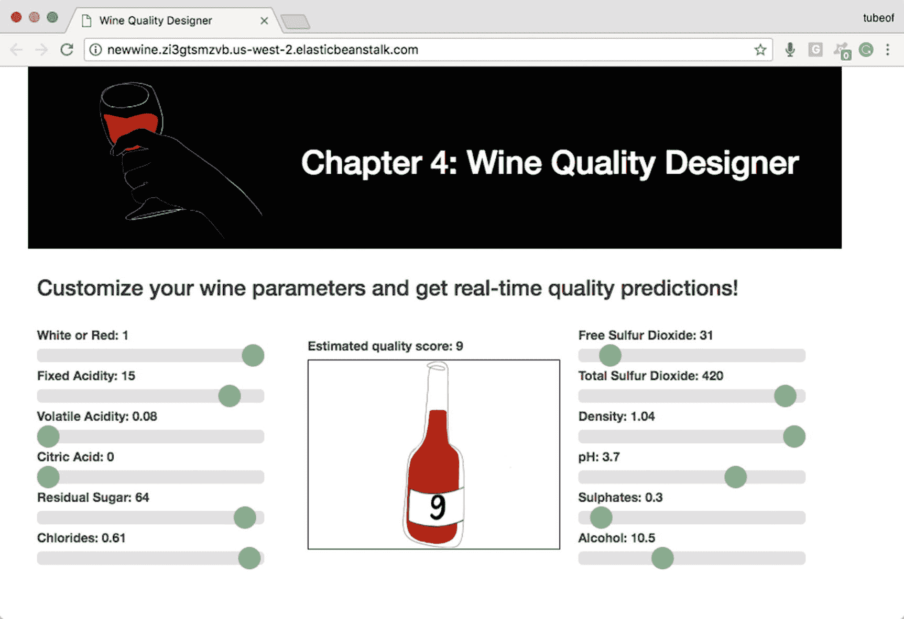

图 4-1

本章的最终 Web 应用程序

这将邀请访问者以一种有趣、响应迅速且具有教育意义的方式与模型进行交互。这些数据是为一篇题为“**通过数据挖掘理化性质对葡萄酒偏好进行建模**”^(¹⁶)的论文收集的。该数据由加州大学欧文分校的 UCI 机器学习库慷慨提供。^(¹⁷)

### 注意

通过访问 [`www.apress.com/9781484238721`](http://www.apress.com/9781484238721) 并点击源代码按钮，下载第 4 章的文件。打开 Jupyter notebook “**chapter4.ipynb**” 以跟随本章内容进行学习。

## 规划我们的 Web 应用程序：是什么造就了顶级葡萄酒？

与任何 Web 应用程序一样，在将其扩展到网络之前，先解决简单的问题至关重要。我们将从探索数据、试验建模、构建本地 Flask 应用程序开始，只有在一切运行正常后，我们才会将其扩展到亚马逊云服务（AWS）Elastic Beanstalk。^(¹⁸)

## 探索葡萄酒质量数据集

葡萄酒质量数据集可以直接通过 Python 的“**Pandas**”库从 UCI 机器学习库下载。它由两个数据集组成：1599 个红葡萄酒实例和 4898 个白葡萄酒实例。这些数据代表了与葡萄牙“**绿酒**”的红白变种相关的化学读数。^(¹⁹) 请继续将本章的文件下载到一个名为“**chapter-4**”的文件夹中。启动 Jupyter notebook 以便跟随操作。

根据 UCI 的数据描述，共有 11 个基于理化测试的属性，以及一个基于感官数据的输出列：

*   **输入**
    *   固定酸度

*   挥发性酸度

*   柠檬酸

*   残糖

*   氯化物

*   游离二氧化硫

*   总二氧化硫

*   密度

*   pH 值

*   硫酸盐

*   酒精

*   **输出**
    *   质量（0 到 10 之间的分数）

我们将创建一个名为“**color**”的新特征来描述葡萄酒是白葡萄酒还是红葡萄酒，并将两个数据集合并为一个。作为良好的网络公民，我们还会将最终合并后的数据集保存一份本地副本到我们的 Web 应用程序中，这样每次用户交互时就不必再访问服务器了（清单 4-1）。

```
white['color'] = 0
red['color'] = 1
wine_df = pd.concat([white, red], ignore_index=True)
Listing 4-1
创建一个新的葡萄酒颜色特征，并将白葡萄酒和红葡萄酒数据合并
```

现在我们已经准备好了数据集，让我们深入研究一下，看看我们有什么（清单 4-2）。

```
Input:
wine_df.info()
Output:

RangeIndex: 6497 entries, 0 to 6496
Data columns (total 13 columns):
fixed acidity           6497 non-null float64
volatile acidity        6497 non-null float64
citric acid             6497 non-null float64
residual sugar          6497 non-null float64
chlorides               6497 non-null float64
free sulfur dioxide     6497 non-null float64
total sulfur dioxide    6497 non-null float64
density                 6497 non-null float64
pH                      6497 non-null float64
sulphates               6497 non-null float64
alcohol                 6497 non-null float64
quality                 6497 non-null int64
color                   6497 non-null int64
dtypes: float64(11), int64(2)
memory usage: 659.9 KB
Listing 4-2
查看特征数据类型
```

“**info()**”函数告诉我们很多关于数据的信息。我们看到有 13 列，除了两个整数列“**quality**”和“**color**”外，其余都是浮点数。“**color**”特征是我们添加的，用于记录葡萄酒是红葡萄酒还是白葡萄酒。“**quality**”特征是结果标签，代表特定葡萄酒的质量等级。这是一个重要的特征，因为它按质量对数据进行聚类，并且是我们的模型将尝试学习的目标（清单 4-3）。

```
Input:
wine_df['quality'].value_counts()
Output:
6    2836
5    2138
7    1079
4     216
8     193
3      30
9       5
Name: quality, dtype: int64
Listing 4-3
葡萄酒数据框中葡萄酒质量的总评分计数
```

“**value_counts()**”函数计算特定分类特征中值的频率。对于“**quality**”，我们看到有 7 种不同的质量类型，其中大多数是质量“**6**”。这个特征可能被用作连续变量，这意味着我们假设最低质量和最高质量之间存在某种线性关系。由于这个质量是基于投票得出的，我们不能假设它是一个连续的数值尺度，而且有些数字是缺失的（官方数据描述说明质量介于 0 和 10 之间，但我们只看到 3 到 9 之间的数字）。

我们将稳妥起见，假设它是一个分类变量，并使用多分类模型而不是回归模型。

可视化分类变量的另一个好方法是使用直方图。这可以在 Pandas 库中轻松完成（清单 4-4 和图 4-2）。

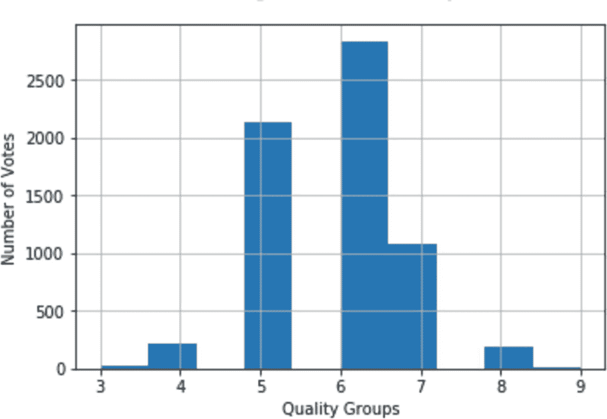

图 4-2

葡萄酒数据框中葡萄酒质量评级的直方图

```
wine_df['quality'].hist()
plt.suptitle('Historgram of Wine Quality')
plt.xlabel('Quality Groups')
plt.ylabel('Number of Votes')
plt.show()
Listing 4-4
按组和投票数划分的葡萄酒质量评级直方图
```

这与“**value_counts()**”提供的信息相同，但更易于理解。我们看到中间范围呈正态分布，这很直观，因为大多数葡萄酒都是普通的，极好或极差的很少。

根据“**info()**”函数，没有空值，也没有文本或基于文本的分类数据。两个整数特征“**quality**”和“**color**”是数值类别，在建模过程中应如此处理。

## 处理不平衡类别

参考葡萄酒质量直方图，我们看到大多数质量集中在 5、6 和 7 这几个桶中。这将使得预测边缘质量桶更具挑战性，因为模型无法从足够的案例中学习。对于关键的建模项目，您要么通过移除一些中间类别来平衡数据集，要么获取更多的边缘案例。在本章的 Jupyter notebook 中，您可以看到重新平衡的过程。

另一种方法是移除较弱的特征。在某些情况下，弱特征会混淆模型，移除它们不仅可以提高分数，还能使模型运行更快。使用返回某种变量重要性的基于树的模型可以轻松实现这一点。您会得到一个按重要性降序排列的特征列表，然后尝试仅使用最佳特征来运行模型。您不断添加特征，直到分数不再提高，最终得到一组可以使用的良好特征（这被称为前向特征选择）。

让我们看看如果将所有类别的数据行数上限设为 500 会发生什么（清单 4-5 和图 4-3）。

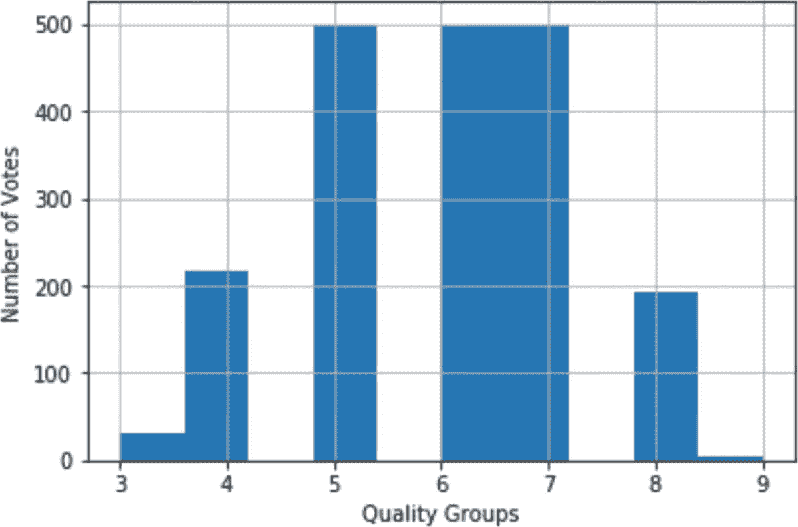

图 4-3

设上限后的葡萄酒质量直方图

```
Input:
wine_balanced_df['quality'].value_counts()
Output:
7    500
6    500
5    500
4    216
8    193
3     30
9      5
Name: quality, dtype: int64
Listing 4-5
设上限后葡萄酒质量的数值分布
```

这确实使中心类别变得平坦，但边缘类别仍然极度不平衡。更好的处理方法是重新分类质量类别。我们将它们归并为仅三个质量组。质量类别 3、4、5 现在属于组 3，质量 6 保持不变，质量类别 7、8、9 属于组 9（图 4-4）。

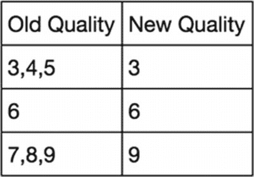

图 4-4

简化的葡萄酒质量超级组

本质上，我们创建了三个超级组：“**差**”、“**一般**”和“**好**”。应用这些新分组后，我们得到了一个更加平衡的分布（清单 4-6 和图 4-5）。

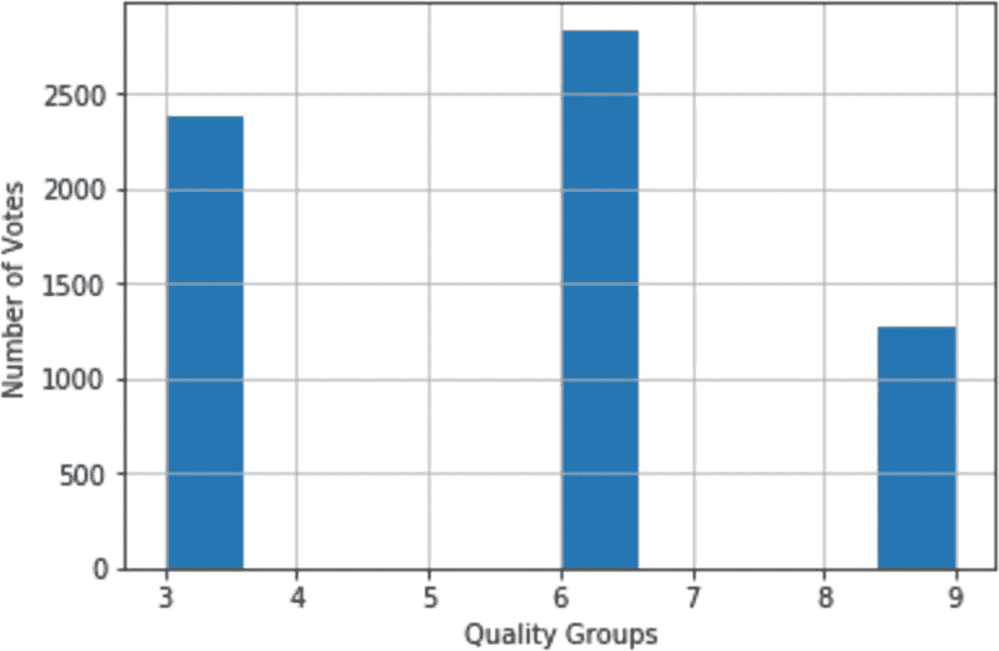

图 4-5

较小桶集合中葡萄酒质量的直方图分布

```
Input:
wine_df['quality'].value_counts()
Output:
6    2836
3    2384
9    1277
Name: quality, dtype: int64
Listing 4-6
将葡萄酒质量聚合为三个组
```

当我们在直方图中绘制质量分组时，各个类别的平衡性要好得多，范围从 1200 到 2800。

## 使用梯度提升分类器进行建模

改善不平衡数据集处理方式的另一种方法是使用能够应对此类数据的模型。一个非常流行的模型是 sklearn 中的“**梯度提升分类器**”，它是一种基于树的强大提升模型。该模型会创建多组树，并根据它们的预测能力进行优化。

要使用 sklearn 的 GradientBoostingClassifier 算法，如果你之前从未使用过“**scikit-learn**”和“**scipy**”，则需要先安装它们（请使用适合你操作系统和软件的安装工具）。为简化操作，你可以直接运行包含本章所有必要 Python 库的“**requirements_jupyter.txt**”文件。通过运行“**pip3**”命令即可快速安装（列表 4-7）。

```
$ pip3 install -r requirements_jupyter.txt
列表 4-7
安装运行笔记本所需的文件
```

我们使用 Pandas 的“**Categorical()**”函数将“**quality**”特征转换为分类类型。这样我们就可以使用该特征的“**cat.codes**”属性，而不是实际值。我们这样做是因为真实的品质类别是 3-6-9，而通过使用“**cat.codes**”，我们将范围缩小到 0 到 2 之间。然后，我们使用 sklearn 的“**train_test_split**”函数（就像我们在上一章中所做的那样）将数据随机拆分为训练集和测试/验证集。如果你查看代码，我们会将“**test_size**”设置为 0.2，这意味着我们将 20% 的数据分配用于测试，并使用“**random_state**”设置一个随机种子，以确保我们的数据拆分始终一致（列表 4-8）。

```
from sklearn.model_selection import train_test_split
wine_df['quality'] = pd.Categorical(wine_df['quality'])wine_df['quality_class'] = wine_df['quality'].cat.codes
outcome = 'quality_class'
outcome_buckets = len(set(wine_df['quality_class']))
X_train, X_test, y_train, y_test = train_test_split(wine_df[features],
wine_df[outcome], test_size=0.2, random_state=42)
列表 4-8
准备我们的训练和测试数据集

```

现在，我们可以将训练数据输入到“**GradientBoostingClassifier**”中进行建模（列表 4-9）。

```
from sklearn.ensemble import GradientBoostingClassifier
gbm_model = GradientBoostingClassifier(random_state=10, learning_rate=0.1, max_depth=10)
gbm_model.fit(X_train[features], y_train)
列表 4-9
使用 GBM 进行建模
```

从代码片段中可以看出，“**GradientBoostingClassifier**”接受各种参数，调整这些参数非常重要，这被称为超参数调优。

以下是调整 GBM 模型的一些关键参数（更多详细信息，请参阅 scikit-learn 帮助文档^(²⁰)）：

*   **learning_rate：** 学习率决定了每棵树的贡献程度。
*   **n_estimators：** 要执行的提升阶段数量。
*   **max_depth：** 回归估计器的最大深度。
*   **max_features：** 每次拆分时需要考虑的特征数量。
*   **random_state：** 用于保证结果可复现的随机种子。

训练“**GradientBoostingClassifier**”模型的最佳方法是使用不同的参数设置多次运行。观察添加“**n_estimators**”参数是否会提高准确率，以及“**learning_rate**”或“**max_depth**”的增大或减小如何影响准确率。对于那些希望深入研究模型调优的人，还有许多额外的工具可以提供帮助，例如交叉验证、超参数调优器等。GradientBoostingClassifier 最让我喜欢的一点是它速度非常快，并且能够处理相当大的数据集，因此你可以轻松编写自己的循环机制来尝试各种参数组合并比较准确率。

有关更详细的 Python API 参考，请参阅文档。^(²¹)

### 评估模型

如果你参考本章的 Jupyter 笔记本，你会看到在运行模型后，我们通过要求模型对样本外数据（即我们那 20% 的测试数据块）预测葡萄酒品质来对其进行评估（列表 4-10）。这是一个需要记住的重要概念：模型从未见过测试数据，这使我们能够用一组全新的数据来评估模型的性能。

```
preds = gbm_model.predict_proba(X_test)
列表 4-10
使用测试数据拆分进行预测
```

“**preds**”变量包含每行数据的三个概率列表，描述了该行属于每个葡萄酒品质类别的概率（这说起来有点拗口）。每行数据的概率之和为 1。例如，让我们看看第一行数据的预测概率（列表 4-11）。

```
输入：
preds[0]
输出：
array([0.50623207, 0.48718144, 0.00658649])
列表 4-11
查看一种葡萄酒的预测结果
```

对于第 0 行的数据（即该特定葡萄酒的化学读数），模型预测索引号 0 处的概率最高，为 0.56，因此属于品质类别“**3**”。这可以很容易地通过 NumPy 的“**argmax**”函数来实现，该函数用于获取列表中最大数字的索引，然后使用该索引位置获取类别编号（列表 4-12）。

```
输入：
print('Argmax: %i' % np.argmax(preds[0]))
print('Quality class: %i' % list(wine_df['quality'].cat.categories)[np.argmax(preds[0])])
输出：
Argmax: 0
Quality class: 3
列表 4-12
使用 NumPy 的“argmax()”函数获取数组中的最大值
```

我们可以对测试数据中的每一种葡萄酒都执行相同的操作，并使用 sklearn.metrics 的“**precision_score()**”函数将其与实际“**真实**”类别进行比较。该函数将返回一个介于 0 和 1 之间的数字，其中 0 表示最差分数，1 表示最佳分数。在这种情况下，精确率比准确率更合适，因为我们讨论的不是一个平衡数据集的简单二元预测。相反，我们想知道模型在不平衡数据集上，针对特定葡萄酒在三个品质类别之间进行选择的准确程度——这绝非易事！（列表 4-13）

> *精确率是 tp / (tp + fp) 的比值，其中 tp 是真阳性数量，fp 是假阳性数量。直观上，精确率体现了分类器不将负样本标记为正样本的能力。* ^(²²)

```
输入：
from sklearn.metrics import precision_score
best_preds = np.asarray([np.argmax(line) for line in preds])
print ("Precision_score: %0.2f" % precision_score(y_test, best_preds, average="macro"))
输出：
Precision_score: 0.74
列表 4-13
获取每个预测品质类别的最高概率
```

另一种查看多类模型整体情况的有用方法是使用混淆矩阵。这将绘制一个大型方阵，显示模型的最佳预测结果与真实情况的对比（列表 4-14 和图 4-6）。在处理大量数据时，使用图形化的混淆矩阵而不是打印出来的矩阵会非常方便。生成这些图形矩阵的代码直接来自 scikit-learn.org 关于混淆矩阵的帮助文件。^(²³)

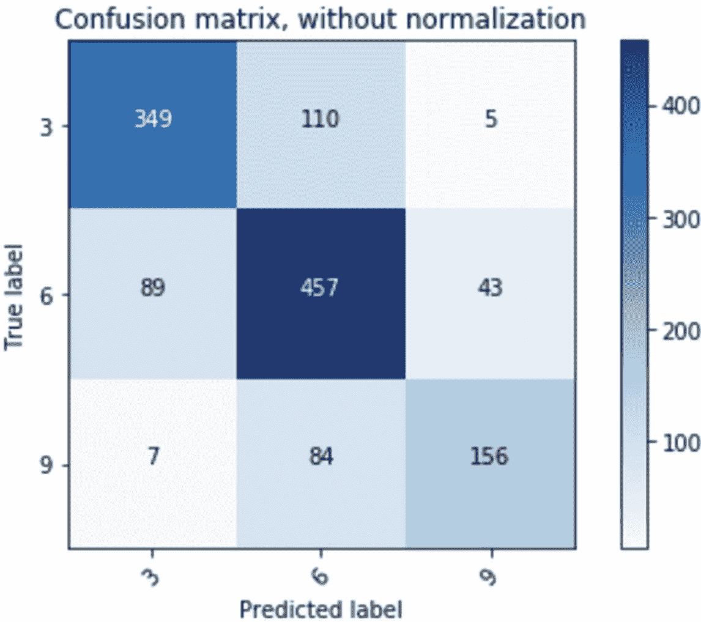

图 4-6

预测值与实际值的混淆矩阵

```
from sklearn.metrics import confusion_matrix
cnf_matrix = confusion_matrix(y_test, best_preds)
plt.figure()
plot_confusion_matrix(cnf_matrix, classes=set(wine_df['quality']),
title='Confusion matrix, without normalization')
plt.show()
列表 4-14
在混淆矩阵上显示的葡萄酒品质预测结果
```

花点时间分析这张图表是值得的。Y 轴代表真实值，X 轴代表来自 GradientBoostingClassifier 模型的最佳预测。

在理想情况下，除了从图表左上角一直延伸到右下角的单条对角线外，所有数字都应为 0。这意味着所有预测都是正确的（参见图 4-7 中虚构的图表）。

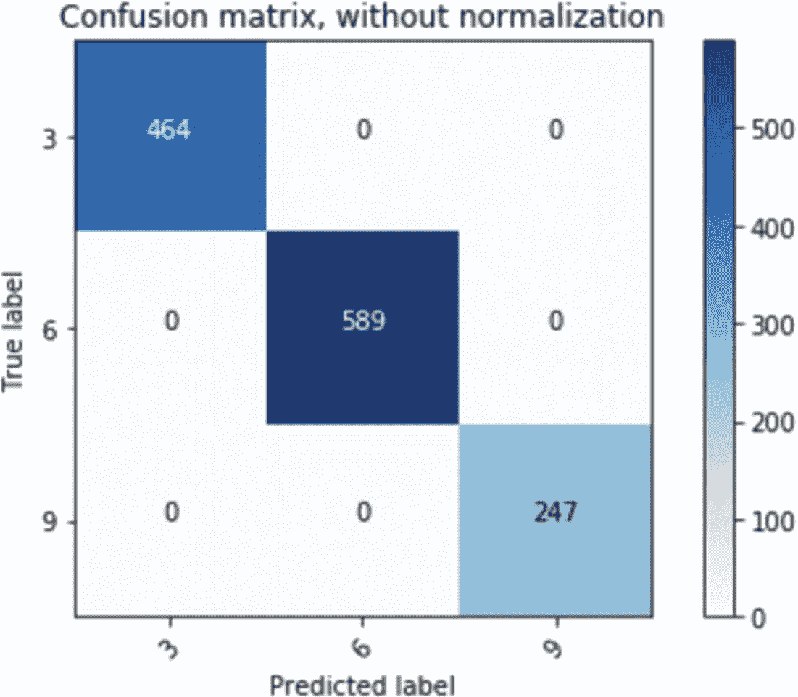

图 4-7

完美混淆矩阵的样子（如果你在真实模型中看到这种完美程度，请保持怀疑，因为建模永远不可能完美）

我们模型的混淆矩阵告诉我们关于数据的一些有趣信息。首先，它的表现相当不错，因为从左上角到右下角的对角线确实包含了最大的数字。当数据偏离对角线（即预测错误）时，它仍然靠近其所属的组。这就是为什么模型预测为 3 而实际是 9，或者模型预测为 9 而实际是 3 的边缘情况非常少。这可以看作是一种小小的安慰：每当预测错误时，错误可能不会太离谱，错误的预测最多只偏差到相邻的桶。

### 持久化模型

在第 3 章中，我们 Web 应用程序的构造函数训练了模型（每当 Web 服务器重启时，它就会重新训练）。在这里，我们将预先训练模型，对其进行 pickle 序列化，并将其用作我们的建模引擎。你很少会遇到数据集和模型足够小，以至于可以直接在云端和 Web 服务器上训练的情况。大多数模型都很大，训练时间长，甚至需要特殊的硬件。通过保存一份完全训练好的模型副本，我们可以将其移动到任何需要的地方，并使其处于随时可预测的状态。如果你不熟悉 Python 术语“**Pickling**”，它是一种将对象以其当前状态保存到文件中的工具^(²⁴)。就像逗号分隔文件（CSV）用于移动数据一样，pickle 文件用于移动 Python 对象。你可以 pickle 任何你想要的东西，包括训练好的模型。关于 Python 版本的说明：AWS Beanstalk 默认使用 Python 3.x，而 pickle 在 Python 2.x 和 3.x 版本之间存在兼容性问题，因此本章请坚持使用 Python 3.x。

这被称为模型持久化，它应该在大多数生产场景中使用，我们也会在本书的大多数章节中使用这种方法（列表 4-15）。

```
with open('gbm_model_dump.p', 'wb') as f:
pickle.dump(gbm_model, f, 2)
列表 4-15
Pickle 序列化我们训练好的 GBM 模型
```

### 对新数据进行预测

就像我们在上一章中所做的那样，我们需要确保能够运行模型并对新数据进行预测。这是构建交互式 Web 应用程序的重要一步，该应用程序的目标是基于用户输入的数据提供新的预测。

首先，我们计算每个特征的平均值，并使用这些值来预测葡萄酒的质量（列表 4-16）。

```
fixed_acidity = 7.215307
volatile_acidity = 0.339666
citric_acid = 0.318633
residual_sugar = 5.443235
chlorides = 0.056034
free_sulfur_dioxide = 30.525319
total_sulfur_dioxide = 115.744574
density = 0.994697
pH = 3.218501
sulphates = 0.531268
alcohol = 10.491801
color = 0

# 创建新数据集
x_test_tmp = pd.DataFrame([[fixed_acidity,
volatile_acidity,
citric_acid,
residual_sugar,
chlorides,
free_sulfur_dioxide,
total_sulfur_dioxide,
density,
pH,
sulphates,
alcohol,
color]], columns = X_test.columns.values)
列表 4-16
获取每个特征的平均值并存储在数据框中
```

在创建了一个新的数据框来存储自定义的葡萄酒化学读数后，我们将其传递给模型的“**predict**”函数。我们可以添加任何结果变量，因为模型在进行预测时会忽略它（列表 4-17）。

```
preds = gbm_model.predict_proba(x_test_tmp)
列表 4-17
基于我们的平均值预测葡萄酒质量
```

因为我们使用平均值作为新的葡萄酒数据，预测的质量值应该接近真实/实际的葡萄酒质量——我们基本上创造了一款平淡无奇的葡萄酒，既不好也不坏（列表 4-18）。

```
输入:
print(('预测的葡萄酒质量: %i') % list(wine_df['quality'].cat.categories)[np.argmax(preds)])
print(('实际平均葡萄酒质量: %0.2f') % np.mean(wine_df['quality'].values))
输出:
预测的葡萄酒质量: 6
实际平均葡萄酒质量: 5.49
列表 4-18
获取葡萄酒质量预测
```

不错！模型预测为第 6 组，平均值为 5.49。请记住，这个模型在预测普通葡萄酒方面会比预测边缘葡萄酒表现更好。所以，它能准确预测这一点并不奇怪。如果我们查看预测数组，会发现模型在将这款葡萄酒归类为质量 3 或质量 6 时有些许挣扎（35%的概率为 3，64%的概率为 6），但质量组 6 胜出（列表 4-19）。

```
array([[0.34124871, 0.63933304, 0.01941825]])
列表 4-19
我们这款普通葡萄酒的预测概率
```

## 设计一个用于交互和评估葡萄酒质量的 Web 应用程序

在我们本地模型上构建一个功能完整的 Flask 版本是本书所有章节中一个常见的主题和恰当的下一步。通过足够的练习，你可能会跳过这一步，但与此同时，在本地解决问题比在云端能节省大量时间和避免很多麻烦。

一个好的第一步是将代码泛化为一个大的函数。这将允许我们向其传递新值，并以尽可能少的麻烦获得一个不错的预测结果。

一旦你下载了本章的所有文件，打开一个命令行窗口，并将驱动器切换到“**web-application**”文件夹。你的文件夹应该看起来像列表 4-20。这里我们显示了 AWS EB 所需的隐藏文件夹“**.ebextensions**”。你可以直接使用它，也可以在“**修复 WSGIApplicationGroup**”部分创建自己的文件夹（在运行本地版本网站时不用担心这个，因为它不受此修复的影响）。

```
web-application
├── application.py
├── requirements.txt
├── static \
└── images
├── quality_wine_logo.jpg
├── wine_red_9.jpg
├── wine_white_9.jpg
├── wine_red_3.jpg
├── wine_white_3.jpg
├── wine_red_6.jpg
└── wine_white_6.jpg
├── pickles
└── gbm_model_dump.p
└──templates
└── index.html
└── .ebextensions <-- 隐藏文件夹
└── wsgi_fix.config
列表 4-20
Web 应用程序文件
```

这里需要注意的是，在某些章节中，我们将主要的 Flask Python 文件称为“**main.py**”，但这里我们使用“**application.py**”——这是 Amazon Elastic Beanstalk 的默认命名约定（总有办法绕过这一点，但这需要编辑配置文件）。从现在开始，我们将在虚拟环境中工作。

## 介绍 AJAX – 动态服务端 Web 渲染

在本章中，我们将开始使用 Ajax，这是一项非常酷的技术，它允许我们无需重建整个页面即可更新 Web 内容。这对于执行大量微更新的高度交互式 Web 应用程序非常有效。Ajax 也非常易于使用，由两部分组成：一个调用“**$.ajax**”的前端脚本函数，以及一个用于捕获和处理这些调用的后端 Flask 函数。我们将在第[10](https://doi.org/10.1007/978-1-4842-3873-8_10)章中更深入地探讨 Ajax。

## 在虚拟环境中工作——一个用于实验、安全与清晰的沙盒

使用虚拟环境有许多优点：

*   创建一个未安装任何 Python 库的环境

*   精确了解应用程序运行所需的 Python 库

*   保护计算机系统的其余部分免受在此环境中安装的任何 Python 库的影响

*   鼓励实验

要启动虚拟环境，请使用“**venv**”命令。如果你的计算机上尚未安装该命令，建议你进行安装（可通过 pip3、conda、brew 等方式安装）。有关为你的操作系统安装虚拟环境的更多信息，请参阅“**venv - 虚拟环境的创建**”用户指南：[`https://docs.python.org/3/library/venv.html`](https://docs.python.org/3/library/venv.html)

在命令行窗口中，如果尚未进入“**web-application**”文件夹，请先导航至此文件夹。在命令行中调用 Python 3 的“**venv**”函数，为我们的开发工作创建一个 Python 3 沙盒区域，以及一个名为“**wineenv**”的文件夹（列表 4-21）。

```
$ python3 -m venv wineenv
$ source wineenv/bin/activate
列表 4-21
启动虚拟环境
```

现在你已准备好开始在虚拟环境中工作。让我们尝试通过调用“**python3**”来本地运行 Web 应用程序（或使用适用于你操作系统的命令；列表 4-22）。

```
$ python3 application.py
列表 4-22
运行 Web 应用程序的本地版本
```

这不会成功，因为我们处于一个干净的虚拟环境中，没有加载专门的 Python 库。你需要安装所有它报错缺失的库（请根据你的操作系统和软件使用相应的安装命令）。最简单的方法是使用“**pip3 install**”安装附带的“**requirements.txt**”文件（列表 4-23）。

```
$ pip3 install -r requirements.txt
列表 4-23
安装依赖项
```

我们有一个全面的 requirements.txt 文件，其中包含运行 Web 应用程序所需的所有 Python 库。这对于我们 Web 应用程序的本地版本来说实际上用处不大，但对于基于云的版本则是必需的。^(²⁶) 无论你在 Amazon、Google 还是 Microsoft 的云上部署应用程序，它都会使用 requirements 文件，在运行 Web 应用程序的任何位置安装所有必需的 Python 库。

回到我们的本地版本实验，运行与之前 Flask 实验相同的命令（列表 4-24）。

```
$ python3 application.py
列表 4-24
运行 Web 应用程序的本地版本
```

然后复制 URL：“`http://127.0.0.1:5000/`”（或终端窗口中显示的任何地址）到浏览器中，你应该会看到 Web 应用程序 Wine Quality Designer 出现（图 4-8）。希望它能成功运行；如果没有，请阅读输出错误并相应处理（请记住，本章需要 Python 3.x）。

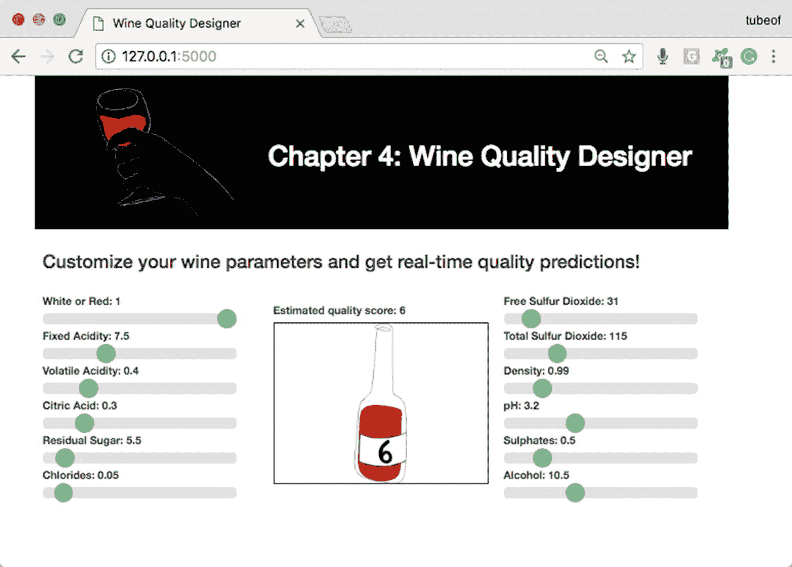

图 4-8

在本地服务器上运行的 Web 应用程序

## Amazon Web Services (AWS) Elastic Beanstalk

对于本章基于云的部分，我们将把应用程序托管在 Amazon 的 Elastic Beanstalk 上。这是一个便捷的托管解决方案，可以自动打包你的网站、部署、扩展和负载均衡。它在一个便捷的基于 Web 的仪表板中提供日志记录、流量和健康监控统计信息，让你随时了解运行状况。这应该能让你专注于应用程序，几乎完全无需操心网站管理。

你需要一个 Amazon Web Service 账户并设置安全凭证。如果你已有 Amazon.com 账户，应该可以轻松将其迁移到 AWS。如果你是新手，可以创建一个免费套餐账户，该账户将允许你访问基本的 Beanstalk 功能。请访问 AWS 免费套餐（[`https://portal.aws.amazon.com/gp/aws/developer/registration/index.html`](https://portal.aws.amazon.com/gp/aws/developer/registration/index.html)）。

### 为 Elastic Beanstalk 创建访问账户

拥有 AWS 账户后，就该设置安全凭证，以便从你的计算机与 AWS Elastic Beanstalk 进行交互。Amazon 的入门教程（[`https://aws.amazon.com/getting-started/tutorials/set-up-command-line-elastic-beanstalk/`](https://aws.amazon.com/getting-started/tutorials/set-up-command-line-elastic-beanstalk/)）是一个很好的指南，可以逐步指导你完成该权限设置过程。

登录 AWS Web 控制台，进入 Identity and Access Management (IAM) 控制台。快速进入的方法是在登录页面的 AWS 服务搜索框中直接输入“**IAM**”。在导航部分选择“**Users**”，然后点击“**Add user**”按钮（图 4-9）。

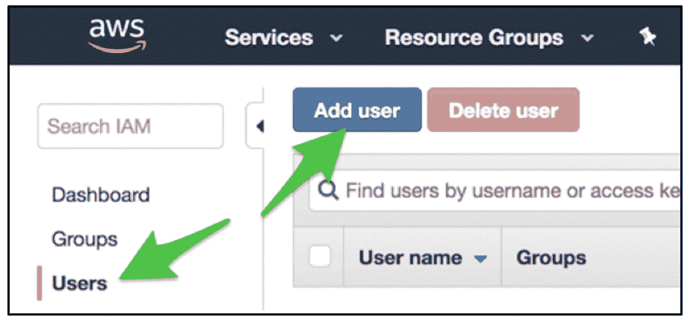

图 4-9

在 AWS 中创建用户

选择一个用户名——这里我们输入“**ebuser**”，并勾选“**Access type: Programmatic access**”（图 4-10）。

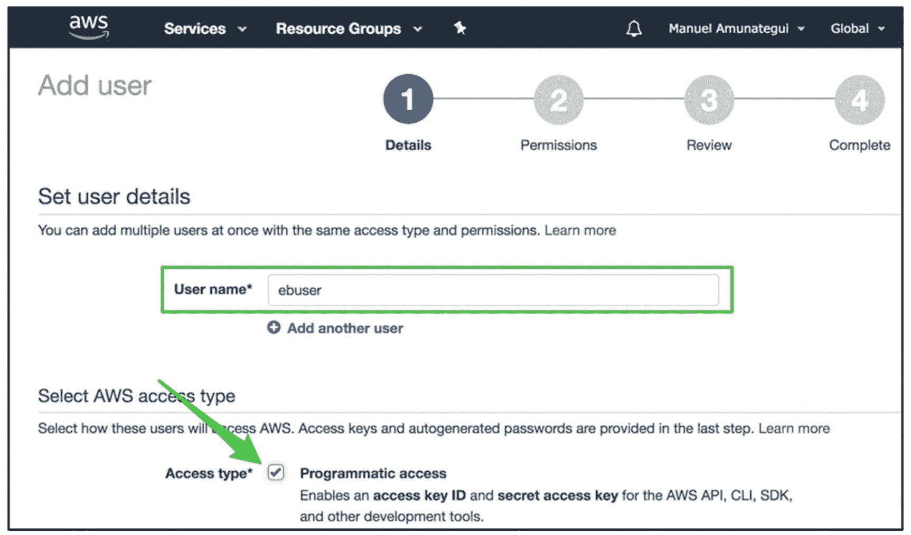

图 4-10

为新用户分配编程访问权限

点击蓝色的“**Next: Permissions**”按钮。这将带你进入“**Set permissions**”页面；点击大的菜单按钮“**Add user to group**”，然后点击“**Create group**”（图 4-11）。

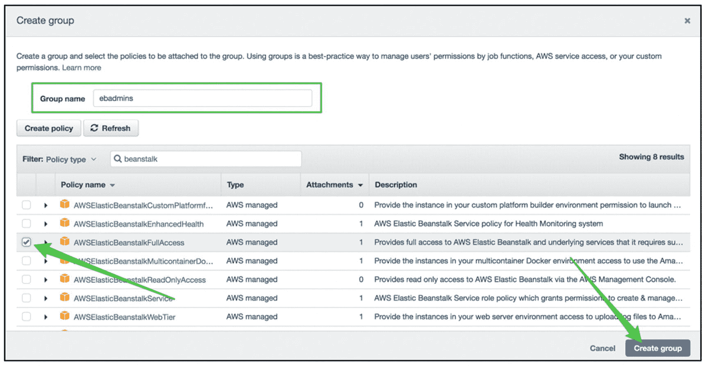

图 4-11

为新用户授予 WSElasticBeanstalkFullAccess 权限

创建一个组名，此处为“**ebadmins**”，并为其分配策略名称“**WSElasticBeanstalkFullAccess**”。然后点击“**Create group**”按钮完成组的创建。点击蓝色的“**Next: review**”按钮，在接下来的页面上点击蓝色的“**Create user**”按钮（图 4-12）。

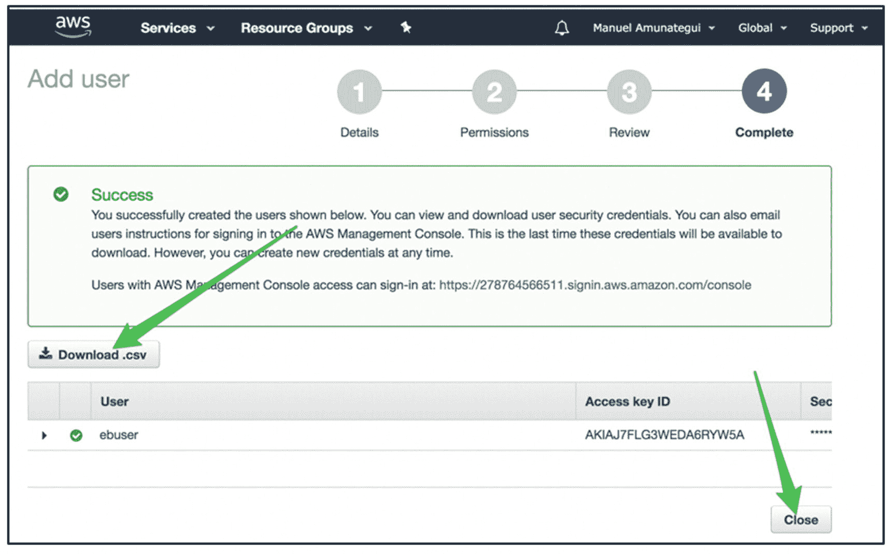

图 4-12

成功创建用户后下载访问密钥

一旦看到“**Success**”消息，这意味着你已成功创建“**ebuser**”账户。请务必点击“**Download .csv**”按钮，将“**.csv**”文件下载到本地机器。此文件很重要，因为它包含你的密钥和秘密代码。将其存储在本地机器上的已知位置，因为你需要这些信息来连接并使用 Secure Shell (SSH) 进入你的 EB。

### Elastic Beanstalk

后续我们将 Elastic Beanstalk 简称为 EB。我们需要安装“**awsebcli**”库来与 AWS 上的 EB 服务进行交互和管理。

对于 Mac 和 Linux 用户（如果报错“**user**”参数问题，请尝试不带该参数）。参见列表 4-25。

```
$ pip install awscli
$ pip install awsebcli
列表 4-25
安装“awsebcli”
```

对于 Windows 用户（如果报错“**user**”参数问题，请尝试不带该参数）。参见列表 4-26。

```
$ pip install awscli --user
$ pip install awsebcli --user
列表 4-26
在 Windows 上安装“awsebcli”
```

有关安装和排查“**awsebcli**”库问题的更多信息，请参考 Amazon 的帮助文档：[`https://docs.aws.amazon.com/elasticbeanstalk/latest/dg/eb-cli3-install.html`](https://docs.aws.amazon.com/elasticbeanstalk/latest/dg/eb-cli3-install.html)。

### EB 命令行界面

来自 AWS 帮助文件：

> *EB 是一种* *命令行界面 (CLI) 工具* *，它会询问你一系列问题，并根据你的回答来部署和管理 Elastic Beanstalk 应用程序。本节将提供一个端到端的演练，使用 EB 启动一个示例应用程序、查看它、更新它，然后删除它。* ^(²⁷)

这是一组方便的命令行工具，用于初始化、推送、控制和终止我们的 EB 实例。

*   **eb init**：初始化 EB 服务^(²⁸)

*   **eb create**：创建一个新的 EB 实例

*   **eb open**：打开一个指向你的 EB 实例的网页

*   **eb deploy**：部署代码或配置的任何更改

*   **eb config**：打开 EB 实例配置文件以供读取和编辑

*   **eb logs**：拉取打开的 EB 实例的各种日志文件

*   **eb terminate**：终止 EB 实例（如果你不想持续产生费用，请务必终止）

有关 EB 命令的更完整信息，请参阅 [`https://docs.aws.amazon.com/elasticbeanstalk/latest/dg/eb-cli3-getting-started.html`](https://docs.aws.amazon.com/elasticbeanstalk/latest/dg/eb-cli3-getting-started.html) 。

我们一直等到现在才安装“**awsebcli**”库，因为我们不希望它的任何内容进入我们的 requirements.txt 文件（清单 4-27）。

```
$ eb init -i
清单 4-27
初始化“awsebcli”
```

这会问你一系列问题，你可以接受大部分默认设置。在“**Enter Application name**”下输入“**winetest**”（图 4-13）。

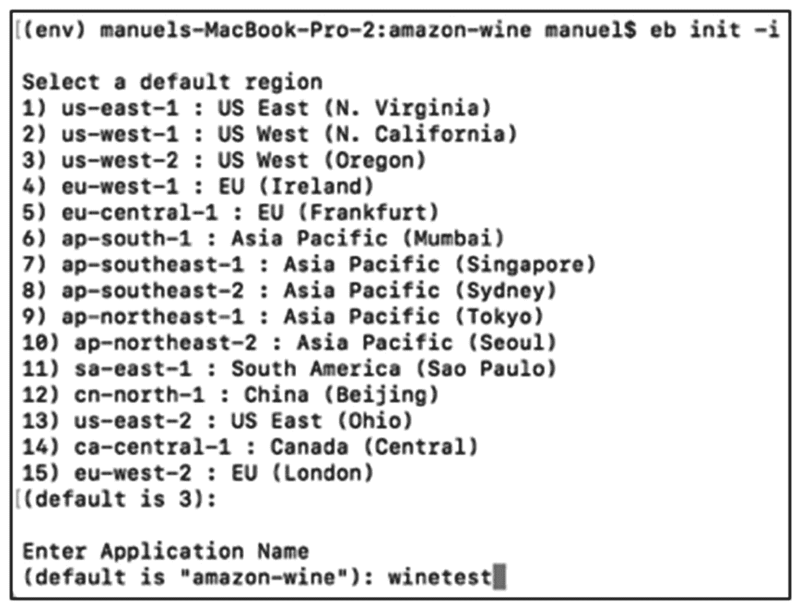

图 4-13

创建应用程序名称

如果这是你第一次在计算机上运行 AWS，它会要求你提供凭证。打开创建用户时下载到你机器上的“**credentials.csv**”文件，并输入所需的两个字段（图 4-14）。

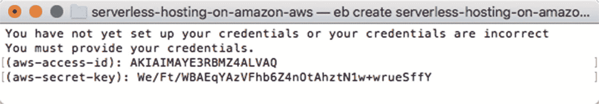

图 4-14

输入你的凭证

选择 Python 默认设置（它必须是 3.x 版本），但在设置 SSH 时选择“是”（图 4-15）。


图 4-15

创建 SSH 密钥

对于它可能问到的所有其他问题，都选择默认设置。在创建 Web 应用程序之前，你需要自定义 WSGI 配置文件，以告知它你将需要 Python 子解释器模式。

### 修复 WSGIApplicationGroup

当使用像 NumPy、Pandas 或其他重量级 Python 库时，你需要告诉 WSGI 进入一种特殊的 Python 子解释器模式。这样做是因为这些库加载起来更复杂，需要更多线程等，因此默认情况下是关闭的（更多信息请参阅 Python Simplified GIL State API^(²⁹)）。这个切换需要在配置文件中添加清单 4-28 中的变量（这来自一个 Stackoverflow 解决方案^(³⁰)）。该文件的副本包含在下载文件中，或者你可以使用文件夹中提供的文件（这是一个隐藏文件夹，你可能能看到也可能看不到`—`如果你不确定，请尝试按照说明创建该文件夹，如果它报错，说明你已经有了）。

```
'WSGIApplicationGroup %{GLOBAL}'
清单 4-28
添加“WSGIApplicationGroup”变量
```

要启用此功能，你需要在“**web-application**”文件夹下创建一个名为“**.ebextensions**”的新文件夹。在你的本地终端窗口中输入清单 4-29 中的命令。

```
$ mkdir .ebextensions
清单 4-29
创建“wsgi_fix”文件
```

这将创建一个名为“**.ebextensions**”的新文件夹，并打开一个“**vi**”窗口，这是一个简单的文本编辑器。按“**i**”键从只读模式切换到“**插入**”模式，并在文档末尾粘贴以下行（本章文档文件夹中也包含此修复的文本文件）。读取此文件的过程非常挑剔；如果有多余的空格或制表符，它将失败。请密切关注部署过程中与该文件相关的任何错误，并相应处理。

从你的本地终端窗口打开“**vi**”（清单 4-30）。

```
$ vi .ebextensions/wsgi_fix.config
清单 4-30
打开一个“vi”会话并按“i”进入插入模式
```

将以下代码粘贴进去（代码可以从本章下载文件中的“**ebextensions_fix.txt**”文件中复制）。这非常挑剔；一个错位的制表符就会破坏这个过程，所以我建议从下载文件中获取内容，或者使用已经提供的默认文件（清单 4-31）。

```
#将以下内容添加到 wsgi_fix.config
files:
"/etc/httpd/conf.d/wsgi_custom.conf":
mode: "000644"
owner: root
group: root
content: |
WSGIApplicationGroup %{GLOBAL}
清单 4-31
将以下代码粘贴到你的“vi”会话中
```

现在按“**escape**”退出“**插入**”模式并进入只读模式，然后输入“**:wq**”以写入并退出“**vi**”（清单 4-32）。

```
:wq
清单 4-32
保存并退出“vi”会话
```

接下来你需要创建你的 EB。

### 创建 EB

现在我们已经准备好创建我们的 Web 应用程序。运行“**eb create**”命令，并带上之前创建的应用程序名称（清单 4-33）。

```
$ eb create winetest
清单 4-33
初始化“awsebcli”
```

这将需要几分钟时间，如果一切顺利，你应该会收到一条成功消息。然后你可以直接使用“**eb open**”命令来实时查看 Web 应用程序。

### 试运行一下

第一次运行应用程序可能需要一点时间，甚至可能超时。如果是这种情况，请再试一次“**eb open**”命令（清单 4-34 和图 4-16）。

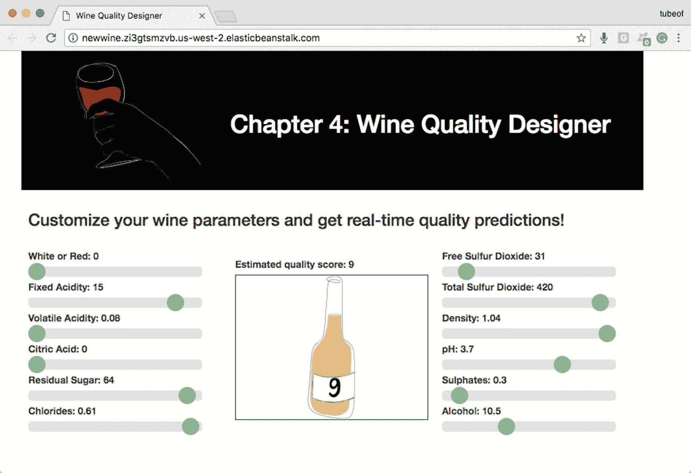

图 4-16

在 AWS Elastic Beanstalk 上运行的葡萄酒质量设计器

```
$ eb open
清单 4-34
使用以下命令打开网站
```

## 别忘了关闭它！

最后，我们需要终止 Beanstalk 实例，以免产生额外费用。这是一个重要的提醒：大多数云服务都不是免费的（清单 4-35）。

```
$ eb terminate winetest
清单 4-35
终止你的实例
```

这需要几分钟时间，但会使网站下线。最好在你的 AWS 仪表盘上仔细检查所有服务是否确实已关闭。这很容易做到：只需登录你的 AWS 账户 [`https://aws.amazon.com/`](https://aws.amazon.com/)，并确保你的 EC2 和 Elastic Beanstalk 账户中没有你未计划使用的任何活跃服务。如果你发现某个实例在你每次“**终止**”它之后似乎又复活了，请检查 EC2 下的“**负载均衡器**”，先终止它们，然后再终止实例。完成后，你还可以停用你的虚拟会话（清单 4-36）。

```
$ deactivate
清单 4-36
停用你的虚拟环境
```

登录你的云账户并确保所有服务都已关闭，这始终是一个好主意（实际上是一个基本想法）。请注意：如果你不这样做，可能会在账单周期结束时收到一个令人不快的“惊喜”。登录你的 AWS 账户，确保你的 EC2 和 Elastic Beanstalk 账户中没有你未计划使用的任何活跃服务（图 4-17 和图 4-18）。

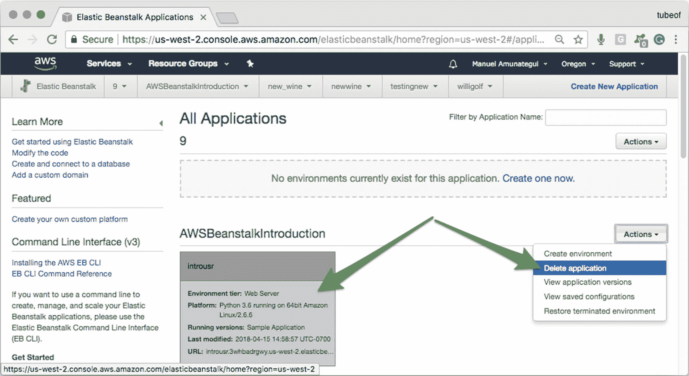

图 4-18

找到你想要终止或删除的实例，并使用“**操作**”下拉按钮选择你的选项

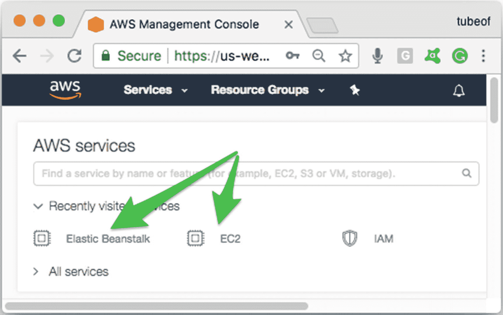

图 4-17

在 AWS 仪表盘上检查是否有任何活跃且不需要的实例

如果你发现某个实例在你每次“**删除应用程序**”之后似乎又复活了，请检查 EC2 下的“**负载均衡器**”，先终止它们，然后返回并再次终止那个“捣乱”的实例（图 4-19）。

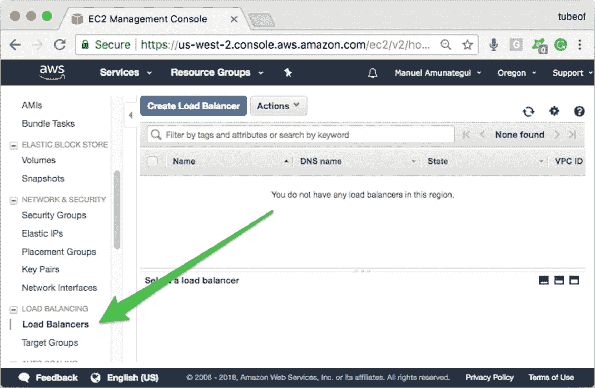

图 4-19

“**负载均衡器**”可能会阻止应用程序终止；如果你无意中启动了多个同名的实例，这种情况就可能发生。

## 步骤回顾

让我们快速回顾一下将 Wine Quality Designer Web 应用程序部署到 Amazon Web Services 的步骤。

**步骤 1：启动虚拟环境**

```
$ python3 -m venv wineenv
$ source wineenv/bin/activate
```

**步骤 2：安装 Python 库**

```
$ pip3 install -r requirements.txt
```

**步骤 3：本地测试 Web 应用程序**

```
$ python3 application.py
```

**步骤 4：创建 wsgi_fix.config 文件**

```
$ mkdir .ebextensions
$ vi .ebextensions/wsgi_fix.config
#将以下内容添加到 wsgi_fix.config
files:
"/etc/httpd/conf.d/wsgi_custom.conf":
mode: "000644"
owner: root
group: root
content: |
WSGIApplicationGroup %{GLOBAL}
```

**步骤 5：Elastic Beanstalk**

```
$ eb init -i
$ eb create winetest
$ eb open
```

**步骤 6：终止 Web 应用程序**

```
$ eb terminate
```

**步骤 7：退出虚拟环境**

```
$ deactivate
```

## 故障排除

从本地正常运行的 Web 应用程序到云端正常运行的应用程序，中间可能会出现各种问题。如果你没有看到预期的结果，第一站就是查看日志！

### 访问日志

如果你遇到问题，请检查日志并查找任何错误。可以使用清单 4-37 中的命令直接在终端窗口中访问日志。

```
$ eb logs
清单 4-37
访问日志
```

日志也可以在 Amazon Elastic Beanstalk 仪表盘页面上访问（图 4-20）。

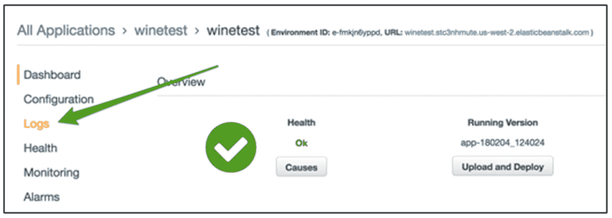

图 4-20

访问日志

选择最后 100 行日志（图 4-21）。

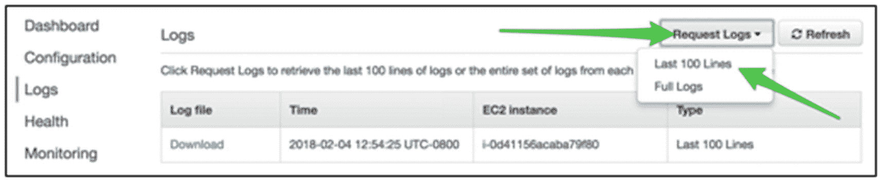

图 4-21

请求最后 100 行

### SSH 连接到你的实例

如果你想直接 SSH 连接到你的新实例，请参见清单 4-38 和图 4-22。

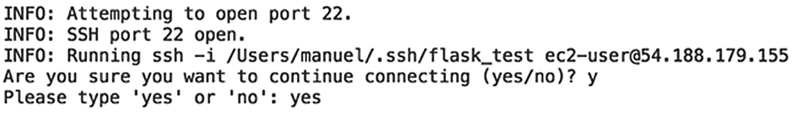

图 4-22

直接 SSH 连接到你的 Elastic Beanstalk 实例

```
$ eb ssh
清单 4-38
SSH 连接到你的实例
```

它会询问你是否要 SSH 连接到你的实例；输入“**yes**”（图 4-23）。

你已成功连接！这就是你刚刚使用“**eb create**”命令创建的 AWS Beanstalk 实例。

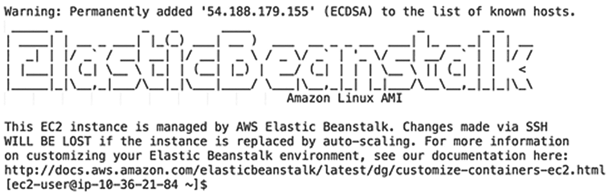

图 4-23

实例已就绪

## 结论

在本章中，我们使用色彩丰富的图像和吸引人的滑块（谁能抗拒滑块呢？）创建了一个关于葡萄酒质量的 Web 应用程序。后端处理依赖于使用 Ajax 进行实时处理，以实现即时反馈，而无需刷新整个页面——这很酷。

网上有很多关于 AWS Elastic Beanstalk 和 Flask 与 EB 的优质免费资料。

*   EB 入门指南：[`https://docs.aws.amazon.com/elasticbeanstalk/latest/dg/command-reference-get-started.html`](https://docs.aws.amazon.com/elasticbeanstalk/latest/dg/command-reference-get-started.html)

*   将 Flask 应用程序部署到 AWS Elastic Beanstalk：AWS Beanstalk 上的简单 Flask 示例：[`https://docs.aws.amazon.com/elasticbeanstalk/latest/dg/create-deploy-python-flask.html#python-flask-`](https://docs.aws.amazon.com/elasticbeanstalk/latest/dg/create-deploy-python-flask.html#python-flask-)

*   使用 EB CLI 管理 Elastic Beanstalk 环境：[`https://docs.aws.amazon.com/elasticbeanstalk/latest/dg/eb-cli3-getting-started.html`](https://docs.aws.amazon.com/elasticbeanstalk/latest/dg/eb-cli3-getting-started.html)

Amazon Web Services 是当今云服务领域的领导者。它拥有超过十年的市场主导地位，这也是其优势之一。用户可能选择其他服务的原因包括多样性、冗余性和成本节约。

脚注 1   2   3   4   5   6   7   8   9   10   11   12   13   14   15   16

