# 5. 案例研究第一部分：同时支持网页和移动浏览器

在 PythonAnywhere.com 上通过网页和移动平台预测股市。

在案例研究的第一部分，我们将创建一个简单的交易提醒系统。该工具将扫描多只股票，并在出现任何有趣的交易形态时提醒查看者。设计将保持简洁，以便在常规网页和移动网页上都能良好运行（图 5-1）。

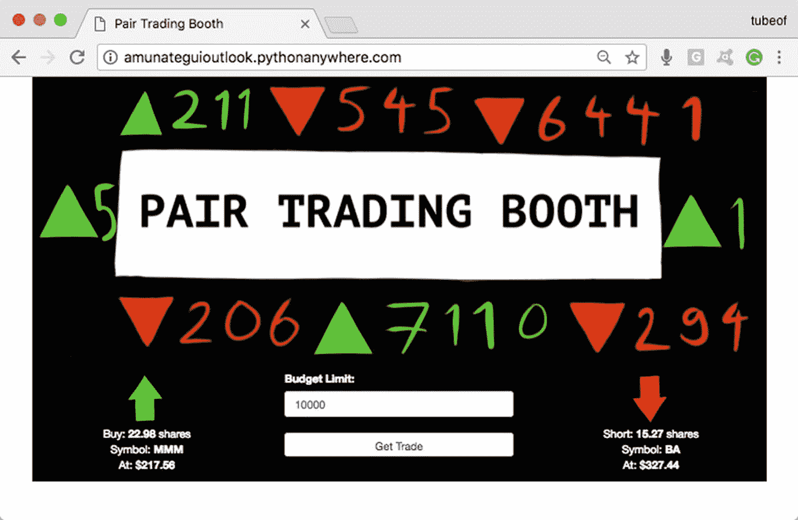

图 5-1

本章的最终网页应用程序

机器学习和量化交易相辅相成。这并不令人意外，因为机器学习的前提是挖掘模式，而谁不想在股市中找到模式呢？在本章中，我们将开始着手本书的案例研究，开发核心的交易信号策略和分发应用程序（请记住，这不是一个真实的交易系统，只是另一个有趣的网页应用实例）。我们将在后续章节中继续改进这个应用程序。我们将基于一种流行的配对交易方法来构建我们的虚构交易系统。

### 注意

通过访问 [`www.apress.com/9781484238721`](http://www.apress.com/9781484238721) 并点击源代码按钮，下载第 5 章的文件。打开 Jupyter notebook “**chapter5.ipynb**” 以跟随本章内容进行学习。

## 配对交易策略

配对交易背后的理念是，相关股票往往会同步波动，因此当我们发现股票行为异常、彼此背离时，我们会做空涨幅最高的股票，买入跌幅最大的股票，期望它们会回归均值。配对交易的另一个优势是，通过同时在市场上持有多头和空头头寸，你可以消除市场的波动性。显然，一个真实的配对交易策略在考虑交易之前会有更多的检查和保障措施，并且永远无法保证两个价值会朝着预期的方向移动。例如，如果公司因欺诈被调查，或者某个商业模式不再合理，那么期望通过买入它来增值可能只是一厢情愿。

在我们的案例中，简而言之，我们将使用过去 90 个交易周期来追踪指数成分股与指数本身的关系。然后，我们会将价差正向偏离最大的股票视为“**做空**”交易。这意味着我们借入股票并在市场上卖出。如果股价下跌，我们回购股票，归还给原所有者，并赚取差价。当然，借入的股票也可能上涨，当你需要回购并归还给所有者时，你就会亏损。

而我们会将价差负向偏离最大的股票视为“**做多**”交易。让我们看一个例子：波音公司（“**BA**”）表现强劲，高于道琼斯指数（“**^DJI**”），而 3M 公司（“**MMM**”）表现疲软，低于道琼斯指数（“**^DJI**”）。因此，交易策略将是买入“**MMM**”并做空“**BA**”（图 5-2）。


图 5-2

BA、MMM 与道琼斯指数之间价差的一个示例

## 下载和准备数据

我们将比较属于**道琼斯工业平均指数 (^DJI)** 的一部分股票子集与指数本身，并买入最低的股票，做空最高的股票。道琼斯工业平均指数是基于美国 30 只大型公开交易股票的指数。其权重是根据每家公司的股价总和计算的。

在我们的案例研究中，我们将保持简单，只关注道琼斯工业平均指数中权重最高的前十只股票，如表 5-1 所示。请继续将本章的文件下载到一个名为“**chapter-5**”的文件夹中。打开 Jupyter notebook 以跟随学习。

表 5-1

道琼斯工业平均指数中权重最高的前十只股票

| 公司名称 | 股票代码 |
| --- | --- |
| 波音 | BA |
| 高盛 | GS |
| 联合健康集团 | UNH |
| 3M | MMM |
| 家得宝 | HD |
| 苹果 | AAPL |
| 麦当劳 | MCD |
| IBM | IBM |
| 卡特彼勒 | CAT |
| 旅行者保险 | TRV |

你可以在本章的代码仓库中访问这些数据的快照。如果你想获取当前数据，可以手动从雅虎财经下载文件。例如，如果你想获取苹果公司最新的历史价格，只需输入以下链接：

*   [`https://finance.yahoo.com/quote/AAPL/history?p=AAPL`](https://finance.yahoo.com/quote/AAPL/history?p=AAPL) 。

选择所需的“**时间段**”（一年的数据应该足够了），点击“**应用**”，最后点击“**下载数据**”链接。这将把包含请求数据的 CSV 文件下载到你的机器上。这是雅虎财经目前提供的一项很棒的免费服务。如果这个服务对你不可用，你也可以使用其他金融数据服务，因为股票数据基本上是通用的。

让我们看看本项目包含的一个 CSV 文件。我们将加载“**^DJI**”，这是道琼斯指数，也是我们用来理解这十只股票走势的基准（清单 5-1 和图 5-3）。

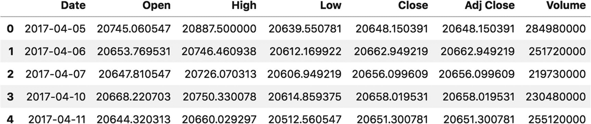

图 5-3

道琼斯指数 CSV 文件的前五行

```
DJI = pd.read_csv('^DJI.csv')
DJI.head()
清单 5-1
道琼斯指数 CSV 文件的顶部行
```

### 准备数据

我们自动化加载所有股票和指数 CSV 文件的过程。这应该能让你轻松地添加和移除股票文件（清单 5-2）。

```
stock_data_list = []
for stock in index_symbol + stock_symbols:
tmp = pd.read_csv(stock + '.csv')
tmp['Symbol'] = stock
tmp = tmp[['Symbol', 'Date', 'Adj Close']]
stock_data_list.append(tmp)
stock_data = pd.concat(stock_data_list)
清单 5-2
循环遍历每个 CSV 并创建一个数据框
```

这段代码片段循环遍历每个股票“**CSV**”文件，将数据拉取到 Pandas 数据框中，添加一个新列来保存股票代码名称，并将其追加到“**stock_data_list**”列表中。一旦收集完所有文件，它使用 Pandas 的“**concat()**”函数创建一个包含所有十只股票和指数的单一数据框（清单 5-3 和图 5-4）。

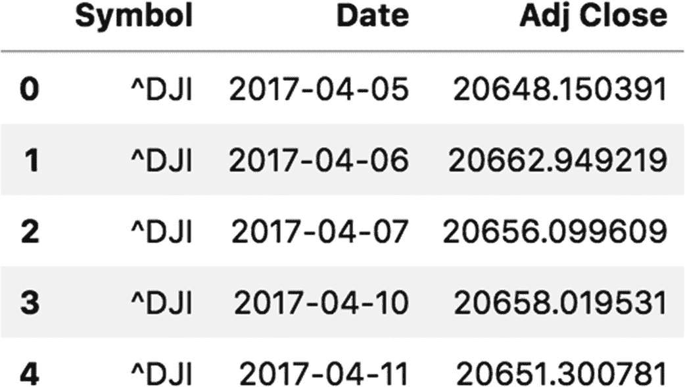

图 5-4

添加了股票代码特征的合并数据框

```
stock_data.head()
清单 5-3
“stock_data”数据框的顶部行
```

### 按股票代码进行数据透视

为了更方便地处理多只股票，我们将删除除“**Date**”和“**Adj Close**”之外的所有字段。然后，我们将它们全部透视到一个大表中（有关此过程的更多详细信息，请参阅本章的 Jupyter notebook）。这种方法扩展性很好，因为我曾成功地将超过 3000 只股票、十年期的数据拼接起来进行分析（清单 5-4 和图 5-5）。

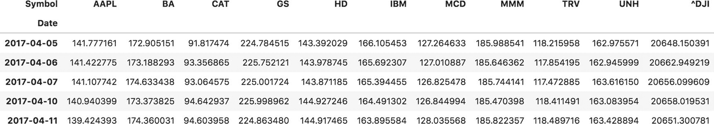

图 5-5

最终的股票数据框，每只股票被透视到自己的列中

```
stock_data = stock_data.pivot('Date','Symbol')
stock_data.columns = stock_data.columns.droplevel()
stock_data.head()
清单 5-4
数据透视并将股票代码设为列标题、日期设为行索引
```

这将使得处理这些数据以及将每个股票代码与指数进行比较的自动化工作变得容易得多。

## 缩放价格市场数据

为了比较不同价格资产之间的变动，我们需要对数据进行归一化处理。本质上，我们要将所有价格重新调整到一个共同的尺度上。实现这一目标的方法有很多，在本网络应用中，我们将使用百分比变化和累积求和。

### 百分比变化与累积求和

一个非常简单的方法是将我们的价格数据转换为百分比变化，然后应用滚动求和，即所谓的累积求和（列表 5-5 和图 5-6）。

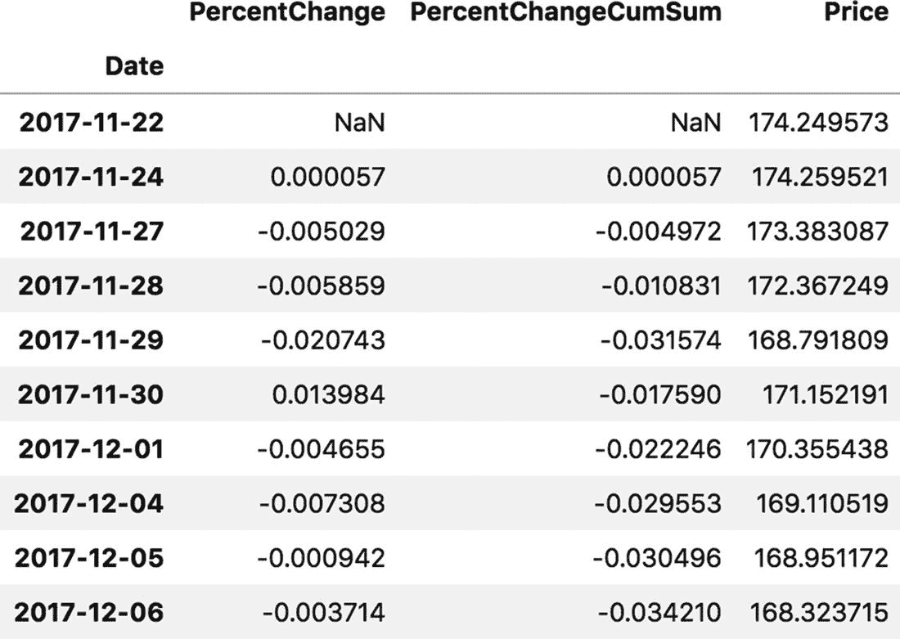

图 5-6

价格、百分比变化及百分比变化累积求和

```
pd.DataFrame({"Price":stock_data['AAPL'], "PercentChange":stock_data['AAPL'].pct_change().cumsum()}).head()
列表 5-5
对 AAPL 应用百分比变化和累积求和
```

在转换过程中，日期为“**2017-11-22**”的第一个价格因没有前值可比较而丢失，变为非数值或“**NaN**”。第二个价格 174.259521 呈现正百分比变化，因为它相对于前一个价格 174.249573 有所上涨。累积变化列按时间顺序对所有变化进行求和。“**PercentChangeCumSum**”列成为一组数据，我们可以将其与任何其他股票序列进行比较，无论它们的数值和范围如何——这对于比较分析来说是一个非常实用的转换。

## 绘制价差图

现在我们有了百分比变化累积求和，就可以轻松绘制指数与其某只成分股之间的差异图。

我们将从“**DJI**”与“**BA**”（波音）以及“**DJI**”与“**AAPL**”（苹果）之间的累积求和百分比差异开始。在所追踪的期间内（2017 年 11 月 22 日至 2018 年 4 月 4 日之间的 90 个交易日），“**BA**”相对于“**DJI**”指数表现出强劲的正向走势。解读该图表的方法是，将绿色的“**0**”线视为稳定的指数，而蓝色的波浪线则代表该成分股的差异（图 5-7）。

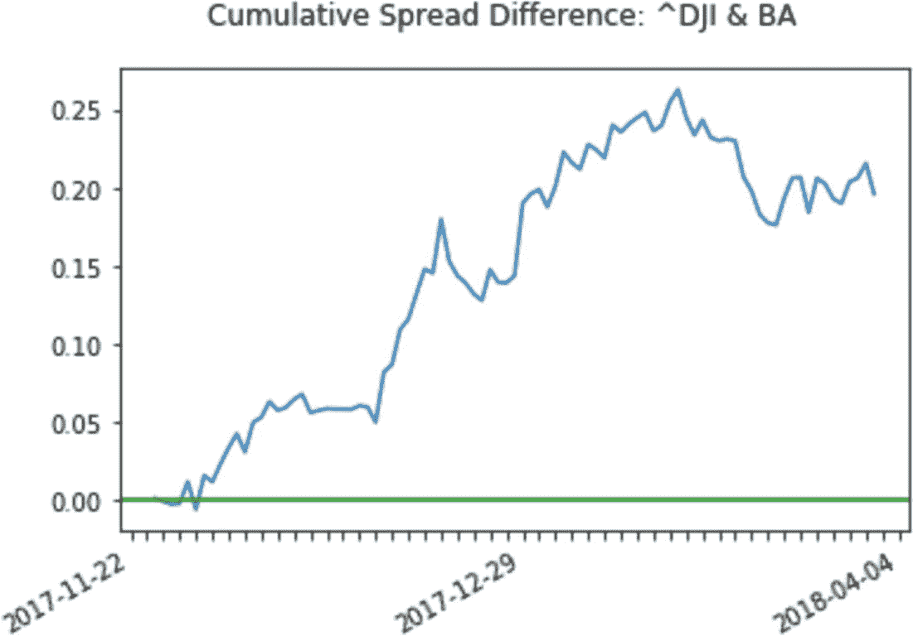

图 5-7

道琼斯指数与波音公司之间的累积价差，该股票相对于指数表现出强劲走势

相反的情况发生在“**AAPL**”上；在同一时期，它相对于“**DJI**”指数表现出强烈的负向弱势（图 5-8）。

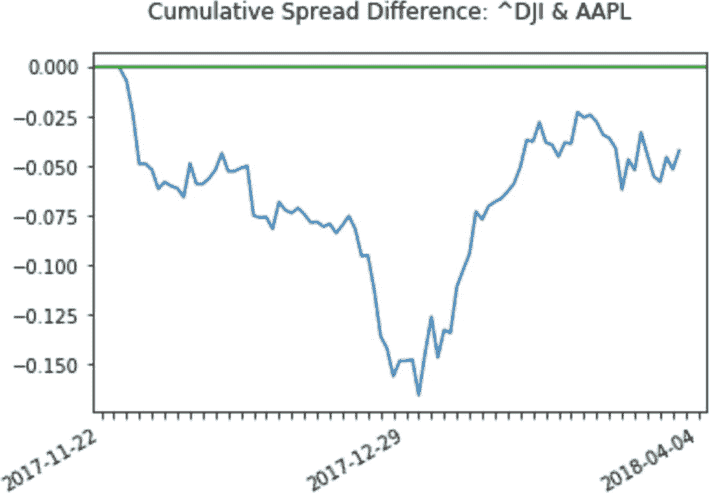

图 5-8

道琼斯指数与苹果公司之间的累积价差，该股票相对于指数表现出弱势

现在，让我们设想一个虚构的交易。如果我们在 2017 年 12 月 29 日左右做空“**BA**”，并在同一时间做多“**AAPL**”会怎样？显然，这是事后挑选股票，但你在“**BA**”上会亏损，而在“**AAPL**”上会赚得更多，从而使这对交易盈利。当然，你必须确保在两边投入等值的美元金额才能实现这一点（稍后会详细说明）。

## 提供交易思路

现在我们对自己追求的交易类型有了基本概念，让我们寻找一些活跃的布局来提供给读者。

### 寻找极端案例

假设我们持有的金融数据是最新的。为了找到相对于“**DJI**”最强正向和最强负向的股票，我们只需创建一个数据框来容纳我们所需 90 天回溯期内所有股票的数据，对所有股票应用百分比变化和累积求和，然后寻找最后一个交易日中最大和最小的交易价格。让我们更详细地过一遍这个过程。

让我们将此应用于我们所有的股票。由于我们只追踪过去 90 个交易日内的差异（可根据实验调整），我们将丢弃更早的数据（列表 5-6）。

```
stock_data = stock_data.tail(90)
列表 5-6
仅使用最后 90 个交易日的数据
```

让我们遍历每个股票代码，将最后一个百分比变化累积求和与 DJI 进行比较，并将结果存储在字典“**last_distance_from_index**”中以供比较（列表 5-7）。

```
stock1 = '^DJI'
last_distance_from_index = {}
temp_series1 = stock_data[stock1].pct_change().cumsum()
for stock2 in list(stock_data):

# 无需处理自身
if (stock2 != stock1):
temp_series2 = stock_data[stock2].pct_change().cumsum()

# 我们用股票减去指数，如果股票相对于指数表现强劲，结果将为正值
diff = list(temp_series2 - temp_series1)
last_distance_from_index[stock2] = diff[-1]
列表 5-7
获取股票与指数之间的距离
```

让我们看看字典中捕获了什么（列表 5-8）。

```
输入:
print(last_distance_from_index)
输出:
{'AAPL': -0.042309986580456815,
'BA': 0.1960194615751124,
'CAT': 0.03379845694757866,
'GS': 0.047454711281622486,
'HD': 0.014178592951754165,
'IBM': -0.003376107031365594,
'MCD': -0.06239853566933862,
'MMM': -0.08366228603707737,
'TRV': 0.04601871807501723,
'UNH': 0.060732956928879145}
列表 5-8
分析我们的股票与指数之间的距离
```

仅通过查看字典，我们发现“**BA**”的值最高，而“**MMM**”的值最低。

### 提出建议

如果我们想自动化此过程或将其扩展到数千只股票，就需要以编程方式提取这些值。让我们使用方便的 lambda 函数。这是一种可以轻松嵌套到字典中并应用转换的函数风格，或者在我们的案例中，用于查找字典中的最小值和最大值（列表 5-9 和 5-10）。

```
输入:
weakest_symbol = min(last_distance_from_index.items(), key=lambda x: x[1])
print('最弱股票代码: %s' % weakest_symbol[0])
输出:
最弱股票代码: MMM
列表 5-9
应用 Lambda 函数查找字典中的最小值
```

```
输入:
strongest_symbol = max(last_distance_from_index.items(), key=lambda x: x[1])
print('最强股票代码: %s' % strongest_symbol[0])
输出:
最强股票代码: BA
列表 5-10
应用 Lambda 函数查找字典中的最大值
```

让我们将这两个极端案例可视化：“**BA**”和“**MMM**”（图 5-9 和 5-10）。

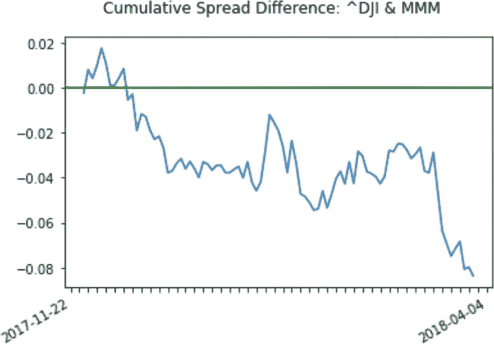

图 5-10

该集合中最弱的股票 vs. 道琼斯指数

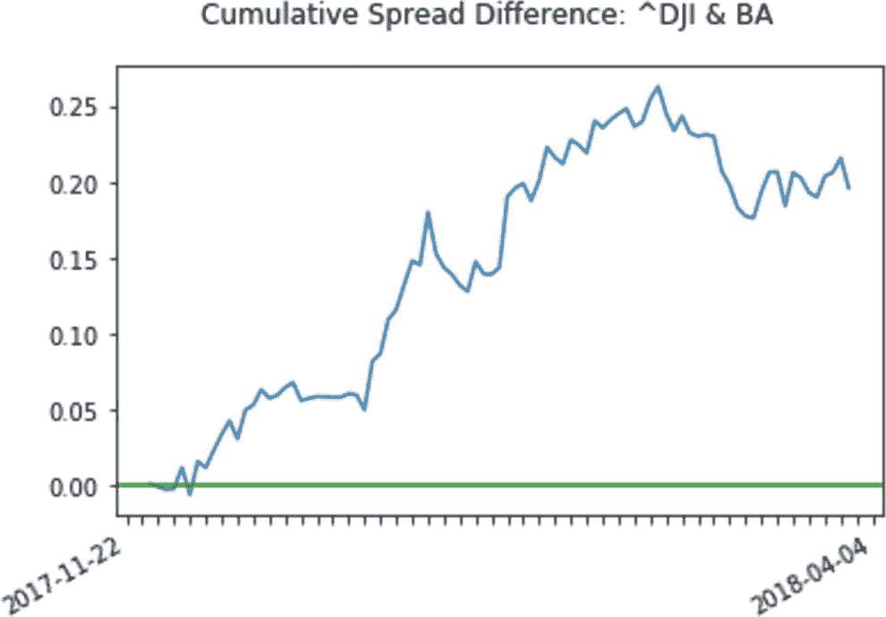

图 5-9

该集合中最强的股票 vs. 道琼斯指数

现在我们有了两个建议，以及它们在图表上的样子（图 5-11）。

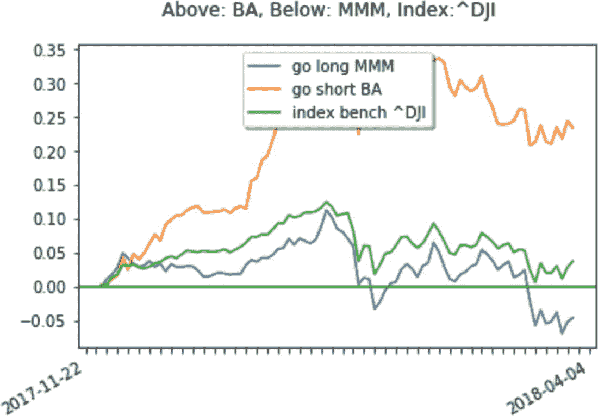

图 5-11

来自我们算法的建议：做空 BA，买入 MMM

1.  买入“**MMM**”

2.  做空“**BA**”

## 计算交易股数

您希望以等额美元的多头和空头头寸进入市场。换句话说，您希望实现美元中性（当然，在预算较小或股票交易价格较高的情况下，这会更难实现）。

您需要设定一个预算值，即您愿意用于交易的总金额（虽然在此用例中我指的是美元，但可以替换为任何其他货币）。在本例中，我们使用 10,000 美元（清单 5-11）。

```
trading_budget = 10000
清单 5-11
设定交易预算
```

由于我们处理的是美元金额，我们需要使用实际的股票价格，而不是百分比变化和累计总和。我们将继续使用“**BA**”和“**MMM**”（清单 5-12）。

```
输入：
short_symbol = strongest_symbol[0]
short_last_close = stock_data[strongest_symbol[0]][-1]
print('最强股票 %s，最新价格：$%f' % (strongest_symbol[0], short_last_close))
long_symbol = weakest_symbol[0]
long_last_close = stock_data[weakest_symbol[0]][-1]
print('最弱股票 %s，最新价格：$%f' % (weakest_symbol[0], long_last_close))
输出：
最强股票 BA，最新价格：$327.440002
最弱股票 MMM，最新价格：$217.559998
清单 5-12
获取两只推荐股票的最新交易价格
```

现在，我们应用交易预算，并计算出每种股票可以交易多少股。公式很简单，就是将预算的一半除以股票价格（清单 5-13 和清单 5-14）。

```
输入：
print('对于 %s，价格为 $%f，您需要做空 %i 股' %
(short_symbol, short_last_close, (trading_budget * 0.5) / short_last_close ))
输出：
对于 BA，价格为 $327.440002，您需要做空 15 股
清单 5-13
获取第一只推荐股票的最新交易价格
```

```
输入：
print('对于 %s，价格为 $%f，您需要买入 %i 股' %
(long_symbol, long_last_close, (trading_budget * 0.5) / long_last_clse ))
输出：
对于 MMM，价格为 $217.559998，您需要买入 22 股
清单 5-14
获取第二只推荐股票的最新交易价格
```

因此，为了进行美元中性的配对交易，我们需要做空 15 股“**BA**”并买入 22 股“**MMM**”。这应该说得通，因为 327 乘以 15 大约是 5,000 美元，而 217 乘以 22 也大约是 5,000 美元。

## 设计一个提供交易建议的移动端友好型 Web 应用

让我们开始构建本地的 Flask 应用程序，它将提供交易建议。像往常一样，我们必须问自己，我们希望最终用户获得什么样的体验。

这将是一个简单的应用程序。在我们案例研究的第一部分，我们将简单地以视觉上令人愉悦的方式，使用大型彩色箭头和清晰的说明，基于策略提供交易建议。用户将能够输入他们的总交易预算，应用程序将计算为了保持美元中性需要买入和卖出的股票数量。

### 流式容器

该应用程序还需要支持移动设备。这意味着它需要使用 Bootstrap 的“**响应式流式容器**”。Bootstrap 3 开箱即用即支持移动设备^(³¹)，但我们可以通过使用正确的标签来增强和控制特定行为。

本书中的大多数脚本都遵循了一些推荐的“**响应式**”行为，例如提供正确的页面渲染和触摸缩放，您将在每个项目的头部看到这些（清单 5-15）。

```
清单 5-15
处理不同的网页浏览设备
```

我们将添加流式容器，以根据用于查看网站的网页设备或尺寸，实现智能渲染。在正常模式下，我们看到宽屏版本，其中绿色和红色箭头绘制在页面的右侧和左侧（图 5-12）。

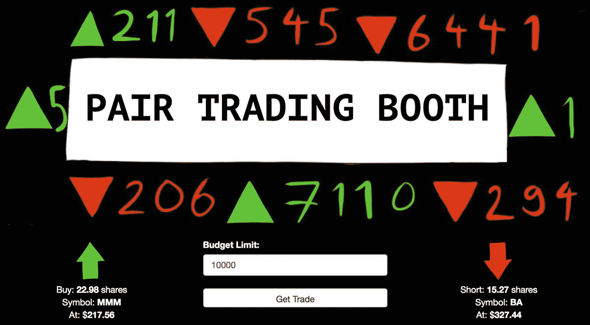

图 5-12

适用于电脑和平板电脑的宽屏模式 Web 应用

当在移动设备或窄页面上查看应用程序时，我们会看到一个版本，其中绿色和红色箭头渲染在“**预算限制**”文本框的上方和下方（图 5-13）。

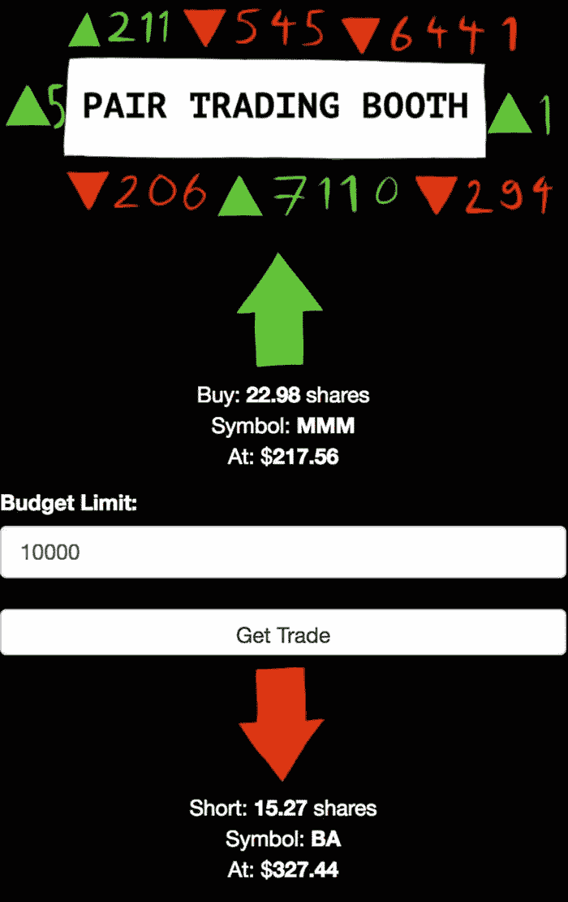

图 5-13

适用于移动设备的窄屏模式 Web 应用

这确保了无论何种格式，应用程序始终易于使用。有关此主题的更多信息，请参阅 w3schools 上的“**Bootstrap 网格示例**”，网址为 [`https://www.w3schools.com/bootstrap/bootstrap_grid_examples.asp`](https://www.w3schools.com/bootstrap/bootstrap_grid_examples.asp) 。

## 运行本地 Flask 版本

如果您还没有下载第 5 章的文件，请将其下载到您的本地机器。在命令/终端窗口中，进入“**web-application**”文件夹。您的文件结构应类似于清单 5-16。

```
web-application
├── ^DJI.csv
├── AAPL.csv
├── BA.csv
├── CAT.csv
├── GS.csv
├── HD.csv
├── IBM.csv
├── main.py
├── MCD.csv
├── MMM.csv
├── TRV.csv
├── UNH.csv
├── static
├── images:
├── down-arrow.png
├── ticker-title.png
└── up-arrow.png
└── templates:
└── index.html
清单 5-16
我们 Web 应用的文件结构
```

您可以通过运行“**pip3 install -r**”命令来安装所有必需的 Python 库（清单 5-17）。

```
$ pip3 install -r requirements.txt
清单 5-17
安装依赖项
```

继续，通过在终端窗口中输入“**python3 main.py**”命令来试运行一下（清单 5-18）。

```
$ python3 main.py
清单 5-18
我们的本地 Web 应用
```

您应该会看到“**配对交易平台**”Web 应用（图 5-14）。

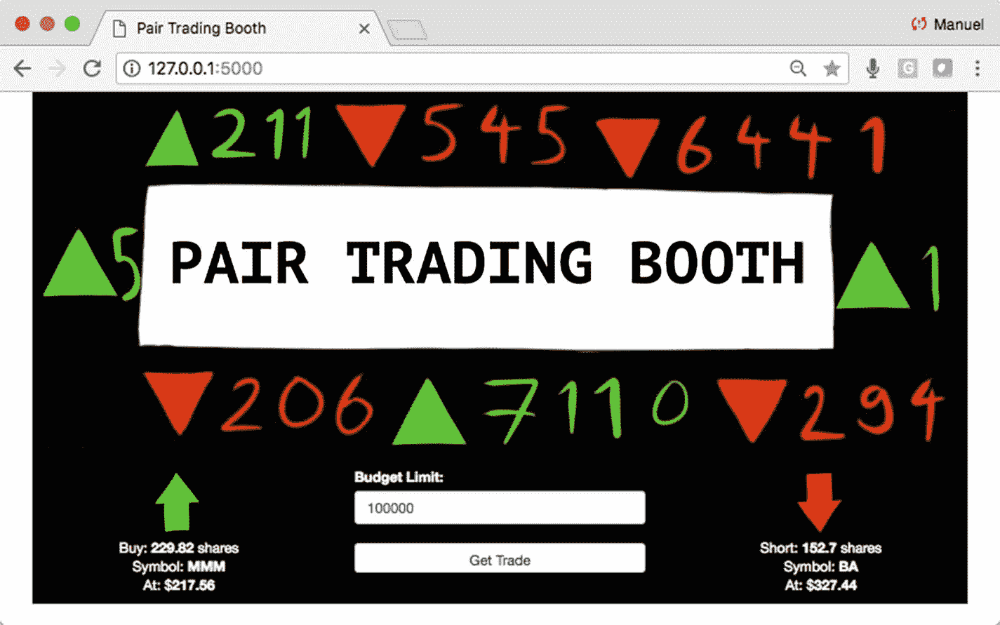

图 5-14

Web 应用的本地渲染

## 这里发生了什么？

与我们迄今为止构建的其他网站相比，本章相当直接。我们确实实现了一些前面讨论过的移动端友好标签，这里还有两件事值得一提。

### Bootstrap 输入字段验证

Bootstrap 具有出色的表单验证功能，实现起来非常简单。只需告诉 Bootstrap 输入字段的数据类型，它就可以自动为您处理，从而省去大量编码和表单处理的麻烦（清单 5-19）。

```
清单 5-19
Bootstrap 字段验证
```

要查看其效果，请尝试在“**预算限制**”输入框中输入一个非数字字符，您将看到前端弹出一个消息框，提示您只能输入数字。这是一个非常棒的功能，尤其是在文本注入攻击盛行的今天（图 5-15）。

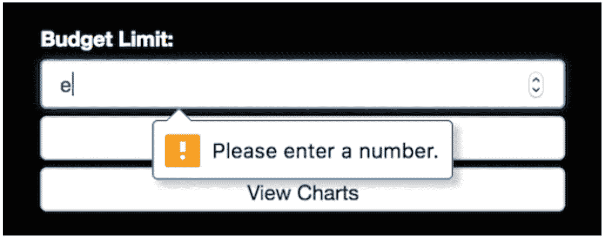

图 5-15

表单验证生效，拒绝非数字字符

有关这些表单验证器的更多信息，请查看 Bootstrap 文档：[`https://getbootstrap.com/docs/4.0/components/forms/`](https://getbootstrap.com/docs/4.0/components/forms/) 。

我们将在接下来的章节中继续构建“**配对交易平台**”Web 应用，所以请保留好代码。

## 在 PythonAnywhere 上运行

登录你在第 1 章中使用的 PythonAnywhere 账户。导航到仪表盘右上角的“**文件**”按钮。在 PythonAnywhere 上创建一个名为“**pair-trading-booth**”的新文件夹。点击顶部菜单栏中的“**文件**”链接，然后在目录文本框中输入“**pair-trading-booth**”，并点击“**新建目录**”（图 5-16）。

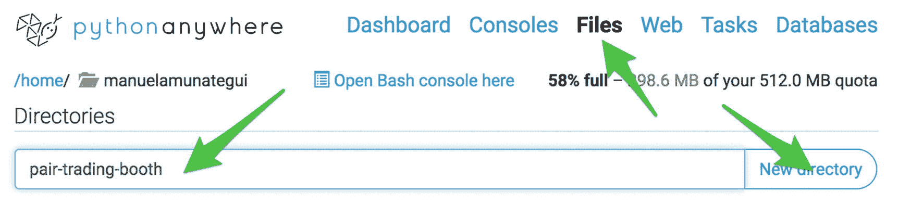

图 5-16

创建我们网站的根目录

进入“**pair-trading-booth**”文件夹，并在其下再创建两个文件夹：“**static**”和“**templates**”。

就在“**pair-trading-booth**”目录下，点击“**上传文件**”按钮，上传本章“**web-application**”文件夹下的所有“**CSV**”文件和“**main.py**”文件。不幸的是，你需要为每个文件都执行一次此操作，总共 12 次（图 5-17）。

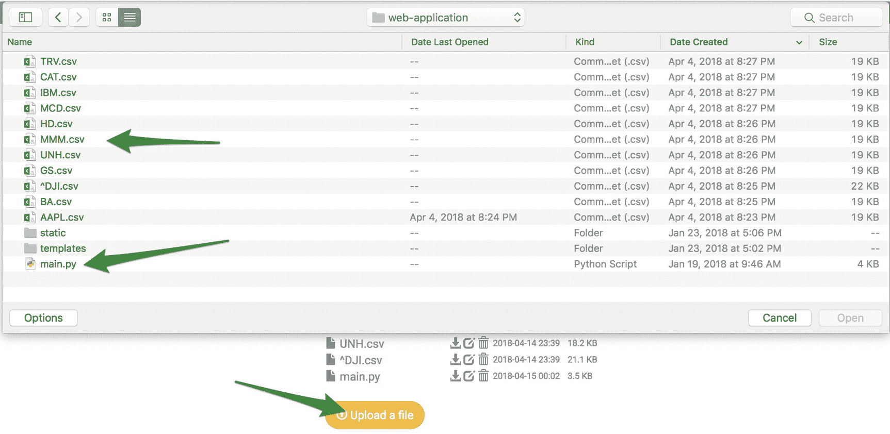

图 5-17

手动将文件上传到云端

你的文件夹结构应如代码清单 5-20 所示。

```
^DJI.csv
AAPL.csv
BA.csv
CAT.csv
GS.csv
HD.csv
IBM.csv
main.py
MCD.csv
MMM.csv
TRV.csv
UNH.csv
├── static
└── templates
代码清单 5-20
PythonAnywhere 上的文件结构
```

接下来，进入“**static**”文件夹并创建一个“**images**”文件夹。进入“**images**”文件夹并上传所有“**PNG**”文件。你的文件夹应如代码清单 5-21 所示。

```
└── static:
└── images:
├── down-arrow.png
├── ticker-title.png
└── up-arrow.png
代码清单 5-21
PythonAnywhere 上的文件结构
```

回溯到“**templates**”文件夹并进入，然后上传——你猜对了——就是“**index.html**”文件。最终的完整结构应如代码清单 5-22 所示。

```
^DJI.csv
AAPL.csv
BA.csv
CAT.csv
GS.csv
HD.csv
IBM.csv
main.py
MCD.csv
MMM.csv
TRV.csv
UNH.csv
└── static:
└── images:
├── down-arrow.png
├── ticker-title.png
└── up-arrow.png
└── templates:
└── index.html
代码清单 5-22
PythonAnywhere 上的文件结构
```

文件结构完全符合我们的要求。现在我们需要配置 Web 设置，告诉 PythonAnywhere 提供什么服务以及如何提供服务。点击“**Web**”选项卡。

## 修复 WSGI 文件

我们需要设置 Web 服务器网关接口文件（WSGI）。WSGI 文件是不同 Web 框架与 Python 编程语言之间的通用接口。

### 源代码

点击 PythonAnywhere 上的“**Web**”菜单按钮（图 5-18）。

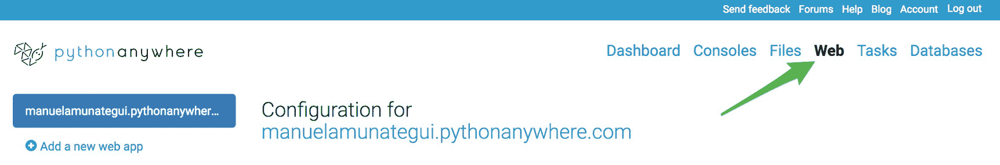

图 5-18

进入 PythonAnywhere 上的 Web 选项卡

向下滚动到“**代码**”部分，将“**源代码**”路径的末尾改为“**pair-trading-booth**”（代码清单 5-23）。

```
源代码: /home//mysite
代码清单 5-23
找到“mysite”源代码链接
```

将“**mysite**”改为“**pair-trading-booth**”（代码清单 5-24）。

```
源代码: /home//pair-trading-booth
代码清单 5-24
用我们的 Web 应用路径更新源代码链接
```

这样，PythonAnywhere 就知道在哪里找到源代码了（图 5-19）。

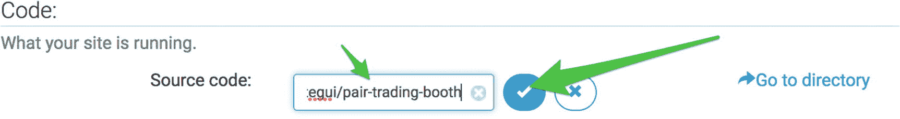

图 5-19

你最终应该在源代码文本框中看到正确的应用程序名称

### WSGI 配置

接下来，在同一部分中，更新“**WSGI 配置文件**”。点击图 5-20 中所示的链接。

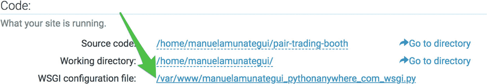

图 5-20

点击“**WSGI 配置文件**”链接以更新配置文件

需要对此文件进行两处编辑。更新“**project_home**”变量以包含你的账户名（这应该会自动完成），并将文件夹名称改为“**pair-trading-booth**”。这通知 Web 服务器，“**pair-trading-booth**”文件夹是它找到服务 Web 应用所需所有文件的地方。接下来，更新脚本的最后一行，使其从“**main**”（main.py 的简称）导入，如代码清单 5-25 所示。

```

# 此文件包含提供您的

# Web 应用程序所需的 WSGI 配置，网址为 http://.pythonanywhere.com/

# 它通过将变量 'application' 设置为某个 WSGI 处理程序来工作。

#
# 以下内容已为您的 Flask 项目自动生成
import sys

# 将您的项目目录添加到 sys.path
project_home = u'/home//pair-trading-booth'
if project_home not in sys.path:
sys.path = [project_home] + sys.path

# 导入 flask 应用，但需要将其命名为 "application" 以便 WSGI 工作
from main import app as application
代码清单 5-25
更新 WSGI 配置文件
```

编辑文件后，点击右上角的绿色“**保存**”按钮，然后再次点击“**Web**”选项卡（图 5-21）。

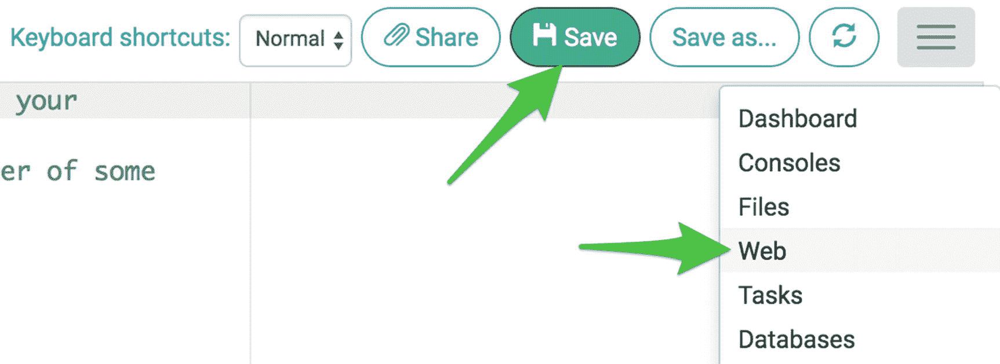

图 5-21

保存 WSGI 配置文件

### 重新加载网站

只剩下一件事要做，那就是点击那个大大的绿色“**重新加载 <<你的账户>>.pythonanywhere .com**”按钮。点击你的网站 URL，你应该会看到“**配对交易亭**”Web 应用程序（图 5-22）。

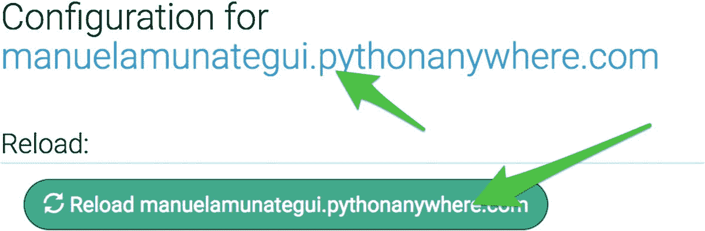

图 5-22

进行任何更改后，点击这个大大的绿色重新加载按钮来更新 Web 服务器

继续，更改“**预算限制**”的大小并获取交易。同时调整网站窗口的大小，以查看宽屏与移动端显示的变化（图 5-23）。

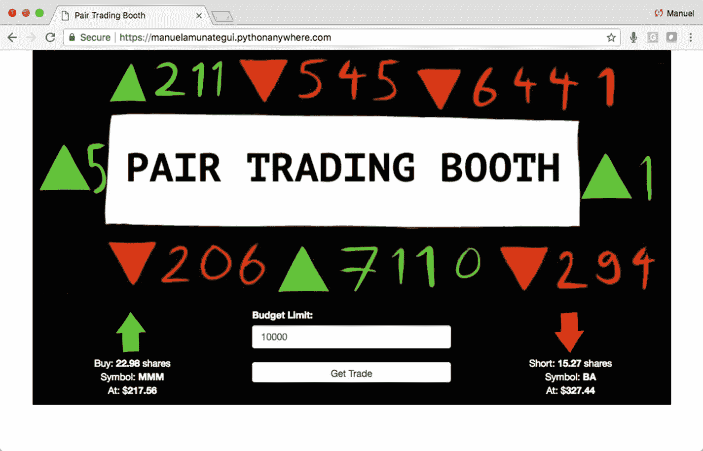

图 5-23

配对交易亭 Web 应用程序已上线！

## PythonAnywhere 故障排除

如果你看到的是“**出了点问题 :-（**”页面（图 5-24）而不是 Web 应用程序，请点击错误日志。这将帮助你查明问题所在以及如何修复。每当你对服务器端脚本进行更改时，都需要点击那个大大的绿色“**重新加载 <<你的账户>>.pythonanywhere .com**”按钮。

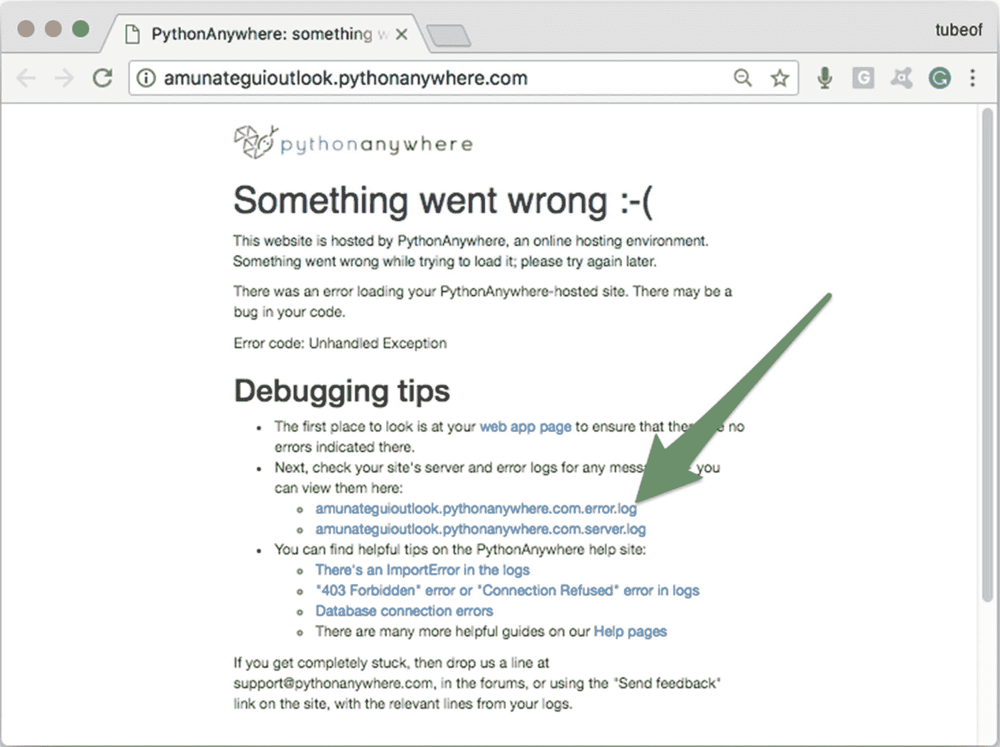

图 5-24

如果出现问题，请点击错误和服务器日志文件的链接

## 结论

[`PythonAnywhere.com`](http://pythonanywhere.com) 不仅极其简单易用，而且直观，在某些情况下甚至是免费的！这使其成为在万维网上扩展简单 Python 想法并触达任何能访问互联网的人的强有力竞争者！

还有一件事：因为我们只使用 PythonAnywhere 上的免费实例，所以不使用时无需急于终止服务。你可以让它一直运行，并向你的朋友和家人展示。对于某些较大的提供商来说情况并非如此——如果你让页面在其中一些提供商上保持运行，将会产生费用。

我会不厌其烦地提醒你在每章结束后关闭服务。

脚注 1

