# 6. 在 Azure 上使用 Google 地图显示预测结果

旧金山的下一起犯罪将发生在哪里？让我们使用 Google 地图和 Microsoft Azure 构建一个交互式预测地图仪表板。

我们再次提升难度，使用强大的 Google 地图 API 来显示信息。我们将构建一个 Web 仪表板，用于预测、映射和可视化旧金山的犯罪情况（图 6-1）。我们将使用来自`DataSF | 旧金山开放数据`的数据集，该数据集源自真实且定期更新的 SFPD 犯罪事件报告系统。只需少量工作，我们就能从世界上最流行的地图框架中受益。


图 6-1 本章的最终 Web 应用程序

### 注意
通过访问 [`www.apress.com/9781484238721`](http://www.apress.com/9781484238721) 并点击源代码按钮，下载第 6 章的文件。打开 Jupyter 笔记本`chapter6.ipynb`以跟随本章内容。

## 规划我们的 Web 应用程序
这是一个雄心勃勃的项目，因为我们将构建一个能够预测并可视化未来犯罪发生地点的应用程序。它不仅需要一个围绕犯罪数据和时间的建模层，还需要一个直观、友好且吸引人的可视化层。

## 在 DataSF 上探索旧金山犯罪热力图数据集
如果你想获取某个大城市的最新犯罪数据，`DataSF`^(³²) 就是最佳选择。实际上，它提供的远不止犯罪数据；截至我上次查看，它已发布了超过 462 个数据集，涵盖旧金山市的各类主题。

我们将使用旧金山犯罪热力图；它包含相当新的数据，通常在每个月底更新。`DataSF` 还有一个仪表板，你可以在其中在地图上可视化数据——很酷的东西（请访问 [`https://data.sfgov.org/Public-Safety/SF-Crime-Heat-Map/q6gg-sa2p/data`](https://data.sfgov.org/Public-Safety/SF-Crime-Heat-Map/q6gg-sa2p/data) 查看）。请继续下载本章的文件到名为`chapter-6`的文件夹中，并打开 Jupyter 笔记本跟随操作。

这是一个相当大的数据集（超过 250 MB）；因此，我们只下载一次数据，并在后续运行中使用本地副本。在 Jupyter 笔记本中，运行数据下载代码，然后在代码成功下载并保存到本地后，将标志`already_have_the_data`设置为`True`。这将确保笔记本的任何后续运行都会从你的本地机器拉取数据。

当你下载时，数据集可能有所不同，因为他们会不断向其中添加数据。我们使用 Pandas 的`read_csv()`来下载并保存到本地。粗略查看数据后，我们发现它包含 14 列和超过 170 万行（列表 6-1）。

```python
# 输入:
crime_df.shape
```

```output
# 输出:
(2192062, 12)
```
列表 6-1 获取数据集形状

我们看到数据涵盖 2003 年至 2018 年（列表 6-2）。

```python
# 输入:
years = [int(dte.split("/")[2]) for dte in crime_df['Date']]
print('最大年份 %i, 最小年份 %i' % (max(years), min(years)))
```

```output
# 输出:
最大年份 2018, 最小年份 2003
```
列表 6-2 数据涵盖的年份

我们还注意到，它既包含有趣的字段，也包含不太有趣的字段（列表 6-3）。

```python
# 输入:
list(crime_df)
```

```output
# 输出:
['IncidntNum', 'Category', 'Descript', 'DayOfWeek', 'Date', 'Time', 'PdDistrict', 'Resolution', 'Address', 'X', 'Y', 'Location']
```
列表 6-3 特征名称（清理前）

## 数据清理
为了使数据更易于使用且更直观，我们只保留`Category`、`DayOfWeek`、`Date`、`Time`、`X`、`Y`，并将`X`和`Y`重命名为`Longitude`和`Latitude`（列表 6-4 和图 6-2）。

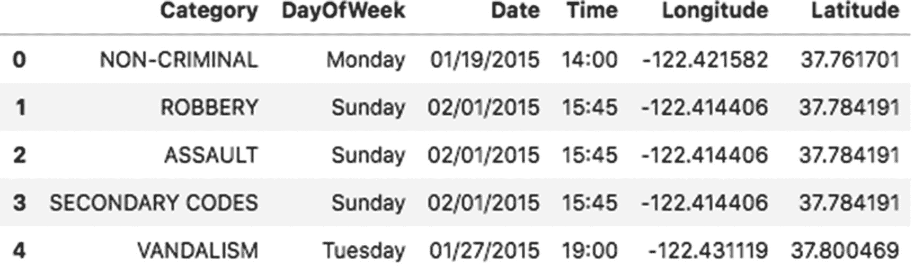

图 6-2 仅保留具有更好列标题名称的有用特征

```python
crime_df = crime_df[['Category', 'DayOfWeek', 'Date', 'Time', 'X', 'Y']]
crime_df.columns = ['Category', 'DayOfWeek', 'Date', 'Time', 'Latitude', 'Longitude']
crime_df.head()
```
列表 6-4 删除不需要的特征并重命名列

## 重新平衡数据集
让我们进行一次探索性的绕道，了解更多关于这些数据的信息。我们将从查看类别以及每个类别包含的报告数量开始（列表 6-5）。

```python
# 输入:
crime_df['Category'].value_counts()
```

```output
# 输出:
LARCENY/THEFT                  473842
OTHER OFFENSES                 306575
NON-CRIMINAL                   235669
ASSAULT                        192459
VEHICLE THEFT                  125983
DRUG/NARCOTIC                  118911
VANDALISM                      114688
WARRANTS                       100512
BURGLARY                        90495
SUSPICIOUS OCC                  79618
MISSING PERSON                  64332
ROBBERY                         55332
FRAUD                           41104
SECONDARY CODES                 25495
FORGERY/COUNTERFEITING          22938
WEAPON LAWS                     21991
TRESPASS                        19195
PROSTITUTION                    16669
STOLEN PROPERTY                 11771
SEX OFFENSES, FORCIBLE          11554
DISORDERLY CONDUCT               9988
DRUNKENNESS                      9781
RECOVERED VEHICLE                8716
DRIVING UNDER THE INFLUENCE      5629
KIDNAPPING                       5307
RUNAWAY                          4403
LIQUOR LAWS                      4078
ARSON                            3887
EMBEZZLEMENT                     2961
LOITERING                        2420
SUICIDE                          1285
FAMILY OFFENSES                  1177
BAD CHECKS                        921
BRIBERY                           804
EXTORTION                         733
SEX OFFENSES, NON FORCIBLE        425
GAMBLING                          343
PORNOGRAPHY/OBSCENE MAT            57
TREA                               14
```
列表 6-5 数据集中的类别

除了这些类别令人担忧之外，你还会注意到排名靠前的类别占据了绝大多数计数。我们可能需要将数据重新组织成更小、更平衡的新类别。使用 Python Pandas 可以轻松做到这一点。让我们创建以下逻辑分组（至少对我来说它们是有意义的；列表 6-6）。

# THEFT = ["LARCENY/THEFT", "VEHICLE THEFT", "BURGLARY", "ROBBERY", "STOLEN PROPERTY"]
# IMPAIRED = ["DRUNKENNESS", "DRIVING UNDER THE INFLUENCE", "LIQUOR LAWS", "DISORDERLY CONDUCT", "DRUG/NARCOTIC", "LOITERING"]
# VIOLENCE = ["ASSAULT", "VANDALISM", "SUSPICIOUS OCC", "TRESPASS", "SEX OFFENSES,
# FORCIBLE" , "SEX OFFENSES, NON FORCIBLE"]
# OTHER = ["OTHER OFFENSES", "NON-CRIMINAL"]
列表 6-6
更高级别的分组

使用 NumPy 便捷的`select()`函数，我们可以创建新的超级类别（列表 6-7）。

```python
selections = [
(crime_df['Category'].isin(THEFT)),
(crime_df['Category'].isin(IMPAIRED)),
(crime_df['Category'].isin(VIOLENCE)),
(crime_df['Category'].isin(OTHER))]
new_categories = ['THEFT', 'IMPAIRED', 'VIOLENCE', 'OTHER']
crime_df['CAT'] = np.select(selections, new_categories, default="OTHER")
```
列表 6-7
使用 NumPy 的`select()`功能创建新类别

如果我们按计数查看类别，会发现数据集在某种程度上更加平衡，更重要的是，需要处理的类别集要短得多（列表 6-8）。

```
输入:
crime_df_tmp['CAT'].value_counts()
输出:
OTHER       865893
THEFT       757423
VIOLENCE    417939
IMPAIRED    150807
```
列表 6-8
新类别的计数

## 按星期几进行探索

让我们按星期几来细分其中一些类别。盗窃案在周五发生得最为频繁，其次是周六（代码清单 6-9 和图 6-3）。

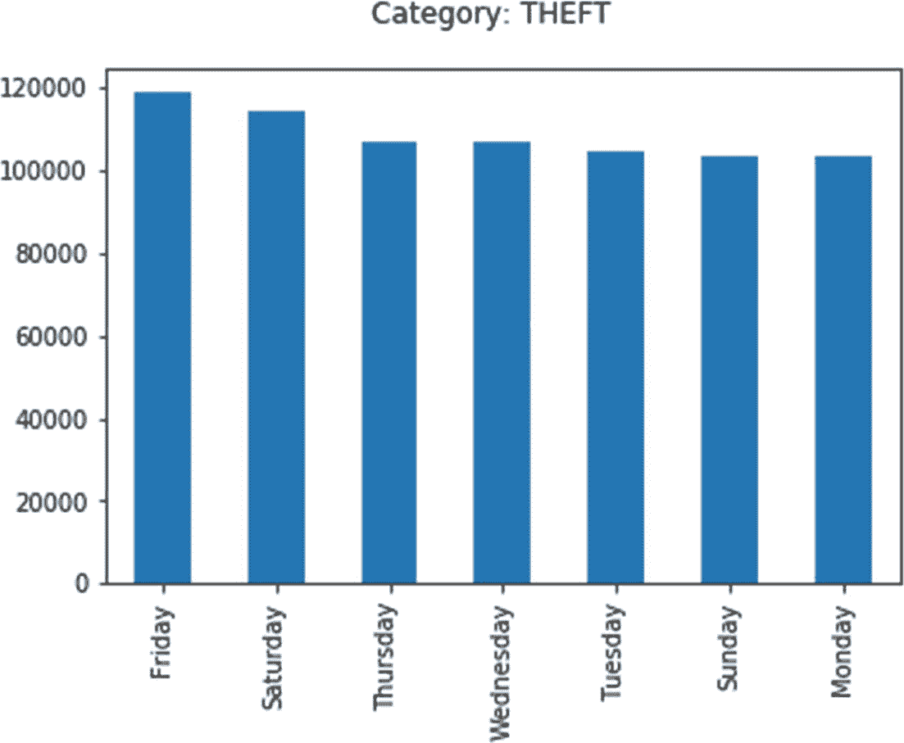
图 6-3
按星期几划分的盗窃案

```python
crime_df_tmp = crime_df[crime_df['CAT'] == 'THEFT']
crime_df_tmp['DayOfWeek'].value_counts().plot(kind='bar')
plt.suptitle('Category: THEFT')
```
Listing 6-9
Theft by Day-of-the-Week

让我们按星期几来细分其中一些类别。令人惊讶的是，`酒后`行为在工作日发生得最多（图 6-4）。

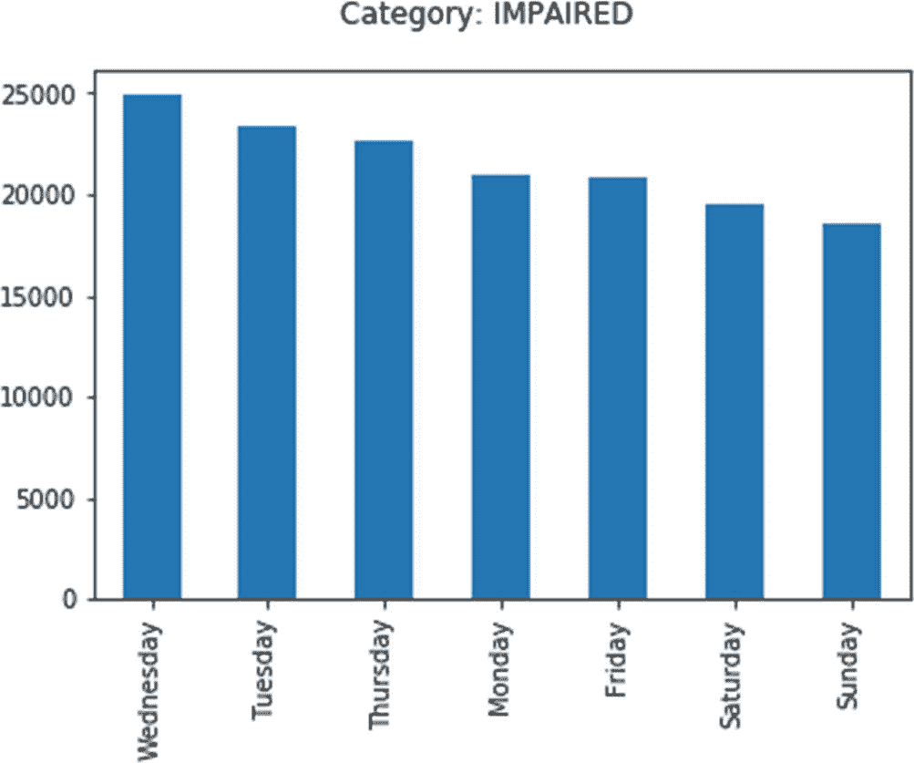
图 6-4
按星期几划分的酒后行为

## 特征工程

让我们将其中一些数据转换为更简单的分组，这将有助于我们以更具泛化性的方式建模。

### 创建月份特征

我们先从一个简单的开始，创建一个月份特征。我们对年份不感兴趣，只关心月份；我们假设历年的一月份都是相似的。这只需要从日期字段中提取前两位数字即可。如果日期格式不是这么规整，我们就需要将其转换为日期字段，并使用一些专门的函数（代码清单 6-10 和图 6-5）。

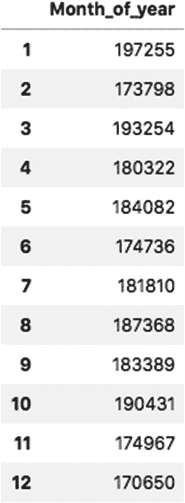
图 6-5
按月份统计的犯罪报告总数表

```python
crime_df["Month_of_year"] = [int(dte.split("/")[0]) for dte in crime_df['Date']]
crime_df["Month_of_year"].value_counts()
```
Listing 6-10
Aggregating by Months

正如预期，我们得到了 12 个分组。让我们绘制它们，看看哪个月的犯罪报告最多（代码清单 6-11 和图 6-6）。

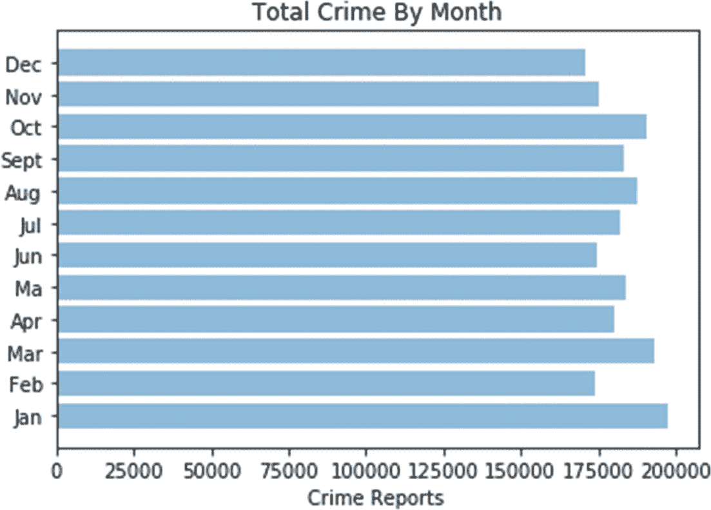
图 6-6
按月份统计的犯罪报告总数

```python
plt.barh(crime_by_month.index, crime_by_month['Month_of_year'], align="center", alpha=0.5)
objects = ['Jan','Feb','Mar','Apr','Ma','Jun','Jul','Aug','Sept','Oct','Nov','Dec']
plt.yticks(crime_by_month.index, objects)
plt.xlabel('Crime Reports')
plt.title('Total Crime By Month')
plt.show()
```
Listing 6-11
Reported Crime Counts by Month

我们可以通过按犯罪类别细分数据来进一步深入挖掘（图 6-7）。

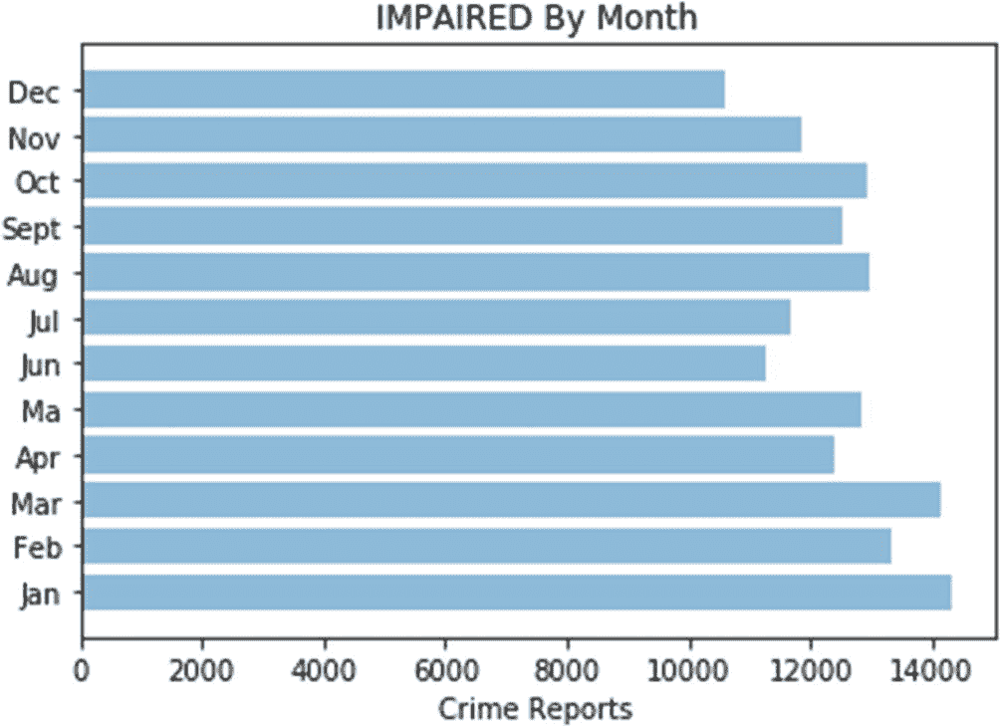
图 6-7
按月份统计的`酒后`类别犯罪报告数量

### 创建时间段

为了简化我们的时间数据，我们将其划分为三个类别：
*   上午
*   下午
*   夜间

我们将复用`np.select()`函数，但还有很多其他方法可以达到相同的结果，比如使用`np.where()`或列表推导式。我们首先创建一个名为`Hour`的新特征，从完整的时间戳中提取犯罪报告的小时数。然后，我们简单地在 24 小时时间线上创建三个时段，并筛选出每个小时属于哪个时间段。最终我们得到了三个分布相当均衡的类别，非上午报告的犯罪数量略多（代码清单 6-12）。

```python
Input:

# create AM, AFT, NT
crime_df["Hour"] = [int(hr.split(":")[0]) for hr in crime_df['Time']]
crime_df["Hour"]

# create new groups
selections = [
(crime_df['Hour'] > 5) & (crime_df['Hour']  13) & (crime_df['Hour']  18) & (crime_df['Hour'] <= 5)]
new_categories = [0, 1, 2] # ['AM', 'AFT', 'NIT']
crime_df['Day_Segment'] = np.select(selections, choices, default=2)
crime_df['Day_Segment'].value_counts()
Output:
2    683804
1    674292
0    620236
```
Listing 6-12
Transform Time Using Categories “AM,” “AFT,” and “NT”

### 按时间段进行探索

报告的`酒后`犯罪似乎在下午更为常见，而报告的`暴力`犯罪则在夜间更为常见（图 6-8 和图 6-9）。

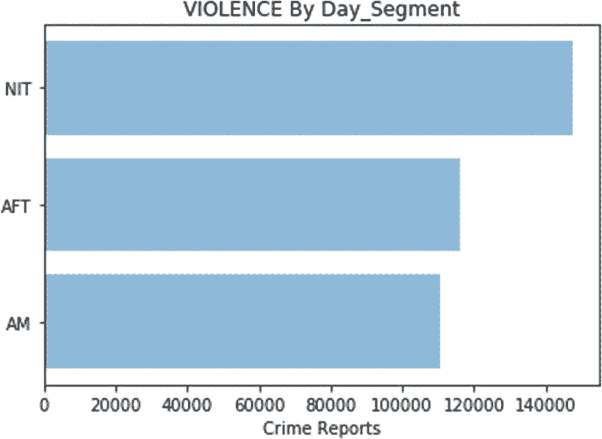
图 6-9
按时间段划分的`暴力`报告犯罪明细

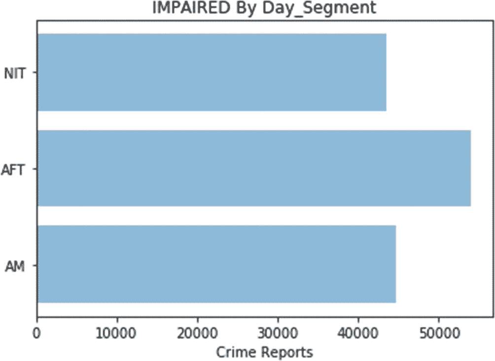
图 6-8
按时间段划分的`酒后`报告犯罪明细

### 注意

更多图表请参考本章的 Jupyter notebook。

## 可视化地理数据

该数据集的一个很棒的特性是它包含了犯罪报告地点的纬度和经度。这对于创建基于位置的模型非常有用，同时也非常适合可视化。事实上，你可以简单地在 Matplotlib 中将纬度和经度分别作为 x 和 y 进行绘制，就能得到数据的良好可视化表示。让我们试试看（代码清单 6-13 和图 6-10）。

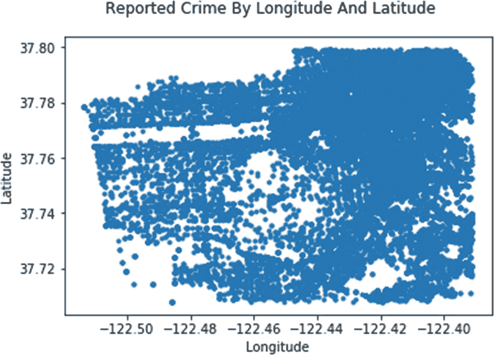
图 6-10
犯罪报告地点的经度和纬度原始绘图

## 可视化犯罪数据

```python
plt.plot(crime_df['Longitude'].head(50000),
crime_df['Latitude'].head(50000),
linestyle='none', marker='.')
plt.show()
```

Listing 6-13
Plotting Crime by Longitude and Latitude

从图中可以看出，通过观察空白区域，我们可以轻松辨认出金门公园、普雷西迪奥公园和默塞德湖公园（图 6-11）。

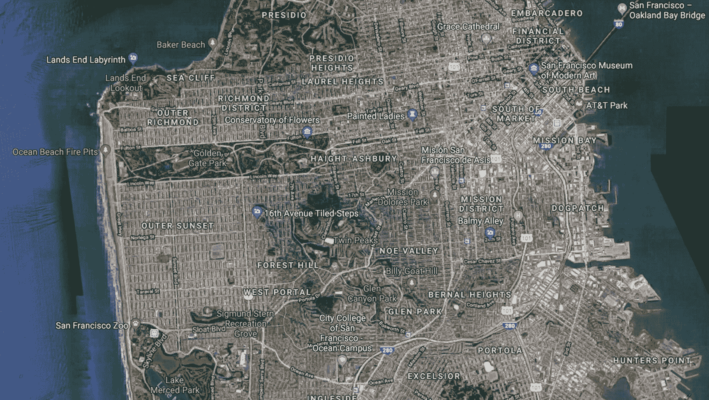

图 6-11

来自谷歌地图的同一区域对比卫星图（来源：谷歌地图）

### 对地理坐标进行四舍五入以创建区域桶

处理地理坐标的一个技巧是，你可以轻松地对它们进行四舍五入，从而创建一个全面的网格——网格越密，四舍五入的位数越少；网格越疏，四舍五入的位数越多。我们创建一个简单的`rounding_factor`变量，来帮助我们更好地找到所需的合适视角。让我们来看一下（清单 6-14 和 6-15；图 6-12 和 6-13）。

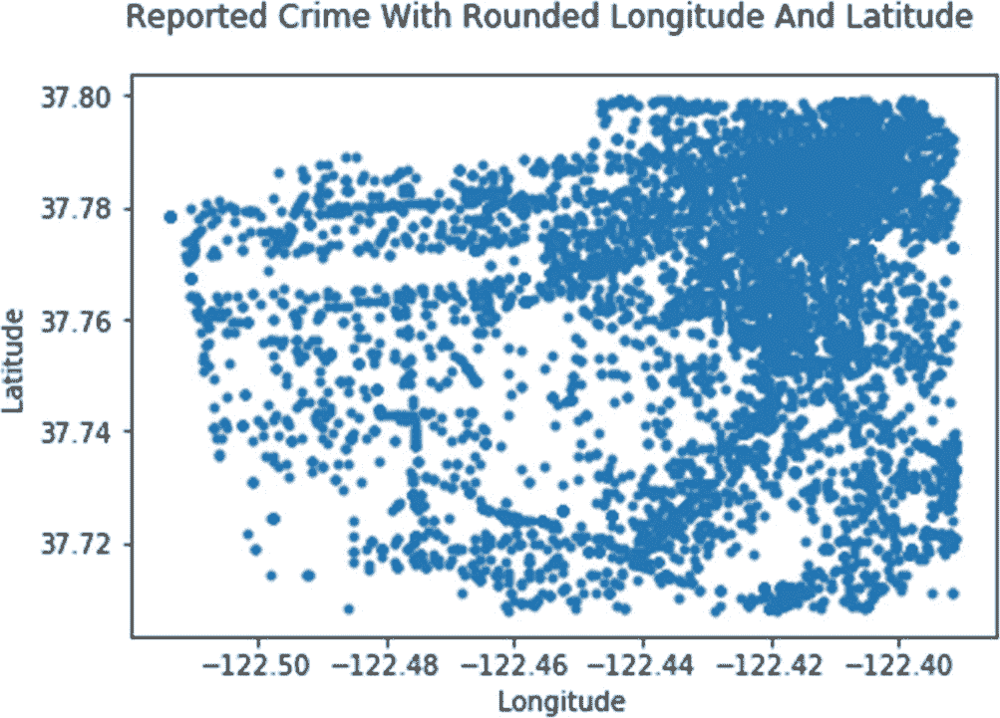

图 6-12

将经度和纬度四舍五入到小数点后四位

```python
rounding_factor = 4
plt.plot(np.round(crime_df['Longitude'].head(10000),rounding_factor),
np.round(crime_df['Latitude'].head(10000),rounding_factor),
linestyle='none', marker='.')
```

清单 6-14
对地理坐标进行四舍五入

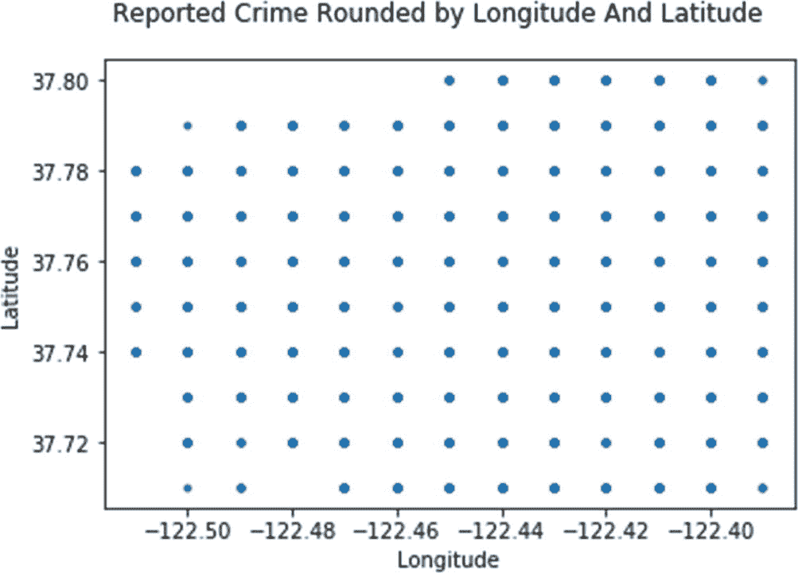

图 6-13

将经度和纬度四舍五入到小数点后两位

```python
rounding_factor = 2
plt.plot(np.round(crime_df['Longitude'].head(10000),rounding_factor),
np.round(crime_df['Latitude'].head(10000),rounding_factor),
linestyle='none', marker='.')
```

清单 6-15
对地理坐标进行四舍五入

我们将采用最后一种情况，将数字四舍五入到小数点后仅两位。正如你从相应图中看到的，它形成了一个清晰且间距均匀的网格，非常适合用于对报告的犯罪活动进行总体概览。作为`Matplotlib`的最后一个实验，我们可以创建一个犯罪热力图（清单 6-16 和图 6-14）。

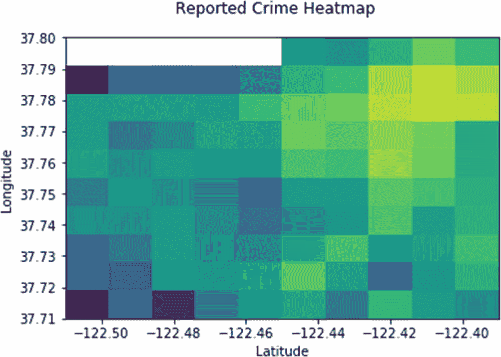

图 6-14

报告犯罪的热力图；显然，最亮的区域位于旧金山的东北部

```python
from matplotlib.colors import LogNorm
x = np.round(crime_df['Longitude'].head(10000),rounding_factor)
y = np.round(crime_df['Latitude'].head(10000),rounding_factor)
fig = plt.figure()
plt.suptitle('报告犯罪热力图')
plt.xlabel('纬度')
plt.ylabel('经度')
H, xedges, yedges, img = plt.hist2d(x, y, norm=LogNorm())
extent = [yedges[0], yedges[-1], xedges[0], xedges[-1]]
```

清单 6-16
尝试热力图

## 用过去预测未来

我们将把迄今为止创建的基本特征聚合到一个通用的、基于时间的表示中。让我们来看一下（清单 6-17 和图 6-15）。

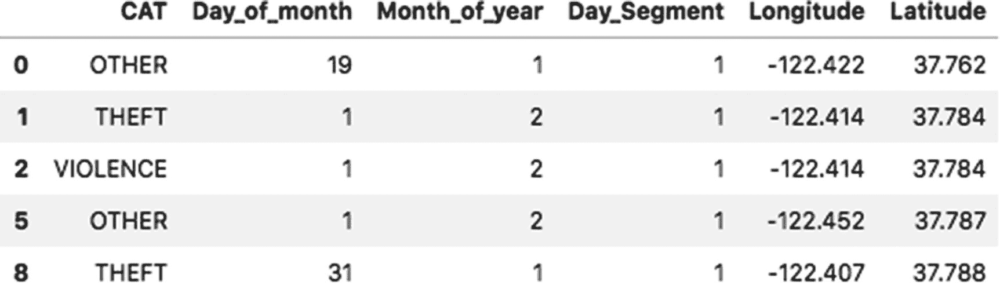

图 6-15

查看我们将输入到 Web 应用程序中的数据

```python
crime_df = crime_df[['CAT', 'Day_of_month','Month_of_year', 'Day_Segment', 'Longitude', 'Latitude']]
crime_df.head()
```

清单 6-17
将数据缩减至仅保留基本特征

数据包含一个通用的位置部分（经度和纬度），以及一个通用的基于时间的部分（月份、日期、时段）。我们需要将这些信息聚合到时间和位置层面。这将使我们能够汇总报告，并根据某个时间段内的报告数量构建强度图。

我们首先添加一个`Count`特征，并应用方便的`Pandas` `groupby()`函数（清单 6-18 和图 6-16）。

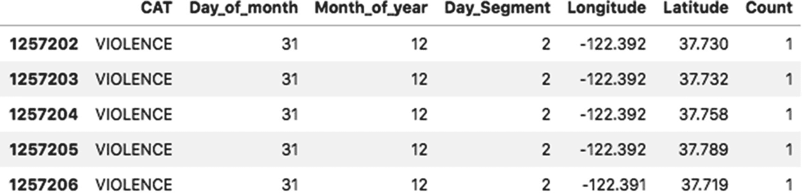

图 6-16

信息聚合到时间和位置层面

```python
crime_df['Count'] = 0
crime_df_agg = crime_df.groupby(['CAT', 'Day_of_month', 'Month_of_year',  'Day_Segment', 'Longitude',  'Latitude',]).count().reset_index()
crime_df_agg.tail()
```

清单 6-18
按时间和位置聚合信息

现在，我们可以查询特定的日期特征，并获取每个位置的所有报告犯罪（清单 6-19 和图 6-17）。

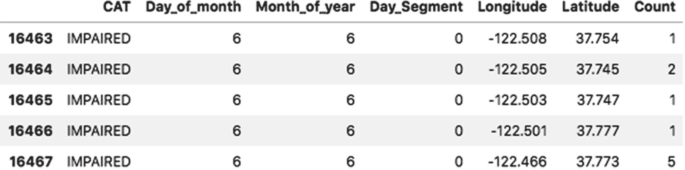

图 6-17

按日期特征聚合的信息

```python
Day_of_month = 1
Month_of_year = 1
Day_Segment = 1
crime_df_agg_tmp = crime_df_agg[(crime_df_agg['Day_of_month'] == Day_of_month) &
(crime_df_agg['Month_of_year'] == Month_of_year) &
(crime_df_agg['Day_Segment'] == Day_Segment)]
crime_df_agg_tmp.head()
```

清单 6-19
按日期特征聚合的信息

我们也可以绘制这些信息（图 6-18）。

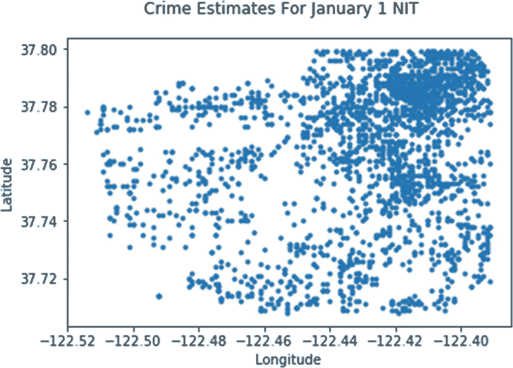

图 6-18

1 月 1 日夜间按经度和纬度估算的犯罪情况

这张图表没有区分计数强度；让我们来改进一下。我们将从`Matplotlib`的`plot()`切换到`scatter()`，并使用`s`或大小参数（清单 6-20 和图 6-19）。

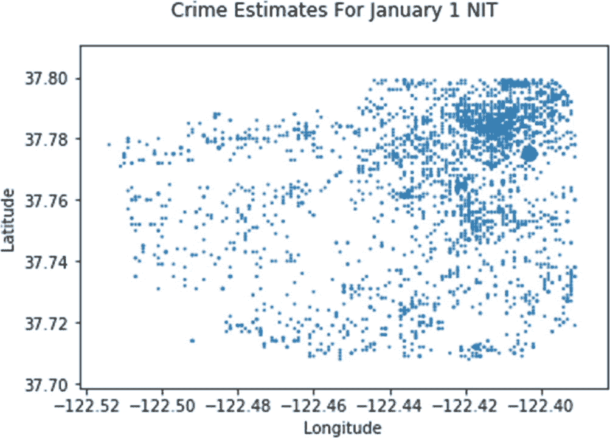

图 6-19

使用`Matplotlib`的散点函数绘图，并传递`Count`特征来调整 1 月 1 日夜间点的尺寸

```python
plt.scatter(crime_df_agg_tmp['Longitude'],
crime_df_agg_tmp['Latitude'], s=crime_df_agg_tmp['Count'])
plt.suptitle(title)
plt.xlabel('经度')
plt.ylabel('纬度')
plt.show()
```

清单 6-20
使用点大小绘制的犯罪数据散点图

为了更全面地展示，让我们再调出一个完全不同的时间点（图 6-20）。

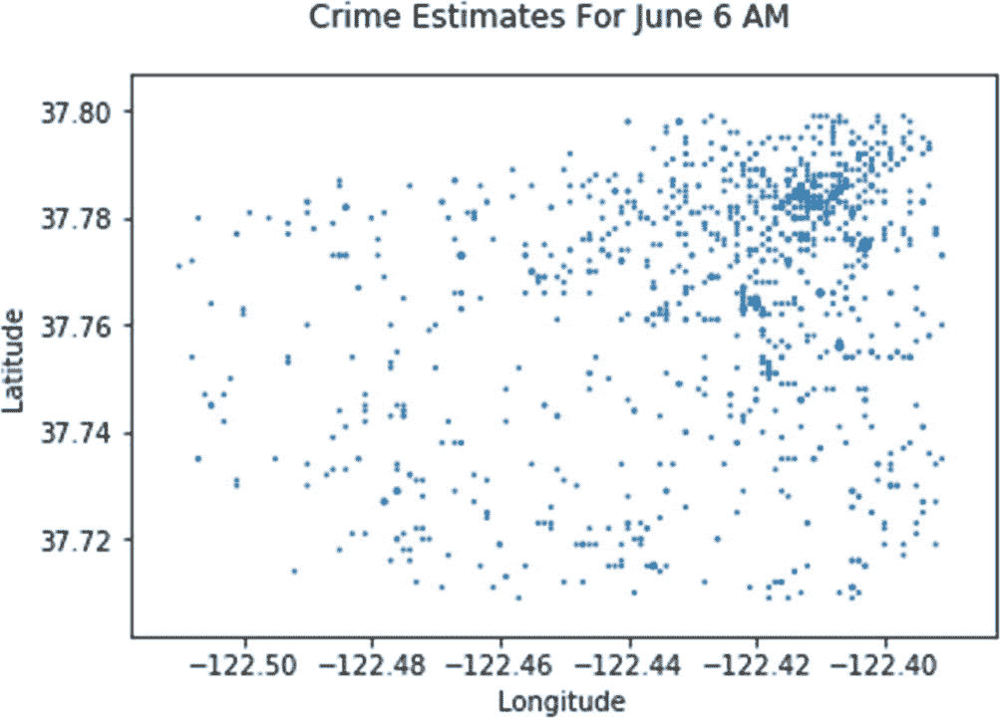

图 6-20

查看 6 月 6 日上午报告犯罪的聚合数据

总结一下我们的快速估算，1 月 1 日夜间报告的犯罪数量多于 6 月 6 日上午。

## Google Maps 简介

# Google Maps 与犯罪数据可视化

如果说有一个强大且易于定制的可视化工具，那非 Google Maps 莫属！让我们换个思路，尝试使用 Google Maps 而不是普通的 Matplotlib 来处理我们的数据。对于这部分内容以及让 Web 应用程序正常工作，你需要在 [`https://developers.google.com/maps/documentation/javascript/get-api-key`](https://developers.google.com/maps/documentation/javascript/get-api-key) 创建一个免费的 Google Maps API 密钥。

过去，没有 API 密钥也能使用 Google Maps，但现在你必须要有它。对于适度使用，免费层级就足够了。

所以，获取密钥并尝试这个简单的示例：输入一个地址和 API 密钥，以获取关于该位置的各种相关信息。在浏览器中输入以下地址和 URL 链接：“`1600 Amphitheatre Parkway, Mountain View, CA`”（清单 6-21）。

```
输入:
https://maps.googleapis.com/maps/api/geocode/xml?address=1600+Amphitheatre+Parkway,+Mountain+View,+CA&key=>
输出:

OK

premise

Google Building 41, 1600 Amphitheatre Pkwy, Mountain View, CA 94043, USA

...

37.4224082
-122.0856086

...
```

清单 6-21 如果你的 API 密钥有效且 URL 格式正确，你应该会看到包含类似数据的较长 XML 响应

## 热力图图层

热力图是一种通过强度来可视化信息的方式。这是一种非常实用的工具，可以叠加在地图上，因为它能显示哪些地方事件发生频繁，哪些地方发生较少——非常适合用于报告犯罪情况！

关于在谷歌地图上创建热力图的一个绝佳示例（图 6-21），请查看谷歌官方文档中的谷歌地图 API 示例：[`https://developers.google.com/maps/documentation/javascript/examples/layer-heatmap`](https://developers.google.com/maps/documentation/javascript/examples/layer-heatmap)。

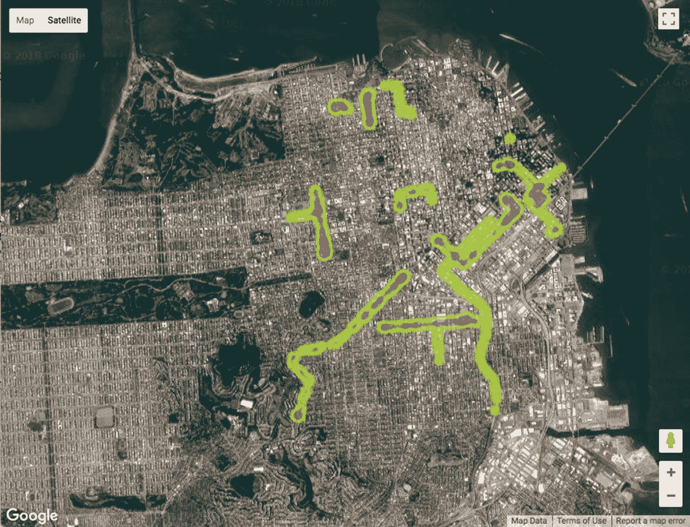

图 6-21 来自谷歌地图 API 的示例脚本；你需要一个 API 密钥才能使用

## 谷歌地图与犯罪数据

让我们将犯罪数据注入到谷歌地图中。首先，我们需要了解 HTML 页面上的 JavaScript 中谷歌地图“`LatLng`”函数所期望的格式（列表 6-22）。

```
function getPoints() {
return [
new google.maps.LatLng(37.782551, -122.445368),
new google.maps.LatLng(37.782745, -122.444586),
...
];}
```

列表 6-22 “`getPoints()`” JavaScript 函数

因此，我们需要从“`crime_df_agg_tmp`”中提取纬度和经度，并将其格式化为谷歌地图所期望的正确格式。然后，我们将每个坐标连接成一个长字符串，以便使用 Flask 将其传递到 HTML 脚本中（列表 6-23）。

```
LatLngString = "
for index, row in crime_df_agg_tmp.iterrows():
LatLngString += "new google.maps.LatLng(" + str(row['Latitude']) + "," + str(row['Longitude']) + "),"
```

列表 6-23 在循环中创建新的谷歌地图“`LatLng()`”对象

举个例子，我手动将“`LatLngString`”的输出粘贴到了一个示例 HTML 页面中，结果如下（图 6-22）。

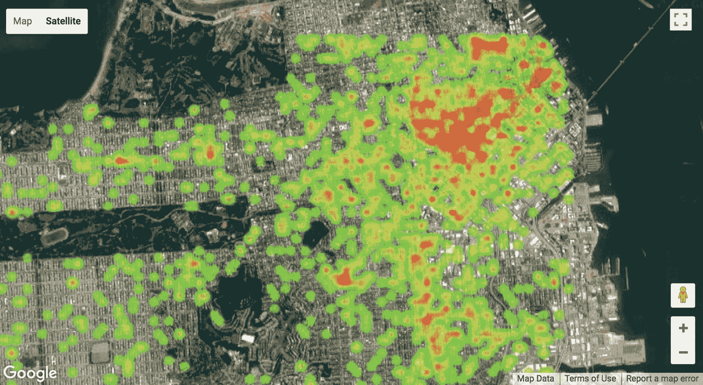

图 6-22 绘制在谷歌地图上的一些旧金山犯罪数据

## 抽象化我们的犯罪预估器

像往常一样，我们需要以简洁明了的方式组织 Web 应用程序的引擎，以便将其放入我们的主 Flask 脚本中。我们将创建“`GetCrimeEstimates()`”函数，该函数将接收一个日期和“`time_segment`”（表示是早晨、下午还是晚上；列表 6-24）。

```
def GetCrimeEstimates(horizon_date, horizon_time_segment):
Day_of_month = int(horizon_date.split('/')[1])
Month_of_year = int(horizon_date.split('/')[0])
Day_Segment = int(horizon_time_segment) # 0,1,2
crime_horizon_df_tmp = crime_horizon_df[
(crime_horizon_df['Day_of_month'] == Day_of_month) &
(crime_horizon_df['Month_of_year'] == Month_of_year) &
(crime_horizon_df['Day_Segment'] == Day_Segment)]

# 为谷歌地图构建 latlng 字符串
LatLngString = "
for index, row in crime_horizon_df_tmp.iterrows():
LatLngString += "new google.maps.LatLng(" + str(row['Latitude']) + "," + str(row['Longitude']) + "),"
return (LatLngString)
```

列表 6-24 “`GetCrimeEstimates()`” 函数

“`GetCrimeEstimates()`”是应用程序的核心。它接收用户通过 Web 应用程序上的滑块选择的日期以及时间段，并返回该日期所有聚合后的犯罪数据。

例如，当调用“`GetCrimeEstimates()`”时，我们会得到一个由“`google.maps.LatLng`”坐标连接而成的字符串，这些坐标已准备好输入到谷歌地图中（列表 6-25）。

```
输入:
GetCrime('10/10/2018', 0)
输出:
new google.maps.LatLng(37.764,-122.508),
new google.maps.LatLng(37.781,-122.49),
new google.maps.LatLng(37.711,-122.469),
new google.maps.LatLng(37.764,-122.46700000000001),
new google.maps.LatLng(37.763000000000005,-122.464),
...
```

列表 6-25 调用“`GetCrimeEstimates()`”

## 设计 Web 应用程序

请继续下载本章 Web 应用程序的代码。打开一个命令行窗口，并将驱动器切换到“`web-application`”文件夹。它应包含以下文件（列表 6-26）。

```
web-application
├── main.py
├── ptvs_virtualenv_proxy.py
├── requirements.txt
├── web.3.4.config
├── static
├── sf-crime-horizon.csv
└── images
├── cop.jpg
├── thief.jpg
├── morning.jpg
├── afternoon.jpg
└── night.jpg
└── templates
└── index.html
```

列表 6-26 Web 应用程序文件

像往常一样，我们将启动一个虚拟环境来隔离我们的 Python 库安装（列表 6-27）。

```
$ python3 -m venv predictingcrimeinsanfrancisco
$ source predictingcrimeinsanfrancisco/bin/activate
```

列表 6-27 启动虚拟环境

然后，通过运行“`pip3 install -r`”命令来安装所有必需的 Python 库（列表 6-28）。

```
$ pip3 install -r requirements.txt
```

列表 6-28 代码输入

### 添加你的 Google API 密钥

在编辑器中，打开文件 `index.html`，并在写着 `ADD_YOUR_API_KEY_HERE` 的地方添加你自己的 API 密钥。你需要更新代码才能看到谷歌地图，否则会收到错误消息。

### 运行测试

像往常一样，在本地 Flask 实例上运行该网站进行测试（列表 6-29）。

```
$ python3 main.py
列表 6-29
代码输入
```

如果一切顺利，你应该会看到一个带有可用谷歌地图的 Web 应用程序。继续运行测试，查看未来日期的犯罪预测（图 6-23）。


图 6-23

运行我们 Web 应用程序的本地版本

### 适用于 Azure 的 Git

初始化一个 Git 会话（清单 6-30）。

```
$ git init
清单 6-30
初始化 Git
```

在整个过程中多次运行 `git status` 是一个好主意，以确保你正在跟踪正确的文件（清单 6-31）。

```
输入:
$ git status
输出:
未跟踪的文件:
  (使用 "git add <文件>..." 以包含要提交的内容)
	main.py
	predictingcrimeinsanfrancisco/
	ptvs_virtualenv_proxy.py
	requirements.txt
	sf-crime-horizon.csv
	static/
	templates/
	web.3.4.config
清单 6-31
运行 “git status”
```

使用 `git add .` 命令，将 `web-application` 文件夹中的所有 Web 应用程序文件添加进来，然后再次检查 `git status`（清单 6-32）。

```
输入:
$ git add .
$ git status
输出:
要提交的变更：
  (使用 "git rm --cached <文件>..." 以取消暂存)
	新文件：   main.py
	新文件：   predictingcrimeinsanfrancisco/bin/activate
	新文件：   predictingcrimeinsanfrancisco/bin/activate.csh
	新文件：   predictingcrimeinsanfrancisco/bin/activate.fish
	新文件：   predictingcrimeinsanfrancisco/bin/easy_install
	新文件：   predictingcrimeinsanfrancisco/bin/easy_install-3.6
	...
清单 6-32
添加到 Git
```

你可能已经注意到，我们在 `git add .` 命令中添加了大量文件。根据 `git status` 的提示，它告诉了我们如何使用 `rm` 命令移除那些我们不想提交到 Git 的文件。让我们移除虚拟环境 `predictingcrimeinsanfrancisco` 中项目不需要的所有文件和文件夹（清单 6-33）。

```
输入:
$ git rm -r --cached predictingcrimeinsanfrancisco
$ git status
输出:
要提交的变更：
  (使用 "git rm --cached <文件>..." 以取消暂存)
	新文件：   main.py
	新文件：   ptvs_virtualenv_proxy.py
	新文件：   requirements.txt
	新文件：   sf-crime-horizon.csv
	新文件：   static/images/afternoon.jpg
	新文件：   static/images/cop.jpg
	新文件：   static/images/morning.jpg
	新文件：   static/images/night.jpg
	新文件：   static/images/thief.jpg
	新文件：   templates/index.html
	新文件：   web.3.4.config
清单 6-33
从 Git 中移除 “predictingcrimeinsanfrancisco”
```

现在我们只保留了需要的文件。因此，执行一次本地的 `git commit`，并添加一条有意义的注释，以便将来需要回顾过往操作时能派上用场（清单 6-34）。

```
输入:
$ git commit -am 'where crime happens'
输出:
[master (root-commit) 1b87606] where will crime happen next
 11 files changed, 120065 insertions(+)
 create mode 100644 main.py
 create mode 100644 ptvs_virtualenv_proxy.py
 create mode 100644 requirements.txt
 create mode 100644 sf-crime-horizon.csv
 create mode 100644 static/images/afternoon.jpg
 create mode 100644 static/images/cop.jpg
 create mode 100644 static/images/morning.jpg
 create mode 100644 static/images/night.jpg
 create mode 100644 static/images/thief.jpg
 create mode 100644 templates/index.html
 create mode 100644 web.3.4.config
清单 6-34
Git 提交
```

有关通过 Git 部署到 Azure 应用服务的更多信息，请参阅 [`https://docs.microsoft.com/en-us/azure/app-service/app-service-deploy-local-git`](https://docs.microsoft.com/en-us/azure/app-service/app-service-deploy-local-git)。

### azure-cli 命令行界面工具

我们将使用 `azure-cli` 工具将我们的 Web 应用程序部署到 Microsoft Azure 上（如果你尚未安装它，请参考第 2 章）。

#### 第 1 步：登录

创建一个 `az` 会话（清单 6-35 和图 6-24）。

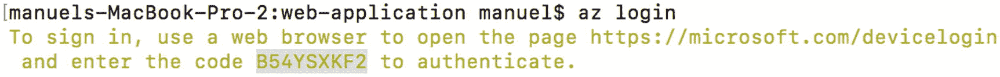

图 6-24

从 azure-cli 登录 Azure

```
$ az login
清单 6-35
代码输入
```

按照说明操作，将浏览器指向给定的 URL 地址，并相应地输入代码（图 6-25）。


图 6-25

验证会话

如果一切顺利（即你拥有一个状态良好的 Azure 账户），它将把 azure-cli 终端连接到云服务器。此外，一旦你获得授权，就可以安全地关闭浏览器窗口。

确保你的命令行工具指向本章的 `web-application` 文件夹。

#### 第 2 步：为你的部署用户创建凭据

该用户将拥有 FTP 和本地 Git 使用的适当权限。这里我将用户名设置为 `flaskuser10`，密码设置为 `flask123`。你只需执行此操作一次，之后就可以重复使用同一个账户。如果遇到问题，只需创建一个不同的用户名（或者像我通常做的那样，在用户名末尾添加一个数字并不断递增；清单 6-36）。

```
$ az webapp deployment user set --user-name flaskuser10 --password flask123
清单 6-36
代码输入
```

当你逐步执行每个 `azure-cli` 步骤时，你会收到 JSON 回复来确认你的设置。对于 `az webapp deployment` 命令，大多数回复应该包含空值且没有错误消息。如果你收到错误消息，则说明存在需要解决的权限问题（`conflict` 表示该名称已被占用，请尝试其他名称；`bad requests` 表示密码强度太弱）。

#### 第 3 步：创建你的资源组

这是你的逻辑容器。在这里，你需要输入离你位置最近的区域（请参阅 [`https://azure.microsoft.com/en-us/regions/`](https://azure.microsoft.com/en-us/regions/) ）。即使你身处地球的另一端，在本示例中选择“`West US`”也没什么大不了的，但在生产环境中，这会产生影响，因为你需要让服务器尽可能靠近你的用户群以获得最佳性能。

这里我将名称设置为“`myResourceGroup`”（清单 6-37）。

```
$ az group create --name myResourceGroup --location "West US"
清单 6-37
代码输入
```

### 第 4 步：创建你的 Azure 应用服务计划

这里我将名称设置为“`myAppServicePlan`”，并选择一个免费实例（sku）（清单 6-38）。

```
$ az appservice plan create --name myAppServicePlan --resource-group myResourceGroup --sku FREE
清单 6-38
代码输入
```

### 第 5 步：创建你的 Web 应用

你的“`webapp`”名称必须是唯一的，并确保你的“`resource-group`”和“`plan`”名称与你在前面步骤中设置的名称一致。在本例中，我将使用“`amunateguicrime`”。要获取支持的运行时的完整列表，请运行“`list-runtimes`”命令（清单 6-39）。

```
$ az webapp list-runtimes
清单 6-39
代码输入
```

要创建 Web 应用程序，请使用“`create`”命令（清单 6-40）。

```
$ az webapp create --resource-group myResourceGroup --plan myAppServicePlan --name amunateguicrime --runtime "python|3.4" --deployment-local-git
清单 6-40
代码输入
```

`az webapp create` 命令的输出将包含一条重要信息，你将在后续步骤中用到它。查找“`deploymentLocalGitUrl`”这一行（图 6-26）。

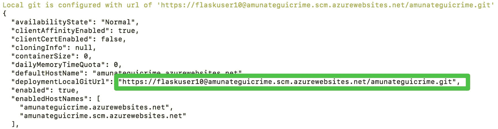

图 6-26

`webapp create` 命令及其生成的 `deploymentLocalGitUrl` 值

### 第 6 步：将 Git 代码推送到 Azure

现在你已经有了一个占位网站，需要将 Git 代码推送到 Azure（清单 6-41）。

```
# 如果 git remote 已存在，请运行 'git remote remove azure'
$ git remote add azure https://flaskuser10@amunateguicrime.scm.azurewebsites.net/amunateguicrime.git
清单 6-41
代码输入
```

最后，将其推送到 Azure（清单 6-42）。

```
$ git push azure master
清单 6-42
代码输入
```

系统会提示你输入之前设置的“`web 应用部署用户`”密码。如果一切顺利，你就可以享受劳动成果了。打开一个 Web 浏览器，输入你的新 URL，它由你的“`webapp`”名称后跟“`.azurewebsites.net`”组成（图 6-27）。


图 6-27

享受你的辛勤劳动成果吧！

另一方面，如果 `Azure-cli` 返回错误消息，你将需要处理它们（请参阅故障排除部分）。

任何时候你更新代码并希望重新部署时，请参阅清单 6-43。

```
$ git commit -am "updated output"
$ git push azure master
清单 6-43
用于代码更新
```

你也可以直接在 Azure 的 Web 仪表板上管理你的应用程序。登录 Azure 并转到“应用服务”（图 6-28）。

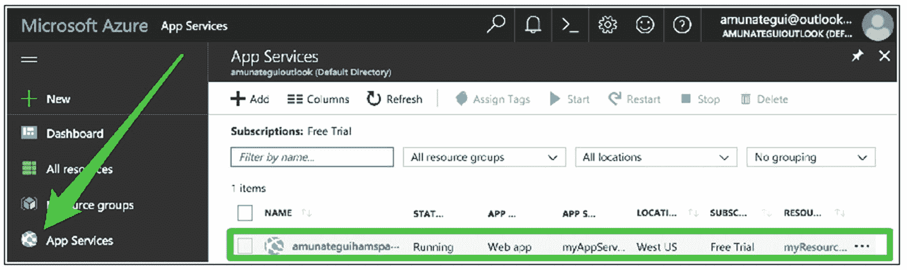

图 6-28

Microsoft Azure 仪表板

## 故障排除

调试 Web 应用程序错误可能会变得复杂。一种方法是通过 Azure 仪表板打开日志记录（图 6-29）。

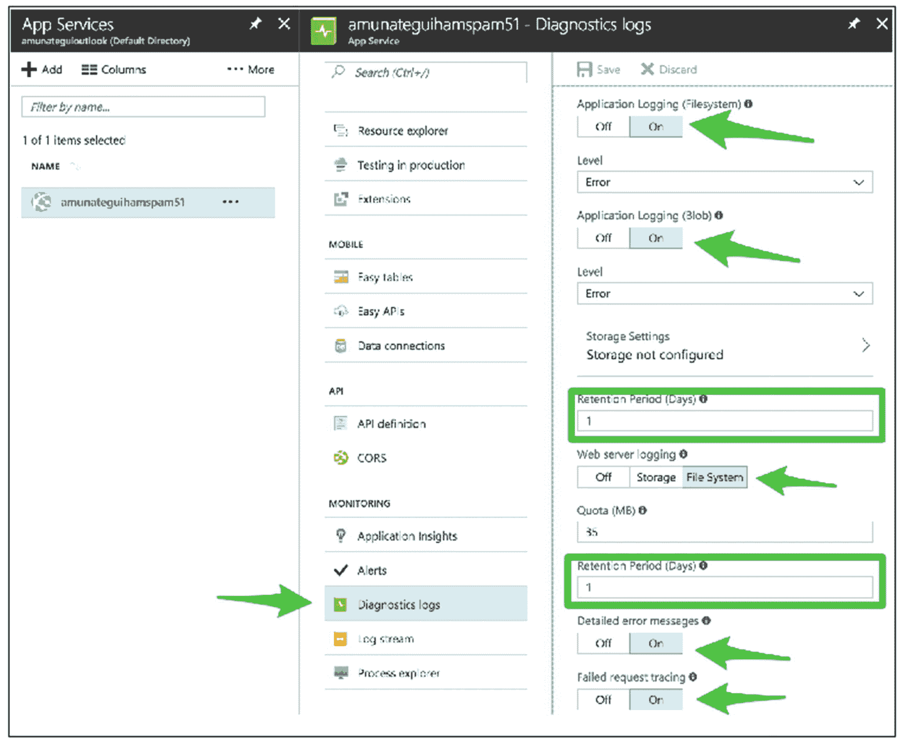

图 6-29

打开 Azure 诊断日志

然后打开日志流以开始捕获活动（图 6-30）。

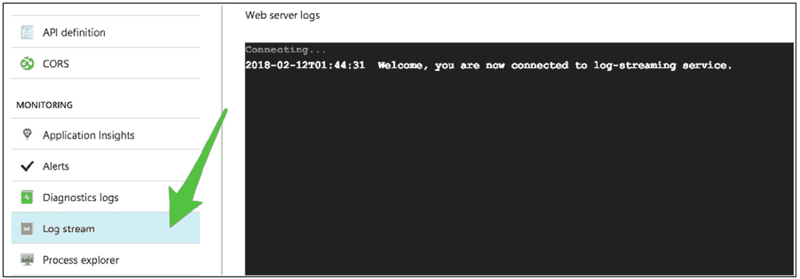

图 6-30

捕获日志信息

你还可以使用 Azure 仪表板内置的便捷控制台工具检查文件结构（图 6-31）。

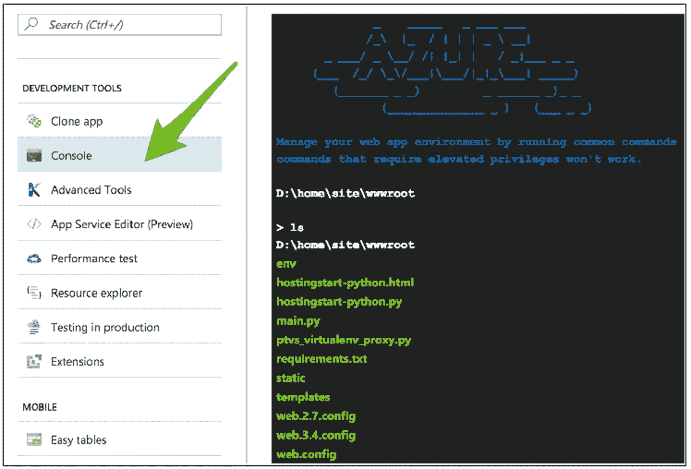

图 6-31

Azure 内置命令行工具

你也可以在命令窗口中访问日志的尾部（清单 6-44）。

```
$ az webapp log tail --resource-group myResourceGroup --name amunateguicrime
清单 6-44
代码输入
```

你甚至可以通过调用 `env\scripts\pip` 函数来检查你的 `requirements.txt` 文件是否有效（清单 6-45）。

```
$ env\scripts\pip install -r requirements.txt
清单 6-45
代码输入
```

## 别忘了关闭它！

像往常一样，停止并删除你不再需要的任何内容。转到 Azure 仪表板中的“`所有资源`”，勾选你不需要的任何内容，然后删除（图 6-32）。

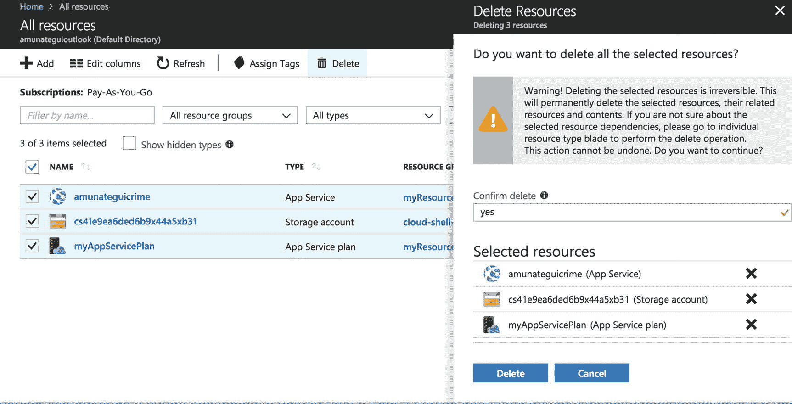

图 6-32

完成后关闭所有内容

最后，停用你的虚拟环境（清单 6-46）。

```
$ deactivate predictingcrimeinsanfrancisco
清单 6-46
代码输入
```

## 结论

本章介绍了一项显而易见的好技术：Google Maps。这个前端仪表板可以实现很多功能。你可以获取用户的位置（经用户同意），你可以通过多种不同方式（从卫星视图到街景视图）可视化地理数据，而且这个列表还在不断增加。最棒的是，编程方面几乎不需要什么。Google Maps API 非常成熟，为你抽象了大量繁重的工作。如果你最终使用 Google Maps 构建了一个高流量网站，你很可能需要一个付费账户。

眼尖的人可能已经注意到，Jupyter 代码使用数据框来分析犯罪数据，而 Flask 应用程序使用 NumPy 数组。这不会是我们唯一一次使用这个技巧。Pandas 库是一个庞大而复杂的库，有时很难让它与无服务器实例良好配合，因为无服务器实例不喜欢那些与操作系统和文件系统有深层关联的库。根据经验，你在 Flask 应用程序顶部需要声明的导入越少越好。

脚注 1