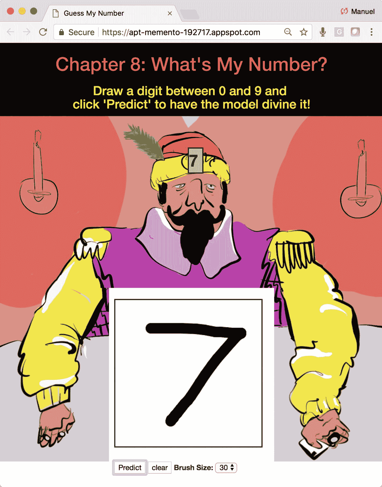
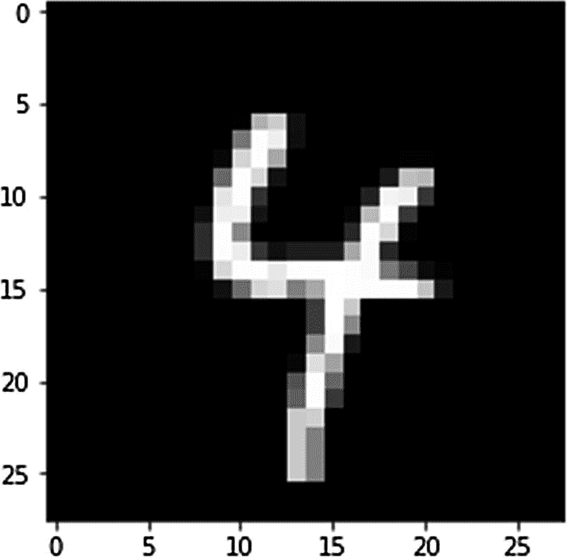
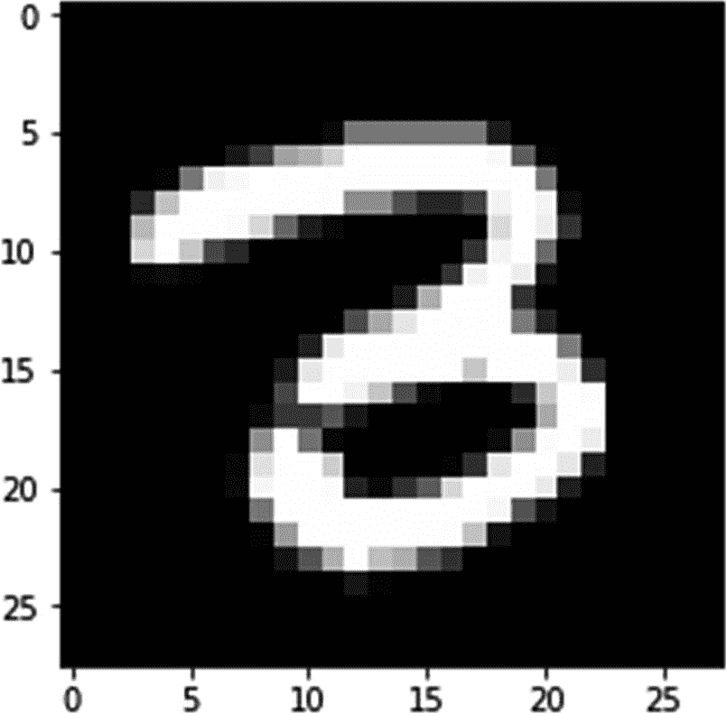
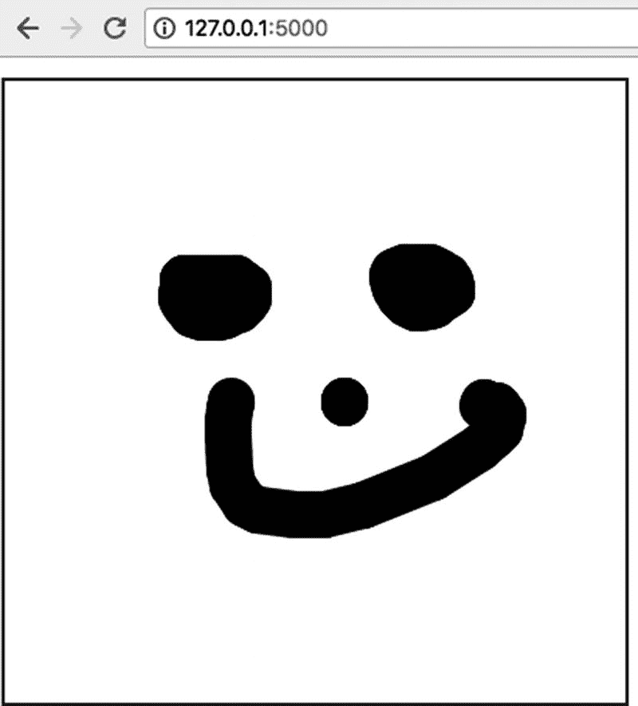
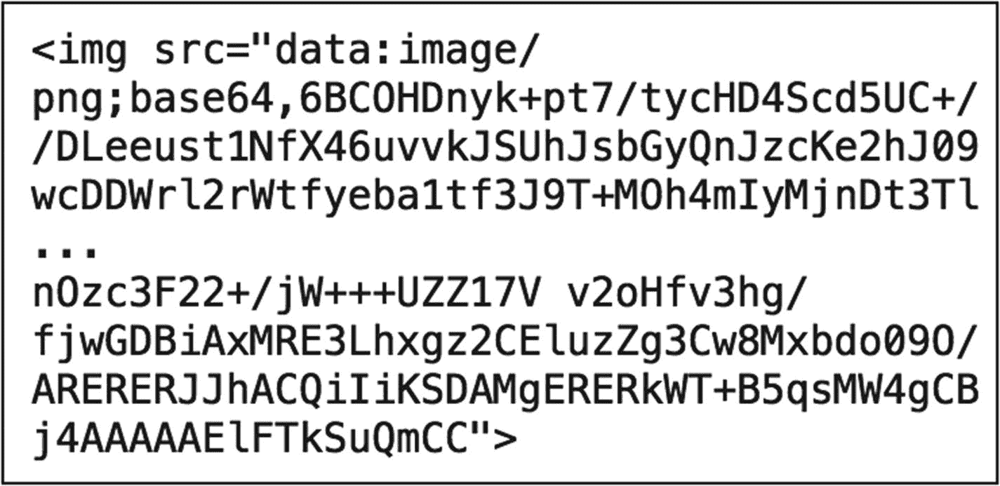
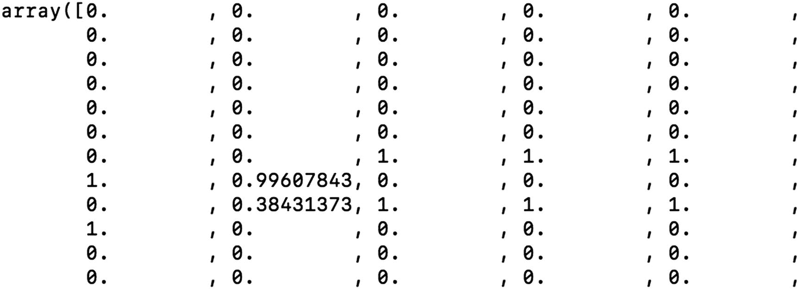
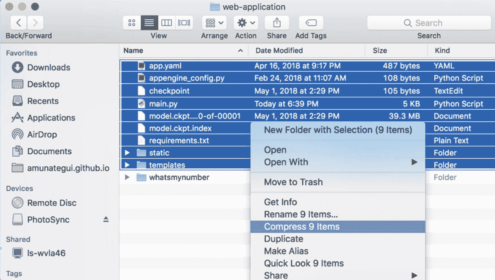
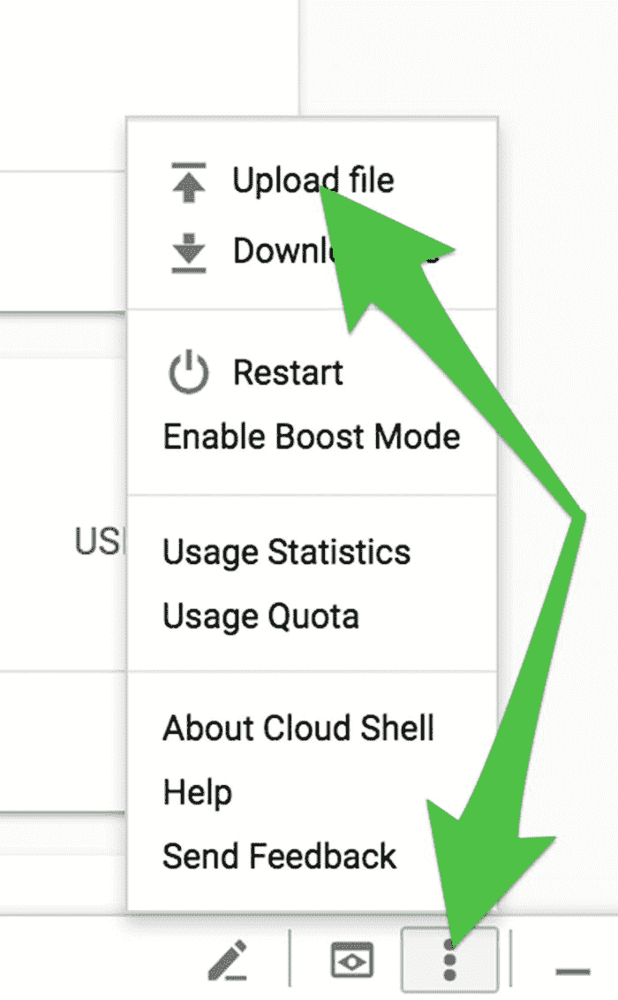
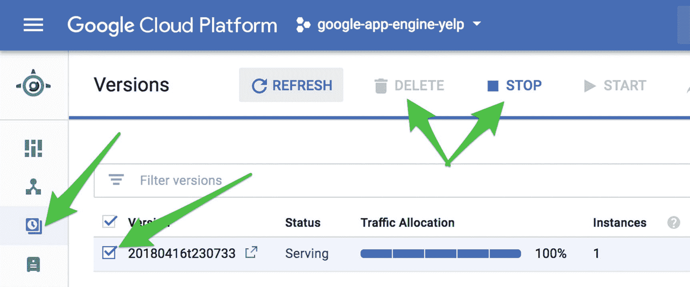
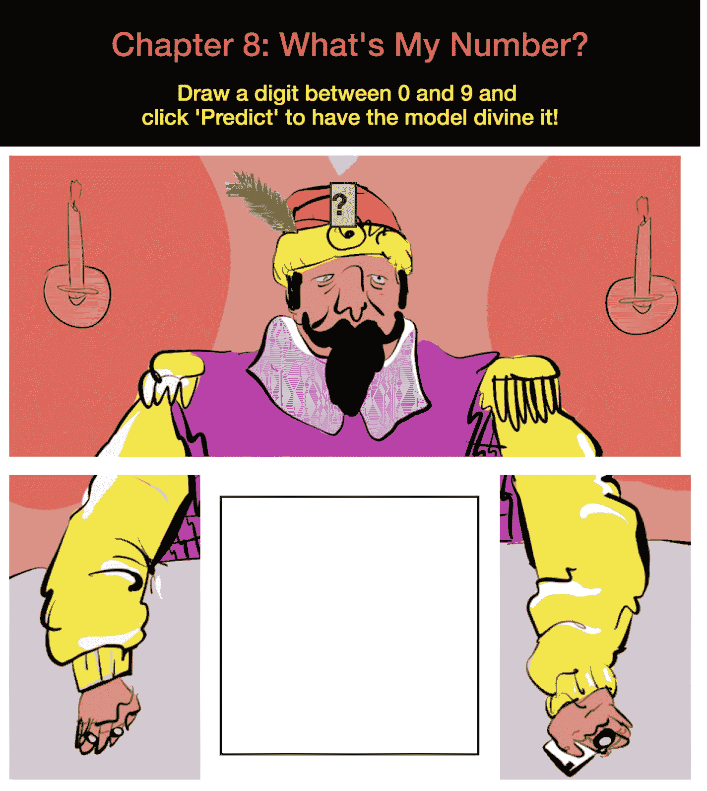

# 8. 使用 GCP 上的 TensorFlow 实现交互式绘图画布与数字预测

让我们构建一个交互式绘图画布，使访问者能够使用 Google Cloud 上的 TensorFlow 图像分类来绘制并预测数字。

事先提醒一下，这是一个非常有趣且互动性强的章节，以至于我最终花了太多时间在最终产品上玩耍（图 8-1）。这是使用机器学习创建 Web 应用程序的固有风险之一！



图 8-1 本章的最终 Web 应用程序

在这里，我们将利用 TensorFlow^(³⁹) 的强大功能来对著名的 MNIST 数据库进行建模。除非你与世隔绝，否则你很可能听说过这两者（如果你没听说过，别担心，到本章结束时你就会了解了）。最终的 Web 应用程序将包含一个画布，允许访问者用鼠标或手指绘制 0 到 9 之间的数字，并由我们训练好的 TensorFlow 模型进行预测。

### 注意
通过访问 [`www.apress.com/9781484238721`](http://www.apress.com/9781484238721) 并点击源代码按钮，下载第 8 章的文件。打开 Jupyter notebook `chapter8.ipynb` 以跟随本章内容进行学习。

## MNIST 数据集

MNIST 数据库包含 60,000 张训练图像和 10,000 张测试图像。它是图像识别分类领域的“Hello World”。该数据集由高中生和美国人口普查局的员工手写的“0”到“9”之间的单个数字组成。理解这些数据的最佳方式是查看一些示例。将本章的文件下载到一个名为 `chapter-8` 的目录中，并打开 Jupyter notebook 跟随操作。当你安装 TensorFlow 时，你将能够直接从 `tensorflow.examples.tutorials.mnist` 库中的 `input_data()` 函数下载 MNIST 数据集。这将使训练我们的模型变得容易得多，因为它们已经将数据分成了训练集和测试集。让我们将 MNIST 加载到内存中并提取一些样本（清单 8-1）。

```
输入：
mnist = input_data.read_data_sets("MNIST_data/", one_hot=True)
输出：
Extracting MNIST_data/train-images-idx3-ubyte.gz
Extracting MNIST_data/train-labels-idx1-ubyte.gz
Extracting MNIST_data/t10k-images-idx3-ubyte.gz
Extracting MNIST_data/t10k-labels-idx1-ubyte.gz
清单 8-1 加载 MNIST
```

这将自动下载并解压四个文件：两组图像和两组对应的标签。让我们打开几个数字和标签。我们将从查看训练数据集中的第一张图像开始，并提取对应的标签（清单 8-2 和图 8-2）。



图 8-2 MNIST 中一个数字的 Matplotlib 可视化渲染

```
import matplotlib.pyplot as plt
first_digit = mnist.train.images[0]
first_digit = np.array(first_image, dtype="float")
first_digit = first_digit.reshape((28, 28))
plt.imshow(sample_digit)
plt.show()
清单 8-2 查看数字
```

我们还可以看到对应的标签；其格式是一个包含 10 个数字的数组，每个数字代表从 0 到 9 的一个值（清单 8-3）。

```
输入：
mnist.train.labels[0]
输出：
array([ 0.,  0.,  0.,  0.,  1.,  0.,  0.,  0.,  0.,  0.])
清单 8-3 查看数字
```

通过使用 `argmax()` 函数，我们可以获取最大值的索引，并且由于它们按升序排列，我们可以自动得到对应的数字（清单 8-4）。

```
输入：
np.argmax(mnist.train.labels[0])
输出：
清单 8-4 列出数字
```

为了好玩，我们将使用另一种筛选数据的方法，即使用内置的 `next_batch()` 函数，稍后我们将依赖该函数将数据输入到我们的 TensorFlow 模型中进行训练（清单 8-5 和图 8-3）。



图 8-3 MNIST 中一个数字的 Matplotlib 可视化渲染

```
batch = mnist.train.next_batch(1)
sample_digit = batch[0]
sample_digit = sample_digit.reshape(28, 28)
plt.imshow(sample_digit)
plt.show()
清单 8-5 查看数字
```

这些数字是灰度图像，大小均为 28x28 像素；关于这些数据，其实没有太多需要赘述的，因为它们不言自明。

## TensorFlow

TensorFlow 是一个由 Google 的友好人士提供的开源库，专为高性能数值计算而设计。它使用数据流图来表示数学运算，这些运算可以轻松地在本地或分布式设备上计算。它具有丰富的功能，可用于计算、数值处理以及从常规到深度的建模。它于 2015 年 11 月在 Apache 2.0 开源许可证下发布。

关于这个主题的资料非常多，我不会重复讨论，而是直接切入我们手头的任务：对手写数字进行建模！所以，如果你还没有做的话，请继续将本章的文件下载到一个名为 `chapter-8` 的文件夹中。打开 Jupyter notebook 跟随操作。

## 使用 TensorFlow 和卷积网络进行建模

MNIST 数据集可能已经被地球上所有的模型建模过^(⁴⁰)，但一个强大且相对易于使用的模型是卷积网络，称为“CNN”或“Covnets”。这是一种极其强大的方法，可以根据你的需求变得简单或复杂。它们最初是为图像建模而设计的，但后来被证明在自然语言处理和时间序列建模等其他许多领域也非常有用。我们将利用 TensorFlow 教程套件中的代码，该教程名为：“面向专家的深度 MNIST”。^(⁴¹) 这不是他们提供的最简单的模型，但它仍然被认为是一个入门级的方法。

该模型在手写数字分类上达到了惊人的 99% 的准确率。当我们将其与 Yann LeCun 在这个数据集上的历程进行对比时，这一点就更加有趣了。他是视觉建模和卷积神经网络之父之一，也是 Facebook 的 AI 研究总监。他在几十年的时间里对这个数据进行了基准测试，并致力于将建模识别准确率从 12% 提高到仅剩百分之零点几的误差。更令人难以置信的是，如今我们可以打开一个关于这个主题的教程，用不到 50 行代码就能获得这个惊人的分数。

让我们简要了解一下我们将用于此 Web 应用程序的模型。以下是该教程的一些要点（更多详情请参阅完整教程，网址为 [`https://www.tensorflow.org/versions/r1.1/get_started/mnist/pros`](https://www.tensorflow.org/versions/r1.1/get_started/mnist/pros)）。

### 占位符 (`tf.placeholder`)

这些是图像和标签数据流的通道。这是 TensorFlow 中的一个重要概念，即在向图中输入任何实际数据之前，先构建一个功能图（清单 8-6）。

```
x = tf.placeholder(tf.float32, shape=[None, 784])
y_ = tf.placeholder(tf.float32, shape=[None, 10])
清单 8-6 代码输入
```

### 变量 (`tf.Variable`)

变量用于保存值，你可以用实际值初始化它们（清单 8-7）。

```
def weight_variable(shape):
initial = tf.truncated_normal(shape, stddev=0.1)
return tf.Variable(initial)
清单 8-7 函数 “weight_variable()”
```

### 构建建模层

我们可以将专门的网络层定义为函数，并根据神经网络的复杂程度，根据需要多次重用它们（清单 8-8）。

```
def conv2d(x, W):
    return tf.nn.conv2d(x, W, strides=[1, 1, 1, 1], padding="SAME")

def max_pool_2x2(x):
    return tf.nn.max_pool(x, ksize=[1, 2, 2, 1],
                        strides=[1, 2, 2, 1], padding="SAME")
```
清单 8-8
抽象函数 `conv2d()` 和 `max_pool_2x2()`。

然后，我们可以通过调用 `conv2d()` 和 `max_pool_2x2()` 来创建任意数量的层（清单 8-9）。

```
h_conv1 = tf.nn.relu(conv2d(x_image, W_conv1) + b_conv1)
h_pool1 = max_pool_2x2(h_conv1)
```
清单 8-9
创建层

### 损失函数

原始教程模型使用 `tf.nn.softmax_cross_entropy_with_logits()` 函数，这个名称有点长。Softmax 返回一个在 *n* 个类别上的概率分布，其总和为 1，而交叉熵处理来自不同分布的数据（清单 8-10）。

```
cross_entropy = tf.reduce_mean(tf.nn.softmax_cross_entropy_with_logits(labels=y_, logits=y))
```
清单 8-10
获取交叉熵

文档指出该函数将在后续版本中被弃用（并且要习惯这一点——这在 TensorFlow 和 Python 的大多数库中都会发生），因此我们将使用一种更通用的类似方法（详情请参阅 Jupyter notebook）。

### 实例化会话

当我们准备好运行模型时，使用 `sess.run` 命令实例化会话。这会启动我们之前设置的所有计算图（列表 8-11）。

```
sess.run(tf.global_variables_initializer())
```
列表 8-11
启动会话

### 训练

我们设置一个任意的循环次数，此处为 1,000 次，并将数据以批次形式输入模型（列表 8-12）。

```
for _ in range(1000):
    batch = mnist.train.next_batch(100)
    train_step.run(feed_dict={x: batch[0], y_: batch[1]})
```
列表 8-12
设置模型迭代次数

### 准确率

为了避免盲目训练，我们添加一个准确率度量来监控模型的训练效果，该度量将每 100 步打印一次进度（列表 8-13）。

```
print(step, sess.run(accuracy, feed_dict={x: mnist.test.images, y_: mnist.test.labels, keep_prob: 1.0}))
```
列表 8-13
在训练期间访问准确率

这个脚本中还有更多内容，请前往实际的 TensorFlow 教程查看，如果你对深度学习感兴趣，这非常值得一看（[`https://www.tensorflow.org/versions/r1.2/get_started/mnist/pros`](https://www.tensorflow.org/versions/r1.2/get_started/mnist/pros)）。

### 运行脚本

运行 2,000 次会得到一个不错的分数，但仍有很大的改进空间（列表 8-14）。

```
0 0.0997
100 0.8445
200 0.905
300 0.9264
400 0.9399
500 0.9492
600 0.9509
700 0.9587
800 0.9596
900 0.9623
1000 0.9668
1100 0.9688
1200 0.9706
1300 0.9719
1400 0.9683
1500 0.9708
1600 0.9754
1700 0.9751
1800 0.9753
1900 0.9738
2000 0.9776
```
列表 8-14
2,000 次迭代期间的准确率输出

如果你按照教程的建议持续训练超过 20,000 步，就能达到那难以企及的 99.2%！但这可能需要长达 30 分钟，具体取决于你的机器（如果你有 GPU，速度会快很多；列表 8-15）。

```
...
19300 0.9935
19400 0.9928
19500 0.9926
19600 0.9923
19700 0.9932
19800 0.993
19900 0.9926
20000 0.9927
```
列表 8-15
20,000 次迭代期间的准确率输出

模型训练完成后，我们将其保存到文件中，以便稍后运行预测（更重要的是，在我们的 Web 应用程序中使用；列表 8-16）。

```
saver = tf.train.Saver()
save_path = saver.save(sess, save_file)
print ("Model saved in file: ", save_path)
```
列表 8-16
保存训练好的权重

## 运行已保存的 TensorFlow 模型

这种实例化已训练模型的能力是应用建模和构建商业流程的重要方面。我们在此开发的模型训练时间并不长（根据你使用的步数，大约 2 到 30 分钟），但如果每次请求都要重新训练，没有用户愿意在网页上等待那么久。好消息是，保存和重新加载已训练模型很容易。关键在于在退出 TensorFlow 会话之前调用 `tf.train.Saver` 的 `save()` 函数（列表 8-17）。

```
输入：
saver = tf.train.Saver()
save_path = saver.save(sess, save_file)
print ("Model saved in file: ", save_path)
输出：
Model saved in file:  /Users/manuel/apress-book-repository/chapter-8/model.ckpt
```
列表 8-17
保存模型

下次你想运行已训练模型时，只需设置所有图变量，并在 TensorFlow 会话中调用 `tf.train.Saver` 的 `restore()` 函数即可（列表 8-18）。

```
输入：
saver = tf.train.Saver()
with tf.Session() as sess:
    sess.run(tf.global_variables_initializer())
    saver.restore(sess, save_file)
    print("Model restored.")
输出：
INFO:tensorflow:Restoring parameters from /Users/manuel/apress-book-repository/chapter-8/model.ckpt
Model restored.
```
列表 8-18
恢复已保存的模型

## 保存模型！

你会在本章的下载文件中找到一个可以直接使用的预训练模型。如果你想使用自己的模型，请查看 Jupyter notebook 并保存训练好的权重文件（我就是这么做的）。最终你会得到三个文件，它们代表已保存的模型，并且是加载模型所必需的。TensorFlow 足够智能，可以从你提供的文件中加载最新版本（例如，你可以存储多个检查点文件，它会使用最新的那个；列表 8-19）。

```
checkpoint
model.ckpt.data-00000-of-00001
model.ckpt.index
```
列表 8-19
本章下载文件中的预训练模型文件（如果你不想自己训练的话）

## 绘制画布

画布是应用程序的关键部分，它能让任何人以一种有趣的方式体验和理解 MNIST、字符识别以及卷积建模。这些通常是高级课程和工业建模工具中涉及的难点概念，但它们也可以很有趣！画布是 HTML5 的一部分（有关此酷炫功能的更多信息，请参见 [`https://www.w3schools.com/html/html5_canvas.asp`](https://www.w3schools.com/html/html5_canvas.asp)），它允许创建一个空间，用户可以在网页上交互并绘制图形（图 8-4）。



图 8-4
使用 HTML5 和 `<canvas>` 标签进行手指绘画

通过这种方法，我们可以将用户在画布上绘制的内容转换为图像，供我们的 TensorFlow 模型接收并尝试预测。

### 从画布到 TensorFlow

这部分并不复杂，但需要一些转换，请耐心阅读。当访问者点击“**Predict**”按钮时，它会调用画布 HTML5 控件的 `toDataURL()` 函数。这会将画布标签中包含的所有数据转换为 PNG 格式图像的文本表示。

这是我们会再次遇到的概念。还记得第 3 章吗？我们依靠文本表示的图像数据来轻松地在服务器和客户端之间传递。在这里，我们反其道而行之——从客户端到服务器（图 8-5）。


图 8-5：以文本形式表示的图像数据

### 注意
代码部分基于 [https://stackoverflow.com/questions/2368784/draw-on-html5-canvas-using-a-mouse](https://stackoverflow.com/questions/2368784/draw-on-html5-canvas-using-a-mouse) 上找到的一个优秀代码片段。每当你遇到编码问题或需要解决方案时，`StackOverflow.com` 应该是你的首选！

## 在新手写数字上进行测试

这是我们流程（以及 Web 应用程序）的关键部分。我们需要能够将新的手写数字传递给模型进行预测。

### 处理真实图像

使用 `MNIST` 数据集进行测试与使用真实图像进行测试的区别在于，`MNIST` 数据已经为我们处理好了。因此，我们需要对新的图像应用相同的处理，使其与我们训练好的模型兼容。想象一下，你创建了一个包含数字的图像文件；这就是你将其传递给模型的方式。我们利用 `PIL` 和 `NumPy` Python 库来执行大部分图像处理（清单 8-20）。

```python
from PIL import Image
img = Image.open('my-own-4.png')
```
**清单 8-20：导入图像**

我们将其调整为官方要求的 28x28 像素尺寸。由于我们将处理透明图像（只显示数字，不显示背景），我们需要添加一个白色背景以符合训练好的 `MNIST` 数据（清单 8-21）。

```python
img = img.resize([28,28])

# 添加白色背景
corrected_img = Image.new("RGBA", (28, 28), "white")

# 将两张图像合并
corrected_img.paste(img, (0,0), img)
```
**清单 8-21：处理新图像**

接下来，我们将图像转换为数组，移除此处不需要的额外颜色维度（因为我们处理的是黑白图像），最后反转整个图像，使空白像素变为零（清单 8-22）。

```python
# 移除颜色维度
corrected_img = np.asarray(corrected_img)

# 移除颜色层
corrected_img = corrected_img[:, :, 0]

# 反转颜色
corrected_img = np.invert(corrected_img)
```
**清单 8-22：处理新图像**

最后，我们将图像从 28x28 的矩阵展平为大小为 784 的扁平向量，并将数据居中在 0 到 1 之间，而不是 0 到 255。就是这样；现在它已准备好输入到我们的 `TensorFlow` 模型中进行预测（清单 8-23 和图 8-6）。


图 8-6：转换后的图像数据准备建模的部分最终输出

```python
corrected_img = corrected_img.reshape([784])

# 居中在 0-1 之间
img = np.asarray(corrected_img, dtype=np.float32) / 255.
```
**清单 8-23：展平数据**

## 设计 Web 应用程序

现在我们来到了本章有趣的部分；我们要设计自己的 Web 应用程序！我们将保持一切极其简单。这旨在有趣且直观，通过将按钮和选项保持在最少，让我们的访问者能够立即理解并与之交互。我们将在中间添加一个中央画布，以便访问者可以绘制一个介于 `0` 和 `9` 之间的数字，以及两个按钮：一个用于预测数字，另一个用于清除画布。最后，我们还将添加一个下拉菜单来控制画笔的粗细——仅此而已！

在图形方面，我们使用一张大图，并将其切割成不同的部分：顶部包含占卜者的头部，两侧包含手臂。这样切割是为了在 Web 应用程序的中心容纳绘图画布。

## 下载 Web 应用程序

如果尚未下载本章的代码，请继续下载，打开一个命令行窗口，并将驱动器切换到 `web-application` 文件夹。它应该包含常规文件以及我们保存的检查点文件（清单 8-24）。

```
web-application
├── app.yaml
├── appengine_config.py
├── main.py
├── requirements.txt
├── checkpoint
├── model.ckpt.data-00000-of-00001
├── model.ckpt.index
├── static
└── images
    ├── left.png
    ├── right.png
    └── top.png
└── templates
    └── index.html
```
**清单 8-24：Web 应用程序文件**

首先，你需要在你的 Python 3.x 实例上安装 `TensorFlow`（或者在下一步中安装 `requirements` 文件）。像往常一样，我们将启动一个虚拟环境来隔离我们的 Python 库安装（清单 8-25）。

```
$ python3 -m venv whatsmynumber
$ source whatsmynumber/bin/activate
$ pip3 install tensorflow
```
**清单 8-25：启动虚拟环境并安装 TensorFlow**

然后，通过运行 `pip install -r` 命令安装所有必需的 Python 库（清单 8-26）。

```
$ pip3 install -r requirements.txt
$ python3
```
**清单 8-26：安装依赖并运行本地版本**

以常规方式运行 Web 应用程序，你应该会看到占卜者出现。根据你的计算能力，启动可能需要一些时间。快去试试吧，确保他的预测名副其实！（图 8-7）


图 8-7：“我的数字是什么”Web 应用程序的空白画布

## Google Cloud Flexible App Engine

我们将使用 `Flexible App Engine` 来运行要求更高的 Python 库，如 `TensorFlow` 和 `PIL`。我们需要使用稍强一些的实例来处理 `TensorFlow` 和我们保存的模型。如果你查看本章 `web-application` 文件夹下的 `app.yaml` 文件，你会看到我们增加了内存和磁盘大小（清单 8-27 和 8-28）。

```yaml
resources:
  cpu: 1
  memory_gb: 3
  disk_size_gb: 20
```
**清单 8-27：现在我们使用更大的配置**

```yaml
resources:
  cpu: 1
  memory_gb: 0.5
  disk_size_gb: 10
```
**清单 8-28：之前我们使用较少的资源设置运行**

提醒一句：你配置的机器越大，费用就越高。所以，请确保在使用完毕后终止你的实例！

## 部署到 Google App Engine

现在你应该对 `Google Flexible App Engine` 有一些经验了，因此这将是一个快速指南，帮助你将此 Web 应用程序启动并运行。

### 步骤 1：启动 Google Cloud Shell

登录你的 Google Cloud 实例，并创建或选择你想要部署 `App Engine` 的项目（如果你没有项目，系统会提示你创建一个——请参阅创建和管理项目^(⁴²)）。点击右上角的插入符号按钮启动 `Cloud Shell` 命令行工具。这将在 `GCP` 仪表板的下半部分打开一个熟悉的命令行窗口（图 8-8）。


图 8-8：访问 Google Cloud Shell

### 步骤 2：压缩并上传所有文件到云端

压缩 `web-application` 文件夹中的文件，但不要压缩虚拟环境文件夹 `whatsmynumber`，因为它不需要（图 8-9）。


图 8-9：压缩 Web 应用程序文件以上传到 Google Cloud

使用 `Upload file` 选项上传（该选项位于 `Shell` 窗口右上角的三个垂直点下；图 8-10）。


图 8-10

# 通过 Google Cloud Shell 上传文件

## 步骤 3：在 Google Cloud 上创建工作目录并解压文件

文件成功上传后，创建一个名为“`chapter-8`”的新目录（清单 8-29）。

```
$ mkdir chapter-8
$ cd chapter-8
清单 8-29
创建云端目录
```

将所有压缩包转移到新文件夹中并解压（清单 8-30）。

```
$ mv ../Archive.zip Archive.zip
$ unzip Archive.zip
清单 8-30
移动并解压 Web 应用程序文件
```

此时，你在 Google Cloud 上的文件夹应类似于清单 8-31 所示。

```
输入:
amunategui@cloudshell:~/chapter-8 (apt-memento-192717)$ ls
输出:
appengine_config.py  main.py                         static
app.yaml             model.ckpt.data-00000-of-00001  templates
Archive.zip          model.ckpt.index
checkpoint           requirements.txt
清单 8-31
通过运行 'ls' 命令确认所有文件已正确上传
```

## 步骤 4：创建 Lib 文件夹

接下来，运行以下命令将所有需要的附加库安装到`lib`文件夹中。当你部署 Web 应用程序时，`lib`文件夹将随所需的库一起传输（清单 8-32）。

```
$ sudo pip3 install -t lib -r requirements.txt
清单 8-32
将所有需要的 Python 库安装到“lib”文件夹中
```

## 步骤 5：部署 Web 应用程序

最后，使用“`gcloud app deploy`”命令将其部署到全球（清单 8-33）。

```
$ gcloud app deploy app.yaml
清单 8-33
部署 Web 应用程序
```

大功告成！现在只需静待工具部署网站。这是灵活型 App Engine，因此完全部署可能需要长达 30 分钟。一旦完成所有设置，它将提供一个可点击的链接，直接跳转到已部署的 Web 应用程序（清单 8-34）。

```
$ gcloud app browse
清单 8-34
你也可以通过以下命令访问
```

享受你的劳动成果吧，并务必通过绘制可识别和不可识别的数字来试验它（图 8-11）。


图 8-11：Google Cloud 上的 Web 应用程序

## 故障排除

有时你可能会遇到问题，此时 Google Cloud 日志将成为你最好的帮手。你可以通过 Google Cloud 仪表板直接访问日志，或调用日志 URL（清单 8-35）。

```
https://console.cloud.google.com/logs
清单 8-35
日志 URL
```

或者，你也可以通过在 Cloud Shell 中输入清单 8-36 中的命令来流式传输日志尾部。

```
$ gcloud app logs tail -s default
清单 8-36
在终端窗口中查看日志
```

## 收尾工作

在结束本章之前，还有最后一件事：不要忘记停止或删除你的 App Engine Cloud 实例。即使你使用的是免费额度，计费仍在进行，没有必要浪费金钱或额度。

灵活型 App Engine 与标准型略有不同，因为灵活型的成本更高。因此，如果你不使用它，务必将其停止。此外，所有这些都可以通过 Google Cloud 仪表板方便地完成。

导航到 App Engine，然后选择“版本”。点击你的活动版本并将其停止（图 8-12）。如果你有多个版本，可以删除旧版本；你无法删除默认版本，但停止它就足够了（如果你真的不想留下任何痕迹，只需删除整个项目）。



图 8-12：停止和/或删除你的 App Engine 版本

就是这样！如果你已完成所有操作，别忘了停用虚拟环境（清单 8-37）。

```
$ deactivate
清单 8-37
停用虚拟环境
```

## 结论

在本章中，我们尝试了一些新旧技术。

### HTML5 `<canvas>` 标签

HTML5 中新的“`canvas`”标签非常有趣，它为向设备和 Flask 输入数据开辟了各种新方式。

### TensorFlow

使用 TensorFlow 并能够将预训练模型加载到 Flask 中意义重大。训练这些模型需要大量的处理和时间，因此能够利用已经训练好的模型可以快速将深度学习模型应用到 Web 应用程序中。这里需要提醒一点：你需要一台与 TensorFlow 需求相匹配的机器，我们在前几章中使用的基本简单设置无法满足要求（有关所需设置，请参阅`app.yaml`文件）。

### 设计

将背景图像分割成四个部分是一种有趣且简单的方法，可以将大图像与输入控件（例如本例中的画布）交织在一起（图 8-13）。



图 8-13：在前端设计中添加额外的“`cellpadding`”以查看容纳绘图画布所需的分割

脚注 1   2   3   4