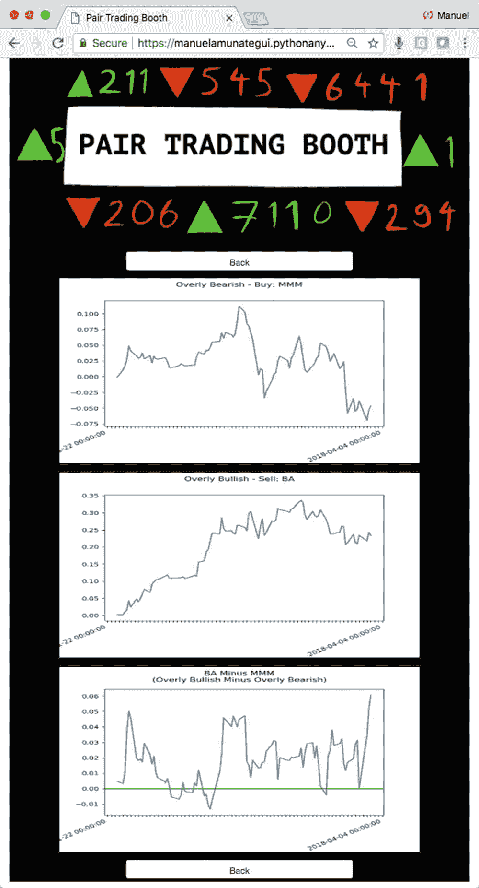
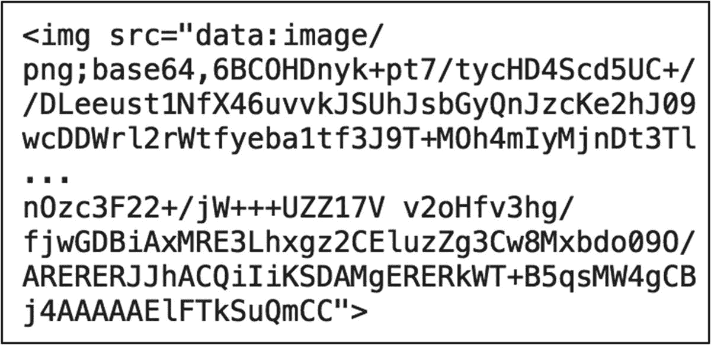
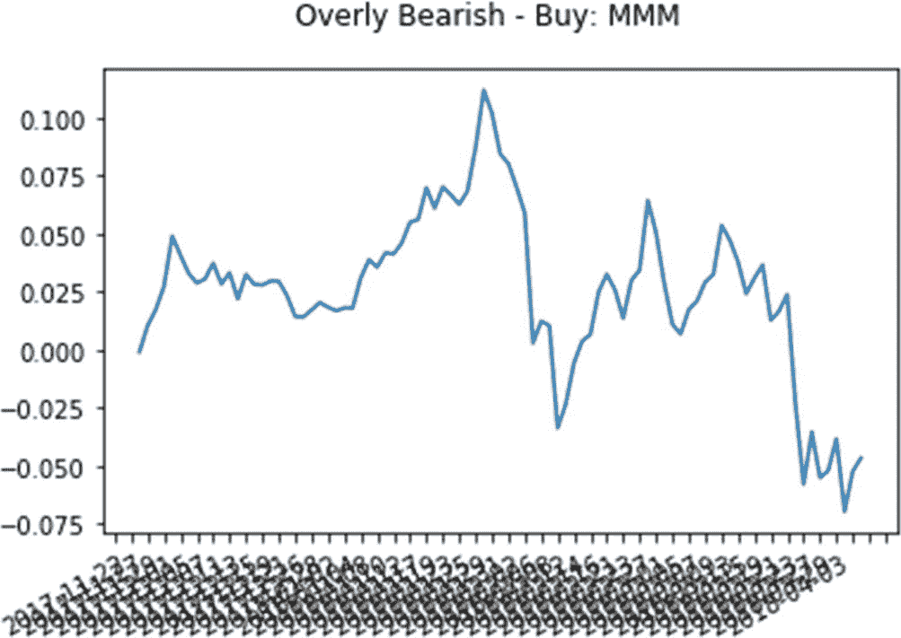
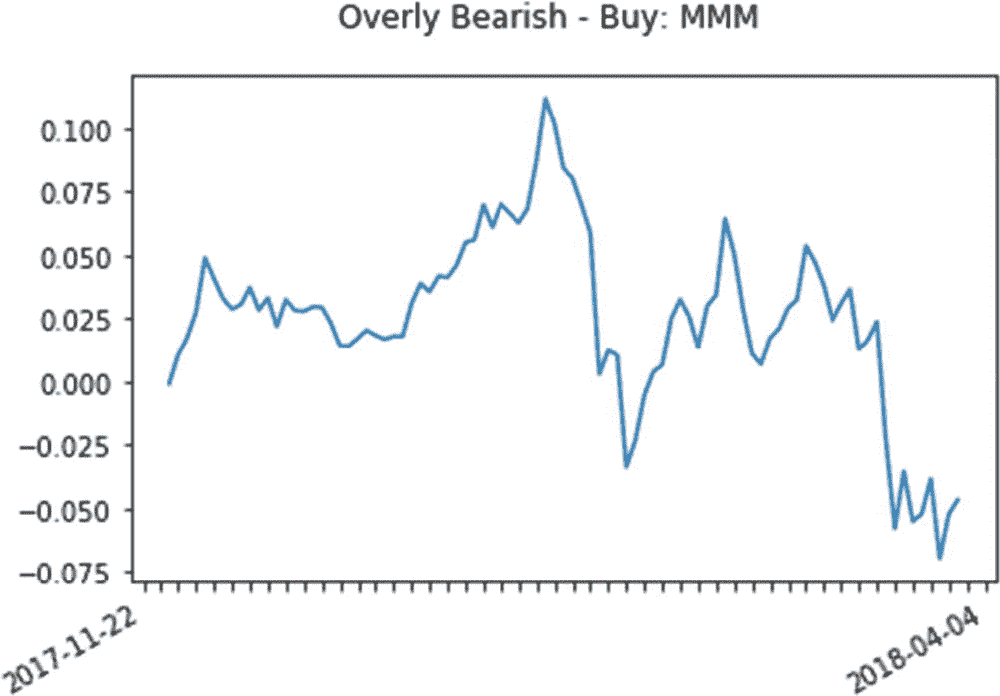
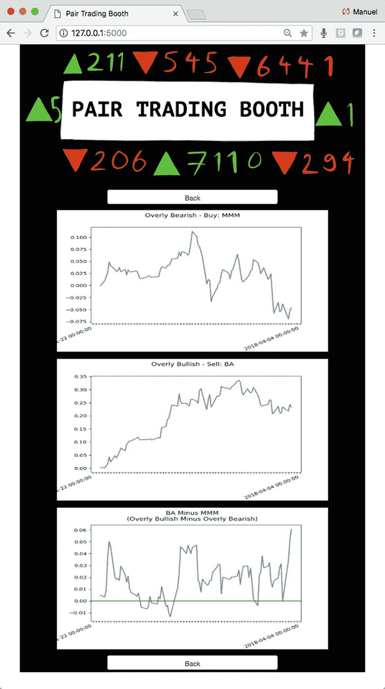
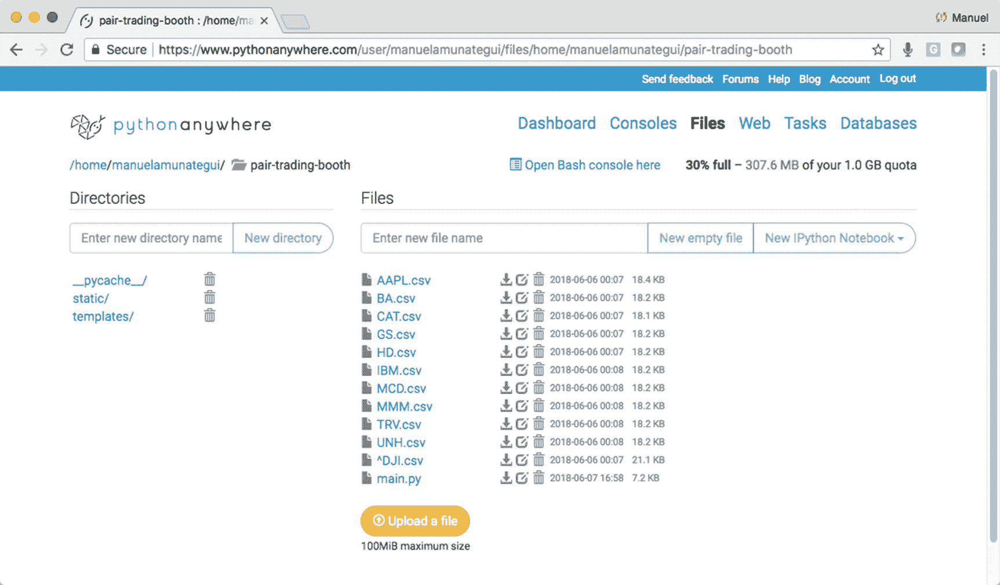
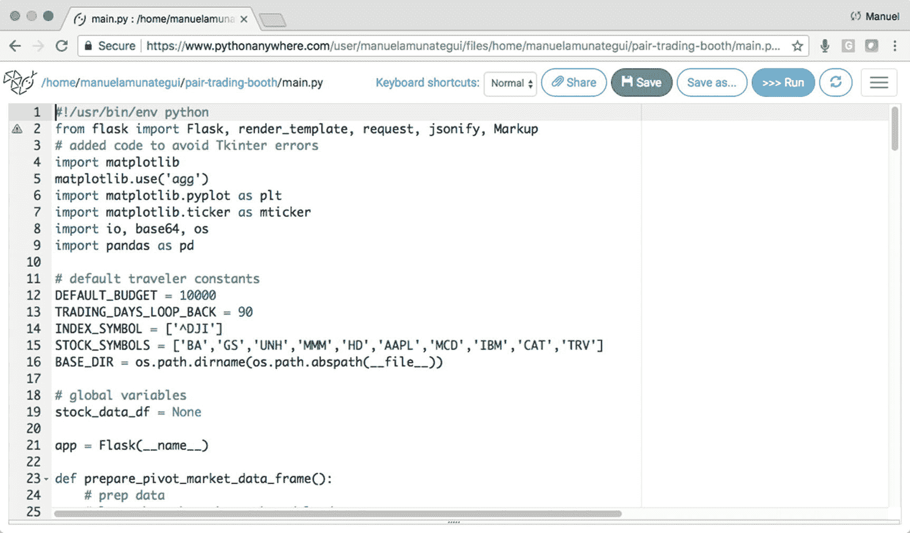
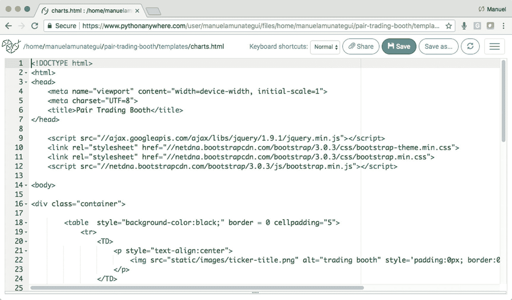
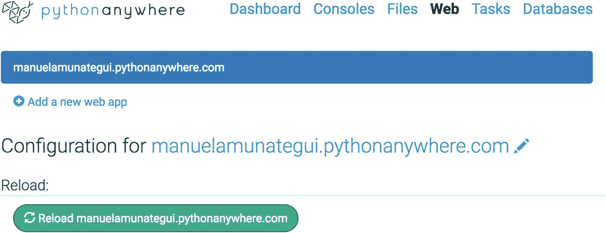
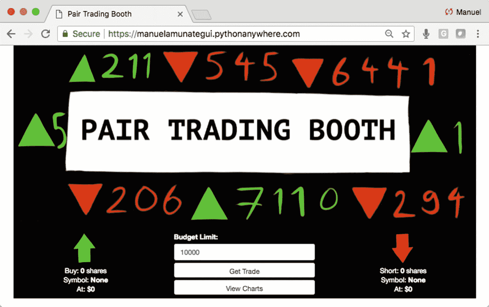

# 9. 案例研究第 2 部分：显示动态图表

在 PythonAnywhere 上显示动态股票图表。

让我们为原始案例研究 Web 应用程序添加一些功能（请确保你熟悉第 5 章中的“在 PythonAnywhere 上运行”）。俗话说“一图胜千言”，在这里绝对适用。通过提供围绕推荐配对交易的价格走势的可视化图表支持，将大大有助于用户评估情况。我们将添加三个图表（图 9-1），分别是每只相关股票的图表，以及显示强势股减去弱势股之间百分比变化累积和差值的图表。



图 9-1

本章的最终 Web 应用程序

这些图表是在 Flask 中动态创建的，并转换为 PNG 文件以供查看。这与我们构建泰坦尼克号 Web 应用程序时使用的技术相同，它允许你使用 Matplotlib 库方便地构建动态图表，并将其从二进制转换为文本以进行 Web 发布。这允许随意创建动态图像，而无需将任何内容保存到文件。

### 注意

通过访问 [`www.apress.com/9781484238721`](http://www.apress.com/9781484238721) 并点击源代码按钮，下载第 9 章的文件。打开 Jupyter notebook “`chapter9.ipynb`” 以跟随本章内容。

## 使用 Matplotlib 创建股票图表

让我们开始吧；将本章的文件下载到一个名为“`chapter-9`”的文件夹中，并打开 Jupyter notebook 跟随操作。这是我们在前几章中使用过并将继续使用的方法。这种方法允许我们使用 Matplotlib 创建图像，然后将它们转换为字符串，以便 HTML 解释器能够动态接收并理解它们。

在以下简化的代码片段中，我们使用“`matplotlib.pyplot`”库在 Python 中创建了一个图像（清单 9-1）。

```python
import matplotlib.pyplot as plt
fig = plt.figure()
plt.bar(y_pos, performance, align="center", color = colors, alpha=0.5)
img = io.BytesIO()
plt.savefig(img, format="png")
img.seek(0)
plot_url = base64.b64encode(img.getvalue()).decode()
```

Listing 9-1
创建编码后的字符串图像

然后，变量“`plot_url`”可以使用 Flask Jinja2 模板符号注入到 HTML 代码中，如下所示（清单 9-2）。

```python
model_plot = Markup(''.format(plot_url))
...
{{model_plot}}
```

Listing 9-2
使用 Flask 和 Jinja2 注入动态图像

如果你查看 HTML 源代码输出，你会看到 HTML 图像标签由一个巨大的字符串输出（此处大幅截断）组成，解释器知道将其转换为图像（图 9-2）。



图 9-2

图像转换为字符串

## 探索配对交易图表

继续将本章的文件下载到一个名为“`chapter-9`”的文件夹中。打开 Jupyter notebook 跟随操作。你会看到这个 notebook 中有大量重复的代码，用于加载和处理到达图表部分所需的所有金融数据。

我们将为访问者提供三个图表：每个交易股票的图表，以及显示强势股减去弱势股的百分比变化、累积总和差值的图表。Jupyter notebook 的前半部分是对第 9 章的重复。我们需要不断重复这些代码，因为我们是在之前的基础上构建这些图表。向下滚动到“第 2 部分”。

让我们运行一个图表，经过不同的步骤将其转换为文本格式，以便能够从 Web 服务器正确提供给 Web 客户端。我们像在 Matplotlib 中构建任何图表一样构建它。我们创建子图来初始化一个绘图对象，向其传递金融数据，创建标题，并旋转 x 轴日期字段（清单 9-3 和图 9-3）。



图 9-3

x 轴已旋转但仍不可读的原始图表

```python
fig, ax = plt.subplots()
ax.plot(temp_series1.index , long_trade_df)
plt.suptitle('过度看跌 - 买入: ' + weakest_symbol[0])

# 旋转日期
myLocator = mticker.MultipleLocator(2)
ax.xaxis.set_major_locator(myLocator)
fig.autofmt_xdate()
```

Listing 9-3
绘制价格差异

我们还做了一些额外的工作来正确格式化 x 轴上的标签。旋转确实有帮助，但我们需要修剪掉一些日期。有很多方法可以处理这个问题，但我们将删除除第一个和最后一个日期之外的所有日期（具体来说，我们只保留第二个日期和倒数第二个日期；清单 9-4）。

```python
输入:
labels = [" for item in ax.get_xticklabels()]
labels[1] = temp_series1.index[0]
labels[-2] = temp_series1.index[-1]
labels = [" for item in ax.get_xticklabels()]
labels[1] = temp_series1.index[0]
labels[-2] = temp_series1.index[-1]
ax.set_xticklabels(labels)
输出:
[Text(0,0,"),
Text(0,0,'2017-11-22'),
Text(0,0,"),
Text(0,0,"),
Text(0,0,"),
Text(0,0,"),
Text(0,0,"),
...
Text(0,0,"),
Text(0,0,"),
Text(0,0,"),
Text(0,0,"),
Text(0,0,"),
Text(0,0,"),
Text(0,0,"),
Text(0,0,"),
Text(0,0,"),
Text(0,0,'2018-04-04'),
Text(0,0,")]
```

Listing 9-4
修复标签以仅显示第一个和最后一个日期

这产生了一个更易读、更简洁的图表，只显示两个有标题的日期：第二个和倒数第二个（图 9-4）。



图 9-4

一个更易读的图表，仅显示极端日期

最后，我们使用 io 库中的“`BytesIO()`”函数将图像数据转换为文本。我们调用 Matplotlib 的“`savefig()`”函数来指定输出格式（尽管这并没有保存到文件），最后调用 base64 库的“`b64encode()`”函数。此时，我们的“`plot_url`”变量保存了图像的文本表示，我们可以使用 Flask 轻松地将其传递给 Web 客户端。这是一种以可扩展且无会话的方式创建动态图像的非常巧妙的方法（清单 9-5）。

```python
输入:
img = io.BytesIO()
plt.savefig(img, format="png")
img.seek(0)
plot_url = base64.b64encode(img.getvalue()).decode()
plot_url
输出:
'iVBORw0KGgoAAAANSUhEUgAAAbAAAAEgCAYAAADVKCZpAAAABHNCSVQICAgIfAhkiAAAAAlwSFlzAAALEgAACxIB0t1+/AAAADl0RVh0U29mdHdhcmUAbWF0cGxvdGxpYiB2ZXJzaW9uIDIuMi4yLCBodHRwOi8vbWF0cGxvdGxpYi5vcmcvhp/UCwAAIABJREFUeJzs3Xl4lOXV+PHvJJPJvu9MAlkmhBCWAImAK7JFUWMVyiaCVqVaW1vfWrGtYtVX5bWtb1+r/hS1EhSNiEoQZccFRIEgwUBYEkgg+77vs/...
```

Listing 9-5
采样编码后的输出

## 设计 Web 应用程序

如果你还没有下载本章的代码，请继续下载；打开一个命令行窗口，并将驱动器切换到“`web-application`”文件夹。它应该包含以下文件，如清单 9-6 所示。

# Web 应用程序文件

```
web-application
├── main.py
├── requirements.txt
├── static
└── images
    ├── ticker-title.png
    ├── up-arrow.png
    └── down-arrow.png
├── templates
├── charts.html
└── index.html
├── ^DJI.csv
├── AAPL.csv
├── BA.csv
├── CAT.csv
├── GS.csv
├── HD.csv
├── IBM.csv
├── MCD.csv
├── MMM.csv
├── TRV.csv
├── UNH.csv
├── requirements.txt
└── main.py
Listing 9-6
Web 应用程序文件
```

像往常一样，我们将启动一个虚拟环境来隔离我们的 Python 库安装，并在需要时创建`requirements.txt`文件（清单 9-7）。

```
$ python3 -m venv pairtrading
$ source pairtrading/bin/activate
Listing 9-7
启动虚拟环境
```

然后通过运行`pip3 install -r`命令安装所有必需的 Python 库（清单 9-8）。

```
$ pip3 install -r requirements.txt
$ python3 main.py
Listing 9-8
安装依赖并运行 Web 应用程序的本地版本
```

以通常的方式运行 Web 应用程序，并确保其按预期工作。第一次运行时可能会有点慢，但之后应该会变得更流畅。同时尝试页面上的各种选项，确保一切功能正常。

## 移动端友好的表格

我们通过将图表绘制在表格单元格中，使 Web 应用对移动端友好，确保它们能根据屏幕尺寸正确缩放。我们在``标签的宽度和高度参数中使用百分比尺寸（如果需要，可以限制高度，但若希望自动调整，宽度必须使用百分比），并将每个图片包裹在一个`<td>`单元格中（清单 9-9）。

```
输入：
chart1_plot = Markup(''.format(plot_url))
输出：

...

{{chart1_plot}}

{{chart2_plot}}

{{chart_diff_plot}}

...

清单 9-9
友好的表格
```

这是一种利用 HTML 中图片的灵活性，使其根据容器框架调整大小的简单方法（图 9-5）。



图 9-5

股票图表的窄视图会根据客户网页大小自动调整尺寸

## 将我们的 Web 应用上传到 PythonAnywhere

让我们将更新后的代码上传到 PythonAnywhere。本章的项目是第 5 章的延续——请按顺序处理这些案例研究，因为我们将在之前 PythonAnywhere 工作的基础上进行构建。登录你的 PythonAnywhere 账户，找到我们之前创建的`pair-trading-booth`文件夹。点击顶部菜单栏中的`Files`链接，进入`pair-trading-booth`目录（图 9-6）。



图 9-6

我们在 PythonAnywhere 上的配对交易应用

所有需要的金融 CSV 文件应该已经在那里了（如果没有，请重新运行第 5 章），我们只需要更新`main.py`和`index.html`文件，并添加一个新的`charts.html`文件来显示我们的股票和衍生图表。最好的方法是在本地编辑器中打开这些文件，然后将内容复制粘贴到 PythonAnywhere 中。

例如，让我们更新`main.py`，在本地编辑器中打开该文件，同时在 PythonAnywhere 中打开该文件，然后将新版本复制粘贴到 PythonAnywhere 上的`main.py`文件中。在继续处理其他文件之前，别忘了点击绿色的`Save`按钮（图 9-7）。



图 9-7

在 PythonAnywhere 上更新`main.py`代码库以处理动态图表的创建

以同样的方式处理模板文件夹中的`index.html`文件，并创建一个名为`charts.html`的新 HTML 文件（图 9-8）。



图 9-8

在 PythonAnywhere 上创建一个名为`charts.html`的新文件以处理动态图表的创建

现在，你可以刷新你的 Web 服务并启动 Web 应用了。点击`Web`菜单选项卡，然后点击那个大大的绿色按钮来重新加载应用（图 9-9）。



图 9-9

点击`Reload`按钮更新你的 Web 服务器

如果你在浏览器中输入 PythonAnywhere 站点的 URL，你应该会看到全新的`Pair Trading Booth`站点。继续，通过点击`Get Trade`和`View Charts`按钮来全面测试它（图 9-10）。



图 9-10

新增了图表功能的`Pair Trading Booth`站点

## 结论

在本章中，我们对`Pair Trading Booth`Web 应用进行了第二次迭代，并为其增加了图表功能。虽然我们没有引入任何新技术，但我们成功地为其增加了额外功能，同时保留了其移动端浏览能力。我们使用了表格和基于百分比的动态图片尺寸，而不是固定尺寸；有时候，最简单的东西才是最强大的。