# 10. 在 GCP 上使用奇异值分解进行推荐

接下来看什么？让我们使用 SVD 和 Google Cloud 上的 Wikipedia API 来推荐电影选项。

在本章中，我们将使用 MovieLens 数据集构建一个电影推荐 Web 应用（图 10-1），该数据集包含“**700 名用户对 9,000 部电影的 100,000 条评分和 1,300 个标签应用**”。^(⁴³) 我们将探索不同的相似度测量技术，并使用奇异值分解（SVD）和协同过滤设计一个推荐应用，以提供出色的电影推荐。

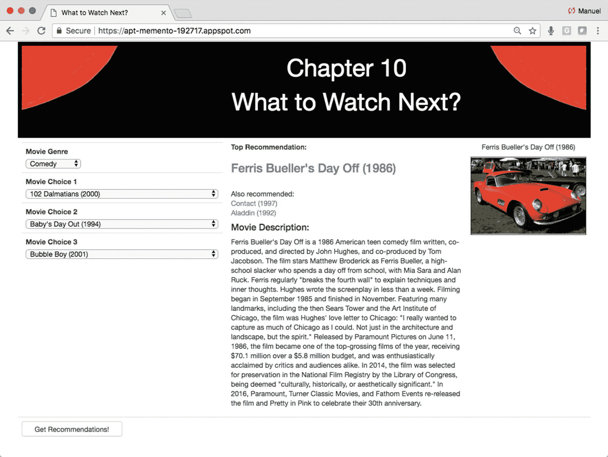

图 10-1

本章的最终 Web 应用

### 注意

通过访问 [`www.apress.com/9781484238721`](http://www.apress.com/9781484238721) 并点击源代码按钮，下载第 10 章的文件。打开 Jupyter notebook “**chapter10.ipynb**” 以跟随本章内容。

## 规划我们的 Web 应用

我们将专注于使用 MovieLens 数据集中的电影评分进行协同过滤。^(⁴⁴) 这可能是学习该主题最流行的数据集。我们基本上将利用群体的智慧来提出电影推荐。我们将构建一个 Web 应用，用户可以选择几部电影，应用将返回相关的电影推荐。为了使其更具信息性和趣味性，我们还将从 Wikipedia 中提取关于顶级电影推荐的相关信息和图片。

## 推荐系统简介

推荐系统在 Web 和电子商务中非常重要。每当一个网站根据你正在查看的内容或你的偏好做出推荐时，它就在使用某种形式的推荐模型。推荐系统的类型根据所使用的工具以及定制化和智能数据的可用性而有很大差异。两个流行的领域是“**基于内容的**”和“**协同过滤**”。

在本章中，我们将专注于协同过滤，而不是基于内容的过滤。MovieLens 的数据包含不同电影的用户评分。使用这些数据应用 CF 的理由是，如果你和某个评论者喜欢同一部电影，那么你很可能也会喜欢该评论者评论过的其他电影。

## 探索 MovieLens 数据集

让我们看看 MovieLens 数据。根据 MovieLens 关于 ml-latest-small 数据集的说明^(⁴⁵)，该数据集包含 671 位用户在 1995 年至 2016 年间对 9,125 部电影创建的 100,004 条评分。

### 更多来自 MovieLens 数据集的内页注释

**评分数据文件结构（“ratings.csv”）：**

*   所有评分都包含在文件“**ratings.csv**”中。该文件标题行之后的每一行代表一个用户对一部电影的一次评分，格式如下：userId, movieId, rating, timestamp。

*   该文件中的行首先按 userId 排序，然后在同一用户内按 movieId 排序。

*   评分采用 5 星制，支持半星增量（0.5 星 – 5.0 星）。

*   时间戳表示自协调世界时（UTC）1970 年 1 月 1 日午夜以来的秒数。

**电影数据文件结构（“movies.csv”）：**

*   电影信息包含在文件“**movies.csv**”中。该文件标题行之后的每一行代表一部电影，格式如下：movieId, title, genres。

*   电影标题是手动输入或从 [`https://www.themoviedb.org/`](https://www.themoviedb.org/) 导入的，并在括号中包含发行年份。这些标题中可能存在错误和不一致之处。

*   类型是一个以竖线分隔的列表，选自以下类别：
    *   动作

    *   冒险

    *   动画

    *   儿童

    *   喜剧

    *   犯罪

    *   纪录片

    *   剧情

    *   奇幻

    *   黑色电影

    *   恐怖

    *   音乐剧

    *   悬疑

    *   爱情

    *   科幻

    *   惊悚

    *   战争

    *   西部

    *   （未列出类型）

继续将本章的文件下载到一个名为“**chapter-10**”的文件夹中。下载“**ml-latest-small.zip**”数据集（ [`http://files.grouplens.org/datasets/movielens/ml-latest-small.zip`](http://files.grouplens.org/datasets/movielens/ml-latest-small.zip) ）并将其解压到你的“**chapter-10**”文件夹中。我们只会用到“**ratings.csv**”和“**movies.csv**”数据集。你应该已经拥有了跟随本章 Jupyter notebook 操作所需的一切。

## “ratings.csv”和“movies.csv”概览

快速查看一下“**ratings.csv**”的 Pandas “**shape**”和“**tail()**”函数。它是一个窄长表格，其时间戳是 Unix 时间，这是一种以自 1970 年 1 月 1 日 UTC 以来的秒数形式表示时间的整数。我们将修复这个问题。这里，我们的 CSV 文件位于名为“**ml-latest-small**”的文件夹中；请根据你的情况相应调整（列表 10-1 和图 10-2）。

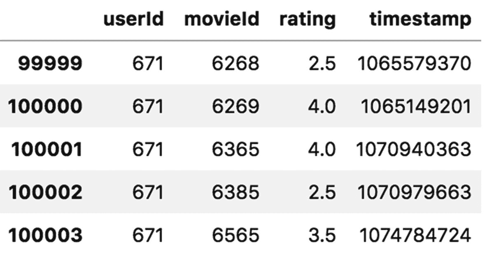

图 10-2

“**ratings.csv**”的原始输出

```
输入:
pd.read_csv('ml-latest-small/ratings.csv')
print('Shape:', ratings_df.shape)
print('Tail:', ratings_df.tail())
输出:
Shape: (100004, 4)
列表 10-1
查看“ratings.csv”
```

我们将使用 datetime 的“**fromtimestamp()**”函数将 Unix 时间转换为实际且可读的时间戳。使用“**describe()**”我们可以确认这一变化，并看到评分范围从 1995 年 1 月到 2016 年 10 月（列表 10-2）。

```
输入:
import datetime
ratings_df['timestamp'] = [datetime.datetime.fromtimestamp(dt) for dt in ratings_df['timestamp'].values]
ratings_df['timestamp'].describe()
输出:
count                  100004
unique                  78141
top       2016-07-23 05:54:42
freq                       87
first     1995-01-09 03:46:49
last      2016-10-16 10:57:24
Name: timestamp, dtype: object
列表 10-2
查看时间戳
```

当我们在“**ratings.csv**”上运行 Pandas 的“**describe()**”时，我们看到最低评分为 0.5，最高为 5，平均值为 4（列表 10-3 和图 10-3）。

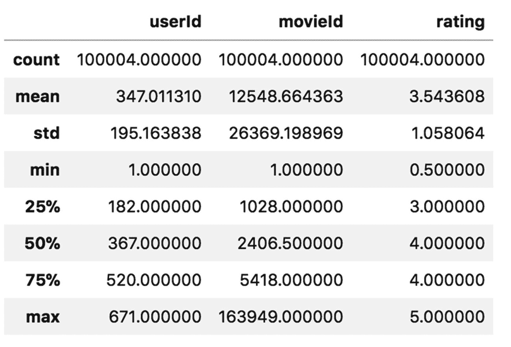

图 10-3

数据框“**ratings_df**”的“**Describe()**”输出

```
ratings_df.describe()
列表 10-3
对“ratings_df”应用函数“describe()”
```

就我们的需求而言，电影数据框中有多少部电影并不重要；我们关心的是评分数据中有多少部电影被评过分（列表 10-4）。

```
输入:
print('Unique number of rated movies: %i' % len(set(ratings_df['movieId'])))
输出:
Unique number of rated movies: 9066
列表 10-4
唯一电影计数
```

所以，我们实际上只有 9,066 部电影可供使用，而不是内页注释中提到的 9,125 部。而唯一用户评论数为 671（列表 10-5）。

```
输入:
print('Unique user count with ratings: %i' % len(set(ratings_df['userId'])))
输出:
Unique user count with ratings: 671
列表 10-5
有评分的唯一用户计数
```

让我们看看“**movies.csv**”。特征“**title**”很直观，而“**genres**”是一个有趣的类别，我们将进一步探索（列表 10-6 和图 10-4）。

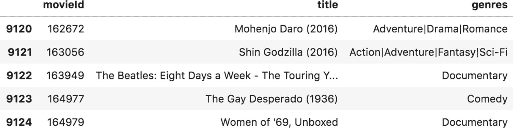

图 10-4

“**movies.csv**”的原始输出

```
输入:
movies_df = pd.read_csv('ml-latest-small/movies.csv')
print('Shape:', movies_df.shape)
movies_df.tail()
输出:
Shape: (9125, 3)
列表 10-6
查看“movies.csv”
```

当我们运行“**describe()**”时，我们注意到特征“**movieId**”与数据框的索引不匹配。最大的 movieId 是 164,979，而只有 9,124 行。这很可能是一个通用的 MovieLens 标识符。这是我们需要调整的地方，以确保 movieId 遵循表格的索引；一旦我们从数据框转向矩阵，这将使我们的生活轻松很多（列表 10-7 和图 10-5）。

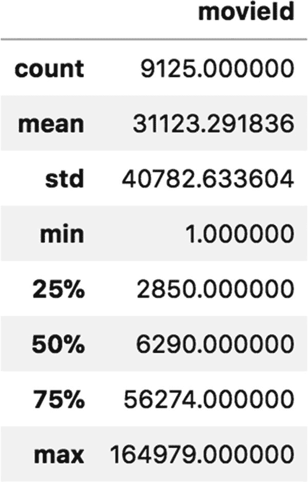

图 10-5

“**describe()**”输出

```
movies_df.describe()
列表 10-7
对“movies_df”运行函数“describe()”
```

## 理解评论与评论文化

现在我们已经对两个数据框有了基本了解，接下来将重点关注它们包含的内容。首先从每个用户 ID 的评论数量开始（代码清单 10-8 和图 10-6）。

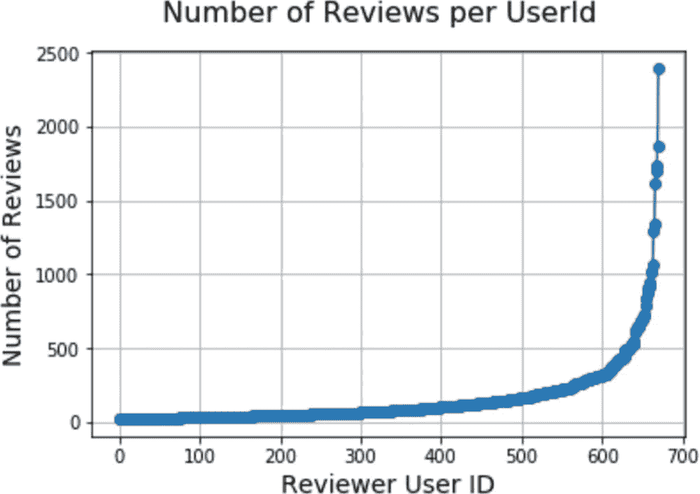

图 10-6

每个用户 ID 的评论总数

```
plt.plot(sorted(ratings_df['userId'].value_counts(normalize=False)), marker="o")
plt.suptitle('Number of Reviews per UserId', fontsize=16)
plt.xlabel('Reviewer User ID', fontsize=14)
plt.ylabel('Number of Reviews', fontsize=14)
plt.grid()
plt.show()
代码清单 10-8
绘制每个用户的评论数
```

我们可以看到，大多数评论者的评论数少于 200 条，但有一位评论者几乎达到了 2500 条！接下来看看实际评分的分布情况（代码清单 10-9 和图 10-7）。

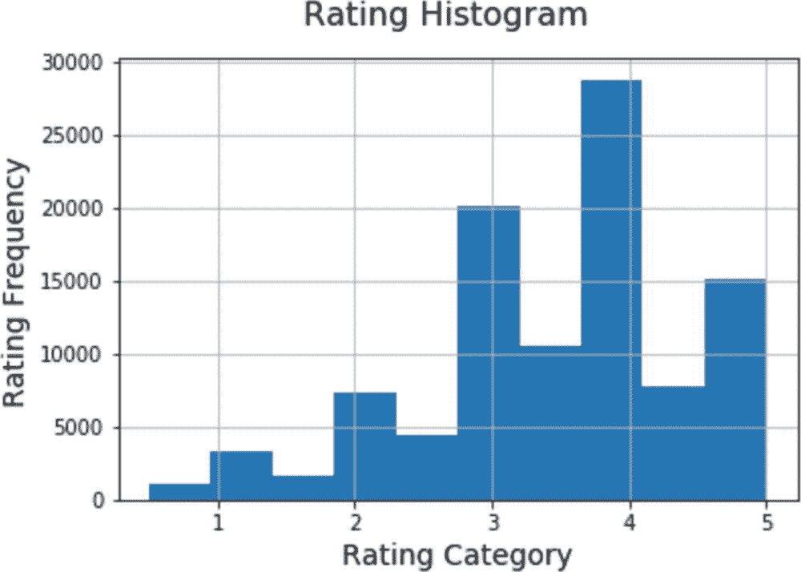

图 10-7

各类别评分总数的直方图

```
ratings_df['rating'].plot.hist()
plt.suptitle('Rating Histogram', fontsize=16)
plt.xlabel('Rating Category', fontsize=14)
plt.ylabel('Rating Frequency', fontsize=14)
plt.grid()
plt.show()
代码清单 10-9
唯一电影数量统计
```

这张图表很重要，因为它展示了评论者偏好的评分类型。在 1 到 5 分的评分范围内，你可能会认为均匀分布会使“**3**”分成为最常用的评分。但我们明显看到事实并非如此，“**4**”分是最受欢迎的评分，其次是“**3**”分和“**5**”分。花些时间思考这一点至关重要。我们即将围绕用户评分构建模型，因此需要能够在同等条件下比较每位评论者。如何将每个用户的评分标准化，使其能与所有其他用户进行比较？一种方法是将每个用户的评论以其评分均值为中心进行归一化。这会创建一个中心“**0**”点，该点将与所有其他评论者的中心点对齐——即中性评论水平。当然，如果评论者只有一条评论，这个系统就无法生效。

电影数据集的分类“**genres**”字段有助于快速了解数据集中包含的电影类型。剧情片和喜剧片似乎是最大的类别（图 10-8）。

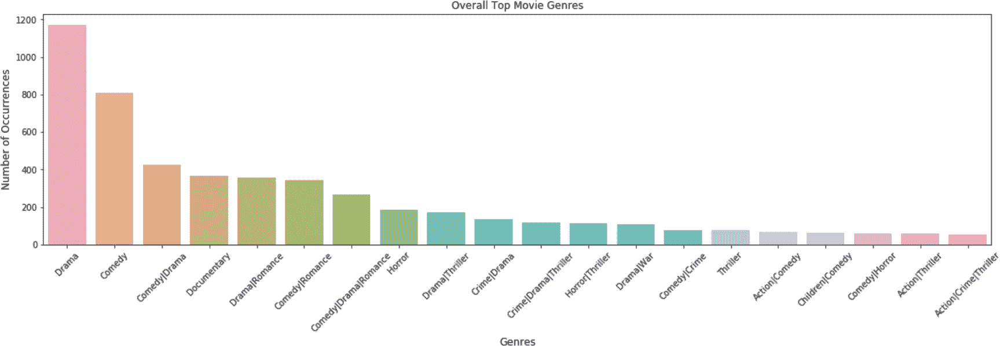

图 10-8

总体热门电影类型

我们还可以通过合并评分和电影数据框，查看电影“**genres**”在评论年份中的分布情况。使用 Pandas 的“**merge()**”函数即可轻松实现。我们以公共索引字段“**movieId**”进行合并，然后从“**timestamp**”特征中提取年份（代码清单 10-10）。

```
reviews_by_genres = pd.merge(movies_df, ratings_df, how = 'inner', on ='movieId')
reviews_by_genres['year'] = reviews_by_genres['timestamp'].dt.year
代码清单 10-10
按年份合并电影与评论
```

现在我们可以绘制由两个表格特征组成的数据，并按年份细分，例如每年被评论的最热门“**genres**”。我们需要执行一个稍微复杂的“**groupby()**”函数调用，以获取每年“**genres**”的总数（代码清单 10-11 和图 10-9）。

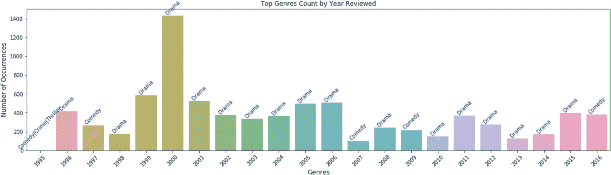

图 10-9

按评论年份统计的热门类型数量

```
def top_category_count(x, n=1):
return x.value_counts().head(n)
reviews_by_genres = reviews_by_genres.groupby(['year']).genres.apply(top_category_count).reset_index()
plt.figure(figsize=(20,5))
g = sns.barplot(reviews_by_genres['year'], reviews_by_genres['genres'], alpha=0.8)
plt.title('Top Genres Count by Year Reviewed')
plt.ylabel('Number of Occurrences', fontsize=12)
plt.xlabel('Genres', fontsize=12)
plt.xticks(rotation=45)
for index, row in reviews_by_genres.iterrows():
g.text(row.name, row.genres, row.level_1, ha="center", rotation=45, color="blue", verticalalignment="bottom", fontsize=10)
plt.show()
代码清单 10-11
按评论年份统计的热门类型
```

“**剧情片**”是最常见的类型，其中穿插着一些“**喜剧片**”，这并不令人意外。2000 年似乎是“**剧情片**”电影表现不错的一年。

## 获取推荐

至此，您应该对我们所使用的数据有了清晰的理解，这将使后续关于建模的章节更易于理解。

为了简化过滤流程，我们将创建一个“**矩阵**”，该矩阵仅使用评分数据框中的三个字段：“**userId**”、“**movieId**”和“**ratings**”（列表 10-12）。

```
输入:
ratings_df.set_index(['userId', 'movieId'], inplace=True)
ratings_matrix = sps.csr_matrix((ratings_df.rating,
(ratings_df.index.labels[0], ratings_df.index.labels[1]))).todense()
print('shape ratings_matrix:', ratings_matrix.shape)
输出:
shape ratings_matrix: (671, 9066)
列表 10-12
创建用户-电影评分矩阵
```

这是通过将索引设置为“**userId**”和“**movieId**”，然后使用其中一个索引作为行、另一个作为列来创建矩阵完成的。由于许多评分将为零，我们使用“**scipy.sparse.csr_matrix()**”函数来创建一个高效的稀疏矩阵（更多信息，请参阅官方文档 [`https://docs.scipy.org/doc/scipy-0.15.1/reference/generated/scipy.sparse.csr_matrix.html`](https://docs.scipy.org/doc/scipy-0.15.1/reference/generated/scipy.sparse.csr_matrix.html) ）。该矩阵将如图 10-10 所示。


图 10-10

非常重要的“**用户**”对“**已评分电影**”矩阵

使用此矩阵将使我们的查询、相似度测量以及最终的 SVD 模型运行得更快。

我们还需要创建一个电影列表，其索引连续且排序顺序与电影数据框中原始电影 ID 的顺序相同。这可以通过删除原始“**movieId**”字段并将其替换为行索引来轻松实现。然后我们将其合并到评分表中，并为评分和电影都采用新的 ID（列表 10-13 和图 10-11）。

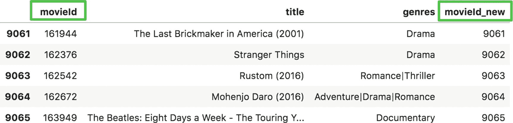

图 10-11

旧的间断“**movieId**”与新的增量“**movieId_new**”

```
movies_df_raw = pd.read_csv('ml-latest-small/movies.csv')
movies_df_raw['movieId_new'] = movies_df_raw.index
movies_df_raw.tail()
列表 10-13
修复电影 ID
```

我们将依赖此行索引来提取相似度。通过查看尾部，我们确认总共有 9,066 部独特的电影。我们需要将这个新的电影 ID 应用于评分和电影数据框，并将其重命名为“**movieId**”以保持一致性（列表 10-14）。

```
ratings_df_raw = ratings_df_raw.merge(movies_df_raw[['movieId', 'movieId_new']], on="movieId", how="inner")
ratings_df_raw = ratings_df_raw[['userId',  'movieId_new', 'rating']]
ratings_df_raw.columns = ['userId',  'movieId', 'rating']
movies_df_raw = movies_df_raw[['movieId_new', 'title', 'genres']]
movies_df_raw.columns = ['movieId', 'title', 'genres']
列表 10-14
应用修复后的电影 ID
```

在深入探讨相似度度量之前，我们最后需要做的一件事是提取一部基础电影，该电影将用于所有后续的相似度算法。我们将评分表中索引为“**0**”的评分数据取出；这代表了原始电影《玩具总动员》的所有评分（列表 10-15）。

```
输入:
movie_toy_story = (mat[:,0])
movie_toy_story[0:20]
输出:
matrix([[ 0\. ],
[ 0\. ],
[ 0\. ],
[ 0\. ],
[ 0\. ],
[ 0\. ],
[ 3\. ],
[ 0\. ],
[ 4\. ],
[ 0\. ],
[ 0\. ],
[ 0\. ],
[ 5\. ],
[ 0\. ],
[ 2\. ],
[ 0\. ],
[ 0\. ],
[ 0\. ],
[ 3\. ],
[ 3.5]])
列表 10-15
基于《玩具总动员》的评分基准
```

## 协同过滤

协同过滤是一种流行的推荐系统类型，它基于利用其他具有相似品味的用户的偏好。

## 相似度/距离度量工具

有大量的距离度量公式可用于衡量两个数字列表之间的相似度或不相似度。当您想要比较多组数字时，这会非常方便。在这里，我们将通过使用欧几里得距离和余弦相似度度量来比较基于用户推荐的电影。

我们将再次利用强大的 Scipy 库，并在本章的大部分需求中使用其距离计算函数“**scipy.spatial.distance()**”。

## 欧几里得距离

简单来说，欧几里得距离是两点之间的距离，可能是最流行的距离算法。这里我们将使用 Scipy 的“**spatial.distance.euclidean()**”函数来计算我们的种子行（《玩具总动员》）与所有其他行之间的欧几里得距离（列表 10-16 和图 10-12）。

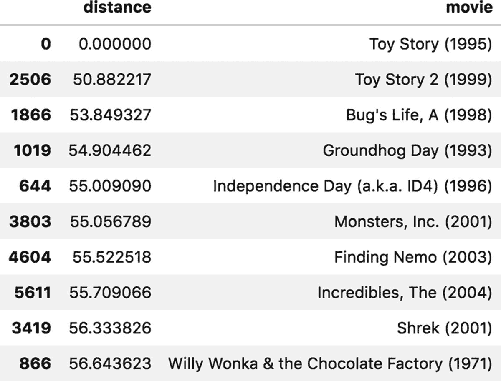

图 10-12

与《玩具总动员》（1995）欧几里得距离最短的电影

```
distances_to_movie = []
for other_movies in mat.T:
distances_to_movie.append(scipy.spatial.distance.euclidean(movie_toy_story, other_movies.tolist()))

# 创建包含电影及其与《玩具总动员》距离分数的数据框
distances_to_movie = pd.DataFrame({'movie':movies_df['title'],'distance':distances_to_movie})

# 按距离升序排序（即最接近 movie_toy_story）
distances_to_movie = distances_to_movie.sort_values('distance')
distances_to_movie.head(10)
列表 10-16
获取相似电影
```

欧几里得距离能够很好地将《玩具总动员》与“**玩具总动员 2**”和“**虫虫危机**”关联起来；从直觉上看，这是有道理的。

## 余弦相似度距离

余弦相似度衡量两个向量之间的余弦角度。^(⁴⁶) 这是一种比欧几里得距离更复杂的度量形式，我们将在本章中一直使用它。

让我们重复之前的练习，使用 Scipy 的“**spatial.distance.cosine()**”函数来计算我们的种子行（《玩具总动员》）与所有其他行之间的余弦距离（列表 10-17 和图 10-13）。

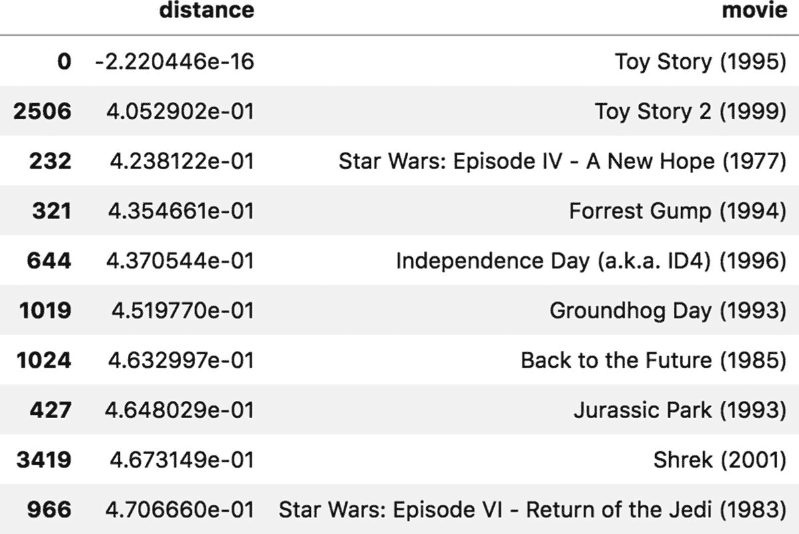

图 10-13

与《玩具总动员》（1995）余弦距离最短的电影

```
distances_to_movie = []
for other_movies in mat.T:
distances_to_movie.append(scipy.spatial.distance.cosine(movie_toy_story, other_movies.tolist()))

# 创建包含电影及其与《玩具总动员》距离分数的数据框
distances_to_movie = pd.DataFrame({'movie':movies_df['title'],'distance':distances_to_movie})

# 按距离升序排序（即最接近 movie_toy_story）
distances_to_movie = distances_to_movie.sort_values('distance')
distances_to_movie.head(10)
列表 10-17
获取相似电影
```

余弦距离将《玩具总动员》与“**玩具总动员 2**”以及其他家庭电影关联起来。有趣的是，余弦距离得出的列表与欧几里得距离不同。

## 奇异值分解

你可以使用任何一种介绍过的距离方法轻松构建一个协同过滤系统，但它无法扩展到更大的数据集，无法处理稀疏数据，也无法应对冷启动问题（即用户/电影交叉数据很少或没有的情况）。像 SVD 这样的模型旨在通过使用低秩近似来缓解其中一些问题，并具备在压缩数据上估计匹配的能力。^(⁴⁷)

这绝非简单的内容，但简而言之，它试图减少数据量，让重要的主题和关联浮现出来，同时让噪声或异常值沉到底部。它会移除嘈杂和不规则的信息，从而构建出一幅更清晰的图谱，显示哪些内容适合哪里，哪些相近，哪些相远。SVD 会将我们按类型和用户排列的电影评分矩阵分解为三个部分：一个用户矩阵、一个电影矩阵，以及一个表示两者关系的向量。然后，我们可以利用这个关系向量来匹配彼此接近的不同用户和评论，并收集周围的信息作为潜在推荐。SVD 会返回一个表示用户特征空间的矩阵和另一个表示电影特征空间的矩阵。接着，我们应用点积运算来寻找相似性和推荐。

此外，这并非旨在成为一门关于 SVD 具体细节的课程，因为它可能会变得很复杂。关于这个主题已经有很多博士论文，网络上也有数百个教程供那些希望深入探究的人参考。我还推荐本代码所基于的博客文章（[`https://beckernick.github.io/matrix-factorization-recommender/`](https://beckernick.github.io/matrix-factorization-recommender/)），以及一篇关于 SVD 实际应用的清晰简单示例：《傻瓜推荐引擎》（[`http://zwmiller.com/projects/simple_recommender.html`](http://zwmiller.com/projects/simple_recommender.html)）。

## 将用户评分中心化至零值附近

由于这个数据集已经被研究了好几年，一些有趣的技巧已被证明是有效的，我们也将在此应用它们。我们将从每个用户的评分中减去其平均评分。这确保了所有用户都按比例缩放并围绕零值分布。如果一个用户的最高评分是 5 分，最低评分是 3 分，而其他用户使用了整个评分范围，那么计算每个用户的平均分并从其评分中减去，将使两者具有可比性（代码清单 10-18）。

```
user_ratings_mean = np.mean(ratings_mat, axis = 1)
ratings_mat_centered = ratings_mat - user_ratings_mean.reshape(-1, 1)
代码清单 10-18
将所有评论中心化至均值附近
```

## 观察 SVD 的实际应用

让我们完成对 Jupyter notebook 中 SVD 代码的分析（如需跟随操作，请参考“**奇异值分解**”部分）。这是一个重要的部分，因为它代表了推荐引擎背后的核心逻辑。

我们做的第一件事是构建一个用户与已评分电影的矩阵（图 10-14）。在我们的案例中，这需要清理一些东西，比如重建电影 ID 使其从零开始，确保它们是连续且无间隔的，并重置评分 ID 也使其从零开始。


图 10-14

非常重要的“**用户**”对“**已评分电影**”矩阵

让我们的推荐器处理新数据的一种方法是将访问者的电影品味作为一个新的“**UserId**”添加到矩阵中。然后，我们使用“**压缩稀疏行矩阵**”函数“**sps.csr_matrix()**”重建矩阵，该函数会将矩阵转换为 SVD 友好的格式，同时考虑新访问者的信息（代码清单 10-19）。

```

# 创建一个新的用户 ID - 在当前最大 ID 上加 1
new_user_id = np.max(ratings_df_cp['userId']) + 1

# 将电影偏好添加到矩阵中，并为所有电影分配 5 星评分
new_user_movie_ids = user_history_movie_ids
new_user_ratings = [5] * len(new_user_movie_ids)

# 将索引设置为以 userId 和 movieId 为多级索引
ratings_df_cp.set_index(['userId', 'movieId'], inplace=True)

# 将新的电影评分作为 pandas 序列添加，并在 ratings_df_cp 末尾插入新行
for idx in range(len(new_user_movie_ids)):
row_to_append = pd.Series([new_user_ratings[idx]])
cols = ['rating']
ratings_df_cp.loc[(new_user_id, new_user_movie_ids[idx]), cols] =         row_to_append.values

# 创建新的评分矩阵
ratings_matrix_plus = sps.csr_matrix((ratings_df_cp.rating,
(ratings_df_cp.index.labels[0], ratings_df_cp.index.labels[1]))).todense()
代码清单 10-19
为我们的新用户获取推荐
```

然后，我们将矩阵发送到“**GetSparseSVD**”函数，该函数执行矩阵分解，并返回三个矩阵，用于计算新用户与其他兴趣相似用户的点积。这使用了稀疏线性代数 SVDS 库“**scipy.sparse.linalg.svds**”，它在处理包含大量零值的大型矩阵方面表现出色（大多数人只看过少数电影，所以当你构建用户对电影的矩阵时，大多数单元格是空白的；代码清单 10-20）。

```
Ua, sigma, Vt = GetSparseSVD(ratings_matrix_centered, K=50)
all_user_predicted_ratings = np.dot(np.dot(Ua, sigma), Vt) + user_ratings_mean.reshape(-1, 1)
代码清单 10-20
获取 SVD
```

我们对返回的矩阵（本例中为 Ua 和 sigma）运行点积运算，并将所有内容打包到一个名为“**predictions_df**”的数据框中。这些数据利用了 SVD 的魔力，将用户及其兴趣组织到不同的维度中（代码清单 10-21 和图 10-15）。

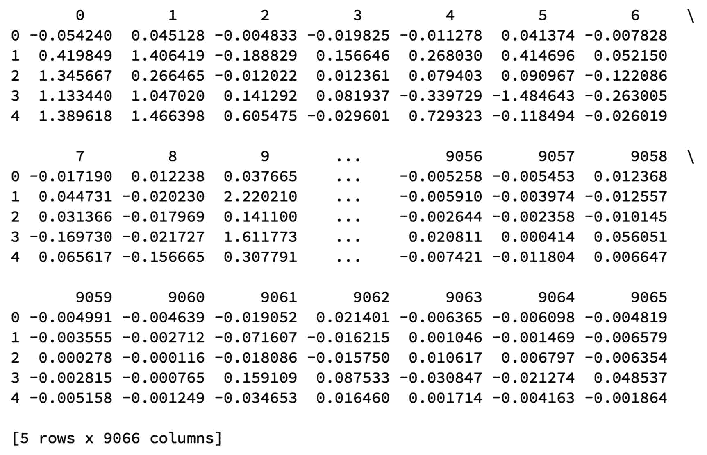

图 10-15

点积矩阵输出，在多个维度上按相似性组织用户

```
predictions_df = pd.DataFrame(all_user_predicted_ratings, columns = movies_df.index)
predictions_df.head()
代码清单 10-21
查看点积矩阵的“head()”
```

我当然不会假装理解这些分组背后的逻辑，但它确实有效，所以我会信任 SVD，并建议你也这样做。

为新用户获取推荐的最后阶段是，仅从“**predictions_df**”中提取该用户的 SVD 点积数据，然后附加电影信息，并简单地挑选少量该用户尚未看过的新电影。例如，假设我们的新用户非常喜欢以下三部剧情/战争片（图 10-16）。

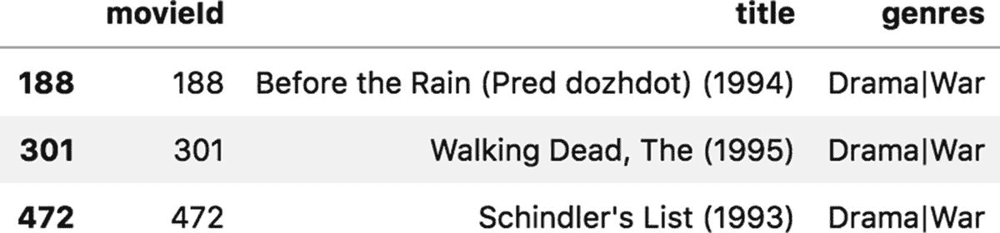

图 10-16

我们用户的偏好

我们将这个新用户的选择作为一个新用户添加到我们的“**用户**”对“**已评分电影**”矩阵中，并为这三个选择赋予高评分。然后，我们运行 SVD 并提取这个新用户的预测结果（图 10-17）。

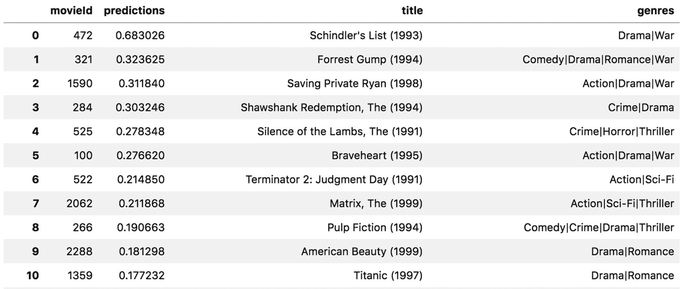

图 10-17

为新用户排序后的推荐结果

显然，我们不会向这个用户推荐“**辛德勒的名单**”，因为这是他们已经看过的电影；相反，我们推荐“**阿甘正传**”、“**拯救大兵瑞恩**”和“**肖申克的救赎**”。好了，代码部分就到这里；让我们来构建这个系统吧！

## 在本地下载并运行“接下来看什么？”代码

让我们下载第 10 章的文件夹，如果尚未解压，请在本地机器上解压。你需要将之前创建的 CSV 文件“**movies.csv**”和“**ratings.csv**”复制到 Web 应用文件的根目录中——即与 **main.py** 相同的文件夹内。你的“**web-application**”文件夹应包含如代码清单 10-22 所示的文件。

```
web-application
├── appengine_config.py
├── app.yaml
├── main.py
├── requirements.txt
├── movies.csv
├── ratings.csv
├── static
└──images
├── curtain-left.png
└── curtain-right.png
└──templates
└── index.html
代码清单 10-22
Web 应用文件
```

按照惯例，我们将启动一个虚拟环境来隔离 Python 库的安装（代码清单 10-23）。

```
$ python3 -m venv whattowatchnext
$ source whattowatchnext/bin/activate
代码清单 10-23
启动虚拟环境
```

然后，通过运行“**pip install -r**”命令来安装所有必需的 Python 库（代码清单 10-24）。

```
$ pip3 install -r requirements.txt
$ python3 main.py
代码清单 10-24
安装依赖并在本地运行网站
```

你可以像在之前的练习中那样，在本地机器上运行该应用。打开一个命令行窗口，切换到“**web-application**”文件夹，然后运行之前执行过的相同命令（例如运行“**python3 main.py**”）。它应该会像图 10-18 中的截图所示。

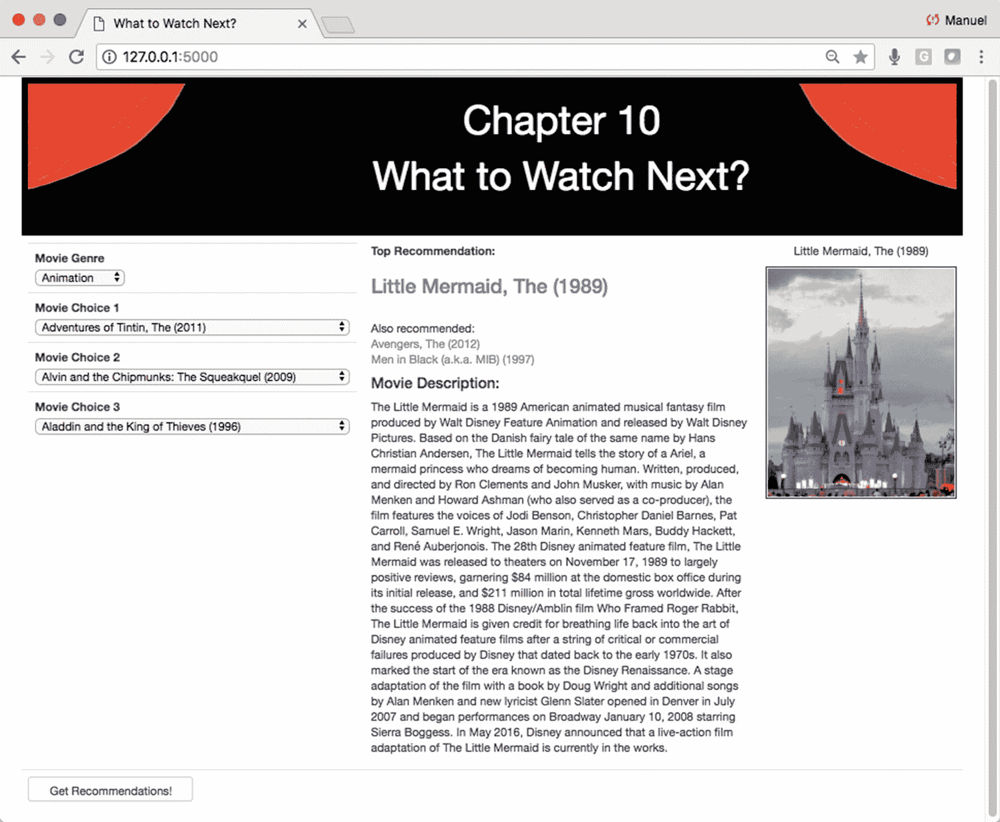

图 10-18

“**接下来看什么？**”在本地运行

## 这里发生了什么？

让我们仔细看看 Flask Web 应用中一些有趣的地方。

## main.py

我们来浏览一下“**main.py**”。在数据探索期间提取的电影类型被复制并硬编码为脚本中的一个常量列表。每次从数据中动态计算它并没有实际价值，因为它与历史数据绑定且不会改变（代码清单 10-25）。

```
MOVIE_GENRES = ["Action", "Adventure", "Animation", "Children", "Comedy", "Crime",
"Documentary", "Drama", "Fantasy", "Film-Noir", "Horror",
"IMAX", "Musical", "Mystery", "Romance", "Sci-Fi", "Thriller",
"War", "Western"]
代码清单 10-25
硬编码电影类型
```

这个类型列表用于填充 Web 应用的第一个下拉框。该下拉框是页面上唯一预填充的字段，每当用户更改它时，它会自动用该类型的电影标题填充其他下拉框。这有助于聚焦应用并大幅减少可用选项的数量。

脚本包含四个便捷函数，它们在访问者与网站交互的不同阶段被调用。

*   **GetMoviesByGenres (movies_df, genre)**
    *   该函数会返回特定类型的所有电影及其 ID 的列表。每当用户更改“**Movie Genre**”下拉框时，它就会被调用。

*   **GetSparseSVD (ratings_centered_matrix, K)**
    *   这是我们之前看过的 SVD 算法。它接收一个评分/电影 ID 矩阵和“**K**”（要计算的奇异值数量），并返回一个用户矩阵、一个表示两者关系的向量（对角矩阵）以及一个电影矩阵。

*   **GetRecommendedMovies (ratings_df, movies_df, user_history_movie_ids)**
    *   这是一个关键函数，它接收评分和电影数据框，以及用户观看并喜欢的电影历史记录（用户从三个下拉框中选择的电影）。它会在评分数据框中追加几行新数据，这些数据包含访问者选择的电影以及最高评分（我们假设用户非常喜欢这些电影）。它会调用“**GetSparseSVD**”函数，并使用原始数据以及从访问者那里追加的新电影进行 SVD 分解。现在，既然我们知道了用户的电影品味，就可以通过点积从 SVD 中找到相似电影。该函数将返回前三名推荐电影。

*   **GetWikipediaData (title_name)**
    *   该函数接收一个电影标题，将其传递给 Wikipedia API，并返回关于该电影的第一段文字以及与该电影关联的第一张图片（通常是电影海报）。

脚本还包含三个 Flask 特定的函数：

*   **startup()**
    *   “**startup()**”函数在 Flask 服务器启动时被调用——换句话说，它是一个构造函数。这是通过添加装饰器“**@app.before_first_request**”来实现的。它加载两个数据集：“**movies.csv**”和“**ratings.csv**”。然后，它像我们在探索性 Jupyter notebook 中所做的那样，通过移除未使用的“**movieId**”并重置所有索引从零开始来清理数据。

*   **ready()**
    *   “**ready()**”函数在页面首次加载、刷新或更改电影类型时被调用。该函数在首次调用时为“**index.html**”页面设置变量默认值。如果不是首次调用（即，通过类型值更改提交表单，并且“**request.method == ‘POST’**”的“**if**”函数返回 true），该函数将保留用户设置的任何值，并通过调用“**GetMoviesByGenres()**”函数获取新的电影选择列表。它还会检查用户是否至少从三个下拉框中选择了至少一部电影，并将这些 ID 传递给“**GetRecommendedMovies()**”函数。这将返回三部新的电影推荐。排名第一的电影推荐会被传递给“**GetWikipediaData()**”函数，以获取该电影的描述片段和海报图片。

*   **background_process()**
    *   此函数与“**index.html**”中的前端 AJAX 函数相关联。每当用户点击三部推荐电影链接之一时，它就会被调用。它获取电影名称并将其传递给“**GetWikipediaData()**”函数，就像“**ready()**”函数所做的那样。这会获取当前焦点电影的描述片段和海报图片。

## index.html

让我们来看看“**index.html**”脚本（清单 10-26）中前端部分的一些有趣内容。

```
$(document).on("click", "a", function(){
var move_title = this.innerHTML;
$(this).text(move_title);
document.getElementById("movie_poster").innerHTML = move_title;
fetchdata(move_title);
});
function fetchdata(move_title)
{
$.ajax({
type : "GET",
url:'{{ url_for('background_process') }}',
data:{ 'movie_title': move_title},
success: function(data){
update_dashboard(data.wiki_movie_description, data.wiki_movie_poster);
}
});
}
function update_dashboard(wiki_movie_description, wiki_movie_poster){
document.getElementById('movie_description').innerHTML = wiki_movie_description;
document.getElementById('image_poster').src = wiki_movie_poster;
}

清单 10-26
JavaScript 端
```

我们有三个函数：

*   **$(document).on(“click”, “a”…)**
    *   该函数监听锚点标签，当被点击时，获取内部文本并将其传递给函数“**fetchdata()**”。
*   **fetchdata(move_title)**
    *   该函数使用 AJAX 向服务器发送 GET 请求，以获取来自维基百科的电影描述和电影海报，并将结果传递给函数“**update_dashboard()**”。
*   **update_dashboard(wiki_movie_description, wiki_movie_poster)**
    *   该函数从函数“**fetchdata()**”获取结果，并用返回的内容替换 HTML 内容描述文本和电影海报。

## 部署到 Google App Engine

到目前为止，你应该对 Google Flexible App Engine 有了一些经验，因此这将是一个快速指南，帮助你将这个 Web 应用程序启动并运行起来。

### 步骤 1：启动 Google Cloud Shell

登录你的 Google Cloud 实例，并创建或选择你想要部署 App Engine 的项目（如果你没有项目，系统会提示你创建一个——请参阅创建和管理项目^(⁴⁸)）。点击右上角的插入符号按钮启动 Cloud Shell 命令行工具。这将在 GCP 仪表板的下半部分打开一个熟悉的命令行窗口（图 10-19）。


图 10-19

访问 Google Cloud Shell

### 步骤 2：压缩并上传所有文件到云端

压缩“**web-application**”文件夹中的文件，但不要压缩虚拟环境文件夹“**whattowatchnext**”，因为它不需要（图 10-20）。

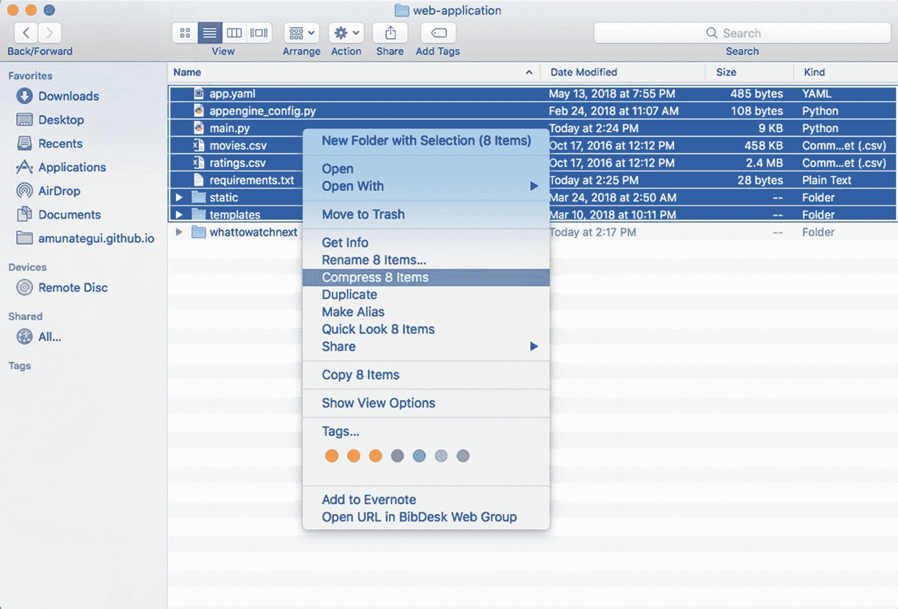

图 10-20

压缩 Web 应用程序文件以上传到 Google Cloud

使用“**Upload file**”选项上传（该选项位于 Shell 窗口右上角的三个垂直点下；图 10-21）。

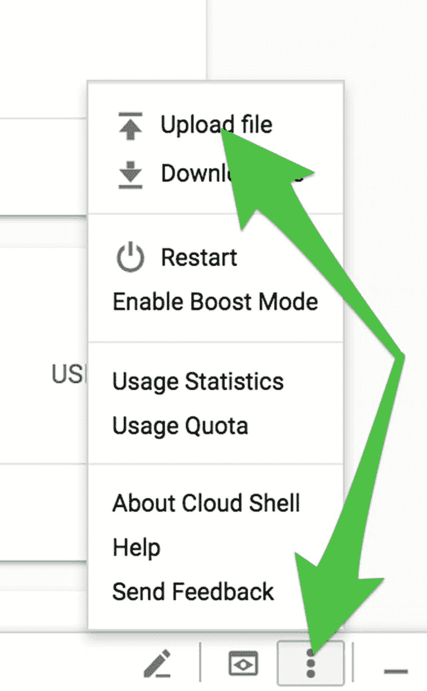

图 10-21

通过 Google Cloud Shell 上传文件

### 步骤 3：在 Google Cloud 上创建工作目录并解压文件

文件成功上传后，创建一个新目录，例如“**chapter-10**”（清单 10-27）。

```
$ mkdir chapter-10
$ cd chapter-10
清单 10-27
在云端创建文件夹
```

将所有压缩档案转移到新文件夹中并解压（清单 10-28）。

```
$ mv ../Archive.zip Archive.zip
$ unzip Archive.zip
清单 10-28
加载所需文件
```

你在 Google Cloud 上的文件夹应该类似于清单 10-29。

```
输入：
$ ls
输出：
appengine_config.py app.yaml Archive.zip lib main.py movies.csv ratings.csv requirements.txt static templates
清单 10-29
检查解压后的内容
```

### 步骤 4：创建 Lib 文件夹

运行以下命令，将所有需要的额外库安装到 lib 文件夹中。当你部署 Web 应用时，lib 文件夹会随所需的库一起传输（清单 10-30）。

```
$ sudo pip3 install -t lib -r requirements.txt
清单 10-30
安装所需库
```

### 步骤 5：部署 Web 应用程序

最后，使用“**gcloud app deploy**”命令将其部署到全世界（清单 10-31）。

```
输入：
$ gcloud app deploy app.yaml
输出：
要部署的服务：
描述符：[/home/amunategui/chapter-10/app.yaml]
源：[/home/amunategui/chapter-10]
目标项目：[apt-memento-192717]目标服务：[default]
目标版本：[20180702t150114]
目标 URL：[https://apt-memento-192717.appspot.com]
是否要继续 (Y/n)？
清单 10-31
部署 Web 应用程序并确认我们要部署应用程序（是的，请继续）
```

就是这样！放松一下，让工具部署网站。这是 Flexible App Engine，因此完全部署可能需要长达 30 分钟。一旦完成所有设置，它会提供一个可点击的链接，直接跳转到已部署的 Web 应用程序（清单 10-32）。

```
$ gcloud app browse
清单 10-32
你也可以使用以下命令访问：
```

享受你的劳动成果吧，并确保通过请求一些电影推荐来进行实验！（图 10-22）。


图 10-22

Google Cloud 上的 Web 应用程序

## 故障排除

在某些情况下，你可能会遇到问题，而 Google Cloud 日志将是你最好的朋友。你可以直接在 Google Cloud 仪表板中访问它们，或者通过调用日志 URL（清单 10-33）。

```
https://console.cloud.google.com/logs
清单 10-33
日志 URL

```

或者，你可以通过在 Cloud Shell 中输入清单 10-34 中的命令来流式传输日志的尾部。

```
$ gcloud app logs tail -s default
清单 10-34
在终端窗口中查看日志
```

## 收尾工作

在结束本章之前，还有最后一件事：不要忘记停止或删除你的 App Engine Cloud 实例。即使你使用的是免费额度，计时器仍在运行，没有必要浪费金钱或额度。

Flexible App Engine 与 Standard App Engine 有些不同，因为 Flexible 成本更高。因此，如果你不使用它，停止它是很重要的。此外，所有这些都可以通过 Google Cloud 仪表板方便地完成。

导航到 App Engine，然后选择版本。点击你的活动版本并停止它（图 10-23）。如果你有多个版本，可以删除旧版本；你无法删除默认版本，但停止它应该就足够了（如果你真的不想留下任何痕迹，只需删除整个项目）。

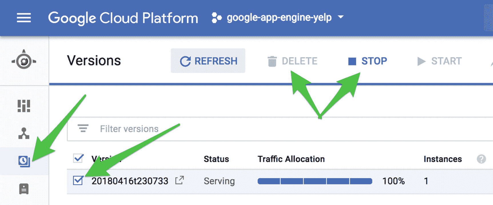

图 10-23

停止和/或删除你的 App Engine 版本

就是这样！如果你全部完成了，别忘了停用虚拟环境（清单 10-35）。

```
$ deactivate
清单 10-35
停用虚拟环境
```

## 结论

用于推荐系统的协同过滤技术非常出色，并且在许多商业应用中广受欢迎。这绝对不是一个简单的章节，因为奇异值分解（SVD）的内部工作原理相当模糊，但关键在于，我们可以构建一个背后拥有强大建模能力的网络应用程序。

尽管奇异值分解（SVD）已经存在了一段时间并且仍在积极使用中，但利用卷积神经网络（CNN）已经取得了有趣的进展。^(⁴⁹)

脚注 1   2   3   4   5   6   7

