# 11. 在 Azure 上利用 NLP 和可视化简化复杂概念

让我们构建一个简单的交互式仪表板，以了解在 Microsoft Azure 上使用自然语言处理消除垃圾短信的成本。

在本章中，我们将对经典的 SMS 垃圾短信收集数据集使用自然语言处理（NLP）。我们将通过特征工程、词频-逆文档频率（TFIDF）和随机森林（RF）将文本消息分类为正常短信或垃圾短信（即，预期消息与广告）。但关键收获将是构建一个网络应用程序，以说明并学习如何调整预测概率阈值，从而实现超越传统 0.5 截断值的各种预测目标（图 11-1）。

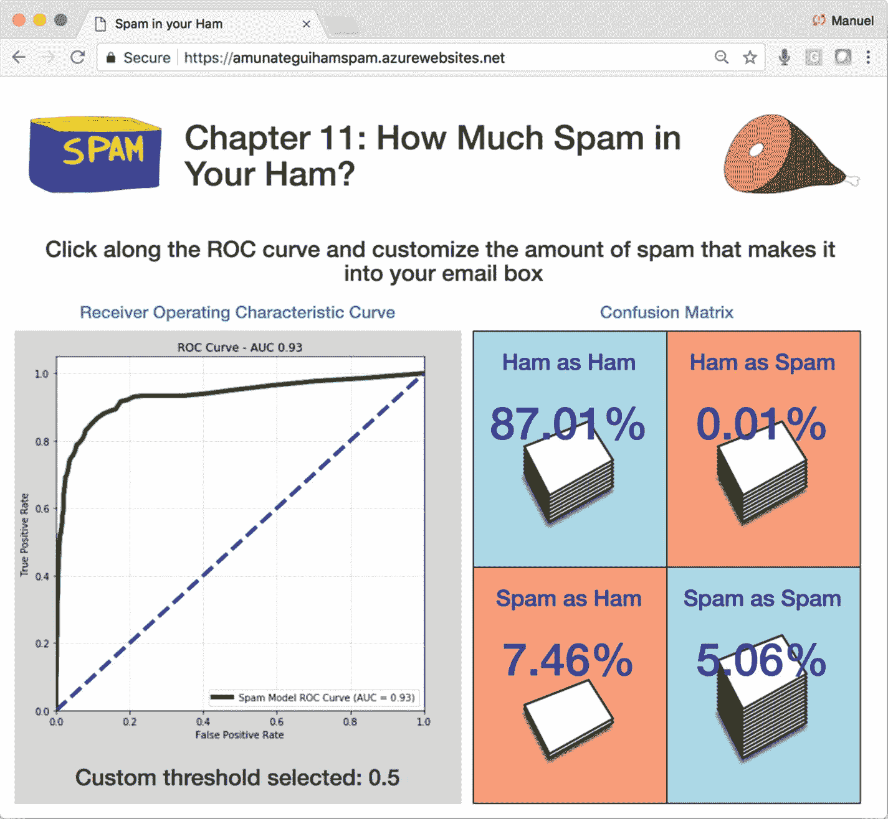

图 11-1 本章的最终网络应用程序

### 注意

通过访问 [`www.apress.com/9781484238721`](http://www.apress.com/9781484238721) 并点击源代码按钮，下载第 11 章的配套文件。打开 Jupyter notebook “`chapter11-ipynb`” 以跟随本章内容。

## 规划我们的网络应用程序——消除垃圾短信的成本

我们的网络应用程序将包含一个交互式接收者操作特征（ROC）图表，访问者可以点击不同的阈值，并可视化有多少正常短信和垃圾短信被正确分类。这将有助于可视化在捕获所有垃圾短信与在此过程中被误标为垃圾短信的正常短信数量之间的权衡。它将突出显示找到满足特定业务需求的正确阈值的重要性。例如，在医疗保健领域，如果资源有限，他们可能更倾向于只识别高概率患者，并接受低风险患者可能被遗漏的情况。而在正常短信/垃圾短信的例子中，用户宁愿收到一些垃圾短信，也不愿丢失任何正常短信。对误标预测的容忍度需要通过业务领域专业知识来理解，但也需要通过建模知识以及像本章网络应用程序这样的可视化工具来理解。

## 数据探索

经典的 SMS 垃圾短信收集数据集由加州大学欧文分校的 UCI 机器学习库慷慨托管。^(⁵⁰) 继续将本章的文件下载到一个名为 “`chapter-11`” 的文件夹中。打开 Jupyter notebook 以跟随操作。根据 UCI 数据集描述，这是一个包含来自 Grumbletext 网站的 425 条垃圾短信和来自 SMS Spam Corpus v.01 的 322 条垃圾短信的集合。另外还有来自各种来源的 4,827 条短信被添加为正常短信。^(⁵¹)

如果我们对结果变量（消息是正常短信还是垃圾短信）调用 Pandas 的 “`groupby()`” 函数，我们可以了解数据集的平衡程度（列表 11-1 和图 11-2）。

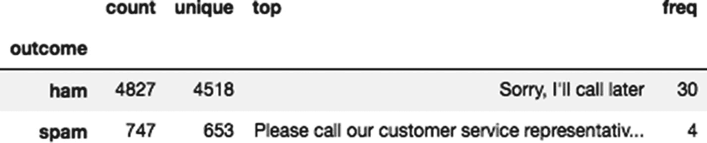

图 11-2 变量 “`outcome`” 的 “`groupby()`” 输出

```
sms_df.groupby('outcome').describe()
```

列表 11-1 对结果变量应用函数 “`groupby()`”

这个简单的命令揭示了大量信息。我们了解到该数据集包含 4,827 条正常短信和 747 条垃圾短信。其中一些是重复的，需要被移除。它还显示数据存在偏差，85% 的消息是正常短信。这种偏差在现实世界中是合理的，但使得建模更具挑战性。

## 清洗文本

我们的第一步简单且显而易见：我们需要移除之前识别出的重复行。这可以通过 Pandas 的 “`drop_duplicates()`” 函数高效完成。通过将 “`keep`” 参数设置为 “`first`”，我们保留第一次出现的记录，并删除所有后续的重复项（列表 11-2）。

```
输入：
print('清理前发现的重复项：%i ' % sum(sms_df.duplicated()))
sms_df = sms_df.drop_duplicates(keep='first')
print('清理后发现的重复项：%i ' % sum(sms_df.duplicated()))
输出：
清理前发现的重复项：403
清理后发现的重复项：0
```

列表 11-2 移除重复行

## 基于文本的特征工程

请务必记住，目前大多数模型（包括 NLP 模型）只能处理定量数据。这意味着我们需要将这些文本形式的短信数据转换为数字。我们将使用各种已知的技巧，例如统计单词数和字符数。

首先，我们来统计每条短信中的单词数量。我们可以使用一个简单的“`列表推导式`”，这是 Python 中对单行循环的一种花哨叫法。然后，我们将这些计数作为新特征添加到我们的短信数据框中，命名为“`word_count`”（代码清单 11-3 和图 11-3）。

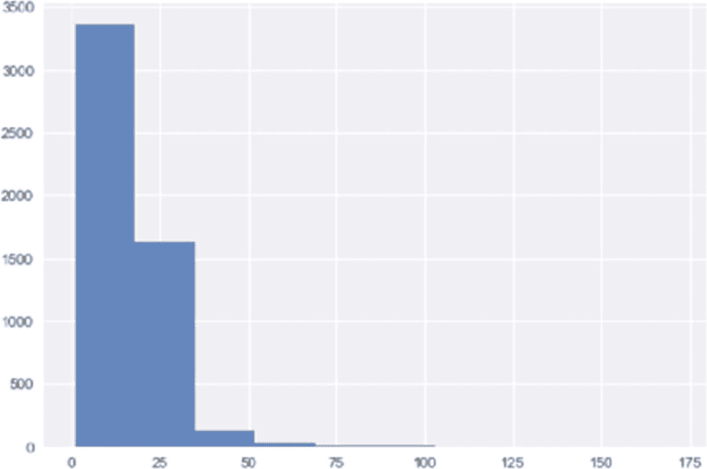

图 11-3 数据集中单词计数的直方图输出

```
sms_df['word_count'] = [len(x.split()) for x in sms_df['sms']]
sms_df['word_count'].hist().plot()
```

代码清单 11-3 绘制每条短信的单词计数

Pandas 有一个方便的“`hist().plot`”函数，可以绘制数据框序列的直方图；这里我们将其应用于新的“`word_count`”特征，以便快速了解数据集中单词计数的分布情况。很明显，大多数短信包含 0 到 20 个单词。

为什么我们要使用单词计数作为特征呢？嗯，我们希望真实短信和垃圾短信之间存在明显的模式差异。也许真实短信的单词数在 5 到 30 之间，而垃圾短信的单词数仅在 10 到 20 之间。无论哪种情况，任何区分模式都将有助于我们的模型。让我们来一探究竟（代码清单 11-4 和图 11-4）。

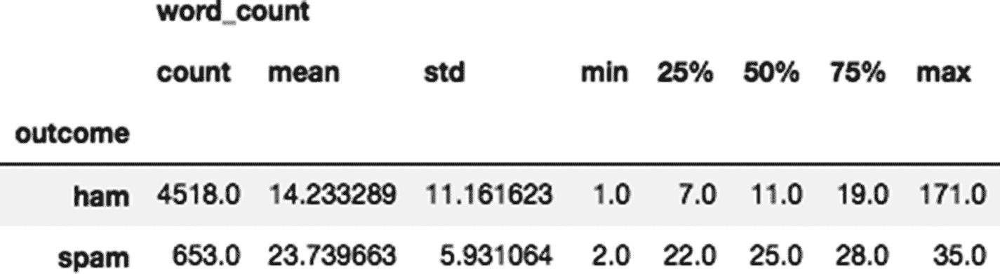

图 11-4 使用“`describe()`”函数对“`outcome`”变量进行汇总统计

```
sms_df[['outcome', 'word_count']].groupby('outcome').describe()
```

代码清单 11-4 真实短信与垃圾短信之间的差异

那么，结果出来了；根据数据，垃圾短信的单词数从未超过 35 个！这意味着任何超过 35 个单词的短信都可以立即被标记为正常短信——这对我们来说是个轻松的胜利！

我们可以继续以这种方式衡量文本数据；例如，不统计单词数，而是统计字符数。思路相同：也许垃圾短信倾向于使用特定字符数范围内的单词（代码清单 11-5 和图 11-5）。

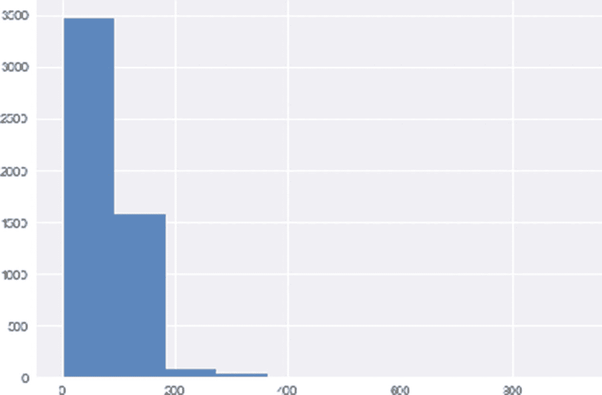

图 11-5 字符数范围直方图

```
sms_df['character_count'] = [len(x) for x in sms_df['sms']]
sms_df['character_count'].hist().plot()
```

代码清单 11-5 每条短信的字符数

这里我们看到大多数短信长度都少于 100 个字符。那么，在正常短信和垃圾短信之间，这个分布又是怎样的呢？（图 11-6）

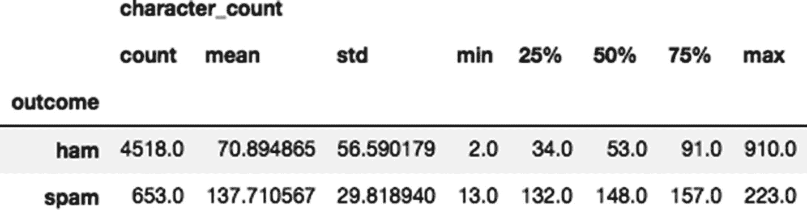

图 11-6 “`outcome`”变量的“`character_count`”汇总

有趣的是，根据我们的历史数据，垃圾短信的长度从未少于 13 个字符——用少于 13 个字符来推销东西确实有点困难……

请参阅相应的 Jupyter notebook，了解应用于短信数据的更多度量方法，例如统计标点符号和大写字母。如果我们能持续突出显示两种类型短信之间的差异行为，我们的模型就会不断改进。

## 为 TFIDF 进行文本整理

一种流行且强大的文本建模技术是词频-逆文档频率（TFIDF）。这是对文档中某个词的频率以及该词在整个语料库所有文档中频率的计算。在我们的案例中，TFIDF 将统计每条短信中单词的频率并按重要性排序，但如果发现某个词整体过于常见且对模式发现无益，则会降低其重要性。在将数据输入 TFIDF 之前，我们需要对数据进行更多的整理（即准备）。

我们需要问自己一个问题，这个问题与任何 NLP 项目都相关：需要多少数据整理工作？当你拥有大量文本数据并使用诸如 word2vec 之类的词向量化工具时^((52))，建议根本不要进行任何清洗。这是因为模型从原始数据中学到的东西比任何被人类假设削弱过的版本都要多。在这些情况下，模型通过接触拼写错误，或者将首字母大写的词和首字母小写的词视为不同等，能够学习得最好。不幸的是，要使这种方法成功，你需要海量的数据；想想维基百科级别的数据量。

# NLP 与正则表达式

对于短信数据集，我们根本没有足够的数据，需要尽可能从中榨取更多价值。以单词`Won`、`won`和`won!`为例；在计算上，它们是不同的，但在寻找垃圾短信时，它们是相同的。因此，如果我们将所有内容转换为小写，并移除任何不属于 26 个字母的字符（即特殊字符、数字、标点符号等），我们就能帮助模型通过在不同情境下看到该词的更多实例来更好地理解它们。

减少文本数据的方法有很多，但一种流行的方法是正则表达式（RegEx）。正则表达式本身是一门语言，但已被整合到包括 Python 在内的许多其他语言中。它使用巧妙的字符表达式组来在文本主体中查找匹配项。

这里我们将使用 Pandas 的`str.replace`函数，并配合正则表达式模式`[^\w\s]`，该模式的含义是：查找任何（`''`）非（`'^'`）单词字符（`'\w'`）后跟空格字符（`'\s'`）的内容，并将其替换为（`""`）空。这会找到任何不是单词的内容并将其移除。非常简单高效（更多信息，请参见 w3schools.com 上的 JavaScript RegExp 参考^([(53))）。然后，我们使用 Pandas 的`str.lower()`函数将所有剩余的单词强制转换为小写（代码清单 11-6）。

```
输入:
sms_df["sms_clean"] = sms_df['sms'].str.replace('[^\w\s]', "")
sms_df["sms_clean"] = sms_df['sms_clean'].str.lower()
sms_df["sms_clean"].head()

输出:
0    go until jurong point crazy available only in ...
1                              ok lar joking wif u oni
2    free entry in 2 a wkly comp to win fa cup fina...
3          u dun say so early hor u c already then say
4    nah i dont think he goes to usf he lives aroun...
名称: sms_clean, 数据类型: object
```

代码清单 11-6
移除所有特殊字符、数字、标点符号并强制转换为小写

我们最终得到了一些看起来有点滑稽的句子，至少对人类来说不太容易阅读。

在数据整理方面，我们可以做的其他事情还有很多。尽管我们在这里不会用到它们，但很好的后续步骤是`词干提取`和`词形还原`，以进一步将单词缩减为共同的词根。例如，如果你输入单词`organize`、`organizes`和`organizing`，它们都会被缩减为`organi`。^((54)) 我们离将清洗后的数据输入 TFIDF 和 RF 越来越近了，但在建模之前，我们还有一个更容易的胜利可以争取。

# 使用外部典型垃圾词列表

垃圾信息已经存在很长时间，相关示例也数不胜数。许多服务商和业余爱好者会收集并整理被视为垃圾信息的单词、句子甚至完整消息的列表。我整理了一份简单的个人列表，包含诸如`秃头`、`现金`、`治愈`、`保证`、`终身`、`机会`、`财富`、`中奖`等词汇。

我将这个简单的列表包含在本章的下载文件中，我们将用它来对比每条短信，并统计其中包含的垃圾词数量。其思路是，大多数正常的日常消息不会包含`中奖`或`现金`这类词，但许多垃圾信息会包含。并且，与我们大多数特征工程一样，最终会得到一个模型所需的数值型特征。

我们在此处用于统计短信与外部垃圾词列表之间交集词汇的推导式很长。但其功能很简单：遍历每条短信并为其创建一个单词列表，然后与垃圾词列表取交集并统计出现次数（列表 11-7）。

```
sms_df["external_spam_word_count"] = [len([(x) for x in sent.split() if x in spam_list]) for sent in sms_df["sms_clean"].values]
```

列表 11-7
创建垃圾词计数

那么，这对我们的模型有帮助吗？（列表 11-8 和图 11-7）

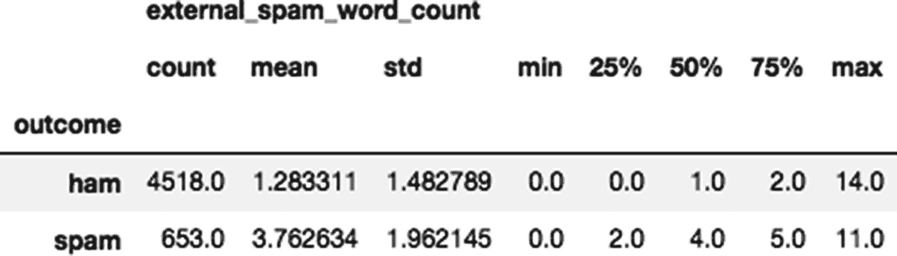

图 11-7

按`结果`变量分组的垃圾词计数

```
sms_df[["outcome", "external_spam_word_count"]].groupby('outcome').describe()
```

列表 11-8
这对预测垃圾信息有帮助吗？

是的，有帮助！如果你查看正常邮件与垃圾邮件的平均词数，会发现垃圾邮件中的外部垃圾词数量是正常邮件的两倍以上。

# 使用 Sklearn 的 TfidfVectorizer 进行特征提取

至此，我们已经收集了足够的量化特征。让我们运行 TFIDF 向量化器，它就像对数据集中每个单词与其他所有单词进行一次大规模特征工程计算（列表 11-9 和图 11-8）。

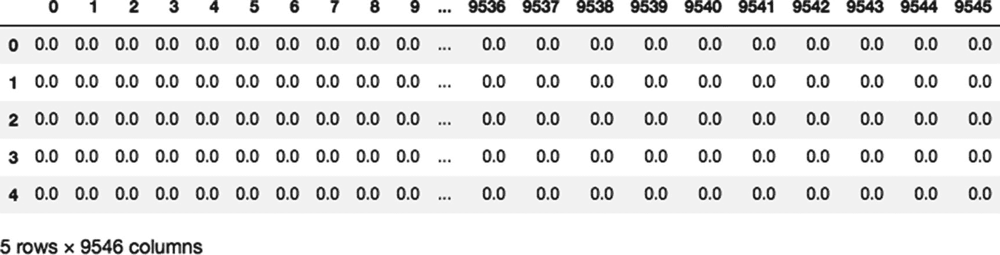

图 11-8

TfidfVectorizer 输出

```
vectorizer = TfidfVectorizer()
vectors = vectorizer.fit_transform(sms_df['sms_clean'])
vectorized_df = pd.DataFrame(vectors.toarray())
vectorized_df.head()
```

列表 11-9
向量化数据

哇！`TfidfVectorizer`创建了 9,546 个新特征，而且速度相当快！这里需要记住几点：`TfidfVectorizer`是一个强大的特征工程工具，因为它不仅考虑每个单词，还考虑整个上下文。这会产生一个非常稀疏的矩阵，因此对于非常大的语料库来说可能是个问题，但在我们的案例中它运行良好。如果这是个问题，也可以通过向其提供有限的词汇集来限制其在向量中考虑的单词数量。

现在，我们只需将这些新特征与我们之前创建的特征合并即可。

# 准备结果变量

对于所有监督模型，我们需要明确要预测的目标。这里我们要预测一条消息是正常邮件还是非正常邮件。因此，正常邮件需要标记为 1，而垃圾邮件需要标记为 0。这可以通过使用 Pandas 的`Categorical()`函数轻松实现（列表 11-10）。

```
输入:
print(all_df[outcome].head())
all_df[outcome] = pd.Categorical(all_df[outcome], categories=["spam","ham"])
all_df[outcome] = all_df[outcome].cat.codes
print(all_df[outcome].head())

输出:
0     ham
1     ham
2    spam
3     ham
4     ham
Name: outcome, dtype: object
0    1
1    1
2    0
3    1
4    1
Name: outcome, dtype: int8
```

列表 11-10
移除重复行

通过打印结果变量转换前后的情况，我们确认正常邮件使用数字`1`，垃圾邮件使用`0`。

# 使用 Sklearn 的 RandomForestClassifier 进行建模

现在我们已经收集了运行随机森林分类器所需的所有量化特征。随机森林，顾名思义，会创建多组随机的特征树，并利用这些树针对结果变量进行训练和预测。然后，它会将所有预测结果汇总（即集成），其假设是这能捕捉到比单一模型更多的细微差别。本质上，随机森林并非真正意义上的`一个`单一模型，而是许多模型的集合，它们对数据有着不同的视角和理解。

`sklearn.ensemble`库提供了一个高效且易于使用的随机森林分类器，恰如其分地命名为`RandomForestClassifier`。这里我们要求它运行两个并行任务（因为如今大多数计算机至少有两个 CPU，模型运行速度会更快），以及 100 个决策树分类器（官方文档列出了更多可供探索的强大选项^(⁵⁵)）。参见列表 11-11。

```
rf_model = RandomForestClassifier(n_jobs=2, random_state=0, n_estimators=100)
rf_model.fit(X_train, y_train)
```

列表 11-11
运行随机分类器模型

一旦`rf_model`训练完成，我们就可以在测试集上运行预测来评估模型性能。该模型提供类别和概率两种格式的预测（列表 11-12 和 11-13）。

```
输入:
prediction_classes = rf_model.predict(X_test)
输出:
[1 1 1 ... 1 1 1]
列表 11-12
预测垃圾邮件与正常邮件
```

```
输入:
prediction_probas = rf_model.predict_proba(X_test)
输出:
[[0.08 0.92]
[0.14 0.86]
[0\.   1\.  ]
...
[0.01 0.99]
[0\.   1\.  ]
[0\.   1\.  ]]
列表 11-13
获取垃圾邮件与正常邮件的概率
```

### 衡量模型性能

`sklearn.metrics` 库提供了大量函数来帮助我们衡量模型的性能。我们将从`classification_report`（列表 11-14）开始。

```
输入:
from sklearn.metrics import classification_report
print(classification_report(y_test, prediction_classes))
输出:
precision    recall  f1-score   support
0       0.92      0.40      0.56       302
1       0.92      0.99      0.96      2108
avg / total       0.92      0.92      0.91      2410
列表 11-14
获取模型指标
```

我们看到，我们的模型在预测正常邮件（第二行）方面表现出色，并且在垃圾邮件的“精确率”（在你标记为某类的样本中，预测正确的比例）上表现也很好。该模型在垃圾邮件的“召回率”（在整个测试集中，正确预测出的比例）和“F1 分数”（基于精确率和召回率的 0 到 1 之间的分数）上则稍显吃力。这是意料之中的，因为数据存在偏差，并且我们没有足够多的垃圾邮件样本用于训练。

“混淆矩阵”是另一个用于可视化模型性能的强大工具。它与精确率和召回率相关，但使用了不同的术语：真正例、假正例、真负例和假负例（图 11-9）。

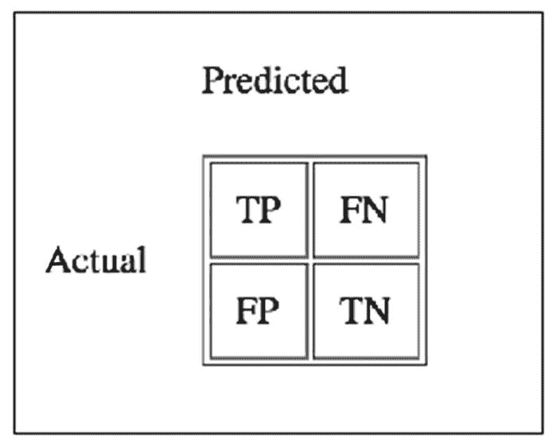

图 11-9
如何解读混淆矩阵

`sklearn.metrics` 库中的`confusion_matrix`函数接收真实结果标签、预测类别以及标签顺序。重要的是要指定你希望将正类标签放在第一位（例如，是正常邮件）。这会使混淆矩阵的解读变得容易得多（列表 11-15）。

```
输入:
from sklearn.metrics import confusion_matrix
cm = confusion_matrix(y_test, prediction_classes, [1,0])
print('测试集总长度: %i' % len(y_test))
print('测试集中正常邮件总数: %i' % sum(y_test==1))
print('测试集中垃圾邮件总数: %i' % sum(y_test==0))
cm
输出:
测试集总长度: 2410
测试集中正常邮件总数: 2108
测试集中垃圾邮件总数: 302
array([[2097,   11],
[ 180,  122]])
列表 11-15
获取混淆矩阵指标
```

在数组的左上角，我们看到模型成功地从 2108 封邮件中正确预测出了 2097 封正常邮件（2097 + 11），并从 302 封邮件中成功预测出了 122 封垃圾邮件（180 + 122）。这些就是“TP”和“TN”。TP 表示真正例，即模型成功预测出某封邮件是正常邮件（正常邮件 = 1）；TN 表示真负例，即模型成功预测出某封邮件不是正常邮件（正常邮件 = 0）。

深入来看，“FN”指的是模型将一封实际上是正常邮件的邮件标记为垃圾邮件（正常邮件 = 0，但实际应为 1）。在数组中，正常邮件行是上面那一行，模型将 11 封实际上是垃圾邮件的邮件预测为了正常邮件。在正常邮件与垃圾邮件的场景中，这个数字非常有害，因为它意味着用户的个人邮件被扔进了垃圾邮件文件夹。

“FP”指的是模型将一封实际上是垃圾邮件的邮件标记为正常邮件（将正常邮件设为 1，而实际应为 0）。在正常邮件数组的第一个单元格中，即数组的底部，模型将 180 封实际上是垃圾邮件的邮件预测为了正常邮件。

混淆矩阵的概念非常重要，因为模型在概率阈值为 0.5 的基础准确率之外，还为你提供了额外的灵活性。在阈值为 0.5 时，低于该值的被判定为 0，高于该值的被判定为 1。通过调整这个阈值，你可以根据业务需求，是更倾向于减少 FN 还是减少 FP，从而从模型中挖掘出更多价值，而不是仅仅使用一个折中的阈值。毕竟，这正是我们 Web 应用仪表盘的核心功能所在。

ROC 图表是理解二分类器价值以及如何通过改变阈值来获得不同效果的一个绝佳工具（图 11-10）。

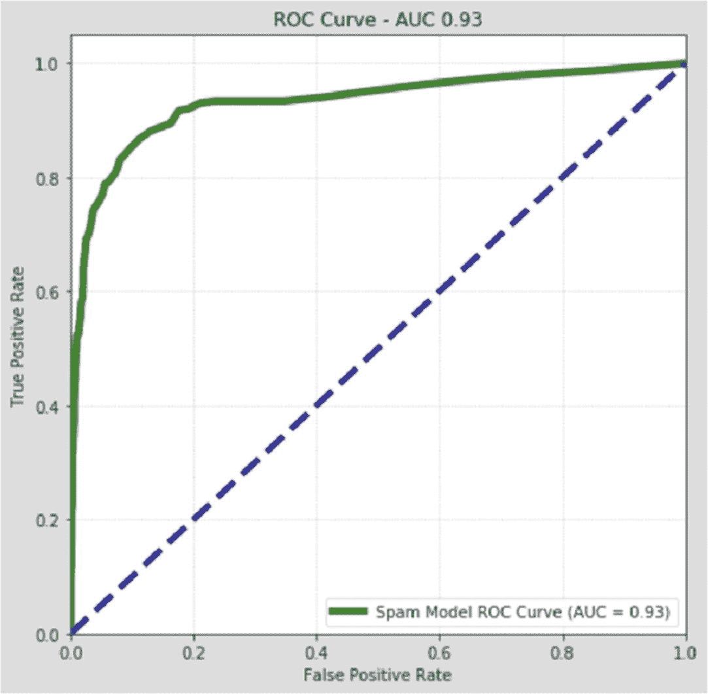

图 11-10
我们正常邮件与垃圾邮件模型的 ROC 曲线

让我们来看看我们模型的 ROC 曲线。总体而言，它的表现非常好，曲线下面积（AUC）得分为 0.93。AUC 得分范围在 0.5 到 1 之间，其中 0.5 表示随机猜测，1 表示完美预测。因此，理想的 AUC 为 1 时，图表中的绿线将从左下角的 0 点笔直向上到 1，然后从左到右水平延伸（换句话说，它覆盖了整个左上角三角形区域）。

AUC 代表一个得分恒定的区域，但通过沿着曲线的外边缘上下滑动，你可以调整“真正例率”和“假正例率”。这似乎是一个奇怪的概念：你可以在不影响模型 AUC 得分的情况下调整模型。从高层次来看，这种灵活性部分原因在于，与其说是“灵活性”，不如说是一种“权衡”。你在曲线上走得越高（沿着绿线向上），你预测为正类的样本就越准确，但你最终得到的正类样本数量就越少，因为你所经过的那些样本已经从正类变成了负类。

这又回到了我们之前的例子：一个资源有限的急诊室可能更倾向于获得更少但精确率更高的预测，因此会沿着绿色的 AUC 线向上滑动。而在我们的正常邮件与垃圾邮件场景中，电子邮件用户无法容忍自己的重要邮件消失在垃圾箱中，因此沿着 AUC 线向下滑动会更可取（这意味着更多的负类样本会被重新标记为正类，从而接受更多真正的垃圾邮件最终进入收件箱）。

### 与模型阈值交互

让我们看看我们的仪表盘将如何展示概率阈值的灵活性。如果我们采用标准的概率截断值 0.5（即，在我们的案例中，任何高于 0.5 的为正常邮件，低于的为垃圾邮件）。请参见列表 11-16 和图 11-11。

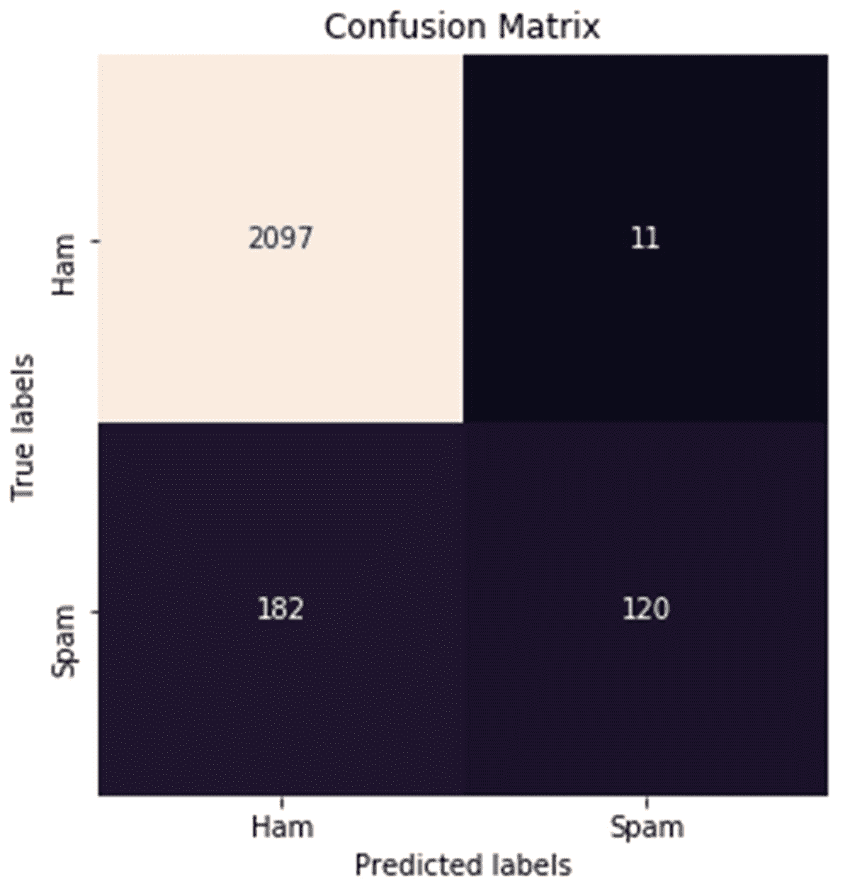

图 11-11
使用简单 0.5 截断值的混淆矩阵

```
prediction_tmp = [1 if x >= 0.5 else 0 for x in prediction_probas[:, 1]]
列表 11-16
使用 0.5 截断值的混淆矩阵
```

我们得到以下图形化的混淆矩阵，从中可以看出，模型正确识别了 2097 封正常邮件和 120 封垃圾邮件，但错误地将 11 封正常邮件标记为垃圾邮件——这可不好！现在，如果我们将阈值降低到 0.3，让我们看看有多少封正常邮件会被标记为垃圾邮件。请参见列表 11-17 和图 11-12。

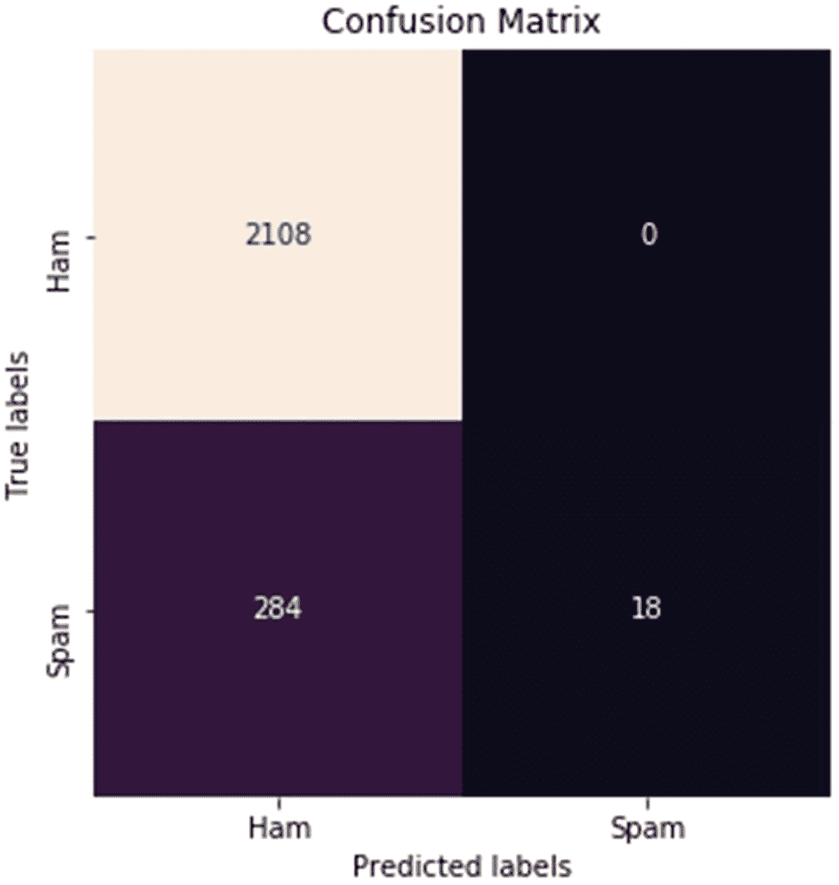

图 11-12
使用自定义 0.3 截断值的混淆矩阵

```
prediction_tmp = [1 if x >= 0.3 else 0 for x in prediction_probas[:, 1]]
列表 11-17
使用 0.3 截断值的混淆矩阵
```

当阈值截断值为 0.3 时，模型没有将任何正常邮件错误地标记为垃圾邮件！但代价是，我们将错误标记为正常邮件的垃圾邮件数量从 182 封增加到了 284 封（即，广告邮件进入了用户的收件箱）。而垃圾邮件文件夹只收到了 10 封正确标记的垃圾邮件，而不是 120 封。你看，*这就是代价*。在像正常邮件与垃圾邮件这样的场景中，这个代价是微不足道的，因为没有人愿意丢失任何个人邮件，并且为了实现这个目标，他们愿意容忍大量的垃圾邮件。

## 与网页图形交互
```

我们将在此实现一个很棒的功能：允许用户点击 AUC 图像来试验模型的阈值。这是一种非常直观的方式，能让用户与网页及本章涉及的概念进行交互。使用 JavaScript 捕获用户的点击事件很容易，通过捕获“`事件偏移量`”（代码基于 Emanuele Feronato 的文章；有关此方法的更多信息，请参阅[`http://www.emanueleferonato.com/2006/09/02/click-image-and-get-coordinates-with-javascript/`](http://www.emanueleferonato.com/2006/09/02/click-image-and-get-coordinates-with-javascript/)），并将其传回 Flask 进行处理（代码清单 11-18）。

```javascript
function point_it(event)
{
cur_x_coord = event.offsetX?(event.offsetX):event.pageX-document.getElementById("pointer_div").offsetLeft;
cur_y_coord = event.offsetY?(event.offsetY):event.pageY-document.getElementById("pointer_div").offsetTop;

fetchdata(cur_x_coord, cur_y_coord)
}
// 代码清单 11-18
// 用于捕获用户在 AUC 图表上点击的 JavaScript 代码
```

在 Flask 中，这通过一系列 if/then 语句转换为新的阈值（代码清单 11-19）。

```python
x_image_coord = int(request.args.get('new_x_coord'))
y_image_coord = int(request.args.get('new_y_coord'))
new_thres = 0.0

# 将坐标转换为阈值
if (y_image_coord >= 360 and y_image_coord = 340 and y_image_coord = 290 and y_image_coord = 260 and y_image_coord = 220 and y_image_coord = 185 and y_image_coord = 150 and y_image_coord = 115 and y_image_coord = 75 and y_image_coord < 115):
new_thres = 0.9
elif (y_image_coord < 75):
new_thres = 1
# 代码清单 11-19
# 将用户点击转换为截断阈值
```

## 构建我们的 Web 应用程序——本地 Flask 版本

我们已经构思好了模型和仪表板的概念，现在是时候构建它了。让我们从构建一个本地 Flask 版本开始。

将第 11 章的文件下载到您的本地机器上。下载并解压所有内容后，打开一个命令行窗口，并将驱动器切换到“`web-application`”文件夹。您的“`web-application`”文件夹应包含如代码清单 11-20 所示的文件。

```
web-application
├── main.py
├── ptvs_virtualenv_proxy.py
├── requirements.txt
├── static:
└── images:
├── 00.png
├── 01.png
├── 02.png
├── 04.png
├── 06.png
├── 08.png
├── 10.png
├── 12.png
├── 14.png
├── 16.png
├── 18.png
├── ham.png
├── roc-chart.png
└──spam.png
├── pickles:
└──spam_model_output.p
├── templates:
└──index.html
└──web.3.4.config
# 代码清单 11-20
# Web 应用程序文件
```

启动一个虚拟环境（参见代码清单 11-21）。

```
$ python3 -m venv hamspamenv
$ source hamspamenv/bin/activate
# 代码清单 11-21
# 启动虚拟环境
```

然后，通过运行“`pip3 install -r`”命令安装所有必需的 Python 库（代码清单 11-22）。

```
$ pip3 install -r requirements.txt
# 代码清单 11-22
# 安装必需的库
```

并在您的本地机器上运行 Web 应用程序（代码清单 11-23 和图 11-13）。

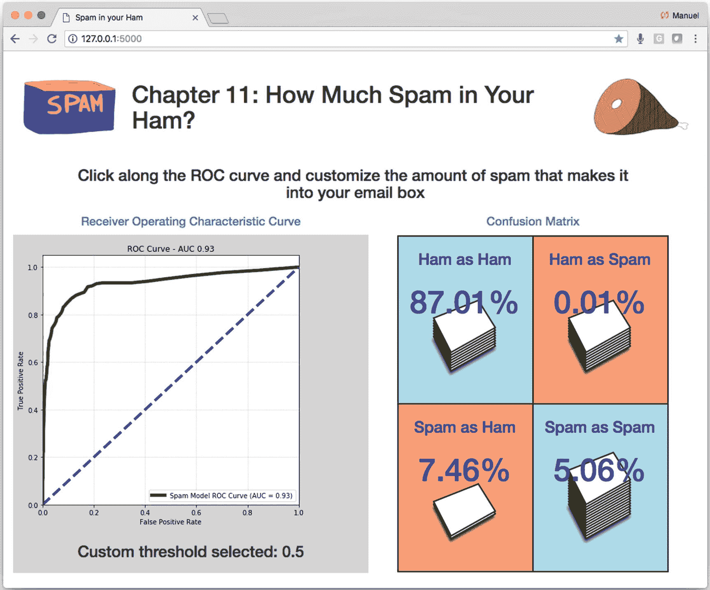

图 11-13

我们 Web 应用程序的本地版本

```
$ python3 main.py
# 代码清单 11-23
# 试运行 Web 应用程序
```

## 部署到 Microsoft Azure

是时候将我们的 Web 应用程序部署到云端了。我们将进行一个非常简短的快速浏览，因为我们已经多次看到这些步骤。

### 用于 Azure 的 Git

初始化一个 Git 会话（代码清单 11-24）。

```
$ git init
# 代码清单 11-24
# 初始化 Git
```

在整个过程中多次运行“`git status`”是一个好主意，以确保您正在跟踪正确的文件（代码清单 11-25）。

```
输入:
$ git status
输出:
位于分支 master
尚无提交
未跟踪的文件:
  (使用 "git add <文件>..." 以包含要提交的内容)
hamspamenv/
main.py
ptvs_virtualenv_proxy.py
requirements.txt
static/
templates/
web.3.4.config
# 代码清单 11-25
# 运行“git status”
```

使用“`git add`”命令从“`web-application`”文件夹中添加所有 Web 应用程序文件，并再次检查“`git status`”（代码清单 11-26）。

```
输入:
$ git add .
$ git status
输出:
要提交的变更：
  (使用 "git rm --cached <文件>..." 以取消暂存)
新文件:   hamspamenv/lib/python3.6/site-packages/werkzeug/urls.py
新文件:     hamspamenv/lib/python3.6/site-packages/werkzeug/useragents.py
新文件:   hamspamenv/lib/python3.6/site-packages/werkzeug/utils.py
新文件:    hamspamenv/lib/python3.6/site-packages/werkzeug/websocket.py
新文件:   hamspamenv/lib/python3.6/site-packages/werkzeug/wrappers.py
新文件:   hamspamenv/lib/python3.6/site-packages/werkzeug/wsgi.py
...
# 代码清单 11-26
# 添加到 Git
```

您可能已经注意到，我们向“`git add.`”命令添加了很多文件。根据“`git status`”的指示，它告诉我们如何使用“`rm`”命令删除我们不想提交到 Git 的文件。让我们从虚拟环境“`hamspamenv`”中删除项目不需要的所有文件和文件夹（代码清单 11-27）。

## 使用 Git 部署到 Azure 应用服务

### 从 Git 中移除“hamspamenv”

输入:
```bash
$ git rm -r --cached hamspamenv
$ git status
```
输出:
```
要提交的变更：
  (使用 "git rm --cached <文件>..." 以取消暂存)
新文件:   main.py
新文件:   ptvs_virtualenv_proxy.py
新文件:   requirements.txt
新文件:   static/images/00.png
新文件:   static/images/01.png
新文件:   static/images/02.png
新文件:   static/images/04.png
新文件:   static/images/06.png
新文件:   static/images/08.png
新文件:   static/images/10.png
新文件:   static/images/12.png
新文件:   static/images/14.png
新文件:   static/images/16.png
新文件:   static/images/18.png
新文件:   static/images/ham.png
新文件:   static/images/roc-chart.png
新文件:   static/images/spam.png
新文件:   static/pickles/spam_model_output.p
新文件:   templates/index.html
新文件:   web.3.4.config
未跟踪的文件:
  (使用 "git add <文件>..." 以包含要提交的内容)
hamspamenv/
```

### Git 提交

现在我们只有需要的文件了。因此，执行本地 `git commit` 并添加一个有意义的注释，以便将来需要回顾过去的操作时使用（代码清单 11-28）。

输入:
```bash
$ git commit -am '在 Azure 上部署 hamspamenv'
```
输出:
```
[master (根提交) 8c03a49] 在 Azure 上部署 hamspamenv
 20 files changed, 450 insertions(+)
 create mode 100644 main.py
 create mode 100644 ptvs_virtualenv_proxy.py
 create mode 100644 requirements.txt
 create mode 100644 static/images/00.png
 create mode 100644 static/images/01.png
 create mode 100644 static/images/02.png
 create mode 100644 static/images/04.png
 create mode 100644 static/images/06.png
 create mode 100644 static/images/08.png
 create mode 100644 static/images/10.png
 create mode 100644 static/images/12.png
 create mode 100644 static/images/14.png
 create mode 100644 static/images/16.png
 create mode 100644 static/images/18.png
 create mode 100644 static/images/ham.png
 create mode 100644 static/images/roc-chart.png
 create mode 100644 static/images/spam.png
 create mode 100644 static/pickles/spam_model_output.p
 create mode 100644 templates/index.html
 create mode 100644 web.3.4.config
```

有关将 Git 部署到 Azure 应用服务的更多信息，请参阅 [https://docs.microsoft.com/en-us/azure/app-service/app-service-deploy-local-git](https://docs.microsoft.com/en-us/azure/app-service/app-service-deploy-local-git)。

## 使用 azure-cli 命令行界面工具

### 步骤 1：登录

创建一个 `az` 会话（清单 11-29 和图 11-14）。

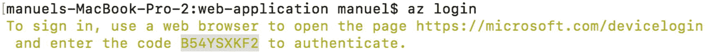

图 11-14 从 azure-cli 登录 Azure

```bash
$ az login
```

按照说明操作，将浏览器指向给定的 URL 地址，并相应输入代码（图 11-15）。

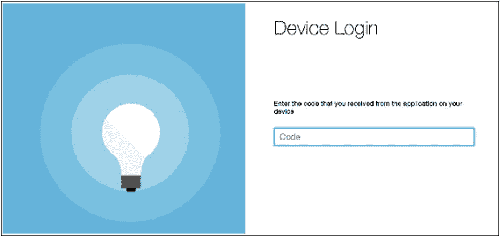

图 11-15 验证会话

如果一切顺利（即，你拥有一个状态良好的 Azure 账户），它将把 azure-cli 终端连接到云服务器。此外，一旦你获得授权，就可以安全地关闭浏览器窗口。

确保你的命令行工具指向本章的 `web-application` 文件夹。

### 步骤 2：为你的部署用户创建凭据

该用户将拥有 FTP 和本地 Git 使用的适当权限。这里我将用户名设置为 `flaskuserXX`，密码设置为 `flask123`。你只需执行此操作一次；之后可以重复使用同一账户。如果遇到问题，只需创建一个不同的用户名（或者在用户名末尾添加一个数字并像我一样递增；清单 11-30）。

```bash
$ az webapp deployment user set --user-name flaskuser30 --password flask123
```

当你逐步执行每个 `azure-cli` 步骤时，你将收到 JSON 回复以确认你的设置。对于 `az webapp deployment`，大多数回复应为空值且无错误消息。如果你收到错误消息，则说明存在需要解决的权限问题（`conflict` 表示该名称已被占用，请尝试其他名称；`bad requests` 表示密码强度太弱）。

### 步骤 3：创建你的资源组

这将是你的逻辑容器。在此，你需要输入离你位置最近的区域（参见 [https://azure.microsoft.com/en-us/regions/](https://azure.microsoft.com/en-us/regions/)）。即使你身处地球另一端，本示例选择 `West US` 也没什么大问题，但在生产环境中，为了获得最佳性能，你希望服务器尽可能靠近你的观众，这就会产生影响。

这里我将名称设置为 `myResourceGroup`（清单 11-31）。

```bash
$ az group create --name myResourceGroup --location "West US"
```

### 步骤 4：创建你的 Azure 应用服务计划

这里我将名称设置为 `myAppServicePlan`，并选择一个免费实例（sku）（清单 11-32）。

```bash
$ az appservice plan create --name myAppServicePlan --resource-group myResourceGroup --sku FREE
```

### 步骤 5：创建你的 Web 应用

你的 `webapp` 名称需要是唯一的，并确保你的 `resource-group` 和 `plan` 名称与你在前面步骤中设置的相同。在本例中，我使用 `amunateguihamspam`。要获取支持的运行时完整列表，请运行 `list-runtimes` 命令（清单 11-33）。

```bash
$ az webapp list-runtimes
```

要创建 Web 应用程序，请使用 `create` 命令（清单 11-34）。

## 使用 Azure 从命令行部署 Flask 应用

首先，创建一个 Web 应用。
```
$ az webapp create --resource-group myResourceGroup --plan myAppServicePlan --name amunateguihamspam --runtime "python|3.4" --deployment-local-git
```
**清单 11-34：创建 Web 应用**

`az webapp create` 的输出将包含一条重要信息，后续步骤会用到。查找 `deploymentLocalGitUrl` 这一行（图 11-16）。

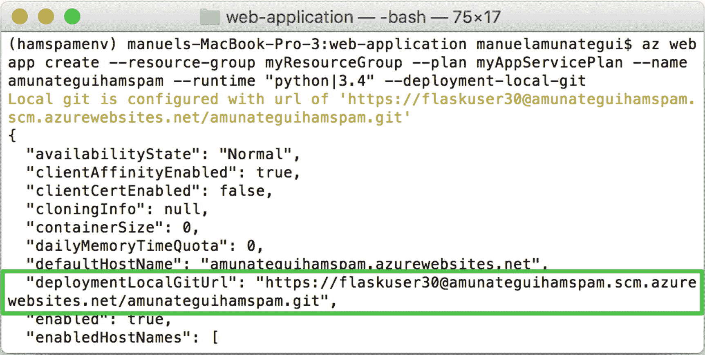
*图 11-16：`az webapp create` 的输出；记下你的部署 Git URL*

如果尚未启动 Git，请启动它（如果你从未使用过 Git，请从 [`https://git-scm.com/book/en/v2/Getting-Started-Installing-Git`](https://git-scm.com/book/en/v2/Getting-Started-Installing-Git) 安装）。

### 步骤 6：将 Git 代码推送到 Azure

现在你有了一个占位网站，需要将你的 Git 代码推送到 Azure（清单 11-35）。
```
# 如果 git remote 已存在，请运行 'git remote remove azure'
$ git remote add azure "https://flaskuser30@amunateguihamspam.scm.azurewebsites.net/amunateguihamspam.git"
```
**清单 11-35：添加远程用户**

最后，将其推送到 Azure（清单 11-36）。
```
$ git push azure master
```
**清单 11-36：推送（在提示时输入“webapp deployment user”密码）**

它会提示你输入之前设置的 `webapp deployment user` 密码。这可能需要一些时间，因为我们必须上传一堆附属文件，如图像和数据集。如果一切顺利，你应该能够享受你的劳动成果了。打开一个 Web 浏览器，输入你的新 URL，它由你的 `webapp` 名称后跟 `.azurewebsites.net` 组成（例如 [`http://amunateguihamspam.azurewebsites.net`](http://amunateguihamspam.azurewebsites.net)）。

另一方面，如果 azure-cli 返回错误消息，你将需要解决这些问题（请参阅“故障排除”部分）。任何时候你更新代码并希望重新部署时，请参见清单 11-37。
```
$ git commit -am "updated output"
$ git push azure master
```
**清单 11-37：提交并推送**

你也可以直接在 Azure 的 Web 仪表板上管理你的应用程序。登录 Azure 并转到应用服务（图 11-17）。

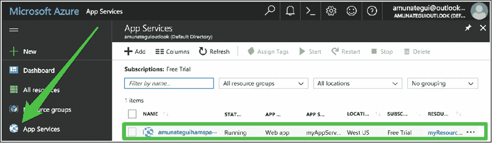
*图 11-17：直接在 Microsoft Azure 仪表板中管理你的应用程序*

### 重要清理！

这是一个关键步骤；你绝不应在云中留下不需要的应用程序在运行，因为这会产生费用（或者如果你使用的是试用计划，则会消耗你的免费额度）。如果你不再需要它，请将其关闭（清单 11-38）。
```
$ az group delete --name myResourceGroup
```
**清单 11-38：拆除时间（系统将要求你确认此操作）**

或者使用 Azure 的 Web 仪表板在 `App Services` 下将其删除。最后，停用你的虚拟环境（清单 11-39）。
```
$ deactivate hamspamenv
```
**清单 11-39：如果之前没有结束，请结束你的虚拟会话**

### 故障排除

调试 Web 应用程序错误可能会变得复杂。一种方法是通过 Azure 的仪表板启用日志记录（图 11-18）。

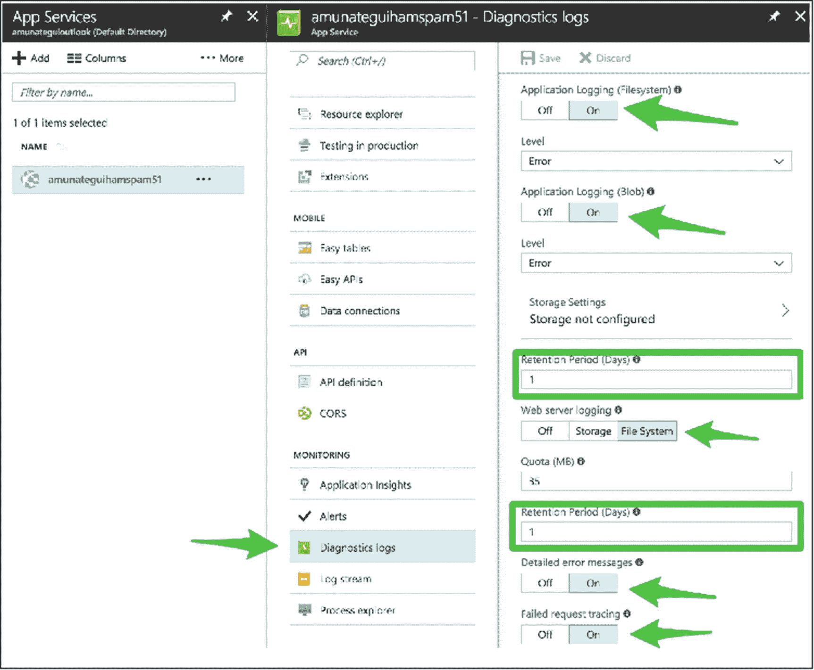
*图 11-18：启用 Azure 的诊断日志*

然后，打开日志流以开始捕获活动（图 11-19）。

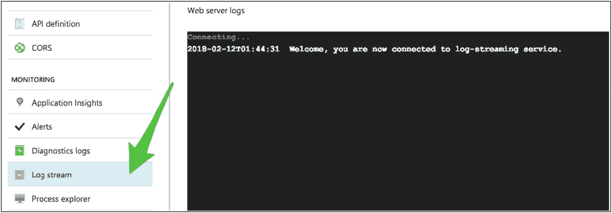
*图 11-19：捕获日志信息*

您还可以使用 Azure 仪表板内置的便捷控制台工具检查文件结构（图 11-20）。

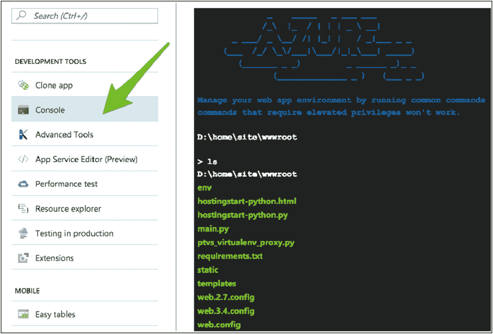
*图 11-20：Azure 内置的命令行工具*

您还可以在命令窗口中访问日志的尾部（清单 11-40）。
```
$ az webapp log tail --resource-group myResourceGroup --name amunateguihamspam
```
**清单 11-40：访问日志**

您甚至可以检查 `requirement.txt` 文件是否有效，方法是调用 `env\scripts\pip` 函数（清单 11-41）。
```
$ env\scripts\pip install -r requirements.txt
```
**清单 11-41：检查是否可以安装 Python 库**

### 结论与附加资源

Azure 是目前可用的三大 Web 托管平台之一，因此是企业级和机器学习解决方案的绝佳选择。

有关 Azure 部署过程的更多信息，请参阅详细且清晰的 Azure 文档“在 Azure 中创建 Python Web 应用”。^(⁵⁶)

脚注 1   2   3   4   5   6   7