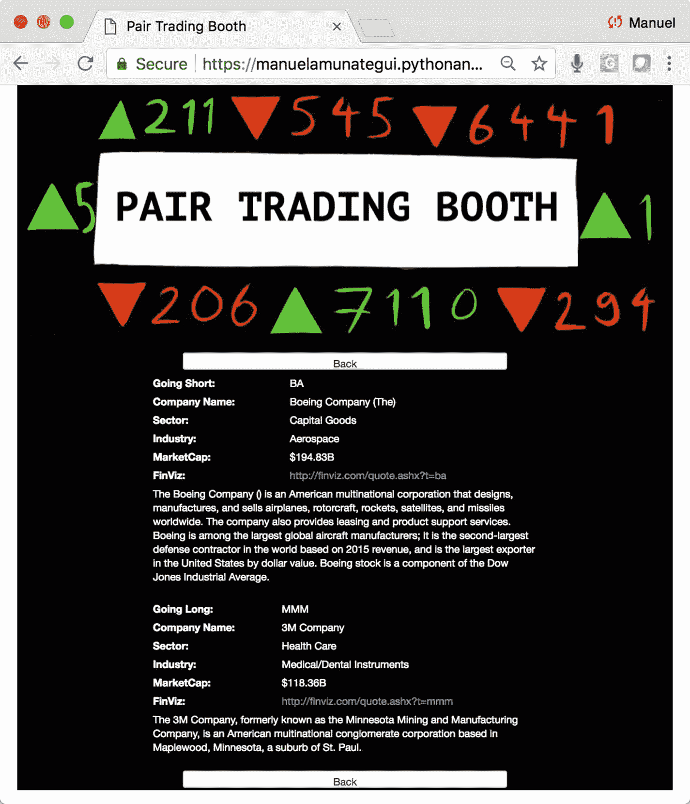
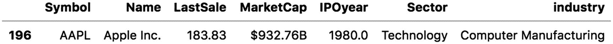
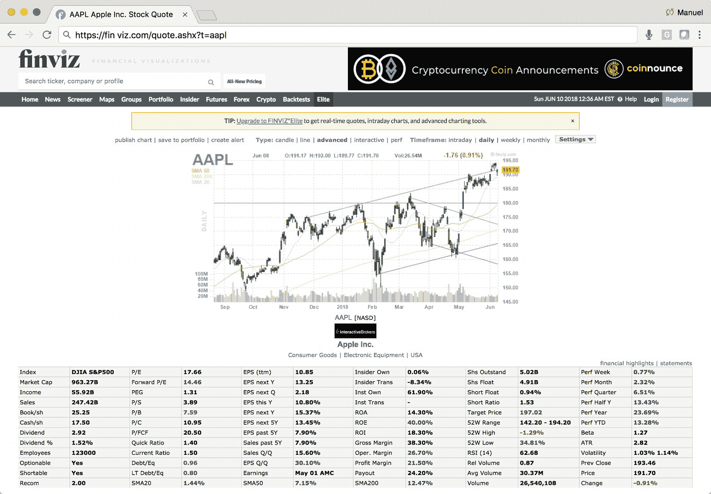
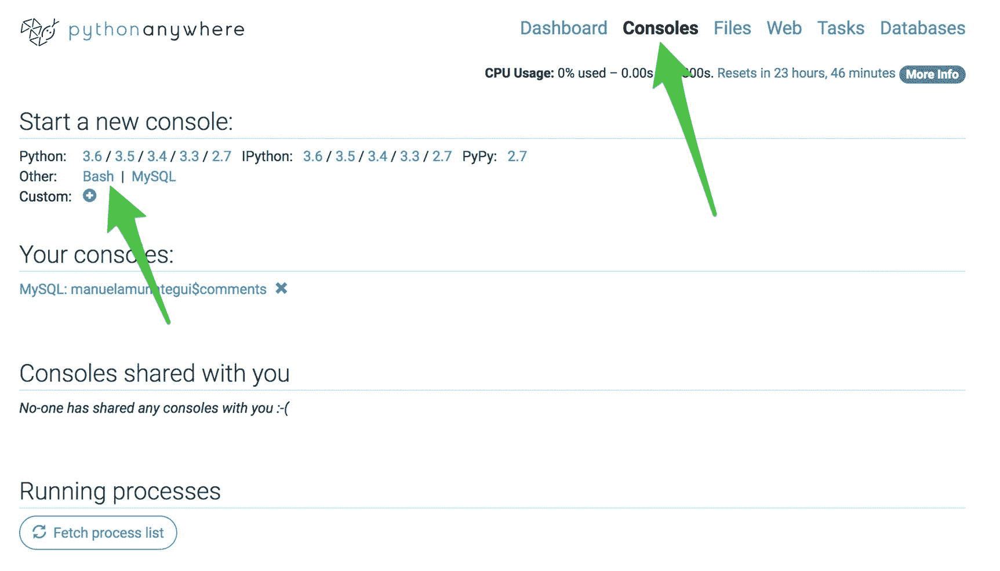
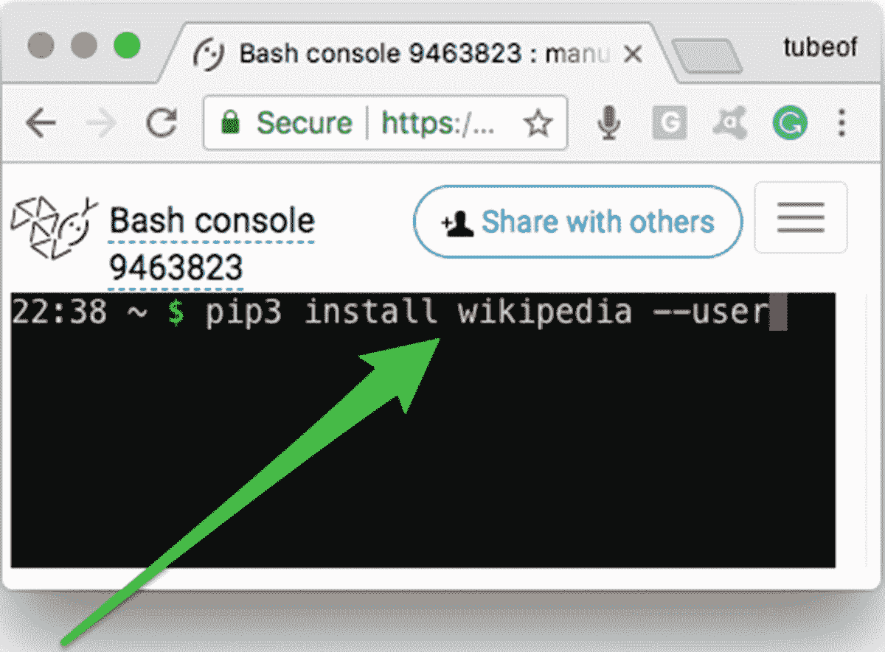
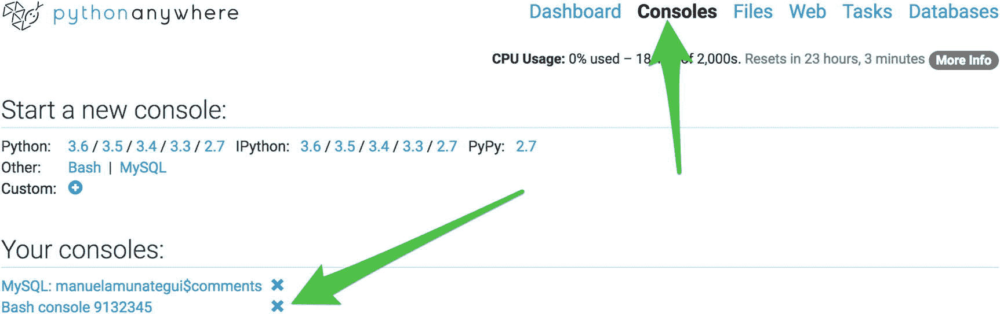
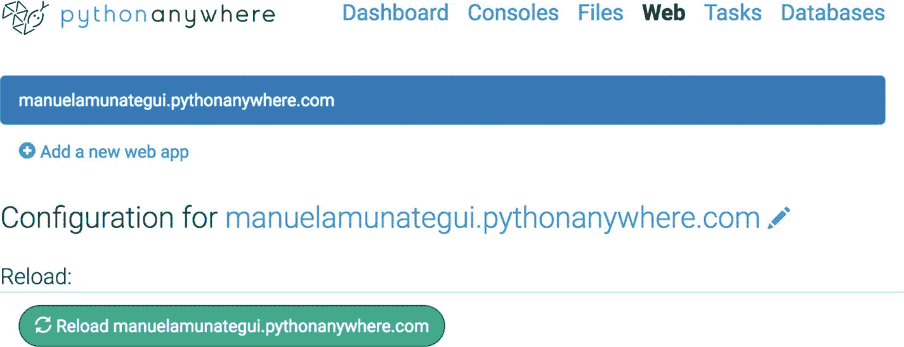
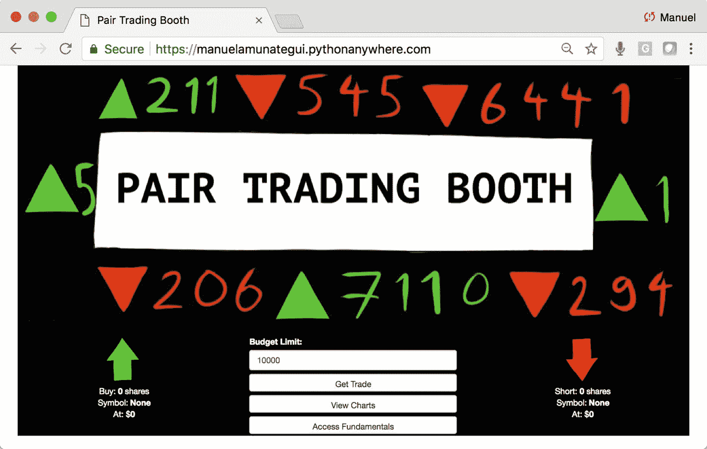

# 12. 案例研究第 3 部分：用基础财务信息丰富内容

在 PythonAnywhere 上通过基础财务数据聚合预测股市。

我们将继续为我们的“配对交易平台”Web 应用程序添加功能（图 12-1）。



图 12-1 本章的最终 Web 应用程序

到目前为止，我们向访问者展示了最佳配对交易，向他们展示了相关的金融图表，现在我们将为他们提供所提及股票背后公司的关键基础细节。

*   公司全名
*   来自 Wikipedia.com 的公司简短介绍
*   市值
*   市场板块
*   市场行业
*   金融网站 Finviz.com 的动态链接

### 注意

通过访问`www.apress.com/9781484238721`并点击源代码按钮，下载第 12 章的文件。打开 Jupyter notebook“`chapter12.ipynb`”以跟随本章内容。

## 访问上市股票公司列表

股票代码简短且模糊，如果将其放入 Web 浏览器进行互联网搜索，可能意味着不同的事物。我们需要将其与完整的公司名称关联起来，以确保其唯一性。纳斯达克网站^(⁵⁷) 提供了一系列优秀的 CSV 文件供我们使用，这些文件将股票代码与包括公司全名在内的额外相关信息进行匹配。将浏览器指向`https://www.nasdaq.com/screening/company-list.aspx`。

将所有三个文件下载到本地计算机。确保按以下格式重命名它们，否则它们都将被称为“`companylist.csv`”：

*   `companylist_NASDAQ.csv`
*   `companylist_AMEX.csv`
*   `companylist_NYSE.csv`

让我们在我们的十个股票代码与下载文件中的位置之间找到匹配项。这很容易通过使用我们感兴趣的十个代码列表，并在公司列表中循环每个代码来完成（清单 12-1）。由于这些股票非常知名，您将为每个股票找到匹配项（对于较小市值的公司可能并非如此）。

```
输入:
stock_symbols = ['BA','GS','UNH','MMM','HD','AAPL','MCD','IBM','CAT','TRV']
print('在纳斯达克列表中发现的代码:')
list(set(stock_symbols) & set(list(stock_company_info_nasdaq['Symbol'])))
输出:
在纳斯达克列表中发现的代码:
['AAPL']
清单 12-1 在“companylist”中检查股票代码
```

我们发现“`companylist_NASDAQ.csv`”列表包含一个代码“`AAPL`”。我们现在可以从公司列表“`CSV`”文件中提取该行并保存。我们以相同的方式处理其他两个公司列表中的其他代码（清单 12-2 和图 12-2）。



图 12-2 我们从纳斯达克公司列表中提取的额外信息

```
stock_company_info_nasdaq[stock_company_info_nasdaq['Symbol'] == 'AAPL']
清单 12-2 查询“companylist”
```

我们现在知道“`AAPL`”等同于“`Apple Inc.`”，并且我们还可以获取该股票代码的市值、IPO 年份、板块和行业。所有这些信息对我们的用户都非常有用。此外，我们现在有了公司名称的准确拼写，我们可以用它来从`www.wikipedia.org`拉取有关该公司的更多信息。如前所述，其中一些代码名称过于简单，不一定能从网络搜索中返回正确的信息，但如果我们结合代码名称和实际公司名称，我们就有更大的机会准确拉取我们想要的信息。（请记住，您可能仍然会遇到拉取到不相关信息的边缘情况。）

## 使用 Wikipedia API 拉取公司信息

Wikipedia 有一个优秀且易于使用的 Python API，我们将利用它来增加我们应用程序的深度。我们将为每个我们推荐的股票拉取介绍段落（介绍段落就是返回的第一个段落；清单 12-3）。

```
输入:
import wikipedia
description = wikipedia.page("Apple Inc.").content
description = description.split('\n')[0]
description
输出:
"Apple Inc. 是一家美国跨国科技公司，总部位于加利福尼亚州库比蒂诺，设计、开发和销售消费电子产品、计算机软件和在线服务。该公司的硬件产品包括 iPhone 智能手机、iPad 平板电脑、Mac 个人电脑、iPod 便携式媒体播放器、Apple Watch 智能手表、Apple TV 数字媒体播放器和 HomePod 智能音箱。Apple 的软件包括 macOS 和 iOS 操作系统、iTunes 媒体播放器、Safari 网络浏览器，以及 iLife 和 iWork 创意和生产力套件，以及 Final Cut Pro、Logic Pro 和 Xcode 等专业应用程序。其在线服务包括 iTunes Store、iOS App Store 和 Mac App Store、Apple Music 和 iCloud。"
清单 12-3 Wikipedia 查询
```

### 构建动态 FinViz 链接

`FinViz.com` 是一个金融基本面数据的宝库。我们不会从中抓取数据；相反，我们将构建动态链接，以便用户可以选择前往该网站获取更多信息。这确保了我们不会窃取他人的信息。我建议始终在新页面中打开链接；这样可以确保用户仍然可以轻松地返回您的页面（清单 12-4 和图 12-3）。



图 12-3 苹果公司的 Finviz 输出链接

```
Input:
predictions_df = pd.DataFrame(all_user_predicted_ratings, columns = movies_df.index)
symbol = 'AAPL'
url = r'http://finviz.com/quote.ashx?t={}'.format(symbol.lower())
url
Output:
http://finviz.com/quote.ashx?t=aapl
清单 12-4 创建 FinViz 链接
```

## 探索基本面

请继续将本章的文件下载到一个名为“`chapter-12`”的文件夹中。打开 Jupyter notebook 以便跟随操作。

让我们将三个基本面功能抽象为三个简洁易用的函数，以便轻松集成到我们的 Web 应用程序中。我们将从“`GetCorollaryCompanyInfo()`”函数开始。该函数将提取我们交易中多头和空头股票代码的公司名称、板块、行业和市值（清单 12-5）。

## 设计 Web 应用程序

```python
def GetCorollaryCompanyInfo(symbol):
CompanyName = "No company name"
Sector = "No sector"
Industry = "No industry"
MarketCap = "No market cap"
if (symbol in list(stock_company_info_nasdaq['Symbol'])):
data_row = stock_company_info_nasdaq[stock_company_info_nasdaq['Symbol'] == symbol]
CompanyName = data_row['Name'].values[0]
Sector = data_row['Sector'].values[0]
Industry = data_row['industry'].values[0]
MarketCap = data_row['MarketCap'].values[0]
elif (symbol in list(stock_company_info_amex['Symbol'])):
data_row = stock_company_info_amex[stock_company_info_amex['Symbol'] == symbol]
CompanyName = data_row['Name'].values[0]
Sector = data_row['Sector'].values[0]
Industry = data_row['industry'].values[0]
MarketCap = data_row['MarketCap'].values[0]
elif (symbol in list(stock_company_info_nyse['Symbol'])):
data_row = stock_company_info_nyse[stock_company_info_amex['Symbol'] == symbol]
CompanyName = data_row['Name'].values[0]
Sector = data_row['Sector'].values[0]
Industry = data_row['industry'].values[0]
MarketCap = data_row['MarketCap'].values[0]
return (CompanyName, Sector, Industry, MarketCap)
```

清单 12-5
通过创建`GetCorollaryCompanyInfo()`函数进行抽象

我们还将构建一个函数，用于处理使用从`GetCorollaryCompanyInfo()`函数获取的公司名称来拉取维基百科信息。该函数将返回找到的条目的第一段（清单 12-6）。

```python
def GetWikipediaIntro(symbol):
description = wikipedia.page("Apple Inc.").content
return(description.split('\n')[0])
```

清单 12-6
通过创建`GetWikipediaIntro()`函数进行抽象

最后，我们将构建一个函数来创建指向 [`Finviz.com`](http://finviz.com) 金融网站的链接。这个函数做的事情不多，只是将股票代码附加到链接的末尾（清单 12-7）。

```python
def GetFinVizLink(symbol):
return(r'http://finviz.com/quote.ashx?t={}'.format(symbol.lower()))
```

清单 12-7
通过创建`GetFinVizLink()`函数进行抽象

如果您还没有下载本章的代码，请继续下载；打开一个命令行窗口，并将驱动器切换到`web-application`文件夹。您的`web-application`文件夹应包含清单 12-8 中所示的文件。

```
web-application
├── main.py
├── requirements.txt
├── companylist_AMEX.csv
├── companylist_NASDAQ.csv
├── companylist_NYSE.csv
├── static
└── images
├── ticker-title.png
├── up-arrow.png
└── down-arrow.png
├── templates
├── charts.html
├── fundamentals.html
└── index.html
├── ^DJI.csv
├── AAPL.csv
├── BA.csv
├── CAT.csv
├── GS.csv
├── HD.csv
├── IBM.csv
├── MCD.csv
├── MMM.csv
├── TRV.csv
├── UNH.csv
├── requirements.txt
└── main.py
```

清单 12-8
Web 应用程序文件

像往常一样，我们将启动一个虚拟环境来隔离我们的 Python 库安装，并在需要时创建`requirements.txt`文件（清单 12-9）。

```
$ python3 -m venv pairtrading
$ source pairtrading/bin/activate
```

清单 12-9
启动虚拟环境

然后，通过运行`pip install -r`命令来安装所有必需的 Python 库（清单 12-10）。

```
$ pip3 install -r requirements.txt
$ python3 main.py
```

清单 12-10
安装依赖并在本地运行 Web 应用程序

像往常一样运行 Web 应用程序，并确保其正常工作。同时，尝试页面上的各种选项，确保一切按预期运行，特别是`Access Fundamentals`按钮（图 12-4）。


图 12-4
配对交易应用程序的本地版本

完成后退出虚拟环境（清单 12-11）。

```
deactivate pairtrading
```

清单 12-11
退出虚拟环境

## 将 Web 应用上传至 PythonAnywhere

现在，我们将更新后的代码上传到 PythonAnywhere。登录你的 PythonAnywhere 账户，找到我们之前创建的`pair-trading-booth`文件夹。点击顶部菜单栏中的`Files`链接，进入`pair-trading-booth`目录（图 12-5）。


图 12-5
我们在 PythonAnywhere 上的配对交易应用

所有需要的股票金融 CSV 文件应该已经存在（如果没有，请重新运行第 5 章）。你需要将纳斯达克、美国证券交易所和纽约证券交易所的公司文件上传到主`pair-trading-booth`目录下，以及已经存在的十只股票 CSV 文件。
*   `companylist_AMEX.csv`
*   `companylist_NASDAQ.csv`
*   `companylist_NYSE.csv`

你还需要更新`main.py`和`index.html`文件，并上传新的`fundamentals.html`文件，以显示我们的股票和衍生图表（或者在 PythonAnywhere 上将其创建为新文件，然后将代码复制粘贴进去）。最好的方法是，在本地编辑器中打开这些文件，然后将内容复制粘贴到 PythonAnywhere 中。

例如，我们来更新`main.py`：在本地编辑器中打开该文件，同时在 PythonAnywhere 中打开该文件，然后将新版本复制粘贴到 PythonAnywhere 上的`main.py`文件中。在处理其他文件之前，别忘了点击绿色的`Save`按钮（图 12-6）。


图 12-6
在 PythonAnywhere 上更新`main.py`代码库以处理动态图表的创建

以同样的方式，在 templates 文件夹中处理`index.html`文件，并创建一个名为`fundamentals.html`的新 HTML 文件（图 12-7）。


图 12-7

# 在 PythonAnywhere 上部署和配置应用

在 PythonAnywhere 上创建一个名为 `fundamentals.html` 的新文件，用于处理动态图表的创建。

接下来，你需要使用 `pip3` 安装 Wikipedia 库，因为它不包含在 PythonAnywhere 的基础 Python 3 构建中（图 12-8）。


图 12-8

## 打开 bash 控制台并安装库

打开 bash 控制台，使用 pip 安装原始 Python 构建中未包含的库。打开 bash 控制台后，你就可以使用 pip 安装任何需要的库了。继续使用以下命令安装 Wikipedia 库（你需要添加两个短横线和 `--user` 来覆盖权限拒绝消息；列表 12-12 和图 12-9）。


图 12-9
在 PythonAnywhere 上安装 Wikipedia 库

```
$ pip3 install wikipedia --user
```
列表 12-12
安装依赖项

使用 `exit` 命令关闭你的 bash 控制台。如果你不再需要它，也可以完全关闭控制台：返回 PythonAnywhere 仪表盘的控制台页面，然后在你打开的 bash 控制台下点击“x”（图 12-10）。


图 12-10
如果不再需要，关闭 bash 控制台

## 刷新 Web 服务并测试应用

现在，你可以刷新 Web 服务并启动 Web 应用了。点击 `Web` 菜单选项卡，然后点击那个大大的绿色按钮来重新加载应用。这非常简单；点击 `Consoles` 按钮，打开一个 bash 控制台（图 12-11）。


图 12-11
点击 `Reload` 按钮来更新你的 Web 服务器

如果你在浏览器中输入 PythonAnywhere 网站的 URL，你应该会看到全新的 `Pair Trading Booth` 网站，尽显其风采。继续测试它的各项功能吧（图 12-12）。


图 12-12
新增了图表功能的 `Pair Trading Booth` 网站

## 结论

在本章中，我们对 `Pair Trading Booth` Web 应用进行了第三次迭代，并增加了辅助基本面信息。我们将当前数据与来自纳斯达克的其他外部数据进行了整合。我们调用了 Wikipedia API 来提取每家公司的概要描述。如果用户选择，我们还创建了动态链接以获取更多信息。

脚注 1