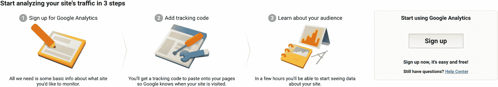
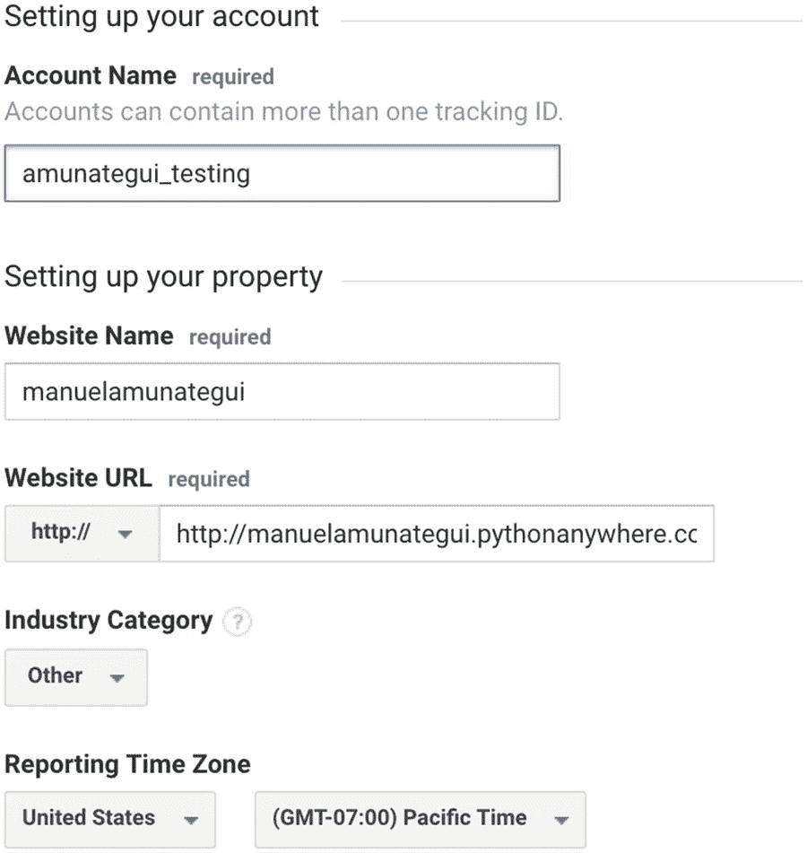
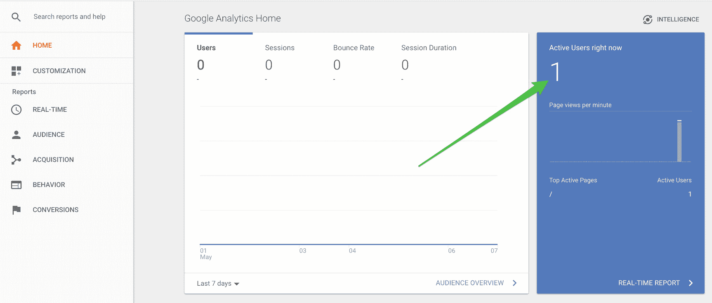
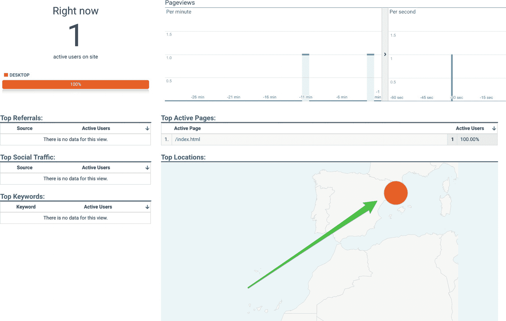
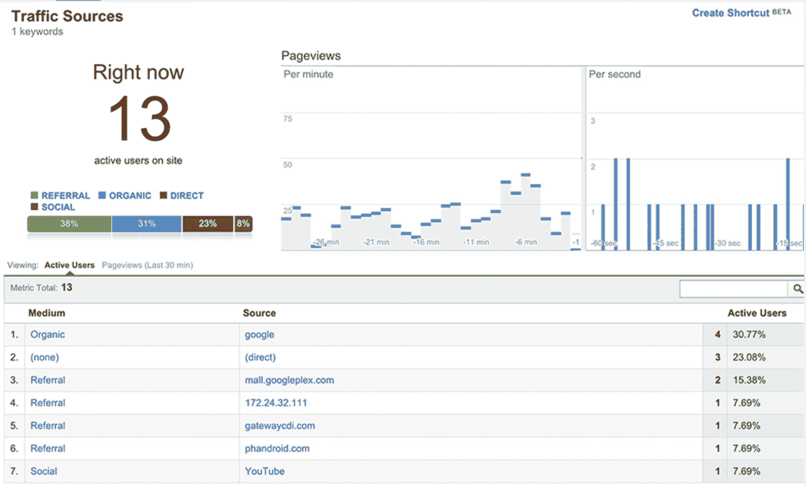
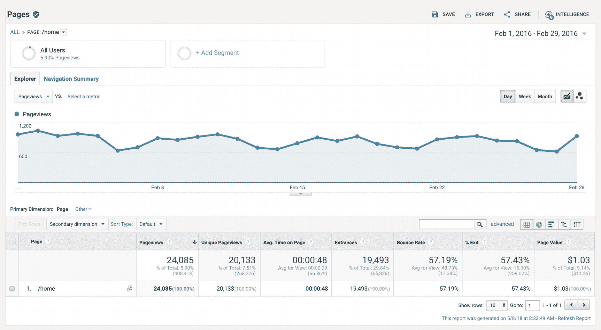

# 13. Google Analytics

免费的进阶智能分析。

让我们来看一个简单的工具，以便更好地了解用户如何与我们的 Web 应用交互。这对 Web 应用开发者来说是一个巨大的福音。构建我们自己的分析跟踪器需要为每个页面添加大量自定义 Flask 代码来跟踪用户，还需要一个数据库来保存这些交互，以及一个分析引擎来理解这些数据。工作量太大了！相反，使用 Google Analytics，我们只需在每个页面的顶部添加一段 JavaScript 代码片段。仅此而已；在每个页面添加几行通用代码，无需编辑，Google Analytics 会处理其余所有事情。

Google Analytics 会告诉我们用户来自哪里，他们在网站和每个页面上花费了多少时间，他们浏览的路径等等。这个工具不仅对于更好地理解用户至关重要，而且对于重构和创建新内容也必不可少。它有一个免费版本和一个昂贵的付费高级版本`——`我们这里将重点介绍免费版本。免费版本对于像我们正在构建的这种小型 Web 应用来说，能提供足够多的洞察信息。

### 注意

本章没有可供下载的内容。

## 创建 Google Analytics 账户

导航至 Google Analytics，在 [`https://analytics.google.com/analytics/web/provision`](https://analytics.google.com/analytics/web/provision) 创建一个免费账户。

这将显示一个跟踪网页过程的简单图示以及“**Sign up**”按钮（图 13-1）。



图 13-1

Google Analytics 流程与注册

在要求输入网站名称的地方，输入你的 [PythonAnywhere.​com](http://pythonanywere.com) 账户（即配对交易的那个；别担心，你可以跟踪多达 100 个账户）。它会问你几个基本问题，你可以使用默认设置（图 13-2）。



图 13-2

我在 Google Analytics 上的回答

最后，点击页面底部的蓝色按钮“**Get Tracking ID**”，并接受服务条款。

## JavaScript 跟踪器

登录 Google Analytics 控制面板后，您首先会看到“**管理**”选项卡，其中包含跟踪网页所需的关键 JavaScript 代码片段（清单 13-1）。这是跟踪系统的核心。您只需在“**<<添加您的 Google Analytics 跟踪 ID>>**”处添加您的 API 密钥，并将其放置在所有页面上即可。

```

(function(i,s,o,g,r,a,m){i['GoogleAnalyticsObject']=r;i[r]=i[r]||function(){
(i[r].q=i[r].q||[]).push(arguments)},i[r].l=1*new Date();a=s.createElement(o),
m=s.getElementsByTagName(o)[0];a.async=1;a.src=g;m.parentNode.insertBefore(a,m)
})(window,document,'script','https://www.google-analytics.com/analytics.js','ga');
ga('create', '>', 'auto');
ga('send', 'pageview');

清单 13-1
JavaScript 跟踪代码片段
```

复制它并将其放入您拥有并希望跟踪的任何网站的“**<head>**”部分。配对交易平台的每个 HTML 模板的头部应如下所示（清单 13-2）（请确保输入您自己的 ID，因为此 ID 将收集我账户的流量分析数据）。

```

配对交易平台

(function(i,s,o,g,r,a,m){i['GoogleAnalyticsObject']=r;i[r]=i[r]||function(){
(i[r].q=i[r].q||[]).push(arguments)},i[r].l=1*new Date();a=s.createElement(o),
m=s.getElementsByTagName(o)[0];a.async=1;a.src=g;m.parentNode.insertBefore(a,m)
})(window,document,'script','https://www.google-analytics.com/analytics.js','ga');
ga('create', 'UA-118908159-1', 'auto');
ga('send', 'pageview');

清单 13-2
这是我的
```

## 阅读您的分析报告

将 Google Analytics 跟踪代码添加到您的网站后，保存代码并推广“**配对交易平台**”。用浏览器访问您的网站，查看源代码以确保新代码已存在，然后刷新您的 Google Analytics 控制面板。您应该会看到网站上有一个活跃用户——那就是您自己（图 13-3）。



图 13-3

显示 1 个活跃用户的 Google Analytics 首页

如果您点击左侧窗格中的“**实时**”选项卡，您甚至可以看到该活跃用户所在的位置。我截取这张截图时正在西班牙——很酷，对吧？（图 13-4）



图 13-4

我的实时活跃用户——我在西班牙！

显然，您需要运行您的 Web 应用程序多天，并拥有实际流量才能开始寻找有趣的模式。您还需要在所有 HTML 模板页面上为“**配对交易平台**”添加跟踪代码，以便开始查看谁访问了哪些页面以及停留了多长时间。

## 流量来源

一旦您收集了流量模式，就可以找出您的用户来自哪里。Google Analytics 培训团队提供了一个很棒的培训课程：[`https://analytics.google.com/analytics/academy/`](https://analytics.google.com/analytics/academy/)（截图来自 Google Analytics 培训团队提供的演示账户；图 13-5）。



图 13-5

来自 Google Analytics 课程的截图，显示了多个活跃用户及其来源

## 页面

一旦您收集了流量模式，就可以找出用户何时访问了特定页面、总点击次数以及他们花费了多少时间（来自 Google Analytics 培训中提供的演示账户；图 13-6）。



图 13-6

页面浏览量信息

## 结论与附加资源

快速回顾一下，您需要在所有想要跟踪的 HTML 页面上放置 Google Analytics JavaScript 跟踪器。Google Analytics 将收集广泛的行为数据，例如流量来源、语言、浏览器类型等。它将任何活动后跟 30 分钟不活动视为一个会话。您可以自定义各个方面，并且您访问的信息始终是匿名的。对于任何想要了解特定页面相对于其他页面的价值、了解用户喜欢和不喜欢什么，以及评估兴趣和追加销售潜力的人来说，这是一个强烈推荐的工具。

有关自定义 Google Analytics 数据的更多信息，我强烈推荐 Google 的 Google Analytics Academy 免费课程，网址为 [`https://analytics.google.com/analytics/academy/`](https://analytics.google.com/analytics/academy/) 。

