# 14. 在 PythonAnywhere 和 MySQL 上进行 A/B 测试

这是一个雄心勃勃的章节，因此我们将限定范围，以便提炼这个丰富主题的精髓，而不会过度深入。我们将从构建一个简单的 MySQL 数据库和表开始，用于跟踪访问者是否喜欢着陆页上的艺术作品。由于这是 A/B 测试，我们将创建两个着陆页，并在用户访问网站时随机切换它们（图 14-1）。


图 14-1

本章的最终 Web 应用程序

### 注意

通过访问 [`www.apress.com/9781484238721`](http://www.apress.com/9781484238721) 并点击源代码按钮，下载第 14 章的文件。您需要在本地机器上安装 MySQL，才能跟随 Jupyter notebook “**chapter14.ipynb**” 进行操作。

在分析学中，A/B 测试意味着使用某物的两个不同版本，并衡量人们对每个版本的反应。这在网站中常用于尝试新设计、新产品、新促销等。在我们的案例中，我们将向访问者展示着陆页的两个不同版本。这些版本将被随机分配，访问者将有机会在喜欢该页面时竖起大拇指。在后台，我们将跟踪此流量以及用户是否竖起大拇指。如果用户没有竖起大拇指，我们将假定这是一个反对票。

这是一个重要的主题，可以为您带来关于您的业务和用户的宝贵知识。有一个著名的轶事：玛丽莎·梅耶在谷歌工作时，进行了一次 A/B 测试，以确定用户在 40 种蓝色中更喜欢哪一种。^(⁵⁸) 显然，人们可能会在这些类型的测试中过度投入。

## A/B 测试

A/B 测试的目标是向公众展示不同的产品并衡量他们的反应。在我们的 Web 应用程序中，我们将展示一个包含两张不同图片的网页：一张愤怒的脸和一张友好的脸。我们将在页面上添加一个简单的标签，要求访问者如果喜欢该图片就竖起大拇指。在后台，我们将统计每次访问和每次竖起大拇指。为简单起见，我们将初始访问计为反对票，如果访问者点击投票按钮，则将其更新为赞成票。请参见图 14-2 和 14-3 以了解每张图片的版本。


图 14-3

图片二


图 14-2

图片一

### 追踪用户

追踪匿名访客有多种方式。常见方法包括使用 Cookie 和数据库。每种方法都有其优势和用途。Cookie 的优势在于，无论用户是否关闭浏览器或关闭电脑，都能在较长时间内追踪用户。网页可以轻松检查访客电脑上之前的 Cookie，并与数据库中的信息进行比对，以判断该访客是否为重复访客。

我们不需要使用 Cookie，因为我们只考虑单次访问。相反，我们将使用 HTML 隐藏标签来追踪用户，并通过 POST 请求将该标签传回。当访客首次访问页面时，我们会在数据库中插入一行记录，包含页面背景图片、时间戳以及一个唯一标识符（一个对该用户唯一的超长字符串；生成两个相同字符串的概率微乎其微），该标识符称为 UUID。如前所述，我们假设首次页面访问为“不喜欢”，并将其写入数据库。在构建页面时，我们会插入一个包含 UUID 的 HTML 隐藏标签，这样如果用户通过点击“喜欢”按钮与页面交互，我们就能将 UUID 传回 Web 服务器，从而更新数据库中之前插入的那行记录。这种方法使我们能够同时服务大量访客，而无需担心谁拥有哪个页面。根据你的需求，有很多方法可以调整和改进这一流程。你甚至可以根据需要，多次在客户端和服务器之间传递该 UUID，并始终清楚你正在处理的是哪个会话和用户。

### UUID

通用唯一标识符（UUID）长度为 128 位，强度高，且保证唯一。我们将使用便捷的“**uuid**”Python 库来自动生成保证唯一的标识符（列表 14-1）。

```
输入：
import uuid
str(uuid.uuid4())
输出：
'e7b1b80e-1eca-43a7-90a3-f01927ace7c9'
列表 14-1
“uuid”库
```

在“**uuid**”库中，“**uuid4()**”函数会生成一个新的随机 ID，而不依赖于计算机的标识符，因此它既唯一又私密。有关 UUID 的更多详细信息和选项，请查阅文档：[`https://docs.python.org/3/library/uuid.html`](https://docs.python.org/3/library/uuid.html)。

## MySQL

我们将使用 MySQL Community Server，这是一款优秀且流行的免费数据库。它非常适合满足我们的 A/B 测试需求。它是一个开源的关系型数据库，能够支持广泛的需求，并被包括 WordPress 以及 Google 和 Facebook 等大型媒体公司在内的众多大型企业所使用。

请前往 [`https://dev.mysql.com/downloads`](https://dev.mysql.com/downloads) 下载适用于你操作系统的 MySQL Community Server 版本。如果你有任何问题或疑问，还可以在那里找到针对你操作系统的安装说明。我们不会使用任何前端界面，不过如果你需要使用，也有不少可用的前端工具（图 14-4）。

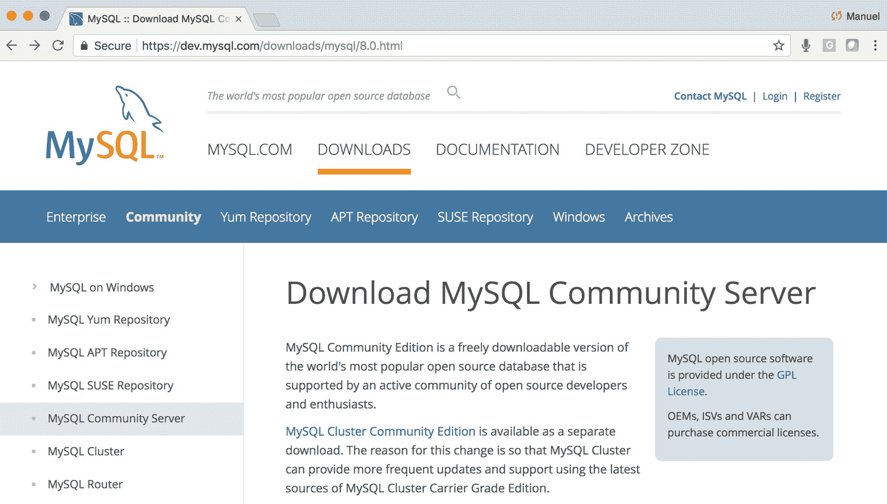

图 14-4

查找并下载适用于你操作系统的正确版本

系统会提示你回答一系列问题，包括设置 root 密码和密码加密类型（图 14-5）。

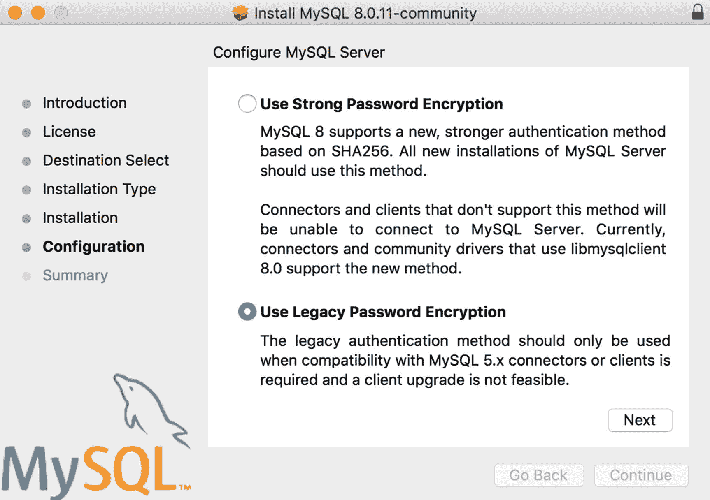

图 14-5

保持简单，使用旧版密码系统

你还可以通过操作系统的控制中心启动和停止数据库（也可以通过命令行完成；图 14-6）。

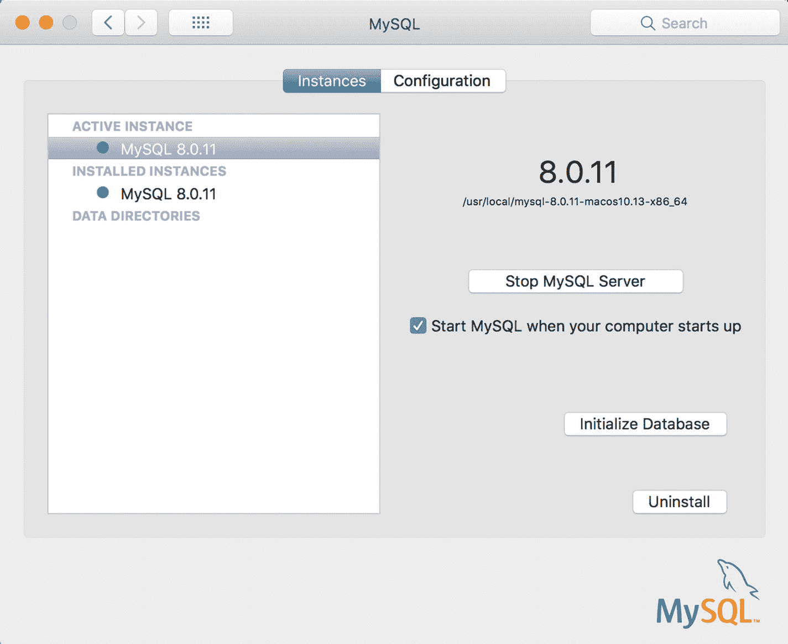

图 14-6

设置 MySQL 服务器在计算机启动时自动启动

### 命令行控制

启动和停止 MySQL（在大多数情况下，安装并重启机器后，MySQL 应自动启动）。有关其他操作系统、本书出版后的变更以及更多命令，请查阅文档：[`https://dev.mysql.com/doc/`](https://dev.mysql.com/doc/)。让我们看看如何启动 MySQL（列表 14-2 和 14-3，以及图 14-7）。

```
$ sudo /usr/local/mysql/support-files/mysql.server start
列表 14-2
在 Mac 上启动 MySQL
```

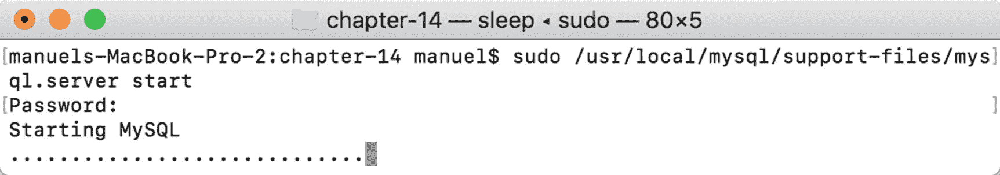

图 14-7

使用命令行启动 MySQL

```
C:\> "C:\Program Files\MySQL\MySQL Server 8.0\bin\mysqld"
列表 14-3
在 Windows 上启动 MySQL
```

让我们看看如何停止 MySQL（列表 14-4 和 14-5）。

```
$ sudo /usr/local/mysql/support-files/mysql.server stop
列表 14-4
在 Mac 上停止 MySQL
```

```
C:\> "C:\Program Files\MySQL\MySQL Server 8.0\bin\mysqladmin" -u root shutdown
列表 14-5
在 Windows 上停止 MySQL
```

### MySQL 命令行监视器

命令行监视器是一个便捷的工具，允许你管理用户和权限、创建数据库和表，以及执行更多操作（有关其他操作系统和更多命令，请查阅文档：[`https://dev.mysql.com/doc/`](https://dev.mysql.com/doc/)）。

要进入监视器，请将驱动器切换到你的 MySQL 目录或导出路径，然后输入“**mysql -u root -p**”命令，系统会提示你输入在安装过程中创建的密码（列表 14-6 和图 14-8）。

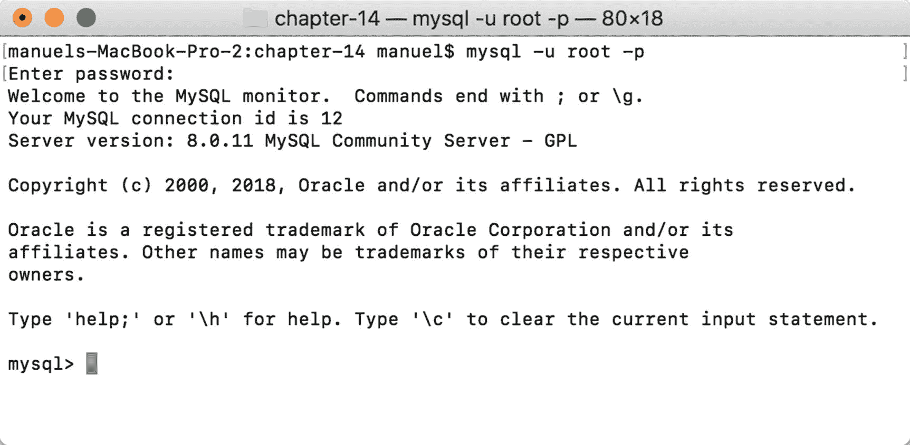

图 14-8

运行 MySQL 命令行监视器

```
$ export PATH=$PATH:/usr/local/mysql/bin
$ mysql -u root -p
列表 14-6
代码输入
```

当你的提示符变为“**mysql>**”时，你就知道已进入监视器。现在，让我们为 A/B 测试创建一个用户、一个数据库和一个表。

### 创建数据库

让我们创建一个名为“**ABTesting**”的数据库（列表 14-7）。

```
mysql> CREATE DATABASE ABTesting;
列表 14-7
创建数据库
```

### 创建表

让我们使用“**CREATE TABLE**”语句创建一个新表。每当创建新表时，最好先将其删除，否则会收到错误提示（但请确保你真的想删除它，因为你会丢失其中包含的所有数据）。我们将创建一个名为“**tblFrontPageOptions**”的表，其中包含一个名为“**uuid**”的唯一标识符字段、一个名为“**liked**”的布尔标志（用于记录用户是否点击了“赞”）、一个用于标记页面是“**A**”还是“**B**”的 page_id 字段，以及一个自动生成的时间戳字段（清单 14-8）。

```
mysql> DROP TABLE ABTesting.tblFrontPageOptions;
mysql> CREATE TABLE ABTesting.tblFrontPageOptions (
uuid VARCHAR(40) NOT NULL,
liked BOOLEAN NOT NULL DEFAULT 0,
pageid INT NOT NULL,
time_stamp  TIMESTAMP NOT NULL DEFAULT CURRENT_TIMESTAMP);
清单 14-8
创建表
```

你可以使用“**INSERT INTO**”语句向表中插入一些数据，轻松测试表是否正常工作（清单 14-9）。

```
mysql> INSERT INTO ABTesting.tblFrontPageOptions (uuid, liked, pageid) VALUES(9999, 1, 2);
清单 14-9
插入数据
```

为了检查数据是否确实已插入表中，我们使用“**SELECT ***”语句（清单 14-10）。

```
输入：
mysql> SELECT * FROM ABTesting.tblFrontPageOptions;
输出：
+------+-------+---------+---------------------+
| uuid | liked | page_id | time_stamp          |
+------+-------+---------+---------------------+
| 9999 |     1 |       2 | 2018-05-19 14:28:44 |
+------+-------+---------+---------------------+
1 row in set (0.00 sec)
清单 14-10
查询数据
```

看起来不错；表中现在有了一行新数据。如果你想从干净的状态开始，可以使用之前的代码删除并重新创建表。互联网上有大量关于 SQL 语法的优秀入门教程，但一个很好的起点是 w3schools 网站：[`https://www.w3schools.com/sql`](https://www.w3schools.com/sql)。退出“**mysql>**”提示符，打开本章的 Jupyter notebook，练习向表中插入数据，并通过“**mysql.connector**”Python 库读取数据。

### 创建数据库用户

我们将创建一个专用于 A/B 测试 Web 应用程序的用户。在 Flask 代码中使用 root 密码是一个坏主意。我们的用户将命名为“**webuser**”，其密码为“**thesecret**”（清单 14-11）。

```
mysql> CREATE USER 'webuser'@'localhost' IDENTIFIED BY 'thesecret';
清单 14-11
创建用户
```

接下来，我们将授予该用户所有权限，等你对 MySQL 更熟悉后（不，不是 my SQL，是 MySQL 产品……你知道他们在 MySQL 总部可能整天都在开这种玩笑……），你可以将其缩减为仅对特定表的读/写权限。参见清单 14-12。

```
mysql> GRANT ALL PRIVILEGES ON ABTesting.* TO 'webuser'@'localhost' WITH GRANT OPTION;
清单 14-12
授予权限
```

最后，你可以使用以下便捷命令检查“**webuser**”用户是否已成功添加（清单 14-13）。

```
mysql> SELECT User FROM mysql.user;
+------------------+
| User             |
+------------------+
| mysql.infoschema |
| mysql.session    |
| mysql.sys        |
| root             |
| webuser          |
+------------------+
5 rows in set (0.00 sec)
清单 14-13
检查用户
```

只需输入“**exit**”命令即可退出 MySQL 命令行工具。

## Python 库：mysql.connector

与数据库的大部分交互将通过 Python 和 Flask 使用便捷的“**mysql.connector**”库来完成。你可以参考第 14 章对应的 Jupyter notebook 进行学习（请安装“**requirements_jupyter.txt**”文件以获取所需的库）。请记住，在本章中我们不会创建本地 Flask 版本，因此请先熟悉 notebook 中的命令，然后我们将直接跳转到云端。

我们将使用“**SELECT**”、“**INSERT**”和“**UPDATE**”SQL 函数来编写三种类型的函数。如果你不熟悉这些经典的 SQL 函数，请查看 w3schools 的优秀入门教程（我知道，我一直在推荐这个网站；它确实很好，我发誓我与它没有任何关系），网址是 [`https://www.w3schools.com/sql`](https://www.w3schools.com/sql)。

### SELECT SQL 语句

“**SELECT**”是最常用的 SQL 命令，用于从表中读取数据。使用“**mysql.connector**”库可以轻松完成此操作。首先，通过调用“**connect()**”函数并传入数据库的授权凭据来创建与数据库的连接。该连接返回一个游标，用于与数据库通信并向其发送指令。这是通过一个包含“**SELECT**”语句的查询字符串完成的。我们将对所有 SQL 语句使用这种方法。该语句与“**INSERT**”和“**UPDATE**”语句的区别在于，我们期望从数据库接收数据。通过“**execute()**”函数执行查询字符串后，我们可以通过循环访问返回的数据。每次循环代表一行数据。请注意，打开的游标和连接在调用结束时都会关闭，因为我们不想不必要地占用资源（清单 14-14）。

```
输入：
cnx = mysql.connector.connect(user='webuser', password="thesecret", database="ABTesting")
cursor = cnx.cursor()
query = "SELECT * FROM ABTesting.tblFrontPageOptions"
cursor.execute(query)
for (uuid, liked, pageid, time_stamp) in cursor:
print("uuid: {} liked:{} pageid: {} on {:%m/%d/%Y %H:%M:%S}".format(
uuid, liked, pageid, time_stamp))
cursor.close()
cnx.close()
输出（示例，你的输出将仅包含表中目前的数据）：
uuid: 704a44d0-29f4-4a2d-bc6a-fe679017f7e9 liked:1 pageid: 2 on 05/19/2018 17:03:29
清单 14-14
使用游标的“select”语句
```

### INSERT SQL 语句

“**INSERT**”语句允许我们将数据插入到数据库的 ABTesting 表中。当访问者首次访问网页时，我们会插入一行数据，包含以下字段：一个“**UUID**”、一个设置为 false 的“**liked**”标志、代表用户正在查看两个背景图像中哪一个的“**pageid**”，以及一个“**timestamp**”。与“**SELECT**”语句一样，我们首先打开一个数据库连接，然后创建一个游标并将查询语句传递给它。在这种情况下，我们的查询语句不是“**SELECT**”，而是“**INSERT**”。我们还使用方便的“**%s**”语句作为变量占位符，随后将由“**args**”元组中保存的值填充。这里我们插入一个新的唯一 ID，其中“**liked**”设置为 false（或“踩”），以及所查看的页面 ID。

另外，每当插入或更新表时，不要忘记在关闭连接之前调用“**commit()**”函数来提交你的插入操作。如果不提交，你的更改将被忽略（清单 14-15）。

```
cnx = mysql.connector.connect(user='webuser', password="thesecret", database="ABTesting")
cursor = cnx.cursor()
query = "INSERT INTO ABTesting.tblFrontPageOptions (uuid, liked, pageid) VALUES (%s, %s, %s);"
args = ("704a44d0-29f4-4a2d-bc6a-fe679017f7e9", 0, 1)
cursor.execute(query, args)
cursor.close()
cnx.commit()
cnx.close()
清单 14-15
使用游标的 SQL “INSERT” 语句
```

### UPDATE SQL 语句

“**UPDATE**”语句与“**INSERT**”语句类似，但区别在于，它不是向表末尾添加新行，而是更新现有行。为了更新特定行，你必须在更新之前能够找到正确的行。在这种情况下，由于我们拥有保证唯一性的“**UUID**”，因此可以轻松找到该特定行，而无需担心错误地更新其他行。为了正确构建“**UPDATE**”语句，我们必须向其传递两个值：“**704a44d0-29f4-4a2d-bc6a-fe679017f7e9**”的“**UUID**”以及设置为 true 的“**liked**”标志（清单 14-16）。

```
cnx = mysql.connector.connect(user='webuser', password="thesecret", database="ABTesting")
cursor = cnx.cursor()
query = "UPDATE ABTesting.tblFrontPageOptions SET liked = %s WHERE uuid = %s;"
args = (1, "704a44d0-29f4-4a2d-bc6a-fe679017f7e9")
cursor.execute(query, args)
cursor.close()
cnx.commit()
cnx.close()
Listing 14-16
SQL “update” Statement with Cursor
```

再次提醒，在关闭连接之前，不要忘记调用“**commit()**”函数来提交你的更改（如果不这样做，你的更改将被忽略）。

## 将代码抽象为便捷函数

我们需要将所有 SQL 代码抽象为易于使用的函数。首先，我们创建两个全局变量来保存 MySQL 用户账户和密码。这使我们只需设置一次，而无需在后续的 SQL 调用中担心它。当你需要更改用户账户时，它也非常方便（清单 14-17）。

```
mysql_account = 'webuser'
mysql_password = 'thesecret'
mysql_database = 'ABTesting'
mysql_host = 'localhost'
Listing 14-17
Abstracting Account Data
```

我们还可以抽象 UUID 生成代码，以保持代码的整洁和简单（清单 14-18）。

```
def GetUUID():
return (str(uuid.uuid4()))
Listing 14-18
Abstracting “GetUUID()” function
```

接下来，我们创建一个函数，用于向数据库插入新的访问记录。该函数将从“**GetUUID()**”获取一个新的 UUID，将“**liked**”设置为 false（因为我们假设所有新访问都不喜欢或不想与网站交互），设置代表为他们随机选择的图片的“**pageid**”，以及由 MySQL 自动生成的时间戳（清单 14-19）。

```
def InsertInitialVisit(uuid_, pageid):
try:
cnx = mysql.connector.connect(user=mysql_account, password=mysql_password, database=mysql_database, host=mysql_host)
cursor = cnx.cursor()
query = "INSERT INTO ABTesting.tblFrontPageOptions (uuid, liked, pageid) VALUES (%s,%s,%s);"
args = (uuid_, 0, pageid)
cursor.execute(query, args)
cursor.close()
cnx.commit()
cnx.close()
except mysql.connector.Error as err:
app.logger.error("Something went wrong: {}".format(err))
Listing 14-19
Abstracting “InsertInitialVisit()” Function
```

当用户与页面交互并点击“赞”按钮时，Flask 使用“**UpdateVisitWithLike()**”函数，利用会话的唯一标识符更新该行，并将“**liked**”标志设置为 true（清单 14-20）。

```
def UpdateVisitWithLike(uuid_):
try:
cnx = mysql.connector.connect(user=mysql_account, password=mysql_password, database=mysql_database, host=mysql_host)
cursor = cnx.cursor()
query = "UPDATE ABTesting.tblFrontPageOptions SET liked = %s WHERE uuid = %s;"
args = (1, uuid_)
cursor.execute(query, args)
cursor.close()
cnx.commit()
cnx.close()
except mysql.connector.Error as err:
app.logger.error("Something went wrong: {}".format(err))
Listing 14-20
Abstracting “UpdateVisitWithLike()” Function
```

最后，我们创建管理仪表板，通过提供总访问次数、总赞和踩的数量以及每张图片获得的赞数，来查看 A/B 测试的进展情况。我们还提供了一个日志视图，用于转储 ABTesting 表中的所有内容（清单 14-21）。

```
def GetVoteResults():
results = "
total_votes = 0
total_up_votes = 0
total_up_votes_page_1 = 0
total_up_votes_page_2 = 0
try:
cnx = mysql.connector.connect(user=mysql_account, password=mysql_password, database=mysql_database, host=mysql_host)
cursor = cnx.cursor()
query = "SELECT * FROM  ABTesting.tblFrontPageOptions"
cursor.execute(query)
for (uuid_, liked, pageid, time_stamp) in cursor:
total_votes += 1
if liked==1 and pageid==1:
total_up_votes_page_1 += 1
if liked==1 and pageid==2:
total_up_votes_page_2 += 1
if liked == 1:
total_up_votes += 1
results += ("uuid: {} liked:{} pageid: {} on {:%m/%d/%Y %H:%M:%S}".format(uuid_, liked, pageid, time_stamp)) + ""
cursor.close()
cnx.close()
except mysql.connector.Error as err:
app.logger.error("Something went wrong: {}".format(err))
return (results, total_votes, total_up_votes, total_up_votes_page_1, total_up_votes_page_2)
Listing 14-21
Abstracting “GetVoteResults()” Function
```

## 设计 Web 应用程序

如果你还没有下载第 14 章的文件，请下载并将其解压到你的本地机器上。你的“**web-application**”文件夹应包含清单 14-22 中所示的文件。

```
web-application
├── main.py
├── static
└──images
├── background1.jpg
├── background2.jpg
└── templates
├── admin.html
└── index.html
Listing 14-22
Web Application Files
```

### 运行本地版本

抱歉，这次没有本地版本。相反，我们将使用 PythonAnywhere 向导在云端创建一个 MySQL 实例，并像之前所做的那样，逐个文件上传所有所需的数据。

## 在 PythonAnywhere 上设置 MySQL

使用内置向导在 PythonAnywhere 上设置 MySQL 非常简单。点击仪表板右上角的“**Databases**”链接，然后像之前在本地版本上所做的那样进行设置（图 14-9）。

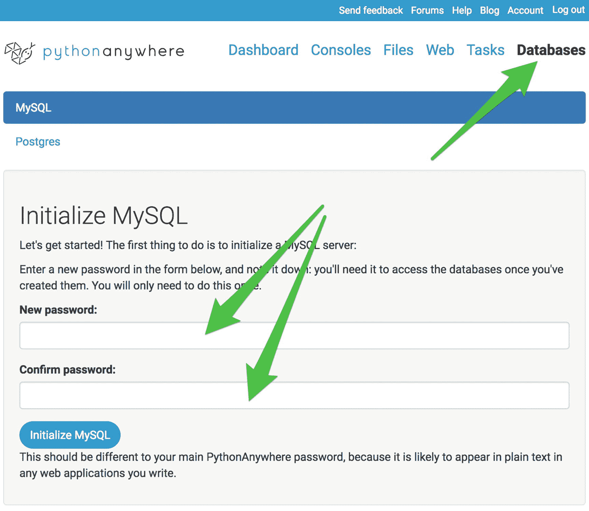

Figure 14-9

Setting up MySQL on PythonAnywhere

初始化 MySQL 后，你将能够创建一个数据库并进入 MySQL 控制台来创建“**tblFrontPageOptions**”。你需要处理两个注意事项。首先，PythonAnywhere 会在数据库名称前附加你的账户名。就我而言，数据库“**ABTesting**”变成了“**amunateguioutloo$ABTesting**”。这没什么大不了的，但我们必须更新所有与数据库通信的代码。第二个问题是，它为你创建的用户就是你必须在脚本中添加的用户，因为它不允许你使用“**CREATE USER**”命令创建其他用户（图 14-10）。

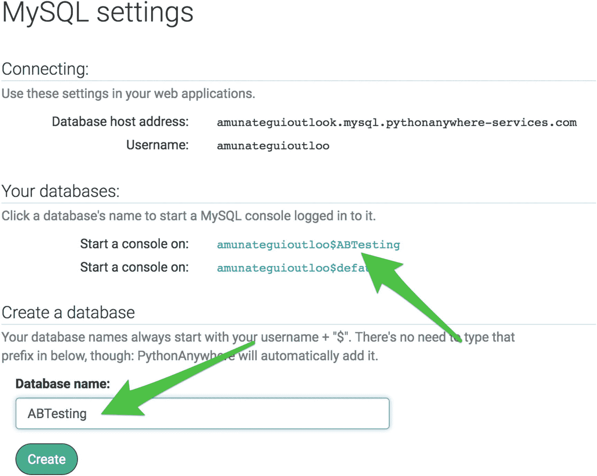

Figure 14-10

Creating the ABTesting database and clicking the console link to set things up

点击“**…$ABTesting**”数据库的控制台链接，创建“**tblFrontPageOptions**”表和“**webuser**”账户。确保更新数据库以反映你的数据库名称（清单 14-23）。

```
Input:
CREATE TABLE amunateguioutloo$ABTesting.tblFrontPageOptions (
uuid VARCHAR(40) NOT NULL,
liked BOOLEAN NOT NULL DEFAULT 0,
pageid INT NOT NULL,
time_stamp  TIMESTAMP NOT NULL DEFAULT CURRENT_TIMESTAMP);
Output:
mysql> CREATE TABLE amunateguioutloo$ABTesting.tblFrontPageOptions (
-> uuid VARCHAR(40) NOT NULL,
->    liked BOOLEAN NOT NULL DEFAULT 0,
-> pageid INT NOT NULL,
-> time_stamp  TIMESTAMP NOT NULL DEFAULT CURRENT_TIMESTAMP);
Query OK, 0 rows affected (0.03 sec)
Listing 14-23
Create Table Command and PythonAnywhere Confirming That the Table “tblFrontPageOptions” was Successfully Created
```

这就是我们需要在控制台中做的所有事情；其余所有操作都将通过 Python 完成。

## 在 PythonAnywhere 上进行 A/B 测试

让我们上传并更新所有代码，使其能在 PythonAnywhere 上配合新数据库工作。在“**Files**”下创建一个名为“**ABTesting**”的新文件夹（图 14-11）。

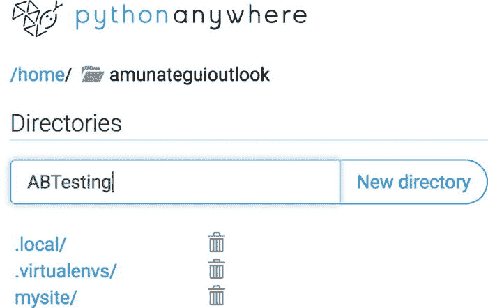

图 14-11

创建新文件夹以托管我们的 ABTesting 站点

接下来，我们需要像处理之前其他 PythonAnywhere 项目一样，将所有文件逐个上传到站点（图 14-12 至 14-14）。

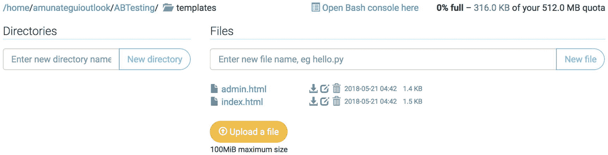

图 14-14

将两个 HTML 文件上传到“**ABTesting/templates/**”下

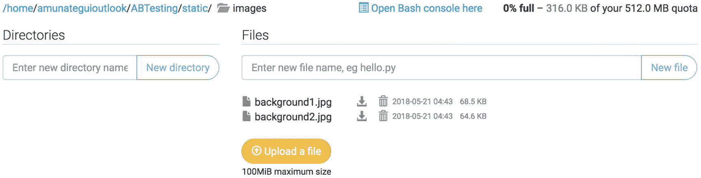

图 14-13

将两张图片上传到“**ABTesting/static/**”下

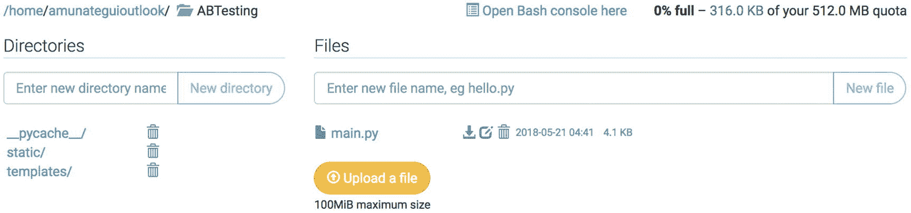

图 14-12

将“**main.py**”上传到“**ABTesting**”文件夹下

上传完所有文件后，你需要进入“**main.py**”并更新数据库账户及所有表引用。你需要用 PythonAnywhere 分配给你的变量来更新以下变量。点击 PythonAnywhere 仪表盘右上角的“**Databases**”以获取这些变量（代码清单 14-24）。

```
mysql_account='>'
mysql_password='thesecret'
mysql_database='>$ABTesting'
mysql_host=">.mysql.pythonanywhere-services.com"
代码清单 14-24
分配的账户数据
```

请确保在“**main.py**”代码中将所有“**<<ENTER-YOUR-DATABASE-USERNAME>>**”替换为你的数据库用户名，否则它将无法运行。

点击 Web 选项卡上的大绿色按钮，启动 Web 应用程序进行测试。尽情投票吧（然后查看管理页面；图 14-15）。


图 14-15

在 PythonAnywhere 上运行的“**你喜欢我吗？**”Web 应用程序

## A/B 测试结果仪表盘

为了查看 A/B 测试操作的结果，我们需要创建一个仪表盘。虽然这不是必需的，你也可以直接通过 SQL 语句在 MySQL 中查询结果，但仪表盘能让任何人在整个测试过程中查看结果，而无需具备 SQL 知识或对 ABTesting 表的查询权限（图 14-16）。

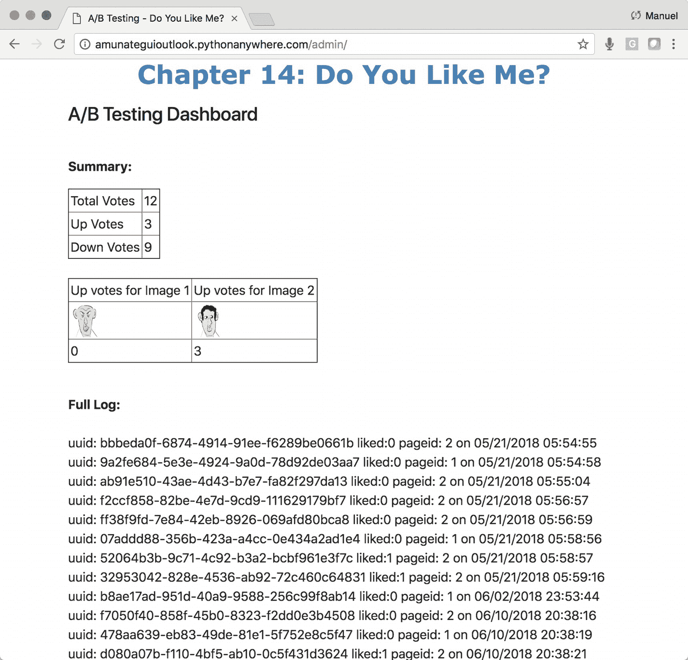

图 14-16

一个显示 A/B 测试最新结果的简单仪表盘

我们将保持简单，提供总投票数、总赞和总踩数、每张图片的赞数，以及所有参与者的完整日志。

## 结论

A/B 测试是更好地了解用户的流行工具之一。它也是一门内容丰富的科学，有多种方法可以实施。在这里，我们假设任何新访客都不喜欢该站点，因此默认给出一个踩。这并不一定意味着他们认为页面不好，也可能意味着他们没有时间阅读问题。因此，在这种情况下，我会更关注每张图片的赞数，而不是担心踩数；无论哪种情况，你都可以找出多数人更喜欢的图片。

我们在这里介绍的另一个工具是 MySQL；它是一个优秀的开源免费关系数据库，被广泛使用和支持。

脚注 1

