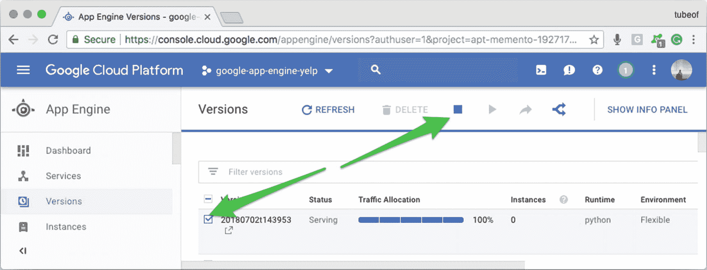
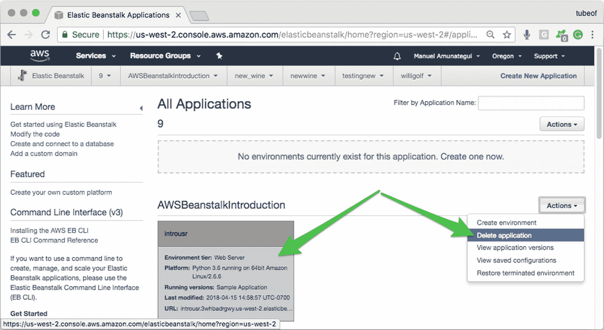
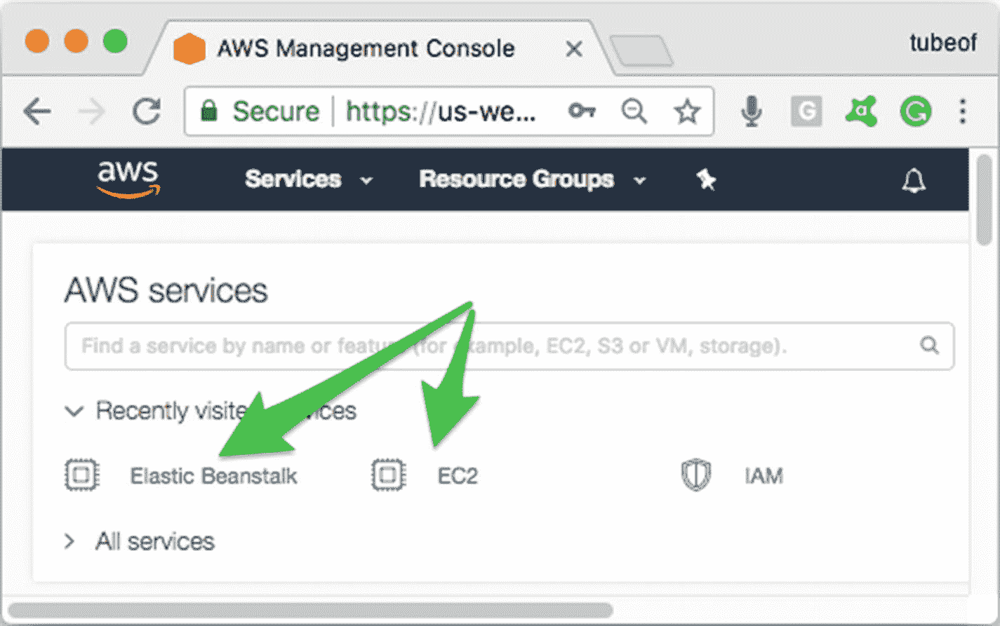
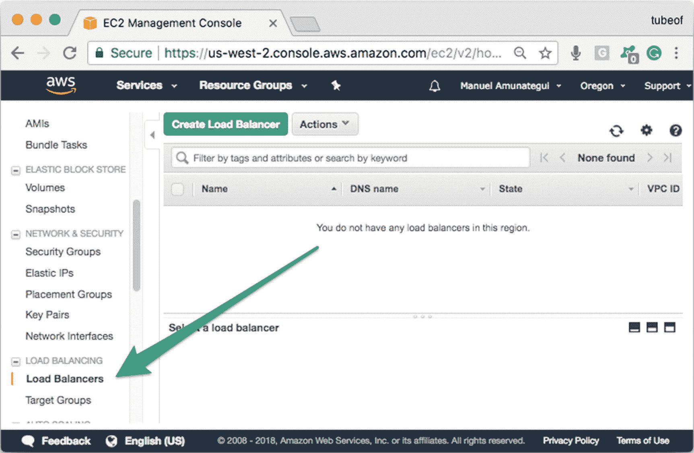
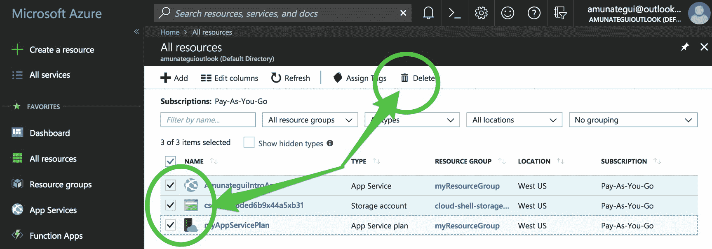
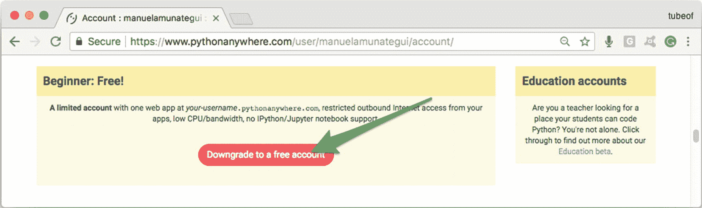
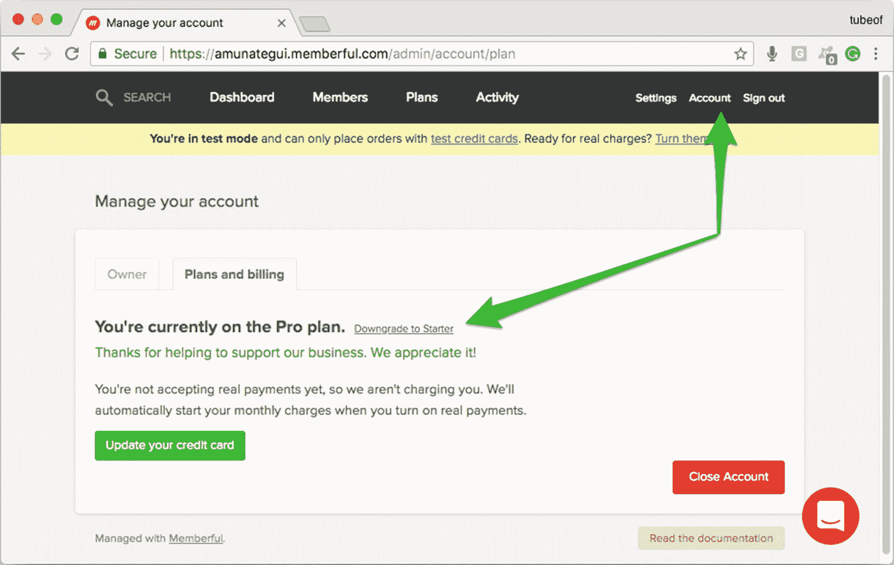

# 17. 结论

本书涵盖的内容雄心勃勃，因此不得不做出取舍，省略了一些章节。本书在技术介绍方面可能有所欠缺，但希望能通过让你快速上手并提供进一步信息的指引来弥补。我们仅简要介绍了数据库，并未涉及自定义域名；不过，好在已有大量其他资料对此进行了阐述。

希望这些章节能给你带来启发，让你在思考如何利用 Memberful 付费墙实现各种功能时，灵感迸发。

还记得那个“**竞争协议**”吗？是的，就是我在本书引言中提到的“非竞争协议”的反面。那么，是时候从本书中汲取你所需的一切，并将其付诸实践了！我们迫不及待地想看到你的成果！

## 关闭服务！

让我们快速回顾一下如何关闭云实例以及 Memberful 和 PythonAnywhere 账户。请记住，在许多情况下，你可以使用命令行命令关闭实例，但登录你的云账户并确认所有服务都已关闭始终是一个好习惯（实际上，这是至关重要的）。请注意：如果你不这样做，可能会在账单周期结束时收到一个令人不快的“惊喜”。

### Google Cloud (App Engine)

导航到你的 GCP 账户，进入“**App Engine**”仪表盘，然后点击“**版本**”。点击你的活跃版本并将其停止（图 17-1）。如果你有多个版本，可以删除旧版本；你无法删除默认版本，但停止它应该就足够了（如果你真的不想留下任何痕迹，只需删除整个项目）。

图 17-1

停止和/或删除你的 App Engine 版本

### Amazon Web Services (Beanstalk)

登录你的 AWS 账户，确保你的 EC2 和 Elastic Beanstalk 账户中没有你计划外的任何活跃服务（图 17-2 和 17-3）。

图 17-3

找到你想要终止或删除的实例，并使用“**操作**”下拉按钮选择你的选项

图 17-2

在 AWS 仪表盘上检查是否有任何活跃且不需要的实例

如果你发现某个实例在每次“**删除应用程序**”后似乎都会复活，请先检查 EC2 下的“**负载均衡器**”并终止它们，然后返回并再次终止那个“顽固”的实例（图 17-4）。

图 17-4

“**负载均衡器**”可能会阻止应用程序终止；如果你无意中启动了多个同名的实例，这种情况就可能发生。

### Microsoft Azure (AWS)

登录 Azure 仪表盘，在搜索栏中输入“**所有资源**”，然后删除你创建的所有内容（图 17-5）。

图 17-5

在“**所有资源**”视图下删除不需要的资源

### PythonAnywhere.com

如果你选择了付费账户并希望降级回免费账户，只需登录你的 PythonAnywhere 仪表盘，点击右上角的“**账户**”选项卡。在这里，你可以根据需要升级或降级你的账户。点击“**降级为免费账户**”，你将回到免费层级（图 17-6）。

图 17-6

在 PythonAnywhere 上降级为免费账户

### Memberful.com

如果你已经完成了第 16 章并设置了付费墙，但希望避免产生额外费用，你可以轻松降级回免费层级。登录你的 Memberful 账户，点击右上角的“**账户**”按钮，然后选择“**方案与账单**”选项卡。在此页面上，你会找到一个“**降级为入门版**”的链接；点击它并按照说明操作（图 17-7）。

图 17-7

在 Memberful 上降级为入门版账户

就是这样！非常感谢你阅读本书！

### 索引

### A

A/B 测试 Ajax, xxvii, xxxiv 警报系统 Amazon Web Service (AWS) 部署 Eb 命令 Elastic Beanstalk WSGI 分析, xxxvi 分析报告 Azure-cli Azure 仪表盘

### B

数据平衡 蒲福风级 自行车共享数据集 Bootstrap, xxvii, xxxiv–xxxv

### C

层叠样式表 (CSS), xxxi–xxxii, xxxiv, xxxv 类别特征 基于云的服务 Amazon AWS Google Cloud Microsoft Azure, xxxvii PythonAnywhere 协同过滤 中心化 余弦相似度 距离 欧几里得距离 相似度/距离测量工具 压缩稀疏行矩阵

### D

DataSF 数据整理 分类数据 count() groupby() describe() 虚拟特征 get_dummies() head() info() isnull() 缺失数据 tail() describe() 道琼斯工业平均指数 (DJI) drop_duplicates()

### E

外部垃圾邮件数据集

### F

特征工程 np.select() np.where() 时间段 FinViz Flask, xxvii, xxxi–xxxiii, xxxvi, xxxix fromtimestamp()

### G

地理坐标 四舍五入 Git, xxxvii–xxxviii Git for Azure az login azure-cli git add git commit git push git status 高尔夫|天气数据集 Google Analytics, xxxvi Google App Engine Google Cloud shell Google Cloud Flexible App Engine Google Cloud shell Google Cloud Flexible App Engine appengine_config.py app.yaml GCP cloud shell lib folder main.py Google Map API Google API key 热力图层 图形数据 groupby()

### H

head() 直方图 HTML, xxvii, xxxi–xxxv HTML5 Canvas HTML 表单 动态图像

### I

不平衡类别 info() 交互式 Web 应用 flask io.BytesIO()

### J, K

JavaScript, xxvii, xxxiii–xxxvi JavaScript 事件 JavaScript 追踪器 Jinja2, xxxii–xxxiii JQuery, xxxiv Jupyter 笔记本, xxviii–xxx

### L

词形还原

### M

机器学习，xxiii–xxix 邮件列表，xxxvii main.py Matplotlib Memberful，xxxv，xxxvi Memberful 认证 /account /auth/sign_in /auth/sign_out /checkout flask 会话机制 graphql 会员平台，xxxv–xxxvi 留言板，xxxvi 微软 Azure，xxxvii Azure-cli MNIST 数据集 移动端 Web 应用 Bootstrap 流体容器 form-validation 建模 交叉验证 梯度提升 线性回归 linear_regression() 逻辑回归 模型系数 非线性回归 PolynomialFeatures() 多项式回归 预测生存率 RMSE sklearn 时间序列 train_test_split() 使用梯度提升建模 混淆矩阵 评估模型 梯度提升分类器 真实值 学习率 持久化模型 精确率 对新数据进行预测 模型性能 曲线下面积 混淆矩阵 f1 分数 模型阈值 精确率 召回率 接收者操作特征 电影类型 MovieLens 数据集 movieId 评分 userId MySQL 命令行监视器 create database create table create user drop table mysql.connector connect() INSERT SELECT UPDATE

### N

朴素贝叶斯 sklearn 的 GaussianNB 纳斯达克公司列表 纳斯达克网站 自然语言处理（NLP）

### O

OpenWeatherMap OpenWeatherMap API

### P

配对交易 简约模型 支付平台，xxxvi PayPal，xxxvi pd.Categorical() 图表 准备数据 concat() 累计和 百分比变化 pivot() 数据缩放 PythonAnywhere bash pip install Flask-SSLify PythonAnywhere MySQL 设置 WSGI WSGI 配置

### Q

定量特征 量化交易 配对交易策略 股票行为

### R

随机森林分类器 评分类别 评分频率 评分直方图 readlines() 推荐系统 推荐电影 回归系数 正则表达式 requirements.txt，xxxix–xli 评审文化 R 平方

### S

安全外壳（SSH） 无服务器云，xxv，xxvii 无服务器技术 旧金山犯罪热力图 奇异值分解（SVD） 短信垃圾邮件收集数据集 静态，xxv，xxxvi，xxxvii 词干提取 股票图表 Stripe，xxxv，xxxvi 订阅者 @auth.login_required Flask-HTTPAuth HTTPBasicAuth HTTPDigestAuth 订阅系统 基于文本的认证 订阅付费墙

### T

templates/index.html TensorFlow 准确率 checkpoint conv2d() 卷积神经网络 交叉熵损失函数 max_pool() 建模层 Saver() softmax tf.nn tf 会话 词频-逆文档频率（TFIDF） 文本整理 TfidfVectorizer 泰坦尼克号数据集 追踪 ID 追踪用户 交易思路 流量来源

### U

通用唯一标识符（UUID） 用户评论

### V

虚拟环境，xxxviii–xl 可视化

### W, X, Y, Z

天气预报 Web 应用 awscli awsebcli eb eb open Elastic Beanstalk HTML 表格 沙盒，xxxviii，xxxix 虚拟环境，xxxviii–xxxix WSGIApplicationGroup Web 插件，xxix，xxxv 维基百科 API 葡萄酒质量数据集 info() value_counts() 词频统计

