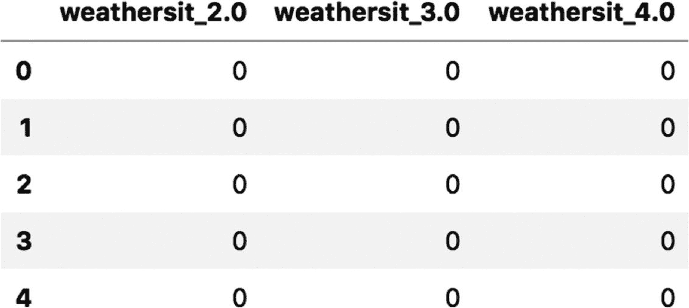
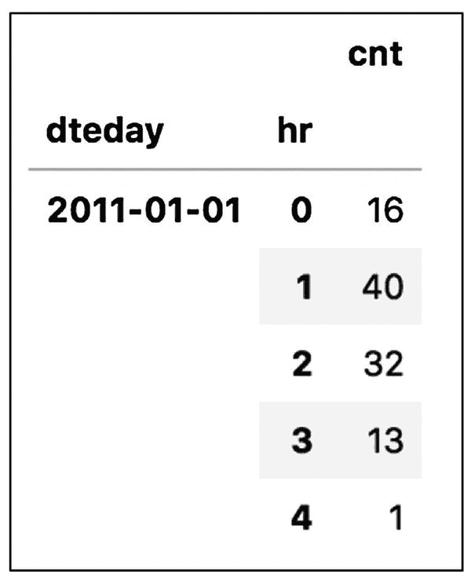

# 对所有分类字段进行虚拟化处理
dataframe_dummy = pd.get_dummies(raw_dataframe, columns=target_columns, drop_first=drop_first,
dummy_na=make_na_col)
return (dataframe_dummy)
代码清单 2-15
抽象代码以创建虚拟数据
```

这会将每个类别拆分到其自己的列中。在下面的代码片段中，我们要求对以下三列进行“**虚拟化**”处理：“**season**”、“**weekday**”和“**weathersit**”（代码清单 2-16）。

```
bike_df_model_ready = prepare_data_for_model(bike_df_model_ready,
target_columns = ['season', 'weekday', 'weathersit'], drop_first = True)
代码清单 2-16
对分类列进行虚拟化处理
```

将该函数应用于数据集后，每个天气类别现在都位于单独的列中（减去第一列，该列是冗余的——如果它不是“**weathershit_2**”、“**weathershit_3**”或“**weathershit_4**”，那么我们可以推断它是“**weathershit_1**”；代码清单 2-17 和图 2-14）。



图 2-14

查看特征“**weathersit**”的虚拟化列

```
bike_df_model_ready[['weathersit_2.0', 'weathersit_3.0', 'weathersit_4.0']].head()
代码清单 2-17
查看虚拟化后的天气字段
```

那么，从分类数据中创建虚拟变量是否有助于模型呢？（代码清单 2-18）

```
输入：
print("均方根误差: %.2f" % sqrt(mean_squared_error(y_test, predictions)))
输出：
均方根误差: 139.40
代码清单 2-18
对分类数据进行虚拟化处理后的均方根误差
```

这个结果并不令人印象深刻，而且肯定不足以证明所有这些额外工作是值得的。让我们继续尝试其他技术。

### 尝试非线性模型

作为最后的建模实验，让我们将虚拟化后的数据输入到 sklearn 的“**Gradient Boosting Regressor**”模型中。在 sklearn 包中从一个模型切换到另一个模型非常简单，我们只需要在内存中加载相应的模型并更改两行代码即可（代码清单 2-19）。

```
输入：
from sklearn.ensemble import GradientBoostingRegressor
model_gbr = GradientBoostingRegressor()
model_gbr.fit(X_train, np.ravel(y_train))
predictions = model_gbr.predict(X_test)
print("均方根误差: %.2f" % sqrt(mean_squared_error(y_test, predictions)))
输出：
均方根误差: 68.13
代码清单 2-19
使用 GBM 模型
```

哇，这是我们迄今为止看到的最低 RMSE 分数；我们将错误率降低了一半！


### 更复杂的特征工程——利用时间序列

这是最后一个特征工程实验，其思路源自微软的数据科学家。^(⁸) 该数据集是自行车租赁随时间变化的台账，因此它是一个时间序列数据集。每当你的数据集记录了随时间变化的事件时，你都应将其作为附加特征纳入考量。例如，一小时前发生的事件可能比一年前发生的事件更重要。时间还可以捕捉趋势、不断变化的需求和认知等。我们要创建能够捕捉所有这些随时间演变要素的特征！

对于每一行数据，我们将添加两个新特征：前一小时的自行车租赁总数，以及两小时前的自行车租赁总数。其直觉是，如果我们想了解当前的自行车租赁热度，可以从观察一小时前的情况入手。如果一小时前租赁量很大，那么现在很可能也不错。这个时间要素可以看作是繁荣或萧条时期、好或坏天气等的代理变量。

为了按日期和小时计算自行车总数，我们使用 Pandas 极其强大的“**groupby()**”函数。我们提取“**dteday**”、“**hr**”和“**cnt**”三个字段，并按日期和小时对计数进行分组（清单 2-20 和图 2-15）。



图 2-15

移动日期以创建新的回溯特征

```
bikes_hour_df_shift = bikes_hour_df[['dteday','hr','cnt']].groupby(['dteday','hr']).sum()
bikes_hour_df_shift.head()
清单 2-20
查看前一时期的租赁计数
```

此函数按小时和日期统计计数。接下来，我们创建两个新特征，一个向前移动 1 行，另一个移动 2 行，从而为当前行提供过去一小时和过去两小时的自行车租赁总数。最后，我们使用 Pandas 的“**merge()**”命令将所有内容添加回主数据框（清单 2-21）。

```
