# 将日期和小时计数合并回 bike_df_model_ready
bike_df_model_ready =  pd.merge(bikes_hour_df, bikes_hour_df_shift[['dteday', 'hr', 'sum_hr_shift_1', 'sum_hr_shift_2']], how="inner", on = ['dteday', 'hr'])
清单 2-21
时间偏移操作
```

在分割这些新数据并将其输入梯度提升模型（GBM）进行回归（使用 sklearn 的 GradientBoostingRegressor）后，我们计算测试数据集上的 RMSE 分数（清单 2-22）。

```
输入：
from sklearn.ensemble import GradientBoostingRegressor
model_gbr = GradientBoostingRegressor()
model_gbr.fit(X_train, np.ravel(y_train))
predictions = model_gbr.predict(X_test)
print("均方根误差: %.2f" % sqrt(mean_squared_error(y_test, predictions)))
输出：
均方根误差: 44.43
清单 2-22
时间偏移的 RMSE
```

哇，太棒了，RMSE 为 44.43，甚至更好了！！！

## 简约模型

不幸的是，事情并不总是关乎最佳分数。在这里，我们需要一个简单的模型，以便使用回归方程进行预测。这并非复杂模型或过度工程化特征所能轻易实现的。GBM 不是线性模型，也无法为我们提供一个轻便的回归方程。此外，我们之前创建的时间偏移需要知道预测前两个小时的租赁总数，而我们的网站访问者无法从中受益，因为我们无法获取实时数据。

当你的目标是创建 Web 应用程序时，这是一个重要的教训：如果最准确的预测来自复杂的建模技术，那么它通常很难很好地转化为生产流水线。

### 从简单模型中提取回归系数——无需服务器端计算即可轻松预测需求

线性回归模型并非最强大的模型，它本身也不以此自居，但它可以将相当复杂的数据提炼成极其简单清晰的线性表示。正是这种简单的表示将为我们的应用程序提供动力。

回归建模的一个强大产物是学习到的模型系数。这在 Web 应用程序的上下文中更为强大，因为我们可以仅依赖这些系数和一个简单的回归方程来估计未来的自行车租赁需求。这有可能使应用程序完全在客户端前端做出复杂决策——轻量、快速且实用！

为了最终得到一组简洁的系数和一个简单的回归方程，我们首先需要训练和测试一个回归模型。只有当我们对分数、使用的特征以及预测质量感到满意时，我们才提取系数。我们还将把输入模型的特征精简到必要且具有说明性的程度。以下是构建 Web 应用程序的教训之一：我们必须平衡最佳建模分数与生产现实。如果你构建了一个非凡的模型，但没有人能操作它，或者它无法在生产中及时运行，那它就是失败的。

为了 Web 应用程序的简洁性，我们将保持简单，仅使用四个特征：“**season**”、“**hr**”、“**holiday**”和“**temp**”。这些特征用户能够理解，易于获取，并且由于只有四个特征，我们的模型将运行得很快。让我们首先单独对这些特征进行建模，并检查它们的 R 平方分数。


### R 平方

R 平方是一种统计度量，用于衡量数据与拟合回归线的接近程度。它也被称为决定系数，或在多元回归中称为多重决定系数。R 平方的定义相当直接：它是由线性模型解释的响应变量变异性的百分比（列表 2-23）。

```
R-squared = Expected variation / Total variation
列表 2-23
R 平方公式
```

决定系数可以看作一个百分比。它让你了解有多少数据点落在回归方程所形成直线的结果范围内。系数越高，落在直线内的点就越多。如果系数为 0.80，那么 80% 的点应该落在回归线内。

我们希望看到 R 平方尽可能接近 1（或 100%），且没有负数。使用 sklearn 的“**r2_score**”函数可以轻松计算（列表 2-24）。

```
输入：
from sklearn.metrics import r2_score
for feat in features:
model_lr = linear_model.LinearRegression()
model_lr.fit(X_train[[feat]], y_train)
predictions = model_lr.predict(X_test[[feat]])
print('R² for %s is %f' % (feat, r2_score(y_test, predictions)))
输出：
R² for hr is 0.160161
R² for season is 0.034888
R² for holiday is -0.001098
R² for temp is 0.154656
列表 2-24
各特征的 R 平方得分
```

每个 R 平方都是正数，我们看到“**hr**”和“**temp**”比“**season**”和“**holiday**”解释了更多的方差。请记住，我们是在单独查看每个特征；一个很好的后续步骤（此处未涉及）是计算所有特征一起的 R 平方得分（或使用调整后的 R 平方来处理多个特征）。

如前所述，我们还将对“**season**”变量进行“**虚拟化**”。如果我们在包含“**虚拟化**”变量的所有特征上重新运行 R 平方计算循环，我们会得到以下得分（列表 2-25）。

```
R² for hr is 0.156594
R² for holiday is 0.001258
R² for temp is 0.154471
R² for season_1 is 0.053717
R² for season_2 is 0.003657
R² for season_3 is 0.016976
R² for season_4 is 0.001111
列表 2-25
虚拟化特征上的 R 平方得分
```

所有值都是正数，因此我们可以在最终的 Web 应用程序中使用这组特征。

### 使用提取的系数预测新数据

现在我们有了模型的系数，我们可以使用回归方程预测新的租赁数量。回归方程是我们回归模型中最优拟合线的方程。该公式很常见，可以在大多数涉及统计学的书籍中看到（图 2-16）。


图 2-16

回归方程

“**y**”是因变量，或者说是我们试图预测的值，在我们的例子中，是自行车租赁的数量，a 是截距，“**β**”是直线的斜率，“**x**”是自变量。在多元线性回归的情况下，你只需添加更多的自变量。

一个重要的注意事项是，这个公式及其系数代表了模型中使用的数据可能产生的最小误差。因此，当我们向其中注入新数据时，我们实际上无法同时更改所有自变量。这是一个需要记住的重点，尽管我们将允许用户调整各种环境设置来影响自行车租赁的数量，但我们也会提供一个“**重置**”按钮，将所有变量重置回其原始平均值。

在我们运行最终模型后，我们需要提取截距和系数。使用 sklearn 的“**linear_model**”函数很容易做到这一点，只需调用“**intercept_**”和“**coef_**”参数即可获取它们（列表 2-26 和 2-27，以及图 2-17）。

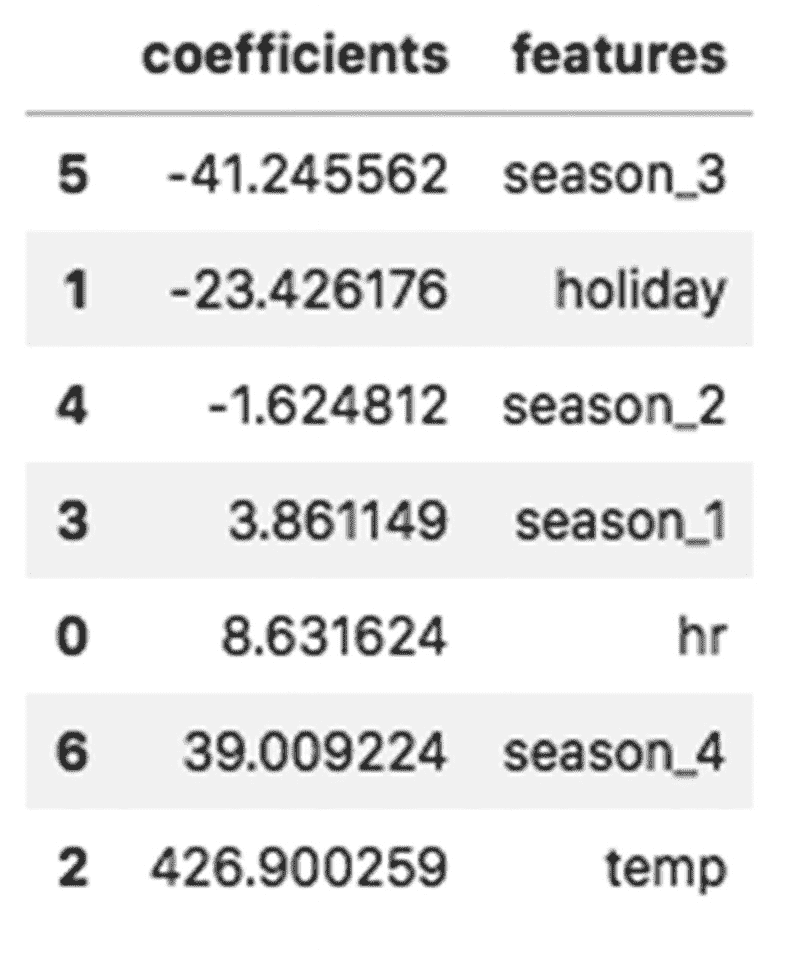

图 2-17

查看线性回归模型的系数

```
feature_coefficients = pd.DataFrame({'coefficients':model_lr.coef_[0],
'features':X_train.columns.values})
feature_coefficients.sort_values('coefficients')
列表 2-27
获取系数
```

```
输入：
from sklearn import linear_model
model_lr = linear_model.LinearRegression()
model_lr.fit(X_train, y_train)
print('Intercept: %f' % model_lr.intercept_)
输出：
Intercept: -121.029547
列表 2-26
获取截距
```

然后，我们可以将这些常量分配给我们的 Web 应用程序，以便它能够预测自行车租赁需求（列表 2-28）。

```
INTERCEPT = -121.029547
COEF_HOLIDAY = -23.426176   # 当天是否为节假日
COEF_HOUR = 8.631624        # 小时 (0 到 23)
COEF_SEASON_1 = 3.861149    # 1: 春季
COEF_SEASON_2 = -1.624812   # 2: 夏季
COEF_SEASON_3 = -41.245562  # 3: 秋季
COEF_SEASON_4 = 39.009224   # 4: 冬季
COEF_TEMP = 426.900259      # 归一化温度，摄氏度 -8 到 +39
列表 2-28
从提取的系数创建常量
```

我们还需要获取历史平均值来构建我们的回归方程。如果值是分类的，那么我们选择最高的平均值并将其设为 1，其他设为 0（就像我们对节假日和季节所做的那样）（列表 2-29）。

```
MEAN_HOLIDAY = 0   # 当天是否为节假日
MEAN_HOUR = 11.6   # 小时 (0 到 23)
MEAN_SEASON_1 = 0  # 1: 春季
MEAN_SEASON_2 = 0  # 2: 夏季
MEAN_SEASON_3 = 1  # 3: 秋季
MEAN_SEASON_4 = 0  # 4: 冬季
MEAN_TEMP = 0.4967 # 归一化温度，摄氏度 -8 到 +39
列表 2-29
设置特征均值

```

我们现在拥有了预测新租赁数量所需的一切。让我们看看在上午 9 点，所有其他值保持在其平均值附近时，我们会得到多少租赁量（列表 2-30）。

```
输入：
rental_counts = INTERCEPT + (MEAN_HOLIDAY * COEF_HOLIDAY) \
+ (9 * COEF_HOUR) \
+ (MEAN_SEASON_1 * COEF_SEASON_1)  + (MEAN_SEASON_2 * COEF_SEASON_2) \
+ (MEAN_SEASON_3 * COEF_SEASON_3)  + (MEAN_SEASON_4 * COEF_SEASON_4) \
+ (MEAN_TEMP * COEF_TEMP)
print('Estimated bike rental count for selected parameters: %i' % int(rental_counts))
输出：
Estimated bike rental count for selected parameters: 171
列表 2-30
让我们使用提取的系数进行预测
```

结果是上午 9 点租出了 171 辆自行车（你的结果可能略有不同）。我们将允许用户一次更改多个特征，但请记住，对原始方程值进行过多更改可能会降低模型性能。

## 设计一个有趣且交互式的 Web 应用程序来展示自行车租赁需求

现在到了有趣的部分，让我们设计我们的 Web 应用程序。我们始终需要牢记最终目标——我们想与他人分享什么，以及他人想看什么？

我们将设计一个交互式 Web 应用程序，允许用户自定义环境变量（时间、节假日、温度和季节），并获得自行车租赁数量的可视化反馈。

这个应用程序需要在视觉上引人注目，以吸引用户并让他们在操作时保持兴趣。这意味着需要在信息传达、用户界面、视觉效果和交互控件上投入与数据收集和建模同样多的思考。


## 为提升可读性与可扩展性而抽象化代码

与我的大多数 Web 应用程序一样，我尝试将代码抽象成逻辑模块。一个模块负责收集用户数据，另一个模块（即“**大脑**”）则负责构建回归方程、运行它并返回自行车租赁预测。将代码组织在逻辑单元中，将极大地简化你在构建和调试 Web 应用程序时的工作。这使你能够对每个模块进行单元测试，以确保一切正常运行，或者在出现问题时通过排除法来定位问题。

就本章的 Web 应用程序而言，大部分“**大脑**”将直接驻留在主 HTML 页面中。Flask 是一个 Web 服务框架，主要用于检索、分析和返回定制化内容。在本章中，我们只需要回归方程来预测自行车租赁需求，因此实际上并不需要在用户和 Web 服务器之间进行大量来回交互（这也是本书中唯一这样做的章节；在其他所有章节中，“大脑”将明确驻留在服务器端，而非客户端的网页上）。

## 构建本地 Flask 应用程序

在将代码部署到云端之前，先在本地运行测试非常重要；这既能避免让你头疼，也能节省时间。首先，让我们在本地机器上执行一个简单的 Flask 练习。如果你从未在本地运行过 Flask 应用程序，你需要使用“**pip3 install**”或你的操作系统和 Python 版本支持的任何工具来安装以下 Python 库。

*   Flask

安装好 Flask 后，打开一个文本编辑器，输入以下代码，并将其保存为“**hello.py**”（清单 2-31）。

```
from flask import Flask
app = Flask(__name__)
@app.route('/')
def hello_world():
return 'Hello, World!'
清单 2-31
简单的 Flask 脚本
```

然后打开一个终端/命令窗口，在 Mac 或 Windows 上输入以下命令（清单 2-32 和 2-33）。

```
$ export FLASK_APP= main.py
$ python -m flask run
清单 2-33
在 Windows 上
```

```
$ export FLASK_APP=main.py
$ flask run
清单 2-32
在 Mac 上
```

你应该会看到类似图 2-18 的内容。

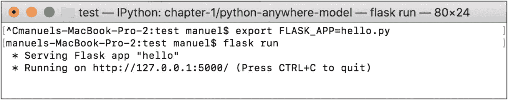

图 2-18

显示 Flask 应用程序本地 URL 的终端/命令窗口

然后，将 URL “`http://127.0.0.1:5000/`”（或终端窗口中显示的任何地址）复制到浏览器中，你应该就能看到 Web 应用程序出现了。更多示例和技巧可以在官方 Flask 快速入门指南中找到：“ [`http://flask.pocoo.org/docs/0.12/quickstart`](http://flask.pocoo.org/docs/0.12/quickstart) ”。

那么，刚才发生了什么？如果你对 Web 服务框架不熟悉，这可能看起来有点令人生畏（请记住，Flask 是目前最简单的框架之一）。让我们逐步分解这个过程。

在前面的“**Hello world**”示例中，一切都发生在假设的 Web 服务器端（实际上就是你的本地机器）。它的工作是处理命令，并将可消费的 HTML 内容返回给发出请求的客户端网页。

首先，我们将 Flask 库加载到内存中（清单 2-34）。

```
from flask import Flask
清单 2-34
导入 Flask
```

然后，我们实例化 Flask 会话（清单 2-35）。

```
app = Flask(__name__)
清单 2-35
实例化 Flask
```

最后，我们创建一个函数来执行某些操作，并用路由参数对其进行装饰，以便它知道将处理来自 Web 客户端的哪些命令。在本例中，‘/’ 仅表示根页面或根“**index.html**”页面会话（清单 2-36）。

```
@app.route('/')
def hello_world():
return 'Hello, World!'
清单 2-36
处理来自根 URL 流量的 Flask 函数
```

显然，函数很少会如此简单；它很可能会调用数据库或表述性状态转移（REST）API 调用来收集定制信息，并通过 HTML 模板将其发送回客户端的网页。整个过程允许创建智能的、定制化的数据，然后将其封装到一个外观精美的网页中。无论从哪个角度看，它看起来都像一个手工制作的页面，尽管它是由 Flask 动态创建的。我们将在本书中全程使用 Flask，如果你能坚持学完每一章，你将对这个工具有深刻的理解。

最后一段代码仅在本地模式（即从本地机器运行）下使用，它运行 Web 服务器代码，并在本例中打开调试标志（清单 2-37）。

```
if __name__=='__main__':
app.run(debug=True)
清单 2-37
在本地自动运行 Flask 应用程序
```

### 在本地下载并运行共享单车 GitHub 代码

如果你还没有下载本章的文件，请下载它们并导航到“ **web-application** ”文件夹。你的文件夹应该看起来像清单 2-38。

```
web-application
├── appengine_config.py
├── main.py
├── requirements.txt
├── app.yaml
├── static
└── images
├── bike_zero.png
├── bike_one.png
├── bike_four.png
├── bike_nine.png
└── bike_sixteen.png
└── templates
└── index.html
清单 2-38
Web 应用程序文件
```

下载并解压所有内容后，打开一个命令行窗口，将驱动器切换到“**web-application**”文件夹，并通过运行“**pip install -r**”命令来安装所有必需的 Python 库（清单 2-39）。

```
$ pip3 install -r requirements.txt
清单 2-39
安装依赖项
```

然后，运行你在“**Hello World**”实验中运行过的相同命令（运行“**python3 main.py**”也可以达到同样的效果；图 2-19）。

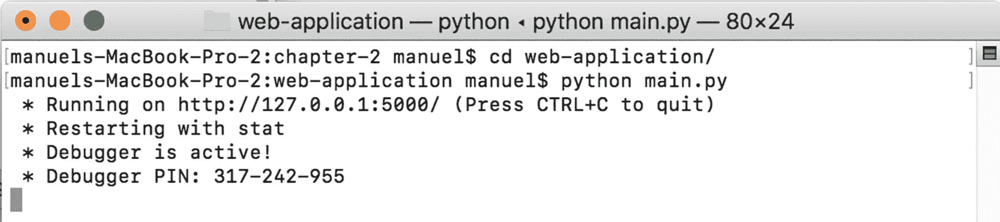

图 2-19

在本章的 Web 应用程序上启动本地 Web 服务器

它应该看起来像图 2-20 中的屏幕截图。

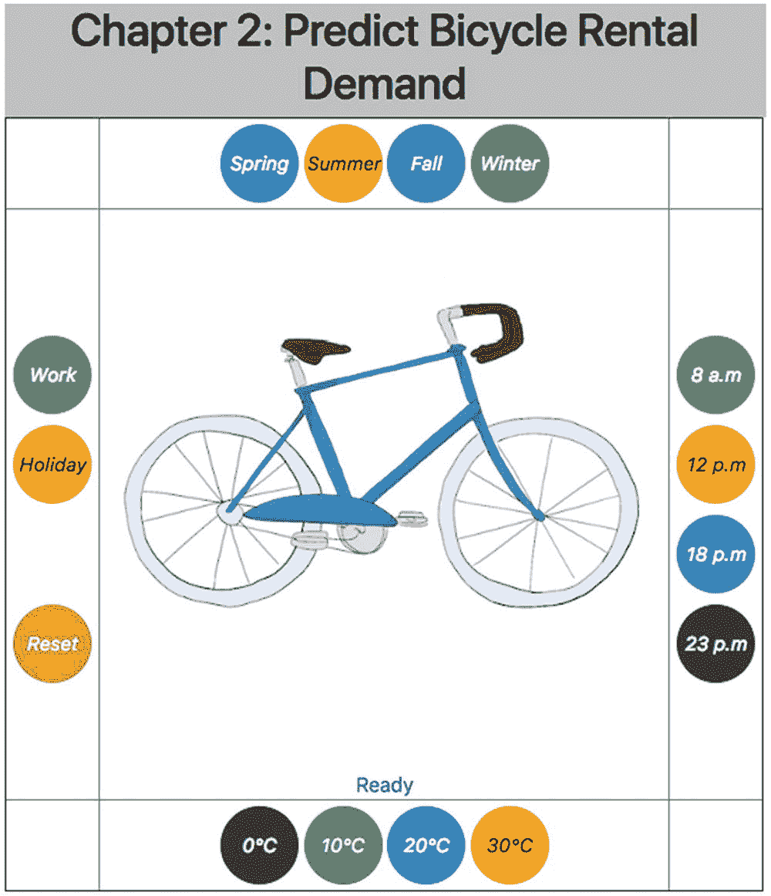

图 2-20

本章 Flask Web 应用程序的本地渲染效果


### 调试技巧

如果你没有看到截图，说明你的系统存在问题，或者缺少某个文件或库。与这个领域的任何工作一样，调试是其中很重要的一部分。你可以通过两种简单的方法来解决问题。如果这是一个 Flask 问题，并且你的浏览器看起来像图 2-21，请执行以下步骤。

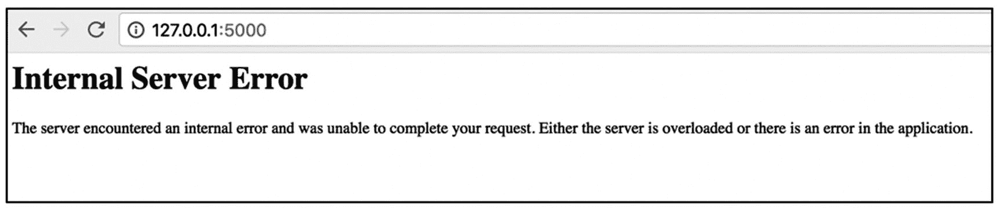

图 2-21

本地网站错误

在“**main.py**”脚本中（通常位于文件末尾）将 Flask 调试标志设置为 True。这仅在本地运行应用程序时有效（列表 2-40）。

```
if __name__=='__main__':
app.run(debug=True)
列表 2-40
Web 应用程序文件
```

如果问题与 Flask 相关，调试器会捕获它并在浏览器中显示，同时会返回一条更有帮助的消息，如图 2-22 所示。

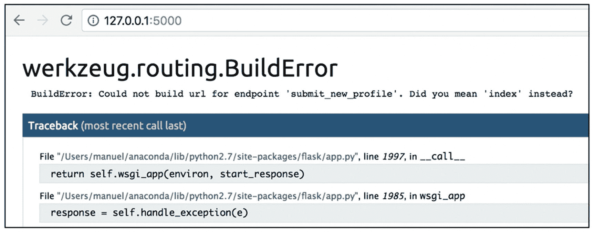

图 2-22

Web 浏览器中的 Flask 错误日志

无论调试标志如何，你还会在终端/命令窗口中看到 Flask 错误消息，如图 2-23 所示。

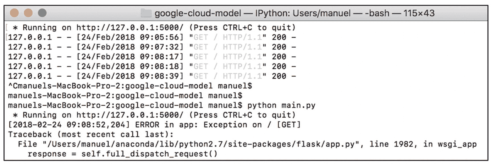

图 2-23

终端/命令窗口中的 Flask 错误日志

修复所有 Flask 问题后，你可能仍然有一些前端错误需要处理。大多数浏览器都会提供一些调试工具。图 2-24 展示了如何在 Chrome 中启动并运行 JavaScript 调试器（你应该能够轻松地在使用的任何浏览器品牌中找到等效工具）。

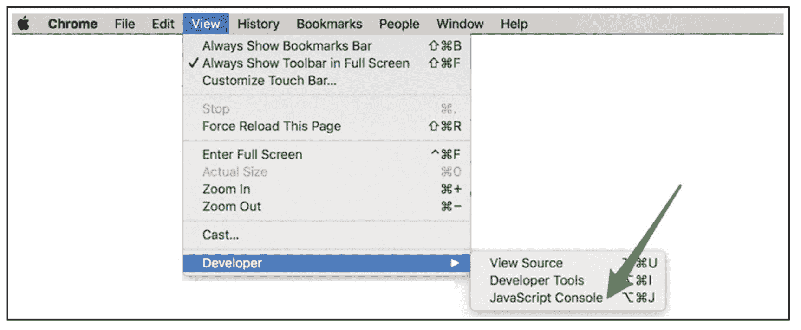

图 2-24

在 Google Chrome 中访问 JavaScript 控制台

这将在网页右侧打开一个漂亮的小型调试中心，列出所有错误或警告。检查一下总是一个好主意，以防出现警告消息。同样，在不同的浏览器品牌和格式（如计算机、手机和平板电脑）中测试你的 Web 应用程序也是如此（图 2-25）。

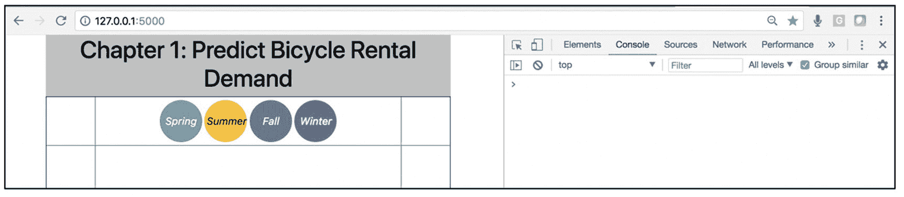

图 2-25

Google Chrome 中的 JavaScript 控制台运行中

## Microsoft Azure——首次挂载 Web 应用程序

我们已经准备好将模型导出到 Azure。你需要一个 Microsoft Azure 帐户，在撰写本文时，Microsoft 提供方便的 200 美元信用额度和所有服务的 30 天试用期以及 12 个月的访问权限。有关更多信息，请参阅 [`https://azure.microsoft.com/en-us/free/`](https://azure.microsoft.com/en-us/free/) 。

## Git——获取 Git 中的所有项目

对于此项目，你需要在本地机器上安装 Git（你可以在 [`https://www.git-scm.com/downloads`](https://www.git-scm.com/downloads) 找到安装二进制文件）。如前所述，Git 是一个源代码版本控制工具，它是一个完全准备好的 Git 包，我们将把它推送到 Microsoft Azure（请参阅引言部分中关于 Git 的简要介绍）。

打开你的终端/命令行窗口，并将其指向本章的“**web-application**”文件夹（列表 2-41）。

```
$ git init
列表 2-41
代码输入
```

在整个过程中运行几次“**git status**”是一个好主意，以确保你正在跟踪正确的文件（列表 2-42）。

```
输入:
$ git status
输出:
未跟踪的文件:
  (使用 "git add <文件>..." 以包含在要提交的内容中)
    main.py
    ptvs_virtualenv_proxy.py
    requirements.txt
    static/
    templates/
    web.3.4.config
列表 2-42
运行 “git status”
```

从“**web-application**”文件夹中添加所有 Web 应用程序文件，并再次检查“**git status**”（列表 2-43）。

```
输入:
$ git add .
$ git status
输出:
要提交的变更:
  (使用 "git rm --cached <文件>..." 以取消暂存)
    新文件:   main.py
    新文件:   ptvs_virtualenv_proxy.py
    新文件:   requirements.txt
    新文件:   static/images/bike_four.png
    新文件:   static/images/bike_nine.png
    新文件:   static/images/bike_one.png
    新文件:   static/images/bike_sixteen.png
    新文件:   static/images/bike_zero.png
    新文件:   templates/index.html
    新文件:   web.3.4.config
列表 2-43
将 Web 应用程序文件添加到 Git

```

执行本地 Git 提交并添加一个有意义的注释，以备将来需要回顾过去的操作（列表 2-44 和图 2-26）。

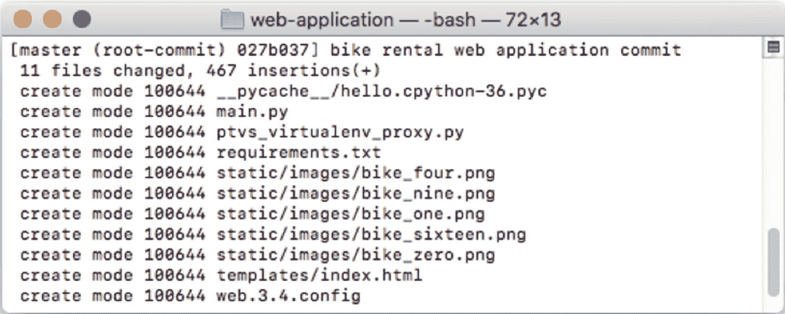

图 2-26

已提交的数据，准备上传到 Azure

```
$ git commit -am "bike rental web application commit"
列表 2-44
Git 提交
```

有关将 Git 部署到 Azure 应用服务的更多信息，请参阅 [`https://docs.microsoft.com/en-us/azure/app-service/app-service-deploy-local-git`](https://docs.microsoft.com/en-us/azure/app-service/app-service-deploy-local-git) 。

## azure-cli 命令行界面工具

我们将依赖“**azure-cli**”工具来启动和运行，因为它是启动和控制 Web 实例的便捷方式（有关设置的更多信息，请参阅官方文档 [`https://docs.microsoft.com/en-us/cli/azure/get-started-with-azure-cli`](https://docs.microsoft.com/en-us/cli/azure/get-started-with-azure-cli) ）。

对于 Mac：

```
$ brew update && brew install azure-cli
```

对于所有其他操作系统，请参阅官方文档：[`https://docs.microsoft.com/en-us/cli/azure/install-azure-cli`](https://docs.microsoft.com/en-us/cli/azure/install-azure-cli) 。

### 步骤 1：登录

安装“**azure-cli**”命令行工具后（如果本地命令行工具出现问题，也可以直接使用 Azure Cloud Shell），创建一个“**az**”会话（列表 2-45）。

```
输入:
az login
输出:
要登录，请使用 Web 浏览器打开页面 https://microsoft.com/devicelogin 并输入代码 BTJMDCR34 进行身份验证。
列表 2-45
从 azure-cli 登录 Azure
```

按照说明操作，将浏览器指向给定的 URL 地址，并相应地输入代码（图 2-27）。

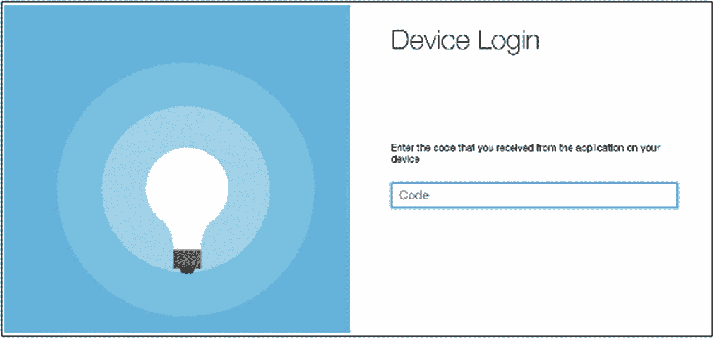

图 2-27

验证会话

如果一切顺利（即你拥有一个状态良好的 Azure 帐户），它将自动将 azure-cli 终端连接到云服务器。此外，一旦你获得授权，就可以安全地关闭浏览器窗口。确保你的命令行工具指向本章的“**web-application**”文件夹。

### 步骤 2：为你的部署用户创建凭据

该用户将拥有 FTP 和本地 Git 使用的适当权限。这里我将用户名设置为“**flaskuser11**”，密码设置为“**flask123**”。你只需执行此操作一次，然后就可以重复使用同一个帐户。如果它给你带来麻烦，只需创建一个不同的用户名（或者在用户名末尾添加一个数字并像我一样不断增加它（列表 2-46））。

```
$ az webapp deployment user set --user-name > --password flask123
列表 2-46
创建用户
```

当你逐步执行每个“**azure-cli**”步骤时，你将收到 JSON 回复以确认你的设置。对于“**az webapp deployment**”，大多数应该具有空值且没有错误消息。如果你收到错误消息，则说明存在需要解决的权限问题（“**conflict**”表示该名称已被占用，请尝试其他名称；“**bad requests**”表示密码太弱）。


### 步骤 3：创建资源组

这将是你的逻辑容器。在此处，你需要输入离你位置最近的区域（参见 [`https://azure.microsoft.com/en-us/regions/`](https://azure.microsoft.com/en-us/regions/) ）。即使你身处地球另一端，在本示例中使用“**美国西部**”也无关紧要，但在生产环境中，为了获得最佳性能，你希望服务器尽可能靠近你的观众，这就会产生差异（列表 2-47）。

```
$ az group create --name myResourceGroup --location "West US"
列表 2-47
创建资源组及响应
```

### 步骤 4：创建 Azure 应用服务计划

在此，我将名称设置为“**myAppServicePlan**”，并选择一个免费实例（sku；列表 2-48）。

```
$ az appservice plan create --name myAppServicePlan --resource-group myResourceGroup --sku FREE
列表 2-48
创建服务计划及成功响应
```

### 步骤 5：创建 Web 应用

你的“**webapp**”名称必须是唯一的，并确保你的“**resource-group**”和“**plan**”名称与你在前面步骤中设置的一致。在本例中，我使用“**amunateguibike**”（列表 2-49）。

```
$ az webapp create --resource-group myResourceGroup --plan myAppServicePlan --name amunateguibike --runtime "python|3.4" --deployment-local-git
列表 2-49
创建 Web 应用
```

有关支持的运行时的完整列表，请参见列表 2-50。

```
$ az webapp list-runtimes
列表 2-50
支持的运行时列表
```

“**az webapp create**”的输出将包含一条重要信息，你将在后续步骤中用到。请查找“ **deploymentLocalGitUrl** ”这一行（图 2-28）。

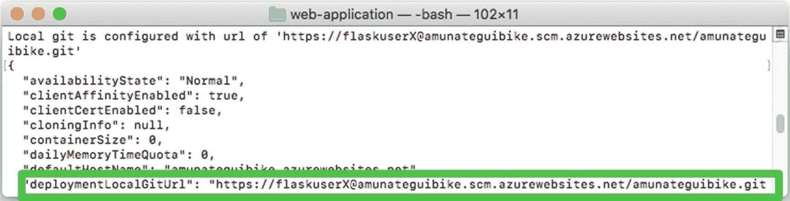

图 2-28

来自“ **deploymentLocalGitUrl** ”的 Git URL 截断输出

有关提取 Azure 项目实例的本地 Git 配置 URL，请参见列表 2-51 和 2-52。

```
https://>@>.scm.azurewebsites.net/>.git
列表 2-52
你的 URL 将类似如下所示
```

```
https://flaskuser11@amunateguibike.scm.azurewebsites.net/amunateguibike.git
列表 2-51
我的案例中提取的 Git URL
```

### 步骤 6：将 Git 代码推送到 Azure

将我们之前保存的 URL 与你的 GIT 仓库位置附加到“**add azure**”命令中（列表 2-53）。

```
