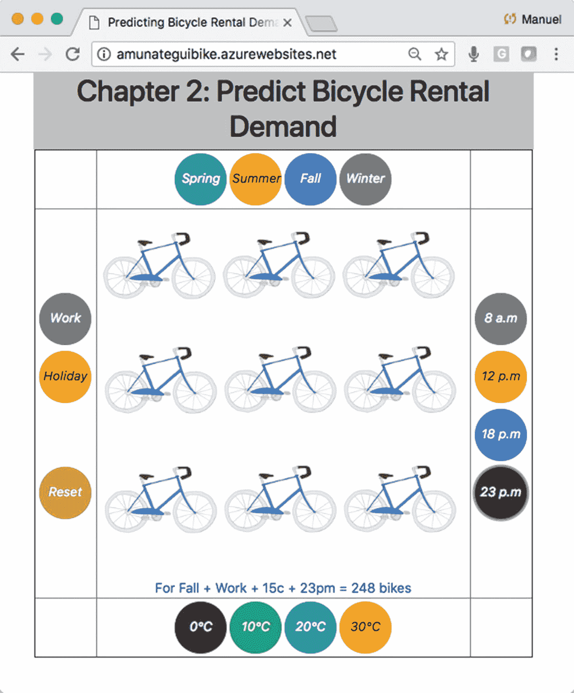
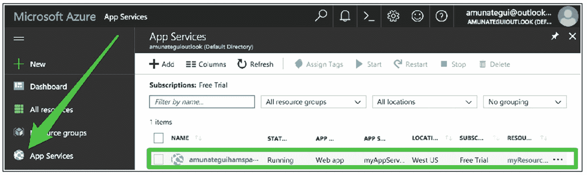
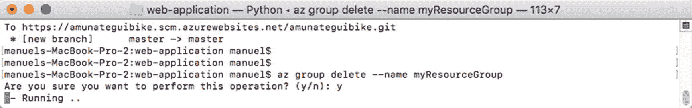
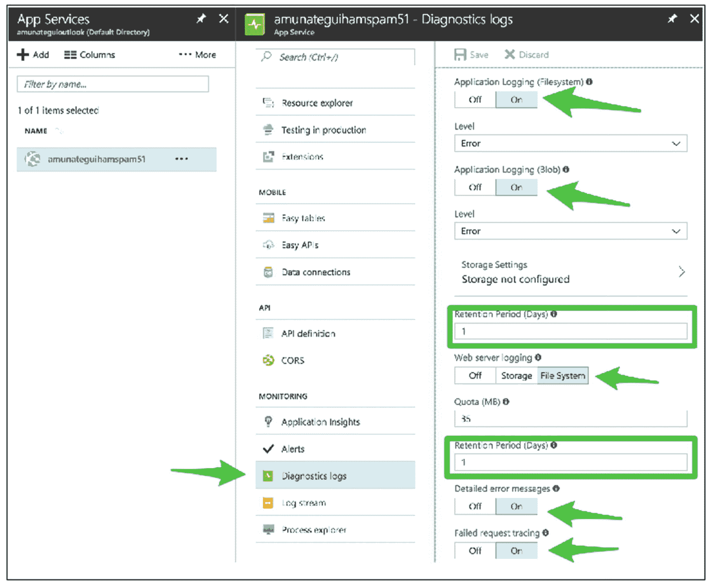
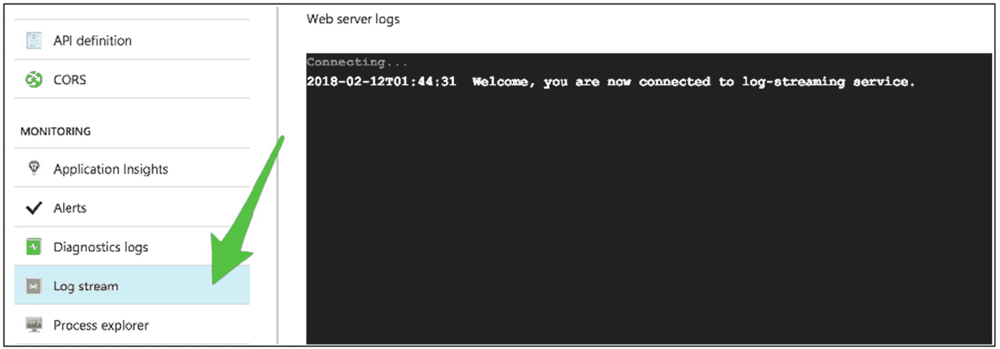
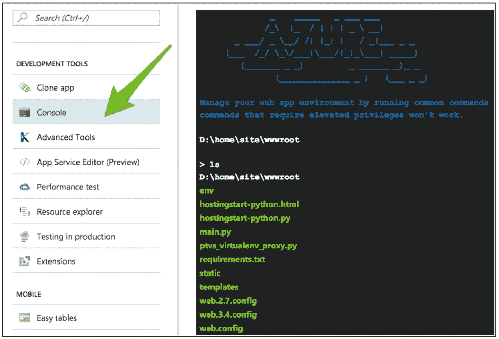

# 如果 git remote 已存在，请运行 'git remote remove azure'
$ git remote add azure https://flaskuser11@amunateguibike.scm.azurewebsites.net/amunateguibike.git
列表 2-53
最终代码推送到 Azure
```

系统可能会提示你输入密码；请确保使用你在“**az webapp deployment user**”步骤中创建的密码（在我的案例中是“**flask123**”；列表 2-54）。

```
$ git push azure master
列表 2-54
最终代码推送到 Azure
```

就是这样！你可以返回占位符浏览器页面并点击刷新，或者打开一个新的浏览器页面并输入 [`http://amunateguibike.azurewebsites.net`](http://amunateguibike.azurewebsites.net)

（或者在你的情况下是 `http://<<替换为你的应用名称>>.azurewebsites.net`），你应该会看到“**预测自行车租赁需求**”（图 2-29）。



图 2-29

享受你辛勤工作的成果`—`“**预测自行车租赁需求**”Web 应用！

另一方面，如果 azure-cli 返回错误消息，你将需要处理它们（请参阅故障排除部分）。任何时候你更新代码并希望重新部署时，发送一个“**push**”命令（列表 2-55）。

```
$ git commit -am "updated output"
$ git push azure master
列表 2-55
更新代码
```

你也可以直接在 Azure 的 Web 仪表板上管理你的应用程序。登录 Azure 并转到应用服务（图 2-30）。



图 2-30

Microsoft Azure 仪表板

### 重要清理！

这是一个关键步骤；你绝不应该在云中留下不需要的应用程序在运行，因为这会产生费用（或者如果你使用的是试用计划，则会消耗你的免费额度）。如果你不再需要它，请将其关闭（列表 2-56 和图 2-31）。



图 2-31

从 Azure 云中删除 Web 应用

```
$ az group delete --name myResourceGroup
列表 2-56
完成后别忘了删除你的 Azure 实例！
```

或者使用 Azure 的 Web 仪表板在“**应用服务**”下将其删除。

### 故障排除

调试 Web 应用错误可能会变得复杂。一种方法是通过 Azure 仪表板打开日志记录（图 2-32）。



图 2-32

打开 Azure 的诊断日志

然后打开日志流以开始捕获活动（图 2-33）。



图 2-33

捕获日志信息

你还可以使用 Azure 仪表板内置的便捷控制台工具检查你的文件结构（图 2-34）。



图 2-34

Azure 内置命令行工具

你甚至可以通过使用安装命令来检查你的“**requirement.txt**”文件是否有效（列表 2-57）。

```
> env\scripts\pip install -r requirements.txt
列表 2-57
在 Azure 控制台中运行命令
```

### 步骤回顾

1.  将你的终端/命令窗口指向包含本章 Web 应用文件的正确目录（并确认它可以在本地运行）。

    ```
    $ cd chapter-2/web-application
    ```

1.  Git 提交所有文件。

    ```
    $ git init
    $ git add .
    $ git commit -am "bike rental commit"
    ```

1.  登录 Azure 命令行界面并验证会话。

    ```
    $ az login
    ```

1.  准备 Azure Web 应用。

    ```
    $ az webapp deployment user set --user-name flaskuser11 --password flask123
    $ az group create --name myResourceGroup --location "West US"
    $ az appservice plan create --name myAppServicePlan --resource-group myResourceGroup --sku FREE
    $ az webapp create --resource-group myResourceGroup --plan myAppServicePlan --name amunateguibike --runtime "python|3.4" --deployment-local-git
    ```

1.  将 Web 应用推送到 Azure 云。

    ```
    $ git remote add azure https://flaskuser11@amunateguibike.scm.azurewebsites.net/amunateguibike.git
    $ git push azure master
    ```

1.  在浏览器窗口中打开 URL 并享受吧！

    ```
    http://>.azurewebsites.net
    ```

1.  终止实例！

    ```
    $ az group delete --name myResourceGroup
    ```

## 这里发生了什么？—— 我们 Web 应用中使用的脚本和技术概览

让我们快速浏览一下我们 Web 应用的代码。有两个重要文件：“**main.py**”，它是 Web 服务的控制脚本；以及模板文件“**index.html**”，它是我们 Web 应用的门面。由于大部分处理直接发生在“**index.html**”中，我们将把大部分时间花在那里，查看运行此 Web 应用的 HTML 和 JavaScript。


### main.py

通常情况下，这是整个应用的后台核心。它可以完成独立 Python 脚本所能做的几乎所有事情，并且还能为网页生成内容。在本章中，除了将平均特征值以及模型的截距和系数传递给模板之外，这里并没有太多其他操作。在本书中，我们将同时使用“**main.py**”和“**application.py**”。为控制 Python Web 服务的文件命名没有绝对的对错之分——唯一的例外是一些保留字。如果你选择自定义名称，则需要更新 YAML 文件和/或 Web 服务器网关接口配置文件。此外，一些云服务提供商默认使用不同的应用程序名称；Google Cloud 默认使用“**main**”，而 Azure 默认使用“**application**”。但无论哪种情况，都可以进行自定义和更改。

“**main.py**”在这里做的一件有趣的事情是传输截距、系数和平均值的起始值。

装饰器 **“@app.route**” 会将所有访问根 URL 或文件名为“**index.html**”的流量路由到相应函数。然后，它只需将所有默认值传递给“**index.html**”模板（清单 2-58）。

```
@app.route("/", methods=['POST', 'GET'])
def index():
