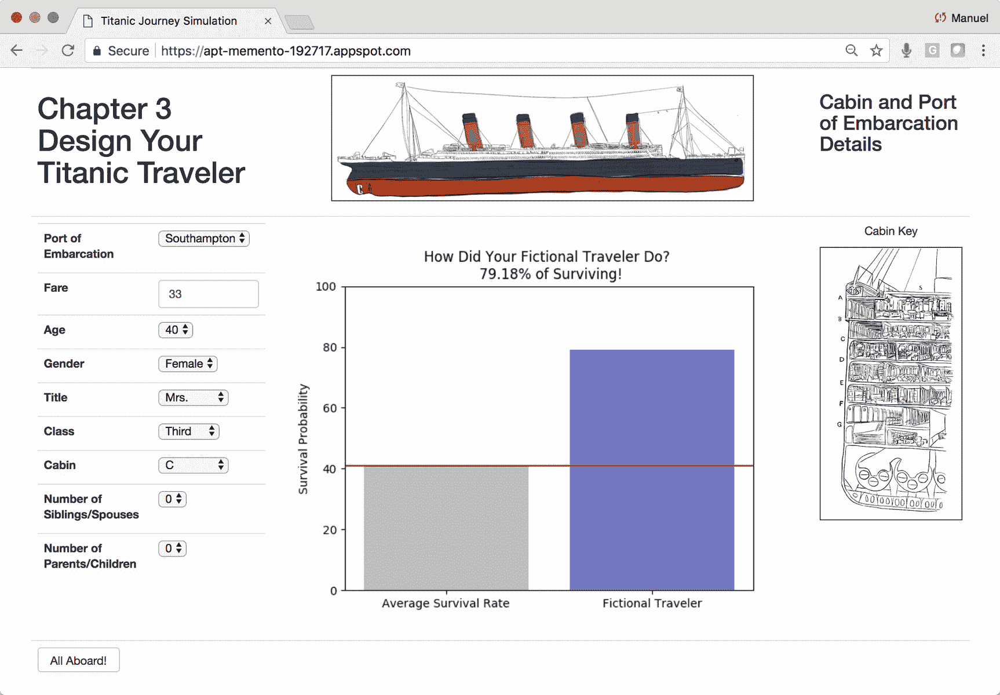
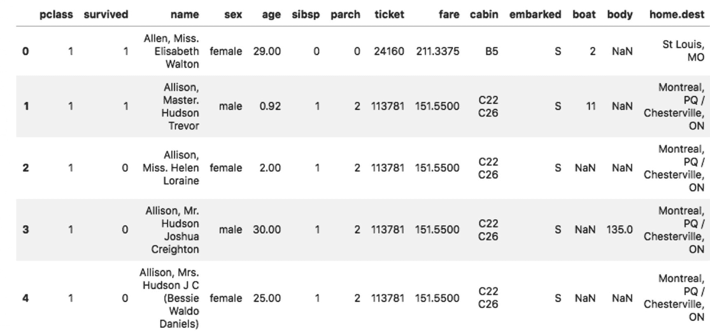
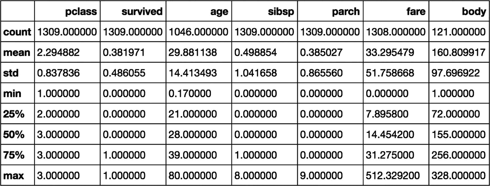
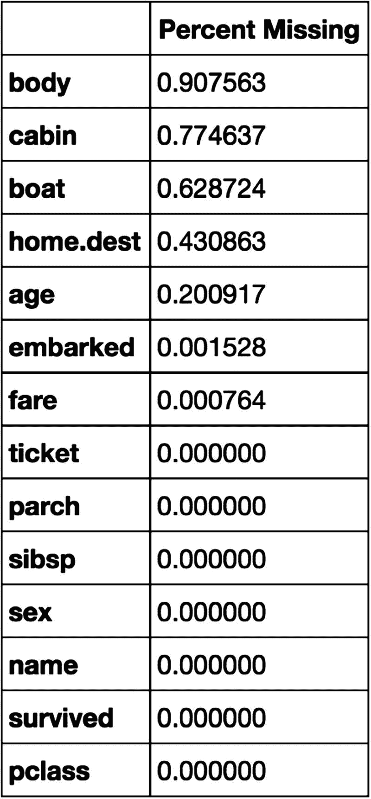
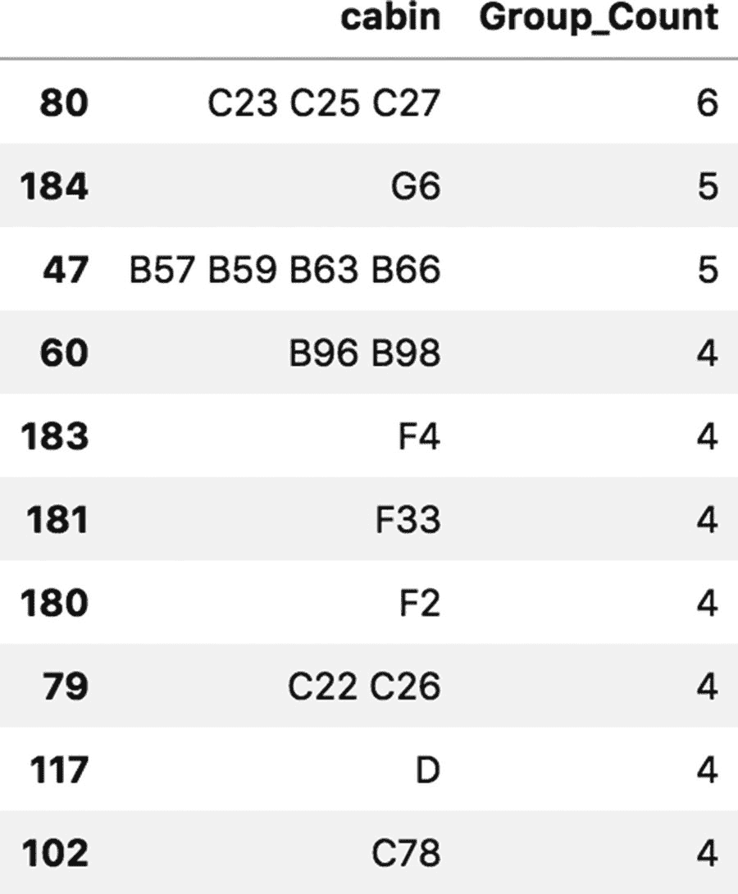
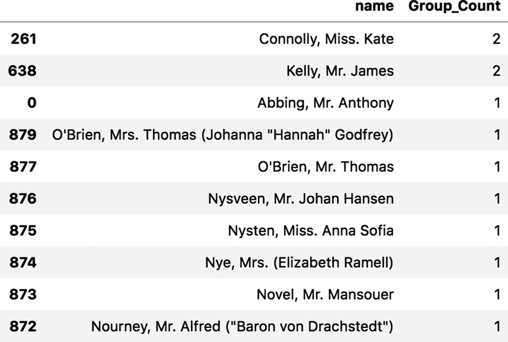
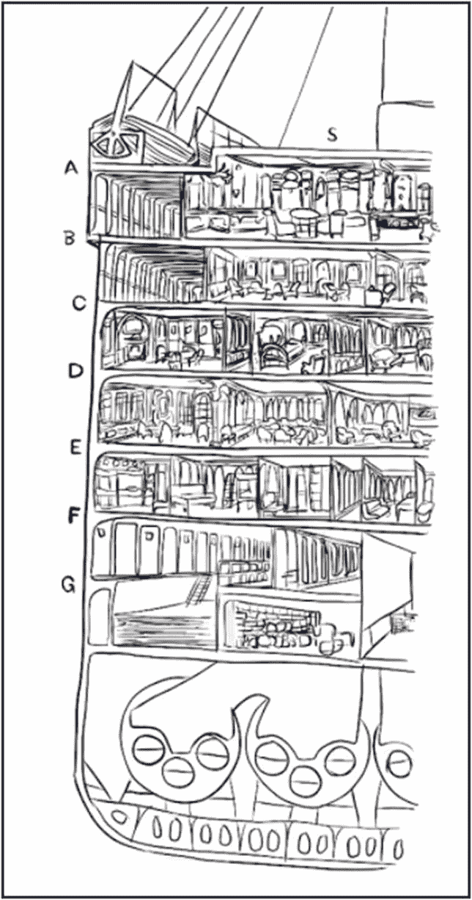
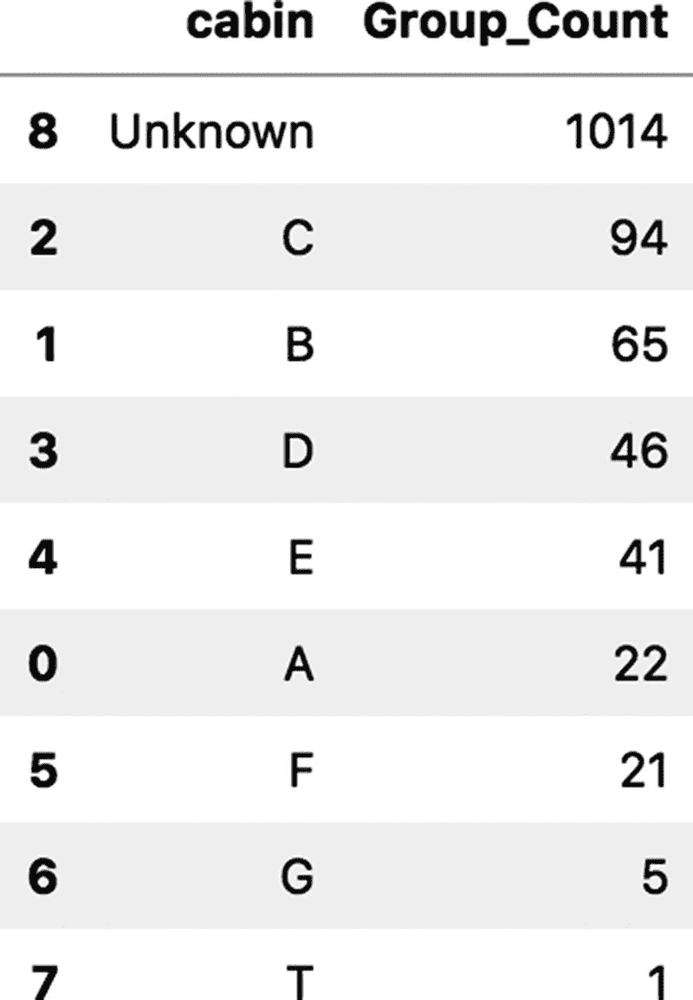
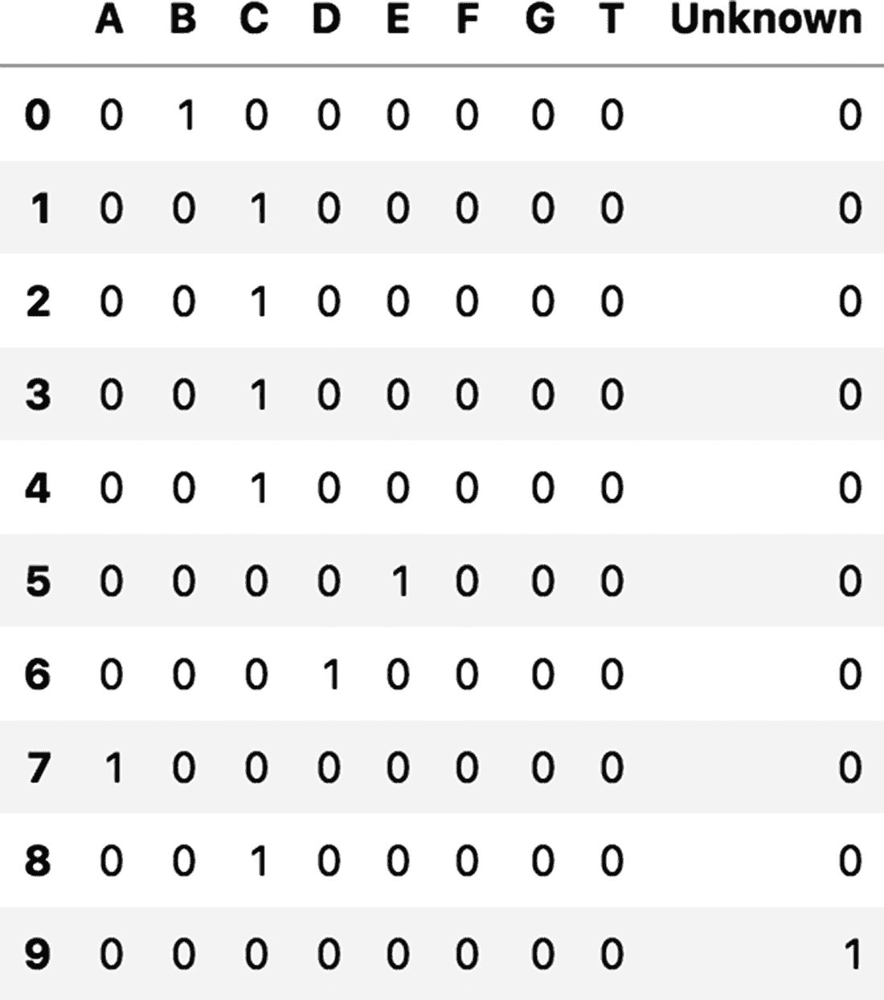
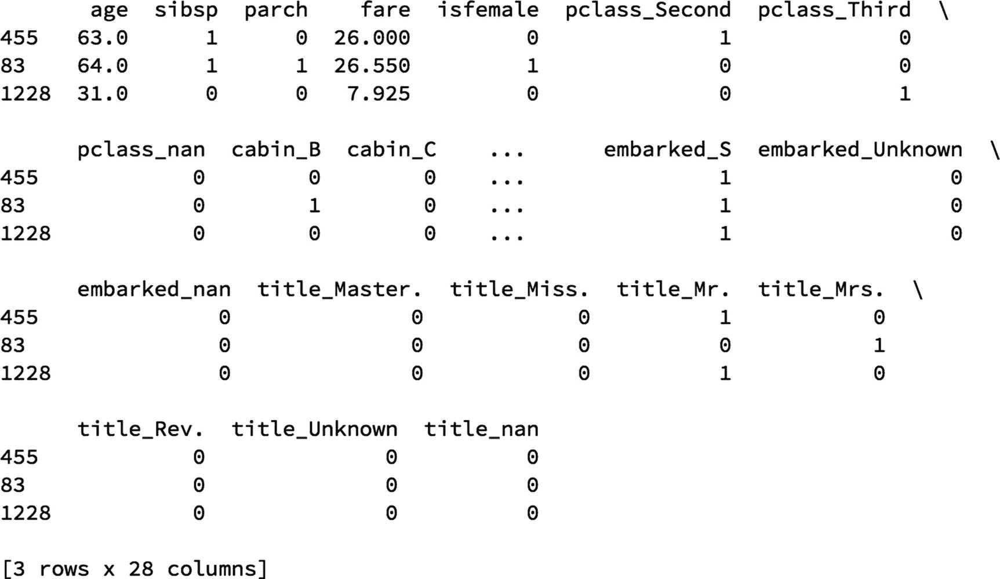

# on load set form with defaults
return render_template('index.html',
mean_holiday = MEAN_HOLIDAY,
mean_hour = MEAN_HOUR,
mean_sesaon1 = MEAN_SEASON_1,
mean_sesaon2 = MEAN_SEASON_2,
mean_sesaon3 = MEAN_SEASON_3,
mean_sesaon4 = MEAN_SEASON_4,
mean_temp = MEAN_TEMP,
model_intercept = INTERCEPT,
model_holiday = COEF_HOLIDAY,
model_hour = COEF_HOUR,
model_season1 = COEF_SEASON_1,
model_season2 = COEF_SEASON_2,
model_season3 = COEF_SEASON_3,
model_season4 = COEF_SEASON_4,
model_temp = COEF_TEMP)
清单 2-58
路由到“index.html”
```

Flask 使用一种名为“**Jinja2**”的技术，将这些变量直接注入到 HTML 模板表单中。如果你查看 return 语句，它会调用 Flask 的“**render_template**”函数，并将预期的变量传递给“**index.html**”。

模板要接收这些变量，只需使用双花括号命令即可。要查看所有这些内容，请参考 Web 应用程序“**index.htm**”的完整脚本（清单 2-59）。

```
var HOLIDAY = {{mean_holiday}}   // 当天是否为节假日
var HOUR = {{mean_hour}}         // 小时 (0 到 23)
var HOUR = {{mean_hour}}         // 小时 (0 到 23)
var SEASON_1 = {{mean_sesaon1}}  // 1:春季
var SEASON_2 ={{mean_sesaon2}}   // 2:夏季
var SEASON_3 = {{mean_sesaon3}}  // 3:秋季
var SEASON_4 = {{mean_sesaon4}}  // 4:冬季
var TEMP = {{mean_temp}}         // 标准温度，单位为摄氏度 -8 到 +39
var INTERCEPT = {{model_intercept}}
var COEF_HOLIDAY = {{model_holiday}}  // 当天是否为节假日
var COEF_HOUR = {{model_hour}}        // 小时 (0 到 23)
var COEF_SEASON_1 = {{model_season1}} // 1:春季
var COEF_SEASON_2 = {{model_season2}} // 2:夏季
var COEF_SEASON_3 = {{model_season3}} // 3:秋季
var COEF_SEASON_4 = {{model_season4}} // 4:冬季
var COEF_TEMP = {{model_temp}}      // 标准温度，单位为摄氏度 -8 到 +39
...
清单 2-59
使用 Jinja2 将 Python 变量设置到 JavaScript 中
```

### /static/ 文件夹

静态文件夹，顾名思义，存放静态的、不变的文件。这里用于存储我们 Web 应用程序的图像、文件和其他可共享数据。

### /templates/index.html 文件夹和脚本

templates 文件夹存放我们 Web 应用程序所需的所有模板。在后续章节中，通常会有两个 HTML 文件，一个“**index.html**”和一个响应 HTML 文件。最好将这些文件分开，而不是试图将所有内容塞进一个带有复杂“**if then**”分支的单个 HTML 文件中。

本章的大部分操作都发生在“**index.html**”内部，因此让我们深入了解一下。在你的编辑器中打开完整的“**index.html**”文件以便跟随学习。如前所述，本章的“**大脑**”不是 Flask，而是“**index.html**”前端页面——并且几乎全部位于页面末尾的 JavaScript 代码片段中。JavaScript 为网页带来了极佳的交互性。

就这个 Web 应用程序而言，它会监听按钮点击事件，并通过使用所选特征运行回归方程来重新计算自行车租赁需求。这还没完；一旦获得新的需求估计值，它会权衡该数字并决定显示哪张自行车图片拼贴画——如果估计值很小，则返回一辆自行车；如果很大，则返回全部十六辆。

首先，用户点击一个特征按钮，使用该特定特征获取新的自行车租赁估计值（清单 2-60）。

```
Spring
清单 2-60
使用 HTML “” 事件调用预测
```

“**<button>**”标签内的“**onclick(**)”函数会将 Id“**season_spring**”发送给主 JavaScript 函数“**calculateBikeDemand()**”。这告诉该函数，用户希望使用如清单 2-61 所示的季节变量设置来重新计算回归方程。

```
function calculateBikeDemand(elem) {
// 将新值应用于存储的变量
...
// 重新计算回归方程
rental_counts = INTERCEPT + (HOLIDAY * COEF_HOLIDAY)
+ (HOUR * COEF_HOUR)
+ (SEASON_1 * COEF_SEASON_1)  + (SEASON_2 * COEF_SEASON_2)
+ (SEASON_3 * COEF_SEASON_3)  + (SEASON_4 * COEF_SEASON_4)
+ (TEMP * COEF_TEMP)if (rental_counts < 0)
// 确定要显示的图片
if (rental_counts < 0) {
bike_out = 'static/images/bike_sixteen.png'
if (rental_counts < 0) {
bike_out = 'static/images/bike_zero.png'
} else if (rental_counts < 100) {
bike_out = 'static/images/bike_one.png'
} else if (rental_counts < 200) {
bike_out = 'static/images/bike_four.png'
} else if (rental_counts < 300) {
bike_out = 'static/images/bike_nine.png'}
// 构建一个包含用户所选变量和新的自行车租赁估计值的可读字符串
output = '对于 ' + season + ' + ' + holiday + ' + ' + temp + ' + ' + hour + '，需求 = ' + Math.round(rental_counts) + ' 辆自行车';
// 将新值和图片源直接注入到 HTML 标签中
document.getElementById("query").innerHTML = output;
document.getElementById('bike_out').src = bike_out
}
清单 2-61
“calculateBikeDemand()”建模 JavaScript 函数
```

## 结论

这就是我们的第一个项目！虽然这是一个简单的项目，Web 客户端和 Web 服务器之间的交互不多，但它符合真正 Web 应用程序的定义。在本章中，我们介绍了通过使用 Flask 和 Web 控件将独立脚本扩展为交互式 Web 应用程序的概念。我们还看到了 Python 和 Python 库与 Flask Web 框架通信是多么容易，使得向 Web 计算的跨越几乎无缝衔接。

整个过程始于规划我们的 Web 应用程序应该是什么样子，以及什么内容能引起观众的兴趣。这一步再怎么强调也不为过：如果没有人感兴趣，那就没有必要费心去构建它。我们常常一开始就建模，然后试图改造它，使其适应一个 Web 应用程序的故事。

然后，我们探索了来自 Capital Bikeshare System 的自行车共享数据集，^(⁹) 尝试了不同的建模方法来预测环境因素下的租赁需求，并选择了最终的特征和模型系数用于我们的 Web 应用程序。

我们运行了 Flask 应用程序的本地版本，并最终将其部署到 Microsoft Azure 云上。如果你按照这个顺序执行这些步骤，应该不会有什么问题。始终从设计 Web 应用程序的故事开始，尽可能在本地构建和运行它，然后再部署到云端。


## 其他资源

如果你想了解更多关于 Flask 的信息，请上网搜索，这方面的资料非常丰富。

更多信息请参考：

*   **Flask**：访问官方门户网站： [`http://flask.pocoo.org/`](http://flask.pocoo.org/)

*   **CSS**：请参阅 w3schools 网站上的优秀教程（涵盖 CSS 及其他所有与 Web 相关的内容）： [`www.w3schools.com/css/`](http://www.w3schools.com/css/)

*   **Bootstrap**：请访问门户网站： [`https://getbootstrap.com/`](https://getbootstrap.com/)

*   **JQuery**：请查看其门户网站： [`https://jquery.com/`](https://jquery.com/)

*   **YAML**：请查看其精简门户网站： [`http://yaml.org/`](http://yaml.org/)

*   **Jinja2**：请参阅官方文档： [`http://jinja.pocoo.org/docs/`](http://jinja.pocoo.org/docs/)

脚注 1   2   3   4   5

# 3. 在 GCP 上使用逻辑回归实现实时智能

让我们通过在 Google Cloud 上构建一个交互式乘客档案生成器，来了解泰坦尼克号沉船事故中哪些人幸存了下来。

在本章中，我们将重新审视全球建模教科书和教育博客所钟爱的经典且戏剧性的泰坦尼克号数据集。我们将分析乘客名单，并试图理解为什么有些人在这场悲剧事故中幸存，而另一些人却没有。我们将探索数据集，为建模做好准备，并将其扩展为一个交互式 Web 应用程序，允许用户创建一个虚构的乘客，调整参数，并可视化该乘客在航行中的表现（图 3-1）。



图 3-1

本章的最终 Web 应用程序

范德比尔特大学生物统计系^(¹⁰)慷慨地托管了该数据（以及许多其他有趣的数据集），可以通过 Pandas Python 库直接调用并方便地下载。

### 注意

通过访问 [`www.apress.com/9781484238721`](http://www.apress.com/9781484238721) 并点击源代码按钮，下载第 3 章的配套文件。打开 Jupyter notebook “**chapter3.ipynb**” 以跟随本章内容进行学习。

## 规划我们的 Web 应用程序

我们的第一步是充分构思泰坦尼克号概念，并使其作为 Web 应用程序在我们的本地机器上运行。

我们应用程序的核心是来自“**sklearn Python 库**”^(¹¹)的一个简单逻辑回归模型。在通过移除无预测能力的特征、为分类数据创建虚拟列、以及对文本字段应用基本的自然语言处理来准备数据之后，我们训练模型以识别那些幸存者和遇难者周围的常见模式。

我们通过遵循标准建模流程（将数据分成两部分，一部分用于训练模型，另一部分用于验证模型）来验证模型的准确性。一旦我们对模型的能力感到满意，我们就用它来预测一个虚构乘客的生存概率。这个概率是一个介于 0 和 1 之间的数字，代表了该虚构乘客从沉船事故中生还的机会——数值越接近 1，生存的机会就越大。

最后，我们将抽象并概括整个过程，使其在我们的 Web 应用程序的构造函数中运行。这意味着数据摄取、准备和建模的整个过程仅在模型部署期间（以及每当 Web 服务器重启时）发生一次。这确保了当用户想要与 Web 应用程序交互时，由于训练好的模型已经加载到内存中，应用程序能够快速给出预测结果。不过我们有点操之过急了；让我们先完成项目的本地版本。


## 数据整理

由于这是一个经典的数据科学练习，也是一次有据可查的著名事件，我们已知（或凭直觉判断）哪些特征对于理解谁在航行中幸存下来具有分析价值（更多信息请参阅范德比尔特大学生物统计学资料^(¹²)）。请继续操作，将本章所需的文件下载到一个名为“**chapter-3**”的文件夹中。打开 Jupyter notebook 以便同步操作。让我们先查看数据提供方给出的数据图例（表 3-1）。

表 3-1

数据集图例

| 特征 | 描述 |
| --- | --- |
| pclass | 船票等级，包含 3 个级别 |
| sex | 性别 |
| age | 年龄 |
| sibsp | 船上兄弟姐妹/配偶人数 |
| parch | 船上父母/子女人数 |
| fare | 乘客票价 |
| cabi | 客舱编号 |
| embarked | 登船港口 |
| name | 乘客姓名 |

初步探索数据可以通过编程方式使用 Pandas 的“**head()**”函数完成，该函数会返回前五行数据（代码清单 3-1 和图 3-2）。你也可以使用“**tail()**”函数查看后五行数据。



图 3-2

原始数据的前五行

```
titanic_df.head()
代码清单 3-1
快速查看前五行数据
```

该数据确实符合范德比尔特大学生物统计学资料的数据图例。你应该会注意到“**body**”列中存在缺失值，“**name**”和“**home.dest**”列中有大量文本数据，以及“**cabin**”列中存在一些混合内容。

“**info()**”、“**describe()**”和“**isnull()**”函数也是快速探索数据的关键。强烈建议在遇到新数据集或进行任何数据转换工作后运行这些函数。

Pandas 的“**info()**”函数会告诉你数据集中包含的数据类型和非空计数（代码清单 3-2）。

```
输入：
titanic_df.info()
输出：

RangeIndex: 1309 entries, 0 to 1308
Data columns (total 1 columns):
pclass       1309 non-null int64
survived     1309 non-null int64
name         1309 non-null object
sex          1309 non-null object
age          1046 non-null float64
sibsp        1309 non-null int64
parch        1309 non-null int64
ticket       1309 non-null object
fare         1308 non-null float64
cabin        295 non-null object
embarked     1307 non-null object
boat         486 non-null object
body         121 non-null float64
home.dest    745 non-null object
dtypes: float64(3), int64(4), object(7)
memory usage: 143.2+ KB
代码清单 3-2
快速查看特征数据类型
```

从“**info()**”函数输出中标记为“**non-null object**”的数据可以被视为基于文本的数据，我们需要弄清楚它是什么类型的文本。这有点像一门主观的艺术，因为处理方式多种多样（稍后会详细介绍）。

Pandas 的“**describe()**”函数会给出所有定量字段的汇总统计。我们立刻就能看到，“**survived**”特征的均值为 0.38。这意味着只有 38% 的乘客幸存，并且由于我们将使用该特征作为训练模型的结果标签，因此数据集偏向于未幸存者（即大多数乘客未能在航行中幸存；代码清单 3-3 和图 3-3）。



图 3-3

泰坦尼克号数据框的描述性输出

```
titanic_df.describe()
代码清单 3-3
定量数据汇总
```

“**isnull()**”函数可以封装到一个计数器中，以找出我们正在处理的缺失值数量。关于插补方法以及如何在建模场景中最佳处理缺失数据，已有专著论述。在这里，我们将删除一些特征，并对其他特征进行插补（代码清单 3-4 和图 3-4）。



图 3-4

泰坦尼克号数据框中每个特征的缺失数据百分比

```
titanic_missing_count = titanic_df.isnull().sum().sort_values(ascending=False)
pd.DataFrame({'Percent Missing':titanic_missing_count/len(titanic_df)})
代码清单 3-4
分析缺失数据
```

分析函数输出后，我们了解到数据包含数值型、分类型和基于文本的特征。数据集总共包含 1,309 行。我们还看到，特征“**body**”中 90% 的条目是缺失的；这使得它成为一个容易删除的特征。还有其他一些特征我们将忽略，因为它们要么难以处理，要么对建模幸存率帮助不大（例如乘客的姓氏）。


### 处理分类数据

处理分类数据是一个重要课题，其中某些方面具有主观性，而另一些则不然。一个实用的经验法则是，找出特定文本列中有多少值是唯一或重复的。检查频率是一个不错的起点。让我们结合 Pandas 的“**groupby()**”和“**count()**”函数，对“**cabin**”特征进行调用。这将告诉我们这些值是否在乘客之间共享，从而判断应将其视为类别还是自由格式的文本条目（见代码清单 3-5 和图 3-5）。



图 3-5

舱位信息是拼接在一起的，将其解耦会更有益处

```
titanic_feature_count = titanic_df.groupby('cabin')['cabin'].count().reset_index(name = "Group_Count")
titanic_feature_count.sort_values('Group_Count', ascending=False).head(20)
代码清单 3-5
统计“cabin”特征中的重复值
```

结果输出证实这些值是类别，因为它们经常重复（这符合直觉：每个舱位可能有多名乘客）。让我们对另一个基于文本的列——“**name**”特征进行同样的实验（我们已经知道会看到多少重复值；见代码清单 3-6 和图 3-6）。



图 3-6

名字重复的次数有多少？

```
titanic_feature_count = titanic_df.groupby('name')['name'].count().reset_index(name = "Group_Count")
titanic_feature_count.sort_values('Group_Count', ascending=False).head(10)
代码清单 3-6
统计“name”特征中的重复值
```

正如直觉所料，大多数名字都是唯一的。这既不是一个适合被视为分类的列，通常也不是一个适合建模的列（你需要重复的数据来发现模式，而唯一的文本条目在其原始状态下无法达到此目的）。

分类数据既可能出现在整数数据类型中，也可能出现在文本数据类型中；因此，单独考虑每个特征并确定最佳建模方式非常重要。例如，特征“**sex**”是分类且二元的，因此该数据的分数对我们没有帮助。我们会将其更改为一个名为“**isFemale**”的单列。如前所示，特征“**cabin**”确实存在重复，但我们可以通过一些处理使其重复得更多（见代码清单 3-7）。

```
输入:
titanic_df['cabin'].head()
输出:
0         B5
1    C22 C26
2    C22 C26
3    C22 C26
4    C22 C26
名称: cabin, 数据类型: object
代码清单 3-7
舱位特征的“Head()”方法
```

通过提取该特征的一个样本，我们注意到数据中的一个共性：每个数字前面都有一个代表船舶甲板层级的字母（图 3-7）。



图 3-7

泰坦尼克号剖面图，标注了舱位层级（插图由 Lucas Amunategui 提供）

因此，利用这些数据的一种方法是取第一个字母并去掉数字。这为我们提供了一个有趣的特征：乘客所在的楼层，以及该楼层与顶层甲板救生艇之间的距离是否与生存率有关？也许存在这种关系，你可以通过我们即将构建的应用程序来找出答案（见代码清单 3-8）。

```
输入:
titanic_df['cabin'] = titanic_df['cabin'].replace(np.NaN, 'U')
titanic_df['cabin'] = [ln[0] for ln in titanic_df['cabin'].values]
titanic_df['cabin'] = titanic_df['cabin'].replace('U', 'Unknown')
titanic_df['cabin'].head()
输出:
0    B
1    C
2    C
3    C
4    C
名称: cabin, 数据类型: object
代码清单 3-8
仅使用每个舱位名称的第一个字符
```

接下来，我们像之前一样执行“**groupby()**”和“**count()**”来统计频率（见代码清单 3-9 和图 3-8）。



图 3-8

我们新的“**cabin**”特征的总计数

```
titanic_feature_count = titanic_df.groupby('cabin')['cabin'].count().reset_index(name = "Group_Count")
titanic_feature_count.sort_values('Group_Count', ascending=False).head(10)
代码清单 3-9
统计每个舱位首字母分组
```

哇，重复次数比之前观察到的多得多。这应该比其原始格式作为特征更有用。我们将对乘客的“**name**”特征进行同样的处理，只提取头衔：“**Mrs.**”或“**Mr.**”等，并丢弃其他部分（更多细节请参阅 Jupyter notebook）。

这并不是说原始的、自由格式的文本（非重复类型）对建模没有用处。恰恰相反，世界上大多数数据都是非结构化的，并且潜力巨大——想想医生的笔记或商店评论！这些数据可以建模，但需要更高级的方法，例如自然语言处理、奇异值分解、词向量化等。我们将在本书的后续章节中看到其中一些技术。

### 从分类数据创建虚拟特征

一旦我们识别出分类特征并完成了需要转换的特征转换，我们仍然需要将它们转换为数值形式，以便模型能够使用它们。Pandas 库中一个很棒的函数是“**get_dummies()**”。它会将每个类别分解到其自己的列中。

以下是使用“**get_dummies()**”函数及其输出的示例（见代码清单 3-10 和图 3-9）。



图 3-9

舱位特征转换为二进制数据（虚拟化）

```
pd.get_dummies(titanic_df['cabin'], columns=['cabin'], drop_first=False).head(10)
代码清单 3-10
从“cabin”特征创建虚拟变量
```

它接受一个特征，将每个唯一值分解到一个单独的列中，并删除原始列。请记住，并非所有非连续数值都应制成虚拟字段。想想美国的邮政编码；如果你将它们虚拟化，将会为数据集增加额外的 43,000 个极其稀疏的特征——这通常不是一个好主意。对于邮政编码，更好的方法可能是更大的分类分组，例如在城镇或州级别进行建模。

## 建模

在我们的第二个项目中保持简单，将使我们能够专注于全局，并平等地投入到构建 Web 应用程序的每个环节。我们将使用来自“**sklearn**”库的逻辑回归模型。如果你还记得上一章，我们使用了线性回归，它试图预测一个连续变量。而逻辑回归则试图预测一个二元结果，例如真或假、高兴或悲伤等。这两种都是极其常见的模型，但你需要根据试图建模和预测的结果变量类型来选择正确的模型。


### 训练/测试集划分

我们利用 sklearn 中的“**train_test_split()**”函数，通过指定随机种子将数据划分为两个随机数据集。在测试不同方法时，设置“**random_state**”参数是个好习惯，这能确保始终使用相同的划分方式，以便进行公平比较。“**test_size**”参数用于设置测试集的划分比例。此处我们将其设为 0.5，即 50%，因此函数会随机打乱数据并将其对半分为训练集和测试集。我们将使用训练部分来建模，用测试部分来评估模型的表现。该函数使用起来非常简便（见代码清单 3-11 和图 3-10）。



图 3-10

泰坦尼克号数据框的训练集划分，已准备好进行建模

```
from sklearn.model_selection import train_test_split
features = [feat forfeat in list(titanic_ready_df) if feat != 'survived']
X_train, X_test, y_train, y_test = train_test_split(titanic_ready_df[features],
titanic_ready_df[['survived']], test_size=0.5, random_state=42)
print(X_train.head(3))
代码清单 3-11
将数据划分为训练集和测试集
```

该函数将结果变量分别存入“**y_train**”和“**y_test**”；模型将只能访问“**y_train**”（见代码清单 3-12）。

```
输入:
print(y_train.head(3))
输出:
survived
455          0
83           1
1228         1
代码清单 3-12
训练数据集中的前几个结果值
```

### 逻辑回归

现在需要决定使用哪种模型并进行设置。由于我们要预测的是一个二元结果——乘客是否在航行中幸存——逻辑回归是一个不错且轻量级的选择，非常适合网络应用。始终牢记最终目标是个好习惯（见代码清单 3-13）。

```
from sklearn.linear_model import LogisticRegression
lr_model = LogisticRegression()
