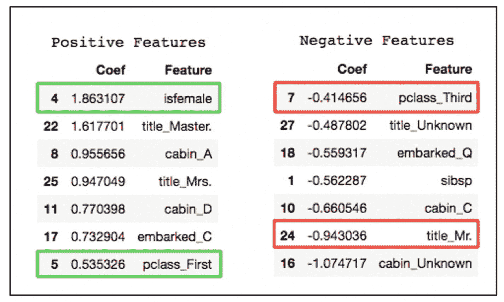
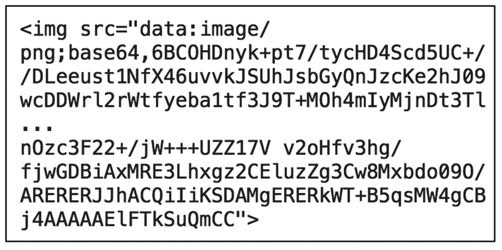
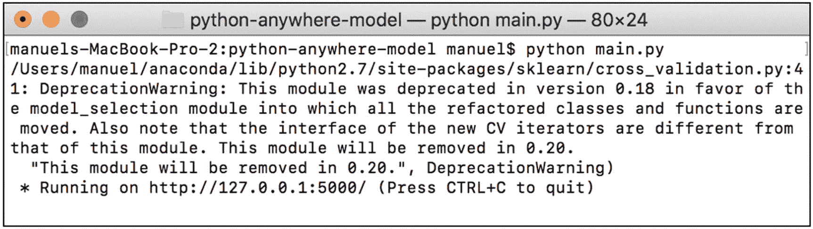
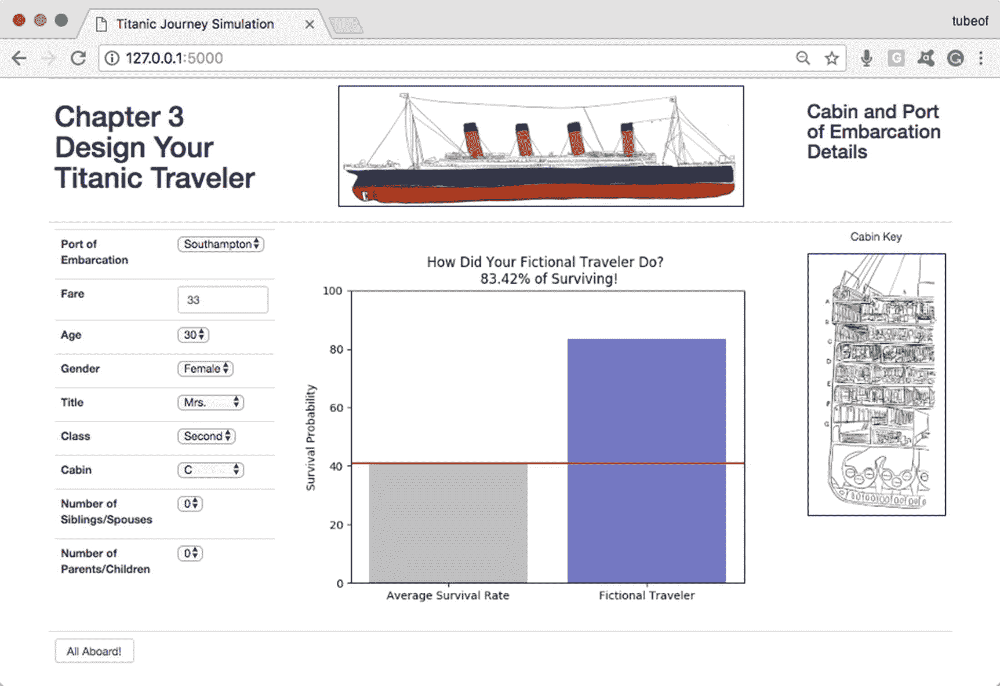
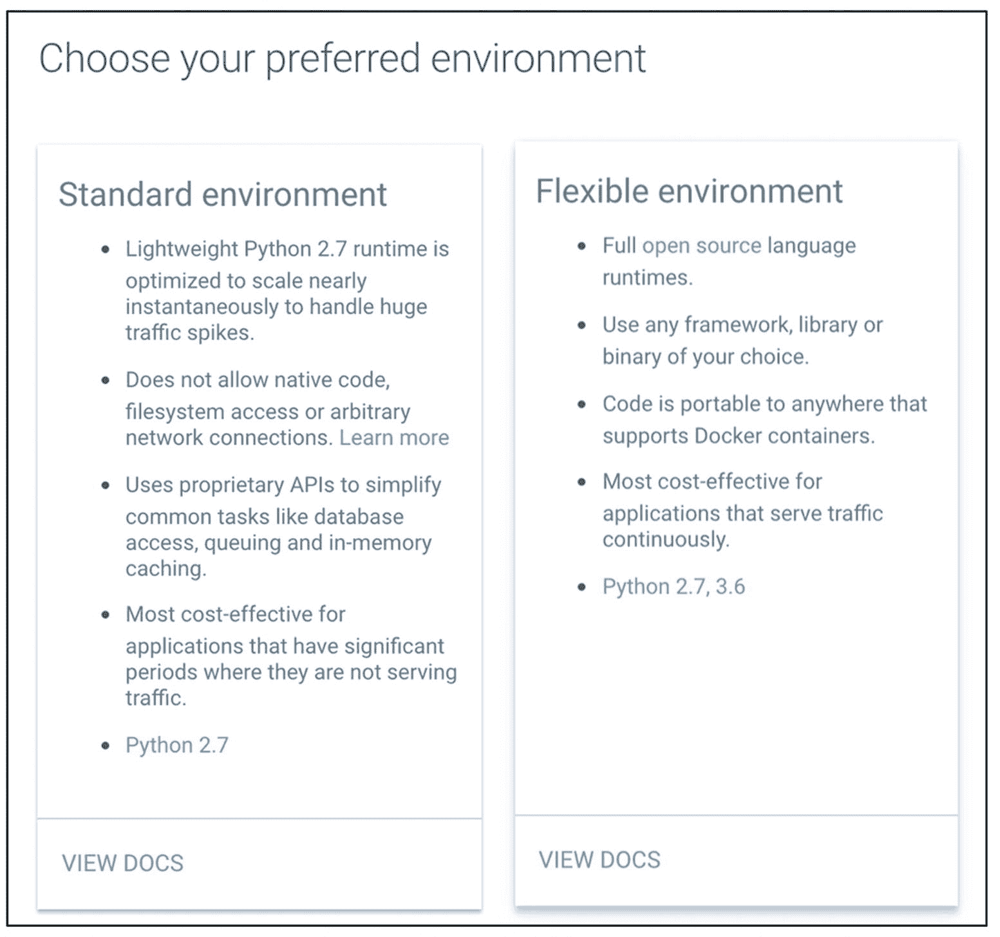
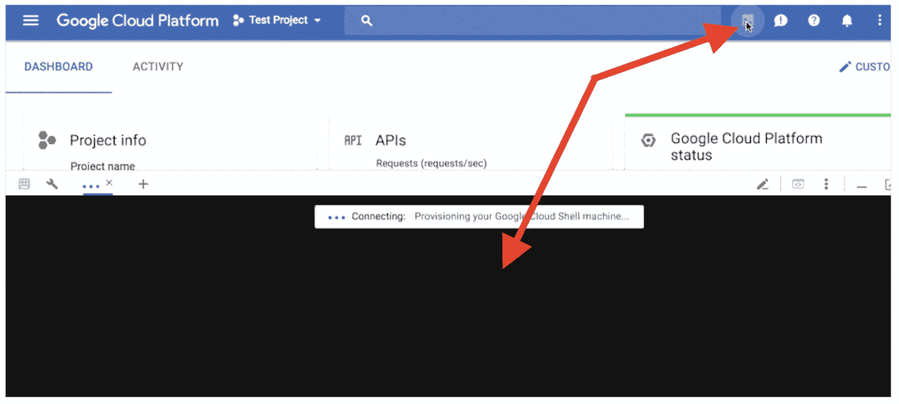
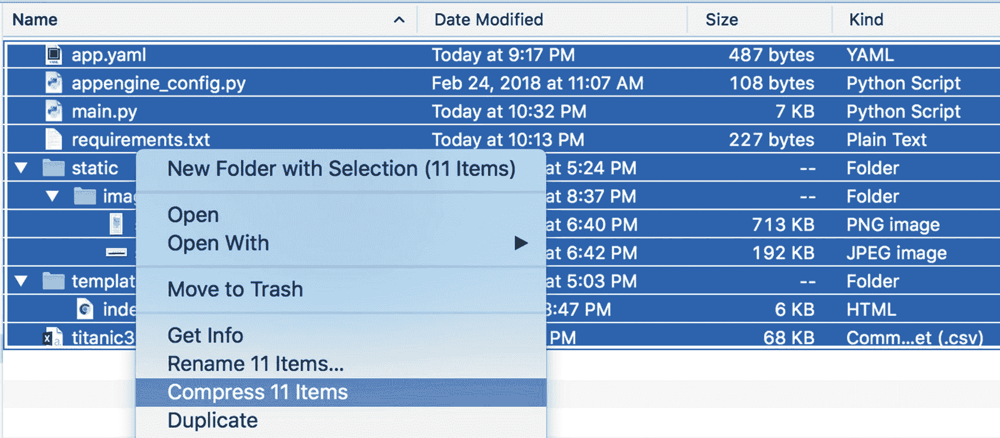
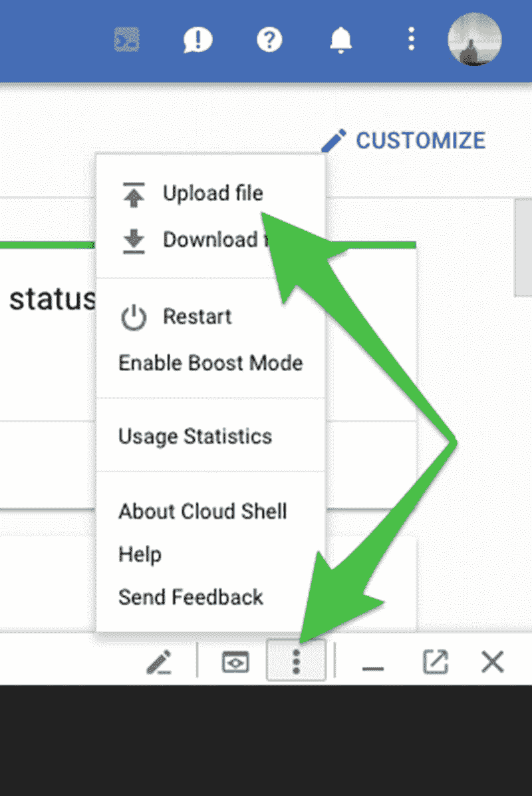
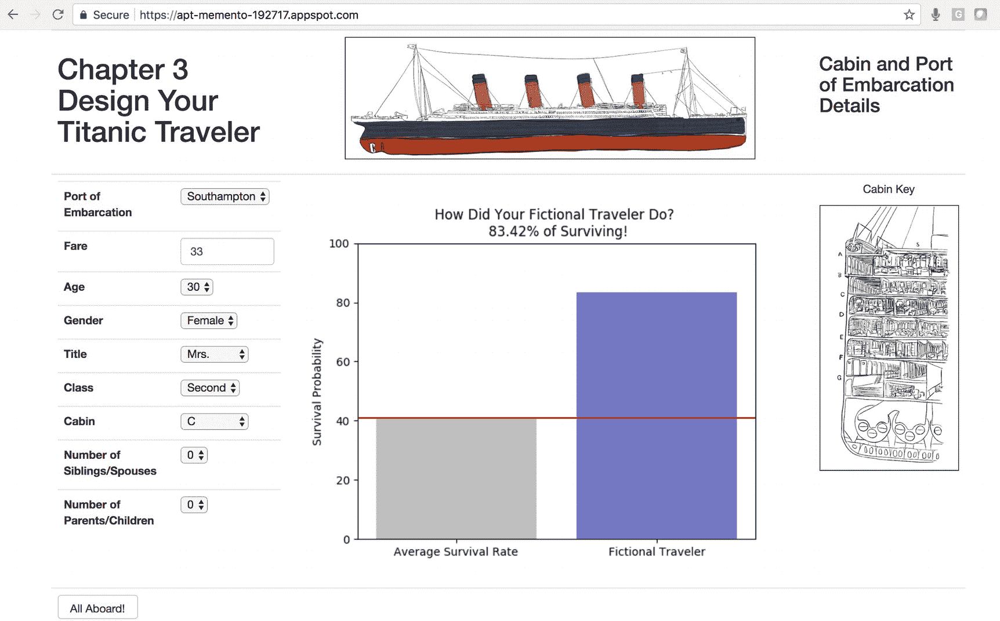
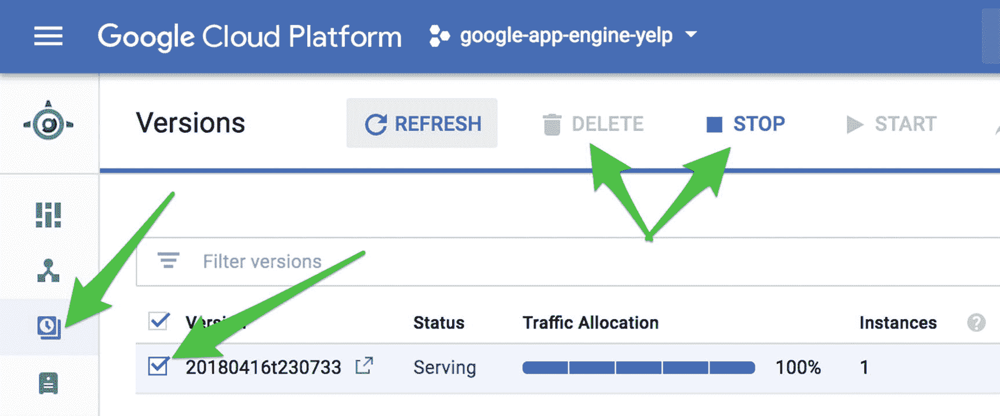

# ravel() 只是创建一个扁平化的数组
lr_model.fit(X_train, y_train.values.ravel())
代码清单 3-13
Sklearn 的逻辑回归模型
```

数据相当直观，幸存模式的规律众所周知，并且大多数建模算法都能清晰地识别出来。Sklearn 的逻辑回归模型让我们可以非常方便地查看模型生成的系数，从而帮助我们解读哪些特征对泰坦尼克号之旅的幸存预测最为重要（见代码清单 3-14）。

```
coefs = pd.DataFrame({'Feature':features, 'Coef':lr_model.coef_[0]})
coefs.sort_values('Coef', ascending=False)
代码清单 3-14
提取模型系数
```

图 3-11 展示了在预测幸存率时正向影响最大和负向影响最大的特征。显然，在这次特定的航行中，身为女性且富有比身为男性且贫穷要幸运得多（完整的系数列表请参见笔记本）。



图 3-11

正向影响最大和负向影响最大的特征

### 预测幸存率

一旦我们训练好模型，就可以使用之前预留的测试数据部分来验证其准确性（使用前面提到的“**train_test_split()**”函数）。这些数据绝不能在训练阶段使用！因此，它能保证对模型进行一次全新的评估，并提供一种客观的方式来获取性能评分（见代码清单 3-15）。

```
输入:
y_pred = lr_model.predict(X_test)
print('Accuracy of logistic regression classifier on test set: {:.2f}%'
.format(lr_modl.score(X_test, y_test)*100))
输出:
Accuracy of logistic regression classifier on test set: 79.35%
代码清单 3-15
使用测试数据集进行预测
```

使用验证数据集时，该模型在预测谁能在航行中幸存方面达到了近 80% 的准确率。考虑到我们使用的是简单模型和小型数据集，这个分数并不算差。

Python 脚本的工作已接近尾声；我们只需要确保能够使用虚构数据进行预测。这是一个重要的步骤，因为我们希望用户能够提供自己的数据，并通过训练好的模型运行。好的，那么让我们尝试预测一位 50 岁、乘坐三等舱的男性乘客（见代码清单 3-16）。

```
x_predict_pclass = 'Third'
x_predict_is_female=0
x_predict_age=50
x_predict_sibsp=3
x_predict_parch = 0
x_predict_fare = 200
x_predict_cabin = 'A'
x_predict_embarked = 'Q'
x_predict_title = 'Mr.'
代码清单 3-16
通过创建虚构乘客来设置自定义预测
```

如果你熟悉这个数据集和历史事件，就会知道我们这位虚构乘客的结局不会太好。在模型运行之后，我们使用一个简单的对比图表来展示结果，该图表显示了我们虚构乘客旁边的平均幸存率。身为男性且乘坐三等舱是一个糟糕的组合（图 3-12）。


图 3-12

平均幸存率与我们的虚构乘客对比

## 抽象化一切，为云端做准备

既然我们已经确认模型可以工作，能够创建虚构乘客并预测他们的幸存概率，那么我们可以将代码打包成两个函数，用于我们的网络应用。保持代码的整洁有序，将减少从独立脚本项目迁移到云端环境过程中的复杂性和调试难题。

### 函数 startup( )

我们创建一个“**startup()**”函数，该函数负责将数据加载到内存中，执行所有特征工程，创建虚拟列，并训练模型。此函数仅在网络服务器启动或重启时被调用一次。尽可能多地将工作预加载到内存中，将为与网络应用交互的用户提供更快、响应更灵敏的体验。

### 函数 submit_new_profile( )

第二个函数名为“**submit_new_profile()**”。该函数处理新的虚构乘客档案，将数据格式化为与真实训练数据相同的形状，创建所需的虚拟列，并让模型预测并输出幸存概率。

就是这样；我们所需的大部分核心处理工作将由这两个函数完成。其余所有代码用于网络服务器和 HTML 页面之间的通信、显示结果以及使整个应用看起来更专业。但我们有点操之过急了；现在让我们先更深入地了解 Flask。

使用 Flask 的一个绝佳理由是，它允许我们在不离开 Python 语言的情况下，将独立的 Python 脚本函数与服务器端的网络控件连接起来。这使得在模型和网络之间传递数据变得容易得多！

## 与 HTML 表单的交互

除了 Flask，一个关键的前端网络技术是“**HTML 表单**”。^(¹³) 尽管这是基础内容，但它是用户与我们的应用之间的关键纽带。HTML 表单允许用户与网页上的信息进行交互，然后点击提交按钮，将自定义数据发送回 Flask 网络服务器（见代码清单 3-17）。

```
...

{{selected_embarked}}
瑟堡
皇后镇

...
提交

代码清单 3-17
与用户交互
```


## 创建动态图像

这里我们使用一项重要技术，将 Python 中即时创建的图像转换为字符串，以便 HTML 解释器能够动态接收并理解这些图像。这是通过“**base64**”Python 模块实现的：

> *该模块提供 RFC 3548 中指定的数据编码和解码功能。该标准定义了 Base16、Base32 和 Base64 算法，用于将任意二进制字符串编码和解码为文本字符串，这些文本字符串可以安全地通过电子邮件发送、用作 URL 的一部分，或作为 HTTP POST 请求的一部分包含在内。该编码算法与 uuencode 程序不同。* ^((14))

在以下简化的代码片段中，我们使用“**matplotlib.pyplot**”库在 Python 中创建了一个图像（清单 3-18）。

```
import matplotlib.pyplot as plt
fig = plt.figure()
plt.bar(y_pos, performance, align="center", color = colors, alpha=0.5)
img = io.BytesIO()
plt.savefig(img, format="png")
img.seek(0)
plot_url = base64.b64encode(img.getvalue()).decode()
清单 3-18
创建动态图像
```

然后，可以使用 Flask Jinja2 模板符号将变量“**plot_url**”注入到 HTML 代码中，如下所示（清单 3-19）。

```
model_plot = Markup(''.format(plot_url))
...
{{model_plot}}
清单 3-19
将动态图像从 Flask 绘制到 Jinja2
```

如果你查看 HTML 源代码输出，你会看到 HTML 图像标签由一长串字符组成（在显示的图像中大幅截断）。解释器将知道如何将其转换为图像（图 3-13）。



图 3-13

图像转换为字符串

## 下载泰坦尼克号代码

让我们下载第 3 章的文件，如果尚未下载，请将它们保存到本地机器上。下载完成后，打开一个命令行窗口，并将驱动器切换到“**web-application**”文件夹。文件夹结构应如清单 3-20 所示。

```
web-application/
├── main.py
├── static/
└── images/
├── small_cabin_location.png
└── small_titanic.jpg
├── templates/
└── index.html
├── titanic3.csv
├── requirements.txt
├── app.yaml
└── appengine_config.py
清单 3-20
Web 应用程序文件
```

下载并解压所有内容后，打开一个命令行窗口，将驱动器切换到“**web-application**”文件夹，并通过运行“**pip install -r**”命令安装所有必需的 Python 库（清单 3-21）。

```
$ pip3 install -r requirements.txt
清单 3-21
安装依赖项
```

与之前的本地 Flask 应用程序一样，运行“**Python3 main.py**”命令。它应该类似于以下图 3-14 中的屏幕截图。



图 3-14

命令/终端窗口输出，显示本地 Flask 网页的 URL 地址

然后，将 URL“**http://127.0.0.1:5000/**”（或终端窗口中显示的任何地址）复制到浏览器中，你应该会看到泰坦尼克号 Web 应用程序出现。如果没有出现，请在你喜欢的代码编辑器中打开“**main.py**”（我在 Mac 上喜欢用 sublime，在 Windows 上喜欢用 notepad++），并将最后一行的布尔标志切换为“**True**”。重新运行它，并解决日志记录器报告的任何问题。

查看 Web 应用程序的本地版本，如图 3-15 所示。



图 3-15

我们 Web 应用程序的本地版本

## Google Cloud Flexible App Engine

现在，这是另一个有趣的部分，将我们的应用程序部署到无服务器云中，让全世界都能看到！在介绍章节中，我们了解了标准 App Engine，这次我们将不得不使用 Flexible App Engine 来运行更复杂的 Python 库。

### Google App Engine

Google App Engine 是无服务器的，因此你无需考虑 Web 应用程序背后的任何硬件。你无需知道应用程序运行在什么操作系统下，它会自动扩展，Google 会处理安全补丁，并且你只需为你消耗的资源付费。

你可以选择两种类型的 App Engine：一种非常简单但可定制性较差，另一种则不然。我们在第 1 章中使用了标准环境；这里由于某些 Python 库的需求，我们需要使用 Flexible 环境（图 3-16）。



图 3-16

App Engine 标准环境与 Flexible 环境之间的差异（在你阅读本文时可能已发生变化）

## 在 Google App Engine 上部署

有多种方法可以在 Google App Engine 上部署 Web 应用程序。在本章中，我们将使用仪表板本身内置的 shell 终端。这适用于快速任务；对于较长时间的任务，你需要从本地计算机打开一个终端会话，并使用适当的身份验证启动与 Google Cloud 账户的连接。其他方法包括将 GitHub（或 BitBucket）直接链接到你的 Google Cloud 账户，直接从本地机器使用终端会话，以及仪表板中还有一个实验性的代码编辑器（参见 [`https://cloudplatform.googleblog.com/2016/10/introducing-Google-Cloud-Shels-new-code-editor.html`](https://cloudplatform.googleblog.com/2016/10/introducing-Google-Cloud-Shels-new-code-editor.html) ）。

如果你还没有 Google Cloud 账户，可以访问 Google Cloud 入门页面（ [`https://console.cloud.google.com/getting-started`](https://console.cloud.google.com/getting-started) ）并设置一个。在撰写本文时，Google 提供 12 个月和 300 美元的信用额度供你入门（图 3-17）。


图 3-17

Google Cloud Platform 特别优惠

### 步骤 1：启动 Google Cloud Shell

登录你的 Google Cloud 实例，并创建或选择你想要 App Engine 所在的项目。通过点击右上角的插入符号按钮启动云 shell 命令行工具。这将在 GCP 仪表板的下半部分打开一个熟悉的命令行窗口（图 3-18）。



图 3-18

访问 Google Cloud shell

### 步骤 2：压缩并上传所有文件到云端

有多种方法可以继续：你可以逐个上传文件，克隆一个 GitHub 仓库，或者将它们压缩成一个归档文件并上传 zip 文件。我们将采用后一种方法。因此，将“**web-application**”文件夹中的 11 个文件压缩（图 3-19）。



图 3-19

压缩 Web 应用程序文件以上传到 Google Cloud

使用“**Upload file**”选项上传它（该选项位于 shell 窗口右上角的三个垂直点下；图 3-20）。



图 3-20

通过 Google Cloud shell 上传文件


### 步骤 3：在 Google Cloud 上创建工作目录并解压文件

文件成功上传后，创建一个名为“**chapter-3**”的新目录，然后将压缩文件移入其中并解压（清单 3-22）。

```
$ mkdir chapter-3
$ cd chapter-3/
$ mv ../Archive.zip Archive.zip
$ unzip Archive.zip
清单 3-22
准备 GCP 目录以进行部署
```

### 步骤 4：创建 Lib 文件夹

我们快完成了。如果你查看 `requirements.txt` 文件，会看到运行应用程序所需的一个或多个 Python 库。当你构建自己的应用程序时，需要在此处列出所有必需的库；然后运行脚本将这些库实际安装到 `lib` 文件夹中。请注意，Google App Engine 的标准环境仅支持最少的库集；对于更复杂的需求，你需要使用灵活环境（这是因为它需要更接近 Python 解释器）。因此，运行以下命令将所有需要的额外库安装到 `lib` 文件夹中。当你部署 Web 应用程序时，`lib` 文件夹将随所需的库一起传输（清单 3-23）。

```
$ pip install -t lib -r requirements.txt
清单 3-23
将所有必需的 Python 库加载到“lib”文件夹中
```

### 步骤 5：部署 Web 应用程序

最后，使用部署命令将其部署到全球。系统会提示一个确认屏幕以继续操作（清单 3-24）。

```
$ gcloud app deploy app.yaml
清单 3-24
将 Web 应用程序部署到云端
```

就是这样！请坐好，让无服务器工具部署我们的网站。这是灵活版 App Engine，因此完全部署可能需要长达 20 分钟。一旦完成所有设置，它会提供一个可点击的链接，直接跳转到已部署的 Web 应用程序，或者你也可以使用“**browse**”命令访问（清单 3-25）。

```
$ gcloud app browse
清单 3-25
获取我们 Web 应用程序的位置 URL
```

享受你的劳动成果吧，并务必通过设计不同的乘客来试验这个 Web 应用程序（图 3-21）。



图 3-21

我们在 Google Cloud 上的 Web 应用程序

## 故障排除

有时你可能会遇到问题，此时 Google Cloud 日志将是你最好的帮手。你可以直接在 Google Cloud 仪表板中或通过日志 URL 轻松访问它们（清单 3-26）。

```
https://console.cloud.google.com/logs
清单 3-26
GCP 日志页面

```

或者，你可以通过在 Cloud Shell 中调用“**app logs tail**”命令来流式传输日志尾部（清单 3-27）。

```
$ gcloud app logs tail -s default
清单 3-27
跟踪部署日志
```

## 收尾工作

最后一件事：在完成我们的 Web 应用程序之前，别忘了停止或删除你的 App Engine Cloud 实例。即使你使用的是免费额度，计时器仍在运行，没有必要浪费金钱或额度。

灵活版 App Engine 与标准版略有不同，因为灵活版的成本更高。因此，如果你不使用它，停止它是很重要的。此外，所有这些都可以通过 Google Cloud 仪表板方便地完成。

导航到 App Engine，然后选择“版本”。点击你的活动版本并停止它（图 3-22）。如果你有多个版本，可以删除旧版本；你无法删除默认版本，但停止它应该就足够了（如果你真的不想留下任何痕迹，只需删除整个项目）。



图 3-22

停止和/或删除你的 App Engine 版本

## 代码解析

让我们简要看一下代码中一些值得注意的部分。

### main.py

“**main.py**”文件与我们本章处理的 Jupyter notebook 略有不同。在运行 Web 应用程序时，最好不要过度依赖处理能力。这就是为什么我们摒弃了所有 Pandas 代码，转而使用 NumPy 数组（清单 3-28）。

```
from numpy import genfromtxt
titanic_array = genfromtxt('titanic3.csv', delimiter=',')
清单 3-28
从 CSV 文件创建矩阵数组
```

例如，当用户设计新的乘客档案时，这些值会按正确顺序添加到列表中，并直接输入到逻辑回归模型中。这些字段没有被虚拟化，而是从一开始就以虚拟状态创建（基本上，我们是手动进行虚拟化；清单 3-29）。

```
if (selected_cabin=='B'):
cabin_B = 1
if (selected_cabin=='C'):
cabin_C = 1
if (selected_cabin=='D'):
cabin_D = 1
if (selected_cabin=='E'):
cabin_E = 1
if (selected_cabin=='F'):
cabin_F = 1
if (selected_cabin=='G'):
cabin_G = 1
if (selected_cabin=='T'):
cabin_T = 1
if (selected_cabin=='Unknown'):
cabin_Unknown = 1
user_designe_passenger = [[age, sibsp, parch, fare, isfemale, pclass_Second, pclass_Third, pclass_nan, cabin_B, cabin_C, cabin_D, cabin_E, cabin_F, cabin_G, cabin_T, cabin_Unknown, cabin_nan, embarked_Q, embarked_S, embarked_Unknown, embarked_nan, title_Master, title_Miss, title_Mr, title_Mrs, title_Rev, title_Unknown, title_nan]]
清单 3-29
手动虚拟化类别
```

在这段代码片段中，“**cabin**”特征直接存储为整数。这为我们节省了一些处理步骤，例如避免调用 Pandas 的“**get_dummies()**”函数。

### app.yaml

YAML 是一种序列化语言，许多框架依赖它来配置和存储程序设置。“**app.yaml**”文件包含配置设置，例如将 App Engine 环境设置为“**flex**”，将 Python 启动脚本名称设置为“**main**”，以及所需的硬件信息（清单 3-30）。

```
runtime: python
env: flex
entrypoint: gunicorn -b :$PORT main:app
runtime_config:
python_version: 3
