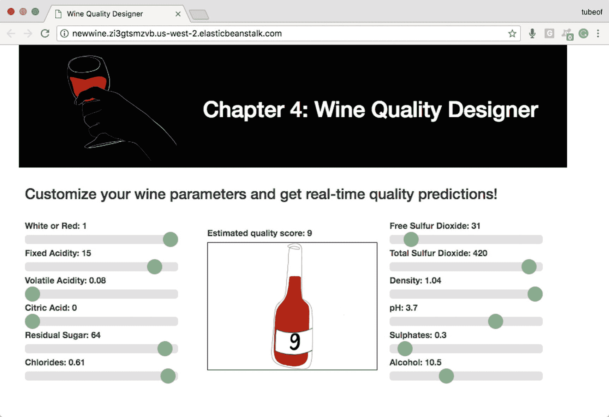
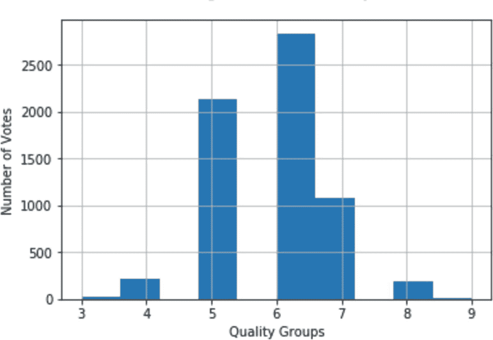
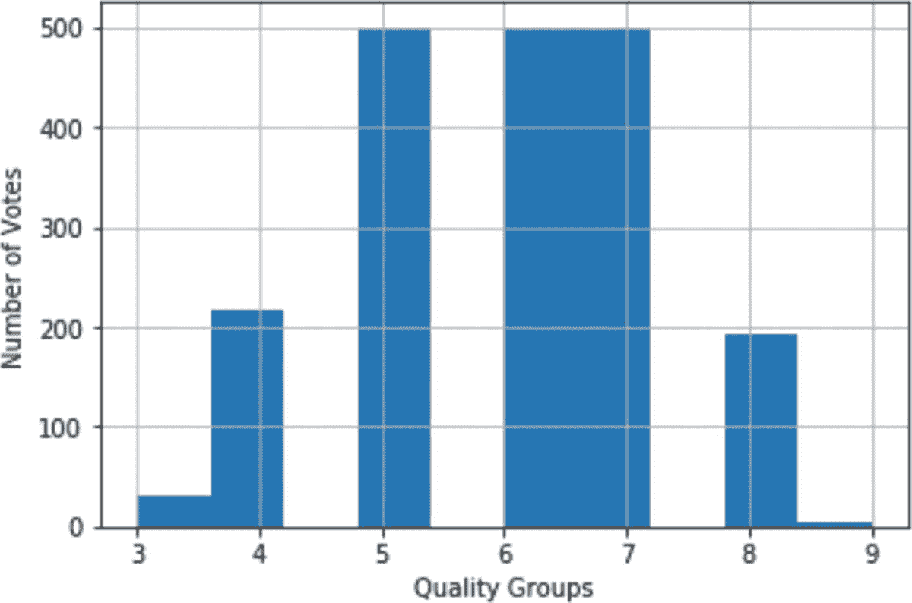
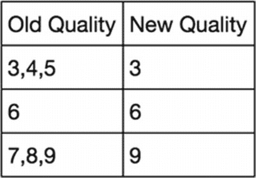
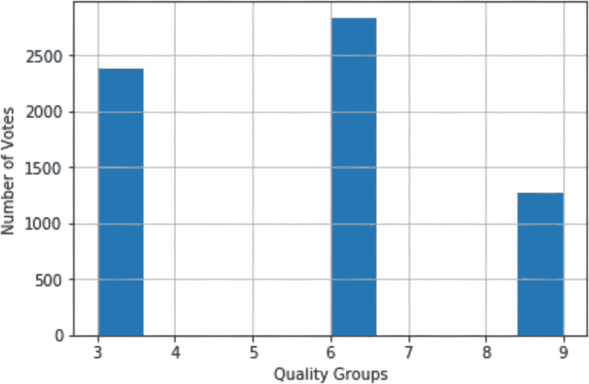
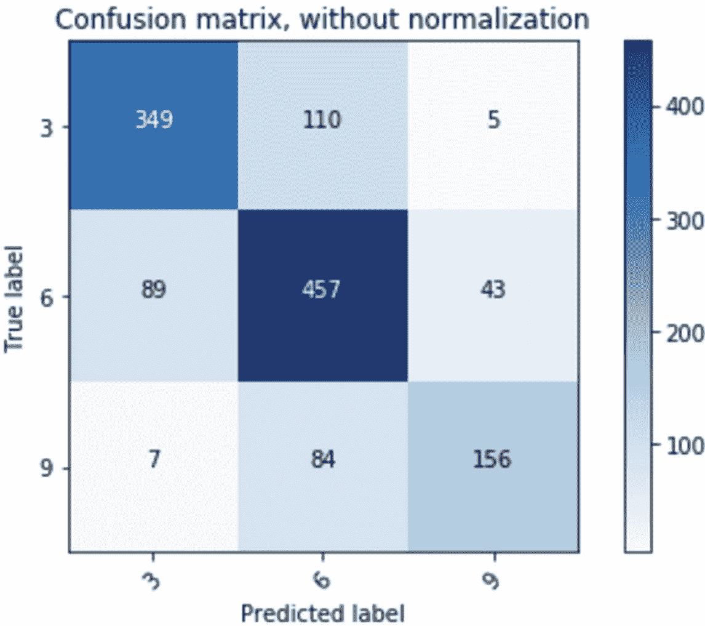
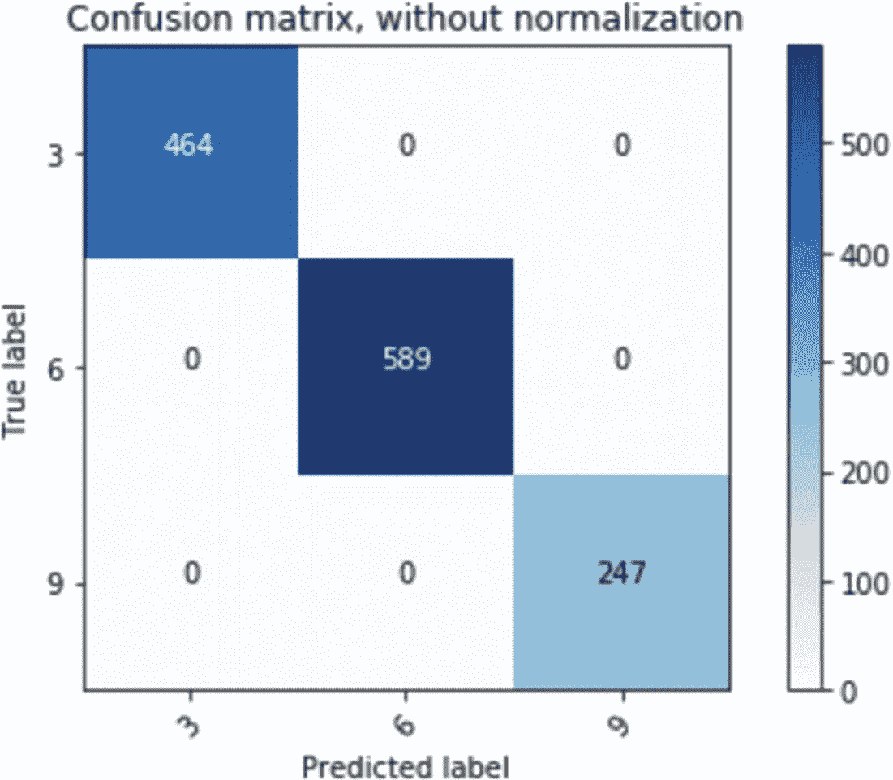

# Add any libraries installed in the "lib" folder
vendor.add('lib')
清单 3-31
“appengine_config.py”脚本内容一览
```

通过调用“**pip install**”命令，可以将所需的 Python 库填充到“**lib**”文件夹中（清单 3-32）。

```
pip install -t lib -r requirements.txt
清单 3-32
填充“lib”文件夹
```

运行此命令后，如果你查看“**lib**”文件夹内部，会看到各种 Python 库已部署并准备就绪。该文件夹将与所有 Web 应用程序文件一起部署，以确保它们正常运行。对于 Google App Engine 而言，“**appengine_config.py**”的功能远不止此处展示的这些；更多详情请参阅官方文档。

### 注意

有关 appengine_config.py 的更多信息，请参阅 Google 文档：[`https://cloud.google.com/appengine/docs/standard/python/tools/appengineconfig`](https://cloud.google.com/appengine/docs/standard/python/tools/appengineconfig)。

### requirements.txt

以下是运行泰坦尼克号 Web 应用程序所需的所有 Python 库列表（你的版本号可能有所不同；清单 3-33）。

```
click==6.7
Flask==0.12.2
itsdangerous==0.24
Jinja2==2.10
MarkupSafe==1.0
numpy==1.14.2
scikit-learn
scipy
python-dateutil==2.7.2
pytz==2018.4
six==1.11.0
Werkzeug==0.14.1
Pillow>=1.0
matplotlib
gunicorn>=19.7.1
清单 3-33
运行 Web 应用程序所需的 Python 库
```

## 步骤回顾

让我们快速回顾一下将泰坦尼克号 Web 应用程序部署到 Google Cloud 所需的步骤。

1.  检查 Web 应用程序是否在本地运行，压缩所有 Web 应用程序文件，在 Google Cloud 上创建目标文件夹，并解压文件：

1.  创建“**lib**”文件夹：

```
$ mkdir chapter-3
$ cd chapter-3/
$ mv ../Archive.zip Archive.zip
$ unzip Archive.zip
```

1.  部署 Web 应用程序：

```
pip install -t lib -r requirements.txt
```

1.  获取 Web 应用程序的 URL：

```
gcloud app deploy app.yaml
```

```
gcloud app browse
```

收尾工作：前往 GCP 控制台的 App Engine，并终止任何正在运行的版本。

## 结论

关于泰坦尼克号数据集，我们了解到，富有且身为女性生存几率最大，而贫穷且身为男性生存几率最小。

尽管这个项目相当直接，但本章引入了许多概念和新技术。首先，要始终在开发本地 Python 想法和模型时提前思考几步，预见如何将其扩展到云端。这包括保持简单、处理直观的概念，以及保持代码的整洁和高效。

脚注 1   2   3   4   5

# 4. 在 AWS 上使用梯度提升机进行预训练智能分析

是什么造就了顶级葡萄酒？通过亚马逊云服务上一个令人难以抗拒的实时 Web 仪表盘来一探究竟。

在本章中，我们将借助“**sklearn**”库中强大的“**梯度提升分类器**”^(¹⁵)算法来了解葡萄酒品质。该算法可以将数据分类到多个类别中，我们将用它来将葡萄酒分组到“**品质**”桶中。我们将通过实时滑块（图 4-1）在 Web 仪表盘中突出展示这一强大功能。



图 4-1

本章的最终 Web 应用程序

这将邀请访问者以一种有趣、响应迅速且具有教育意义的方式与模型进行交互。这些数据是为一篇题为“**通过数据挖掘理化性质对葡萄酒偏好进行建模**”^(¹⁶)的论文收集的。该数据由加州大学欧文分校的 UCI 机器学习库慷慨提供。^(¹⁷)

### 注意

通过访问 [`www.apress.com/9781484238721`](http://www.apress.com/9781484238721) 并点击源代码按钮，下载第 4 章的文件。打开 Jupyter notebook “**chapter4.ipynb**” 以跟随本章内容进行学习。

## 规划我们的 Web 应用程序：是什么造就了顶级葡萄酒？

与任何 Web 应用程序一样，在将其扩展到网络之前，先解决简单的问题至关重要。我们将从探索数据、试验建模、构建本地 Flask 应用程序开始，只有在一切运行正常后，我们才会将其扩展到亚马逊云服务（AWS）Elastic Beanstalk。^(¹⁸)


## 探索葡萄酒质量数据集

葡萄酒质量数据集可以直接通过 Python 的“**Pandas**”库从 UCI 机器学习库下载。它由两个数据集组成：1599 个红葡萄酒实例和 4898 个白葡萄酒实例。这些数据代表了与葡萄牙“**绿酒**”的红白变种相关的化学读数。^(¹⁹) 请继续将本章的文件下载到一个名为“**chapter-4**”的文件夹中。启动 Jupyter notebook 以便跟随操作。

根据 UCI 的数据描述，共有 11 个基于理化测试的属性，以及一个基于感官数据的输出列：

*   **输入**
    *   固定酸度

*   挥发性酸度

*   柠檬酸

*   残糖

*   氯化物

*   游离二氧化硫

*   总二氧化硫

*   密度

*   pH 值

*   硫酸盐

*   酒精

*   **输出**
    *   质量（0 到 10 之间的分数）

我们将创建一个名为“**color**”的新特征来描述葡萄酒是白葡萄酒还是红葡萄酒，并将两个数据集合并为一个。作为良好的网络公民，我们还会将最终合并后的数据集保存一份本地副本到我们的 Web 应用程序中，这样每次用户交互时就不必再访问服务器了（清单 4-1）。

```
white['color'] = 0
red['color'] = 1
wine_df = pd.concat([white, red], ignore_index=True)
Listing 4-1
创建一个新的葡萄酒颜色特征，并将白葡萄酒和红葡萄酒数据合并
```

现在我们已经准备好了数据集，让我们深入研究一下，看看我们有什么（清单 4-2）。

```
Input:
wine_df.info()
Output:

RangeIndex: 6497 entries, 0 to 6496
Data columns (total 13 columns):
fixed acidity           6497 non-null float64
volatile acidity        6497 non-null float64
citric acid             6497 non-null float64
residual sugar          6497 non-null float64
chlorides               6497 non-null float64
free sulfur dioxide     6497 non-null float64
total sulfur dioxide    6497 non-null float64
density                 6497 non-null float64
pH                      6497 non-null float64
sulphates               6497 non-null float64
alcohol                 6497 non-null float64
quality                 6497 non-null int64
color                   6497 non-null int64
dtypes: float64(11), int64(2)
memory usage: 659.9 KB
Listing 4-2
查看特征数据类型
```

“**info()**”函数告诉我们很多关于数据的信息。我们看到有 13 列，除了两个整数列“**quality**”和“**color**”外，其余都是浮点数。“**color**”特征是我们添加的，用于记录葡萄酒是红葡萄酒还是白葡萄酒。“**quality**”特征是结果标签，代表特定葡萄酒的质量等级。这是一个重要的特征，因为它按质量对数据进行聚类，并且是我们的模型将尝试学习的目标（清单 4-3）。

```
Input:
wine_df['quality'].value_counts()
Output:
6    2836
5    2138
7    1079
4     216
8     193
3      30
9       5
Name: quality, dtype: int64
Listing 4-3
葡萄酒数据框中葡萄酒质量的总评分计数
```

“**value_counts()**”函数计算特定分类特征中值的频率。对于“**quality**”，我们看到有 7 种不同的质量类型，其中大多数是质量“**6**”。这个特征可能被用作连续变量，这意味着我们假设最低质量和最高质量之间存在某种线性关系。由于这个质量是基于投票得出的，我们不能假设它是一个连续的数值尺度，而且有些数字是缺失的（官方数据描述说明质量介于 0 和 10 之间，但我们只看到 3 到 9 之间的数字）。

我们将稳妥起见，假设它是一个分类变量，并使用多分类模型而不是回归模型。

可视化分类变量的另一个好方法是使用直方图。这可以在 Pandas 库中轻松完成（清单 4-4 和图 4-2）。



图 4-2

葡萄酒数据框中葡萄酒质量评级的直方图

```
wine_df['quality'].hist()
plt.suptitle('Historgram of Wine Quality')
plt.xlabel('Quality Groups')
plt.ylabel('Number of Votes')
plt.show()
Listing 4-4
按组和投票数划分的葡萄酒质量评级直方图
```

这与“**value_counts()**”提供的信息相同，但更易于理解。我们看到中间范围呈正态分布，这很直观，因为大多数葡萄酒都是普通的，极好或极差的很少。

根据“**info()**”函数，没有空值，也没有文本或基于文本的分类数据。两个整数特征“**quality**”和“**color**”是数值类别，在建模过程中应如此处理。

## 处理不平衡类别

参考葡萄酒质量直方图，我们看到大多数质量集中在 5、6 和 7 这几个桶中。这将使得预测边缘质量桶更具挑战性，因为模型无法从足够的案例中学习。对于关键的建模项目，您要么通过移除一些中间类别来平衡数据集，要么获取更多的边缘案例。在本章的 Jupyter notebook 中，您可以看到重新平衡的过程。

另一种方法是移除较弱的特征。在某些情况下，弱特征会混淆模型，移除它们不仅可以提高分数，还能使模型运行更快。使用返回某种变量重要性的基于树的模型可以轻松实现这一点。您会得到一个按重要性降序排列的特征列表，然后尝试仅使用最佳特征来运行模型。您不断添加特征，直到分数不再提高，最终得到一组可以使用的良好特征（这被称为前向特征选择）。

让我们看看如果将所有类别的数据行数上限设为 500 会发生什么（清单 4-5 和图 4-3）。



图 4-3

设上限后的葡萄酒质量直方图

```
Input:
wine_balanced_df['quality'].value_counts()
Output:
7    500
6    500
5    500
4    216
8    193
3     30
9      5
Name: quality, dtype: int64
Listing 4-5
设上限后葡萄酒质量的数值分布
```

这确实使中心类别变得平坦，但边缘类别仍然极度不平衡。更好的处理方法是重新分类质量类别。我们将它们归并为仅三个质量组。质量类别 3、4、5 现在属于组 3，质量 6 保持不变，质量类别 7、8、9 属于组 9（图 4-4）。



图 4-4

简化的葡萄酒质量超级组

本质上，我们创建了三个超级组：“**差**”、“**一般**”和“**好**”。应用这些新分组后，我们得到了一个更加平衡的分布（清单 4-6 和图 4-5）。



图 4-5

较小桶集合中葡萄酒质量的直方图分布

```
Input:
wine_df['quality'].value_counts()
Output:
6    2836
3    2384
9    1277
Name: quality, dtype: int64
Listing 4-6
将葡萄酒质量聚合为三个组
```

当我们在直方图中绘制质量分组时，各个类别的平衡性要好得多，范围从 1200 到 2800。


## 使用梯度提升分类器进行建模

改善不平衡数据集处理方式的另一种方法是使用能够应对此类数据的模型。一个非常流行的模型是 sklearn 中的“**梯度提升分类器**”，它是一种基于树的强大提升模型。该模型会创建多组树，并根据它们的预测能力进行优化。

要使用 sklearn 的 GradientBoostingClassifier 算法，如果你之前从未使用过“**scikit-learn**”和“**scipy**”，则需要先安装它们（请使用适合你操作系统和软件的安装工具）。为简化操作，你可以直接运行包含本章所有必要 Python 库的“**requirements_jupyter.txt**”文件。通过运行“**pip3**”命令即可快速安装（列表 4-7）。

```
$ pip3 install -r requirements_jupyter.txt
列表 4-7
安装运行笔记本所需的文件
```

我们使用 Pandas 的“**Categorical()**”函数将“**quality**”特征转换为分类类型。这样我们就可以使用该特征的“**cat.codes**”属性，而不是实际值。我们这样做是因为真实的品质类别是 3-6-9，而通过使用“**cat.codes**”，我们将范围缩小到 0 到 2 之间。然后，我们使用 sklearn 的“**train_test_split**”函数（就像我们在上一章中所做的那样）将数据随机拆分为训练集和测试/验证集。如果你查看代码，我们会将“**test_size**”设置为 0.2，这意味着我们将 20% 的数据分配用于测试，并使用“**random_state**”设置一个随机种子，以确保我们的数据拆分始终一致（列表 4-8）。

```
from sklearn.model_selection import train_test_split
wine_df['quality'] = pd.Categorical(wine_df['quality'])wine_df['quality_class'] = wine_df['quality'].cat.codes
outcome = 'quality_class'
outcome_buckets = len(set(wine_df['quality_class']))
X_train, X_test, y_train, y_test = train_test_split(wine_df[features],
wine_df[outcome], test_size=0.2, random_state=42)
列表 4-8
准备我们的训练和测试数据集

```

现在，我们可以将训练数据输入到“**GradientBoostingClassifier**”中进行建模（列表 4-9）。

```
from sklearn.ensemble import GradientBoostingClassifier
gbm_model = GradientBoostingClassifier(random_state=10, learning_rate=0.1, max_depth=10)
gbm_model.fit(X_train[features], y_train)
列表 4-9
使用 GBM 进行建模
```

从代码片段中可以看出，“**GradientBoostingClassifier**”接受各种参数，调整这些参数非常重要，这被称为超参数调优。

以下是调整 GBM 模型的一些关键参数（更多详细信息，请参阅 scikit-learn 帮助文档^(²⁰)）：

*   **learning_rate：** 学习率决定了每棵树的贡献程度。
*   **n_estimators：** 要执行的提升阶段数量。
*   **max_depth：** 回归估计器的最大深度。
*   **max_features：** 每次拆分时需要考虑的特征数量。
*   **random_state：** 用于保证结果可复现的随机种子。

训练“**GradientBoostingClassifier**”模型的最佳方法是使用不同的参数设置多次运行。观察添加“**n_estimators**”参数是否会提高准确率，以及“**learning_rate**”或“**max_depth**”的增大或减小如何影响准确率。对于那些希望深入研究模型调优的人，还有许多额外的工具可以提供帮助，例如交叉验证、超参数调优器等。GradientBoostingClassifier 最让我喜欢的一点是它速度非常快，并且能够处理相当大的数据集，因此你可以轻松编写自己的循环机制来尝试各种参数组合并比较准确率。

有关更详细的 Python API 参考，请参阅文档。^(²¹)

### 评估模型

如果你参考本章的 Jupyter 笔记本，你会看到在运行模型后，我们通过要求模型对样本外数据（即我们那 20% 的测试数据块）预测葡萄酒品质来对其进行评估（列表 4-10）。这是一个需要记住的重要概念：模型从未见过测试数据，这使我们能够用一组全新的数据来评估模型的性能。

```
preds = gbm_model.predict_proba(X_test)
列表 4-10
使用测试数据拆分进行预测
```

“**preds**”变量包含每行数据的三个概率列表，描述了该行属于每个葡萄酒品质类别的概率（这说起来有点拗口）。每行数据的概率之和为 1。例如，让我们看看第一行数据的预测概率（列表 4-11）。

```
输入：
preds[0]
输出：
array([0.50623207, 0.48718144, 0.00658649])
列表 4-11
查看一种葡萄酒的预测结果
```

对于第 0 行的数据（即该特定葡萄酒的化学读数），模型预测索引号 0 处的概率最高，为 0.56，因此属于品质类别“**3**”。这可以很容易地通过 NumPy 的“**argmax**”函数来实现，该函数用于获取列表中最大数字的索引，然后使用该索引位置获取类别编号（列表 4-12）。

```
输入：
print('Argmax: %i' % np.argmax(preds[0]))
print('Quality class: %i' % list(wine_df['quality'].cat.categories)[np.argmax(preds[0])])
输出：
Argmax: 0
Quality class: 3
列表 4-12
使用 NumPy 的“argmax()”函数获取数组中的最大值
```

我们可以对测试数据中的每一种葡萄酒都执行相同的操作，并使用 sklearn.metrics 的“**precision_score()**”函数将其与实际“**真实**”类别进行比较。该函数将返回一个介于 0 和 1 之间的数字，其中 0 表示最差分数，1 表示最佳分数。在这种情况下，精确率比准确率更合适，因为我们讨论的不是一个平衡数据集的简单二元预测。相反，我们想知道模型在不平衡数据集上，针对特定葡萄酒在三个品质类别之间进行选择的准确程度——这绝非易事！（列表 4-13）

> *精确率是 tp / (tp + fp) 的比值，其中 tp 是真阳性数量，fp 是假阳性数量。直观上，精确率体现了分类器不将负样本标记为正样本的能力。* ^(²²)

```
输入：
from sklearn.metrics import precision_score
best_preds = np.asarray([np.argmax(line) for line in preds])
print ("Precision_score: %0.2f" % precision_score(y_test, best_preds, average="macro"))
输出：
Precision_score: 0.74
列表 4-13
获取每个预测品质类别的最高概率
```

另一种查看多类模型整体情况的有用方法是使用混淆矩阵。这将绘制一个大型方阵，显示模型的最佳预测结果与真实情况的对比（列表 4-14 和图 4-6）。在处理大量数据时，使用图形化的混淆矩阵而不是打印出来的矩阵会非常方便。生成这些图形矩阵的代码直接来自 scikit-learn.org 关于混淆矩阵的帮助文件。^(²³)



图 4-6

预测值与实际值的混淆矩阵

```
from sklearn.metrics import confusion_matrix
cnf_matrix = confusion_matrix(y_test, best_preds)
plt.figure()
plot_confusion_matrix(cnf_matrix, classes=set(wine_df['quality']),
title='Confusion matrix, without normalization')
plt.show()
列表 4-14
在混淆矩阵上显示的葡萄酒品质预测结果
```


花点时间分析这张图表是值得的。Y 轴代表真实值，X 轴代表来自 GradientBoostingClassifier 模型的最佳预测。

在理想情况下，除了从图表左上角一直延伸到右下角的单条对角线外，所有数字都应为 0。这意味着所有预测都是正确的（参见图 4-7 中虚构的图表）。



图 4-7

完美混淆矩阵的样子（如果你在真实模型中看到这种完美程度，请保持怀疑，因为建模永远不可能完美）

我们模型的混淆矩阵告诉我们关于数据的一些有趣信息。首先，它的表现相当不错，因为从左上角到右下角的对角线确实包含了最大的数字。当数据偏离对角线（即预测错误）时，它仍然靠近其所属的组。这就是为什么模型预测为 3 而实际是 9，或者模型预测为 9 而实际是 3 的边缘情况非常少。这可以看作是一种小小的安慰：每当预测错误时，错误可能不会太离谱，错误的预测最多只偏差到相邻的桶。

### 持久化模型

在第 3 章中，我们 Web 应用程序的构造函数训练了模型（每当 Web 服务器重启时，它就会重新训练）。在这里，我们将预先训练模型，对其进行 pickle 序列化，并将其用作我们的建模引擎。你很少会遇到数据集和模型足够小，以至于可以直接在云端和 Web 服务器上训练的情况。大多数模型都很大，训练时间长，甚至需要特殊的硬件。通过保存一份完全训练好的模型副本，我们可以将其移动到任何需要的地方，并使其处于随时可预测的状态。如果你不熟悉 Python 术语“**Pickling**”，它是一种将对象以其当前状态保存到文件中的工具^(²⁴)。就像逗号分隔文件（CSV）用于移动数据一样，pickle 文件用于移动 Python 对象。你可以 pickle 任何你想要的东西，包括训练好的模型。关于 Python 版本的说明：AWS Beanstalk 默认使用 Python 3.x，而 pickle 在 Python 2.x 和 3.x 版本之间存在兼容性问题，因此本章请坚持使用 Python 3.x。

这被称为模型持久化，它应该在大多数生产场景中使用，我们也会在本书的大多数章节中使用这种方法（列表 4-15）。

```
with open('gbm_model_dump.p', 'wb') as f:
pickle.dump(gbm_model, f, 2)
列表 4-15
Pickle 序列化我们训练好的 GBM 模型
```

### 对新数据进行预测

就像我们在上一章中所做的那样，我们需要确保能够运行模型并对新数据进行预测。这是构建交互式 Web 应用程序的重要一步，该应用程序的目标是基于用户输入的数据提供新的预测。

首先，我们计算每个特征的平均值，并使用这些值来预测葡萄酒的质量（列表 4-16）。

```
fixed_acidity = 7.215307
volatile_acidity = 0.339666
citric_acid = 0.318633
residual_sugar = 5.443235
chlorides = 0.056034
free_sulfur_dioxide = 30.525319
total_sulfur_dioxide = 115.744574
density = 0.994697
pH = 3.218501
sulphates = 0.531268
alcohol = 10.491801
color = 0
