# 创建新数据集
x_test_tmp = pd.DataFrame([[fixed_acidity,
volatile_acidity,
citric_acid,
residual_sugar,
chlorides,
free_sulfur_dioxide,
total_sulfur_dioxide,
density,
pH,
sulphates,
alcohol,
color]], columns = X_test.columns.values)
列表 4-16
获取每个特征的平均值并存储在数据框中
```

在创建了一个新的数据框来存储自定义的葡萄酒化学读数后，我们将其传递给模型的“**predict**”函数。我们可以添加任何结果变量，因为模型在进行预测时会忽略它（列表 4-17）。

```
preds = gbm_model.predict_proba(x_test_tmp)
列表 4-17
基于我们的平均值预测葡萄酒质量
```

因为我们使用平均值作为新的葡萄酒数据，预测的质量值应该接近真实/实际的葡萄酒质量——我们基本上创造了一款平淡无奇的葡萄酒，既不好也不坏（列表 4-18）。

```
输入:
print(('预测的葡萄酒质量: %i') % list(wine_df['quality'].cat.categories)[np.argmax(preds)])
print(('实际平均葡萄酒质量: %0.2f') % np.mean(wine_df['quality'].values))
输出:
预测的葡萄酒质量: 6
实际平均葡萄酒质量: 5.49
列表 4-18
获取葡萄酒质量预测
```

不错！模型预测为第 6 组，平均值为 5.49。请记住，这个模型在预测普通葡萄酒方面会比预测边缘葡萄酒表现更好。所以，它能准确预测这一点并不奇怪。如果我们查看预测数组，会发现模型在将这款葡萄酒归类为质量 3 或质量 6 时有些许挣扎（35%的概率为 3，64%的概率为 6），但质量组 6 胜出（列表 4-19）。

```
array([[0.34124871, 0.63933304, 0.01941825]])
列表 4-19
我们这款普通葡萄酒的预测概率
```

## 设计一个用于交互和评估葡萄酒质量的 Web 应用程序

在我们本地模型上构建一个功能完整的 Flask 版本是本书所有章节中一个常见的主题和恰当的下一步。通过足够的练习，你可能会跳过这一步，但与此同时，在本地解决问题比在云端能节省大量时间和避免很多麻烦。

一个好的第一步是将代码泛化为一个大的函数。这将允许我们向其传递新值，并以尽可能少的麻烦获得一个不错的预测结果。

一旦你下载了本章的所有文件，打开一个命令行窗口，并将驱动器切换到“**web-application**”文件夹。你的文件夹应该看起来像列表 4-20。这里我们显示了 AWS EB 所需的隐藏文件夹“**.ebextensions**”。你可以直接使用它，也可以在“**修复 WSGIApplicationGroup**”部分创建自己的文件夹（在运行本地版本网站时不用担心这个，因为它不受此修复的影响）。

```
web-application
├── application.py
├── requirements.txt
├── static \
└── images
├── quality_wine_logo.jpg
├── wine_red_9.jpg
├── wine_white_9.jpg
├── wine_red_3.jpg
├── wine_white_3.jpg
├── wine_red_6.jpg
└── wine_white_6.jpg
├── pickles
└── gbm_model_dump.p
└──templates
└── index.html
└── .ebextensions <-- 隐藏文件夹
└── wsgi_fix.config
列表 4-20
Web 应用程序文件
```

这里需要注意的是，在某些章节中，我们将主要的 Flask Python 文件称为“**main.py**”，但这里我们使用“**application.py**”——这是 Amazon Elastic Beanstalk 的默认命名约定（总有办法绕过这一点，但这需要编辑配置文件）。从现在开始，我们将在虚拟环境中工作。

## 介绍 AJAX – 动态服务端 Web 渲染

在本章中，我们将开始使用 Ajax，这是一项非常酷的技术，它允许我们无需重建整个页面即可更新 Web 内容。这对于执行大量微更新的高度交互式 Web 应用程序非常有效。Ajax 也非常易于使用，由两部分组成：一个调用“**$.ajax**”的前端脚本函数，以及一个用于捕获和处理这些调用的后端 Flask 函数。我们将在第[10](https://doi.org/10.1007/978-1-4842-3873-8_10)章中更深入地探讨 Ajax。


## 在虚拟环境中工作——一个用于实验、安全与清晰的沙盒

使用虚拟环境有许多优点：

*   创建一个未安装任何 Python 库的环境

*   精确了解应用程序运行所需的 Python 库

*   保护计算机系统的其余部分免受在此环境中安装的任何 Python 库的影响

*   鼓励实验

要启动虚拟环境，请使用“**venv**”命令。如果你的计算机上尚未安装该命令，建议你进行安装（可通过 pip3、conda、brew 等方式安装）。有关为你的操作系统安装虚拟环境的更多信息，请参阅“**venv - 虚拟环境的创建**”用户指南：[`https://docs.python.org/3/library/venv.html`](https://docs.python.org/3/library/venv.html)

在命令行窗口中，如果尚未进入“**web-application**”文件夹，请先导航至此文件夹。在命令行中调用 Python 3 的“**venv**”函数，为我们的开发工作创建一个 Python 3 沙盒区域，以及一个名为“**wineenv**”的文件夹（列表 4-21）。

```
$ python3 -m venv wineenv
$ source wineenv/bin/activate
列表 4-21
启动虚拟环境
```

现在你已准备好开始在虚拟环境中工作。让我们尝试通过调用“**python3**”来本地运行 Web 应用程序（或使用适用于你操作系统的命令；列表 4-22）。

```
$ python3 application.py
列表 4-22
运行 Web 应用程序的本地版本
```

这不会成功，因为我们处于一个干净的虚拟环境中，没有加载专门的 Python 库。你需要安装所有它报错缺失的库（请根据你的操作系统和软件使用相应的安装命令）。最简单的方法是使用“**pip3 install**”安装附带的“**requirements.txt**”文件（列表 4-23）。

```
$ pip3 install -r requirements.txt
列表 4-23
安装依赖项
```

我们有一个全面的 requirements.txt 文件，其中包含运行 Web 应用程序所需的所有 Python 库。这对于我们 Web 应用程序的本地版本来说实际上用处不大，但对于基于云的版本则是必需的。^(²⁶) 无论你在 Amazon、Google 还是 Microsoft 的云上部署应用程序，它都会使用 requirements 文件，在运行 Web 应用程序的任何位置安装所有必需的 Python 库。

回到我们的本地版本实验，运行与之前 Flask 实验相同的命令（列表 4-24）。

```
$ python3 application.py
列表 4-24
运行 Web 应用程序的本地版本
```

然后复制 URL：“`http://127.0.0.1:5000/`”（或终端窗口中显示的任何地址）到浏览器中，你应该会看到 Web 应用程序 Wine Quality Designer 出现（图 4-8）。希望它能成功运行；如果没有，请阅读输出错误并相应处理（请记住，本章需要 Python 3.x）。

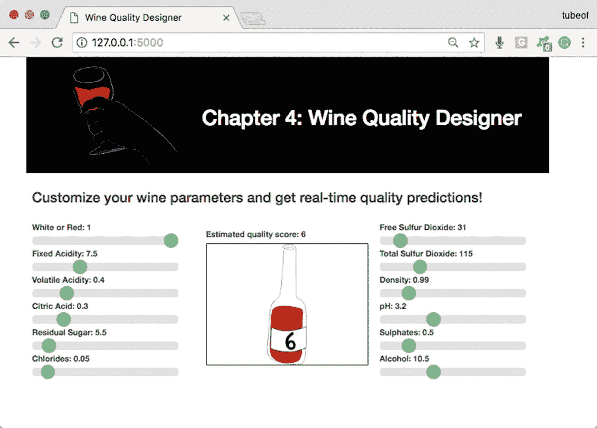

图 4-8

在本地服务器上运行的 Web 应用程序

## Amazon Web Services (AWS) Elastic Beanstalk

对于本章基于云的部分，我们将把应用程序托管在 Amazon 的 Elastic Beanstalk 上。这是一个便捷的托管解决方案，可以自动打包你的网站、部署、扩展和负载均衡。它在一个便捷的基于 Web 的仪表板中提供日志记录、流量和健康监控统计信息，让你随时了解运行状况。这应该能让你专注于应用程序，几乎完全无需操心网站管理。

你需要一个 Amazon Web Service 账户并设置安全凭证。如果你已有 Amazon.com 账户，应该可以轻松将其迁移到 AWS。如果你是新手，可以创建一个免费套餐账户，该账户将允许你访问基本的 Beanstalk 功能。请访问 AWS 免费套餐（[`https://portal.aws.amazon.com/gp/aws/developer/registration/index.html`](https://portal.aws.amazon.com/gp/aws/developer/registration/index.html)）。

### 为 Elastic Beanstalk 创建访问账户

拥有 AWS 账户后，就该设置安全凭证，以便从你的计算机与 AWS Elastic Beanstalk 进行交互。Amazon 的入门教程（[`https://aws.amazon.com/getting-started/tutorials/set-up-command-line-elastic-beanstalk/`](https://aws.amazon.com/getting-started/tutorials/set-up-command-line-elastic-beanstalk/)）是一个很好的指南，可以逐步指导你完成该权限设置过程。

登录 AWS Web 控制台，进入 Identity and Access Management (IAM) 控制台。快速进入的方法是在登录页面的 AWS 服务搜索框中直接输入“**IAM**”。在导航部分选择“**Users**”，然后点击“**Add user**”按钮（图 4-9）。

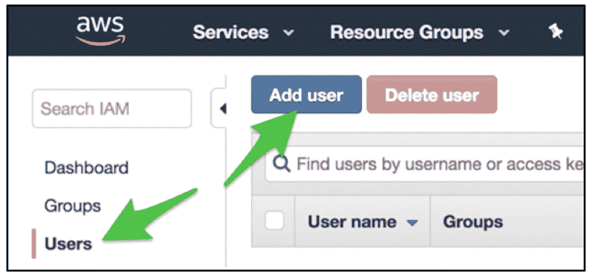

图 4-9

在 AWS 中创建用户

选择一个用户名——这里我们输入“**ebuser**”，并勾选“**Access type: Programmatic access**”（图 4-10）。

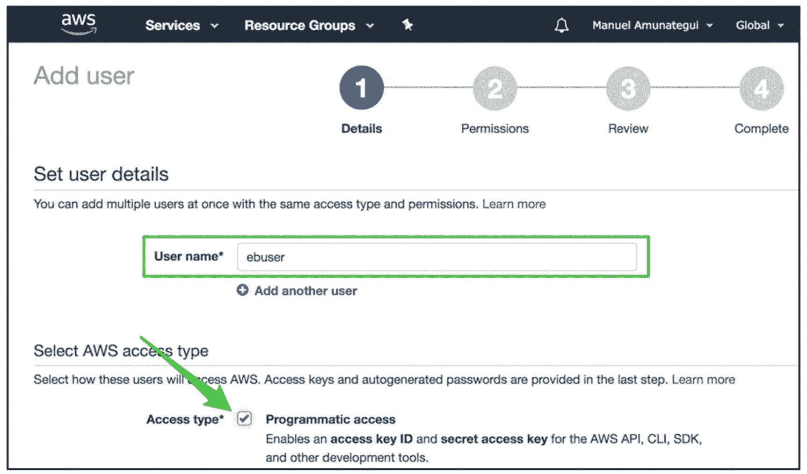

图 4-10

为新用户分配编程访问权限

点击蓝色的“**Next: Permissions**”按钮。这将带你进入“**Set permissions**”页面；点击大的菜单按钮“**Add user to group**”，然后点击“**Create group**”（图 4-11）。

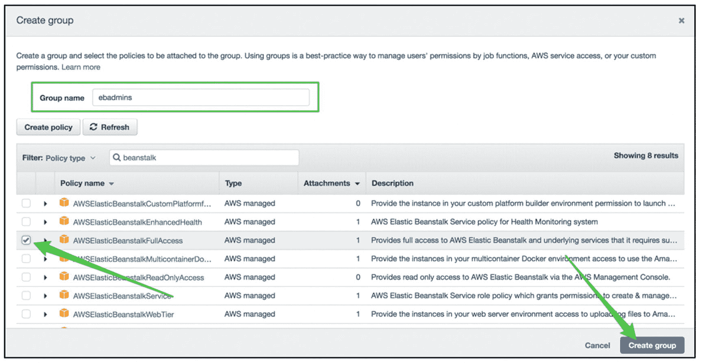

图 4-11

为新用户授予 WSElasticBeanstalkFullAccess 权限

创建一个组名，此处为“**ebadmins**”，并为其分配策略名称“**WSElasticBeanstalkFullAccess**”。然后点击“**Create group**”按钮完成组的创建。点击蓝色的“**Next: review**”按钮，在接下来的页面上点击蓝色的“**Create user**”按钮（图 4-12）。

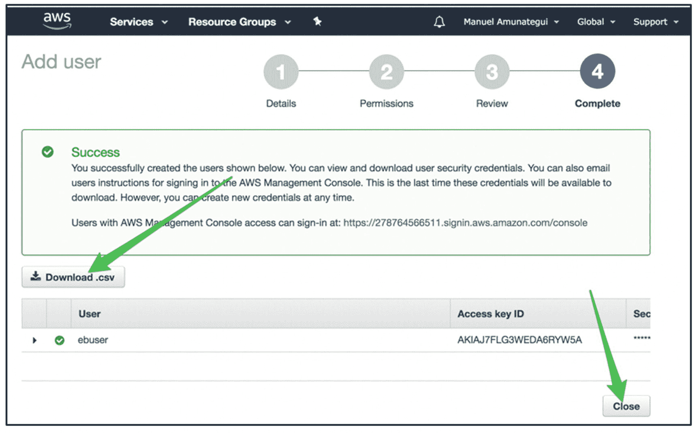

图 4-12

成功创建用户后下载访问密钥

一旦看到“**Success**”消息，这意味着你已成功创建“**ebuser**”账户。请务必点击“**Download .csv**”按钮，将“**.csv**”文件下载到本地机器。此文件很重要，因为它包含你的密钥和秘密代码。将其存储在本地机器上的已知位置，因为你需要这些信息来连接并使用 Secure Shell (SSH) 进入你的 EB。

### Elastic Beanstalk

后续我们将 Elastic Beanstalk 简称为 EB。我们需要安装“**awsebcli**”库来与 AWS 上的 EB 服务进行交互和管理。

对于 Mac 和 Linux 用户（如果报错“**user**”参数问题，请尝试不带该参数）。参见列表 4-25。

```
$ pip install awscli
$ pip install awsebcli
列表 4-25
安装“awsebcli”
```

对于 Windows 用户（如果报错“**user**”参数问题，请尝试不带该参数）。参见列表 4-26。

```
$ pip install awscli --user
$ pip install awsebcli --user
列表 4-26
在 Windows 上安装“awsebcli”
```

有关安装和排查“**awsebcli**”库问题的更多信息，请参考 Amazon 的帮助文档：[`https://docs.aws.amazon.com/elasticbeanstalk/latest/dg/eb-cli3-install.html`](https://docs.aws.amazon.com/elasticbeanstalk/latest/dg/eb-cli3-install.html)。


### EB 命令行界面

来自 AWS 帮助文件：

> *EB 是一种* *命令行界面 (CLI) 工具* *，它会询问你一系列问题，并根据你的回答来部署和管理 Elastic Beanstalk 应用程序。本节将提供一个端到端的演练，使用 EB 启动一个示例应用程序、查看它、更新它，然后删除它。* ^(²⁷)

这是一组方便的命令行工具，用于初始化、推送、控制和终止我们的 EB 实例。

*   **eb init**：初始化 EB 服务^(²⁸)

*   **eb create**：创建一个新的 EB 实例

*   **eb open**：打开一个指向你的 EB 实例的网页

*   **eb deploy**：部署代码或配置的任何更改

*   **eb config**：打开 EB 实例配置文件以供读取和编辑

*   **eb logs**：拉取打开的 EB 实例的各种日志文件

*   **eb terminate**：终止 EB 实例（如果你不想持续产生费用，请务必终止）

有关 EB 命令的更完整信息，请参阅 [`https://docs.aws.amazon.com/elasticbeanstalk/latest/dg/eb-cli3-getting-started.html`](https://docs.aws.amazon.com/elasticbeanstalk/latest/dg/eb-cli3-getting-started.html) 。

我们一直等到现在才安装“**awsebcli**”库，因为我们不希望它的任何内容进入我们的 requirements.txt 文件（清单 4-27）。

```
$ eb init -i
清单 4-27
初始化“awsebcli”
```

这会问你一系列问题，你可以接受大部分默认设置。在“**Enter Application name**”下输入“**winetest**”（图 4-13）。

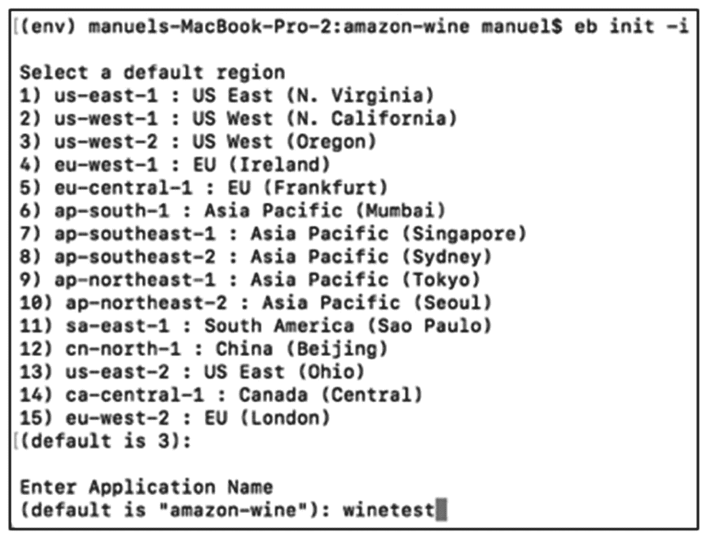

图 4-13

创建应用程序名称

如果这是你第一次在计算机上运行 AWS，它会要求你提供凭证。打开创建用户时下载到你机器上的“**credentials.csv**”文件，并输入所需的两个字段（图 4-14）。

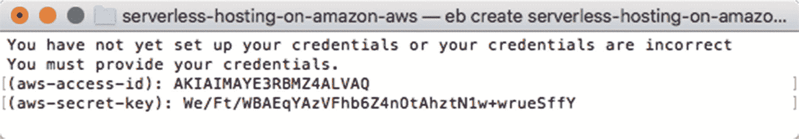

图 4-14

输入你的凭证

选择 Python 默认设置（它必须是 3.x 版本），但在设置 SSH 时选择“是”（图 4-15）。


图 4-15

创建 SSH 密钥

对于它可能问到的所有其他问题，都选择默认设置。在创建 Web 应用程序之前，你需要自定义 WSGI 配置文件，以告知它你将需要 Python 子解释器模式。

### 修复 WSGIApplicationGroup

当使用像 NumPy、Pandas 或其他重量级 Python 库时，你需要告诉 WSGI 进入一种特殊的 Python 子解释器模式。这样做是因为这些库加载起来更复杂，需要更多线程等，因此默认情况下是关闭的（更多信息请参阅 Python Simplified GIL State API^(²⁹)）。这个切换需要在配置文件中添加清单 4-28 中的变量（这来自一个 Stackoverflow 解决方案^(³⁰)）。该文件的副本包含在下载文件中，或者你可以使用文件夹中提供的文件（这是一个隐藏文件夹，你可能能看到也可能看不到`—`如果你不确定，请尝试按照说明创建该文件夹，如果它报错，说明你已经有了）。

```
'WSGIApplicationGroup %{GLOBAL}'
清单 4-28
添加“WSGIApplicationGroup”变量
```

要启用此功能，你需要在“**web-application**”文件夹下创建一个名为“**.ebextensions**”的新文件夹。在你的本地终端窗口中输入清单 4-29 中的命令。

```
$ mkdir .ebextensions
清单 4-29
创建“wsgi_fix”文件
```

这将创建一个名为“**.ebextensions**”的新文件夹，并打开一个“**vi**”窗口，这是一个简单的文本编辑器。按“**i**”键从只读模式切换到“**插入**”模式，并在文档末尾粘贴以下行（本章文档文件夹中也包含此修复的文本文件）。读取此文件的过程非常挑剔；如果有多余的空格或制表符，它将失败。请密切关注部署过程中与该文件相关的任何错误，并相应处理。

从你的本地终端窗口打开“**vi**”（清单 4-30）。

```
$ vi .ebextensions/wsgi_fix.config
清单 4-30
打开一个“vi”会话并按“i”进入插入模式
```

将以下代码粘贴进去（代码可以从本章下载文件中的“**ebextensions_fix.txt**”文件中复制）。这非常挑剔；一个错位的制表符就会破坏这个过程，所以我建议从下载文件中获取内容，或者使用已经提供的默认文件（清单 4-31）。

```
#将以下内容添加到 wsgi_fix.config
files:
"/etc/httpd/conf.d/wsgi_custom.conf":
mode: "000644"
owner: root
group: root
content: |
WSGIApplicationGroup %{GLOBAL}
清单 4-31
将以下代码粘贴到你的“vi”会话中
```

现在按“**escape**”退出“**插入**”模式并进入只读模式，然后输入“**:wq**”以写入并退出“**vi**”（清单 4-32）。

```
:wq
清单 4-32
保存并退出“vi”会话
```

接下来你需要创建你的 EB。

### 创建 EB

现在我们已经准备好创建我们的 Web 应用程序。运行“**eb create**”命令，并带上之前创建的应用程序名称（清单 4-33）。

```
$ eb create winetest
清单 4-33
初始化“awsebcli”
```

这将需要几分钟时间，如果一切顺利，你应该会收到一条成功消息。然后你可以直接使用“**eb open**”命令来实时查看 Web 应用程序。

### 试运行一下

第一次运行应用程序可能需要一点时间，甚至可能超时。如果是这种情况，请再试一次“**eb open**”命令（清单 4-34 和图 4-16）。

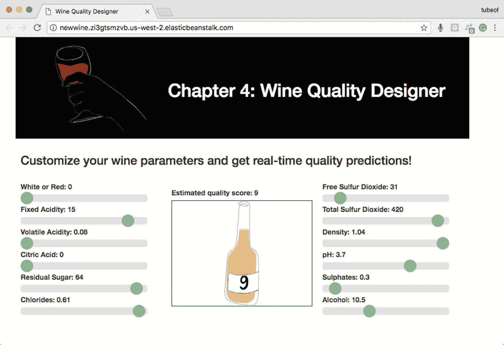

图 4-16

在 AWS Elastic Beanstalk 上运行的葡萄酒质量设计器

```
$ eb open
清单 4-34
使用以下命令打开网站
```


## 别忘了关闭它！

最后，我们需要终止 Beanstalk 实例，以免产生额外费用。这是一个重要的提醒：大多数云服务都不是免费的（清单 4-35）。

```
$ eb terminate winetest
清单 4-35
终止你的实例
```

这需要几分钟时间，但会使网站下线。最好在你的 AWS 仪表盘上仔细检查所有服务是否确实已关闭。这很容易做到：只需登录你的 AWS 账户 [`https://aws.amazon.com/`](https://aws.amazon.com/)，并确保你的 EC2 和 Elastic Beanstalk 账户中没有你未计划使用的任何活跃服务。如果你发现某个实例在你每次“**终止**”它之后似乎又复活了，请检查 EC2 下的“**负载均衡器**”，先终止它们，然后再终止实例。完成后，你还可以停用你的虚拟会话（清单 4-36）。

```
$ deactivate
清单 4-36
停用你的虚拟环境
```

登录你的云账户并确保所有服务都已关闭，这始终是一个好主意（实际上是一个基本想法）。请注意：如果你不这样做，可能会在账单周期结束时收到一个令人不快的“惊喜”。登录你的 AWS 账户，确保你的 EC2 和 Elastic Beanstalk 账户中没有你未计划使用的任何活跃服务（图 4-17 和图 4-18）。

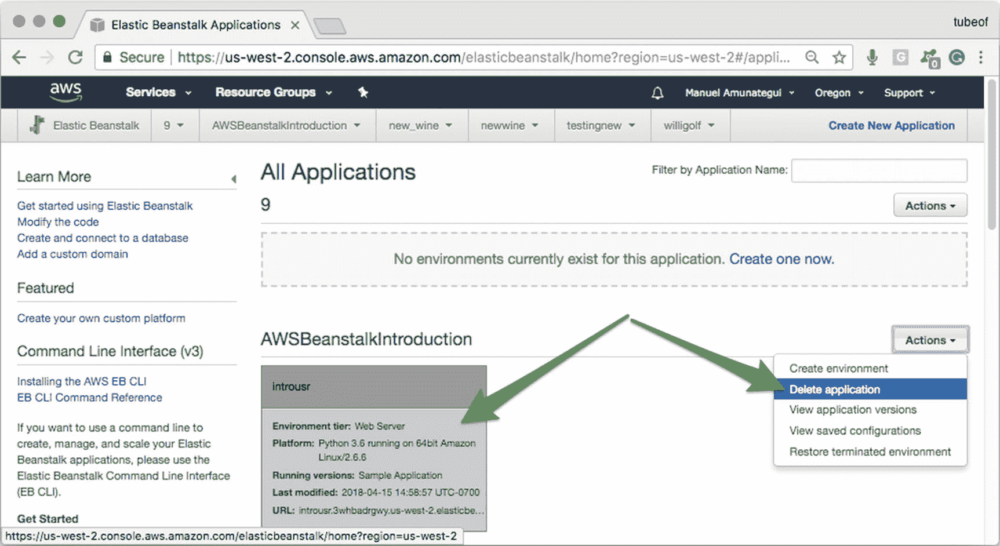

图 4-18

找到你想要终止或删除的实例，并使用“**操作**”下拉按钮选择你的选项

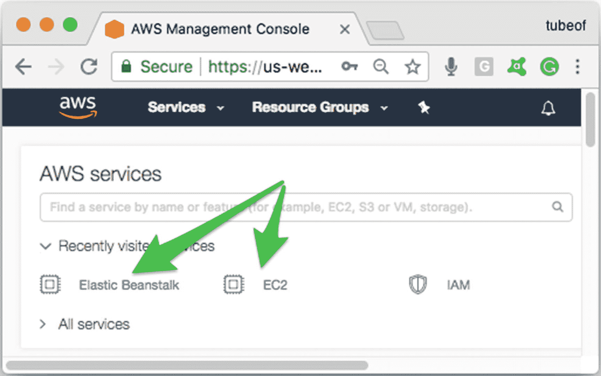

图 4-17

在 AWS 仪表盘上检查是否有任何活跃且不需要的实例

如果你发现某个实例在你每次“**删除应用程序**”之后似乎又复活了，请检查 EC2 下的“**负载均衡器**”，先终止它们，然后返回并再次终止那个“捣乱”的实例（图 4-19）。

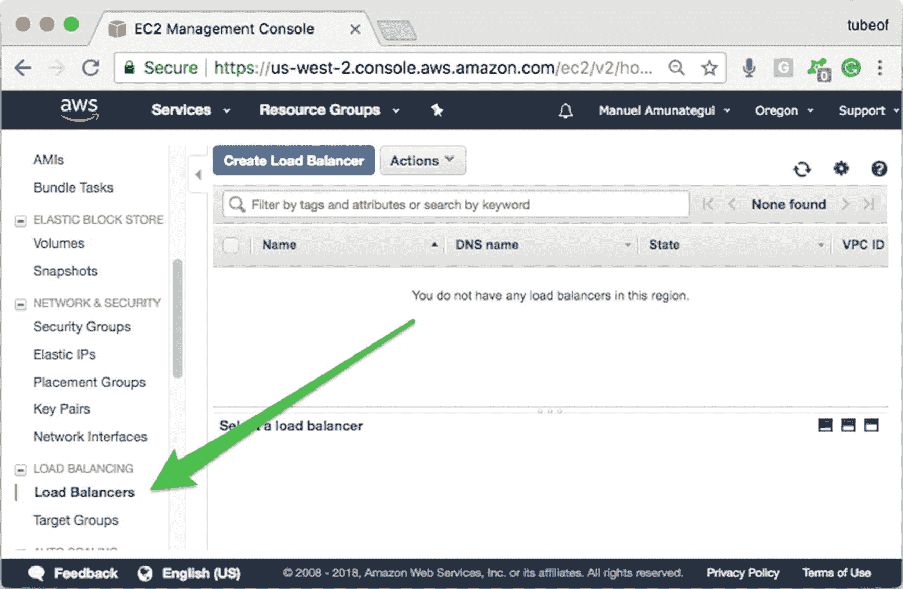

图 4-19

“**负载均衡器**”可能会阻止应用程序终止；如果你无意中启动了多个同名的实例，这种情况就可能发生。

## 步骤回顾

让我们快速回顾一下将 Wine Quality Designer Web 应用程序部署到 Amazon Web Services 的步骤。

**步骤 1：启动虚拟环境**

```
$ python3 -m venv wineenv
$ source wineenv/bin/activate
```

**步骤 2：安装 Python 库**

```
$ pip3 install -r requirements.txt
```

**步骤 3：本地测试 Web 应用程序**

```
$ python3 application.py
```

**步骤 4：创建 wsgi_fix.config 文件**

```
$ mkdir .ebextensions
$ vi .ebextensions/wsgi_fix.config
#将以下内容添加到 wsgi_fix.config
files:
"/etc/httpd/conf.d/wsgi_custom.conf":
mode: "000644"
owner: root
group: root
content: |
WSGIApplicationGroup %{GLOBAL}
```

**步骤 5：Elastic Beanstalk**

```
$ eb init -i
$ eb create winetest
$ eb open
```

**步骤 6：终止 Web 应用程序**

```
$ eb terminate
```

**步骤 7：退出虚拟环境**

```
$ deactivate
```

## 故障排除

从本地正常运行的 Web 应用程序到云端正常运行的应用程序，中间可能会出现各种问题。如果你没有看到预期的结果，第一站就是查看日志！

### 访问日志

如果你遇到问题，请检查日志并查找任何错误。可以使用清单 4-37 中的命令直接在终端窗口中访问日志。

```
$ eb logs
清单 4-37
访问日志

日志也可以在 Amazon Elastic Beanstalk 仪表盘页面上访问（图 4-20）。

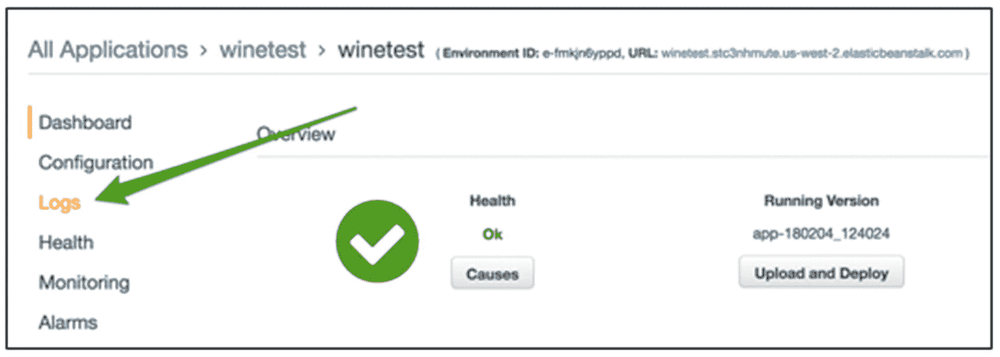

图 4-20

访问日志

选择最后 100 行日志（图 4-21）。

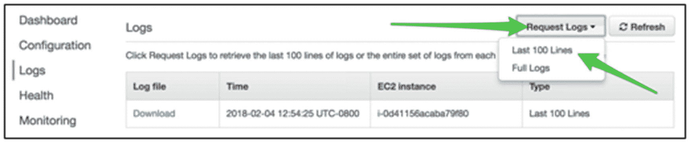

图 4-21

请求最后 100 行

### SSH 连接到你的实例

如果你想直接 SSH 连接到你的新实例，请参见清单 4-38 和图 4-22。

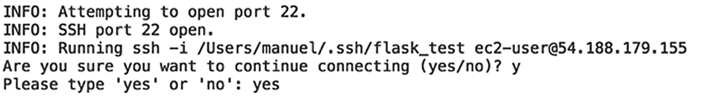

图 4-22

直接 SSH 连接到你的 Elastic Beanstalk 实例

```
$ eb ssh
清单 4-38
SSH 连接到你的实例
```

它会询问你是否要 SSH 连接到你的实例；输入“**yes**”（图 4-23）。

你已成功连接！这就是你刚刚使用“**eb create**”命令创建的 AWS Beanstalk 实例。

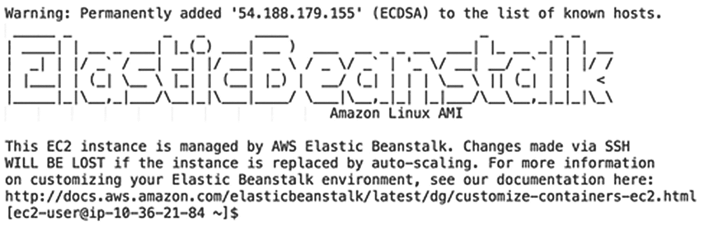

图 4-23

实例已就绪

## 结论

在本章中，我们使用色彩丰富的图像和吸引人的滑块（谁能抗拒滑块呢？）创建了一个关于葡萄酒质量的 Web 应用程序。后端处理依赖于使用 Ajax 进行实时处理，以实现即时反馈，而无需刷新整个页面——这很酷。

网上有很多关于 AWS Elastic Beanstalk 和 Flask 与 EB 的优质免费资料。

*   EB 入门指南：[`https://docs.aws.amazon.com/elasticbeanstalk/latest/dg/command-reference-get-started.html`](https://docs.aws.amazon.com/elasticbeanstalk/latest/dg/command-reference-get-started.html)

*   将 Flask 应用程序部署到 AWS Elastic Beanstalk：AWS Beanstalk 上的简单 Flask 示例：[`https://docs.aws.amazon.com/elasticbeanstalk/latest/dg/create-deploy-python-flask.html#python-flask-`](https://docs.aws.amazon.com/elasticbeanstalk/latest/dg/create-deploy-python-flask.html#python-flask-)

*   使用 EB CLI 管理 Elastic Beanstalk 环境：[`https://docs.aws.amazon.com/elasticbeanstalk/latest/dg/eb-cli3-getting-started.html`](https://docs.aws.amazon.com/elasticbeanstalk/latest/dg/eb-cli3-getting-started.html)

Amazon Web Services 是当今云服务领域的领导者。它拥有超过十年的市场主导地位，这也是其优势之一。用户可能选择其他服务的原因包括多样性、冗余性和成本节约。

脚注 1   2   3   4   5   6   7   8   9   10   11   12   13   14   15   16


