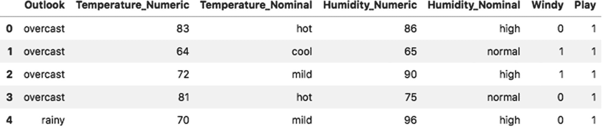
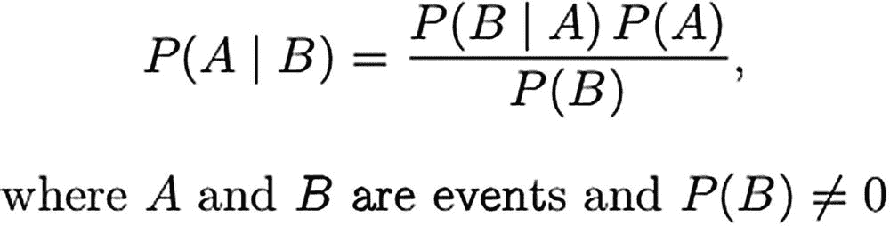
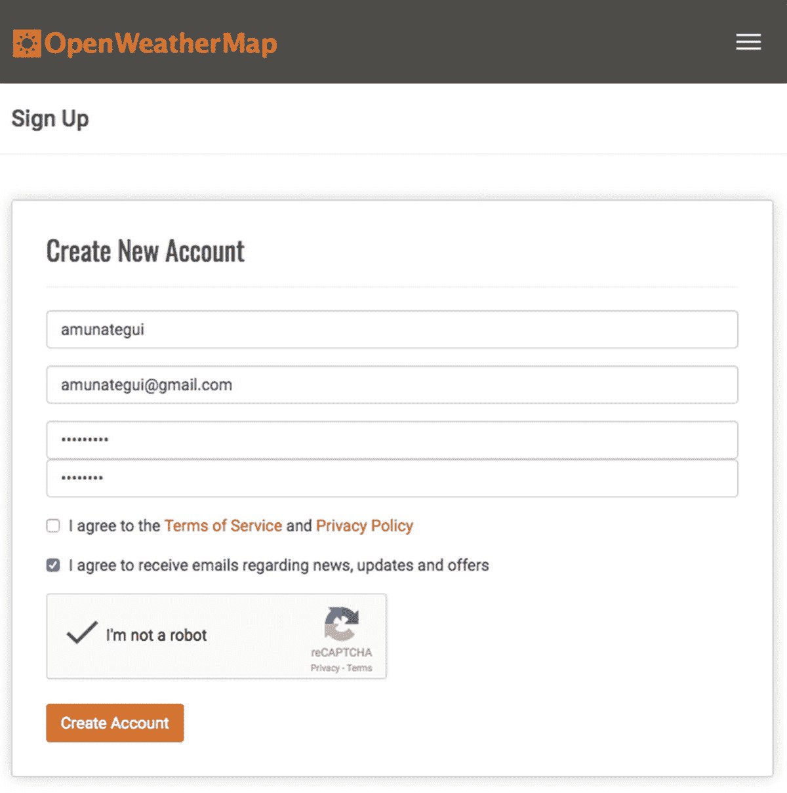
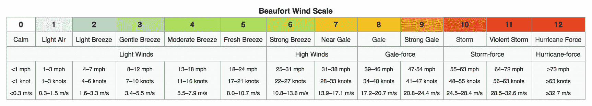
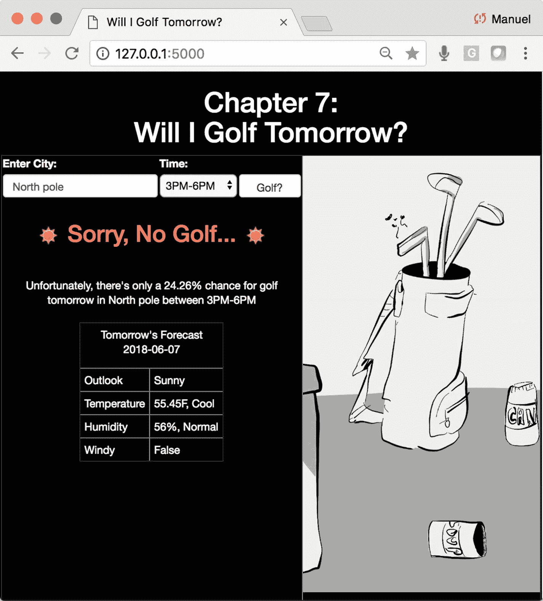
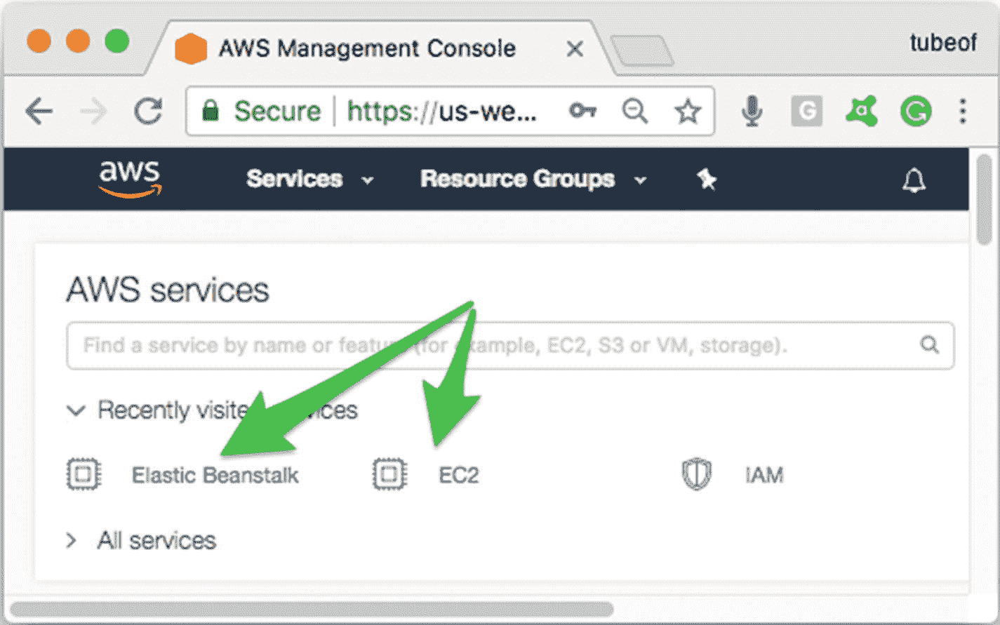
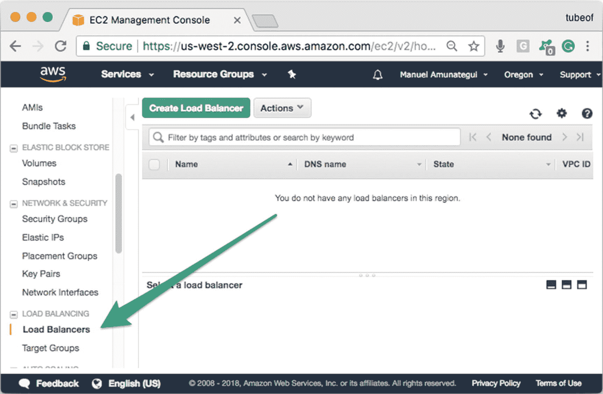
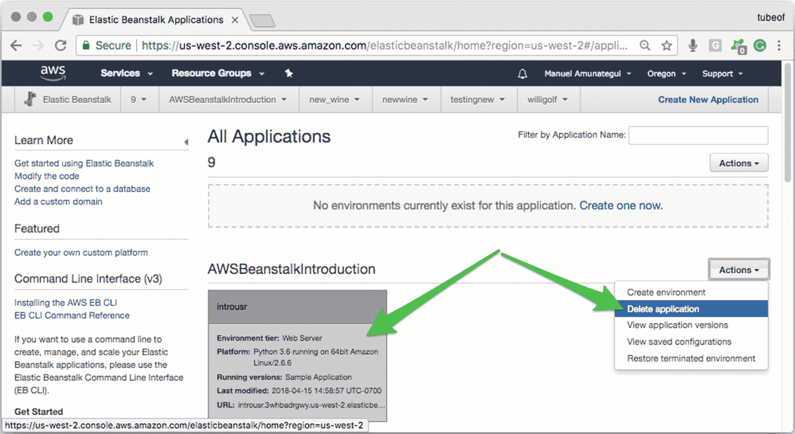

# 7. 使用朴素贝叶斯和 OpenWeather 在 AWS 上进行预测

我明天会打高尔夫吗？使用朴素贝叶斯和亚马逊云服务上的实时天气预报来找出答案。

在本章中，我们将研究 Gerardnico 博客上著名的“**高尔夫|天气数据集**”。^(³³) 我之所以说“**著名**”，是因为似乎每当有人撰写关于贝叶斯的入门文章时，都会使用这个数据集。这很合理，因为它是一个非常简单直观的环境读数集合，以及玩家最终是否打高尔夫球。它切中要点，并且非常适合于在没有计算机甚至计算器的情况下使用贝叶斯定理进行建模。但别担心，我们照例会使用 sklearn 库。我们将对打高尔夫球所需的条件进行建模，并结合 OpenWeatherMap^(³⁴) 来拉取基于用户选择位置的实时预报（图 7-1）。


图 7-1

本章的最终 Web 应用程序

### 注意

通过访问 [`www.apress.com/9781484238721`](http://www.apress.com/9781484238721) 并点击源代码按钮，下载第 7 章的文件。打开 Jupyter 笔记本“**chapter7.ipynb**”以跟随本章内容。


## 探索数据集

请将本章的文件下载到一个名为“**chapter-7**”的文件夹中。打开 Jupyter notebook 以便跟随操作。

由于这是一个非常小的数据集，无需下载任何内容，我们将用 Python 手动创建它。它只包含 14 行数据（列表 7-1 和图 7-2）。



图 7-2

“***高尔夫|天气***”数据集的前几行

```
golf_data_header = ['Outlook', 'Temperature_Numeric', 'Temperature_Nominal', 'Humidity_Numeric', 'Humidity_Nominal', 'Windy', 'Play']
golf_data_set = [['overcast',83,'hot',86,'high',False,True],
['overcast',64,'cool',65,'normal',True,True],
['overcast',72,'mild',90,'high',True,True],
['overcast',81,'hot',75,'normal',False,True],
['rainy',70,'mild',96,'high',False,True],
['rainy',68,'cool',80,'normal',False,True],
['rainy',65,'cool',70,'normal',True,False],
['rainy',75,'mild',80,'normal',False,True],
['rainy',71,'mild',91,'high',True,False],
['sunny',85,'hot',85,'high',False,False],
['sunny',80,'hot',90,'high',True,False],
['sunny',72,'mild',95,'high',False,False],
['sunny',69,'cool',70,'normal',False,True],
['sunny',75,'mild',70,'normal',True,True]]
golf_df = pd.DataFrame(golf_data_set, columns=golf_data_header)
golf_df[['Windy','Play']] = golf_df[['Windy','Play']].astype(int)
golf_df.head()
列表 7-1
将数据集加载到 Pandas 数据框中，创建列名并将布尔字段转换为整数
```

“**Outlook**”字段是对天气的总体描述，类似于一个超级类别。它由三个值组成：“**Overcast**”、“**Rainy**”和“**Sunny**”。温度读数有两种形式：“**Temperature_Numeric**”，即华氏温度数值，以及“**Temperature_Nominal**”，这是一个分类表示，分为三个值：“**hot**”、“**mild**”和“**cold**”。湿度也有两种形式：“**Humidity_Numeric**”，即湿度百分比读数，以及“**Humidity_Nominal**”，这是一个分类变量，包含两个值：“**high**”和“**normal**”。“**Windy**”是一个布尔变量，表示是否有风。最后，“**Play**”是结果变量，表示根据所述条件，玩家是否打了高尔夫球的真实结果。

## 朴素贝叶斯

朴素贝叶斯是一组基于贝叶斯定理和条件概率的算法（图 7-3）。它独立考虑预测变量以确定结果的概率。之所以称为“**朴素**”，是因为它假设预测变量之间相互独立，但除非每个预测变量发生在不同的星球上，否则很难确定这种假设是否成立。尽管如此，这种假设极大地简化了模型；它使模型变得简单、快速且透明。它非常适合在分布式环境中处理大型数据集。



图 7-3

贝叶斯概率公式

简单来说，朴素贝叶斯分类会创建一个频率表，记录来自某个历史数据集的每一种可能的值组合，包括正面和负面结果。通过考虑简单的分类特征更容易理解，但它可以处理任何数据类型。然后，贝叶斯定理可以利用收集到的频率来生成新的概率。

其表述如下：

*   **P(A|B)** 是在给定某些相等值的条件下，结果发生的概率
*   **P(B|A)** 是该结果对应的那些值的概率的乘积
*   **P(A)** 是不考虑这些值时该结果的概率
*   **P(B)** 是不考虑结果时这些值的概率
*   如果这还不清楚，可以观看 RapidMiner 团队制作的一个简短有趣的视频，网址是 [`https://www.youtube.com/watch?v=IlVINQDk4o8`](https://www.youtube.com/watch?v=IlVINQDk4o8) 。

## Sklearn 的 GaussianNB

正如本章引言中提到的，我们将使用“**sklearn.naive_bayes**”库中的“**GaussianNB**”。这是一个简单的模型，提供了一些可调参数：更多信息请参见 [`http://scikit-learn.org/stable/modules/generated/sklearn.naive_bayes.GaussianNB.html`](http://scikit-learn.org/stable/modules/generated/sklearn.naive_bayes.GaussianNB.html) 。

它的使用非常简单，下面是一个调用朴素贝叶斯模型进行分类以及如何提取概率和预测的示例。“**predict()**”函数根据训练结果返回真/假预测。返回“**1**”表示模型预测会进行高尔夫运动（列表 7-2）。

```
输入:
from sklearn.naive_bayes import GaussianNB
naive_bayes = GaussianNB()
naive_bayes.fit(X_train[features],  y_train))
print(naive_bayes.predict(X_test))
输出:
[0 0 1 0 0 0 1]
列表 7-2
在 GaussianNB 模型上调用 predict() 函数
```

“**predict_proba()**”函数返回一对值。第一个值代表结果为假的概率，第二个值代表结果为真的概率（列表 7-3）。

```
输入:
print(naive_bayes.predict_proba(X_test))
输出:
array([[  9.99994910e-01,   5.09005696e-06],
[  9.99968916e-01,   3.10842486e-05],
[  0.00000000e+00,   1.00000000e+00],
[  8.84570501e-01,   1.15429499e-01],
[  8.00907988e-01,   1.99092012e-01],
[  9.99932094e-01,   6.79055800e-05],
[  0.00000000e+00,   1.00000000e+00]])
列表 7-3
从 GaussianNB 模型中获取概率
```

显然，你可以使用其中任何一个值；只需记住每个值的含义。在我们的案例中，我们将使用第二个值，因为我们对于不打高尔夫球的概率与打高尔夫球的概率相比，兴趣不大。这两个数字之和为 1。


## 实时 OpenWeatherMap

我们将把真实的天气预报数据应用到“**明天我是否打高尔夫**”的 Web 应用中。请前往 `openweathermap.org` 注册一个 API 密钥，这是免费的（图 7-4）！非常感谢 Open Weather 团队——非常喜欢这项服务！



图 7-4

OpenWeatherMap.org 注册界面

他们会向您发送一封包含 API 密钥和示例的邮件确认。邮件中提到，新密钥的授权可能需要十分钟。对我来说，实际花了大约 30 分钟。然后，使用您的新密钥运行示例，以双重确认您的账户是否正常工作（列表 7-4）。

```
http://api.openweathermap.org/data/2.5/weather?q=London,uk&APPID=>
列表 7-4
天气 URL——添加您的 API 密钥
```

在它们的系统上传播确实需要一点时间，但确实有效，并且示例返回了以下 JSON 字符串（当然，您的数据会有不同的天气信息；列表 7-5）。

```
{"coord":{"lon":-0.13,"lat":51.51},"weather":[{"id":803,"main":"Clouds","description":"broken clouds","icon":"04n"}],"base":"stations","main":{"temp":284.37,"pressure":1014,"humidity":76,"temp_min":283.15,"temp_max":285.15},"visibility":10000,"wind":{"speed":6.7,"deg":240},"clouds":{"all":75},"dt":1524531000,"sys":{"type":1,"id":5091,"message":0.0065,"country":"GB","sunrise":1524545173,"sunset":1524597131},"id":2643743,"name":"London","cod":200}
列表 7-5
原始 JSON 字符串
```

但访问 REST API JSON 数据的更好方法是用 Python 完成所有操作。这允许您以完全编程的方式调用 API 并处理返回的数据。让我们来看一下（列表 7-6）。

```
from urllib.request import urlopen
weather_json = json.load(urlopen("http://api.openweathermap.org/data/2.5/weather?q=Barcelona&appid=>"))
列表 7-6
使用“api.openweathermap.org”获取实时天气数据
```

作为回报，我们得到一个 JSON 对象，可以通过键值对调用轻松访问（列表 7-7）。

```
输入:
print(weather_json)
输出:
{'base': 'stations',
'clouds': {'all': 0},
'cod': 200,
'coord': {'lat': 41.38, 'lon': 2.18},
'dt': 1524538800,
'id': 3128760,
'main': {'humidity': 72,
'pressure': 1018,
'temp': 287.15,
'temp_max': 288.15,
'temp_min': 286.15},
'name': 'Barcelona',
'sys': {'country': 'ES',
'id': 5470,
'message': 0.0034,
'sunrise': 1524545894,
'sunset': 1524595276,
'type': 1},
'visibility': 10000,
'weather': [{'description': 'clear sky',
'icon': '01n',
'id': 800,
'main': 'Clear'}],
'wind': {'deg': 330, 'speed': 2.6}}
列表 7-7
JSON 内容
```

单个元素可以通过附加键名轻松访问，就像操作 Pandas 对象一样（列表 7-8）。

```
输入:
weather_json['main']
输出:
{'humidity': 72,
'pressure': 1018,
'temp': 287.15,
'temp_max': 288.15,
'temp_min': 286.15}
列表 7-8
JSON “main” 内容
```

### 天气预报 vs. 当前天气数据

我们想使用第二天的天气预报，而“**OpenWeatherMap**”确实提供了五天天气预报 API 服务。它返回的数据以三小时为增量。让我们看看它是如何工作的（列表 7-9）。

```
输入:
http://api.openweathermap.org/data/2.5/forecast?q=Barcelona&APPID=>
输出:
{“dt":1524679200,"main":{"temp":293.08,"temp_min":291.228,"temp_max":293.08,"pressure":1021.76,"sea_level":1030.11,"grnd_level":1021.76,"humidity":83,"temp_kf":1.85},"weather":[{"id":802,"main":"Clouds","description":"scattered clouds","icon":"03d"}],"clouds":{"all":48},"wind":{"speed":0.98,"deg":31.502},"sys":{"pod":"d"},"dt_txt":"2018-04-25 18:00:00"}
列表 7-9
天气预报 URL——添加您的 API 密钥。这将返回大量文本，包含五天、每三小时增量的天气预报
```

键值对“**dt_txt**”是所包含天气预报的开始时间。因此，在这个例子中，对于巴塞罗那 4 月 24 日下午 6 点到 9 点之间，将是疏云天气。能够访问三小时预报为我们的高尔夫预测提供了很好的粒度。有关提取特定日期的方法，请参阅相应的 Jupyter notebook。


### 将 OpenWeatherMap 转换为“高尔夫|天气数据”

为了将“**OpenWeatherMap**”数据转换为正确的“**高尔夫|天气数据集**”格式，需要进行一些数据转换。接下来，我们将调整一些量纲，并修正一些分类数据。

**天气状况**

高尔夫数据集中的“**天气状况**”分类特征有三个可能的值：“**阴天**”、“**雨天**”和“**晴天**”。在“**OpenWeatherMap**”中，一个接近的对应项是“**weather.main**”变量，它提供了九个可能的值：^(³⁵)

*   晴空
*   少云
*   散云
*   多云
*   阵雨
*   雨
*   雷暴
*   雪
*   薄雾

虽然这带有主观性，但我们需要决定如何映射。让我们对这些值进行分组，并构建一个函数来处理等价关系（如果你不喜欢我的分组，可以自行更改）。

**晴天**

*   晴空
*   少云

**阴天**

*   散云
*   多云
*   薄雾

**雨天**

*   阵雨
*   雨
*   雷暴
*   雪

我们将分组结果封装到一个简洁的函数中，该函数可以处理“**OpenWeatherMap**”和“**高尔夫|天气数据**”之间的等价关系（代码清单 7-10）。我们还利用了“**OpenWeatherMap**”提供的一个便捷功能，即获取天气的图形图标，这些图标将显示在我们的 Web 应用程序上（请参阅 [`https://openweathermap.org/weather-conditions`](https://openweathermap.org/weather-conditions) 上的完整图标列表）。

```
def GetWeatherOutlookAndWeatherIcon(main_weather_icon):
# 截取第三个字符 - 不需要白天或夜晚标识
main_weather_icon = main_weather_icon[0:2]
# 返回 "高尔夫|天气数据" 变量和白天图标
if (main_weather_icon in ["01", "02"]):
return("sunny", main_weather_icon + "d.png")
elif (main_weather_icon in ["03", "04", 50]):
return("overcast", main_weather_icon + "d.png")
else:
return("rain", main_weather_icon + "d.png")
代码清单 7-10
函数 “GetWeatherOutlookAndWeatherIcon”
```

**数值型温度**

你可能已经注意到，温度单位不是华氏度或摄氏度，而是开尔文。因此，我们需要通过以下公式将其转换为华氏度（虽然你可以让 API 为你完成此操作，但我们将自己动手）：

```
华氏度 = T × 1.8 - 459.67
```

以及摄氏度：

```
摄氏度 = K - 273.15
```

**名义温度**

名义温度是一个分类变量，由三个值组成：“**凉爽**”、“**温和**”和“**炎热**”。由于这些是主观分组，我们将推断出范围，以便根据来自“**OpenWeatherMap**”的实时预报创建新的分组（代码清单 7-11）。

```
输入:
golf_df[['Temperature_Numeric', 'Temperature_Nominal']].groupby('Temperature_Nominal').agg({'Temperature_Numeric' : [np.min, np.max]})
输出:
Temperature_Numeric
amin amax
Temperature_Nominal
cool                                 64   69
hot                                  80   85
mild                                 70   75
代码清单 7-11
名义温度
```

“**凉爽**”的范围是 64 到 69 华氏度，而“**温和**”的范围是 70 到 75。这很简单，因为这两个值之间没有间隙。另一方面，“**炎热**”从 80 开始。因此，我们需要处理 75 到 80 之间的间隙。为简单起见，我们将“**温和**”的范围扩展到 80。最终得到以下函数（代码清单 7-12）。

```
def GetNominalTemparature(temp_fahrenheit):
if (temp_fahrenheit < 70):
return "cool"
elif (temp_fahrenheit < 80):
return "mild"
else:
return "hot"
代码清单 7-12
名义温度
```

**数值型湿度**

“**OpenWeatherMap**”上的湿度以百分比形式给出，因此我们将直接使用其精确的数值形式。^(³⁶)

**名义湿度**

就像我们对分类名义温度所做的那样，我们需要对名义湿度应用相同的逻辑。肯定有不同的方法来划分这个变量，但必须做出选择，将百分比转换为当前“**高尔夫|天气数据**”数据集中存在的类别（代码清单 7-13）。

```
输入:
golf_df[['Humidity_Numeric', 'Humidity_Nominal']].groupby('Humidity_Nominal').agg({'Humidity_Numeric' : [np.min, np.max]})
输出:
Humidity_Numeric
amin amax
Humidity_Nominal
high                           85   96
normal                         65   80
代码清单 7-13
湿度
```

根据我们的历史数据，我们只有两个选择：“**高**”或“**正常**”。我们将采用简单的方法，将 81% 及以上的湿度视为高，其他情况视为正常（代码清单 7-14）。

```
def GetNominalHumidity(humidity_percent):
if (humidity_percent > 80):
return "high"
else:
return "normal"
代码清单 7-14
函数 “GetNominalHumidity”
```

**有风**

“**OpenWeatherMap**”指出风速单位是米/秒。^(³⁷) 我们将使用蒲福风级（一种将风速与不同陆地和海洋状况联系起来的等级）及其对“**强风**”类别的定义来确定什么是有风、什么是无风（图 7-5），并抽象出一个函数（代码清单 7-15）。该等级的中点位于风速超过 10.8 米/秒时，被视为“**强风**”。



图 7-5

蒲福风级（来源：维基百科）

```
def GetWindyBoolean(wind_meter_second):
if (wind_meter_second > 10.8):
return(True)
else:
return(False)
代码清单 7-15
函数 “GetWindyBoolean”
```

## 设计一个 Web 应用程序“明天我会打高尔夫吗？”使用实时天气预报数据

像往常一样，我们希望我们的应用程序直观、可视化且有趣。这将成为全世界所有高尔夫球手的首选应用程序（没错！）。它也是一个强大的应用程序，将使用来自世界任何地方的实时天气预报，同时保持极其简单的构建方式。这就是贝叶斯模型的魅力所在：它简单、快速，并且为 Web 应用程序提供了一个出色的实时且可扩展的建模选项。

我们的网页只需要两个输入框，以便用户可以输入他们想要打高尔夫的位置和明天的具体时间。该应用程序将尝试查找该位置和时间的天气预报，将“**OpenWeatherMap**”的 JSON 数据转换为所需的“**高尔夫|天气数据集**”格式，并针对“**明天我会打高尔夫吗**”这个问题返回“**是**”或“**否**”。非常简单，对吧？


### 下载 Web 应用程序

请继续下载本章的代码，打开一个命令行窗口，并将驱动器切换到“**web-application**”文件夹。该文件夹应包含与代码清单 7-16 中相同的文件。这里我们展示了 AWS EB 所需的隐藏文件夹“**.ebextensions**”。你可以直接使用它，也可以在“**修复 WSGIApplicationGroup**”部分自行创建（在运行本地版本网站时无需担心此问题，因为它不受此修复的影响）。

```
web-application
├── application.py
├── requirements.txt
├── static
└── images
├── go-golf.jpg
└── no-golf.jpg
└── templates
└── index.html
└── .ebextensions ← 隐藏文件夹
└── wsgi_fix.config
代码清单 7-16
Web 应用程序文件
```

你应该在 Python 3.x 中运行此应用程序，最好在虚拟环境中运行，这样可以将运行 Web 应用程序所需的内容与你机器上已安装的内容隔离开来。

确保你的命令窗口指向本章的“**web-application**”文件夹，并启动一个虚拟环境。启动一个名为“**willigolftomorrow**”的虚拟环境，以确保我们使用的是 Python 3，并安装所有必需的库（代码清单 7-17）。

```
$ python3 -m venv willigolftomorrow
$ source willigolftomorrow/bin/activate
代码清单 7-17
启动虚拟环境
```

然后，通过运行“**pip install -r**”命令安装所有必需的 Python 库（代码清单 7-18）。

```
$ pip3 install -r requirements.txt
代码清单 7-18
安装依赖项
```

接下来，你必须打开“**application.py”**并添加你的“**OpenWeatherMap**”API 密钥。在 **PlayGolf()** 函数中查找 **“<<YOUR_API_KEY>>”**（代码清单 7-19）。

```
openweathermap_url = "http://api.openweathermap.org/data/2.5/forecast?q=" + selected_location + "&mode=json&APPID=>"
代码清单 7-19
添加你的“OpenWeatherMap”API 密钥
```

添加完 API 密钥后，你就可以像往常一样运行本地 Web 应用程序了（代码清单 7-20）。

```
$ python3 application.py
代码清单 7-20
试运行
```

你应该会看到类似于图 7-6 的内容（真遗憾，明天北极不能打高尔夫了）。



图 7-6

在本地运行 Flask 应用程序

确认 Web 应用程序在你的本地机器上正确运行后，按“**ctrl-c**”退出，但保持在虚拟环境会话中。

## 在 AWS Elastic Beanstalk 上运行

仍然在“**willigolftomorrow**”虚拟环境会话中，安装最新的“**awsebcli**”（代码清单 7-21）。我们跳过了一些步骤，因为你现在应该已经设置好了所有安全层（如果没有，请参考第 1 章和第 4 章）。

```
$ pip3 install awscli --upgrade
$ pip3 install awsebcli --upgrade
代码清单 7-21
Pip3 命令（你可能不需要 upgrade 命令，因为你在虚拟环境中，但运行它也无妨）
```

初始化 EB 服务，并按照之前 AWS 项目的常规设置进行操作（代码清单 7-22）。

```
$ eb init -i
代码清单 7-22
EB 初始化命令

```

使用“**willigolftomorrow**”名称创建一个项目，对“**SSH**”选择“是”，并采用默认设置或你在前几章 AWS EB 运行期间喜欢的任何设置（代码清单 7-23）。

```
$ eb create willigolftomorrow
代码清单 7-23
EB 创建命令
```

### 修复 WSGIApplicationGroup

就像我们在“顶级葡萄酒”项目中所做的那样，你需要在“**web-application**”文件夹下创建一个新文件夹（代码清单 7-24），或者使用已提供的文件夹（这是一个隐藏文件夹，你可能能看到也可能看不到——如果不确定，请尝试按照说明创建该文件夹，如果提示错误，则说明你已经有了它）。

```
$ mkdir .ebextensions
$ vi .ebextensions/wsgi_fix.config
代码清单 7-24
创建 wsgi_fix 文件
```

这将创建一个名为“**.ebextensions**”的新文件夹，并打开一个 VI 窗口（在 Unix 术语中称为 visual instrument），这是一个简单的文本编辑器。按“**i**”键从只读模式切换到“**插入**”模式，并在文档末尾粘贴以下行（此修复的文本文件也包含在本章的文档文件夹中）。读取此文件的过程非常挑剔；如果有多余的空格或制表符，将会失败。请密切关注部署过程中与该文件相关的任何错误，并相应处理（代码清单 7-25）。

```
#将以下内容添加到 wsgi_fix.config
files:
"/etc/httpd/conf.d/wsgi_custom.conf":
mode: "000644"
owner: root
group: root
content: |
WSGIApplicationGroup %{GLOBAL}
代码清单 7-25
添加修复
```

现在按“**escape**”键退出“**插入**”模式并进入只读模式，然后输入“**:wq**”以写入并退出“**vi**”（代码清单 7-26）。

```
:wq
代码清单 7-26
退出“vi”
```

### 试运行

使用“**open**”命令打开网站（代码清单 7-27）。

```
$ eb open willigolftomorrow
代码清单 7-27
试运行云版本的 Web 应用程序
```

第一次运行应用程序可能需要一些时间，甚至可能超时。如果是这种情况，请再尝试一次“**eb open**”（见图 7-7）。


图 7-7

在 Elastic Beanstalk 上运行的“***明天我会打高尔夫吗？***”Web 应用程序


### 别忘了关闭它！

最后，我们需要终止 Beanstalk 实例，以免产生额外费用。这是一个重要的提醒：大多数云服务都不是免费的（如果提示名称不匹配，请重试）。系统会要求你确认操作（清单 7-28）。

```
$ eb terminate willigolftomorrow
清单 7-28
终止 EB
```

如果你需要对代码进行任何编辑，只需在本地目录中执行修改，然后调用“**eb deploy**”函数即可（清单 7-29）。

```
$ eb deploy willigolftomorrow
清单 7-29
部署修复或更新
```

最后，一旦确认实例已终止，你可以通过调用以下命令退出虚拟环境（清单 7-30）。

```
$ deactivate
清单 7-30
关闭虚拟环境
```

始终建议（实际上是基本要求）登录你的云账户，确保所有服务都已关闭（警告：如果不这样做，你可能会在账单周期结束时收到一个令人不快的“惊喜”）。登录你的 AWS 账户，确保你的 EC2 和 Elastic Beanstalk 账户中没有你未计划使用的任何活跃服务（图 7-8 和图 7-9）。



图 7-8

在 AWS 仪表盘上检查是否有任何活跃且不需要的实例

如果你发现某个实例在你每次“**Delete application**”后似乎都会复活，请检查 EC2 下的“**Load Balancers**”，先终止它们，然后返回并再次终止那个“顽固”实例（图 7-10）。



图 7-10

“**Load Balancers**”可能会阻止应用程序终止；如果你无意中启动了多个同名实例，这种情况就可能发生



图 7-9

找到你想要终止或删除的实例，然后使用“**Actions**”下拉按钮选择你的操作

## 结论

从表面上看，除了数据集和模型之外，这似乎与我们之前构建的内容略有不同，但事实并非如此。让我们来看看其中的一些亮点。

### 访问 OpenWeatherMap 数据

与我们在 Jupyter 中使用 urllib.request 的“**urlopen**”调用 REST API 服务不同，在 Flask 中我们使用“**requests**”库（清单 7-31 和 7-32）。

```
import requests
weather_json = requests.get(openweathermap_url).json()
清单 7-32
我们这样调用它
```

```
from urllib.request import urlopen
import json
weather_json = json.load(urlopen(openweathermap_url))
清单 7-31
而不是这样
```

这是一种稍微更流行的调用 REST API 的方式，其优势在于内置了 JSON 处理，因此我们只需一次函数调用，而不是两次。

### Try/Catch

我们还使用了 try/catch（或者在这里是 try/error）来捕获缺失的位置。应用程序不能在用户面前崩溃，这一点至关重要；同时，无论是否为错误，妥善处理问题也很重要。如果你向“**OpenWeatherMap**”传递一个未知位置，它将返回一个错误。这很容易捕获、利用，并向用户返回一条信息性消息，提示他们尝试其他操作（清单 7-33）。

```
try:
weather_json = requests.get(openweathermap_url).json()
except:
# 找不到位置
e = sys.exc_info()[0]
message = "找不到该位置，请重试"
清单 7-33
使用 Try/Catch 处理缺失位置
```

尽管我们通过异常变量“**e**”捕获了错误消息，但这里我们并没有对其进行任何处理。我将其保留下来，以便你知道如何访问它，从而可以通过日志记录或智能显示将其扩展到你自己的应用程序中。

### 处理用户输入的数据

这是一个重要的话题，但本书并未真正涉及。根据你正在构建的应用程序类型，你需要确保用户输入的数据不会损害你的应用程序、数据或硬件。比如“**SQL 注入**”^(³⁸)，用户可以通过文本框传递系统命令来删除所有文件。

在这里，我们确保用户输入的文本能够与“**OpenWeatherMap**”配合使用。如果你直接使用原始 HTTP 字符串并添加空格，它将无法正常工作（清单 7-34）。

```
http://api.openweathermap.org/data/2.5/weather?q=New York City&appid...
清单 7-34
处理 URL 中的空格
```

处理这些问题的一个简单方法是使用 urllib.parse 库中的“**quote_plus()**”函数。它会将任何文本输入转换为 HTML 友好的格式，以便可以将其添加到 URL 中而不会干扰 HTML 命令。让我们看一个例子（清单 7-35）。

```
import urllib.parse
urllib.parse.quote_plus('New York City!')
'New+York+City%21'
清单 7-35
处理 URL 中的空格
```

这可以轻松扩展到我们的 Flask 脚本中，只需在“**request.form**”调用之后添加，并在进一步处理之前通过它过滤用户数据即可（清单 7-36）。

```
selected_location = request.form['selected_location']
selected_location = urllib.parse.quote_plus(selected_location)
清单 7-36
处理 URL 中的空格
```

脚注 1   2   3   4   5   6

