# 15. 从访客到订阅者

探讨一些简单的身份验证方案。

在本章中，我们将简要探讨处理订阅者的不同方法。我们将研究一个简单的登录机制，但会快速转向插件。本书的主旨是快速启动并运行你的想法，因此构建自己的订阅者机制与本书的核心理念相悖。如果你有时间、知识和/或人员来做这件事，那么你可能会节省一些钱，但这并非易事。当你处理他人的个人和财务数据时，需要承担全新的责任层。我更倾向于并推荐将这部分工作外包给那些做得好的人，并以插件的形式租用。它们易于使用，能让你专注于重要的事情——你的商业创意！

我们将通过一个非常简单的站点模型，探讨从访客那里获取付款的不同方式。

*   基于文本的身份验证（一种使用数据库扩展的概念，用于自建解决方案——不推荐）

*   Memberful——简单的订阅或产品购买；解锁对 Vimeo 等网站视频的访问权限

*   PayPal 捐赠

*   Stripe 支付

在下一章中，我们将结合我们的配对交易 Web 应用程序和 Memberful.com，探讨一个更强大的付费墙示例。

### 注意

通过访问 [`www.apress.com/9781484238721`](http://www.apress.com/9781484238721) 并点击源代码按钮，下载第 15 章的文件。本章没有 Jupyter notebook，但有一系列 HTML 和 Flask 文件可供实验。

## 基于文本的身份验证

将在线存在变现的一种方法是将访客转化为订阅者。如果你的内容是独家的和/或经常更新，那么访客可能愿意付费以定期、更深入地访问这些内容。这可以通过不同的方式和不同的级别来实现。在高级别上，你需要通过采用身份验证过程来限制对某些区域的访问，从而将免费内容与付费内容分开。

最简单的方法是直接将通用账户/密码硬编码到 Flask 中，或使用文本文件处理多个账户。

### 警告

此方法仅适用于安全不是问题的演示和/或短期项目。你绝不应使用此类方法存储任何私密、有价值的内容，当然更不应存储任何与金钱有关的内容——请将这些想法保留到下一章。

### Flask-HTTPAuth——硬编码账户

我们将从文档^(⁵⁹) 中的基本 Flask-HTTPAuth 示例开始（代码清单 15-1）。

```
from flask import Flask
from flask_httpauth import HTTPBasicAuth
app = Flask(__name__)
auth = HTTPBasicAuth()
users = {
"john": "hello",
"susan": "bye"
}
@auth.get_password
def get_pw(username):
if username in users:
return users.get(username)
return None
@app.route('/')
@auth.login_required
def index():
return "Hello, %s!" % auth.username()
if __name__ == '__main__':
app.run()
代码清单 15-1
简单身份验证
```

没有比这更简单的了。将代码保存到 Python 脚本中（或下载本章的文件并运行 Flask 脚本“**authentication-simple.py**”）。如果缺少 Python 库，请像之前章节那样通过关联的“**authentication_requirements.txt**”文件使用 pip3 install 安装）。

输入账户“**john**”及密码“**hello**”，或“**susan**”及密码“**bye**”（代码清单 15-2 和图 15-1）。

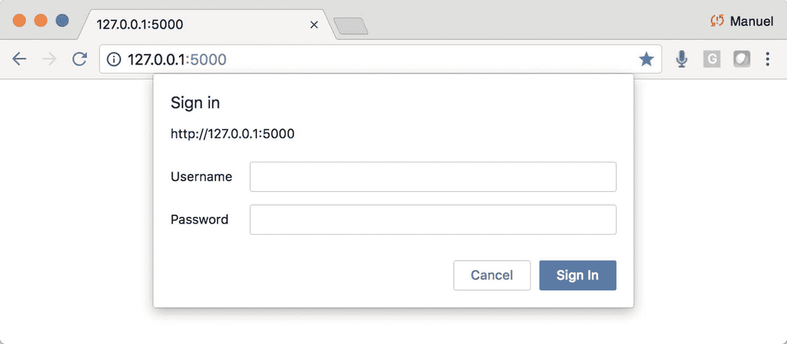

图 15-1

需要用户名和密码才能继续

```
$ python3 authentication-simple.py
代码清单 15-2
运行本地 Flask 脚本“authentication-simple.py”
```


### 摘要认证示例

为了获得经过身份验证的会话（即，允许用户在域内页面间导航而无需在每个页面都登录），你需要使用一种经过身份验证的 cookie。一旦会话的用户通过身份验证，你只需在任何 Flask 函数前加上“**@auth.login_required**”，如果访问者已通过身份验证，会话才会继续；否则，将弹出登录框。相关代码可在脚本“**authentication-digest.py**”（清单 15-3）中找到。

```
from flask import Flask
from flask_httpauth import HTTPDigestAuth
app = Flask(__name__)
app.config['SECRET_KEY'] = 'secret key here'
auth = HTTPDigestAuth()
users = {
"john": "hello",
"susan": "bye"
}
@auth.get_password
def get_pw(username):
if username in users:
return users.get(username)
return None
@app.route('/')
@auth.login_required
def index():
return "Hello, %s!" % auth.username()
@app.route('/paywall')
@auth.login_required
def paywall():
return "%s, you are on page 2!" % auth.username()
if __name__ == '__main__':
app.run()
清单 15-3
摘要认证
```

试试看，运行 Flask 脚本“**authentication-digest.py**”，输入账号“**john**”和密码“**hello**”，或“**susan**”和密码“**bye**”（清单 15-4）。

```
$ python3 authentication-digest.py
清单 15-4
摘要认证
```

一旦通过身份验证，在 URL 末尾添加“**/paywall**”。这将显示你现在正在使用一个经过身份验证的会话，订阅者只需登录一次（图 15-2）。

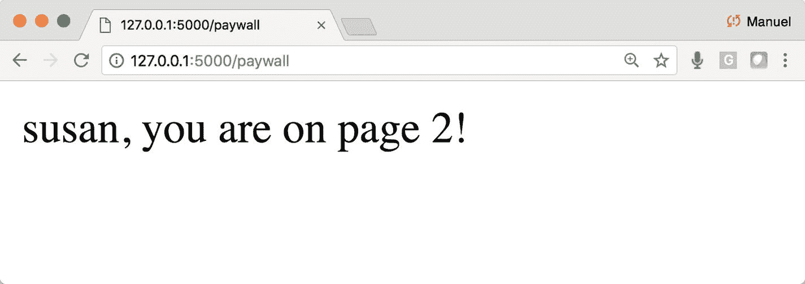

图 15-2

在通过身份验证的情况下浏览网站

### 使用外部文本文件的摘要认证示例

这与之前的概念基本相同，但现在我们从外部文本文件读取数据，而不是 Flask 脚本内部的字典。这将允许管理员（或你）添加和删除用户名和密码，而无需影响源代码或重启 Web 服务器，因为文件在每次认证时都会被读取。请注意，用户名/密码在文本文件中编写时不带引号或逗号，每行一个。相关代码可在脚本“**authentication-digest-external.py**”（清单 15-5）中找到。

```
from flask import Flask
from flask_httpauth import HTTPDigestAuth
app = Flask(__name__)
app.config['SECRET_KEY'] = 'secret key here'
auth = HTTPDigestAuth()
@auth.get_password
def get_pw(username):
for user in open("users-file.txt","r").readlines():
if username in user:
user={user.split(':')[0]:user.split(':')[1].rstrip()}
return user.get(username)
return None
@app.route('/')
@auth.login_required
def index():
return "Hello, %s!" % auth.username()
@app.route('/paywall')
@auth.login_required
def paywall():
return "%s, you are on page 2!" % auth.username()
if __name__ == '__main__':
app.run()
清单 15-5
使用外部文件的摘要认证
```

试试看，运行 Flask 脚本“**authentication-digest-external.py**”，输入账号“**john**”和密码“**hello**”，或“**susan**”和密码“**bye**”（清单 15-6）。

```
$ python3 authentication-digest-external.py
清单 15-6
使用外部文件的摘要认证
```

一旦通过身份验证，在 URL 末尾添加“**/paywall**”。这将显示你现在正在使用一个经过身份验证的会话，订阅者只需登录一次（图 15-3）。

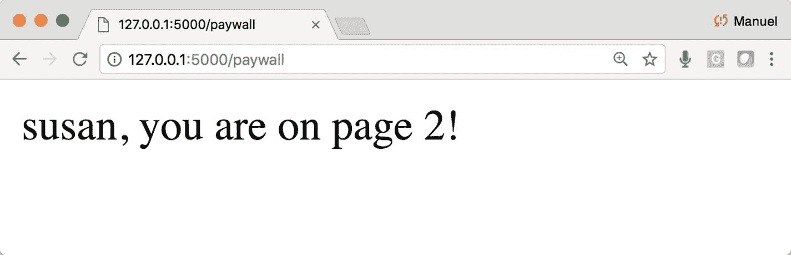

图 15-3

从文本文件读取数据，在通过身份验证的情况下浏览网站

### 注意

本章到目前为止看到的代码应谨慎使用，因为它没有使用安全功能来妥善存储用户凭据。这仅应用于原型、一次性项目或安全内网上的内部演示。下一节将介绍一种更健壮且推荐的方法。

## 简单的订阅插件系统

在构建商业级付费墙或仅限订阅页面时，我推荐的方法是使用专业且由外部管理的插件。让专业人士处理加密、安全、敏感信息存储、信用卡支付等问题，这样你就可以专注于构建优质的内容和服务！这是我们这些“**周末战士**”应该走的路。

## Memberful

Memberful 是我们将要使用和实现的插件。我个人喜欢 Memberful^(⁶⁰)，并认为对于任何寻求简单方法来管理网站付费墙部分的人来说，这是一个很好的选择。它通过 Stripe^(⁶¹) 提供信用卡支付，提供用户管理功能，并且非常谨慎。Memberful 有一系列教学视频，帮助你更好地理解他们那边的运作方式，因为这可能成为你实现网站货币化目标的重要工具。

让我们看一个从 Memberful 购买东西的简单示例。这里我们只关注购买商品；订阅和付费墙将在下一章讨论。要设置一个待售产品，你只需进入你的 Memberful 仪表板，在那里设置一个待售商品，他们会给你一个简单的 URL 放在你的页面上。当访问者进行购买流程时，他们会看到你的网站内出现一个弹出框。这就是 Memberful 的美妙之处：你的访问者永远不会觉得他们离开了你的网站去进行购买。大大的 A+ 好评。

那么，去 Memberful 注册一个免费账户吧。本章中你不需要使用信用卡（图 15-4）。

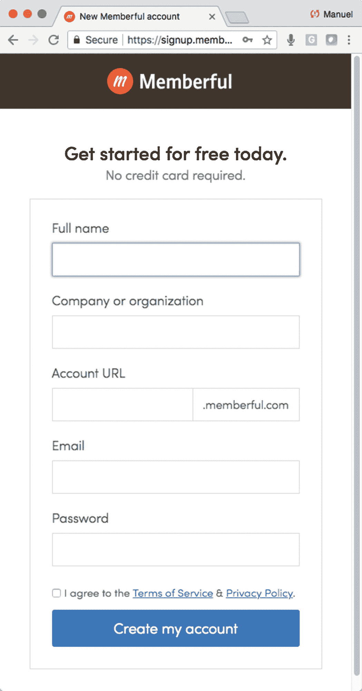

图 15-4

注册一个免费的 Memberful 账户——本章无需信用卡

当你创建一个免费账户时，他们会为你设置一个测试 URL，以模拟请求会员资格的过程，而无需使用真实的信用卡。这将让你站在订阅者的角度，了解该工具的工作原理。注册一个账户，当它询问你是否在使用 WordPress 时，选择“**我在使用其他平台**”（图 15-5）。

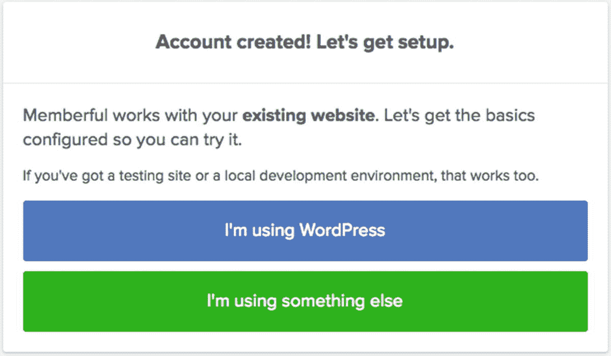

图 15-5

注册账户，当被问及是否使用 WordPress 时，选择“**我在使用其他平台**”

接下来，你会看到一个包含一些代码和一个视频的页面。我强烈建议观看视频，因为它解释得很清楚。输入你的 PythonAnywhere 网站地址，并复制 HTML JavaScript 代码。JavaScript 创建了弹出窗口，因此用户永远不会离开你的网站（图 15-6）。

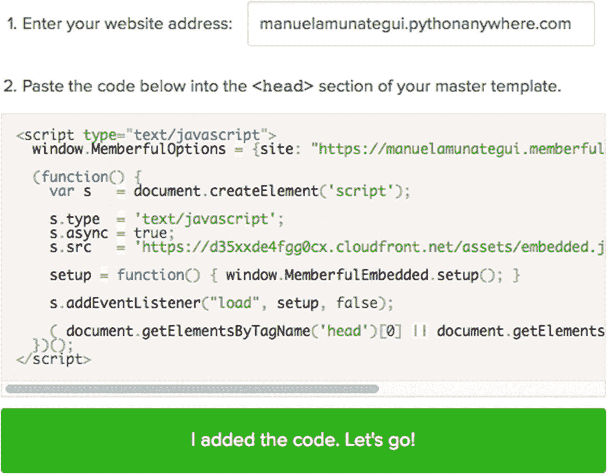

图 15-6

输入你的 PythonAnywhere URL 并复制 HTML 代码

作为回报，你将获得一个“**购买链接 HTML 代码**”（清单 15-7）。

```
>.memberful.com/checkout?plan=30287">购买示例套餐，每月 25 美元。
清单 15-7
虚假产品购买链接
```

让我们创建一个非常简单的测试网页（无需 Flask）来放置我们的购买链接。完成后，点击它并进行那个虚假购买。你可以使用帮助文档中列出的任何虚假测试信用卡号，或者直接使用“**4242 4242 4242 4242**”。


### 创建一个销售虚拟产品的真实网页

构建清单 15-8 中所示的简单 HTML，并确保将购买链接替换为你自己的链接（即使用有效账户）。你可以在本章目录中找到名为“**memberful-purchase.html**”的基础脚本。编辑并运行它，你应该会看到类似图 15-7 的页面。

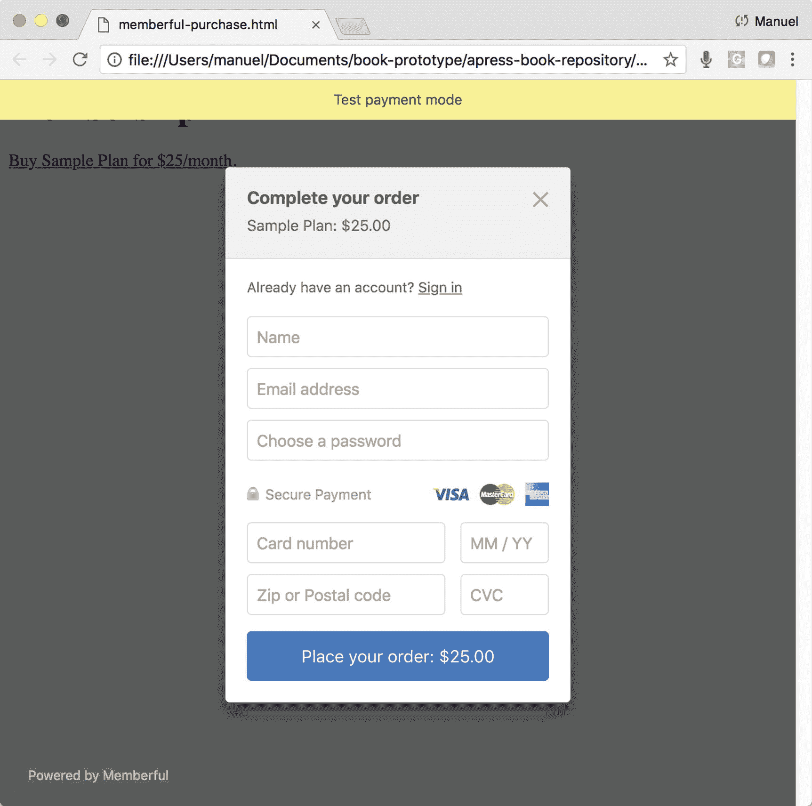

图 15-7

你网站上的 Memberful 弹窗；继续使用虚拟信用卡号下单

```

window.MemberfulOptions = {site: "https://manuelamunategui.memberful.com"};
(function() {
var s   = document.createElement('script');
s.type  = 'text/javascript';
s.async = true;
s.src   = 'https://d35xxde4fgg0cx.cloudfront.net/assets/embedded.js';
setup = function() { window.MemberfulEmbedded.setup(); }
s.addEventListener("load", setup, false);
( document.getElementsByTagName('head')[0] || document.getElementsByTagName('body')[0] ).appendChild( s );
})();

Membership
>.memberful.com/checkout?plan=30287">以每月 25 美元购买示例计划。

清单 15-8
购买产品脚本
```

### 检查你的供应商仪表板

完成虚拟购买后，登录你的 Memberful 账户，点击顶部导航栏上的“**仪表板**”按钮。我们的订单就在那里！太棒了！我们暂时不碰 Memberful，直到下一章。显然，如果你销售的是真实产品，你会创建许多这样的购买链接，并附上你自己的产品描述和图片。同样在仪表板中，你可以管理用户、产品、退款等（图 15-8 和图 15-9）。

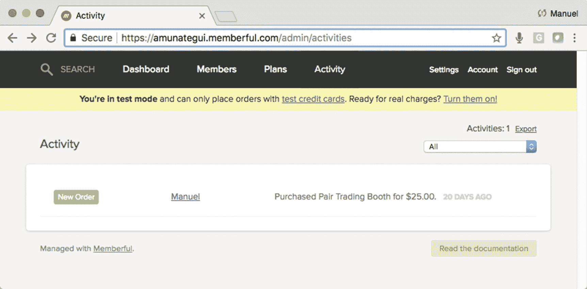

图 15-9

管理订单

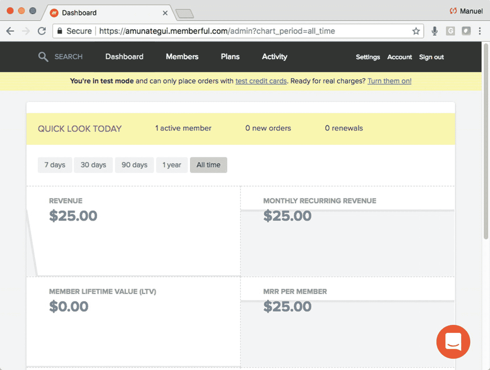

图 15-8

查看订单活动

## 使用 PayPal 接受捐赠

设置 PayPal 捐赠按钮是为个人和非营利项目筹集资金最简单的方法之一（请阅读免责声明或查找其他类型的 PayPal 选项 [`www.paypal.com/buttons`](http://www.paypal.com/buttons)）。显然，你需要一个状态良好的账户，你只需将 HTML 表单代码放入你的网页中，它就会处理其余所有事情`—`它甚至会为你显示按钮。这是一个无痛选项，你甚至不需要 Flask，因为这个支付选项只需要 HTML`—`其他什么都不需要（清单 15-9）。

```

清单 15-9
PayPal 捐赠代码
```

一旦你将代码放入网页，你就会看到黄色的“**捐赠**”按钮。当你使用有效的 PayPal 账户点击它时，它会将你带到 PayPal，并向捐赠者提出一系列问题以完成财务捐赠（图 15-10 和图 15-11）。

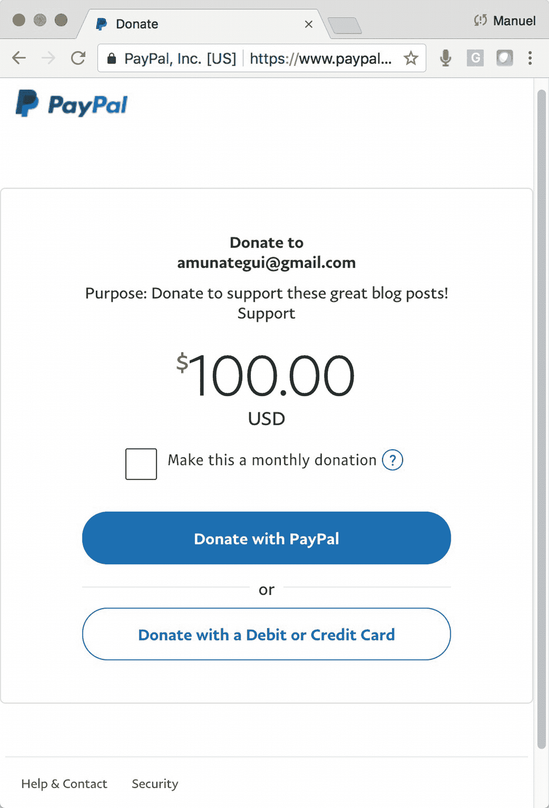

图 15-11

显示你网站和电子邮件信息的 PayPal 捐赠仪表板

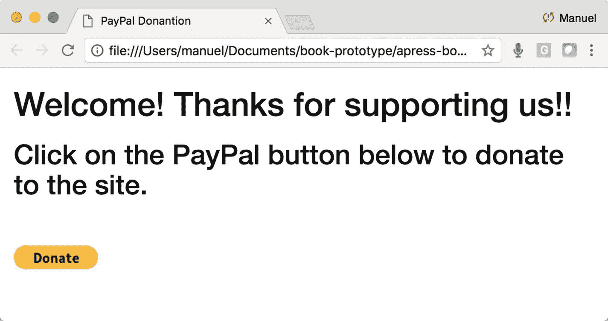

图 15-10

你网站上的 PayPal 捐赠按钮

你可以在本章的下载文件中查看此代码的示例，文件名为“**paypal.html**”。如果你需要使用此类方法进行自己的筹款，你需要拥有一个账户并获取你自己的代码。

## 使用 Stripe 进行购买

Stripe 是一个简单、强大且广泛使用的支付平台，拥有大量 Flask 支持。它也被广泛信任，如果你希望访客向你付款，这一点很重要。我们将遵循官方文档中的一个简单示例（ [`https://stripe.com/docs/checkout/flask`](https://stripe.com/docs/checkout/flask) ）。

首先注册一个免费账户，如果你只想使用开发者工具进行测试，则无需提供任何支付信息。

注册一个免费的 Stripe 账户，导航到“**开发者**”部分，然后点击“**API 密钥**”（图 15-12）。

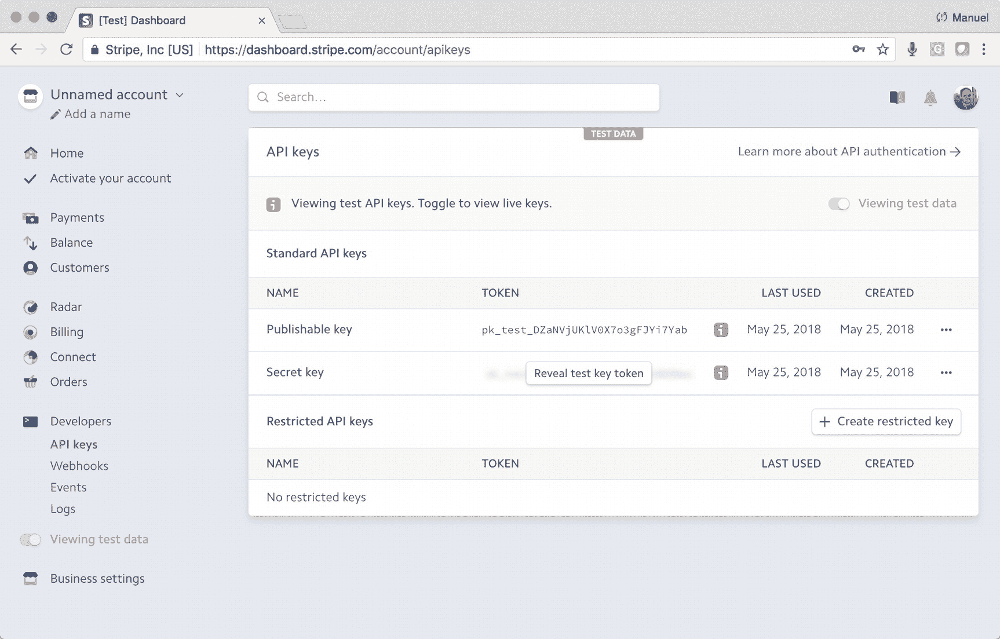

图 15-12

显示可发布密钥和秘密密钥的开发者部分

获取测试购买的代码非常简单，我们将按照他们的示例进行操作（ [`https://stripe.com/docs/checkout/flask`](https://stripe.com/docs/checkout/flask) ）。他们建议获取“**可发布密钥**”和“**秘密密钥**”，并将它们创建为操作系统变量，这样你就不必硬编码它们（这是一个很好的做法）。在 Mac 上使用终端中的“**export**”命令，在 Windows 上使用控制面板，或者直接将变量添加到 Flask 中（清单 15-10）。

```
$ export SECRET_KEY=">"
$ export PUBLISHABLE_KEY=">”
清单 15-10
导出你的 API 密钥
```

你还需要使用 pip3 安装 Stripe 和 Flask（清单 15-11）。

```
$ sudo pip3 install --upgrade stripe
$ sudo pip3 install flask
清单 15-11
安装所需库
```

“**main.py**”，我们的 Flask 控制器，导入 Stripe，设置秘密密钥和可发布密钥，并提供两个页面`—`“**index.html**”页面，你可以在其中放置待售商品，以及“**charge.html**”页面，你可以在其中使用“**stripe.Charge.create()**”函数处理商品购买`—`并提供一个确认页面。这相当直接，其有效性也在于此（清单 15-12）。

```
import os
from flask import Flask, render_template, request
import stripe
stripe_keys = {
'secret_key':  os.environ['SECRET_KEY'],
'publishable_key': os.environ['PUBLISHABLE_KEY']
}
stripe.api_key = stripe_keys['secret_key']
app = Flask(__name__)
@app.route('/')
def index():
return render_template('index.html', key=stripe_keys['publishable_key'])
@app.route('/charge', methods=['POST'])
def charge():
# 金额以美分为单位
amount = 500
customer = stripe.Customer.create(
email='customer@example.com',
source=request.form['stripeToken']
)
charge = stripe.Charge.create(
customer=customer.id,
amount=amount,
currency='usd',
description='Flask Charge'
)
return render_template('charge.html', amount=amount)
if __name__ == '__main__':
app.run(debug=True)
清单 15-12
查看“Main.py”
```

模板还使用了一个巧妙的技巧，即使用布局文件（“**layout.html**”）。这允许你创建一个可以在整个网站中重复使用的骨架 HTML 页面。例如，你只需创建一次品牌标识和下拉链接，然后让每个页面继承它。

然后，你利用 Jinja2 标签“****”在 HTML 中引入新代码（清单 15-13）。

```

Stripe

form article label {
display: block;
margin: 5px;
}
form .submit {
margin: 15px 0;
}



清单 15-13
使用模板 HTML 页面——“layout.html”
```

任何想要放入布局文件中的代码都使用 Jinja2 标签“****”（清单 15-14）。

```



金额为 5.00 美元


清单 15-14
用于“layout.html”和变量“key”的 Jinja2 标签
```


在 [`Stripe.com`](http://stripe.com) 上创建一个免费账户，并按照之前所示导出你的 API 密钥。然后运行示例代码（你可以在本章的下载文件中找到它，原文件名是“**stripe-payments**”）。继续在本地运行代码（清单 15-15 和图 15-13）。

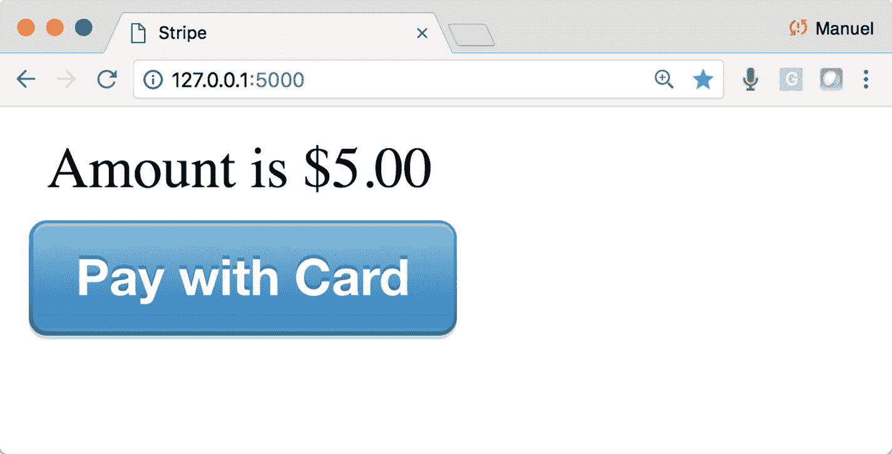

图 15-13

你自己的 [Stripe.​com](http://stripe.com) 购买按钮

```
$ python3 main.py
清单 15-15
运行 Stripe Flask 示例
```

如果你完成示例购买流程（你应该可以输入任何虚假的信用卡号），然后登录你的 Stripe.com 仪表盘，你应该能看到该订单（图 15-14）。

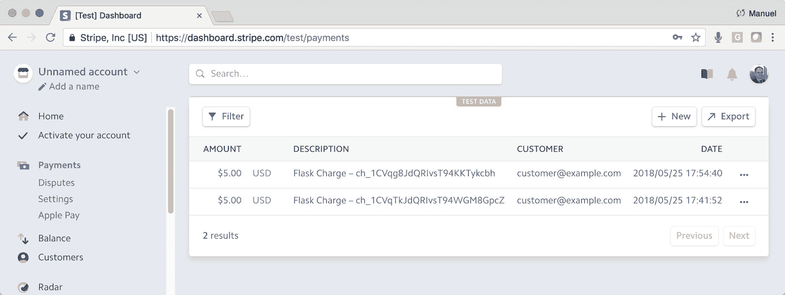

图 15-14

你自己的 Stripe.com 购买按钮

## 结论

本章简要介绍了一些可用于 Web 应用程序的身份验证、捐赠和购买插件。我要重申，这里展示的任何“**自建**”解决方案都不适用于任何严肃用途，当然也不适用于任何商业场景。在第 16 章和第 17 章中，我们将探讨一个真正的解决方案，你可以根据你的付费墙和订阅需求进行定制。

脚注 1   2   3

