# 16. 案例研究第 4 部分：使用 Memberful 构建订阅付费墙

让我们通过使用 Memberful 和 PythonAnywhere 上的信用卡支付，基于订阅付费墙来完成我们的案例研究。

在本章中，我们将把所有交易内容隐藏在仅限付费用户的订阅付费墙之后（图 16-1）。这是我们的最后一个项目，让我们把它做得特别一些！我们将使用 Memberful.com 为我们的配对交易网站扩展一个真正的付费墙订阅系统。这比我们在前一章中看到的要复杂得多。之前我们了解了如何销售产品或收取订阅费。这些都是单步流程。相反，我们想要一种方式，允许付费用户浏览整个网站，包括付费墙后的内容，并且每个会话只需登录一次。

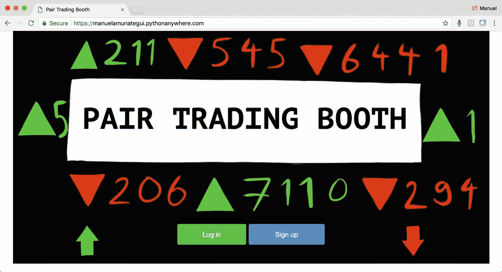

图 16-1

本章的最终 Web 应用程序

我们在此假设，虚构的交易建议价值足够高，足以让人们为其付费。以下是实现这一目标所需的工具。此外，由于本章涉及付费墙，并且需要将特定地址绑定到 Memberful，我们将无法在本地运行此项目。我们将使用的配对交易展台代码与前面章节相同；我们在这里要做的只是添加一个额外的登录页面和 Memberful 付费墙功能。简单来说，本章不会使用 Jupyter 或本地 Flask 代码。

### 注意

通过访问 [`www.apress.com/9781484238721`](http://www.apress.com/9781484238721) 并点击源代码按钮，下载第 16 章的文件。

## 升级你的 Memberful 和 PythonAnywhere 付费账户

为了构建这个付费墙，你需要使用付费账户。你需要将你的 Memberful.com 账户升级到“**专业版**”，这需要提供有效的信用卡号，每月费用为 25 美元。这是必需的，因为你需要访问 API 和 Webhooks，而这些在免费账户上是禁用的。你还需要将你的 PythonAnywhere 账户升级到最低付费级别——在撰写本文时，它被称为“**Hacker $5/month**”。这是必需的，因为身份验证需要使用自定义端口，而这仅在付费账户上允许。我建议开启几天试试看，如果你觉得它没用，在产生第二个月费用之前降级回免费账户。

简而言之，我们希望让会员能够使用 Memberful 购买订阅（这样我们就不必处理任何用户或支付数据），让他们在会话期间只需登录一次账户，然后允许他们自由浏览网站，直到他们注销。

### 升级 Memberful

让我们升级账户，以便掌握 OAuth 状态和自定义端口。这将允许我们的应用程序让访问者登录并访问付费墙后的页面。前往 Memberful 网站，然后进入“**账户**”和“**套餐与账单**”（图 16-2）。

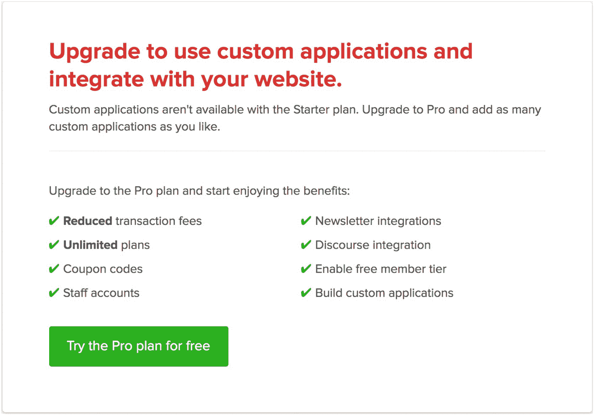

图 16-2

访问“**专业版**”

继续升级到“**专业版**”。在“**应用程序详情**”窗格中，勾选所有复选框，并添加一个会员登录页面。这至关重要，因为 Memberful 会在用户注册或登录后将他们重定向到此页面（清单 16-1 和 16-2，以及图 16-3）。

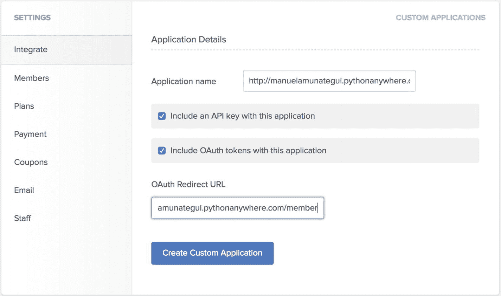

图 16-3

我们 Web 应用程序付费墙的设置

```
https://>.pythonanywhere.com/member
清单 16-2
你的“OAuth 重定向 URL”应如下所示
```

```
http://>.pythonanywhere.com/
清单 16-1
你在 Memberful 中的应用程序名称是你的 PythonAnywhere.com 账户。它应如下所示
```

接下来复制你的 OAuth“**标识符**”和“**密钥**”。这些密钥是我们将在 Web 应用程序的 Flask 部分中使用的（图 16-4）。

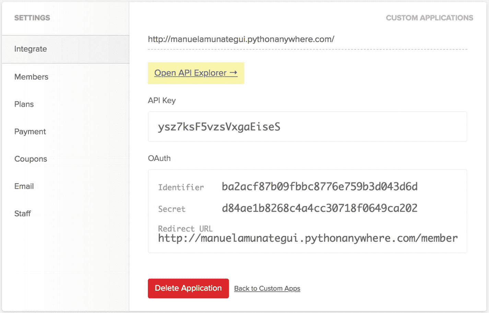

图 16-4

创建自定义应用程序后，你的页面应如下所示

在“**自定义应用**”选项卡下，将你的“**登录应用程序**”设置为下拉菜单中的站点（它应该已经包含你之前在“**自定义应用程序**”自动登录应用程序中添加的 PythonAnywhere 账户；图 16-5）。

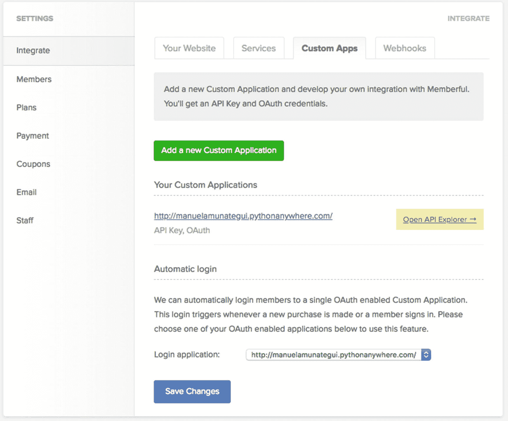

图 16-5

选择你的“**登录应用程序**”以反映你的 PythonAnywhere 账户

### 升级 PythonAnywhere

在 PythonAnywhere 的账户选项卡下，选择第一个付费计划（即最便宜的），“**Hacker**”计划（图 16-6）。

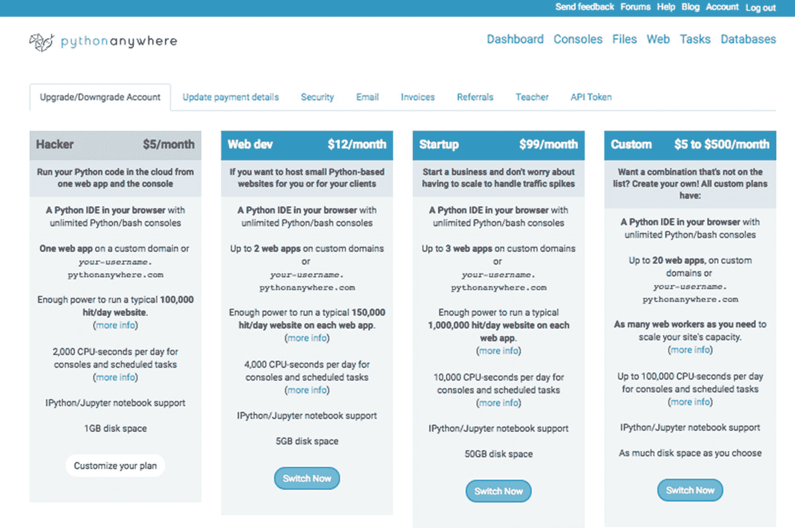

图 16-6

PythonAnywhere 付费账户的选择；最便宜的付费账户将允许你跟随本章项目进行操作

### Pip 安装 Flask-SSLify

我们需要安装“**Flask-SSLify**”，因为它不是 PythonAnywhere 上 Python 3 构建的一部分。Flask-SSLify 将强制所有页面使用“**HTTPS**”，并为你提供增强的安全性。你之前已经使用过“**pip3 install**”来安装 Wikipedia 的 API。点击 PythonAnywhere 账户顶部的“**控制台**”链接，访问一个 bash 控制台（图 16-7）。

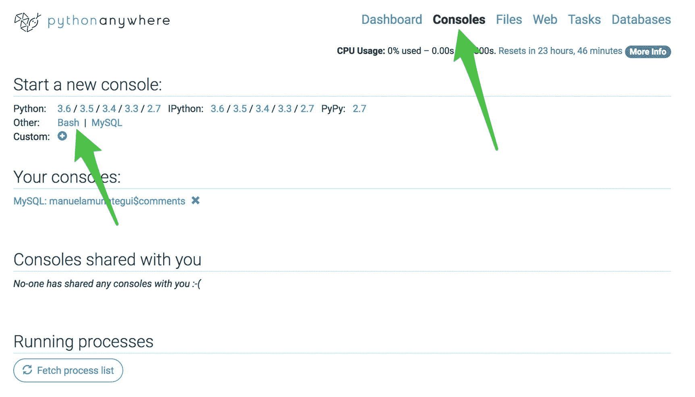

图 16-7

打开 bash 控制台，使用 pip 安装原始 Python 构建中未包含的库

一旦 bash 控制台打开，你就可以使用 pip 安装所需的库。继续使用以下命令安装 Flask-SSLify 库（你需要添加两个破折号和“**user**”以覆盖权限被拒绝的消息；清单 16-3）。

```
$ pip3 install Flask-SSLify --user
清单 16-3
安装额外的库
```


## Memberful 身份验证

Memberful 支持使用 OAuth 2.0 协议进行身份验证，但由于它要求您将应用程序直接绑定到您的 Memberful 账户，因此创建付费墙比您自己实现要容易得多。更多信息，请参考 Memberful 官方文档：[`https://memberful.com/help/integrate/advanced/memberful-api/`](https://memberful.com/help/integrate/advanced/memberful-api/)。

### 两步流程与 Flask 会话机制

Flask 会话是一个数据持有对象，可以使用 cookie 在页面之间维持状态。试想一下，有时您希望记住用户正在做什么、他们的购物车中有什么，或者即使用户在不同页面之间跳转，也能记住他们是谁。您可以使用表单变量来回传递数据，但这很快就会变得混乱和令人困惑（而且不太安全）。Flask 会话通过使用 cookie 将数据存储在客户端计算机上来解决这个问题。为此，必须启用 cookie。

得益于 Memberful 强大的会员功能和集成的用户界面，我们将要创建的用户身份验证系统很容易实现。当访客进入付费墙后面的页面时，我们的 Flask 应用程序会检查该用户是否确实是付费客户。我们只需要在会话期间检查一次，然后依赖会话变量来记住他/她有权查看付费墙后面的页面。

### 身份验证步骤 1

第一步是从 Memberful 站点获取身份验证“**代码**”。此代码是一个临时密钥，允许您请求用户的信息。当用户点击 Web 应用程序的 Memberful 身份验证“**sign_in**”链接时，此代码会自动返回（清单 16-4）。

```
>.memberful.com/auth/sign_in">登录
清单 16-4
身份验证登录链接
```

一旦 Memberful 将查询 URL 识别为有效的 Memberful 客户端站点，它就会返回一个附加到重定向 URL 的代码（清单 16-5）。

```
https://manuelamunategui.pythonanywhere.com/member/?code=483294e65b5dd2e65862e3c1ba454dee&redirect_to=http%3A%2F%2Fmanuelamunategui.pythonanywhere.com%2Fmember%2F
清单 16-5
身份验证代码
```

我们的应用程序将代码“**code=483294e65b5dd2e65862e3c1ba454dee**”读取为“**GET**”变量，并保留它以构建第二步身份验证。

### 身份验证步骤 2

我们自定义的“**IsSubscriberLoggedIn()**”函数完成了大部分身份验证工作。它首先构建“**access_token_req**”字典，其中包含上一步的临时“**code**”、应用程序的 Memberful ID 和密钥以及重定向 URL（所有这些都可以在您的 Memberful 账户的“**设置**” ➤ “**集成**” ➤ “**自定义应用**”下找到）。

然后，它将访问令牌字典作为“**POST**”请求传递给“**oauth/token**”URL（清单 16-6）。

```
https://>.memberful.com/oauth/token
清单 16-6
auth/token URL
```

如果一切正确，它将返回“**access_token**”；这是真正的密钥，将解锁我们访客的个人数据，例如他们是否是我们 Web 应用程序的实际会员，以及他们的订阅当前是否处于活动状态（清单 16-7）。

```
https://>.memberful.com/api/graphql/member?access_token=999999999
清单 16-7
可以使用以下 URL 查询此数据
```

身份验证过程步骤 2 中的所有操作都通过表单“**POST**”完成，以免将敏感信息显示为可读的 URL。这类工作很容易在我们的函数“**IsSubscriberLoggedIn()**”中抽象出来，这将使我们的 Web 应用程序能够轻松检查每个访客的会员状态（清单 16-8）。

```
def IsSubscriberLoggedIn(code):
# 构建访问令牌字典
access_token_req = {
"code": code,
"client_id": MEMBERFUL_KEY,
"client_secret": MEMBERFUL_SECRET,
"redirect_uri": redirect_uri,
"grant_type": "authorization_code" }
# 构建 oauth/token 以访问访客数据
content_length=len(urlencode(access_token_req))
access_token_req['content-length'] = str(content_length)
r = requests.post(MEMBERFUL_SITE + '/oauth/token', data=access_token_req)
data = json.loads(r.text)
# 构建 graphql 查询以查询所需的具体值
r = requests.get(MEMBERFUL_SITE + '/api/graphql/member?access_token=' +             data['access_token'] +                                           '&query={%20currentMember%20{%20fullName%20subscriptions%20{%20active%20expiresAt%20}%20}%20}')
清单 16-8
函数“IsSubscriberLoggedIn()”
```

一个值得提及的领域是 graphQL（更多详情请参阅 Memberful API 文档的“**查询和变更**”部分，网址为 [`https://memberful.com/help/integrate/advanced/memberful-api/#queries-and-mutations`](https://memberful.com/help/integrate/advanced/memberful-api/#queries-and-mutations) ）。该工具在成功进行身份验证后，允许查询特定的订阅者信息（清单 16-9）。

```
输入：
query {
member(id: 1) {
id
fullName
email
subscriptions {
id
plan {
id
name
}
}
}
}
输出：
{
"data": {
"member": {
"id": "1",
"fullName": "John Doe",
"email": "john.doe@example.com",
"subscriptions": [
{
"id": "1",
"plan": {
"id": "1",
"name": "Monthly"
}
}
]
}
}
}
清单 16-9
来自官方帮助文档
```

在我们的案例中，我们只关心两条信息：用户的姓名以及他们的订阅是否处于活动状态（清单 16-10）。

```
query={%20currentMember%20{%20fullName%20subscriptions%20{%20active%20expiresAt%20}%20}%20}
清单 16-10
我们将以下变量附加到“GET”URL
```

这翻译过来就是：提供此会员的全名，以及他们的订阅是否处于活动状态以及何时到期。这里我们只使用了订阅是否处于活动状态，但您可以通过检查到期日期并提醒会员尽快续订来轻松扩展此功能（清单 16-11）。

```
{"data":{"currentMember":{"fullName":"Manuel", "subscriptions":[{"active":true,
"expiresAt":1529879538}]}}}
清单 16-11
如果我们运行它并查看 graphQL 响应，我们会得到
```


### 调用 Memberful 函数

这就是 Memberful 的精妙之处：使用起来非常简单，它通过存储用户数据和管理支付、退款、续订等操作，为我们完成了所有繁重的工作。Memberful 提供了四个可以嵌入到你网站中的 URL。

**登录：**

```
https://>.memberful.com/auth/sign_in
```

**购买订阅（计划编号会有所不同）：**

```
https://>.memberful.com/checkout?plan=29504
```

**退出登录：**

```
https://>.memberful.com/auth/sign_out
```

**管理你的账户：**

```
https://>.memberful.com/account
```

通过在每页的开头添加一个简单的 JavaScript 代码片段以及登录/注册/购买链接，你将自动继承客户弹窗管理系统。这非常强大，因为访客会感觉这一切都构建在我们的 Web 应用程序内部（清单 16-12）。

```
window.MemberfulOptions = {site: "https://amunategui.memberful.com"};
(function() {
var s   = document.createElement('script');
s.type  = 'text/javascript';
s.async = true;
s.src   = 'https://d35xxde4fgg0cx.cloudfront.net/assets/embedded.js';
setup = function() { window.MemberfulEmbedded.setup(); }
s.addEventListener("load", setup, false);
( document.getElementsByTagName('head')[0] || document.getElementsByTagName('body')[0] ).appendChild( s );
})();

清单 16-12
用于管理站内弹窗的 Memberful JavaScript 代码
```

你可以在 Memberful 网站上，通过点击右上角的设置按钮，然后点击“**你的网站**”选项卡来找到这个 JavaScript 代码片段（图 16-8）。

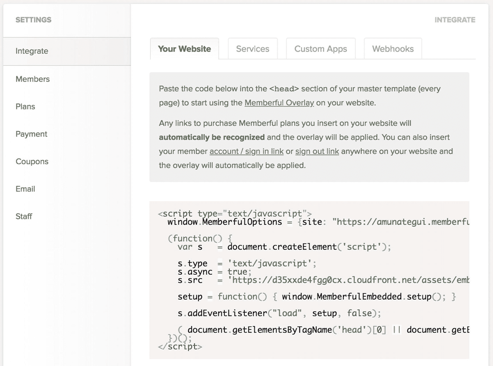

图 16-8

访问“**MemberfulOptions**”JavaScript 代码片段

当用户访问 Web 应用程序并点击“**登录**”时，他们会看到那个专业且集成的弹窗，这是我们期望在严肃网站上看到的（事实上，我们没有管理或存储任何用户数据或财务数据，这是我们自己的小秘密；图 16-9）。

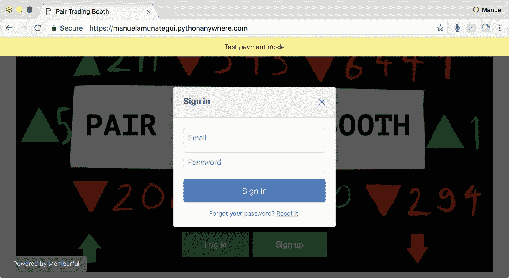

图 16-9

像专业人士一样登录！

## 在 Memberful.com 上设计订阅计划

为了创建会员资格，访客需要访问网站并点击“**注册**”。当他们这样做时，会看到一个订阅窗口。这可以通过多种方式进行自定义，包括不同的价格、层级和订阅时长。我们将使用演示账户提供的默认设置（图 16-10）。

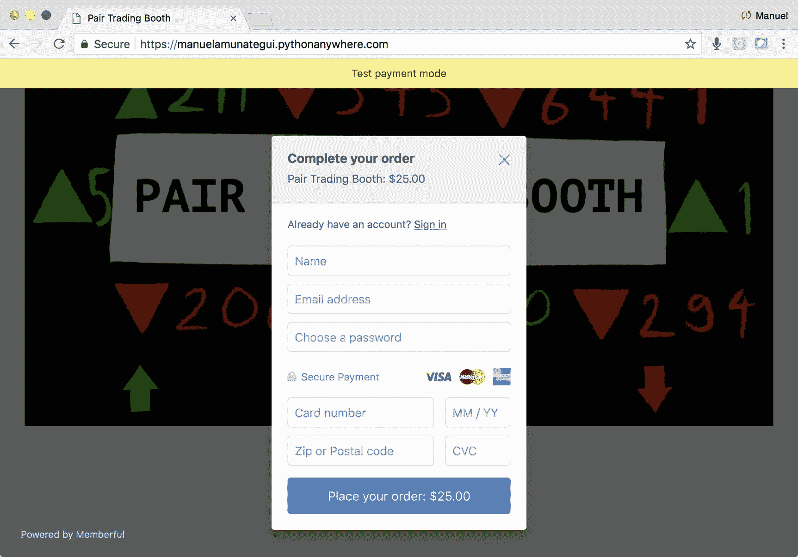

图 16-10

新访客正在为 Pair Trading Booth 网站创建会员资格，是的！！！

可以在 Memberful 仪表盘上轻松创建订阅计划。登录你的账户，导航到 **计划** ➤ **示例计划** ➤ **计划**设置，复制生成的 URL 计划购买链接，并将其粘贴到你的注册按钮中（图 16-11）。

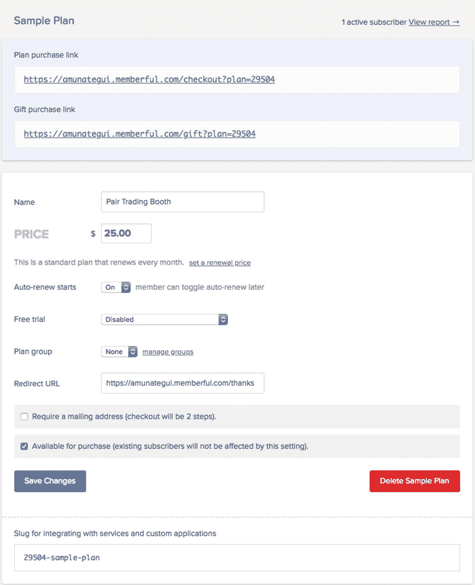

图 16-11

创建一个示例计划；我们这里使用默认设置

如果你复制“**计划购买链接**”并将其粘贴到浏览器中，你将看到它提供的内容（当然，我们通常不会通过这种方式访问它，因为我们希望它作为弹窗出现在我们自己的 Web 应用程序内部）。它是实时可用的，你可以使用提供的虚假信用卡号之一创建一个测试账户（图 16-12）。

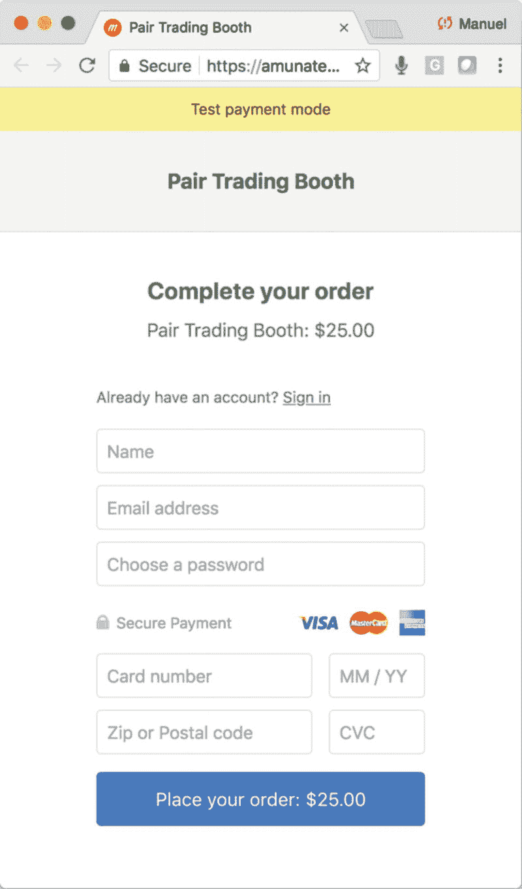

图 16-12

别忘了使用测试信用卡号！

使用以下任意虚假信用卡号（来自官方文档 [`https://memberful.com/help/general/using-test-credit-cards/`](https://memberful.com/help/general/using-test-credit-cards/)）。

*   **Visa**：4242 4242 4242 4242

*   **Mastercard**：5555 5555 5555 4444

*   **American Express**：3782 822463 10005

## 将 Web 应用程序上传到 PythonAnywhere

由于本章没有本地 Flask 版本可运行，让我们直接将其部署到 PythonAnywhere。如果你一直跟着之前的“**Pair Trading Booth**”案例研究操作，你只需要更新以下文件：

*   **main.py**

*   **index.html**

*   **charts.html**

*   **fundamentals.html**

并且你需要添加一个新的着陆页，该页面会向所有非会员和未登录用户隐藏所有交易信息：

*   **welcome.html**

登录你的 PythonAnywhere 账户，并用本章下载内容中的新版本替换这五个文件。

### 将 Memberful 和 MySQL 替换为你自己的凭据

在运行 Web 应用程序之前，你需要在“**main.py**”中替换一些内容。需要设置三个 Memberful 常量和一个 PythonAnywhere 常量（清单 16-13）。

```
MEMBERFUL_KEY='>'
MEMBERFUL_SECRET='>'
MEMBERFUL_SITE='>'
PYTHONANYWHERE_SITE = '>'
清单 16-13
在 PythonAnywhere 上，将“main.py”中的以下常量替换为你的凭据
```

一切就绪后，点击那个大大的绿色按钮刷新 Web 应用程序，然后进行测试。你需要使用虚假信用卡号完成一次注册流程；之后你就可以使用这些凭据登录了（图 16-13）。

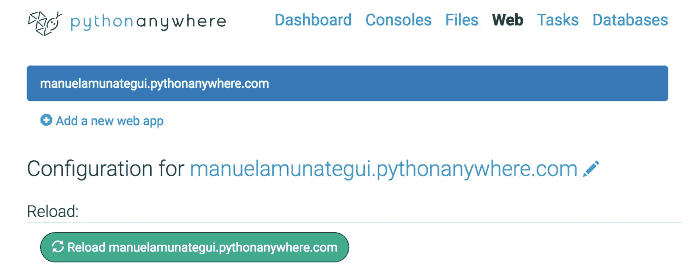

图 16-13

在启用付费墙之前的最后一步

## 这是怎么回事？

让我们从高层次看看付费墙中一些有趣的元素。

### main.py

这是 Web 应用程序的大脑；因此它将承担 Memberful 集成的大部分工作。我们需要添加一个处理器来处理着陆页“**welcome.html**”，用户在登录前会访问该页面。一旦他们登录，就会被引导到“**/member/**”路径，在那里他们可以通过以下三个身份验证路径进行引导：

**会员请求退出登录了吗？**

检查“**request.args.get(‘action’)**”变量，查找“**logout**”值。如果是这种情况，通过清除该会员的会话变量来使其退出登录。

**会员是否已登录？**

检查会话变量，看其中是否有用户名；如果有，则无需再次验证。让他们继续在付费墙后浏览。

**这位访客刚刚到达并正在尝试登录吗？**

获取“**request.args.get(‘code’)**”并将其传递给“**IsSubscriberLoggedIn()**”函数，以确保他们拥有有效的订阅。如果有效，将他们的用户名添加到会话对象中，他们就可以在付费墙后浏览了。

“**main.py**”中的其余代码与之前的案例研究相同。它包含用于在我们列出的十只道琼斯 30 指数股票中寻找最极端股票的代码、用于创建动态价格图表的代码，以及获取相关公司辅助信息的功能。

### welcome.html

“**welcome.html**”页面是新的着陆页（图 16-14）。

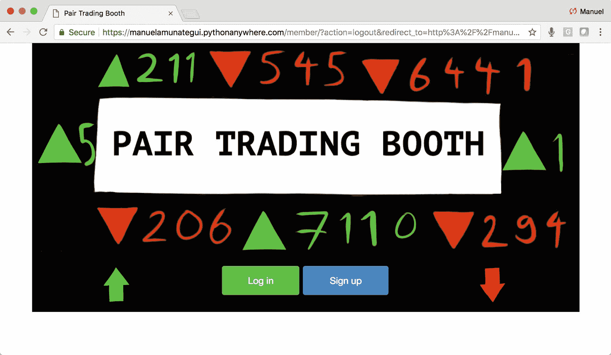

图 16-14

新的着陆页

这是一个简单的 HTML 页面，遵循“**Pair Trading Booth**”网站的外观和风格。它提供两个按钮：一个用于登录，另一个用于注册。

### index.html

“**index.html**”页面新增了两个按钮：一个用于退出登录，另一个用于管理用户的账户（图 16-15）。

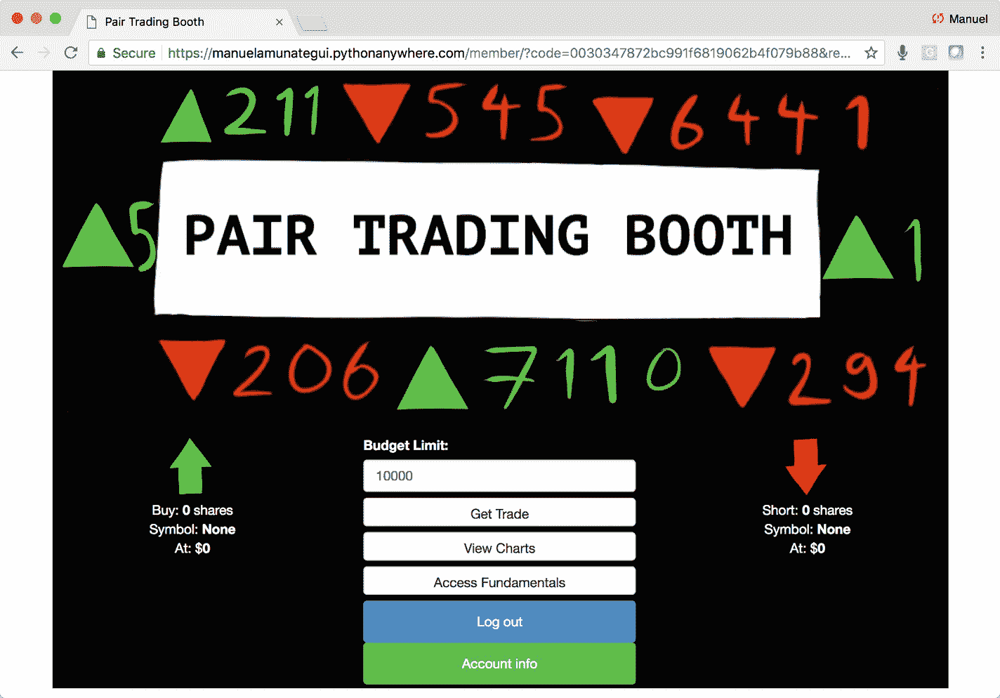

图 16-15

两个新按钮：一个用于退出登录，一个用于访问账户信息


## 结论

以上就是全部内容：你所需的所有工具，用于创建自己的付费墙，将你的机器学习创意变现。能够以如此集成的方式管理订阅者和信用卡支付，简直太棒了。这在几年前是难以实现的。现在，你可以完全专注于你的机器学习创意，而将会员管理事务交给专业人士处理。

