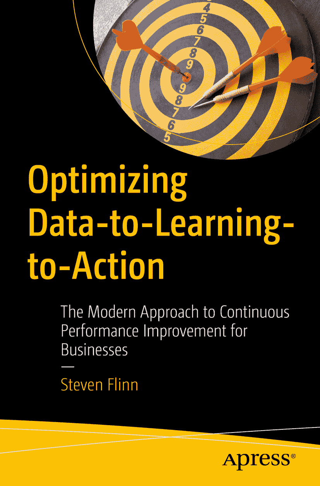

史蒂文·弗林《优化数据到学习到行动：企业持续绩效提升的现代方法》

作者在本书中引用的任何源代码或其他补充材料，读者均可通过本书在 GitHub 上的产品页面获取，网址为 [`www.apress.com/9781484235300`](http://www.apress.com/9781484235300)。如需更详细信息，请访问 [`http://www.apress.com/source-code`](http://www.apress.com/source-code)。ISBN 978-1-4842-3530-0 电子书 ISBN 978-1-4842-3531-7 [`doi.org/10.1007/978-1-4842-3531-7`](https://doi.org/10.1007/978-1-4842-3531-7) 美国国会图书馆控制号：2018939149 © 史蒂文·弗林 2018 本作品受版权保护。出版商保留所有权利，无论是全部还是部分材料，具体包括翻译、重印、重用插图、朗诵、广播、微缩胶片复制或任何其他物理方式，以及电子改编、计算机软件或现在已知或以后开发的类似或不同方法的传输或信息存储与检索。本书中可能出现商标名称、标识和图像。我们不以每次出现商标名称、标识或图像时都使用商标符号，而是仅以编辑方式使用这些名称、标识和图像，以利于商标所有者，无意侵犯商标。本出版物中对商品名称、商标、服务标志及类似术语的使用，即使未明确标识，也不应被视为对其是否受专有权利保护的意见表达。尽管本书中的建议和信息在出版时被认为是真实准确的，但作者、编辑和出版商均不对可能存在的任何错误或遗漏承担法律责任。出版商对本书所含内容不作任何明示或暗示的保证。本书采用无酸纸印刷。全球图书贸易由 Springer Science+Business Media New York 发行，地址：233 Spring Street, 6th Floor, New York, NY 10013。电话：1-800-SPRINGER，传真：(201) 348-4505，电子邮件：orders-ny@springer-sbm.com，或访问 www.springeronline.com。Apress Media, LLC 是一家加利福尼亚有限责任公司，其唯一成员（所有者）是 Springer Science + Business Media Finance Inc (SSBM Finance Inc)。SSBM Finance Inc 是一家特拉华州公司。谨以此书献给我的母亲和父亲 引言

我们生活在一个有趣的时代。一方面，基于技术的进步正以令人眼花缭乱的速度发生。但另一方面，对宏观数据的仔细审视表明，与历史结果相比，美国企业的绩效仍在持续下滑。而我们当前改善企业绩效的方法似乎仍停留在上个世纪。如果剥离掉技术相关的引用，人们很难将当今管理出版物中普遍推荐的方法与一二十年前的方法区分开来。确实，至少自 20 世纪 90 年代以来，在这方面似乎没有太多新意。

本书旨在挑战这种企业绩效的“沉睡”状态，提出一种与当今动态环境相关、且有望足够稳健以持续保持相关性的绩效提升新方法。这种新方法的设计目标如下：

*   为当今组织提供一种清晰有效的持续绩效提升方法
*   展示如何系统地最大化人员、流程和技术投资的价值，并持续做到这一点
*   广泛适用于不同的业务领域和业务职能

## 那么，它是什么？

这种新方法首先认识到，在当今世界，提升企业绩效的关键在于改进决策。事实一直如此，但这一现实常常被层出不穷的流行管理思潮所回避或仅作旁敲侧击式的处理。数据也充分支持这一直觉：改进决策就能改善财务绩效。例如，贝恩公司发现，“决策有效性与财务结果之间的相关性，在每个国家、行业和公司规模中，置信水平均达到 95% 或更高。”¹

并非所有决策都同等重要——真正起作用的，是那些与组织最重要的价值驱动因素相一致的决策，而这些驱动因素可能并不总是显而易见的。例如，对于制造工厂而言，对其长期价值影响更大的，往往并非其在任何特定时刻的运营方式，而是关于是否应该建造、如何配置、选址何处、应开发何种物流来支持它等决策，这些决策将决定其持久的绩效遗产。这一点始终成立，尽管常常未被明确认识到。

决策分析领域是一门在过去半个多世纪中发展起来的、旨在改进决策的规范性学科，它通常可用于帮助处理重大的、一次性的决策，例如进行收购或是否建厂及选址。然而，将完整的决策分析应用于组织日常运作核心的无数重复性决策，则显得有些笨拙。本书提出的方法独特地改编了决策分析的关键方面，并将其与管理科学其他领域的技术相结合，使其能够有益地应用于组织中做出的所有类型决策，以及组织的各个层级。

通过将决策置于核心位置，我们可以更轻松地摒弃那些随着最新技术和管理思潮的病毒式传播而带来的思维模糊性。例如，以数据科学这个迅速爆红的领域为例。对于任何一组“大数据”或相关的数据分析，需要考虑的问题是：“哪些决策有可能得到改进，这种改进的财务收益是多少？”那些被大肆吹捧的基于机器学习的新能力呢？同样的问题。一个旨在更好促进协作的新系统呢？同样的问题。一个新的营销流程呢？同样的问题。你明白了吧。这看起来如此简单，然而这些问题却常常无人问津，即使被问及，也未能以任何严谨的方式得到解答。

这种新方法强调的第二个基础要素是学习，取其最丰富的含义和应用。学习从属于决策——至少在商业意义上（或许与我们的日常生活相反）——学习只有在有可能改变原本会发生的决策时才有价值，而该决策又会改变原本会发生的行动。其推论是，数据及其经过更多过滤和组织后的衍生物——信息和知识——只有在能够增强学习时才有价值。这是一个重要的概念：数据（或信息、知识）本身没有内在价值，除非它作为增强学习的基础或具有这种潜力。经典的决策分析有一个“信息价值”的概念——我们将在本书中讨论并应用这一概念——但这个标签多少有些用词不当。这个概念真正蕴含的是学习的价值，而数据、信息和知识只有在源自这种学习价值时才有价值。

当然，说到学习，当今世界出现了一个全新的学习维度，即便在几年前，这个维度也从未被认真考虑过：那就是**机器**的学习。过去，我们认为学习仅仅是人类的行为，组织学习领域的焦点也理所当然地集中在人类学习上，这一点不难理解。但展望未来，在几乎任何组织流程或活动中，我们都需要越来越多地同时考虑人类学习和基于机器的学习。本书中提出的更强大的学习方法，将无缝地同时适用于机器和人。

## 它不是什么？

优化“数据-学习-行动”的流程，并不会让其他有价值的商业卓越与改进学科变得过时；相反，它通常是对这些学科的补充，并放大其价值。例如，它不会取代商业战略，但可以为战略提供信息，并帮助你从战略中获得最大收益。它不会取代诸如质量改进之类的经典举措，但可以为在何时何地投资这些举措提供指导。它不会阻碍创新，反而可以帮助提高基于创新的流程的效率和效果。虽然在优化“数据-学习-行动”的过程中，必然要高度重视技术应用和量化，但最终起决定作用的，仍然是按重要性排序的经典三要素：人、流程和技术。本书所呈现的方法能够做到的，是帮助你在组织中，以富有洞察力的严谨态度，确定在何处、何时以及如何强调这些通用的商业资产和学科。

## 为什么是现在？

首先，因为企业绩效需要提升，而过去几十年的经典答案对许多组织来说已经动力不足。质量改进？当然需要，但这已经被广泛应用了（如果还没有，那应该马上应用！）。流程再造？很好，但到目前为止，它在大多数组织中基本上已经完成了其使命，并且通常只关注组织中那些更具交易性质的有限部分。领导力、教练辅导、组织设计、变革管理等？当然，这些学科将始终是重要的关注点，但它们不足以实现并维持最卓越的绩效。这需要新的、更优越的方法和实践，而这正是本书旨在提供的。

其次，经济正在迅速转型，大多数工作流程正变得知识密集、学习密集和决策密集，而那些非知识、非学习、非决策密集型的业务领域则正在迅速实现自动化和常规化。这意味着，真正重要的方法和实践必须越来越聚焦于组织的知识、学习和决策密集领域，而这正是本书所倡导的方法所做的。

第三，因为技术进步的速度，特别是信息技术（包括应用于企业的信息技术）的进步速度正在加快，企业需要一种方法来充分利用这些进步，并且要高效地做到这一点。广义的人工智能，特别是机器学习，很可能是这些加速发展的技术中最重要的，但同时，我们在物联网、新型协作方式、商业智能以及企业 IT 整体向云端迁移等领域也在持续取得进展。后者是所有其他技术的加速器，因为云能够几乎立即交付能力和功能上的进步。这些技术在未来十年及以后将对商业产生多大的影响，怎么说都不为过。但我们也从以往的技术转折点中清楚地知道，在此过程中会有大量的潜在资金陷阱和死胡同，因此，关于何时投资这些技术、如何证明投资的合理性、以及如何在组织中部署这些技术，要做出最优决策有多么困难，同样怎么说都不为过。而这正是回答这些与技术相关的问题成为本书核心焦点的原因。

## 为什么它对我很重要？

如果你是一位企业领导者，这个方法对你很重要，因为你有责任确保你的组织尽一切可能优化其绩效，并持续保持这种卓越绩效。你同样有责任确保投资决策有严格的依据支持——这是你的受托责任！

如果你是一位 IT 高管，它对你很重要，因为你需要一种方法，能够为你持续做出的与技术相关的投资和部署决策增加额外的结构性，并且你需要一种可靠的方式来向你的领导层和业务同事证明你的建议是合理的。

如果你是一位技术实践者或知识工作者，你应该关心它，因为它能为你日常工作中自然产生的无数假设和决策提供一个可以信赖的指导框架，从而让你的工作轻松得多。

如果你是一位技术提供商或相关服务提供商，它对你很重要，因为本书介绍的方法可以为你提供一种手段，来展示你的产品和服务可以在客户的“数据-学习-行动”流程中的何处以及如何交付价值，并支持对其所交付价值进行可信的量化评估。

如果你是一位管理顾问，你应该关心它，因为本书中描述的方法和途径具有广泛的适用性，因此为你提供了一个建立全新重要业务实践的机会！

而如果你是一位数据科学家和/或机器学习专家（你真幸运！），你应该关心它，因为本书中的方法将使你能够将自己的努力置于整体业务决策和学习的背景之下，让你工作的战略重要性更加清晰。

## 方法概述

该方法的核心由四大主题引导并整合而成：

*   优化决策，尤其是高杠杆率的重复性决策
*   将决策所嵌入的“数据-学习-行动”流程明确视为一个过程
*   将学习的概念建立在坚实而严谨的基础之上
*   在“数据-学习-行动”流程中识别并解决价值约束

决策是提升业务绩效的核心——改进决策就能提升绩效。而且并非所有决策，而是那些与组织重要价值驱动因素最契合的决策。正如我之前提到的，这一点始终成立，但坦率地说，随着技术进步和更多日常任务被自动化，在复杂情境中做出决策实际上已成为人们在商业大多数领域中的主要活动！此外，尽管已有成熟领域专门处理大型、一次性决策，但将其应用于较小和/或重复性决策却显得笨拙（不幸的是，在实践中，它似乎也很少被完全应用于大型、一次性决策）。在本书的篇章中，我们将展示如何调整决策科学的关键要素，使其能够有效应用于构成我们在商业世界中大部分工作的所有其他类型的决策。这样做带来的结果是思维的严谨性和清晰度，而这在商业决策中常常是缺失的。

决策也是构成“数据-学习-行动”信息流的核心，因为学习及其输入的数据、信息和知识，其价值仅在于它们能够影响决策。（我们将在后续章节详细讨论数据、信息和知识之间的关系。）但除了仅仅代表一种自然的信息流之外，我们还可以将“数据-学习-行动”视为一个明确的过程。事实上，这是一个**普适的过程**。在这个“数据-学习-行动”流程中，决策紧随学习步骤之后，并紧接在行动步骤之前。这一流程顺序适用于商业应用，也适用于我们的个人生活，甚至适用于其他生物体。它同样适用于基于机器的学习。在此向科尔·波特致歉：鸟儿这样做，我们这样做，甚至受过教育的机器也这样做！这确实是一个普适的过程——一个统御万物的过程。这是因为它是基本的学习过程，而学习对于我们的商业生活以及一般的智能体而言都是核心。我们/它进行学习，学习为决策提供信息，决策进而驱动行动。而学习基于经验（即数据）。“数据-学习-行动”通常是一个递归适应的过程，因为该过程产生的行动可以创造新的数据，这些数据又成为学习的输入，学习进而为决策提供信息，决策又驱动新的行动，如此循环往复。

因此，“数据-学习-行动”是一个过程——一个普适的过程——当然，过程有其流程。我们的流程始于输入或数据，这些数据可能以各种方式转化（为信息和/或知识），然后被学习过程所消耗（是的，过程自然可以包含子过程！）。学习随后被决策过程应用，从而产生行动（这里的行动定义足够宽泛，以至于推迟采取行动也可以被视为一种行动）。

这一切都很好，但我们所说的**学习**究竟是什么意思？啊，这正是此处要解决的核心问题，因为现实情况是，在传统的管理方法中，学习的确切含义总是被含糊带过，要么是默认学习是一个直观易懂的概念，无需进一步解释，要么更可能的是，由于人们无奈地认为学习这个概念过于模糊，难以进行更严格的定义。这不符合我们的目的。我们需要足够精确地定义“学习”这一现象，使其能够被**量化**，否则我们就无法衡量和优化该现象的商业价值。同时，该定义必须**完全适用于人类心智和机器**，否则面对未来几年机器学习不可避免的进步及其无处不在的应用，我们的方法就不具备足够的可扩展性。幸运的是，我们将看到，学习的本质是**减少不确定性**，从而实现更准确的预测，而这一关于学习本质的洞察恰好一箭双雕：它既能够量化学习的价值，又完全适用于人类学习和人工学习。

由于过程有其自然的流程，就像任何其他类型的流程一样，可能存在**约束**或瓶颈，限制过程输出的流量。我们“数据-学习-行动”流程的流量由可操作的、因而有价值的学习构成。在河流中，约束可能是一个狭窄的峡谷。对于电流，它可能是一段高电阻区域。对于“数据-学习-行动”流程，它可能是流程链中任何数量的可操作学习的约束或瓶颈造成的结果。但无论它们是什么，我们都会发现它们总是与一个或多个人、流程或技术因素相关。我们的“数据-学习-行动”流程与河流的不同之处在于，快速识别主要瓶颈往往很棘手。我们的流程要复杂得多，第一印象很容易出错！

但我们可以运用自己的“技巧”或替代视角，从而穿透复杂性，揭示流程中的约束。（流程的基本法则是：总有一个约束存在！）从某种意义上说，我们**逆向**流程来寻找约束。我们从决策回溯到学习，再回溯到数据，并贯穿其间所有中间步骤。我们以一种精确的方式，结合基于决策分析的方法来做到这一点，这使我们能够识别出流程链中导致学习约束的一个或多个位置，更具体地说，是导致与我们最关心的决策真正相关的学习受到约束的位置。在许多情况下，我们可以相当严格地量化消除约束的价值。这种沿着“数据-学习-行动”流程逆向工作的视角是本书的核心概念。本书的替代书名完全可以叫做《决策-学习-数据》！

显而易见，识别“数据-学习-行动”流程中的约束必然是一个持续的过程。由于流程的一个基本属性是总有一个瓶颈存在，因此在成功解决初始瓶颈后，很可能又会出现一个新的瓶颈需要考虑。但通过采取这种逐步推进的方法，我们避免了组织极易陷入的浪费性过度建设和时机不当问题，尤其是在信息技术方面。

## 本书的脉络

本书的脉络与这篇引言一脉相承。我们将首先阐述采取行动的理由，然后深入探讨构成这一新方法根基的学科，例如决策科学、约束理论和流程视角。接着，我们将详细审视从数据到学习再到行动的链条，并逐一考察其中的每个要素。在考察过程中，我们会思考每个要素的实例，以及影响或将要影响每个要素的外部因素，特别是与技术相关的因素。我们还将看到，为什么这个“链条”往往实际上是一个闭环。接下来，我们将讨论如何沿着链条逆向工作，以识别价值瓶颈。我们将引入学习价值的概念，并概述如何严谨且可信地量化这一价值，这使我们能够量化解决瓶颈方案的价值。量化学习价值还能实现对总价值的量化，而总价值是确定组织投资优先级的恰当衡量标准。随后，我们将花大量篇幅讨论与每个数据-学习-行动要素相关的常见瓶颈类型，以及如何通过人员-流程-技术方面的实例来解决这些瓶颈。最后，我们将花一些时间探讨如何组织并执行能够为您的组织增值的数据-学习-行动优化工作。

至此，我送您踏上阅读、学习，并希望是一场行动冒险的旅程！

致谢

本书综合了我近年来开发并付诸实践的概念，而这些概念又基于此前多年积累的经验和学识。例如，我感谢在宾汉姆顿大学攻读本科期间，在数学和经济学方面打下了坚实的基础。我很幸运，在斯坦福大学工程经济系统系攻读研究生期间，受益于罗纳德·霍华德博士在决策分析领域的开创性工作。我也很幸运能进入西北大学凯洛格管理学院深造，并受益于对战略和金融的深入研究。在荷兰皇家壳牌公司，我有机会体验在全球企业层面领导信息技术的激动人心与挑战。最后，在我目前任职的 ManyWorlds 公司，我得以率先为企业开发机器学习应用，并为众多领先企业就战略、决策科学和信息技术交叉领域的各种主题提供咨询并从中学习。似乎正是这种独特的机遇与经验的融合，才使得本书概述的方法得以完全成形。否则，我十分怀疑这一切能否发生。

在本书的出版过程中，我要感谢 Apress 出版社出色的编辑们，特别是苏珊·麦克德莫特和丽塔·费尔南多，感谢她们相信这部作品并确保一切顺利进行。感谢娜奥米·莫尼彭尼与我在 ManyWorlds 共同开创了本书详述的许多概念，并为手稿提供了早期指导。特别感谢塞巴斯蒂安·卡隆，他同意担任本书的技术审校（尽管他并不完全清楚自己将面对什么！），帮助我发现了自己的一些盲点，使本书比原本更加完善。当然，本书的任何不足之处仍由我本人全权负责。最后，感谢我的家人对写作所需投入（这总是比预期的要多！）的理解。

目录
第 1 章：行动的理由 1
第 2 章：新方法的根源 17
第 3 章：从数据到学习再到行动 29
第 4 章：技术内容及其定位 49
第 5 章：逆向流程：从决策到数据 61
第 6 章：量化价值 79
第 7 章：总价值 107
第 8 章：优化学习吞吐量 121
第 9 章：学习约束的模式与解决方案 135
第 10 章：为数据-学习-行动的成功而组织 161
第 11 章：结论 177
索引 187
关于作者与关于技术审校
关于作者
关于技术审校
脚注 1

Blenko, Marcia, Michael Mankins, and Paul Rogers, “The Decision-Driven Organization” *Harvard Business Review*, June 2010. [`https://hbr.org/2010/06/the-decision-driven-organization`](https://hbr.org/2010/06/the-decision-driven-organization)

